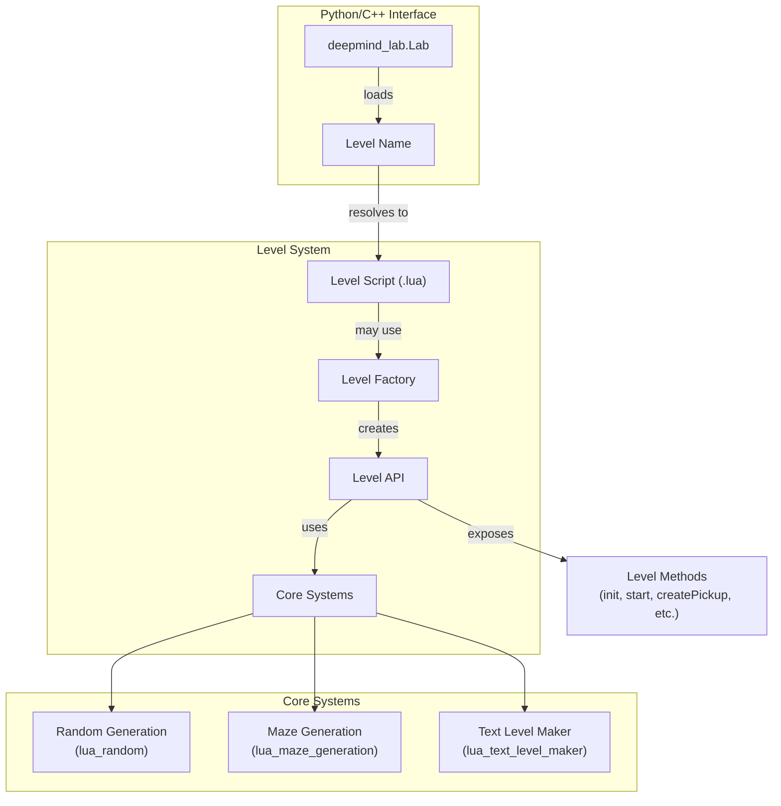
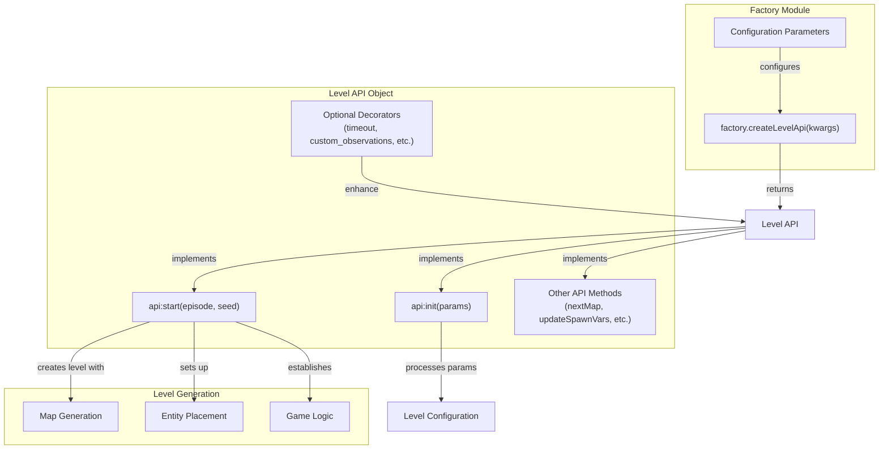
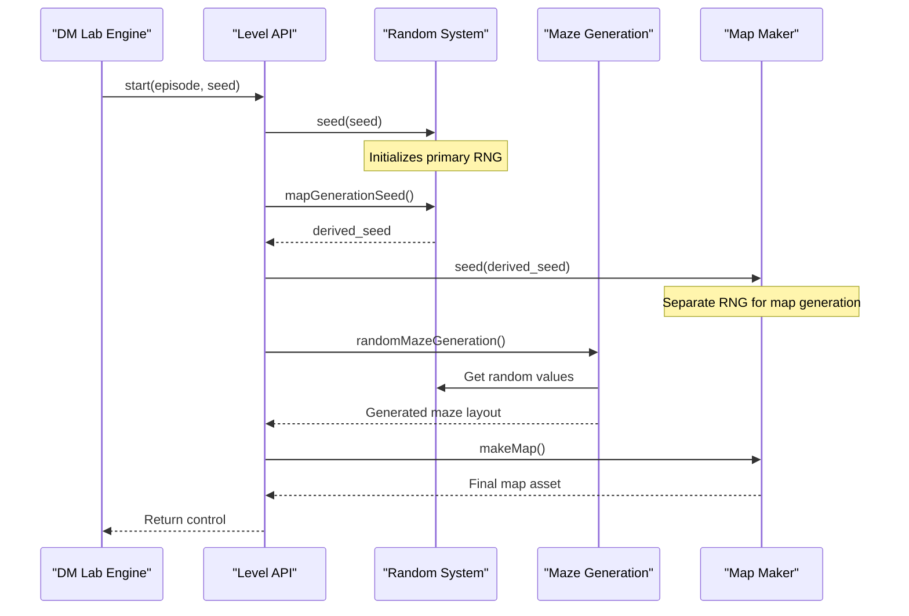
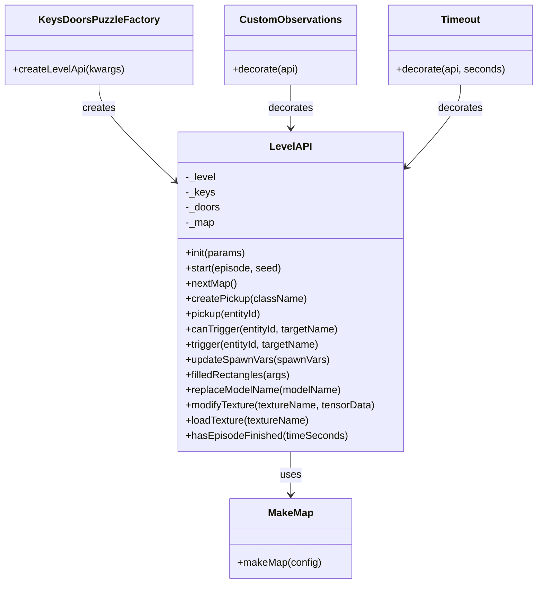
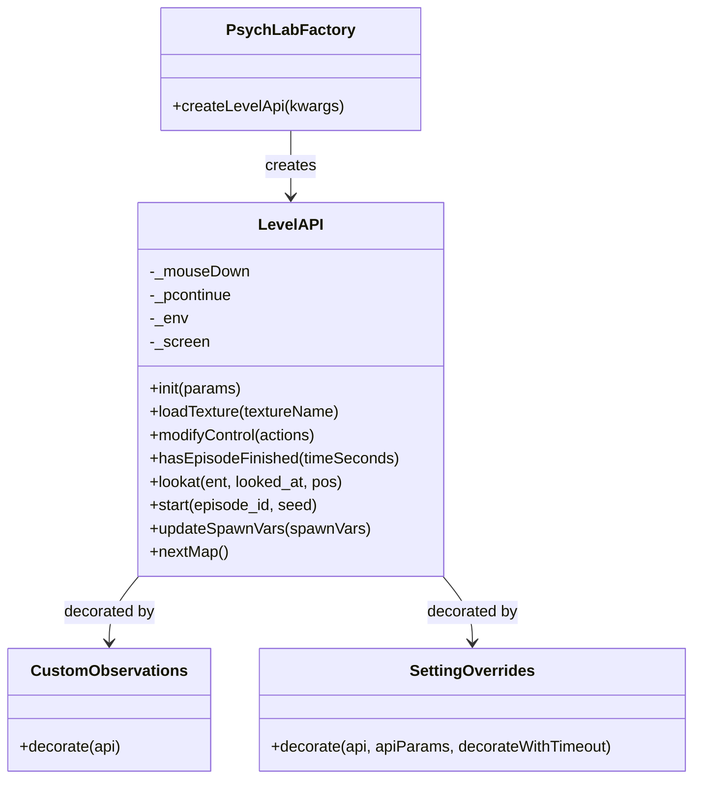

<!-- source: DeepWiki mcp.deepwiki.com · repo google-deepmind/lab · page 6.3 Level Factories · fetched 2026-10-26 -->

# Level Factories

<details>
<summary>Relevant source files</summary>

The following files were used as context for generating this wiki page:

- [deepmind/engine/lua_maze_generation.cc](deepmind/engine/lua_maze_generation.cc)
- [deepmind/engine/lua_maze_generation.h](deepmind/engine/lua_maze_generation.h)
- [deepmind/engine/lua_maze_generation_test.cc](deepmind/engine/lua_maze_generation_test.cc)
- [deepmind/engine/lua_random.cc](deepmind/engine/lua_random.cc)
- [deepmind/engine/lua_random.h](deepmind/engine/lua_random.h)
- [deepmind/engine/lua_random_test.cc](deepmind/engine/lua_random_test.cc)
- [deepmind/engine/lua_text_level_maker.cc](deepmind/engine/lua_text_level_maker.cc)
- [deepmind/engine/lua_text_level_maker.h](deepmind/engine/lua_text_level_maker.h)
- [docs/levels.md](docs/levels.md)
- [docs/users.md](docs/users.md)
- [game_scripts/decorators/test_only.lua](game_scripts/decorators/test_only.lua)
- [game_scripts/factories/psychlab/factory.lua](game_scripts/factories/psychlab/factory.lua)
- [game_scripts/factories/rooms/keys_doors_puzzle_factory.lua](game_scripts/factories/rooms/keys_doors_puzzle_factory.lua)
- [game_scripts/levels/tests/seed_test.lua](game_scripts/levels/tests/seed_test.lua)
- [testing/load_level_test.cc](testing/load_level_test.cc)
- [testing/seed_level_test.cc](testing/seed_level_test.cc)

</details>


## Purpose and Scope

Level Factories in DeepMind Lab provide a structured approach for procedurally generating and customizing game environments. They serve as reusable components that encapsulate the logic for creating specific types of levels with configurable parameters. This document explains how level factories work, how to create them, and how to use them effectively. For information about maze generation specifics, see [Maze Generation](#6.1). For details on the text level format used to describe levels, see [Text Level Format](#6.2).

## Architecture and Integration

Level factories are Lua modules that implement a standard interface to generate game environments dynamically. They integrate with DeepMind Lab's core systems through a well-defined API structure.

### Level Factory in System Context



Sources: [game_scripts/factories/rooms/keys_doors_puzzle_factory.lua:85-139](), [deepmind/engine/lua_random.h:40-105](), [deepmind/engine/lua_maze_generation.h:32-202](), [deepmind/engine/lua_text_level_maker.h:37-93]()

### Level Factory Components and Flow



Sources: [game_scripts/factories/rooms/keys_doors_puzzle_factory.lua:85-139](), [game_scripts/factories/psychlab/factory.lua:33-138]()

## Creating Level Factories

A level factory is a Lua module that exports a `createLevelApi` function, which returns an API object implementing the necessary methods for the DeepMind Lab engine to interact with.

### Required Structure

```lua
local factory = {}

function factory.createLevelApi(kwargs)
  local api = {}
  
  function api:init(params)
    -- Process initialization parameters
  end
  
  function api:start(episode, seed)
    -- Initialize the level with the given seed
  end
  
  function api:nextMap()
    -- Return the map to be loaded
  end
  
  -- Implement other required methods...
  
  return api
end

return factory
```

### Core API Methods

| Method | Purpose | Typical Implementation |
|--------|---------|------------------------|
| `init(params)` | Initialize level parameters | Parse and validate configuration parameters |
| `start(episode, seed)` | Start a new episode | Initialize random generator with seed, create level layout |
| `nextMap()` | Provide map to load | Return the generated map's file path |
| `updateSpawnVars(spawnVars)` | Modify entity spawn settings | Customize entities based on level design |
| `createPickup(className)` | Define pickup characteristics | Configure items that can be collected |
| `hasEpisodeFinished(timeSeconds)` | Determine episode end | Check end conditions |

Sources: [game_scripts/factories/rooms/keys_doors_puzzle_factory.lua:97-284]()

## Level Generation and Randomization

Level factories typically generate dynamic content using randomization controlled by seeds to ensure reproducibility.

### Seed Flow in Level Factories



Sources: [game_scripts/factories/rooms/keys_doors_puzzle_factory.lua:115-158](), [deepmind/engine/lua_random.cc:86-99]()

### Randomization Components

Level factories use several randomization mechanisms:

1. **Primary Random Generator** - Initialized with the episode seed
   ```lua
   random:seed(seed)
   ```

2. **Map Generation Seed** - A derived seed for map layout consistency
   ```lua
   randomMap:seed(random:mapGenerationSeed())
   ```

3. **Mixer Sequence** - To ensure disjoint seed subspaces
   ```cpp
   mixer_seq_ = static_cast<std::uint64_t>(mixer_seed) << 32;
   ```

Sources: [deepmind/engine/lua_maze_generation.cc:39-61](), [deepmind/engine/lua_maze_generation.cc:568-573](), [deepmind/engine/lua_random.cc:92-95]()

## Using Level Factories

### Basic Usage Pattern

Level factories are typically used in level scripts to create customized environments:

```lua
local factory = require 'factories.rooms.keys_doors_puzzle_factory'

return factory.createLevelApi{
  episodeLengthSeconds = 120,
  levelGenerator = function(args, seed)
    -- Custom level generation logic
    return {
      map = my_map_layout,
      keys = my_keys_definition,
      doors = my_doors_definition
    }
  end
}
```

### Integration with Testing

The seed management in level factories allows for deterministic testing:

```lua
api:start(0, seed)
local random_value_1 = random:uniformReal(0, 1)

-- Reset with same seed should produce identical values
api:start(0, seed)
assert(random_value_1 == random:uniformReal(0, 1))
```

Sources: [game_scripts/levels/tests/seed_test.lua:25-41](), [testing/seed_level_test.cc:16-44]()

## Example: Keys and Doors Puzzle Factory

The Keys and Doors Puzzle Factory demonstrates a complete implementation of a level factory:



This factory:
1. Defines keys and doors with different colors
2. Places them in a generated map
3. Requires the agent to collect keys and open corresponding doors
4. Rewards the agent for successfully reaching a goal

Sources: [game_scripts/factories/rooms/keys_doors_puzzle_factory.lua:16-292]()

## Example: PsychLab Factory

The PsychLab factory demonstrates a different approach, creating a 2D screen interface within the 3D environment:



This factory:
1. Creates a virtual screen within the environment
2. Tracks the agent's gaze position on the screen
3. Handles click interactions
4. Facilitates cognitive experiments in a 3D environment

Sources: [game_scripts/factories/psychlab/factory.lua:16-140]()

## Best Practices for Level Factories

1. **Consistent Seed Management**: Always initialize random generators in the `start` method with the provided seed.

2. **Separation of Concerns**: Keep level generation logic separate from gameplay logic.

3. **Parameter Validation**: Validate all input parameters during initialization.

4. **Use Decorators**: Apply decorators like `custom_observations` and `timeout` to extend functionality.

5. **Documentation**: Document all configuration parameters and their effects.

6. **Testing**: Use the deterministic nature of seed-based generation for thorough testing.

Sources: [game_scripts/factories/rooms/keys_doors_puzzle_factory.lua:85-139](), [game_scripts/factories/psychlab/factory.lua:131-138]()

## Level Factory Decorators

DeepMind Lab provides several decorators that can be applied to level APIs to extend their functionality:

| Decorator | Purpose |
|-----------|---------|
| `custom_observations` | Adds custom observation capabilities |
| `timeout` | Adds time-based episode termination |
| `setting_overrides` | Manages API parameter overriding |
| `test_only` | Restricts level usage to evaluation contexts |

Sources: [game_scripts/factories/rooms/keys_doors_puzzle_factory.lua:287-288](), [game_scripts/factories/psychlab/factory.lua:131-136](), [game_scripts/decorators/test_only.lua:20-42]()

## Conclusion

Level Factories provide a powerful and flexible system for creating procedurally generated environments in DeepMind Lab. By encapsulating level generation logic in reusable factories, researchers can create diverse training and evaluation environments while maintaining control over randomization and ensuring reproducibility. The factory pattern allows for separation of concerns, making it easier to develop, test, and extend environment capabilities.

---

