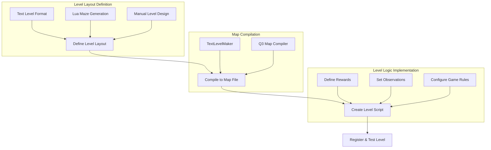
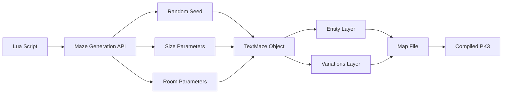
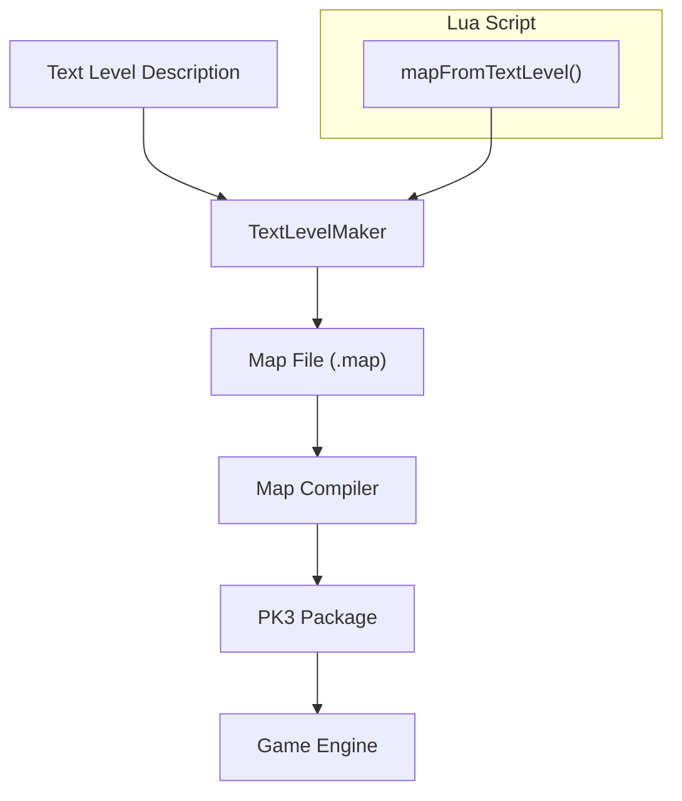
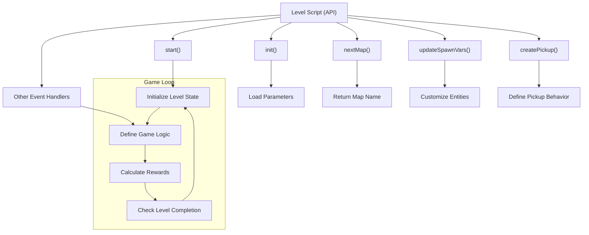

<!-- source: DeepWiki mcp.deepwiki.com · repo google-deepmind/lab · page 6.4 Custom Level Creation · fetched 2026-10-26 -->

# Custom Level Creation

<details>
<summary>Relevant source files</summary>

The following files were used as context for generating this wiki page:

- [deepmind/engine/lua_maze_generation.cc](deepmind/engine/lua_maze_generation.cc)
- [deepmind/engine/lua_maze_generation.h](deepmind/engine/lua_maze_generation.h)
- [deepmind/engine/lua_maze_generation_test.cc](deepmind/engine/lua_maze_generation_test.cc)
- [deepmind/engine/lua_random.cc](deepmind/engine/lua_random.cc)
- [deepmind/engine/lua_random.h](deepmind/engine/lua_random.h)
- [deepmind/engine/lua_random_test.cc](deepmind/engine/lua_random_test.cc)
- [deepmind/engine/lua_text_level_maker.cc](deepmind/engine/lua_text_level_maker.cc)
- [deepmind/engine/lua_text_level_maker.h](deepmind/engine/lua_text_level_maker.h)
- [docs/levels.md](docs/levels.md)
- [docs/users.md](docs/users.md)
- [game_scripts/decorators/test_only.lua](game_scripts/decorators/test_only.lua)
- [game_scripts/factories/psychlab/factory.lua](game_scripts/factories/psychlab/factory.lua)
- [game_scripts/factories/rooms/keys_doors_puzzle_factory.lua](game_scripts/factories/rooms/keys_doors_puzzle_factory.lua)
- [game_scripts/levels/tests/seed_test.lua](game_scripts/levels/tests/seed_test.lua)
- [testing/load_level_test.cc](testing/load_level_test.cc)
- [testing/seed_level_test.cc](testing/seed_level_test.cc)

</details>


This document provides a step-by-step guide for creating custom levels in DeepMind Lab. It covers how to define level layouts using text files, procedurally generate mazes, and compile them into playable levels. For information about maze generation algorithms, see [Maze Generation](#6.1), and for details on the text level format specification, see [Text Level Format](#6.2).

## Overview of Level Creation Process

Creating a custom level in DeepMind Lab typically involves these key steps:



Sources: [deepmind/engine/lua_text_level_maker.cc:332-415](), [deepmind/engine/lua_maze_generation.cc:117-318]()

## Text-Based Level Creation

The simplest approach to creating a level is to define it using the text level format, which consists of two main layers:

1. **Entity Layer**: Defines walls, empty spaces, and game objects
2. **Variations Layer**: (Optional) Defines texture variations for visual diversity

### Entity Layer Symbols

| Symbol | Meaning |
|--------|---------|
| `*` | Wall |
| ` ` (space) | Empty space |
| `P` | Player start position |
| `G` | Goal object |
| `H` | Horizontal door |
| `I` | Vertical door |
| `K` | Key |

Sources: [game_scripts/factories/rooms/keys_doors_puzzle_factory.lua:64-65](), [deepmind/engine/lua_maze_generation_test.cc:81-87](), [deepmind/engine/lua_maze_generation_test.cc:233-239]()

### Creating a Basic Level

Here's how to create a simple level with a player start position, some walls, and a goal:

1. Create a text file with your level layout:

```
*******
*P    *
*** ***
*     *
*  G  *
*******
```

2. Optionally add a variations layer for texture diversity:

```
.......
.A    .
... ...
.B    .
.  C  .
.......
```

In the variations layer, letters A-Z define different texture variations, and dots (`.`) represent default textures.

Sources: [deepmind/engine/lua_maze_generation_test.cc:115-136]()

## Procedural Level Generation

For more complex or randomized levels, you can use DeepMind Lab's procedural maze generation system:



Sources: [deepmind/engine/lua_maze_generation.cc:171-318](), [deepmind/engine/lua_random.cc:87-99]()

### Example of Procedural Generation

Here's a Lua script example for generating a random maze:

```lua
local maze_generation = require 'dmlab.system.maze_generation'
local random = require 'dmlab.system.sys_random'

-- Seed the random number generator for reproducibility
random:seed(42)

-- Create a random maze
local maze = maze_generation.randomMazeGeneration{
  random = random,
  width = 15,       -- Must be odd
  height = 13,      -- Must be odd
  maxRooms = 3,     -- Maximum number of rooms
  roomMinSize = 3,  -- Minimum room dimension (must be odd)
  roomMaxSize = 7,  -- Maximum room dimension (must be odd)
  extraConnectionProbability = 0.1,
  spawn = 'P',      -- Player spawn character
  object = 'G',     -- Goal object character
  roomSpawnCount = 1,
  roomObjectCount = 1,
  hasDoors = true,
}

-- Get the resulting layers
local entityLayer = maze:entityLayer()
local variationsLayer = maze:variationsLayer()

-- Use these layers to create a map
```

Sources: [deepmind/engine/lua_maze_generation_test.cc:262-276](), [deepmind/engine/lua_maze_generation_test.cc:353-367]()

## Compiling Levels

Once you have your level layout (either text-based or procedurally generated), you need to compile it into a format the game engine can use:



Sources: [deepmind/engine/lua_text_level_maker.cc:332-415]()

### Using TextLevelMaker

This example shows how to compile a text level into a playable map:

```lua
local text_level_maker = require 'dmlab.system.text_level_maker'

local pk3_file = text_level_maker:mapFromTextLevel{
  entityLayer = [[
*******
*P    *
*** ***
*     *
*  G  *
*******
]],
  variationsLayer = [[
.......
.A    .
... ...
.B    .
.  C  .
.......
]],
  mapName = "my_custom_level",
  callback = function(i, j, c, maker)
    -- Custom entity callback (optional)
    if c == 'G' then
      return maker:makeEntity{
        i = i,
        j = j,
        classname = 'goal',
      }
    end
    return false  -- Let default handler process other characters
  end,
}

-- pk3_file now contains the path to the compiled level
```

Sources: [deepmind/engine/lua_text_level_maker.cc:341-408]()

## Creating a Level Script

After compiling your level, you need to create a Lua script that defines the level's behavior:



Sources: [game_scripts/factories/rooms/keys_doors_puzzle_factory.lua:93-290](), [game_scripts/factories/psychlab/factory.lua:33-138]()

### Basic Level Script Structure

Here's a template for a basic level script:

```lua
local api = {}
local random = require 'common.random'
local make_map = require 'common.make_map'
local map_maker = require 'dmlab.system.map_maker'
local text_level_maker = require 'dmlab.system.text_level_maker'

function api:init(params)
  -- Initialize level parameters
  self._episodeLengthSeconds = 60
  -- Process any custom params
end

function api:start(episode, seed)
  random:seed(seed)  -- Ensure reproducibility
  
  -- Generate or load the level layout
  local entityLayer = [[
    *******
    *P    *
    *** ***
    *     *
    *  G  *
    *******
  ]]
  
  -- Compile the map
  self._map = text_level_maker:mapFromTextLevel{
    entityLayer = entityLayer,
    mapName = "my_level",
  }
end

function api:nextMap()
  -- Return the map to be loaded
  return self._map
end

function api:updateSpawnVars(spawnVars)
  -- Customize entity properties
  return spawnVars
end

-- Additional methods for game logic...

return api
```

Sources: [game_scripts/factories/rooms/keys_doors_puzzle_factory.lua:93-146](), [testing/load_level_test.cc:22-72]()

## Custom Entity Handler

When compiling a level, you can provide a custom entity handler to control how special characters in your text level are translated into game entities:

```lua
function customEntityCallback(i, j, character, maker)
  if character == 'G' then
    -- Custom goal entity
    return maker:makeEntity{
      i = i,
      j = j,
      classname = 'custom_goal',
      model = 'models/special_goal.md3',
      scriptName = 'goal_script',
    }
  elseif character == 'K' then
    -- Custom key entity
    return maker:makeEntity{
      i = i,
      j = j,
      classname = 'key',
      wait = -1,  -- Don't respawn
      colorRgb = '1 0 0',  -- Red key
    }
  end
  return false  -- Let default handler process other characters
end
```

Sources: [deepmind/engine/lua_text_level_maker.cc:382-386](), [game_scripts/factories/rooms/keys_doors_puzzle_factory.lua:134-156]()

## Testing Your Level

You can test your custom level by running DeepMind Lab with your level script:

1. Ensure your level script is in the correct location (e.g., `game_scripts/levels/your_level.lua`)
2. Run DeepMind Lab with your level specified:

```python
import deepmind_lab

env = deepmind_lab.Lab(
    'your_level',                       # Level name
    ['RGB_INTERLEAVED'],                # Observations
    config={
        'fps': '60',                    # Frames per second
        'width': '640',                 # Screen width
        'height': '480',                # Screen height
    })
```

Sources: [testing/load_level_test.cc:22-72](), [testing/seed_level_test.cc:18-44]()

## Advanced Customization

### Room Detection and Manipulation

You can use the maze generation API to find rooms in a level and customize them:

```lua
local maze_generation = require 'dmlab.system.maze_generation'
local maze = maze_generation.mazeGeneration{entity = entityLayer}

-- Find all rooms (spaces surrounded by walls)
local rooms = maze:findRooms("*")  -- '*' is the wall character

-- Visit each room and customize it
for i, room in ipairs(rooms) do
  room:visit(function(row, col)
    -- Modify the variations layer for this room
    maze:setVariationsCell(row, col, string.char(string.byte('A') + i - 1))
  end)
end
```

Sources: [deepmind/engine/lua_maze_generation_test.cc:210-228](), [deepmind/engine/lua_maze_generation.cc:432-454]()

### Path Finding

You can create paths between points in your maze:

```lua
local path_found = maze:visitRandomPath{
  random = random,
  from = {playerRow, playerCol},
  to = {goalRow, goalCol},
  wall = "*",  -- Wall character to avoid
  func = function(row, col)
    -- Called for each cell in the path
    -- You can modify the level as needed
    maze:setVariationsCell(row, col, 'P')
  end
}
```

Sources: [deepmind/engine/lua_maze_generation_test.cc:639-648](), [deepmind/engine/lua_maze_generation.cc:563-612]()

### Custom Textures and Models

You can customize the appearance of your level by creating a theme:

```lua
local theme = {
  mazeVariation = function(self, variation)
    -- Return textures for the given variation
    return {
      floor = {tex = 'map/floor_tile', width = 512, height = 512},
      ceiling = {tex = 'map/ceiling', width = 512, height = 512},
      wallN = {tex = 'map/wall_brick', width = 256, height = 256},
      wallE = {tex = 'map/wall_brick', width = 256, height = 256},
      wallS = {tex = 'map/wall_brick', width = 256, height = 256},
      wallW = {tex = 'map/wall_brick', width = 256, height = 256},
    }
  end,
  
  placeWallDecals = function(self, args)
    -- Add decorations to walls
    local decals = {}
    for i, location in ipairs(args) do
      if location.variation == 'A' then
        table.insert(decals, {
          index = i,
          decal = {tex = 'map/painting', width = 256, height = 256}
        })
      end
    end
    return decals
  end,
  
  placeFloorModels = function(self, args)
    -- Add 3D models to the floor
    local models = {}
    for i, location in ipairs(args) do
      if location.variation == 'B' then
        table.insert(models, {
          index = i,
          model = {mod = 'models/chest.md3', scale = 1.0, angle = 45.0}
        })
      end
    end
    return models
  end
}
```

Sources: [deepmind/engine/lua_text_level_maker.cc:106-306]()

## Conclusion

Creating custom levels in DeepMind Lab involves defining the level layout (either through text or procedural generation), compiling it into a map file, and creating a level script that defines the game logic. By following this guide, you should be able to create your own custom levels with unique layouts, game mechanics, and visual styles.

Remember that level creation is an iterative process—start simple and gradually add complexity as you become more familiar with DeepMind Lab's systems.

---

