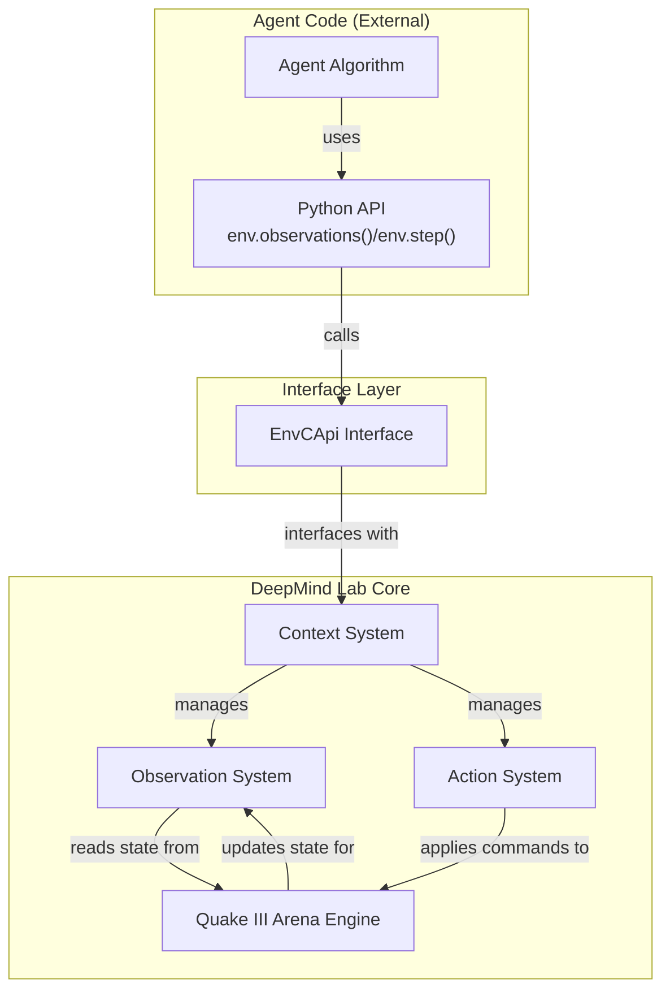
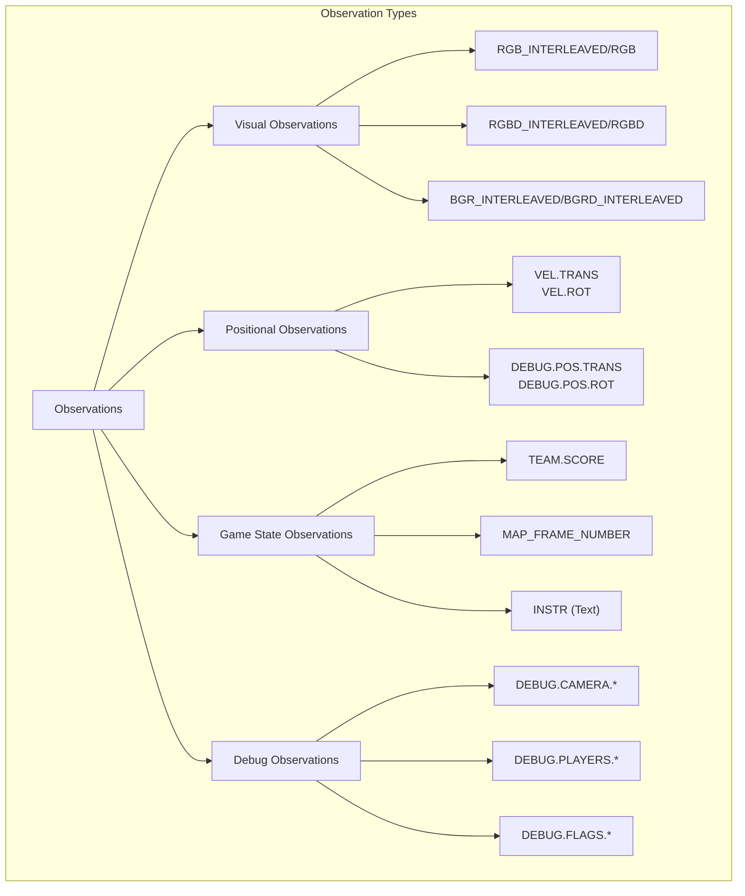
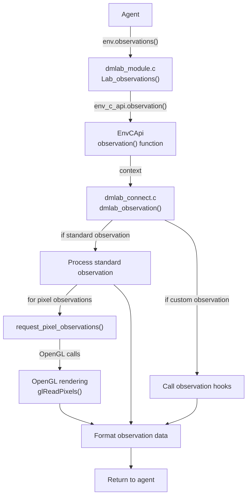
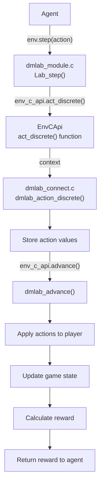

<!-- source: DeepWiki mcp.deepwiki.com · repo google-deepmind/lab · page 7 Observations and Actions · fetched 2026-10-26 -->

# Observations and Actions

<details>
<summary>Relevant source files</summary>

The following files were used as context for generating this wiki page:

- [RELEASE_NOTES.md](RELEASE_NOTES.md)
- [docs/users/observations.md](docs/users/observations.md)
- [docs/users/python_api.md](docs/users/python_api.md)
- [docs/users/run_from_script.md](docs/users/run_from_script.md)
- [engine/code/deepmind/dmlab_connect.c](engine/code/deepmind/dmlab_connect.c)
- [python/dmlab_module.c](python/dmlab_module.c)
- [python/random_agent.py](python/random_agent.py)
- [python/tests/dmlab_module_test.py](python/tests/dmlab_module_test.py)
- [python/tests/random_agent_test.py](python/tests/random_agent_test.py)
- [python/tests/render_test.py](python/tests/render_test.py)
- [testing/recording_test.cc](testing/recording_test.cc)
- [third_party/rl_api/env_c_api.h](third_party/rl_api/env_c_api.h)
- [third_party/rl_api/env_c_api_bind.h](third_party/rl_api/env_c_api_bind.h)
- [third_party/rl_api/env_c_api_example.cc](third_party/rl_api/env_c_api_example.cc)
- [third_party/rl_api/env_c_api_example_test.cc](third_party/rl_api/env_c_api_example_test.cc)

</details>


## Purpose and Scope

This page documents the observation and action systems in DeepMind Lab, which form the primary interface for agent-environment interaction. These systems enable reinforcement learning agents to perceive the environment through observations and influence it through actions. The document covers the technical implementation details, available observation and action types, and how they can be used in agent development.

For information about defining custom observations in level scripts, see [Lua Scripting](#5) and [Custom Level Creation](#6.4).

## System Architecture Overview

The observation and action systems sit at the core of the environment-agent interaction loop in DeepMind Lab, bridging the game engine with external agent code.



Sources:
- [engine/code/deepmind/dmlab_connect.c]()
- [third_party/rl_api/env_c_api.h]()
- [python/dmlab_module.c]()

## Observations

Observations provide information about the current state of the environment to the agent. DeepMind Lab offers various observation types that can be requested when creating an environment.

### Observation Categories



Sources:
- [docs/users/observations.md]()
- [engine/code/deepmind/dmlab_connect.c:95-116]()

### Standard Observations

The following table lists the standard observations available in all environments:

| Observation Name | Type/Shape | Description |
|------------------|------------|-------------|
| `RGB_INTERLEAVED` | Bytes (height, width, 3) | RGB image with channels interleaved (row-major) |
| `RGBD_INTERLEAVED` | Bytes (height, width, 4) | RGB+Depth image with channels interleaved |
| `RGB` | Bytes (3, height, width) | RGB image with channels planar |
| `RGBD` | Bytes (4, height, width) | RGB+Depth image with channels planar |
| `BGR_INTERLEAVED` | Bytes (height, width, 3) | BGR image with channels interleaved |
| `BGRD_INTERLEAVED` | Bytes (height, width, 4) | BGR+Depth image with channels interleaved |
| `MAP_FRAME_NUMBER` | Doubles (1) | Current frame number in the map |

Sources:
- [docs/users/observations.md:3-21]()
- [engine/code/deepmind/dmlab_connect.c:106-116]()

### Custom Observations

These optional observations can be added to environments:

| Observation Name | Type/Shape | Description |
|------------------|------------|-------------|
| `VEL.TRANS` | Doubles (3) | Player relative velocity vector |
| `VEL.ROT` | Doubles (3) | Player relative angular velocity vector |
| `INSTR` | String | Textual message from level to agent |
| `TEAM.SCORE` | Doubles (2) | Team score (your team, their team) |

Sources:
- [docs/users/observations.md:36-47]()
- [python/tests/dmlab_module_test.py:197-204]()

### Debug Observations

Debug observations provide additional information useful for development:

| Observation Name | Type/Shape | Description |
|------------------|------------|-------------|
| `DEBUG.CAMERA.TOP_DOWN` | Bytes (3, h, w) | Top-down view of the level |
| `DEBUG.POS.TRANS` | Doubles (3) | Player's world position in game units |
| `DEBUG.POS.ROT` | Doubles (3) | Player's orientation in degrees |
| `DEBUG.PLAYER_ID` | Doubles (1) | Current player's ID |

Sources:
- [docs/users/observations.md:49-70]()

### Observation Implementation

The observation system is implemented through several components:



Sources:
- [engine/code/deepmind/dmlab_connect.c:984-1036]()
- [python/dmlab_module.c:576-610]()

## Actions

Actions are the means by which agents interact with the environment. DeepMind Lab uses a discrete action space consisting of seven standard action dimensions.

### Standard Action Types

The standard action space consists of:

| Action Name | Index | Type | Range | Description |
|-------------|-------|------|-------|-------------|
| `LOOK_LEFT_RIGHT_PIXELS_PER_FRAME` | 0 | Angular velocity | [-512, 512] | Look left/right (negative = left) |
| `LOOK_DOWN_UP_PIXELS_PER_FRAME` | 1 | Angular velocity | [-512, 512] | Look down/up (negative = down) |
| `STRAFE_LEFT_RIGHT` | 2 | Discrete | [-1, 1] | Strafe left/right (negative = left) |
| `MOVE_BACK_FORWARD` | 3 | Discrete | [-1, 1] | Move backward/forward (negative = backward) |
| `FIRE` | 4 | Binary | [0, 1] | Fire weapon/use item |
| `JUMP` | 5 | Binary | [0, 1] | Jump |
| `CROUCH` | 6 | Binary | [0, 1] | Crouch |

Sources:
- [engine/code/deepmind/dmlab_connect.c:74-92]()
- [python/random_agent.py:37-49]()
- [python/tests/dmlab_module_test.py:70-78]()

### Action Flow



Sources:
- [engine/code/deepmind/dmlab_connect.c:864-881]()
- [python/dmlab_module.c:379-431]()
- [third_party/rl_api/env_c_api.h:417-424]()

### Action Implementation

Actions are processed in several steps:

1. The agent sends an action array through the Python API
2. The action values are stored in the environment
3. The `advance()` function applies these actions to update the game state
4. The resulting reward is calculated and returned

Sources:
- [engine/code/deepmind/dmlab_connect.c:774-806]()
- [python/dmlab_module.c:379-431]()

## Using Observations and Actions in Python

### Creating an Environment with Specific Observations

```python
import deepmind_lab

# Create environment with RGB and velocity observations
env = deepmind_lab.Lab(
    'lt_chasm',                            # Level name
    ['RGB_INTERLEAVED', 'VEL.TRANS'],      # Requested observations
    config={'width': '320', 'height': '240'}  # Configuration
)
env.reset()  # Initialize the environment
```

### Sending Actions and Receiving Observations

```python
import numpy as np
import deepmind_lab

# Create environment
env = deepmind_lab.Lab('lt_chasm', ['RGB_INTERLEAVED'])
env.reset()

# Create an action array (7 values for the 7 standard actions)
action = np.zeros([7], dtype=np.intc)
# Move forward
action[3] = 1  # MOVE_BACK_FORWARD = 1 means forward

# Send the action and receive the reward
reward = env.step(action)

# Get the observation
observation = env.observations()['RGB_INTERLEAVED']
```

### Basic Agent Loop Example

```python
import numpy as np
import deepmind_lab

# Create environment
env = deepmind_lab.Lab('lt_chasm', ['RGB_INTERLEAVED'])
env.reset()

# Simple agent loop
for _ in range(1000):
    if not env.is_running():
        print("Episode ended, resetting")
        env.reset()
    
    # Get observation
    observation = env.observations()['RGB_INTERLEAVED']
    
    # Compute action (random in this example)
    action = np.random.randint(-1, 2, size=7).astype(np.intc)
    
    # Send action to environment
    reward = env.step(action)
    
    print(f"Reward: {reward}")
```

Sources:
- [python/random_agent.py:140-176]()
- [python/tests/dmlab_module_test.py:92-102]()

## Querying Observation and Action Specifications

The Python API provides methods to inspect available observations and actions:

### Observation Specification

```python
import deepmind_lab
env = deepmind_lab.Lab('lt_chasm', [])
observation_spec = env.observation_spec()
print(observation_spec)
```

Example output:
```
[{'dtype': <type 'numpy.uint8'>, 'name': 'RGB_INTERLEAVED', 'shape': (240, 320, 3)},
 {'dtype': <type 'numpy.uint8'>, 'name': 'RGBD_INTERLEAVED', 'shape': (240, 320, 4)},
 {'dtype': <type 'numpy.uint8'>, 'name': 'RGB', 'shape': (3, 240, 320)},
 ...]
```

Sources:
- [python/dmlab_module.c:446-501]()
- [docs/users/python_api.md:166-190]()

### Action Specification

```python
import deepmind_lab
env = deepmind_lab.Lab('lt_chasm', [])
action_spec = env.action_spec()
print(action_spec)
```

Example output:
```
[{'max': 512, 'min': -512, 'name': 'LOOK_LEFT_RIGHT_PIXELS_PER_FRAME'},
 {'max': 512, 'min': -512, 'name': 'LOOK_DOWN_UP_PIXELS_PER_FRAME'},
 {'max': 1, 'min': -1, 'name': 'STRAFE_LEFT_RIGHT'},
 ...]
```

Sources:
- [python/dmlab_module.c:503-528]()
- [docs/users/python_api.md:219-235]()

## Advanced Features

### Events System

The events system complements observations by providing information about discrete events in the environment. Events can be retrieved using the `env.events()` method.

```python
events = env.events()
for event_type, observations in events:
    print(f"Event: {event_type}")
    for obs in observations:
        print(f"  Data: {obs}")
```

Sources:
- [python/dmlab_module.c:612-674]()
- [python/tests/dmlab_module_test.py:148-186]()

### Velocity Observations

The velocity observations (`VEL.TRANS` and `VEL.ROT`) provide detailed information about movement:

```python
env = deepmind_lab.Lab(
    'seekavoid_arena_01', 
    ['RGB_INTERLEAVED', 'VEL.TRANS', 'VEL.ROT']
)
env.reset()

# After movement
obs = env.observations()
trans_velocity = obs['VEL.TRANS']  # [x, y, z] velocity
rot_velocity = obs['VEL.ROT']      # [pitch, yaw, roll] angular velocity
```

Sources:
- [python/tests/dmlab_module_test.py:197-258]()

## Common Patterns and Best Practices

1. **Prefer interleaved observations**: For image data, `RGB_INTERLEAVED` is more efficient than planar formats as it requires less processing.

2. **Cache observation shapes**: Query the observation specification once at initialization rather than repeatedly.

3. **Use numpy arrays**: Always provide actions as numpy arrays with `dtype=np.intc`.

4. **Handle episode termination**: Always check if the environment is still running using `env.is_running()`.

5. **Reuse action arrays**: Create action arrays once and update them in-place for efficiency.

```python
# Efficient action handling
action = np.zeros([7], dtype=np.intc)  # Create once

for _ in range(1000):
    # Update action values in-place
    action[0] = calculate_look_left_right()
    action[1] = calculate_look_up_down()
    # ...
    
    reward = env.step(action)
```

Sources:
- [python/random_agent.py:84-131]()
- [RELEASE_NOTES.md:55-59]()

## Conclusion

The observation and action systems form the core interface between agents and the DeepMind Lab environment. This document has covered their implementation, available types, and usage patterns. By understanding these systems, you can effectively develop agents that perceive and interact with the environment in sophisticated ways.

For creating custom observations or actions in level scripts, refer to the [Lua Scripting](#5) documentation.

Sources:
- [engine/code/deepmind/dmlab_connect.c]()
- [python/dmlab_module.c]()
- [third_party/rl_api/env_c_api.h]()
- [docs/users/observations.md]()
- [docs/users/python_api.md]()

---

