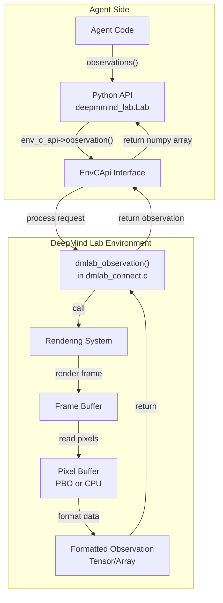
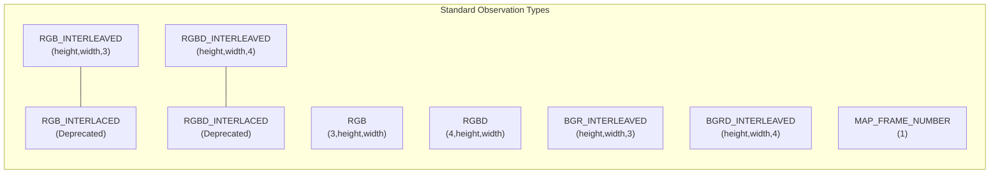

<!-- source: DeepWiki mcp.deepwiki.com · repo google-deepmind/lab · page 7.1 Standard Observations · fetched 2026-10-26 -->

# Standard Observations

<details>
<summary>Relevant source files</summary>

The following files were used as context for generating this wiki page:

- [RELEASE_NOTES.md](RELEASE_NOTES.md)
- [docs/users/observations.md](docs/users/observations.md)
- [docs/users/python_api.md](docs/users/python_api.md)
- [docs/users/run_from_script.md](docs/users/run_from_script.md)
- [engine/code/deepmind/dmlab_connect.c](engine/code/deepmind/dmlab_connect.c)
- [python/dmlab_module.c](python/dmlab_module.c)
- [python/random_agent.py](python/random_agent.py)
- [python/tests/dmlab_module_test.py](python/tests/dmlab_module_test.py)
- [python/tests/random_agent_test.py](python/tests/random_agent_test.py)
- [python/tests/render_test.py](python/tests/render_test.py)
- [testing/recording_test.cc](testing/recording_test.cc)
- [third_party/rl_api/env_c_api.h](third_party/rl_api/env_c_api.h)
- [third_party/rl_api/env_c_api_bind.h](third_party/rl_api/env_c_api_bind.h)
- [third_party/rl_api/env_c_api_example.cc](third_party/rl_api/env_c_api_example.cc)
- [third_party/rl_api/env_c_api_example_test.cc](third_party/rl_api/env_c_api_example_test.cc)

</details>


This document describes the standard built-in observations provided by DeepMind Lab's observation system. These are the tensor-based sensory inputs available to agents that represent what the agent "sees" in the 3D environment. For information about custom observations, see [Custom Observations](#7.2), and for debugging observations, see [Events System](#7.4).

## Observation System Architecture

The following diagram shows how observations flow through DeepMind Lab's architecture:



Sources: [engine/code/deepmind_lab_connect.c:984-1065](), [python/dmlab_module.py:576-610]()

## Standard Observation Types

Standard observations are defined in the enum `ObservationsEnum` in `dmlab_connect.c`:



Sources: [engine/code/deepmind_lab_connect.c:94-116](), [docs/users/observations.md:9-22]()

### Observation Format Specifications

| Observation Name | Type/Shape | Description |
|------------------|------------|-------------|
| `RGB_INTERLEAVED` | Bytes (height, width, 3) | RGB image with interleaved channels |
| `RGBD_INTERLEAVED` | Bytes (height, width, 4) | RGB + depth with interleaved channels |
| `RGB` | Bytes (3, height, width) | RGB image with planar channels |
| `RGBD` | Bytes (4, height, width) | RGB + depth with planar channels |
| `BGR_INTERLEAVED` | Bytes (height, width, 3) | BGR image with interleaved channels |
| `BGRD_INTERLEAVED` | Bytes (height, width, 4) | BGR + depth with interleaved channels |
| `MAP_FRAME_NUMBER` | Doubles (1) | Current frame number in the map |

Sources: [docs/users/observations.md:9-22](), [engine/code/deepmind_lab_connect.c:106-116]()

#### Format Details

- **Default dimensions**: Width 320, Height 180 (configurable via settings)
- **Planar format**: Channels are stored contiguously (e.g., RRR...GGG...BBB...)
- **Interleaved format**: Channels are interwoven (e.g., RGBRGB... or BGRBGR...)
- **Depth channel**: The "D" suffix indicates inclusion of depth information

For historical reasons, `RGB_INTERLACED` and `RGBD_INTERLACED` are supported as deprecated synonyms for `RGB_INTERLEAVED` and `RGBD_INTERLEAVED`. You will see a warning in the console if you use the deprecated names.

Sources: [docs/users/observations.md:22-35](), [engine/code/deepmind_lab_connect.c:102-115](), [RELEASE_NOTES.md:252-253]()

## Implementation Details

Standard observations are defined in `dmlab_connect.c` with an enum and corresponding names:

```c
enum ObservationsEnum {
  kObservations_RgbInterleaved,
  kObservations_RgbdInterleaved,
  kObservations_RgbPlanar,
  kObservations_RgbdPlanar,
  kObservations_BgrInterleaved,
  kObservations_BgrdInterleaved,
  kObservations_MapFrameNumber,
  kObservations_RgbInterlaced,    // Deprecated.
  kObservations_RgbdInterlaced,   // Deprecated.
};

const char* const kObservationNames[] = {
    "RGB_INTERLEAVED",   //
    "RGBD_INTERLEAVED",  //
    "RGB",               //
    "RGBD",              //
    "BGR_INTERLEAVED",   //
    "BGRD_INTERLEAVED",  //
    "MAP_FRAME_NUMBER",  //
    "RGB_INTERLACED",    //
    "RGBD_INTERLACED",   //
};
```

Sources: [engine/code/deepmind_lab_connect.c:94-116]()

### Observation Processing Flow

The observation system processes requests through the following steps:

1. Check if the observation is `MAP_FRAME_NUMBER`
   - If yes, return the current frame count
2. For pixel observations:
   - Make OpenGL context current
   - Render the current screen if not already rendered
   - Determine if depth information is needed
   - Request pixel observations with the appropriate format
   - Copy and format the data according to the requested observation type
   - Return the formatted tensor

Sources: [engine/code/deepmind_lab_connect.c:984-1065]()

### Pixel Buffer Objects (PBOs)

For efficient GPU-to-CPU transfers, the system can use OpenGL Pixel Buffer Objects:

1. PBOs allow asynchronous pixel transfers from GPU to CPU
2. The system creates and manages PBOs for RGB and depth data
3. PBO usage is controlled by the `use_pbos` setting and hardware support
4. The `request_pixel_observations`, `bind_pixel_observation`, and `unbind_pixel_observation` functions handle PBO operations

Sources: [engine/code/deepmind_lab_connect.c:189-303]()

## Using Observations in Python

### Requesting Observations

Specify the desired observation types when creating the Lab environment:

```python
import deepmind_lab
import numpy as np

# Create environment with RGB_INTERLEAVED observation
env = deepmind_lab.Lab('level_name', ['RGB_INTERLEAVED'])
env.reset()

# Step environment and get observation
action = np.zeros((7,), dtype=np.intc)  # No-op action
reward = env.step(action)
obs = env.observations()
rgb_image = obs['RGB_INTERLEAVED']  # Shape: (height, width, 3)
```

Sources: [python/tests/dmlab_module_test.py:92-102](), [python/random_agent.py:154-172]()

### Querying Observation Specifications

Use `observation_spec()` to discover available observations and their formats:

```python
env = deepmind_lab.Lab('level_name', [])
specs = env.observation_spec()
# Example output for RGB_INTERLEAVED:
# {'name': 'RGB_INTERLEAVED', 'dtype': <type 'numpy.uint8'>, 'shape': (180, 320, 3)}
```

Sources: [python/dmlab_module_test.py:56-68](), [docs/users/python_api.md:166-208]()

## Performance Considerations

- **Preferred format**: `RGB_INTERLEAVED` requires less processing than planar formats
- **PBO acceleration**: When available, PBOs can improve pixel transfer performance
- **Observation size**: Larger observation dimensions increase memory usage and transfer time

Sources: [docs/users/observations.md:24-30](), [engine/code/deepmind_lab_connect.c:189-303]()

## Configuration Options

The following settings affect standard observations:

| Setting | Description | Default |
|---------|-------------|---------|
| `width` | Horizontal resolution of observation frames | 320 |
| `height` | Vertical resolution of observation frames | 180 |
| `use_pbos` | Whether to use Pixel Buffer Objects for pixel transfers | depends on hardware |

Sources: [docs/users/python_api.md:30-40](), [engine/code/deepmind_lab_connect.c:677-680]()

## Observation Format Compatibility Issues

### Fix for VEL.ROT Observation

In the December 2020 release, a bug was fixed with the `VEL.ROT` observation when used in combination with pixel observations. Previously, angular velocity information was lost due to a logic error when pixel observations were also requested.

```
Fix observation 'VEL.ROT' to allow non-zero values when combined with pixel
observations. Previously, the presence of pixel observations caused the
angular velocity information to be lost due to a logic error.
```

Sources: [RELEASE_NOTES.md:57-59]()

### Rendering Origin

The rendering origin for observations changed in May 2018 to use top-left as origin by default instead of bottom-left:

```
Allow game to be rendered with top-left as origin instead of bottom-left.
```

This change affects how observation images should be interpreted, with the origin now at the top-left corner of the image.

Sources: [RELEASE_NOTES.md:227-228]()

## Testing Observations

The DeepMind Lab codebase includes tests for observations, including:

- Verifying the shape and type of different observation formats
- Testing velocity observations (`VEL.TRANS` and `VEL.ROT`)
- Testing rendering origins and buffer formats

See the `python/tests/dmlab_module_test.py` file for test examples.

Sources: [python/tests/dmlab_module_test.py:92-258](), [python/tests/render_test.py:30-73]()

---

