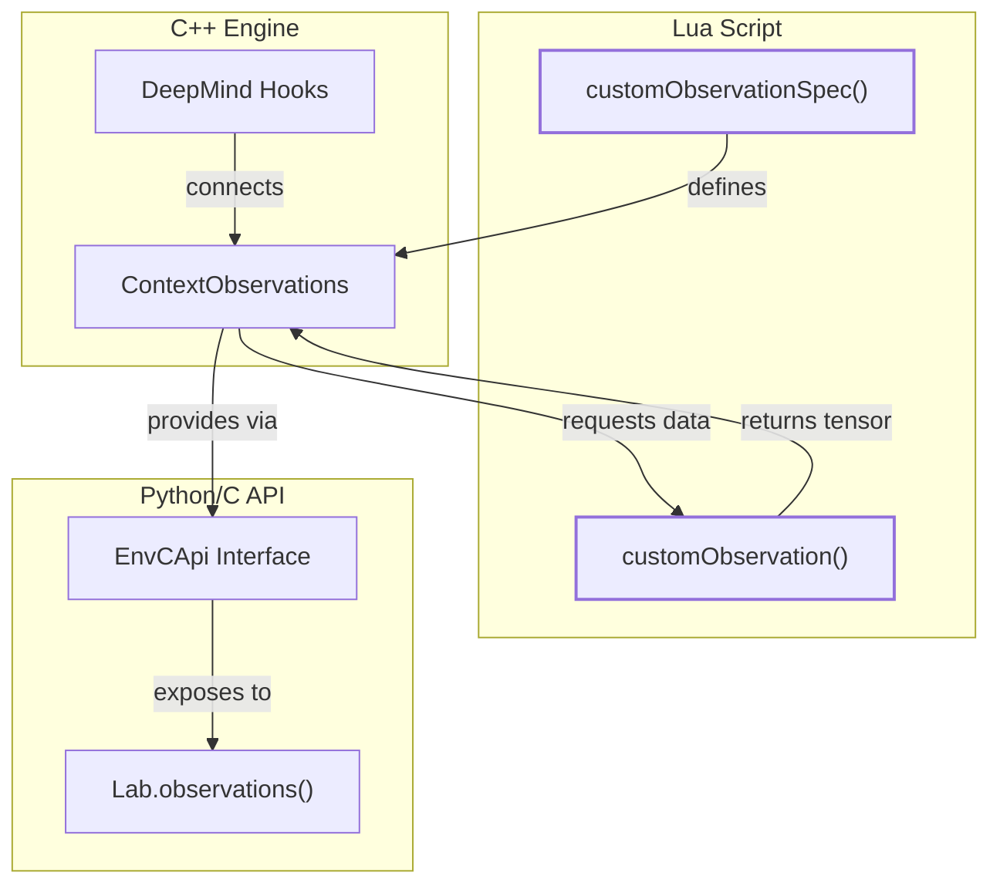
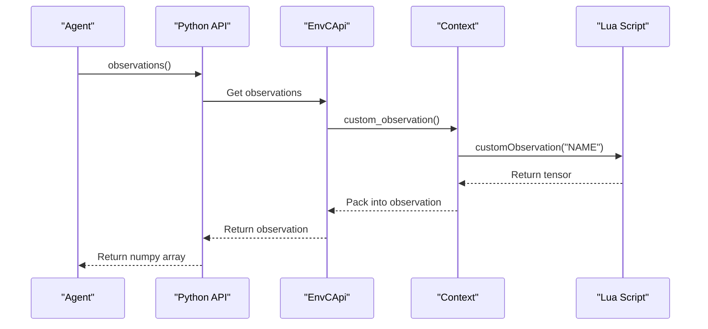
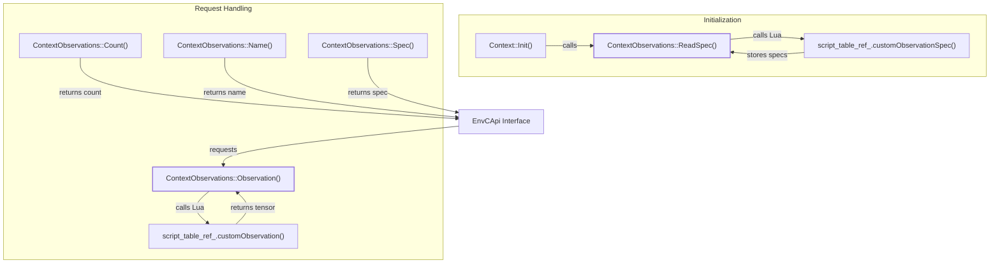
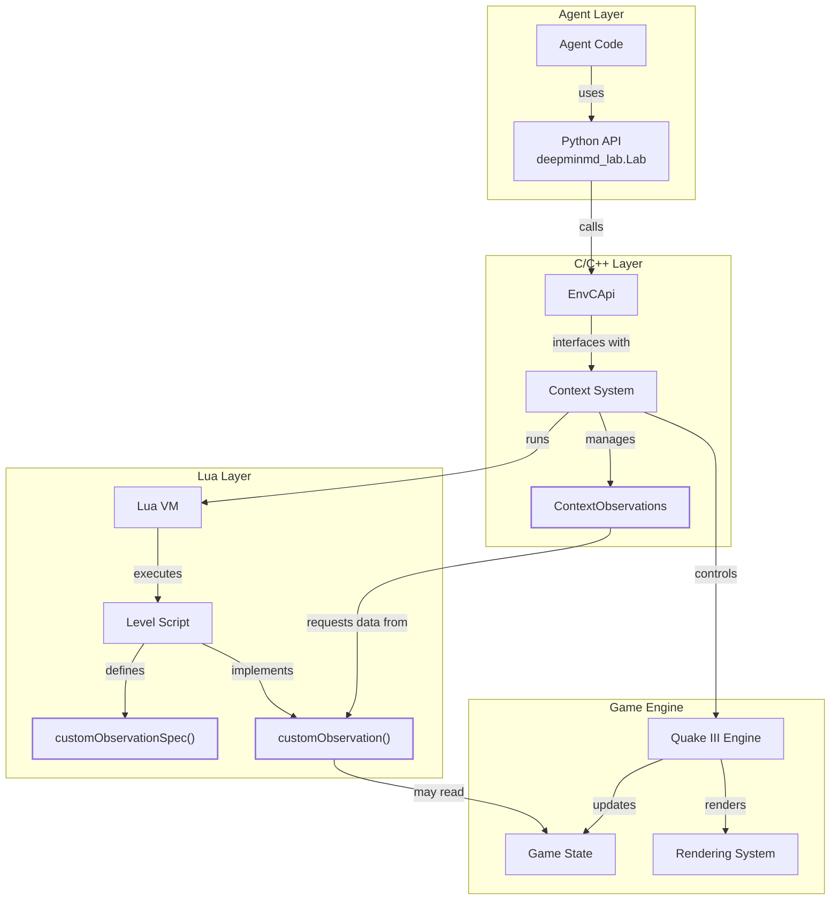

<!-- source: DeepWiki mcp.deepwiki.com · repo google-deepmind/lab · page 7.2 Custom Observations · fetched 2026-10-26 -->

# Custom Observations

<details>
<summary>Relevant source files</summary>

The following files were used as context for generating this wiki page:

- [deepmind/engine/context.cc](deepmind/engine/context.cc)
- [deepmind/engine/context.h](deepmind/engine/context.h)
- [deepmind/include/deepmind_hooks.h](deepmind/include/deepmind_hooks.h)
- [docs/developers/reference/lua_api.md](docs/developers/reference/lua_api.md)
- [engine/code/deepmind/dm_local.c](engine/code/deepmind/dm_local.c)
- [engine/code/deepmind/dm_local.h](engine/code/deepmind/dm_local.h)
- [engine/code/deepmind/dm_public.h](engine/code/deepmind/dm_public.h)
- [engine/code/game/g_active.c](engine/code/game/g_active.c)
- [engine/code/game/g_local.h](engine/code/game/g_local.h)
- [engine/code/game/g_mover.c](engine/code/game/g_mover.c)
- [engine/code/game/g_spawn.c](engine/code/game/g_spawn.c)
- [engine/code/qcommon/deepmind_hooks.c](engine/code/qcommon/deepmind_hooks.c)
- [engine/code/qcommon/q_shared.h](engine/code/qcommon/q_shared.h)
- [engine/code/qcommon/surfaceflags.h](engine/code/qcommon/surfaceflags.h)
- [engine/code/renderergl1/tr_cmds.c](engine/code/renderergl1/tr_cmds.c)
- [engine/code/renderergl2/tr_cmds.c](engine/code/renderergl2/tr_cmds.c)
- [game_scripts/decorators/debug_observations.lua](game_scripts/decorators/debug_observations.lua)
- [game_scripts/levels/tests/debug_observation_test.lua](game_scripts/levels/tests/debug_observation_test.lua)
- [python/tests/debug_observation_test.py](python/tests/debug_observation_test.py)

</details>


This page documents how to create and use custom observations in DeepMind Lab. Custom observations allow developers to extend the environment with additional observation types beyond the built-in ones. For information about standard observations that come with DeepMind Lab by default, see [Standard Observations](#7.1).

## Overview

Custom observations are a powerful mechanism that allows level creators to provide additional observation data to agents. These observations can be of any form, ranging from simple scalars to complex tensors, and can represent any information about the game state that may be useful for learning agents.

The custom observation system consists of two main components:
1. A **specification phase** where observation shapes and types are defined
2. An **observation phase** where actual observation data is generated and returned



Sources:
- [deepmind/engine/context.h:417-421]()
- [deepmind/engine/context.cc:389-406]()
- [deepmind/include/deepmind_hooks.h:336-359]()
- [docs/developers/reference/lua_api.md:212-232]()

## Defining Custom Observations

Custom observations are defined in the Lua level script by implementing the `customObservationSpec()` function, which returns an array of observation specifications.

Each observation specification is a Lua table with the following fields:
- `name`: A string identifier for the observation
- `type`: Either "bytes" or "doubles", determining the type of tensor returned
- `shape`: An array of integers defining the dimensions of the tensor

### Observation Types

DeepMind Lab supports two types of observations:

| Type | Description | Lua Tensor | C++ Equivalent | Python Type |
|------|-------------|------------|----------------|-------------|
| `bytes` | 8-bit integer values | `tensor.ByteTensor` | `unsigned char` | `np.uint8` |
| `doubles` | Double-precision floating point | `tensor.DoubleTensor` | `double` | `np.float64` |

### Observation Shapes

The `shape` field in the observation specification defines the dimensions of the returned tensor. For example:
- `{3}` specifies a 1D tensor with 3 elements
- `{84, 84, 3}` specifies a 3D tensor (like an RGB image)

If a dimension is dynamic (can change between calls), it should be set to `0` in the specification.

Example specification:

```lua
function api:customObservationSpec()
  return {
    {name = 'LOCATION', type = 'doubles', shape = {3}},
    {name = 'ORDER', type = 'bytes', shape = {0}},  -- Dynamic length
    {name = 'LOOK_PITCH', type = 'doubles', shape = {1}},
  }
end
```

Sources:
- [docs/developers/reference/lua_api.md:233-260]()
- [deepmind/include/deepmind_hooks.h:336-352]()

## Implementing Custom Observations

After defining observation specifications, you need to provide the actual observation data by implementing the `customObservation` function in your Lua script. This function is called whenever the environment needs an observation value.

```lua
function api:customObservation(name)
  if name == 'LOCATION' then
    return tensor.DoubleTensor(game:playerInfo().pos)
  elseif name == 'ORDER' then
    local order = 'Find Apples!'
    return tensor.ByteTensor(order:byte(1, -1))
  elseif name == 'LOOK_PITCH' then
    return tensor.DoubleTensor{game:playerInfo().angles[1]}
  end
end
```

The function receives the name of the requested observation and should return a tensor of the appropriate type and shape as defined in the specification.

### Flow of Custom Observation Data



Sources:
- [docs/developers/reference/lua_api.md:212-232]()
- [deepmind/engine/context.cc:389-406]()

## Registration and Internal Processing

When a level is loaded, DeepMind Lab processes and registers custom observations through several steps:



The internal processing through C++ involves several key functions in the Context class:

1. `MutableObservations()->ReadSpec(script_table_ref_)`: Reads observation specifications from Lua
2. `Observations().Count()`: Returns the number of custom observations
3. `Observations().Name(idx)`: Returns name of observation at index
4. `Observations().Spec(idx, spec)`: Fills in observation specifications
5. `MutableObservations()->Observation(idx, observation)`: Retrieves observation data from Lua

Sources:
- [deepmind/engine/context.cc:812-814]()
- [deepmind/engine/context.cc:389-406]()
- [deepmind/include/deepmind_hooks.h:336-359]()

## Accessing Custom Observations

### From Python

Custom observations are accessed exactly like standard observations, through the `observations()` method:

```python
env = deepmind_lab.Lab(level_name, ['LOCATION', 'ORDER', 'LOOK_PITCH'])
env.reset()
obs = env.observations()
location = obs['LOCATION']  # numpy array with shape (3,)
order = obs['ORDER']        # numpy array with dynamic length
pitch = obs['LOOK_PITCH']   # numpy array with shape (1,)
```

### From C++

In C++, observations are accessed through the EnvCApi interface:

```c++
EnvCApi_Observation observation;
env_c_api->observation(env_c_api_context, obs_idx, &observation);
```

Sources:
- [python/tests/debug_observation_test.py:26-42]()
- [deepmind/include/deepmind_hooks.h:356-359]()

## Example: Debug Observations

The DeepMind Lab codebase includes a comprehensive example of custom observations in the `debug_observations.lua` file, which demonstrates how to create various types of debug visualizations and game state observations.

Some examples from the file include:

| Observation Name | Type | Description |
|------------------|------|-------------|
| `DEBUG.CAMERA.TOP_DOWN` | Bytes | Top-down view of the level |
| `DEBUG.POS.TRANS` | Doubles | Player position coordinates |
| `DEBUG.PLAYER_ID` | Bytes | Current player ID |
| `DEBUG.PLAYERS.HEALTH` | Doubles | Health values of all players |
| `DEBUG.MAZE.LAYOUT` | String | Text representation of maze layout |

The debug observations system shows how custom observations can be organized into logical groups using namespaces (e.g., `DEBUG.CAMERA.*`).

Sources:
- [game_scripts/decorators/debug_observations.lua:313-372]()
- [python/tests/debug_observation_test.py:26-42]()

## Best Practices and Performance Tips

1. **Return Efficiently-Sized Tensors**: Only return the data you need. Large tensors (especially images) can impact performance.

2. **Reuse Tensors When Possible**: Create tensors once and update their values rather than creating new ones each time.

3. **Namespace Your Observations**: Use prefixes (like `DEBUG.`) to organize related observations.

4. **Handle Dynamic Shapes Carefully**: When using dynamic shapes (0 in spec), ensure the tensor you return has consistent meaning even if its size changes.

5. **Documentation**: Document your custom observations clearly, especially when they're part of a public API.

6. **Testing**: Create tests that verify your custom observations return the expected shapes and values.

Sources:
- [game_scripts/decorators/debug_observations.lua:313-372]()
- [game_scripts/levels/tests/debug_observation_test.lua:1-63]()

## Integration with DeepMind Lab Architecture

Custom observations are deeply integrated into the DeepMind Lab architecture:



The custom observation system uses several hooks in the engine that connect the Lua scripting environment with the C++ core:

1. `custom_observation_count`: Returns number of observations
2. `custom_observation_name`: Returns name of an observation
3. `custom_observation_spec`: Returns specification of an observation
4. `custom_observation`: Returns the actual observation data

These hooks provide a standardized interface between the scripting layer and the engine.

Sources:
- [deepmind/include/deepmind_hooks.h:336-359]()
- [deepmind/engine/context_observations.h:419-421]()
- [engine/code/deepmind/dm_public.h:30-57]()
- [engine/code/qcommon/deepmind_hooks.c:89-407]()

## Summary

Custom observations provide a flexible way to extend DeepMind Lab with additional information for agents. By implementing `customObservationSpec()` and `customObservation()` in your Lua level script, you can create observations of any type and shape. These observations can then be accessed through the same API as standard observations, making them seamlessly integrated with the rest of the system.

Whether you need to provide debug visualizations, game state information, or environment-specific data, custom observations give you the tools to make that information available to learning agents.

---

