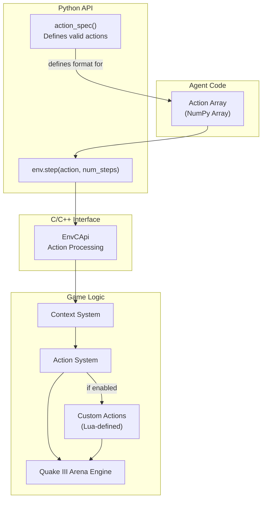
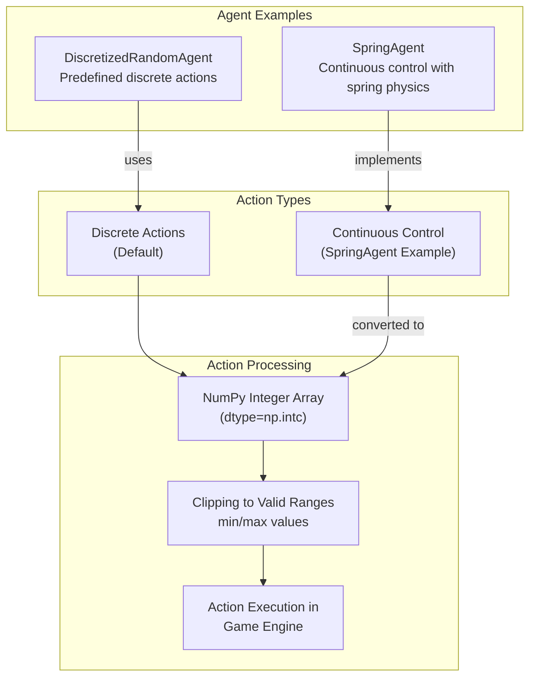
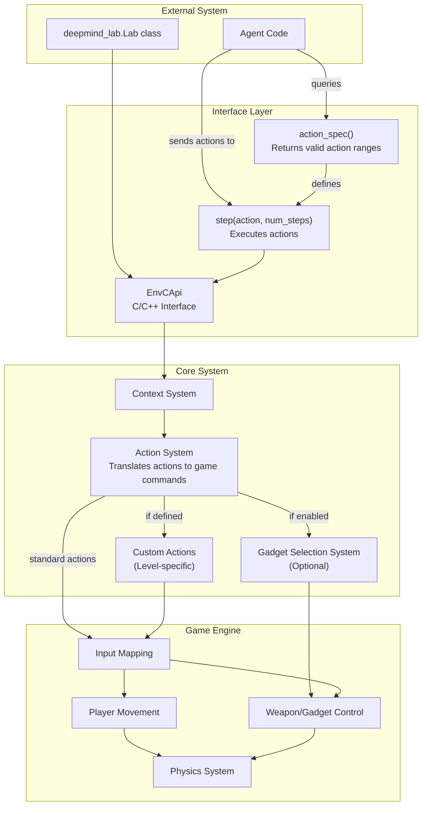

<!-- source: DeepWiki mcp.deepwiki.com · repo google-deepmind/lab · page 7.3 Actions · fetched 2026-10-26 -->

# Actions

<details>
<summary>Relevant source files</summary>

The following files were used as context for generating this wiki page:

- [docs/users/actions.md](docs/users/actions.md)
- [docs/users/observations.md](docs/users/observations.md)
- [docs/users/python_api.md](docs/users/python_api.md)
- [docs/users/run_from_script.md](docs/users/run_from_script.md)
- [game_scripts/decorators/gadget_selection.lua](game_scripts/decorators/gadget_selection.lua)
- [game_scripts/decorators/setting_overrides.lua](game_scripts/decorators/setting_overrides.lua)
- [game_scripts/levels/tests/properties_test.lua](game_scripts/levels/tests/properties_test.lua)
- [python/random_agent.py](python/random_agent.py)
- [python/tests/dmlab_module_test.py](python/tests/dmlab_module_test.py)
- [python/tests/properties_test.py](python/tests/properties_test.py)
- [python/tests/random_agent_test.py](python/tests/random_agent_test.py)
- [python/tests/render_test.py](python/tests/render_test.py)

</details>


This document describes the action system in DeepMind Lab, which defines how agents interact with the environment. Actions allow an agent to control movement, looking around, and other interactions within the 3D environment. For information about observations (which provide feedback from the environment to the agent), see [Observations and Actions](#7).

## Standard Discrete Actions

DeepMind Lab provides a set of standard discrete actions that are available in all environments. These actions are passed to the environment through the `step()` method as an integer array.

| Action Name | Range | Description |
| :---------- | :---- | :---------- |
| `LOOK_LEFT_RIGHT_PIXELS_PER_FRAME` | [-512, 512] | Angular velocity for looking left/right |
| `LOOK_DOWN_UP_PIXELS_PER_FRAME` | [-512, 512] | Angular velocity for looking down/up |
| `STRAFE_LEFT_RIGHT` | [-1, 1] | Move sideways (left/right) |
| `MOVE_BACK_FORWARD` | [-1, 1] | Move backwards/forwards |
| `FIRE` | [0, 1] | Fire button (0 = not pressed, 1 = pressed) |
| `JUMP` | [0, 1] | Jump button (0 = not pressed, 1 = pressed) |
| `CROUCH` | [0, 1] | Crouch button (0 = not pressed, 1 = pressed) |

Looking actions are specified in "pixels", which corresponds to how many pixels the mouse would move at a 640x480 resolution running at the standard 60 frames per second. A value of approximately 57 will rotate the player 360 degrees in one second of game time.

Sources: [docs/users/actions.md:1-23](), [python/tests/dmlab_module_test.py:65-78]()

## Additional Optional Actions

The following actions can be enabled via configuration settings:

| Action Name | Setting Flag | Range | Description |
| :---------- | :----------- | :---- | :---------- |
| `SELECT_GADGET` | `gadgetSelect` | [0, 10] | Directly select gadget by number (if value > 0) |
| `SWITCH_GADGET` | `gadgetSwitch` | [-1, 1] | Cycle through gadgets (-1 = previous, 1 = next) |

These additional actions must be explicitly enabled in the environment configuration by setting the corresponding flags to `true`.

Sources: [docs/users/actions.md:25-32](), [game_scripts/decorators/gadget_selection.lua:1-67](), [game_scripts/decorators/setting_overrides.lua:119-120]()

## Action Representation Flow



Sources: [python/tests/dmlab_module_test.py:65-78](), [docs/users/python_api.md:158-165](), [game_scripts/decorators/gadget_selection.lua:10-26]()

## Using Actions in Python

Actions in DeepMind Lab are represented as integer arrays. The structure of this array is defined by the `action_spec()` method, which returns a list of dictionaries describing each action dimension.

### Retrieving Action Specifications

```python
env = deepmind_lab.Lab('level_name', [observation_list])
action_spec = env.action_spec()
# Returns a list of dictionaries, each with 'name', 'min', and 'max' keys
```

The action specification tells you the names, order, and valid ranges for each action dimension.

### Creating and Using Action Arrays

Actions must be provided as NumPy arrays with dtype `np.intc` (32-bit integers):

```python
import numpy as np

# Create a no-op action (all zeros)
action = np.zeros([7], dtype=np.intc)

# Apply specific actions
action[0] = 20  # Look right
action[3] = 1   # Move forward

# Send the action to the environment
reward = env.step(action, num_steps=4)  # Execute for 4 frames
```

### Discrete Action Helper Example

The following example from the random agent shows how to create helper functions for discrete actions:

```python
def _action(*entries):
  return np.array(entries, dtype=np.intc)

# Example action mappings
ACTIONS = {
    'look_left': _action(-20, 0, 0, 0, 0, 0, 0),
    'look_right': _action(20, 0, 0, 0, 0, 0, 0),
    'look_up': _action(0, 10, 0, 0, 0, 0, 0),
    'look_down': _action(0, -10, 0, 0, 0, 0, 0),
    'strafe_left': _action(0, 0, -1, 0, 0, 0, 0),
    'strafe_right': _action(0, 0, 1, 0, 0, 0, 0),
    'forward': _action(0, 0, 0, 1, 0, 0, 0),
    'backward': _action(0, 0, 0, -1, 0, 0, 0),
    'fire': _action(0, 0, 0, 0, 1, 0, 0),
    'jump': _action(0, 0, 0, 0, 0, 1, 0),
    'crouch': _action(0, 0, 0, 0, 0, 0, 1)
}
```

Sources: [python/random_agent.py:30-49](), [python/tests/dmlab_module_test.py:96-102](), [docs/users/python_api.md:219-235]()

## Continuous vs. Discrete Control



While the action interface to the environment is discrete (integer arrays), agents can implement continuous control policies by converting their continuous actions to the required discrete format before passing them to the environment.

The random agent example includes two different approaches:
1. `DiscretizedRandomAgent`: Uses a predefined set of discrete actions
2. `SpringAgent`: Implements a continuous control using spring-like physics with critically damped derivatives

Sources: [python/random_agent.py:34-138](), [python/tests/random_agent_test.py:32-77]()

## Action System Architecture



The action system in DeepMind Lab translates agent commands into game engine inputs. The system supports both standard actions available in all environments and custom actions that can be defined for specific levels.

Sources: [docs/users/actions.md:1-32](), [game_scripts/decorators/gadget_selection.lua:1-67](), [python/tests/dmlab_module_test.py:65-78]()

---

