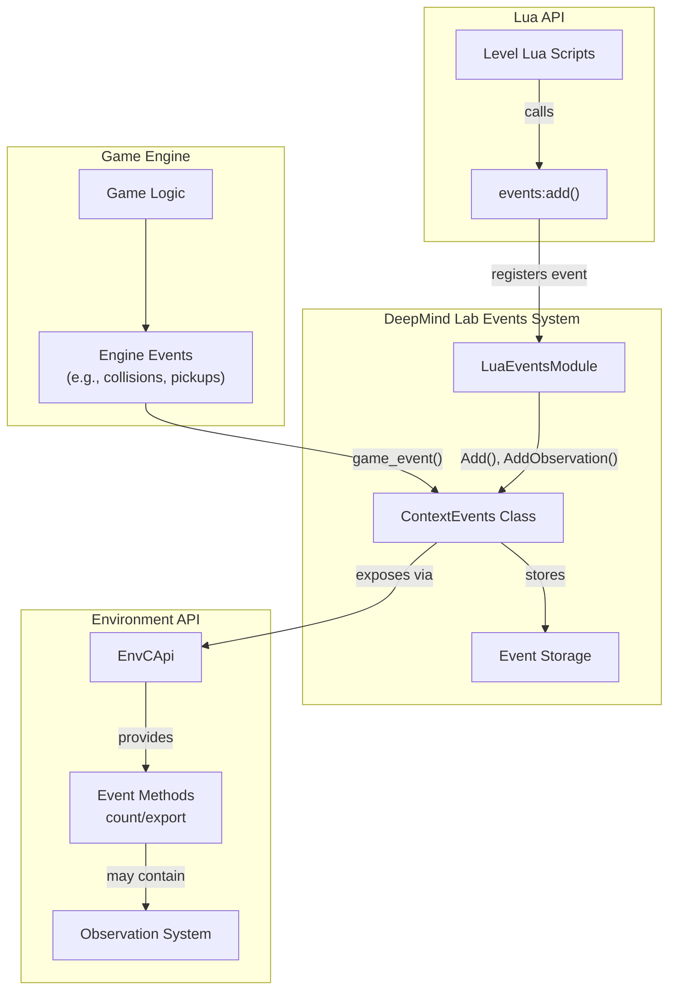
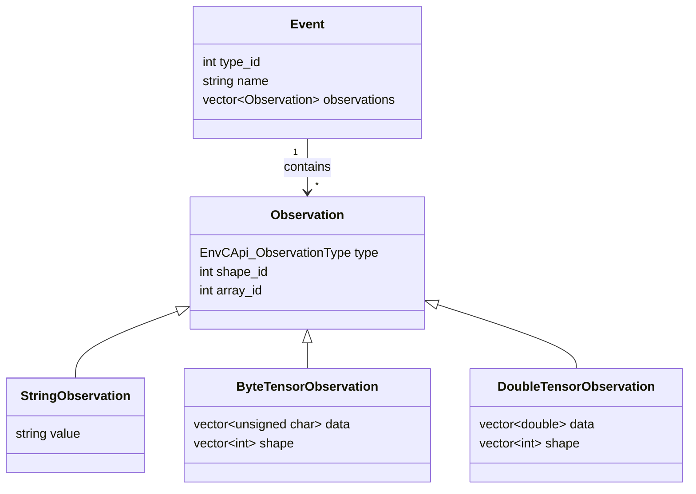
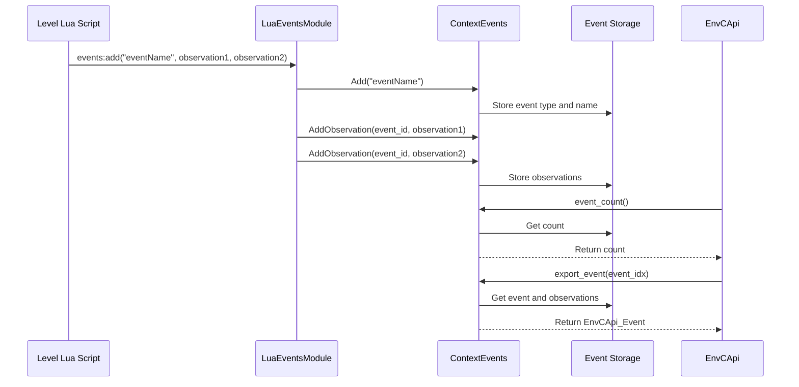
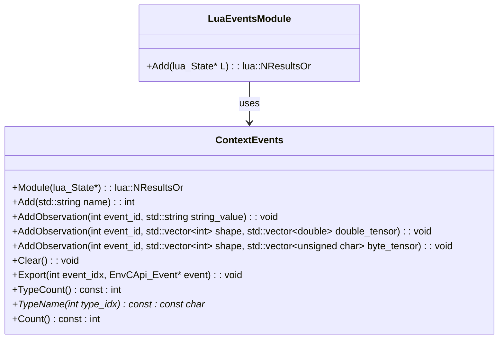
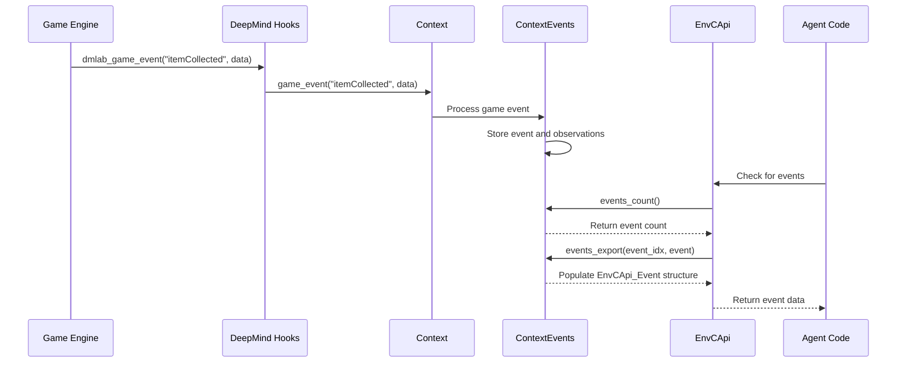

<!-- source: DeepWiki mcp.deepwiki.com · repo google-deepmind/lab · page 7.4 Events System · fetched 2026-10-26 -->

# Events System

<details>
<summary>Relevant source files</summary>

The following files were used as context for generating this wiki page:

- [deepmind/engine/context.cc](deepmind/engine/context.cc)
- [deepmind/engine/context.h](deepmind/engine/context.h)
- [deepmind/engine/context_actions.cc](deepmind/engine/context_actions.cc)
- [deepmind/engine/context_events.cc](deepmind/engine/context_events.cc)
- [deepmind/engine/context_observations.cc](deepmind/engine/context_observations.cc)
- [deepmind/include/deepmind_hooks.h](deepmind/include/deepmind_hooks.h)
- [deepmind/level_generation/compile_map.cc](deepmind/level_generation/compile_map.cc)
- [deepmind/level_generation/text_level/char_grid.cc](deepmind/level_generation/text_level/char_grid.cc)
- [deepmind/level_generation/text_level/lua_bindings.cc](deepmind/level_generation/text_level/lua_bindings.cc)
- [deepmind/level_generation/text_level/translate_text_level_test.cc](deepmind/level_generation/text_level/translate_text_level_test.cc)
- [deepmind/support/test_srcdir.cc](deepmind/support/test_srcdir.cc)
- [deepmind/util/run_executable.cc](deepmind/util/run_executable.cc)
- [docs/developers/reference/lua_api.md](docs/developers/reference/lua_api.md)
- [engine/code/deepmind/dm_local.c](engine/code/deepmind/dm_local.c)
- [engine/code/deepmind/dm_local.h](engine/code/deepmind/dm_local.h)
- [engine/code/deepmind/dm_public.h](engine/code/deepmind/dm_public.h)
- [engine/code/game/g_active.c](engine/code/game/g_active.c)
- [engine/code/game/g_local.h](engine/code/game/g_local.h)
- [engine/code/game/g_mover.c](engine/code/game/g_mover.c)
- [engine/code/game/g_spawn.c](engine/code/game/g_spawn.c)
- [engine/code/qcommon/deepmind_hooks.c](engine/code/qcommon/deepmind_hooks.c)
- [engine/code/qcommon/q_shared.h](engine/code/qcommon/q_shared.h)
- [engine/code/qcommon/surfaceflags.h](engine/code/qcommon/surfaceflags.h)
- [examples/game_main.c](examples/game_main.c)

</details>


The Events System in DeepMind Lab provides a mechanism for tracking and reporting significant occurrences during environment execution. This system enables the lab to communicate important in-game events to agents, allowing them to respond to these events or record them for later analysis.

## Purpose and Architecture

The Events System acts as a bridge between the game engine and the reinforcement learning environment API. It allows both the engine and Lua scripts to generate events that can be exposed to agents through observations.



Sources:
- [deepmind/engine/context_events.cc]()
- [deepmind/engine/context_events.h]()
- [deepmind/engine/context.cc:480-484]()
- [deepmind/include/deepmind_hooks.h:45-61]()

## Event Data Model

Events in DeepMind Lab consist of a type identifier, a name, and a collection of observations. Each event can carry multiple observations of different types, making them flexible for conveying complex information.



Sources:
- [deepmind/engine/context_events.cc:113-165]()
- [deepmind/engine/context_events.h:31-65]()
- [third_party/rl_api/env_c_api.h]()

## Creating and Processing Events

Events can be created from Lua scripts or directly from the C++ code. The system exports them via the environment C API where they can be accessed by agents.

### Event Creation from Lua



Sources:
- [deepmind/engine/context_events.cc:42-95]()
- [docs/developers/reference/lua_api.md:301-305]()
- [engine/code/qcommon/deepmind_hooks.c:241-245]()

## Event Types

The Events System can handle three types of observation data:

| Observation Type | C++ Type | Description |
|------------------|----------|-------------|
| `EnvCApi_ObservationString` | `std::string` | Text data |
| `EnvCApi_ObservationBytes` | `std::vector<unsigned char>` | Raw byte data, often used for images or encoded data |
| `EnvCApi_ObservationDoubles` | `std::vector<double>` | Floating-point numeric data |

Sources:
- [deepmind/engine/context_events.cc:175-212]()
- [deepmind/engine/context_events.h:31-65]()

## Integration with Engine Events

The game engine can generate events that are passed to the Events System. These events are typically processed via the `game_event` hook.

```
GameEngine → game_event hook → ContextEvents → EnvCApi → Agent
```

The `game_event` function is called with an event name and associated data. This allows the engine to report significant occurrences to the environment.

Sources:
- [engine/code/deepmind/dm_local.c:213-217]()
- [engine/code/qcommon/deepmind_hooks.c:174-178]()
- [deepmind/engine/context.cc:479-484]()

## Lua API

The Events System is accessible from Lua scripts through the `events` module. This module is registered with the Lua VM during initialization.

### Adding Events

```lua
local events = require 'dmlab.system.events'

-- Add an event with a string observation
events:add("goalReached", "Player reached the goal!")

-- Add an event with multiple observations
events:add("itemCollected", "Gold coin", tensor.DoubleTensor{10.0}, tensor.ByteTensor{255, 215, 0})
```

When `events:add()` is called, it registers a new event with the specified name and attaches the provided observations to it.

Sources:
- [deepmind/engine/context_events.cc:42-95]()
- [docs/developers/reference/lua_api.md:301-305]()

## C++ Implementation

The core of the Events System is implemented in the `ContextEvents` class. This class manages event storage, creation, and export.



Sources:
- [deepmind/engine/context_events.cc]()
- [deepmind/engine/context_events.h]()

## Environment API Integration

The Events System exposes events to the environment through the EnvCApi. This allows agents to access events through a unified interface.

The following hooks connect the Events System to the API:

| Hook | Description |
|------|-------------|
| `events.clear` | Clear all events |
| `events.type_count` | Get the number of event types |
| `events.type_name` | Get the name of an event type |
| `events.count` | Get the number of events |
| `events.export_event` | Export event data in the EnvCApi format |

Sources:
- [deepmind/include/deepmind_hooks.h:45-61]()
- [deepmind/engine/context.cc:670-675]()
- [engine/code/qcommon/deepmind_hooks.c:213-245]()

## Example Game Event Flow

When an in-game event occurs (like a player collecting an item or triggering an action), the following sequence typically happens:

1. The game engine detects the event (e.g., collision with an item)
2. It calls `dmlab_game_event` with the event name and data
3. This triggers the `game_event` hook in the DeepMind context
4. The event is processed, potentially generating observations
5. The event is stored by the Events System
6. The event becomes available to agents through the EnvCApi



Sources:
- [engine/code/deepmind/dm_local.c:213-217]()
- [engine/code/qcommon/deepmind_hooks.c:174-178]()
- [examples/game_main.c:240-257]()

## Accessing Events from Agent Code

Agents can access events through the EnvCApi interface. The typical pattern is:

1. Check the event count: `env_c_api.event_count(context)`
2. Iterate through events: `env_c_api.event(context, idx, &event)`
3. Process the event data: `event.id`, `event.observations`, etc.

Sources:
- [examples/game_main.c:240-257]()

## Summary

The Events System in DeepMind Lab provides a flexible way to communicate important occurrences within the environment to agents. It supports different types of observation data and can be used from both Lua scripts and C++ code. This system is essential for rich agent-environment interaction, allowing agents to respond to significant game events beyond the standard observations.

---

