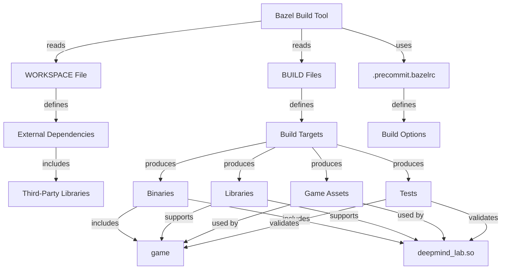
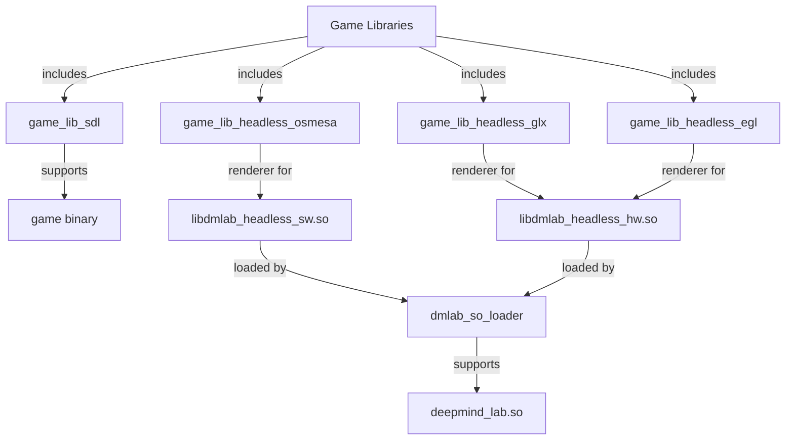
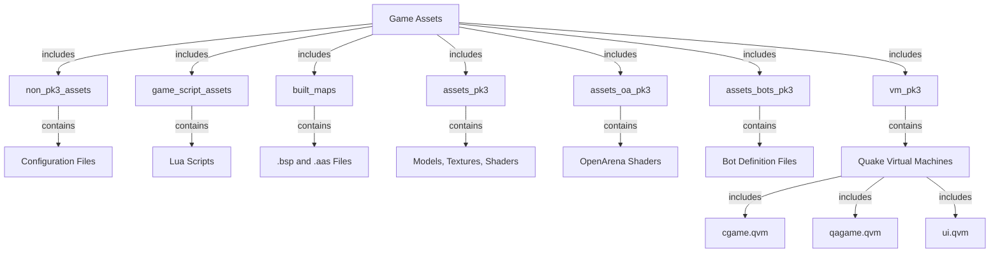
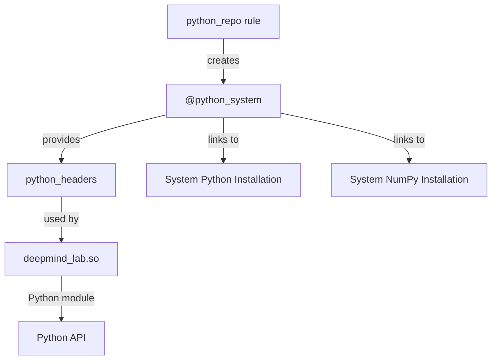
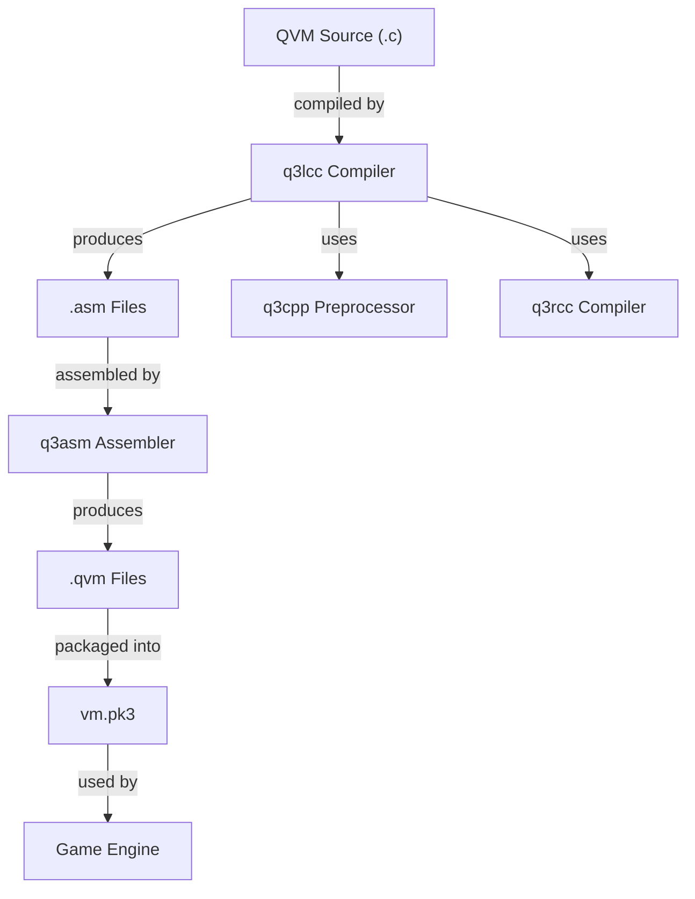
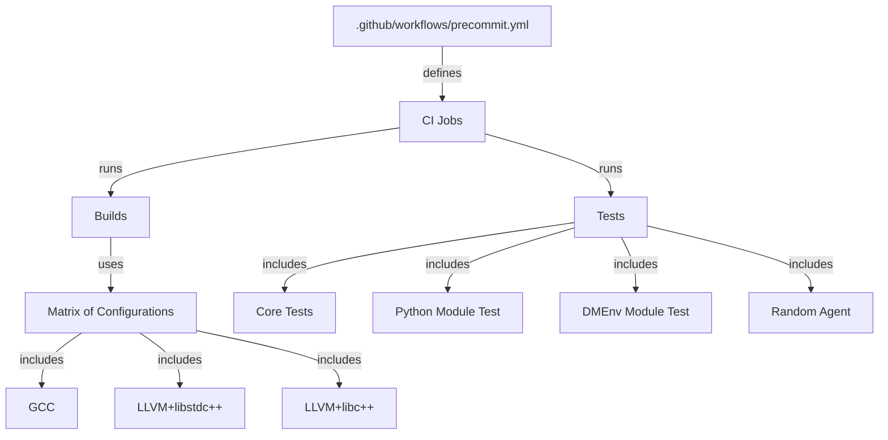

<!-- source: DeepWiki mcp.deepwiki.com · repo google-deepmind/lab · page 8 Build System · fetched 2026-10-26 -->

# Build System

<details>
<summary>Relevant source files</summary>

The following files were used as context for generating this wiki page:

- [.github/workflows/precommit.yml](.github/workflows/precommit.yml)
- [.precommit.bazelrc](.precommit.bazelrc)
- [BUILD](BUILD)
- [WORKSPACE](WORKSPACE)
- [bazel/dm_env.BUILD](bazel/dm_env.BUILD)
- [bazel/pybind11.BUILD](bazel/pybind11.BUILD)
- [bazel/tree.BUILD](bazel/tree.BUILD)
- [docs/users/build.md](docs/users/build.md)
- [public/dmlab_connect_test.cc](public/dmlab_connect_test.cc)
- [python/tests/BUILD](python/tests/BUILD)
- [python/tests/utils/BUILD](python/tests/utils/BUILD)
- [python_system.bzl](python_system.bzl)

</details>


DeepMind Lab uses the [Bazel](https://bazel.build/) build system to manage its compilation, testing, and packaging processes. This document provides a comprehensive overview of the build system architecture, key build targets, dependency management, and configuration options. For information about getting started with building DeepMind Lab, see [Getting Started](#2).

## Build System Architecture

DeepMind Lab's build system is based on Bazel, which provides a structured and reproducible build environment. The system is organized around several key files:

- **WORKSPACE**: Defines external dependencies
- **BUILD**: Defines build targets and rules
- **.precommit.bazelrc**: Contains common build configurations
- Various subdirectory BUILD files: Define component-specific targets

### High-Level Build Architecture



Sources: [WORKSPACE](), [BUILD](), [.precommit.bazelrc](), [docs/users/build.md]()

## Key Build Targets

DeepMind Lab's main BUILD file defines several critical targets that produce the primary artifacts of the system.

### Core Libraries



The core libraries provide different rendering backends:

- **game_lib_sdl**: For windowed operation with SDL
- **game_lib_headless_osmesa**: Software-based headless rendering
- **game_lib_headless_glx**: Hardware-accelerated headless rendering using GLX
- **game_lib_headless_egl**: Hardware-accelerated headless rendering using EGL

Sources: [BUILD:802-892]()

### Main Executables

The key executable targets include:

- **game**: The main game binary for interactive use
- **deepmind_lab.so**: Python module that provides API access
- **python_random_agent**: Example agent that interacts with the environment

```bash
# Build the Python module
bazel build -c opt //:deepmind_lab.so

# Build and run the game
bazel build -c opt //:game
bazel run -c opt //:game

# Run an example random agent
bazel run -c opt //:python_random_agent
```

Sources: [BUILD:907-914](), [BUILD:1012-1033](), [BUILD:1047-1052]()

### Game Assets

DeepMind Lab packages various assets required by the game:



Sources: [BUILD:659-799]()

## Dependency Management

DeepMind Lab uses Bazel's dependency management system to handle both external and internal dependencies.

### External Dependencies

The WORKSPACE file defines external dependencies including:

- **Google Libraries**: GoogleTest, Abseil
- **Graphics Libraries**: SDL, OpenGL/EGL/OSMesa
- **Compression Libraries**: zlib, JPEG, PNG
- **Scripting**: Lua
- **Python**: Python bindings and libraries (numpy, six, etc.)

```
http_archive(
    name = "com_google_googletest",
    strip_prefix = "googletest-main",
    urls = ["https://github.com/google/googletest/archive/main.zip"],
)
```

Sources: [WORKSPACE:6-10](), [WORKSPACE:12-153]()

### Python Dependencies

Python dependencies are handled specially since they need to interact with the system's Python installation:



The WORKSPACE uses a custom repository rule (`python_repo`) to locate system Python installations and NumPy libraries.

Sources: [WORKSPACE:162-165](), [python_system.bzl]()

## Build Configuration

DeepMind Lab provides several build configuration options to customize the build process.

### Rendering Backends

The build system supports multiple rendering backends through configuration settings:

```
config_setting(
    name = "dmlab_graphics_sdl",
    define_values = {"graphics": "sdl"},
)

config_setting(
    name = "dmlab_graphics_osmesa_or_glx",
    define_values = {"graphics": "osmesa_or_glx"},
)

config_setting(
    name = "dmlab_graphics_osmesa_or_egl",
    define_values = {"graphics": "osmesa_or_egl"},
)
```

These can be selected at build time using `--define graphics=...` flags.

Sources: [BUILD:937-950]()

### Platform Detection

The build system uses configuration settings to detect the underlying platform:

```
config_setting(
    name = "is_linux",
    constraint_values = ["@platforms//os:linux"],
)

config_setting(
    name = "is_macos",
    constraint_values = ["@platforms//os:macos"],
)
```

Sources: [BUILD:9-17]()

### C++ Standard

The build system uses C++17 as specified in the .precommit.bazelrc file:

```
build --cxxopt=-std=c++17
```

Sources: [.precommit.bazelrc:6]()

## Quake Virtual Machine (QVM) Compilation

DeepMind Lab is built on the Quake III Arena engine, which uses Quake Virtual Machines (QVMs) for game logic. The build system includes a multi-step process to compile these components:



Sources: [BUILD:45-60](), [BUILD:80-113](), [BUILD:239-254](), [BUILD:411-442]()

## Testing Framework

DeepMind Lab includes comprehensive testing capabilities:

- **Python Module Tests**: Validate the Python bindings functionality
- **Level Load Tests**: Ensure levels can load correctly
- **Seed Tests**: Verify deterministic behavior with fixed seeds

```bash
# Run all tests
bazel test -c opt //...

# Run a specific test
bazel test -c opt //python/tests:python_module_test
```

Sources: [python/tests/BUILD](), [BUILD:1072-1115]()

## Build Artifacts

When built, DeepMind Lab produces several key artifacts:

| Artifact | Description | Build Command |
|----------|-------------|--------------|
| `deepmind_lab.so` | Python module for agent integration | `bazel build -c opt //:deepmind_lab.so` |
| `game` | Interactive game binary | `bazel build -c opt //:game` |
| `python_random_agent` | Example agent implementation | `bazel build -c opt //:python_random_agent` |
| `libdmlab_headless_hw.so` | Headless hardware-accelerated library | `bazel build -c opt //:libdmlab_headless_hw.so` |
| `libdmlab_headless_sw.so` | Headless software-rendered library | `bazel build -c opt //:libdmlab_headless_sw.so` |

Sources: [BUILD:952-975](), [BUILD:907-914](), [BUILD:1012-1033]()

## GitHub CI Integration

DeepMind Lab includes GitHub Actions workflow configurations for continuous integration:



Sources: [.github/workflows/precommit.yml]()

## Related Systems

For more information on related systems, see:

- [Python API](#3) for details on the Python interface
- [Lua Scripting](#5) for level scripting capabilities
- [Level Generation](#6) for creating and customizing levels
- [Observations and Actions](#7) for agent interfaces

---

