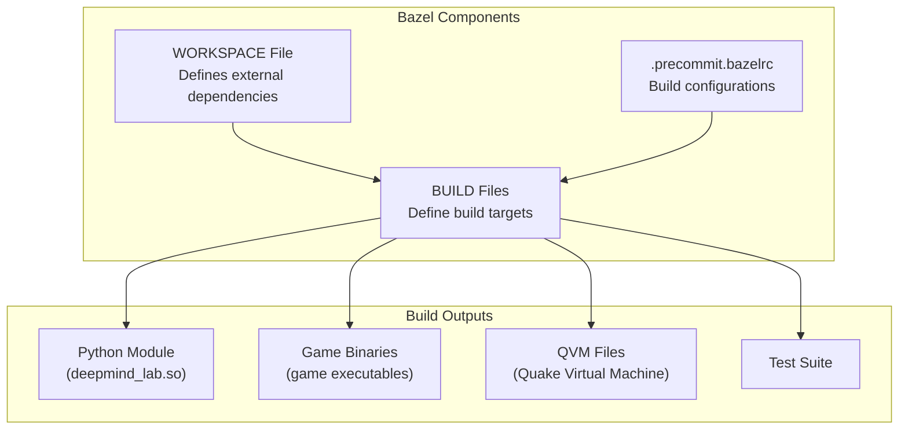
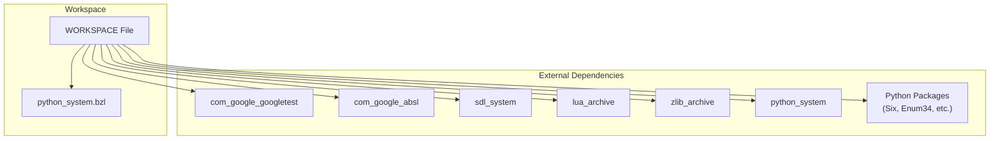
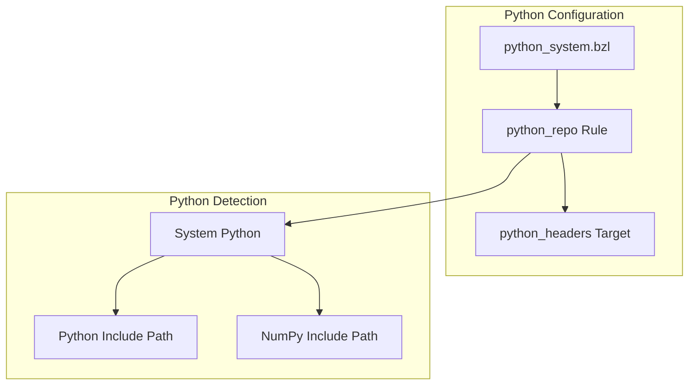
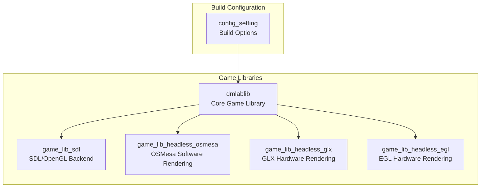
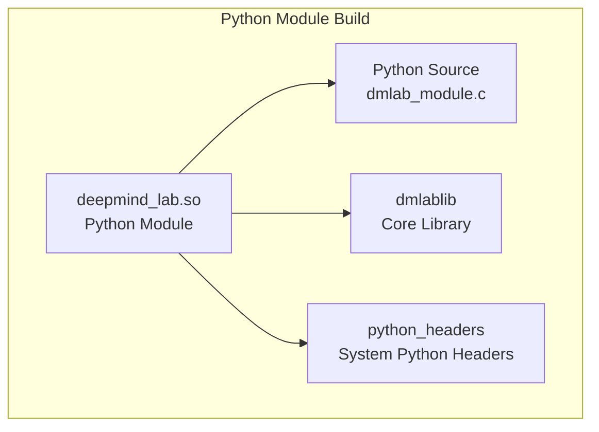
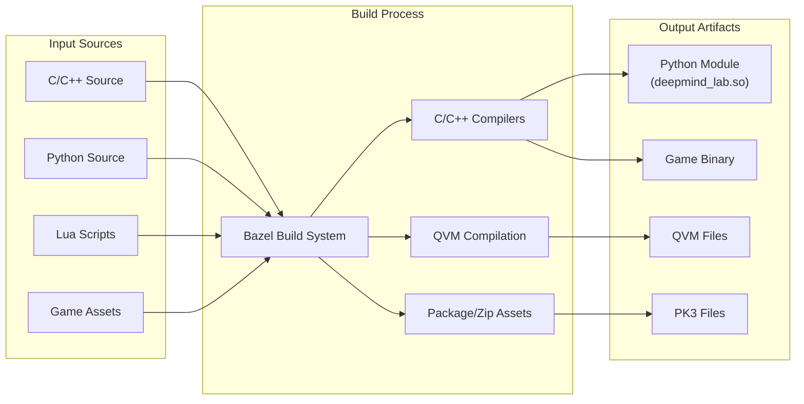
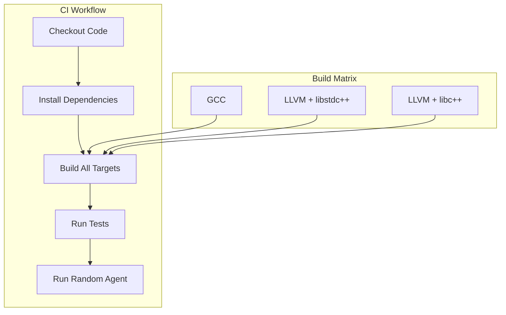

<!-- source: DeepWiki mcp.deepwiki.com · repo google-deepmind/lab · page 8.1 Bazel Setup · fetched 2026-10-26 -->

# Bazel Setup

<details>
<summary>Relevant source files</summary>

The following files were used as context for generating this wiki page:

- [.github/workflows/precommit.yml](.github/workflows/precommit.yml)
- [.precommit.bazelrc](.precommit.bazelrc)
- [BUILD](BUILD)
- [WORKSPACE](WORKSPACE)
- [bazel/dm_env.BUILD](bazel/dm_env.BUILD)
- [bazel/pybind11.BUILD](bazel/pybind11.BUILD)
- [bazel/tree.BUILD](bazel/tree.BUILD)
- [docs/users/build.md](docs/users/build.md)
- [public/dmlab_connect_test.cc](public/dmlab_connect_test.cc)
- [python/tests/BUILD](python/tests/BUILD)
- [python/tests/utils/BUILD](python/tests/utils/BUILD)
- [python_system.bzl](python_system.bzl)

</details>


This page documents how to set up and use Bazel for building DeepMind Lab. Bazel is the build system used by DeepMind Lab to manage dependencies, compile code, and create distributable packages. For information about specific build options and configurations, see [Build Options](#8.2).

## Overview of Bazel in DeepMind Lab

DeepMind Lab uses Bazel as its primary build system. Bazel provides a consistent, reproducible build environment that handles dependencies, compilation, and packaging of the project.

The core Bazel components in DeepMind Lab include:

- **WORKSPACE file**: Defines external dependencies and the workspace configuration
- **BUILD files**: Define build targets and their dependencies
- **Configuration files**: Set build options and platform-specific settings



Sources: [WORKSPACE](), [BUILD](), [.precommit.bazelrc]()

## Workspace Structure

The WORKSPACE file defines the external dependencies required by DeepMind Lab. This includes C++ libraries, Python packages, and game-related dependencies.

Key external dependencies include:

| Category | Dependencies |
|----------|--------------|
| Testing | GoogleTest |
| C++ Libraries | Abseil, Eigen |
| Graphics | JPEG, PNG, SDL2, OpenGL, EGL, OSMesa |
| Python | NumPy, Six, EnumPy |
| Game Engine | Lua 5.1 |



Sources: [WORKSPACE:3-165](), [python_system.bzl]()

### Python Configuration

DeepMind Lab's build system includes special handling for Python dependencies. The `python_system.bzl` file defines rules to detect and use the system's Python installation.



Sources: [WORKSPACE:4-4](), [python_system.bzl:17-72]()

## Key Build Targets

The main BUILD file defines multiple targets for building different components of DeepMind Lab.

### Core Components

| Target | Type | Purpose |
|--------|------|---------|
| `:deepmind_lab.so` | cc_binary | Python interface module |
| `:game` | cc_binary | Standalone game executable |
| `:python_random_agent` | py_binary | Example random agent |
| `:dmlablib` | cc_library | Core library for DeepMind Lab |

### Game Libraries

DeepMind Lab supports multiple rendering backends:



Sources: [BUILD:802-824](), [BUILD:826-846](), [BUILD:848-868](), [BUILD:872-892](), [BUILD:937-950](), [BUILD:998-1010]()

### Python Interface

The Python interface is built as a shared library that can be imported in Python:



Sources: [BUILD:1012-1033](), [BUILD:1035-1045]()

## Building with Bazel

### Prerequisites

Before building DeepMind Lab, you need to install Bazel and the required dependencies:

1. Install Bazel following the [Bazel installation guide](https://docs.bazel.build/versions/master/install.html)
2. Install DeepMind Lab dependencies (shown for Debian/Ubuntu):

```
sudo apt-get install libffi-dev gettext freeglut3-dev libsdl2-dev \
  zip libosmesa6-dev python-dev python-numpy python-pil python-enum34 \
  python3-dev python3-numpy python3-pil
```

Sources: [docs/users/build.md:6-20](), [docs/users/build.md:32-47]()

### Basic Build Commands

Here are the most common Bazel commands for building DeepMind Lab:

| Command | Purpose |
|---------|---------|
| `bazel build -c opt //:deepmind_lab.so` | Build the Python interface |
| `bazel test -c opt //python/tests:python_module_test` | Run Python module tests |
| `bazel run -c opt //:python_random_agent` | Run the random agent example |

Sources: [docs/users/build.md:74-94]()

### Build Options

DeepMind Lab supports several build configurations that can be specified with `--define` flags:

```
# Build with SDL graphics (with display)
bazel build -c opt //:deepmind_lab.so --define graphics=sdl

# Build with OSMesa or GLX (headless, software rendering)
bazel build -c opt //:deepmind_lab.so --define graphics=osmesa_or_glx

# Build with OSMesa or EGL (headless, hardware acceleration if available)
bazel build -c opt //:deepmind_lab.so --define graphics=osmesa_or_egl
```

Sources: [BUILD:937-950](), [BUILD:998-1010]()

## Build Process Flow

The following diagram illustrates the overall build process:



Sources: [BUILD:771-799](), [BUILD:661-687](), [BUILD:742-773]()

## Common Bazel Commands for DeepMind Lab

### Building Core Components

```
# Build the Python module
bazel build -c opt //:deepmind_lab.so

# Build the game binary
bazel build -c opt //:game
```

### Running Tests

```
# Run all tests
bazel test -c opt //...

# Run Python module tests
bazel test -c opt //python/tests:python_module_test

# Run a specific test
bazel test -c opt //python/tests:python_random_agent_test
```

Sources: [python/tests/BUILD:18-44](), [.github/workflows/precommit.yml:43-49]()

### Building with Different Configurations

```
# Build with optimizations
bazel build -c opt //:deepmind_lab.so

# Build with debug symbols
bazel build -c dbg //:deepmind_lab.so

# Build using a specific compiler
CC=clang CXX=clang++ bazel build -c opt //:deepmind_lab.so
```

Sources: [.precommit.bazelrc:4-6](), [.github/workflows/precommit.yml:30-31]()

## Continuous Integration

DeepMind Lab includes CI configuration for GitHub Actions that build and test the code using different compilers and configurations.



Sources: [.github/workflows/precommit.yml:15-27](), [.github/workflows/precommit.yml:42-52]()

## Troubleshooting

### Python Dependency Issues

If you encounter Python dependency issues during the build, you may need to adjust the Python configuration:

1. Ensure NumPy is installed for your Python version
2. Verify that Python development headers are installed
3. Check that the correct Python version is being detected

```
# Check your NumPy include path
python3 -c "import numpy as np; print(np.get_include())"

# Build with a specific Python binary
PYTHON_BIN_PATH="/usr/bin/python3" bazel build -c opt //:deepmind_lab.so
```

Sources: [docs/users/build.md:96-131]()

### Rendering Backend Issues

If you encounter rendering issues:

1. For headless environments, try using the software renderer (OSMesa)
2. For hardware acceleration, ensure your GPU drivers are properly installed
3. Check that the necessary libraries (EGL, GLX, OSMesa) are installed

```
# Build with software rendering
bazel build -c opt //:deepmind_lab.so --define graphics=osmesa_or_glx
```

Sources: [BUILD:826-892](), [BUILD:937-950]()

---

