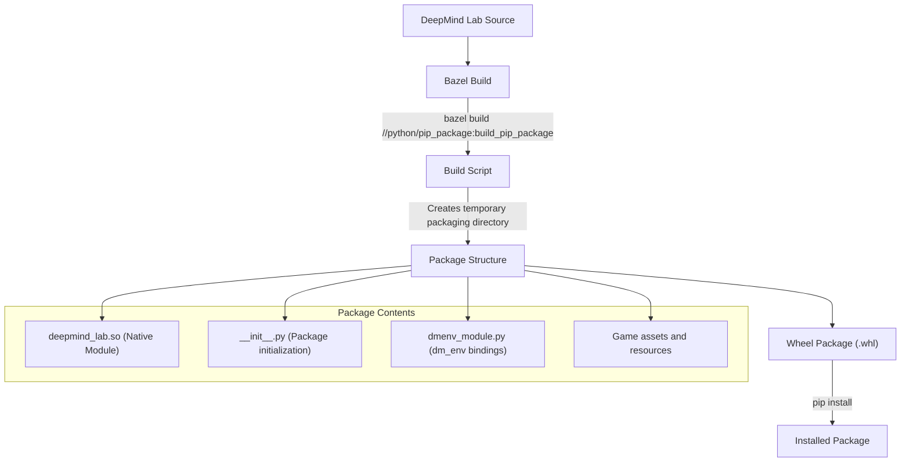
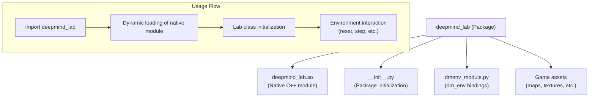
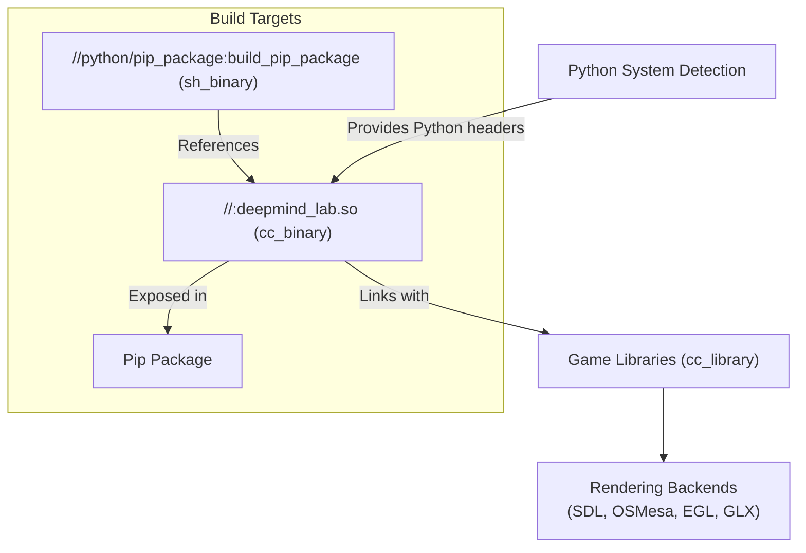

<!-- source: DeepWiki mcp.deepwiki.com · repo google-deepmind/lab · page 8.3 Pip Package · fetched 2026-10-26 -->

# Pip Package

<details>
<summary>Relevant source files</summary>

The following files were used as context for generating this wiki page:

- [.github/workflows/precommit.yml](.github/workflows/precommit.yml)
- [.precommit.bazelrc](.precommit.bazelrc)
- [BUILD](BUILD)
- [README.md](README.md)
- [docs/users/build.md](docs/users/build.md)
- [public/dmlab_connect_test.cc](public/dmlab_connect_test.cc)
- [python/pip_package/BUILD](python/pip_package/BUILD)
- [python/pip_package/README.md](python/pip_package/README.md)
- [python/pip_package/__init__.py](python/pip_package/__init__.py)
- [python/pip_package/build_pip_package.sh](python/pip_package/build_pip_package.sh)
- [python/pip_package/setup.py](python/pip_package/setup.py)
- [python/tests/BUILD](python/tests/BUILD)
- [python/tests/utils/BUILD](python/tests/utils/BUILD)
- [python_system.bzl](python_system.bzl)

</details>


This document explains how to build, install and use the DeepMind Lab Python pip package. The pip package provides a convenient way to use DeepMind Lab outside of a Bazel project, allowing you to install the environment using standard Python package management tools.

For information about using the Python API itself, see [Python API](#3).

## Overview

The DeepMind Lab pip package encapsulates the DeepMind Lab environment into a standard Python package that can be installed using pip. This allows researchers and developers to use DeepMind Lab without needing to understand or work with Bazel directly.

The package provides two main interfaces:
- The native DeepMind Lab Python API (via the `deepmind_lab.Lab` class)
- Bindings to DeepMind's standard "dm_env" reinforcement learning API (via the `deepmind_lab.dmenv_module`)

## Build Process

Building the DeepMind Lab pip package involves several steps: building the assets and binaries with Bazel, bundling them into a Python package, and creating a wheel distribution file.

### Build Process Diagram



Sources: [python/pip_package/build_pip_package.sh:1-66](), [python/pip_package/BUILD:1-16]()

## Building the Pip Package

### Prerequisites

Before building the pip package, ensure you have:

1. Installed all DeepMind Lab dependencies as described in the [Build System](#8.1) documentation
2. Additional pip package requirements:
   - pip, wheel, and setuptools
   - virtualenv (optional, but recommended)

### Build Commands

The full build process requires two main steps:

1. Build the packaging script with Bazel
2. Run the script to create the wheel package

```bash
# Clone DeepMind Lab repository if you haven't already
git clone https://github.com/deepmind/lab.git
cd lab

# Build the pip package script with Bazel (for Python 3)
bazel build -c opt --python_version=PY3 //python/pip_package:build_pip_package

# Run the script to create the wheel package
./bazel-bin/python/pip_package/build_pip_package /tmp/dmlab_pkg
```

Sources: [python/pip_package/README.md:9-24](), [python/pip_package/build_pip_package.sh:10-66]()

### Python Version Selection

DeepMind Lab supports both Python 2 and Python 3. To select which Python version to build against, use the `--python_version` flag when building the pip package script:

- For Python 2: `--python_version=PY2`
- For Python 3: `--python_version=PY3` (default since Bazel 0.27)

When creating the wheel package, you can also specify which Python interpreter to use via the `PYTHON_BIN_PATH` environment variable:

```bash
PYTHON_BIN_PATH="/usr/bin/python3" ./bazel-bin/python/pip_package/build_pip_package /tmp/dmlab_pkg
```

Sources: [python/pip_package/README.md:42-61](), [python/pip_package/build_pip_package.sh:47-53]()

## Package Structure

The DeepMind Lab pip package has the following structure:



The pip package works by:
1. Dynamically loading the native `deepmind_lab.so` module when imported
2. Exposing the DeepMind Lab API through the `Lab` class
3. Providing optional dm_env bindings through the `dmenv_module`

Sources: [python/pip_package/__init__.py:1-32](), [python/pip_package/build_pip_package.sh:25-42]()

## Installing the Package

### Basic Installation

After building the wheel package, you can install it using pip:

```bash
pip install /tmp/dmlab_pkg/deepmind_lab-1.0-py3-none-any.whl
```

### Using Virtualenv (Recommended)

For a cleaner installation, use virtualenv to create an isolated environment:

```bash
# Create a virtual environment
virtualenv myenv
source myenv/bin/activate

# Install dependencies
pip install numpy

# Install DeepMind Lab
pip install /tmp/dmlab_pkg/deepmind_lab-1.0-py3-none-any.whl
```

To use the dm_env bindings, install with the additional extras:

```bash
pip install /tmp/dmlab_pkg/deepmind_lab-1.0-py3-none-any.whl[dmenv_module]
```

Sources: [python/pip_package/README.md:84-137](), [python/pip_package/setup.py:1-21]()

### Testing the Installation

Create a simple test script to verify the installation:

```python
import deepmind_lab
import numpy as np

# Create a new environment object
lab = deepmind_lab.Lab("demos/extra_entities", ['RGB_INTERLEAVED'],
                      {'fps': '30', 'width': '80', 'height': '60'})
lab.reset(seed=1)

# Execute 100 walk-forward steps and sum the returned rewards
reward_sum = sum(
    [lab.step(np.array([0,0,0,1,0,0,0], dtype=np.intc)) for i in range(0, 100)])
print(f"Total reward: {reward_sum}")
```

Run the script to test if DeepMind Lab is working correctly.

Sources: [python/pip_package/README.md:149-171]()

## Using the Package

### Basic Usage

```python
import deepmind_lab
import numpy as np

# Create a DeepMind Lab environment
lab = deepmind_lab.Lab(
    level='lt_chasm',                           # Level name
    observations=['RGB_INTERLEAVED'],           # Requested observations
    config={'fps': '30', 'width': '80', 'height': '60'}  # Configuration
)

# Reset the environment
lab.reset(seed=42)

# Define action: forward movement
action = np.array([0, 0, 0, 1, 0, 0, 0], dtype=np.intc)

# Run the environment for 100 steps
for _ in range(100):
    reward = lab.step(action)
    if lab.is_running():
        # Get observation
        obs = lab.observations()['RGB_INTERLEAVED']
    else:
        lab.reset(seed=42)
```

### Using dm_env Bindings

DeepMind Lab also provides compatibility with DeepMind's standard reinforcement learning API [dm_env](https://github.com/deepmind/dm_env):

```python
from deepmind_lab import dmenv_module

# Create a dm_env-compatible environment
env = dmenv_module.Lab(
    level='lt_chasm',
    observation_names=['RGB_INTERLEAVED'],
    config={'fps': '30', 'width': '80', 'height': '60'}
)

# Reset the environment
timestep = env.reset()

# Define action: forward movement
action = [0, 0, 0, 1, 0, 0, 0]

# Run the environment for 100 steps
for _ in range(100):
    timestep = env.step(action)
    observation = timestep.observation['RGB_INTERLEAVED']
    reward = timestep.reward
```

Sources: [python/pip_package/__init__.py:1-32](), [python/pip_package/README.md:193-218]()

## Package Dependencies

The DeepMind Lab pip package has the following dependencies:

| Dependency | Version | Purpose |
|------------|---------|---------|
| numpy      | >= 1.13.3 | Array operations and observation handling |
| six        | >= 1.10.0 | Python 2/3 compatibility |
| dm-env     | (optional) | Required for dm_env bindings |

Sources: [python/pip_package/setup.py:1-21]()

## Build System Integration

The pip package build process is integrated with the DeepMind Lab Bazel build system. The main components involved are:



The pip package build process uses Bazel targets defined in multiple BUILD files:

1. The main BUILD file defines how to build the `deepmind_lab.so` native module
2. The `python/pip_package/BUILD` file defines the packaging script
3. The Python system detection rules in `python_system.bzl` locate the system's Python installation

Sources: [BUILD:1002-1045](), [python/pip_package/BUILD:1-16](), [python_system.bzl:1-72]()

## Common Issues and Troubleshooting

### NumPy Compatibility

The NumPy version used to build DeepMind Lab must be compatible with the one used at runtime. If you encounter NumPy-related errors:

1. Check your NumPy version: `python -c "import numpy; print(numpy.__version__)"`
2. Ensure the build system is using a compatible version
3. If using virtualenv, you may need to install NumPy again in the environment

### Reinstalling or Upgrading

When making changes to DeepMind Lab source code, you'll need to rebuild and reinstall the package. Use the `--force-reinstall` flag with pip:

```bash
pip install /tmp/dmlab_pkg/deepmind_lab-1.0-py3-none-any.whl --force-reinstall
```

### Headless Rendering Options

The pip package includes multiple rendering backends. By default, it tries to select the appropriate one for your system. You can force a specific backend when building the native module by setting Bazel build options.

Sources: [python/pip_package/README.md:174-188](), [BUILD:936-994]()

---

