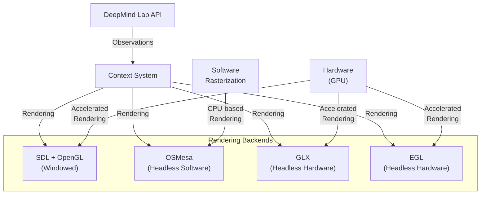
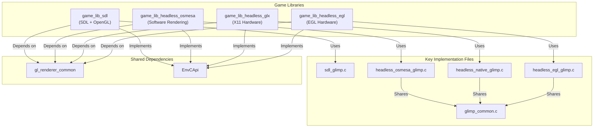
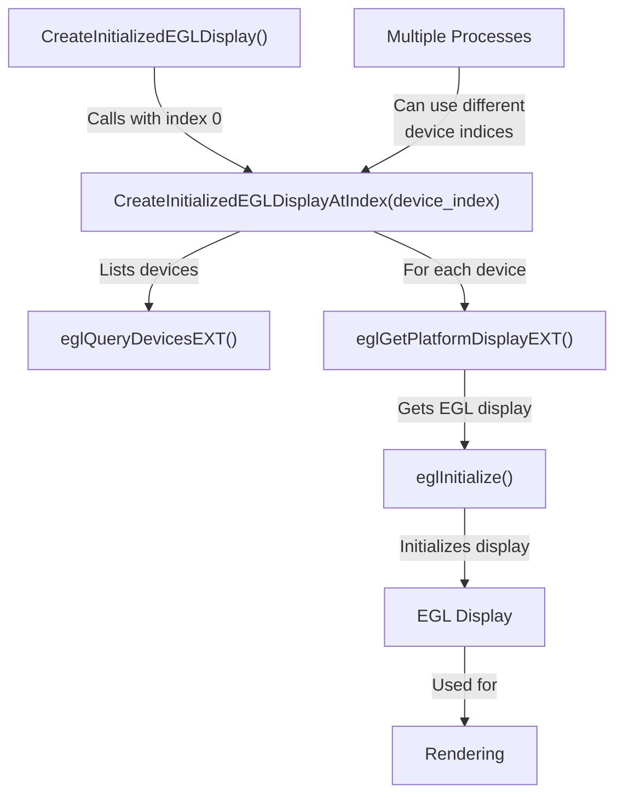
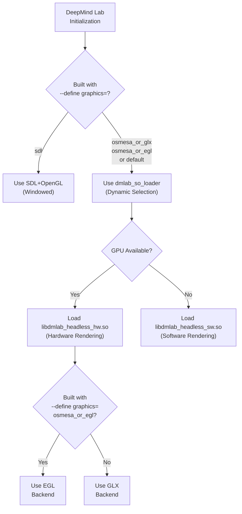

<!-- source: DeepWiki mcp.deepwiki.com · repo google-deepmind/lab · page 8.4 Rendering Options · fetched 2026-10-26 -->

# Rendering Options

<details>
<summary>Relevant source files</summary>

The following files were used as context for generating this wiki page:

- [.github/workflows/precommit.yml](.github/workflows/precommit.yml)
- [.precommit.bazelrc](.precommit.bazelrc)
- [BUILD](BUILD)
- [docs/users/build.md](docs/users/build.md)
- [public/dmlab_connect_test.cc](public/dmlab_connect_test.cc)
- [python/tests/BUILD](python/tests/BUILD)
- [python/tests/utils/BUILD](python/tests/utils/BUILD)
- [python_system.bzl](python_system.bzl)
- [third_party/GL/BUILD](third_party/GL/BUILD)
- [third_party/GL/EGL/egl.h](third_party/GL/EGL/egl.h)
- [third_party/GL/EGL/eglext.h](third_party/GL/EGL/eglext.h)
- [third_party/GL/EGL/eglplatform.h](third_party/GL/EGL/eglplatform.h)
- [third_party/GL/KHR/khrplatform.h](third_party/GL/KHR/khrplatform.h)
- [third_party/GL/LICENSE](third_party/GL/LICENSE)
- [third_party/GL/util/BUILD](third_party/GL/util/BUILD)
- [third_party/GL/util/LICENSE](third_party/GL/util/LICENSE)
- [third_party/GL/util/egl_util.cc](third_party/GL/util/egl_util.cc)
- [third_party/GL/util/egl_util.h](third_party/GL/util/egl_util.h)
- [third_party/GL/util/egl_util_test.cc](third_party/GL/util/egl_util_test.cc)

</details>


DeepMind Lab supports several rendering backends for visualizing the 3D environments. This page documents the available rendering options, how to configure them, and considerations for selecting the appropriate renderer for your use case. The rendering options primarily differ in whether they require a display (windowed mode) or can run without one (headless mode), and whether they use hardware acceleration or software rendering.

## Overview of Available Renderers

DeepMind Lab provides four different rendering backends:

1. **SDL with OpenGL** - Windowed rendering that displays visible output on screen
2. **Headless OSMesa** - Software-based rendering without display requirements
3. **Headless GLX** - Hardware-accelerated rendering using X11, without visible output
4. **Headless EGL** - Hardware-accelerated rendering using EGL, without visible output

### Rendering Architecture



Sources: [BUILD:802-892]()

## Renderer Implementations

Each rendering backend is implemented as a separate library in the codebase:



Sources: [BUILD:802-892]()

## Selecting a Rendering Backend

There are two main ways to select a rendering backend in DeepMind Lab:

### 1. Build-time Selection

You can select the rendering backend at build time using Bazel's `--define` flag:

| Flag | Description |
|------|-------------|
| `--define graphics=sdl` | Uses SDL with OpenGL (windowed mode) |
| `--define graphics=osmesa_or_glx` | Uses OSMesa for software rendering or GLX for hardware rendering |
| `--define graphics=osmesa_or_egl` | Uses OSMesa for software rendering or EGL for hardware rendering |
| `--define headless=osmesa` | Forces headless mode with OSMesa software rendering |

Example:
```
bazel build -c opt --define graphics=osmesa_or_egl //:deepmind_lab.so
```

Sources: [BUILD:937-950](), [.github/workflows/precommit.yml:52]()

### 2. Runtime Library Selection

DeepMind Lab also includes a mechanism to dynamically select between software (OSMesa) and hardware (EGL or GLX) rendering at runtime. This is implemented through the `dmlab_so_loader` which can load either:

- `libdmlab_headless_hw.so` - For hardware-accelerated headless rendering
- `libdmlab_headless_sw.so` - For software-based headless rendering

This allows the same build to adapt to different hardware environments.

Sources: [BUILD:978-995]()

## Hardware-Accelerated Headless Rendering with EGL

The EGL-based renderer is particularly useful for multi-GPU systems where you need hardware acceleration without a display. DeepMind Lab uses a utility library to initialize EGL displays:



Sources: [third_party/GL/util/egl_util.h:18-59](), [third_party/GL/util/egl_util.cc:16-163]()

## Renderer Selection Logic

The following diagram illustrates how DeepMind Lab selects which renderer to use:



Sources: [BUILD:997-1009]()

## Rendering Performance Considerations

When selecting a rendering backend, consider the following:

| Renderer | Advantages | Disadvantages | Best For |
|----------|------------|--------------|----------|
| SDL+OpenGL | Visual output, debugging | Requires display/monitor | Development, debugging, demos |
| OSMesa (Headless SW) | Works without GPU, consistent | Slower rendering | CI/Tests, systems without GPU |
| GLX (Headless HW) | Fast rendering, no display needed | Requires X11 and GPU | Training on Linux with GPU |
| EGL (Headless HW) | Fast rendering, no display or X11 | Requires GPU | Modern GPU systems, deployment |

Sources: [BUILD:802-892]()

## Configuring the Software/Hardware Selection

The default selection logic in DeepMind Lab will try to use hardware acceleration if available, falling back to software rendering if not. For research experiments where consistent performance is important, you may want to explicitly select one renderer to ensure consistency across runs.

Example of forcing software rendering:
```
bazel run -c opt --define headless=osmesa //:python_random_agent
```

Sources: [.github/workflows/precommit.yml:52]()

## Platform Compatibility

Support for specific rendering backends varies by platform:

| Platform | SDL+OpenGL | OSMesa | GLX | EGL |
|----------|------------|--------|-----|-----|
| Linux | ✓ | ✓ | ✓ | ✓ |
| macOS | ✓ | ✓ | ✗ | ✗ |
| Windows | ✓ | ✓ | ✗ | Limited |

Note that headless hardware-accelerated rendering (GLX/EGL) is primarily designed for Linux environments.

Sources: [docs/users/build.md:1-134](), [third_party/GL/EGL/eglplatform.h:1-170]()

## Multi-GPU Environments

For systems with multiple GPUs, the EGL backend provides functionality to select specific devices:

1. The `CreateInitializedEGLDisplayAtIndex(device_index)` function allows selecting a specific GPU
2. By default, the first available GPU (index 0) is used
3. For multi-process training on a multi-GPU system, you can assign different processes to different GPUs

Sources: [third_party/GL/util/egl_util.h:33](), [third_party/GL/util/egl_util.cc:98-152]()

## Debugging Rendering Issues

If you encounter rendering issues:

1. Start with the SDL+OpenGL backend for visual debugging
2. For headless environments, try forcing software rendering with `--define headless=osmesa`
3. Check hardware requirements: EGL and GLX require a compatible GPU
4. For EGL issues on multi-GPU systems, try specifying different device indices

Sources: [python/tests/render_test.py:215-221]()

---

