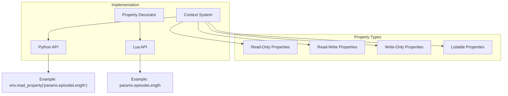
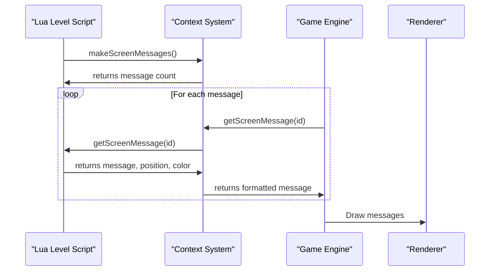
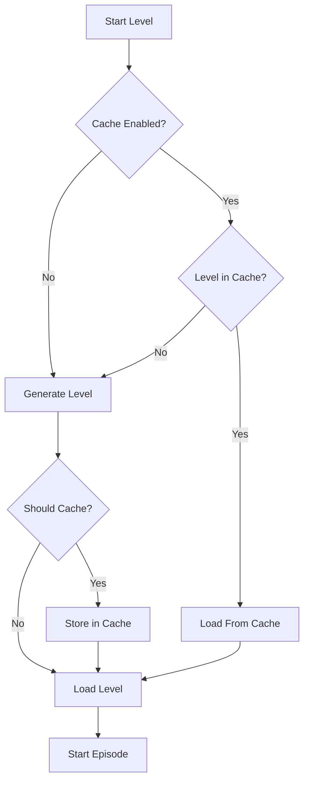
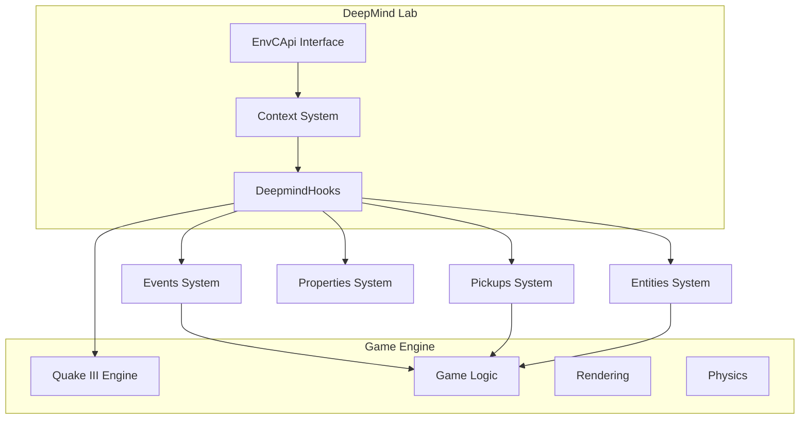
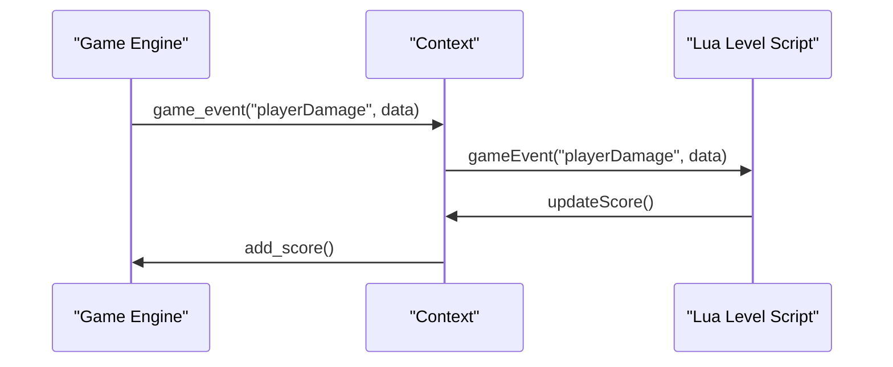

<!-- source: DeepWiki mcp.deepwiki.com · repo google-deepmind/lab · page 9 Advanced Topics · fetched 2026-10-26 -->

# Advanced Topics

<details>
<summary>Relevant source files</summary>

The following files were used as context for generating this wiki page:

- [deepmind/engine/context.cc](deepmind/engine/context.cc)
- [deepmind/engine/context.h](deepmind/engine/context.h)
- [deepmind/include/deepmind_hooks.h](deepmind/include/deepmind_hooks.h)
- [docs/developers/reference/lua_api.md](docs/developers/reference/lua_api.md)
- [docs/users/actions.md](docs/users/actions.md)
- [engine/code/deepmind/dm_local.c](engine/code/deepmind/dm_local.c)
- [engine/code/deepmind/dm_local.h](engine/code/deepmind/dm_local.h)
- [engine/code/deepmind/dm_public.h](engine/code/deepmind/dm_public.h)
- [engine/code/game/g_active.c](engine/code/game/g_active.c)
- [engine/code/game/g_local.h](engine/code/game/g_local.h)
- [engine/code/game/g_mover.c](engine/code/game/g_mover.c)
- [engine/code/game/g_spawn.c](engine/code/game/g_spawn.c)
- [engine/code/qcommon/deepmind_hooks.c](engine/code/qcommon/deepmind_hooks.c)
- [engine/code/qcommon/q_shared.h](engine/code/qcommon/q_shared.h)
- [engine/code/qcommon/surfaceflags.h](engine/code/qcommon/surfaceflags.h)
- [game_scripts/decorators/gadget_selection.lua](game_scripts/decorators/gadget_selection.lua)
- [game_scripts/decorators/setting_overrides.lua](game_scripts/decorators/setting_overrides.lua)
- [game_scripts/levels/tests/properties_test.lua](game_scripts/levels/tests/properties_test.lua)
- [python/tests/properties_test.py](python/tests/properties_test.py)

</details>


This page covers advanced features and techniques for working with DeepMind Lab. It's intended for developers who have already mastered the basics and need to fine-tune their environments, optimize performance, or implement sophisticated customizations. For information about getting started with DeepMind Lab, see [Getting Started](#2).

## Configuration and Properties

DeepMind Lab includes a powerful property system that allows for dynamic configuration and information exchange between the environment and the agent.

### Property System Architecture

The property system provides a hierarchical way to access and modify settings in the environment. Properties can be read-only, write-only, or read-write, and can be organized in nested structures.



Sources:
- [deepmind/engine/context.h:528-544]()
- [deepmind/engine/context.cc:529-536]()
- [game_scripts/decorators/property_decorator.lua]()

### Reading and Writing Properties

Properties can be accessed from both Python and Lua:

#### Python Example:
```python
# Read a property
episode_length = env.read_property('params.episodeLengthSeconds')

# Write a property
env.write_property('params.overrideEntityLayer', custom_layer)

# List sub-properties
engine_props = env.properties('engine')
```

#### Lua Example:
```lua
local property_decorator = require 'decorators.property_decorator'

-- In your API table
function api:init(params)
    property_decorator.decorate(self)
    property_decorator.addReadWrite('params', my_settings)
    property_decorator.addReadOnly('stats.score', function() 
        return tostring(current_score) 
    end)
end
```

Sources:
- [python/tests/properties_test.py:27-40]()
- [game_scripts/levels/tests/properties_test.lua:18-56]()
- [game_scripts/decorators/setting_overrides.lua:155-163]()

### Property Attributes

Properties have different attributes that determine how they can be accessed:

| Attribute | Code Flag | Description |
|-----------|-----------|-------------|
| Readable | `READABLE` | Property can be read |
| Writable | `WRITABLE` | Property can be written |
| Listable | `LISTABLE` | Property contains sub-properties |

You can check a property's attributes using `env.properties()` which returns a dictionary mapping each property to its attributes.

Sources:
- [python/tests/properties_test.py:94-140]()
- [deepmind/engine/context.h:401-411]()

## Debugging and Testing

DeepMind Lab provides several mechanisms for debugging environments and visualizing state.

### Screen Messages and Overlays

You can overlay text messages and filled rectangles on the screen for debugging:



To implement screen messages in your level:

```lua
function api:makeScreenMessages(screenWidth, screenHeight, lineHeight, stringBufferSize)
    return 2  -- Return the number of messages
end

function api:getScreenMessage(messageId, buffer, x, y, alignL0R1C2, shadow, rgba)
    if messageId == 0 then
        -- First message at top-left
        buffer = "Score: " .. current_score
        x = 10
        y = 10
        alignL0R1C2 = 0  -- Left aligned
        shadow = 1       -- With shadow
        rgba = {1, 1, 1, 1}  -- White
    elseif messageId == 1 then
        -- Second message at top-right
        buffer = "Time: " .. time_remaining
        x = screenWidth - 10
        y = 10
        alignL0R1C2 = 1  -- Right aligned
        shadow = 1
        rgba = {1, 1, 1, 1}
    end
end
```

Similar functions exist for drawing filled rectangles: `makeFilledRectangles()` and `getFilledRectangle()`.

Sources:
- [deepmind/engine/context.h:291-320]()
- [engine/code/deepmind/dm_local.h:116-148]()
- [deepmind/engine/context.cc:445-468]()

### Testing with Properties

The property system can be used effectively for testing environment behavior:

```python
def test_environment_state():
    env = deepmind_lab.Lab('my_level', [])
    env.reset(seed=42)
    
    # Check current state through properties
    current_layer = env.read_property('params.currentEntityLayer')
    assert 'P' in current_layer  # Verify player exists
    
    # Modify environment through properties
    env.write_property('params.overrideEntityLayer', custom_layer)
    env.reset(seed=42)
    
    # Verify changes took effect
    assert env.read_property('params.currentEntityLayer') == custom_layer
```

Sources:
- [python/tests/properties_test.py:142-204]()

## Performance Optimization

### Level Caching

DeepMind Lab includes a level caching system to improve loading times for procedurally generated levels:



Level caching is configured through the `Context` system:

```cpp
void SetLevelCacheSetting(bool local, bool global, DeepMindLabLevelCacheParams level_cache_params)
```

Parameters:
- `local`: Enable local level cache in the temporary directory
- `global`: Enable global level cache in a shared location
- `level_cache_params`: Callbacks for reading/writing cache data

Sources:
- [deepmind/engine/context.h:370-382]()
- [deepmind/engine/context.cc:86-91]()
- [deepmind/engine/context.cc:564-570]()

### Rendering Optimization

For headless environments (where visual observation isn't needed), you can significantly improve performance:

```python
# Create a minimal rendering environment
env = deepmind_lab.Lab('level', [], config={
    'width': '1',
    'height': '1',
    'fps': '60'
})
```

For server environments, you can use the headless renderer which doesn't require a GPU:

```bash
# Use headless renderer when building
bazel build -c opt --define headless=true //...
```

Sources:
- [python/tests/properties_test.py:47-50]()

## Advanced Customization

### Engine Hooks

DeepMind Lab exposes numerous hooks into the Quake III Arena engine through the `DeepmindHooks` system:



These hooks enable deep customization of the environment's behavior, allowing you to modify:
- Entity spawning and behavior
- Player movement and actions
- Game events and rewards
- Rendering and observations

Sources:
- [deepmind/include/deepmind_hooks.h:34-443]()
- [engine/code/qcommon/deepmind_hooks.c:18-251]()
- [engine/code/deepmind/dm_public.h:22-58]()

### Custom Actions

You can define custom discrete actions beyond the standard movement controls:

```lua
function api:customDiscreteActionSpec()
  return {
    {name = 'SWITCH_GADGET', min = -1, max = 1},
    {name = 'SELECT_GADGET', min = 0, max = 10},
  }
end

function api:customDiscreteActions(actions)
  -- Handle the custom actions
  if actions[1] ~= 0 then  -- SWITCH_GADGET action
    -- Switch gadget logic
  end
  if actions[2] ~= 0 then  -- SELECT_GADGET action
    -- Select gadget logic
  end
end
```

These custom actions will appear alongside standard actions in the agent's action space.

Sources:
- [docs/users/actions.md:24-32]()
- [game_scripts/decorators/gadget_selection.lua:3-64]()
- [docs/developers/reference/lua_api.md:172-208]()

### Custom Observations

Similar to custom actions, you can define custom observations:

```lua
function api:customObservationSpec()
  return {
    {name = 'LOCATION', type = 'doubles', shape = {3}},  -- Player position
    {name = 'ORDER', type = 'bytes', shape = {0}},       -- Variable-length text
    {name = 'LOOK_PITCH', type = 'doubles', shape = {1}} -- Camera pitch
  }
end

function api:customObservation(name)
  if name == 'LOCATION' then
    return tensor.DoubleTensor{x, y, z}
  elseif name == 'ORDER' then
    return tensor.ByteTensor(order:byte(1, -1))
  elseif name == 'LOOK_PITCH' then
    return tensor.DoubleTensor{pitch}
  end
end
```

Observations can return either byte tensors or double tensors, and can have fixed or variable shapes.

Sources:
- [deepmind/include/deepmind_hooks.h:336-359]()
- [docs/developers/reference/lua_api.md:211-256]()

### Event System

The event system allows your environment to track and respond to game events:



To handle events in your level script:

```lua
function api:gameEvent(eventName, eventData)
  if eventName == 'playerDamage' then
    -- Handle player damage event
    local damage = eventData[1]
    current_score = current_score - damage
  elseif eventName == 'pickupCollected' then
    -- Handle pickup event
    local pickupType = eventData[1]
    current_score = current_score + pickup_values[pickupType]
  end
end
```

Sources:
- [deepmind/include/deepmind_hooks.h:394-396]()
- [engine/code/deepmind/dm_local.h:161-165]()
- [docs/developers/reference/lua_api.md:295-304]()

## Configuration and Properties

### Setting Overrides

DeepMind Lab provides a flexible mechanism for overriding level settings through the `setting_overrides` decorator:

```lua
local setting_overrides = require 'decorators.setting_overrides'

local api = {}
local myParams = {
  episodeLengthSeconds = 60,
  rewardGoal = 10,
  mazeWidth = 11,
  mazeHeight = 11,
  -- other settings
}

setting_overrides.decorate{
  api = api,
  apiParams = myParams,
  decorateWithTimeout = true
}

function api:nextMap()
  return 'my_map'
end

-- Return the decorated API
return api
```

This system allows settings to be overridden from Python:

```python
env = deepmind_lab.Lab(
    'my_level',
    [],
    config={
        'episodeLengthSeconds': '120',  # Override the default value
        'mazeWidth': '15',
        'mazeHeight': '15'
    }
)
```

Sources:
- [game_scripts/decorators/setting_overrides.lua:92-174]()
- [docs/developers/reference/lua_api.md:258-277]()

## Advanced Topics Summary

This page has covered several advanced aspects of DeepMind Lab:

1. **Configuration and Properties**: The property system for accessing and modifying environment state
2. **Debugging and Testing**: Tools for debugging environments and testing behavior
3. **Performance Optimization**: Techniques to improve loading times and runtime performance
4. **Advanced Customization**: Creating custom actions, observations, and handling events
5. **Setting Overrides**: Flexible configuration system for levels

These advanced features allow you to create sophisticated, high-performance environments for reinforcement learning research. They build upon the core functionality described in other sections of this documentation to provide fine-grained control over the DeepMind Lab system.

---

