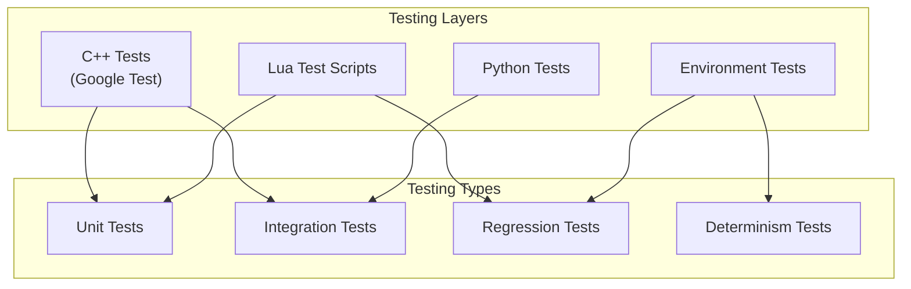
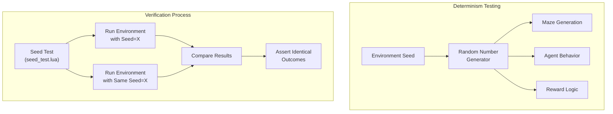
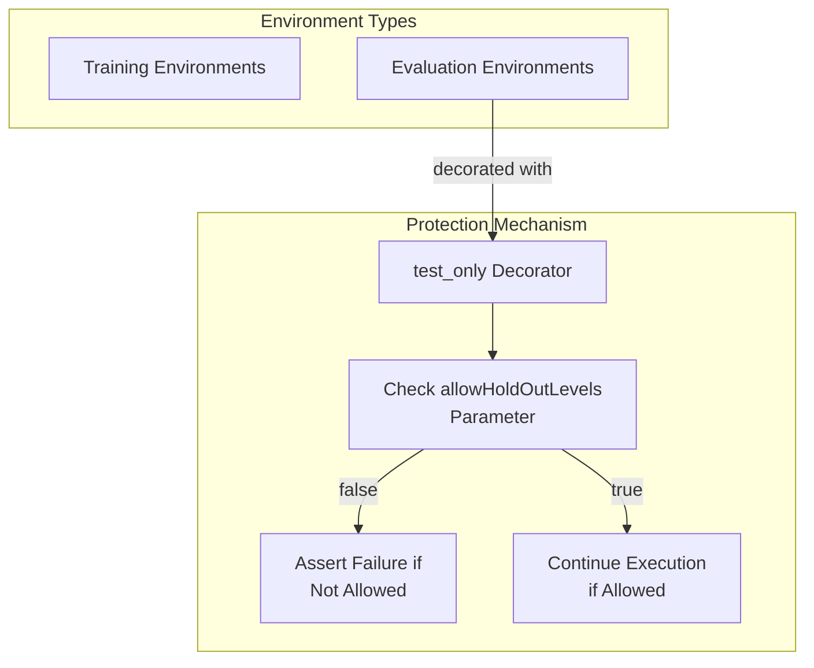

<!-- source: DeepWiki mcp.deepwiki.com · repo google-deepmind/lab · page 9.1 Debugging and Testing · fetched 2026-10-26 -->

# Debugging and Testing

<details>
<summary>Relevant source files</summary>

The following files were used as context for generating this wiki page:

- [docs/levels.md](docs/levels.md)
- [docs/users.md](docs/users.md)
- [engine/code/renderergl1/tr_cmds.c](engine/code/renderergl1/tr_cmds.c)
- [engine/code/renderergl2/tr_cmds.c](engine/code/renderergl2/tr_cmds.c)
- [game_scripts/decorators/debug_observations.lua](game_scripts/decorators/debug_observations.lua)
- [game_scripts/decorators/test_only.lua](game_scripts/decorators/test_only.lua)
- [game_scripts/factories/psychlab/factory.lua](game_scripts/factories/psychlab/factory.lua)
- [game_scripts/factories/rooms/keys_doors_puzzle_factory.lua](game_scripts/factories/rooms/keys_doors_puzzle_factory.lua)
- [game_scripts/levels/tests/debug_observation_test.lua](game_scripts/levels/tests/debug_observation_test.lua)
- [game_scripts/levels/tests/seed_test.lua](game_scripts/levels/tests/seed_test.lua)
- [python/tests/debug_observation_test.py](python/tests/debug_observation_test.py)
- [testing/load_level_test.cc](testing/load_level_test.cc)
- [testing/seed_level_test.cc](testing/seed_level_test.cc)

</details>


This document outlines the debugging and testing tools available in DeepMind Lab that help researchers and developers verify their environments and diagnose issues. It covers both programmatic testing approaches and interactive debugging capabilities built into the system.

For information about performance optimization, see [Performance Optimization](#9.3).

## 1. Testing Framework Overview

DeepMind Lab provides testing capabilities at multiple levels, from unit tests of individual components to integration tests of full environments. The testing system leverages both C++ testing frameworks (Google Test) and Lua-based test scripts.



Sources: [testing/load_level_test.cc](), [testing/seed_level_test.cc](), [game_scripts/levels/tests/seed_test.lua](), [python/tests/debug_observation_test.py]()

### 1.1 C++ Testing

Most core components are tested using Google Test, which provides assertions for validating expected behaviors. The typical pattern involves:

1. Setting up the environment with specific parameters
2. Initializing the environment API
3. Running environment steps
4. Verifying observation shapes and contents

Example from load_level_test.cc:

```
1. Set up test parameters (renderer, resolution)
2. Initialize the EnvCApi interface
3. Configure the level settings
4. Start and advance the environment
5. Verify observation dimensions
```

Sources: [testing/load_level_test.cc:20-72]()

### 1.2 Lua Test Scripts

DeepMind Lab includes a Lua-based testing framework for testing level scripts and Lua-based game logic. The test runner in `testing.test_runner` module provides utilities for defining and running test cases.

Sources: [game_scripts/levels/tests/seed_test.lua:42-54]()

### 1.3 Python Testing

Python tests validate the Python bindings and ensure proper integration with the underlying C++ code. These tests use the `absltest` framework to create test cases that interact with the DeepMind Lab Python API.

Sources: [python/tests/debug_observation_test.py:61-143]()

## 2. Debug Observations

Debug observations are special tensors and values that provide visibility into the internal state of the environment. These observations are particularly useful for debugging, visualization, and understanding agent behavior.

```mermaid
graph TD
    subgraph "Debug Observation Types"
        CameraObs["Camera Observations"]
        PlayerObs["Player Information"]
        MazeObs["Maze Layout"]
        EntityObs["Entity Information"]
        FlagObs["Flag Status"]
    end
    
    subgraph "Camera Observations"
        TopDown["DEBUG.CAMERA.TOP_DOWN"]
        PlayerView["DEBUG.CAMERA.PLAYER_VIEW"]
        InterleavedTopDown["DEBUG.CAMERA_INTERLEAVED.TOP_DOWN"]
    end
    
    subgraph "Player Information"
        PlayerPos["DEBUG.POS.TRANS"]
        PlayerRot["DEBUG.POS.ROT"]
        PlayerId["DEBUG.PLAYER_ID"]
        PlayerHealth["DEBUG.PLAYERS.HEALTH"]
    end
    
    subgraph "Maze Information"
        MazeLayout["DEBUG.MAZE.LAYOUT"]
        MazeVariation["DEBUG.MAZE.VARIATION"]
    end
    
    CameraObs --> TopDown
    CameraObs --> PlayerView
    CameraObs --> InterleavedTopDown
    
    PlayerObs --> PlayerPos
    PlayerObs --> PlayerRot
    PlayerObs --> PlayerId
    PlayerObs --> PlayerHealth
    
    MazeObs --> MazeLayout
    MazeObs --> MazeVariation
```



Sources: [game_scripts/decorators/debug_observations.lua](), [python/tests/debug_observation_test.py:27-46]()

### 2.1 Enabling Debug Observations

To use debug observations, you need to:

1. Include the debug observations module:
   ```lua
   local debug_observations = require 'decorators.debug_observations'
   ```

2. Extend your custom observations with debug observations:
   ```lua
   debug_observations.extend(custom_observations)
   ```

3. Request the desired debug observations when creating the environment in Python:
   ```python
   env = deepmind_lab.Lab(
       'level_name',
       ['DEBUG.CAMERA.TOP_DOWN', 'DEBUG.PLAYERS.HEALTH'],
       config={...})
   ```

Sources: [game_scripts/decorators/debug_observations.lua:319-372](), [python/tests/debug_observation_test.py:66-74]()

### 2.2 Available Debug Observations

Here's a table of commonly used debug observations:

| Observation Name | Type | Description |
|------------------|------|-------------|
| `DEBUG.CAMERA.TOP_DOWN` | Bytes | Planar top-down view of the level (3 x H x W) |
| `DEBUG.CAMERA_INTERLEAVED.TOP_DOWN` | Bytes | Interleaved top-down view (H x W x 3) |
| `DEBUG.CAMERA.PLAYER_VIEW` | Bytes | Planar first-person view with reticle |
| `DEBUG.MAZE.LAYOUT` | String | Text representation of maze layout |
| `DEBUG.POS.TRANS` | Doubles | Player position (x, y, z) |
| `DEBUG.POS.ROT` | Doubles | Player orientation angles |
| `DEBUG.PLAYER_ID` | Bytes | Current player ID |
| `DEBUG.PLAYERS.HEALTH` | Doubles | Health values of all players |
| `DEBUG.PLAYERS.ARMOR` | Doubles | Armor values of all players |
| `DEBUG.PLAYERS.SCORE` | Doubles | Score values of all players |
| `DEBUG.PLAYERS.NAME` | String | Names of all players (newline-separated) |

Sources: [game_scripts/decorators/debug_observations.lua:324-371](), [python/tests/debug_observation_test.py:27-46]()

### 2.3 Interactive Camera Controls

For interactive debugging, DeepMind Lab provides camera movement controls:

```lua
debug_observations.enableCameraMovement(api)
```

This allows you to use WASD keys to move the camera around the environment, Space/Ctrl to move up and down, and clicking to print the current camera position to the console.

Sources: [game_scripts/decorators/debug_observations.lua:389-411]()

## 3. Testing Determinism

Ensuring deterministic behavior is crucial for reinforcement learning research. DeepMind Lab includes utilities for testing and ensuring determinism in environment execution.



Sources: [testing/seed_level_test.cc](), [game_scripts/levels/tests/seed_test.lua]()

### 3.1 Seed-Based Testing

The `seed_test.lua` script demonstrates how to verify determinism by:

1. Starting an environment with a specific seed
2. Generating random numbers and recording their values
3. Restarting the environment with the same seed
4. Verifying that the same random numbers are generated

This ensures that environments behave consistently given the same initial seed, which is critical for reproducible research.

Sources: [game_scripts/levels/tests/seed_test.lua:25-41]()

### 3.2 Running Seed Tests

Seed tests can be run using the C++ test harness:

```cpp
ASSERT_EQ(env_c_api.setting(context, "levelName", "tests/seed_test"), 0);
ASSERT_EQ(env_c_api.setting(context, "testLevelScript", test_script), 0);
ASSERT_EQ(env_c_api.init(context), 0);
```

The test loads the specified level script and runs the Lua-based seed test to verify determinism.

Sources: [testing/seed_level_test.cc:18-44]()

## 4. Debug Rendering and Performance

The rendering system includes debugging tools that help identify performance bottlenecks and rendering issues.

### 4.1 Performance Counters

The rendering engine provides performance counters accessed via the `r_speeds` console variable:

| r_speeds value | Information Displayed |
|----------------|----------------------|
| 1 | Shader/batch/surface counts, vertices, triangles, texture memory usage |
| 2 | Culling statistics for patches and models |
| 3 | View cluster information |
| 4 | Dynamic light statistics |
| 5 | Depth buffer range (zFar) |
| 6 | Flare rendering statistics |
| 7 | VAO draw statistics and shader bindings (GL2 renderer only) |

Sources: [engine/code/renderergl2/tr_cmds.c:29-73](), [engine/code/renderergl1/tr_cmds.c:29-70]()

### 4.2 Custom Views for Debugging

The engine supports rendering custom views for debugging purposes:

```lua
local buffer = game:renderCustomView{
    width = SCREEN_SHAPE.width,
    height = SCREEN_SHAPE.height,
    pos = camera.pos,
    look = camera.look,
}
```

This allows you to render the environment from arbitrary viewpoints, which is useful for debugging level geometry and agent behavior.

Sources: [game_scripts/decorators/debug_observations.lua:271-278]()

## 5. Test-Only Environments

DeepMind Lab includes a mechanism to prevent training on evaluation environments, ensuring fair comparisons in research.



Sources: [game_scripts/decorators/test_only.lua](), [docs/levels.md:15-19]()

### 5.1 Using the test_only Decorator

The `test_only` decorator prevents environments from being used for training unless explicitly allowed:

```lua
local test_only = require 'decorators.test_only'
-- Apply to your API
test_only.decorate(api)
```

When this decorator is applied:
- The environment will only run if `allowHoldOutLevels=true` is set
- Otherwise, it raises an assertion error to prevent accidentally training on evaluation environments

Sources: [game_scripts/decorators/test_only.lua:27-41]()

### 5.2 Running Test-Only Environments

To run environments with the `test_only` decorator:

```python
env = deepmind_lab.Lab(
    'evaluation_level_name',
    observations,
    config={'allowHoldOutLevels': 'true'})
```

Or set the parameter in the environment settings in C++:

```cpp
ASSERT_EQ(env_c_api.setting(context, "allowHoldOutLevels", "true"), 0);
```

Sources: [testing/load_level_test.cc:40-41](), [docs/levels.md:18]()

## 6. Integration Testing

To test complete environments, DeepMind Lab provides integration tests that verify the correct behavior of multiple components working together.

### 6.1 Level Loading Tests

The `load_level_test.cc` file demonstrates how to create integration tests for levels:

1. Connect to the environment API
2. Configure environment settings
3. Initialize and start the environment
4. Advance the environment for several steps
5. Verify observations have the expected format

This ensures that levels load correctly and produce valid observations.

Sources: [testing/load_level_test.cc:20-72]()

### 6.2 Observation Tests

The `debug_observation_test.py` file shows how to test observation correctness:

```python
def test_debug_camera(self):
    env = deepmind_lab.Lab(
        'tests/debug_observation_test',
        [DEBUG_CAMERA_OBSERVATION, DEBUG_ICAMERA_OBSERVATION, 'RGB_INTERLEAVED'],
        config={'width': '320', 'height': '180'})

    env.reset()
    camera_image = env.observations()[DEBUG_CAMERA_OBSERVATION]
    # Verify pixel values at specific coordinates
    for (x, y), rgb in RANDOM_DEBUG_CAMERA_PIXEL_POS_VALUES:
        self.assertTrue(np.allclose(camera_image[:, y, x], rgb, atol=6))
```

This tests that camera observations render correctly and have the expected pixel values.

Sources: [python/tests/debug_observation_test.py:128-142]()

## 7. Best Practices

Here are some best practices for debugging and testing in DeepMind Lab:

1. **Use debug observations liberally:** Debug observations provide visibility into the environment state without modifying behavior.

2. **Test with fixed seeds:** Use fixed seeds for deterministic testing to ensure reproducibility.

3. **Verify observation shapes:** Always check that observations have the expected dimensions and types.

4. **Use test-only decorator:** Mark evaluation environments with the test_only decorator to prevent accidental training.

5. **Check rendering performance:** Use the r_speeds console variable to diagnose rendering performance issues.

6. **Test in headless mode:** For CI/CD pipelines, use the software renderer to run tests without a display.

7. **Use the custom camera:** The debug camera provides a top-down view useful for understanding agent behavior.

Sources: [testing/load_level_test.cc](), [game_scripts/decorators/debug_observations.lua](), [game_scripts/decorators/test_only.lua]()

---

