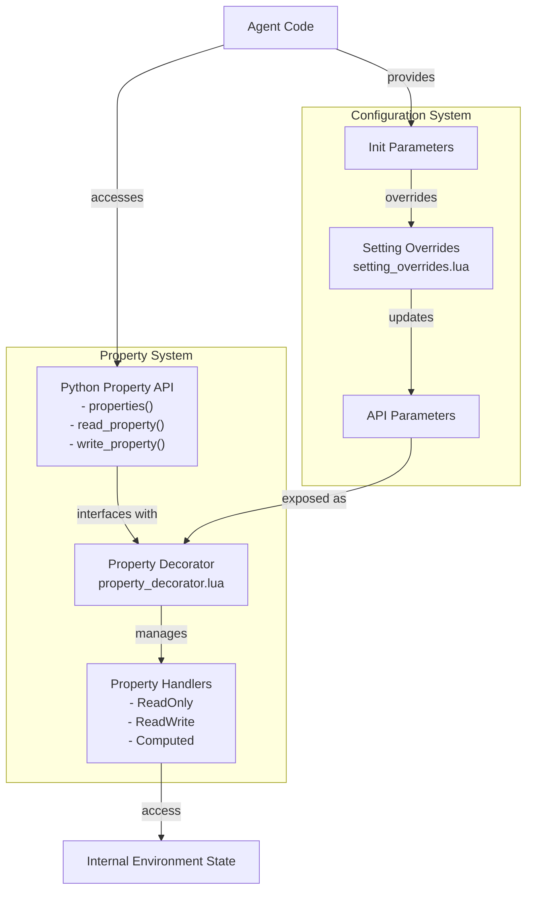
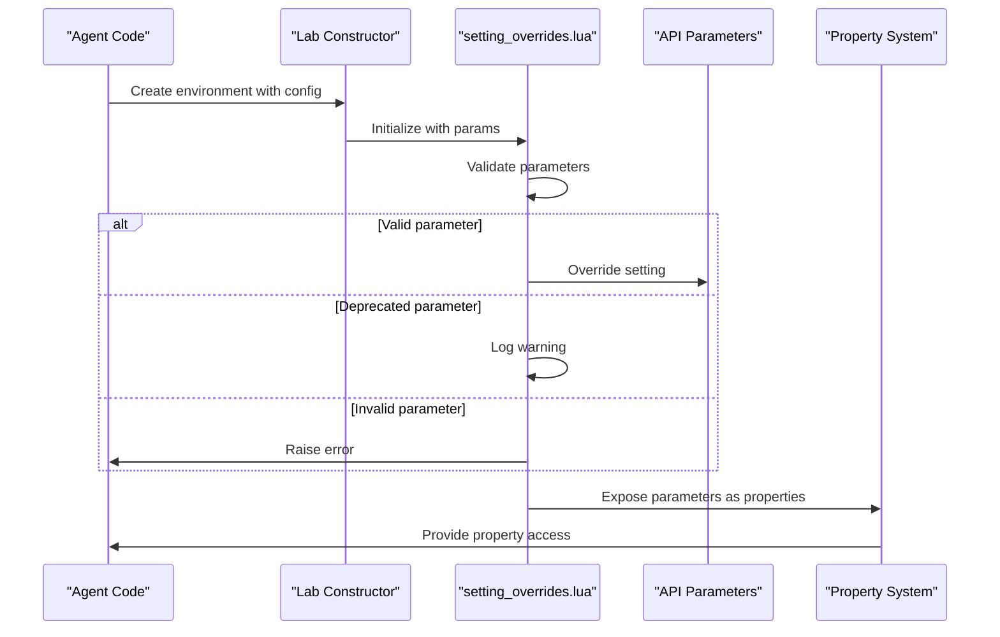
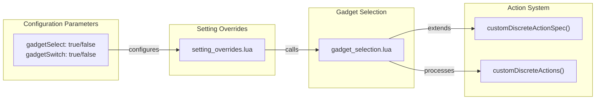

<!-- source: DeepWiki mcp.deepwiki.com · repo google-deepmind/lab · page 9.2 Configuration and Properties · fetched 2026-10-26 -->

# Configuration and Properties

<details>
<summary>Relevant source files</summary>

The following files were used as context for generating this wiki page:

- [docs/users/actions.md](docs/users/actions.md)
- [game_scripts/decorators/gadget_selection.lua](game_scripts/decorators/gadget_selection.lua)
- [game_scripts/decorators/setting_overrides.lua](game_scripts/decorators/setting_overrides.lua)
- [game_scripts/levels/tests/properties_test.lua](game_scripts/levels/tests/properties_test.lua)
- [python/tests/properties_test.py](python/tests/properties_test.py)

</details>


This document covers DeepMind Lab's property and configuration systems, which allow users to access and modify environment settings at runtime. This system provides a structured way to expose internal environment state and parameters to external systems, particularly agent code interacting with DeepMind Lab through the Python API.

For information about specific level parameters and settings, see [Level Generation](#6). For performance-related configuration options, see [Performance Optimization](#9.3).

## 1. Property System Overview

DeepMind Lab implements a hierarchical property system that allows controlled access to internal state and configuration parameters. Properties can be readable, writable, or listable, and are organized in a tree-like structure with dot-separated path notation.



Sources: [game_scripts/decorators/property_decorator.lua](), [game_scripts/decorators/setting_overrides.lua:110-175](), [python/tests/properties_test.py:19-43]()

## 2. Property Types and Attributes

Properties in DeepMind Lab have different access attributes that define how they can be used:

```mermaid
classDiagram
    class "Property" {
        +path: string
        +attributes: int
    }
    
    class "ReadableProperty" {
        +read_property()
    }
    
    class "WritableProperty" {
        +write_property()
    }
    
    class "ListableProperty" {
        +properties()
        +children: Property[]
    }
    
    class "PropertyExample" {
        params.arg1 (readable+writable)
        params (listable)
        func.times10 (readable+computed)
        engine.fps (readable)
    }
    
    Property <|-- ReadableProperty
    Property <|-- WritableProperty
    Property <|-- ListableProperty
    Property <|-- PropertyExample
```

The property system supports the following attributes:

| Attribute | Flag Constant | Description |
|-----------|---------------|-------------|
| Readable  | `READABLE`    | Property can be read with `read_property()` |
| Writable  | `WRITABLE`    | Property can be modified with `write_property()` |
| Listable  | `LISTABLE`    | Property can be listed with `properties()` and contains child properties |

Sources: [python/tests/properties_test.py:31-36](), [game_scripts/levels/tests/properties_test.lua:17-55]()

## 3. Using the Property API in Python

The Python API provides three main methods for interacting with properties:

### 3.1 Listing Properties

The `properties(key)` method lists all child properties under a given property key:

```python
# List all top-level properties
top_level_properties = env.properties('')

# List all properties under 'params'
param_properties = env.properties('params')
```

Each entry in the returned dictionary maps a property name to its attributes (a bitfield of READABLE, WRITABLE, LISTABLE).

### 3.2 Reading Properties

The `read_property(key)` method reads the value of a readable property:

```python
# Read a property value
fps = env.read_property('engine.fps')
arg1 = env.read_property('params.arg1')
```

### 3.3 Writing Properties

The `write_property(key, value)` method writes a new value to a writable property:

```python
# Write a new value to a property
env.write_property('params.arg1', 'false')
env.write_property('params.arg2', '42')
```

### 3.4 Property Access Exceptions

The property system can raise several exceptions:

| Exception | Condition |
|-----------|-----------|
| `KeyError` | When the property key doesn't exist |
| `TypeError` | When attempting to read a non-readable property |
| `TypeError` | When attempting to write to a non-writable property |
| `TypeError` | When attempting to list a non-listable property |
| `TypeError` | When providing a value of the wrong type |

Sources: [python/tests/properties_test.py:94-140]()

## 4. Configuring DeepMind Lab Environments

DeepMind Lab environments can be configured at initialization time by passing a dictionary of parameters to the Lab constructor:

```python
env = deepmind_lab.Lab(
    'level_name',
    ['RGBD'],
    config={
        'fps': '30',
        'width': '640',
        'height': '480',
        'episodeLengthSeconds': '60'
    }
)
```

### 4.1 Configuration Parameter Handling

When a DeepMind Lab environment is initialized, the following process occurs:



### 4.2 Parameter Whitelisting

The configuration system maintains a whitelist of parameters that can be safely ignored if not used by the environment:

```
episodeLengthSeconds, invocationMode, allowHoldOutLevels, levelGenerator, 
playerId, players, randomSeed, datasetPath, enableCameraMovement, logLevel
```

For deprecated parameters, warnings are logged instead of errors:

```
__platform__, textureRandomization
```

Sources: [game_scripts/decorators/setting_overrides.lua:26-47]()

## 5. Creating Custom Properties

Level scripts can define custom properties using the `property_decorator` module. This is useful for exposing internal level state to agents or debugging tools.

### 5.1 Adding Read-Only Properties

Read-only properties can be simple values or computed values:

```lua
-- Add a read-only property that computes a value on demand
property_decorator.addReadOnly('func.times10', function(valueString)
  local value = tonumber(valueString)
  return value and tostring(value * 10)
end)
```

### 5.2 Adding Read-Write Properties

Read-write properties allow external code to modify internal state:

```lua
-- Add a read-write property for a table of parameters
property_decorator.addReadWrite('params', apiParams)
```

### 5.3 Example: Adding Properties to a Level

The following example shows how to add properties to a level:

```lua
local property_decorator = require 'decorators.property_decorator'

local api = {
    _properties = {
        arg1 = true,
        arg2 = 19,
        arg3 = "hello",
        -- Nested properties
        subArgs = {
            sub1 = 'val1',
            sub2 = 'val2',
            sub3 = 'val3',
        },
        -- Arrays as properties
        arrArgs = {
            'arr1',
            'arr2',
            'arr3',
        }
    }
}

-- Decorate the API with property functionality
property_decorator.decorate(api)

-- Expose the properties table
property_decorator.addReadWrite('params', api._properties)
```

Sources: [game_scripts/levels/tests/properties_test.lua:17-55]()

## 6. Built-in Properties

DeepMind Lab includes several built-in property groups:

### 6.1 Engine Properties

Engine properties provide information about the game engine:

- `engine.fps`: Current frames per second setting
- `engine.rendererName`: The active renderer name

### 6.2 Console Access

The property system exposes the console interface as a property:

```python
# Execute a console command
env.read_property('console', 'cg_fov 90')
```

### 6.3 Parameter Access

The current API parameters can be accessed through properties:

```python
# Read a configuration parameter
value = env.read_property('params.episodeLengthSeconds')

# Modify a configuration parameter
env.write_property('params.overrideEntityLayer', entity_layer_text)
```

### 6.4 Function Properties

Function properties compute values on demand:

```python
# Get computed values
entity_layer = env.read_property('func.entityLayer.200')
variations_layer = env.read_property('func.variationsLayer.200')
```

Sources: [python/tests/properties_test.py:143-203]()

## 7. Integration with Other Systems

The property system integrates with several other DeepMind Lab systems:

### 7.1 Setting Overrides Decorator

The property system is automatically integrated when using the `setting_overrides.decorate` function:

```lua
setting_overrides.decorate({
  api = api,
  apiParams = apiParams,
  decorateWithTimeout = true
})
```

This adds standard properties and makes configuration parameters accessible through the property system.

### 7.2 Gadget Selection Integration

The gadget selection system is also integrated with the setting overrides and property system, allowing configuration of additional actions:



Sources: [game_scripts/decorators/setting_overrides.lua:155-156](), [game_scripts/decorators/gadget_selection.lua:3-63](), [docs/users/actions.md:26-31]()

## 8. Best Practices

### 8.1 Type Checking

The property system performs type checking when writing properties. For best results:

- Use proper types for properties (booleans, numbers, strings)
- Convert values to strings when reading/writing properties that expect specific formats
- Handle exceptions when accessing properties that may not exist

### 8.2 Hierarchical Organization

Organize properties in a logical hierarchy:

- Use the dot notation to create nested property structures
- Group related properties under common prefixes
- Use convention-based naming for consistency

### 8.3 Performance Considerations

- Reading and writing properties incurs some overhead
- For performance-critical code, cache property values instead of reading them repeatedly
- Consider using direct function calls for frequently accessed values

Sources: [python/tests/properties_test.py:105-114]()

---

