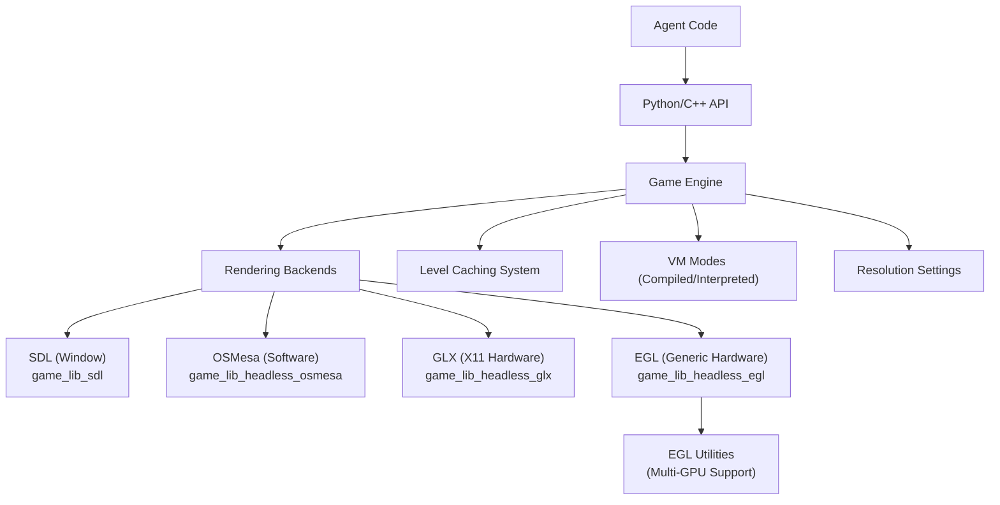
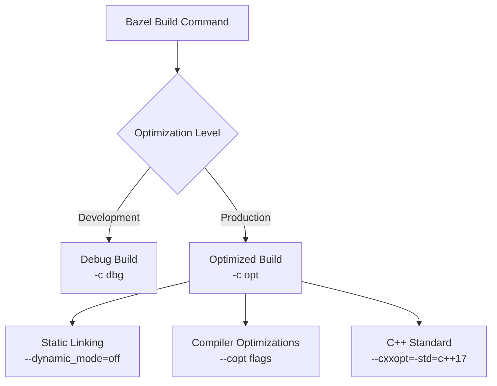
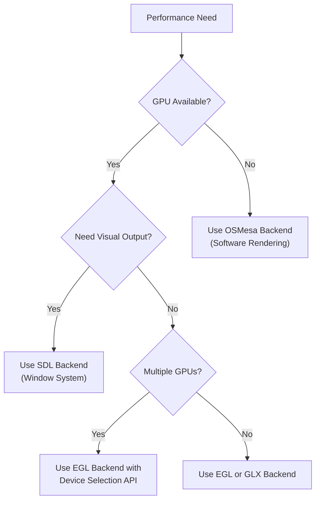
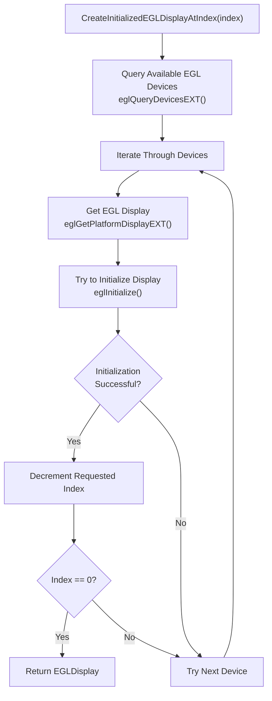

<!-- source: DeepWiki mcp.deepwiki.com · repo google-deepmind/lab · page 9.3 Performance Optimization · fetched 2026-10-26 -->

# Performance Optimization

<details>
<summary>Relevant source files</summary>

The following files were used as context for generating this wiki page:

- [.github/workflows/precommit.yml](.github/workflows/precommit.yml)
- [.precommit.bazelrc](.precommit.bazelrc)
- [BUILD](BUILD)
- [docs/users/build.md](docs/users/build.md)
- [public/dmlab_connect_test.cc](public/dmlab_connect_test.cc)
- [python/tests/BUILD](python/tests/BUILD)
- [python/tests/utils/BUILD](python/tests/utils/BUILD)
- [python_system.bzl](python_system.bzl)
- [third_party/GL/BUILD](third_party/GL/BUILD)
- [third_party/GL/EGL/egl.h](third_party/GL/EGL/egl.h)
- [third_party/GL/EGL/eglext.h](third_party/GL/EGL/eglext.h)
- [third_party/GL/EGL/eglplatform.h](third_party/GL/EGL/eglplatform.h)
- [third_party/GL/KHR/khrplatform.h](third_party/GL/KHR/khrplatform.h)
- [third_party/GL/LICENSE](third_party/GL/LICENSE)
- [third_party/GL/util/BUILD](third_party/GL/util/BUILD)
- [third_party/GL/util/LICENSE](third_party/GL/util/LICENSE)
- [third_party/GL/util/egl_util.cc](third_party/GL/util/egl_util.cc)
- [third_party/GL/util/egl_util.h](third_party/GL/util/egl_util.h)
- [third_party/GL/util/egl_util_test.cc](third_party/GL/util/egl_util_test.cc)

</details>


This document outlines strategies and options for optimizing the performance of DeepMind Lab. It covers build configurations, rendering backend selection, level caching, and other factors that impact performance. For detailed information on level caching specifically, see [Level Caching](#9.4).

## Architecture Overview

The following diagram illustrates the key components in DeepMind Lab that affect performance:



Sources: [BUILD:802-892](), [public/dmlab_so_loader.cc](), [third_party/GL/util/egl_util.cc]()

## Build Optimizations

DeepMind Lab's performance is significantly affected by build configurations. The following diagram illustrates the key build optimization options:



To build DeepMind Lab with optimizations, use the `-c opt` flag:

```bash
bazel build -c opt //:deepmind_lab.so
```

The `.precommit.bazelrc` file contains important optimization flags:
- `--compilation_mode=opt`: Enables compiler optimizations
- `--dynamic_mode=off`: Prefers static linking, which can improve performance
- `--cxxopt=-std=c++17`: Uses C++17 standard which includes performance improvements

Sources: [.precommit.bazelrc:4-6](), [BUILD:1011-1034]()

## Rendering Backends

DeepMind Lab supports multiple rendering backends, each with different performance characteristics:

### Backend Selection Guide



### Backend Characteristics

| Backend | Type | GPU Required | Performance | Use Case |
|---------|------|--------------|-------------|----------|
| SDL | Windowed | Yes | Good | Debugging, visualization |
| OSMesa | Headless Software | No | Slowest | CPU-only environments |
| GLX | Headless Hardware X11 | Yes | Better | Linux with X11 |
| EGL | Headless Hardware Generic | Yes | Best | Production, multi-GPU |

To specify the rendering backend, use the `--define` flag:

```bash
bazel run -c opt --define headless=osmesa //:python_random_agent
```

The backend selection is configured in the BUILD file using selection rules:

```python
cc_binary(
    name = "libdmlab_headless_hw.so",
    deps = select({
        "dmlab_graphics_osmesa_or_egl": [":game_lib_headless_egl"],
        "dmlab_graphics_osmesa_or_glx": [":game_lib_headless_glx"],
        "//conditions:default": [":game_lib_headless_egl"],
    }),
)
```

Sources: [BUILD:937-974](), [.github/workflows/precommit.yml:52]()

## Multi-GPU Configurations

When running on machines with multiple GPUs, DeepMind Lab can be configured to use specific devices using the EGL backend. This is handled by the EGL utility functions in `third_party/GL/util/egl_util.cc`.

Key functions:
- `CreateInitializedEGLDisplayAtIndex(int device_index)`: Creates and initializes an EGL display for a specific GPU
- `CreateInitializedEGLDisplay()`: Uses device index 0 by default

The selection logic for GPU devices is illustrated below:



Sources: [third_party/GL/util/egl_util.cc:98-148](), [BUILD:957-963]()

## Level Caching

The level caching system can significantly improve performance by avoiding regeneration of levels. DeepMind Lab includes a level cache API defined in `public/level_cache_types.h`.

For detailed information on configuring and using level caching, see [Level Caching](#9.4).

Sources: [BUILD:562-564]()

## VM Mode Selection

The Quake III Arena engine that powers DeepMind Lab uses a virtual machine (VM) for game logic execution. There are two main VM modes:

| VM Mode | Performance | Use Case |
|---------|-------------|----------|
| Compiled | Faster | Default mode for maximum performance |
| Interpreted | Slower | Debugging, compatibility with tools like ThreadSanitizer |

To select the VM mode:

```bash
bazel run -c opt //:python_random_agent -- --vmMode=interpreted
```

Sources: [public/dmlab_connect_test.cc:50-52]()

## Resolution Settings

Screen resolution has a significant impact on performance, especially for the RGB observation. Lower resolutions require less processing power and memory.

Configure resolution with:

```bash
bazel run -c opt //:python_random_agent -- --width=320 --height=240
```

The default resolution is 640x480.

Sources: [python/random_agent.py]()

## Observation Selection

Each observation type has an associated performance cost. Only request observations that your agent actually requires.

```python
env = deepmind_lab.Lab(
    level_name,
    ['RGB_INTERLEAVED', 'INSTR'],  # Only request needed observations
    config={...}
)
```

Sources: [python/random_agent.py]()

## Python vs. C++ API Performance

The native C++ API (`public/dmlab.h`) has lower overhead than the Python API. For performance-critical applications where every millisecond matters, consider using the C++ API directly.

Sources: [public/dmlab.h](), [python/dmlab_module.c]()

## Benchmark Testing

DeepMind Lab includes a benchmark utility to measure performance:

```bash
bazel run -c opt //python/tests:python_benchmark
```

This benchmark can be used to compare different optimization strategies and hardware configurations.

Sources: [python/tests/BUILD:6-16]()

## Summary

For optimal performance:

1. Use `-c opt` for optimized builds
2. Select appropriate rendering backend (EGL recommended for headless GPU environments)
3. Configure level caching
4. Use the compiled VM mode
5. Reduce resolution if possible
6. Only request necessary observations
7. Consider the C++ API for maximum performance

---

