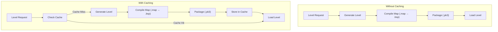
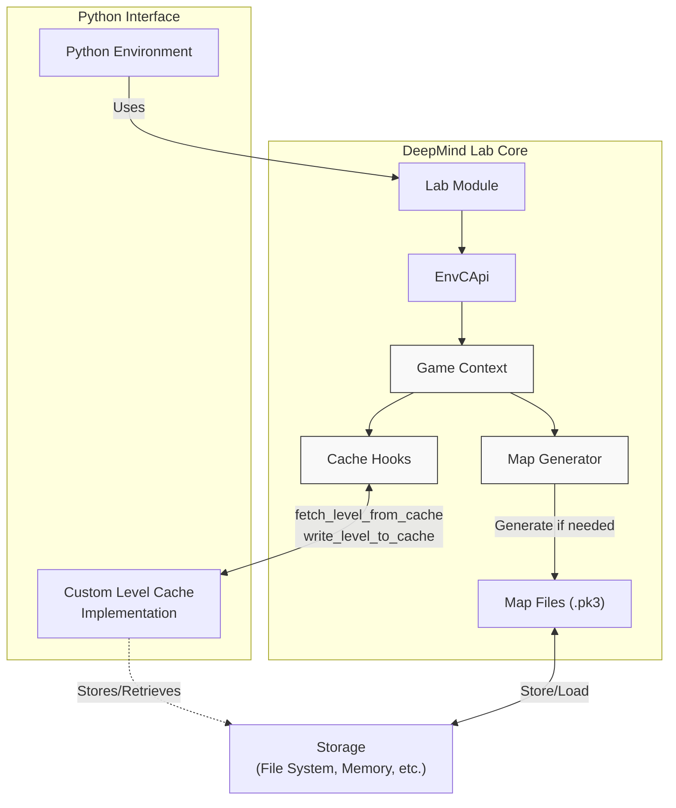
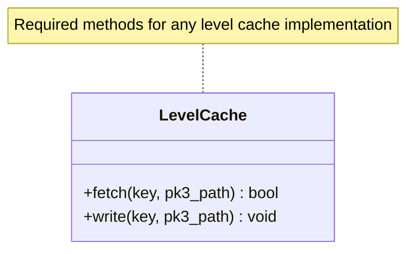
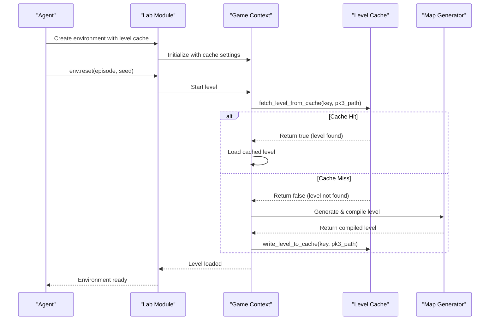

<!-- source: DeepWiki mcp.deepwiki.com · repo google-deepmind/lab · page 9.4 Level Caching · fetched 2026-10-26 -->

# Level Caching

<details>
<summary>Relevant source files</summary>

The following files were used as context for generating this wiki page:

- [RELEASE_NOTES.md](RELEASE_NOTES.md)
- [engine/code/deepmind/dmlab_connect.c](engine/code/deepmind/dmlab_connect.c)
- [examples/game_main.py](examples/game_main.py)
- [python/dmlab_module.c](python/dmlab_module.c)
- [python/random_agent_simple.py](python/random_agent_simple.py)
- [python/tests/benchmark.py](python/tests/benchmark.py)
- [python/tests/level_cache_test.py](python/tests/level_cache_test.py)
- [python/tests/utils/game_controller_test.py](python/tests/utils/game_controller_test.py)
- [python/tests/utils/maze_game_controller.py](python/tests/utils/maze_game_controller.py)
- [python/tests/utils/maze_game_controller_test.py](python/tests/utils/maze_game_controller_test.py)
- [python/tests/utils/test_environment_decorator.py](python/tests/utils/test_environment_decorator.py)
- [python/tests/utils/test_environment_decorator_test.py](python/tests/utils/test_environment_decorator_test.py)
- [testing/recording_test.cc](testing/recording_test.cc)
- [third_party/rl_api/env_c_api.h](third_party/rl_api/env_c_api.h)
- [third_party/rl_api/env_c_api_bind.h](third_party/rl_api/env_c_api_bind.h)
- [third_party/rl_api/env_c_api_example.cc](third_party/rl_api/env_c_api_example.cc)
- [third_party/rl_api/env_c_api_example_test.cc](third_party/rl_api/env_c_api_example_test.cc)

</details>


Level caching is a performance optimization feature in DeepMind Lab that reduces environment startup time by avoiding expensive recompilations of levels. When enabled, DeepMind Lab can store and retrieve compiled level data between runs, significantly improving performance for levels that require procedural generation or complex compilation steps.

## Purpose and Benefits

The primary purpose of level caching is to improve the performance of agents that repeatedly interact with the same environments by:

1. Avoiding expensive map compilation steps for procedurally generated levels
2. Reducing environment initialization time
3. Enabling faster experimentation cycles for researchers

Sources: [RELEASE_NOTES.md:200-202]()

## How Level Caching Works

Level caching operates at the map file level, saving the compiled `.pk3` files (Quake III Arena package files) that result from processing level definitions.



When a level is requested, DeepMind Lab first checks if a compiled version already exists in the cache. If found, it loads directly from cache, skipping the expensive compilation steps. If not found, it generates and compiles the level normally, then stores the result in the cache for future use.

Sources: [engine/code/deepmind/dmlab_connect.c:336-378](), [RELEASE_NOTES.md:200-242]()

## Cache Types and Configuration

DeepMind Lab supports two types of level caches:

| Cache Type | Setting | Purpose |
|------------|---------|---------|
| Local Level Cache | `localLevelCache` | Cache levels for the current process/session |
| Global Level Cache | `globalLevelCache` | Cache levels shared across multiple processes/sessions |

These settings can be enabled by setting the corresponding configuration parameters when creating a DeepMind Lab environment.

Sources: [engine/code/deepmind/dmlab_connect.c:577-584]()

## Architecture



The level caching system integrates with DeepMind Lab's map generation process:

1. When a level is requested, the Game Context checks if a compiled version exists in the cache
2. Cache hooks call into the custom level cache implementation
3. If the cache contains the level, it's loaded directly
4. If not, the Map Generator compiles the level and the result is stored in the cache

Sources: [engine/code/deepmind/dmlab_connect.c:135-171](), [python/dmlab_module.c:104-136]()

## Python Implementation

To use level caching in Python, you need to implement a class with two required methods:



### Required Methods

1. **`fetch(key, pk3_path)`**:
   - Attempts to retrieve a cached level
   - `key`: Unique identifier for the level
   - `pk3_path`: Path where the cached level should be written
   - Returns `True` if successful, `False` otherwise

2. **`write(key, pk3_path)`**:
   - Stores a generated level in the cache
   - `key`: Unique identifier for the level
   - `pk3_path`: Path to the generated level file

Sources: [python/dmlab_module.c:104-136](), [python/tests/level_cache_test.py:106-150]()

## Example Implementation

Here's an example of a simple file-based level cache implementation:

```python
class FileLevelCache:
    def __init__(self, cache_dir):
        """Initialize with a directory to store cached levels.
        
        Args:
            cache_dir: Directory to store cached level files
        """
        self._cache_dir = cache_dir
        os.makedirs(cache_dir, exist_ok=True)
        
    def fetch(self, key, pk3_path):
        """Try to fetch a cached level.
        
        Args:
            key: Unique identifier for the level
            pk3_path: Path where the cached level should be written
            
        Returns:
            True if the level was found in cache, False otherwise
        """
        cache_path = os.path.join(self._cache_dir, key)
        if os.path.isfile(cache_path):
            shutil.copyfile(cache_path, pk3_path)
            return True
        return False
        
    def write(self, key, pk3_path):
        """Store a generated level in the cache.
        
        Args:
            key: Unique identifier for the level
            pk3_path: Path to the generated level file
        """
        cache_path = os.path.join(self._cache_dir, key)
        shutil.copyfile(pk3_path, cache_path)
```

Sources: [python/tests/level_cache_test.py:106-150]()

## Usage with DeepMind Lab

To use a level cache with DeepMind Lab, provide an instance of your cache implementation when creating the environment:

```python
import deepmind_lab
import os

# Create a custom level cache
cache_dir = "/tmp/dmlab_level_cache"
level_cache = FileLevelCache(cache_dir)

# Create environment with level cache
env = deepmind_lab.Lab(
    level='contributed/dmlab30/explore_goal_locations_small',
    observations=['RGB_INTERLEAVED'],
    config={
        'width': '96',
        'height': '72',
    },
    level_cache=level_cache
)
```

If you pass `level_cache=None`, it's equivalent to not using level caching at all.

Sources: [python/tests/level_cache_test.py:42-50](), [python/tests/level_cache_test.py:107-150]()

## Internal Workflow



The key components involved in the caching process:

1. **Generation of the cache key**: Typically based on the level name, parameters, and seed
2. **Cache lookup**: Checking if the level exists in the cache
3. **Level generation**: Only performed when the level is not found in the cache
4. **Cache storage**: Storing the compiled level for future use

Sources: [engine/code/deepmind/dmlab_connect.c:336-378](), [python/dmlab_module.c:104-136]()

## Performance Considerations

Level caching is particularly beneficial for:

1. **Procedurally generated levels**: These require compilation every time without caching
2. **Environments with complex geometries**: These have expensive compilation steps
3. **Batch training**: When multiple environments are created with similar configurations

For levels with limited procedural generation possibilities, restricting the number of possible variations can make caching more effective. For example, the Skymaze level generation was restricted to produce only 100,000 distinct levels to improve cache effectiveness.

Sources: [RELEASE_NOTES.md:241-242]()

## Error Handling

The level caching system propagates errors from the cache implementation back to the calling code. If an exception occurs in the `fetch` or `write` methods, it will be raised to the caller.

Common errors include:
- Missing required methods (`fetch` or `write`)
- Methods with incorrect signatures
- Exceptions raised inside the methods

Sources: [python/tests/level_cache_test.py:53-106](), [python/dmlab_module.c:110-111](), [python/dmlab_module.c:129-130]()

## Conclusion

Level caching is a powerful feature that can significantly improve the performance of DeepMind Lab environments by avoiding redundant compilation of levels. By implementing a custom level cache, you can tailor the caching behavior to your specific needs, whether that's caching in memory, on disk, or in a distributed system.

The level caching system is designed to be flexible and extensible, allowing for a wide range of implementation strategies while maintaining a simple interface.