# Page: Overview

# Overview

<details>
<summary>Relevant source files</summary>

The following files were used as context for generating this wiki page:

- [README.md](README.md)
- [RELEASE_NOTES.md](RELEASE_NOTES.md)
- [engine/code/deepmind/dmlab_connect.c](engine/code/deepmind/dmlab_connect.c)
- [python/dmlab_module.c](python/dmlab_module.c)
- [python/pip_package/BUILD](python/pip_package/BUILD)
- [python/pip_package/README.md](python/pip_package/README.md)
- [python/pip_package/__init__.py](python/pip_package/__init__.py)
- [python/pip_package/build_pip_package.sh](python/pip_package/build_pip_package.sh)
- [python/pip_package/setup.py](python/pip_package/setup.py)
- [testing/recording_test.cc](testing/recording_test.cc)
- [third_party/rl_api/env_c_api.h](third_party/rl_api/env_c_api.h)
- [third_party/rl_api/env_c_api_bind.h](third_party/rl_api/env_c_api_bind.h)
- [third_party/rl_api/env_c_api_example.cc](third_party/rl_api/env_c_api_example.cc)
- [third_party/rl_api/env_c_api_example_test.cc](third_party/rl_api/env_c_api_example_test.cc)

</details>


DeepMind Lab is a 3D learning environment based on id Software's Quake III Arena game engine, designed primarily for research in artificial intelligence, especially deep reinforcement learning. This document provides a high-level overview of DeepMind Lab's architecture, core components, and how they interact to create a platform for agent-based AI research.

For specific guides on installation and setup, see [Getting Started](#2). For API documentation, see [Python API](#3) or [C/C++ API](#4). For details on creating custom levels, see [Level Generation](#6).

## Purpose and Features

DeepMind Lab provides a suite of challenging 3D navigation and puzzle-solving tasks for learning agents. It serves as a testbed for AI research by providing:

- A flexible platform for defining custom environments
- A standard reinforcement learning interface
- Rich 3D worlds with realistic physics
- Support for procedural content generation
- Customizable reward structures
- Multiple observation types (RGB, depth, velocity, etc.)

Sources: [README.md:27-29]()

## System Architecture

DeepMind Lab follows a layered architecture with clear separation of concerns between its components.

### Core System Architecture

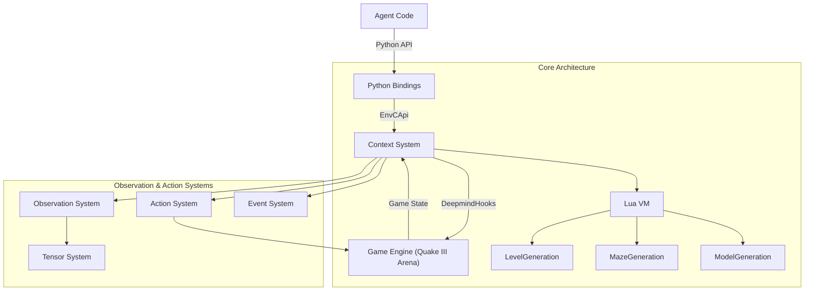

The architecture consists of several key components:

1. **Agent Interface**: Python bindings that provide an API for agents to interact with the environment
2. **EnvCApi**: C-language interface that defines the core environment functionality
3. **Context System**: Central hub that connects the Python bindings to the underlying game engine
4. **Lua VM**: Scripting environment for level generation and game logic
5. **Game Engine**: Modified Quake III Arena engine that handles rendering, physics, and gameplay
6. **Observation & Action Systems**: Components that facilitate agent-environment interaction

Sources: [README.md:27-29](), [engine/code/deepmind/dmlab_connect.c:59-71](), [python/dmlab_module.c:234-265](), [third_party/rl_api/env_c_api.h:15-29]()

### Python Interface and Binding Flow

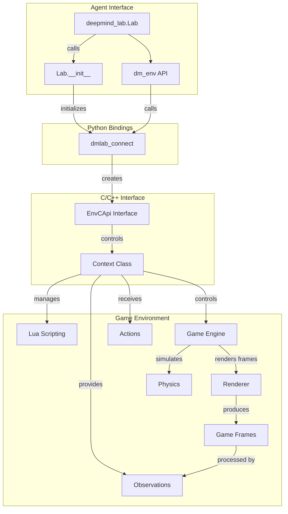

This diagram shows how the Python API interfaces with the underlying C/C++ code through the EnvCApi, which controls the Context system. The Context manages the Lua scripting environment and interfaces with the game engine.

Sources: [python/dmlab_module.c:51-102](), [engine/code/deepmind/dmlab_connect.c:138-149](), [third_party/rl_api/env_c_api.h:213-446]()

## Core Components

### Python API

The Python API is the primary interface for agents to interact with DeepMind Lab. It provides methods for:

- Initializing the environment with specific settings
- Getting observations from the environment
- Taking actions in the environment
- Getting rewards from the environment

The primary class is `Lab`, which wraps the C/C++ API and provides access to the environment.

```python
# Example usage
import deepmind_lab
lab = deepmind_lab.Lab("lt_chasm", ['RGB_INTERLEAVED'], {'fps': '30'})
lab.reset(seed=1)
observation = lab.observations()  # Get observations
reward = lab.step([0, 0, 0, 1, 0, 0, 0])  # Take an action
```

DeepMind Lab also provides bindings to the DeepMind "dm_env" standard API for reinforcement learning, allowing for compatibility with other DeepMind research tools.

Sources: [python/dmlab_module.c:51-102](), [python/pip_package/README.md:193-198](), [python/pip_package/__init__.py:1-22]()

### EnvCApi (Environment C API)

The EnvCApi is a C-language interface that defines the core functionality of the environment. It provides functions for:

- Setting environment parameters
- Initializing the environment
- Starting an episode
- Getting observations
- Taking actions
- Getting rewards

The API is defined in the `EnvCApi` struct, which contains function pointers to the various methods.

```c
struct EnvCApi_s {
  // Setup, start and termination
  int (*setting)(void* context, const char* key, const char* value);
  int (*init)(void* context);
  int (*start)(void* context, int episode_id, int seed);
  void (*release_context)(void* context);
  
  // Observations and actions
  void (*observation)(void* context, int observation_idx, EnvCApi_Observation* obs);
  void (*act_discrete)(void* context, const int actions_discrete[]);
  EnvCApi_EnvironmentStatus (*advance)(void* context, int num_steps, double* reward);
  
  // ... additional functions ...
};
```

The EnvCApi provides a standard interface for environment interaction, allowing the Python API to communicate with the underlying game engine.

Sources: [third_party/rl_api/env_c_api.h:97-448](), [third_party/rl_api/env_c_api_example.cc:72-193]()

### Context System

The Context system is the central hub of DeepMind Lab, connecting the Python bindings to the underlying game engine. It manages:

- The Lua VM for level generation and game logic
- The observation and action systems
- The game engine interface through DeepmindHooks

The Context system is implemented in the `GameContext` struct, which contains:

- A pointer to the DeepmindContext
- The environment's dimensions and buffer information
- The game's state information
- Recording context for demos and videos
- Network settings for multiplayer

Sources: [engine/code/deepmind/dmlab_connect.c:136-176]()

### Lua Scripting System

The Lua scripting system provides a flexible way to define custom levels, game mechanics, and reward structures. It includes:

- Level generation through maze and text level descriptions
- Custom observation and action definitions
- Game logic and reward definitions
- Customizable theme elements

Lua scripts are used to define the behavior of the environment, allowing researchers to create custom tasks without modifying the core C/C++ code.

Sources: [README.md:107-108]()

### Game Engine

DeepMind Lab uses a modified version of the Quake III Arena game engine (via ioquake3), providing:

- 3D rendering capabilities
- Physics simulation
- Game logic execution
- Multiplayer support

The game engine is responsible for rendering the environment, simulating physics, and executing the game logic defined in Lua scripts.

Sources: [README.md:3-6](), [README.md:114-132]()

## Environment Interaction Flow

### Initialization and Execution Flow

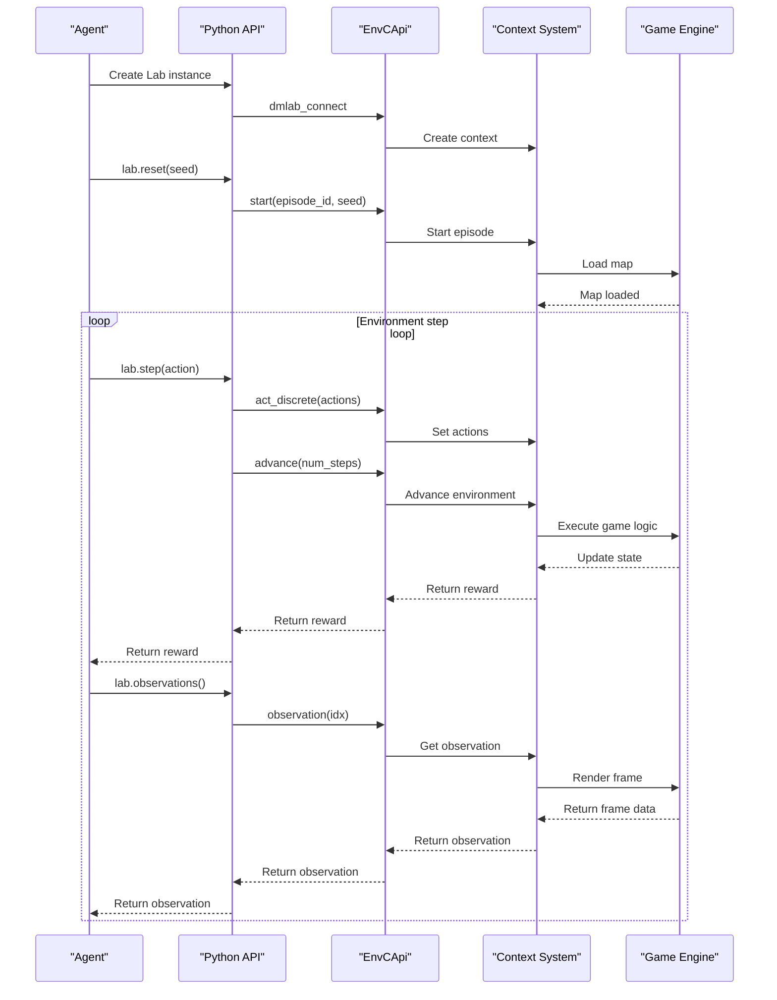

This diagram shows the flow of interaction between an agent and DeepMind Lab, from initialization to the step loop where actions are taken and observations are received.

Sources: [python/dmlab_module.c:311-430](), [engine/code/deepmind/dmlab_connect.c:775-836](), [third_party/rl_api/env_c_api.h:394-447]()

### Observation and Action Types

DeepMind Lab provides a variety of observation types:

| Observation Name | Description | Data Type |
|------------------|-------------|-----------|
| RGB_INTERLEAVED | RGB image with channels interleaved | uint8 |
| RGBD_INTERLEAVED | RGB + depth image with channels interleaved | uint8 |
| RGB | RGB image with channels planar | uint8 |
| RGBD | RGB + depth image with channels planar | uint8 |
| BGR_INTERLEAVED | BGR image with channels interleaved | uint8 |
| BGRD_INTERLEAVED | BGR + depth image with channels interleaved | uint8 |
| MAP_FRAME_NUMBER | Current frame number in the map | double |

Actions in DeepMind Lab are represented as a vector of discrete values:

| Action Name | Description | Range |
|-------------|-------------|-------|
| LOOK_LEFT_RIGHT_PIXELS_PER_FRAME | Angular velocity for horizontal look | [-512, 512] |
| LOOK_DOWN_UP_PIXELS_PER_FRAME | Angular velocity for vertical look | [-512, 512] |
| STRAFE_LEFT_RIGHT | Lateral movement | [-1, 1] |
| MOVE_BACK_FORWARD | Forward/backward movement | [-1, 1] |
| FIRE | Fire weapon | [0, 1] |
| JUMP | Jump | [0, 1] |
| CROUCH | Crouch | [0, 1] |

Sources: [engine/code/deepmind/dmlab_connect.c:74-115](), [engine/code/deepmind/dmlab_connect.c:922-972]()

## Build System and Distribution

DeepMind Lab uses the Bazel build system to build the project and its dependencies. The build process includes:

1. Building the game engine and associated libraries
2. Building the Python bindings
3. Building the test suite

DeepMind Lab can be distributed as a Python package through pip, making it easy to install and use. The pip package includes:

- The compiled DeepMind Lab shared library
- The Python bindings
- Additional assets required by the environment

```bash
# Install DeepMind Lab via pip
pip install /path/to/deepmind_lab-1.0-py2-none-any.whl
```

For more details on building and installing DeepMind Lab, see [Installation](#2.1).

Sources: [python/pip_package/README.md:17-23](), [python/pip_package/setup.py:1-20](), [python/pip_package/build_pip_package.sh:1-65]()

## Property System

Since the December 2020 release, DeepMind Lab includes a property system that allows dynamic querying and modifying of environment state. Properties are key-value pairs that represent the environment's configuration and can be:

- Read using `read_property`
- Written using `write_property`
- Listed using `properties`

```python
# Example of using properties
lab = deepmind_lab.Lab("lt_chasm", ['RGB_INTERLEAVED'])
lab.reset()
# Read a property
value = lab.read_property("key")
# Write a property
lab.write_property("key", "value")
# List properties
props = lab.properties()
```

This property system provides a flexible way to interact with the environment's state and configuration at runtime.

Sources: [RELEASE_NOTES.md:35-51](), [python/dmlab_module.c:684-780]()

## Version History

DeepMind Lab has evolved over time with new features and improvements:

| Release Date | Major Features |
|--------------|----------------|
| Dec 2020 | Property system, dm_env API support, new psychlab and language binding tasks |
| Oct 2019 | New psychlab levels, text actions, level caching improvements |
| June 2018 | New psychlab levels, Python 3 support |
| May 2018 | Level caching, DMLab-30 levels, custom actions |
| Feb 2018 | Demo recording and playback, DMLab-30 levels |
| Jan 2018 | Tensor and image libraries, new Lua customizable themes |
| Dec 2016 | Initial release |

For detailed release notes, see the [RELEASE_NOTES.md](RELEASE_NOTES.md) file.

Sources: [RELEASE_NOTES.md:13-371]()

---

# Page: Architecture

# Architecture

<details>
<summary>Relevant source files</summary>

The following files were used as context for generating this wiki page:

- [RELEASE_NOTES.md](RELEASE_NOTES.md)
- [deepmind/engine/callbacks.cc](deepmind/engine/callbacks.cc)
- [deepmind/engine/callbacks_test.cc](deepmind/engine/callbacks_test.cc)
- [deepmind/engine/context.cc](deepmind/engine/context.cc)
- [deepmind/engine/context.h](deepmind/engine/context.h)
- [deepmind/include/deepmind_context.h](deepmind/include/deepmind_context.h)
- [deepmind/include/deepmind_hooks.h](deepmind/include/deepmind_hooks.h)
- [docs/developers/reference/lua_api.md](docs/developers/reference/lua_api.md)
- [engine/code/deepmind/dm_local.c](engine/code/deepmind/dm_local.c)
- [engine/code/deepmind/dm_local.h](engine/code/deepmind/dm_local.h)
- [engine/code/deepmind/dm_public.h](engine/code/deepmind/dm_public.h)
- [engine/code/deepmind/dmlab_connect.c](engine/code/deepmind/dmlab_connect.c)
- [engine/code/game/g_active.c](engine/code/game/g_active.c)
- [engine/code/game/g_local.h](engine/code/game/g_local.h)
- [engine/code/game/g_mover.c](engine/code/game/g_mover.c)
- [engine/code/game/g_spawn.c](engine/code/game/g_spawn.c)
- [engine/code/qcommon/deepmind_hooks.c](engine/code/qcommon/deepmind_hooks.c)
- [engine/code/qcommon/q_shared.h](engine/code/qcommon/q_shared.h)
- [engine/code/qcommon/surfaceflags.h](engine/code/qcommon/surfaceflags.h)
- [game_scripts/levels/tests/event_test.lua](game_scripts/levels/tests/event_test.lua)
- [game_scripts/levels/tests/text_observation_test.lua](game_scripts/levels/tests/text_observation_test.lua)
- [public/dmlab.h](public/dmlab.h)
- [public/dmlab_so_loader.cc](public/dmlab_so_loader.cc)
- [public/file_reader_types.h](public/file_reader_types.h)
- [python/dmlab_module.c](python/dmlab_module.c)
- [testing/recording_test.cc](testing/recording_test.cc)
- [third_party/rl_api/env_c_api.h](third_party/rl_api/env_c_api.h)
- [third_party/rl_api/env_c_api_bind.h](third_party/rl_api/env_c_api_bind.h)
- [third_party/rl_api/env_c_api_example.cc](third_party/rl_api/env_c_api_example.cc)
- [third_party/rl_api/env_c_api_example_test.cc](third_party/rl_api/env_c_api_example_test.cc)

</details>


This document describes the system architecture of DeepMind Lab, explaining the major components and how they interact. DeepMind Lab is a 3D learning environment based on the Quake III Arena engine, designed for reinforcement learning research. It provides a modular architecture that connects Python agent code with a customized game engine through well-defined interfaces.

## Core Architecture Overview

DeepMind Lab follows a layered architecture that separates the game engine, scripting environment, and agent interfaces into distinct components. The Context system serves as the central hub, connecting all components together.

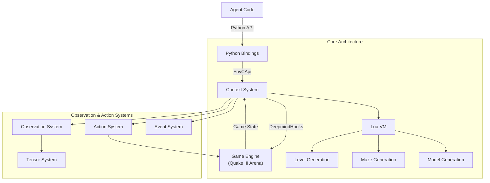

Sources:
- [RELEASE_NOTES.md:1-371](https://github.com/google-deepmind/lab/blob/master/RELEASE_NOTES.md)
- [deepmind/engine/context.h:21-570](https://github.com/google-deepmind/lab/blob/master/deepmind/engine/context.h)
- [deepmind/engine/context.cc:1-1000](https://github.com/google-deepmind/lab/blob/master/deepmind/engine/context.cc)

## Context System and Component Interactions

The Context system (`deepmind::lab::Context` class) is the central component of DeepMind Lab, responsible for coordinating all other subsystems. It manages the Lua VM, interfaces with the game engine through hooks, and handles observations and actions.

```mermaid
classDiagram
    class Context {
        -lua_vm_: lua::Vm
        -script_table_ref_: lua::TableRef
        -game_: ContextGame
        -observations_: ContextObservations
        -custom_actions_: ContextActions
        -pickups_: ContextPickups
        -events_: ContextEvents
        -game_entities_: ContextEntities
        +Init(): int
        +Start(episode, seed): int
        +MapLoaded(): int
        +HasEpisodeFinished(): bool
        +SetActions(): void
        +GetActions(): void
    }
    
    Context --> ContextGame
    Context --> ContextObservations
    Context --> ContextActions
    Context --> ContextPickups
    Context --> ContextEvents
    Context --> ContextEntities
    Context --> "LuaVM"
    
    class ContextGame {
        +MapFinished(): bool
        +SetMapFinished(): void
        +GetCustomView(): void
        +SetPlayerState(): void
    }
    
    class ContextObservations {
        +Count(): int
        +Name(idx): const char*
        +Spec(idx): void
        +Observation(idx): void
    }
    
    class ContextActions {
        +DiscreteCount(): int
        +DiscreteName(idx): const char*
        +DiscreteBounds(idx): void
        +DiscreteApply(actions): void
    }
```

Sources:
- [deepmind/engine/context.h:54-566](https://github.com/google-deepmind/lab/blob/master/deepmind/engine/context.h)
- [deepmind/engine/context.cc:79-886](https://github.com/google-deepmind/lab/blob/master/deepmind/engine/context.cc)
- [deepmind/include/deepmind_hooks.h:35-620](https://github.com/google-deepmind/lab/blob/master/deepmind/include/deepmind_hooks.h)

## Python to C++ Interface Flow

DeepMind Lab provides a Python API that allows agents to interact with the environment. The Python layer connects to the C++ core through a well-defined bridge that uses the EnvCApi interface. This section shows how calls flow from Python through to the game engine.

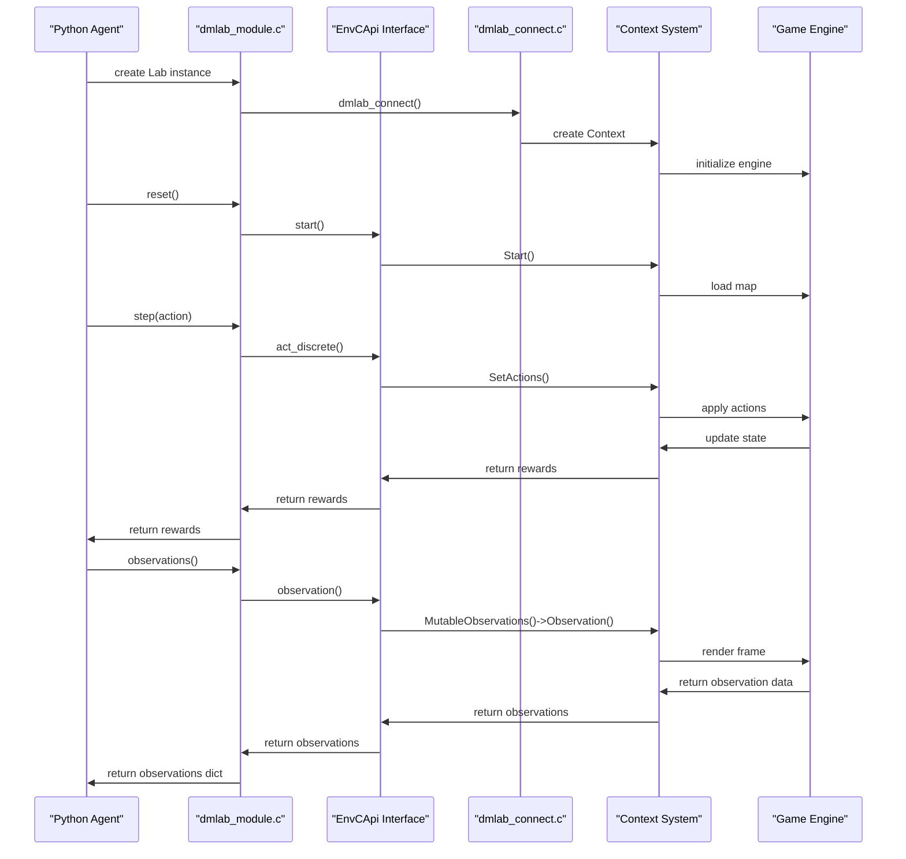

Sources:
- [python/dmlab_module.c:66-600](https://github.com/google-deepmind/lab/blob/master/python/dmlab_module.c)
- [engine/code/deepmind/dmlab_connect.c:66-831](https://github.com/google-deepmind/lab/blob/master/engine/code/deepmind/dmlab_connect.c)
- [public/dmlab_so_loader.cc:45-300](https://github.com/google-deepmind/lab/blob/master/public/dmlab_so_loader.cc)

## Communication Between Game Engine and Lab System

DeepMind Lab uses a hook-based system to integrate with the Quake III Arena engine. The `DeepmindHooks` structure defines callbacks that the engine calls to interact with the Context system.

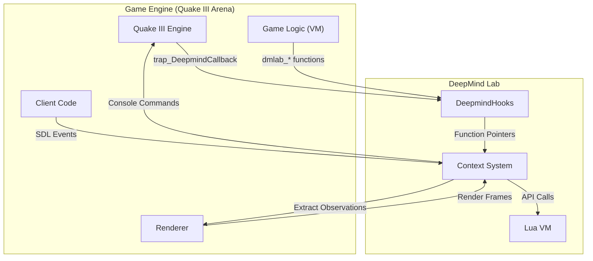

Sources:
- [deepmind/include/deepmind_hooks.h:35-545](https://github.com/google-deepmind/lab/blob/master/deepmind/include/deepmind_hooks.h)
- [engine/code/deepmind/dm_local.h:19-266](https://github.com/google-deepmind/lab/blob/master/engine/code/deepmind/dm_local.h)
- [engine/code/deepmind/dm_local.c:19-265](https://github.com/google-deepmind/lab/blob/master/engine/code/deepmind/dm_local.c)
- [engine/code/qcommon/deepmind_hooks.c:19-247](https://github.com/google-deepmind/lab/blob/master/engine/code/qcommon/deepmind_hooks.c)

## EnvCApi Integration

DeepMind Lab implements the EnvCApi interface, which provides a standard way for agents to interact with environments. This interface is defined in `third_party/rl_api/env_c_api.h` and connects the Python layer to the C++ implementation.

| EnvCApi Function      | Purpose                                   | Implementation in DeepMind Lab                |
|-----------------------|-------------------------------------------|----------------------------------------------|
| `setting`             | Apply a setting to the environment        | Configure level, screen size, etc.            |
| `init`                | Initialize the environment                | Initialize Context and load Lua script        |
| `start`               | Start a new episode                       | Call Context::Start with episode ID and seed  |
| `act_discrete`        | Send discrete actions to the environment  | Update actions in Context                     |
| `advance`             | Advance the environment by one step       | Run the game engine for one or more frames    |
| `observation`         | Get observations from the environment     | Get rendered frames, game state, etc.         |
| `observation_spec`    | Get the shape of an observation           | Describe observation dimensions and type      |
| `action_discrete_count` | Get the number of discrete actions     | Return number of available actions            |
| `release_context`     | Clean up and release resources            | Close the environment                         |

Sources:
- [third_party/rl_api/env_c_api.h:52-568](https://github.com/google-deepmind/lab/blob/master/third_party/rl_api/env_c_api.h)
- [engine/code/deepmind/dmlab_connect.c:500-736](https://github.com/google-deepmind/lab/blob/master/engine/code/deepmind/dmlab_connect.c)

## Lua Scripting System

DeepMind Lab uses Lua as its scripting language for defining levels, game logic, and custom behaviors. The Lua VM is embedded in the Context system and provides a powerful way to customize environments.

### Lua API and Script Lifecycle

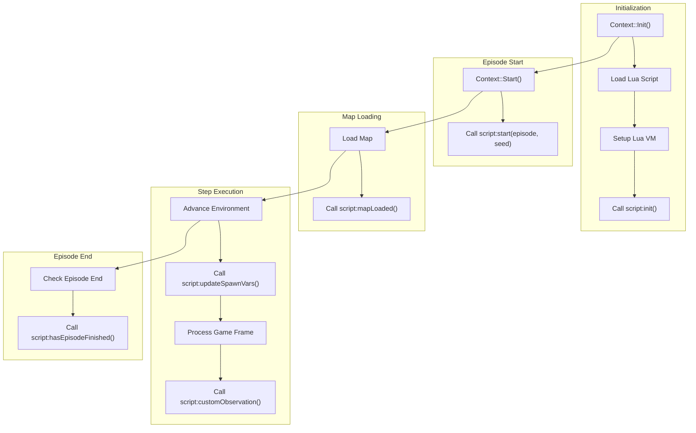

The Lua VM is initialized with modules for:
- Maze generation (`dmlab.system.maze_generation`)
- Tensor operations (`dmlab.system.tensor`)
- Map making (`dmlab.system.map_maker`)
- Game interaction (`dmlab.system.game`)
- Events (`dmlab.system.events`)
- Pickups (`dmlab.system.pickups_spawn`)
- Random number generation (`dmlab.system.random`)
- Model creation (`dmlab.system.model`)

Sources:
- [deepmind/engine/context.cc:721-804](https://github.com/google-deepmind/lab/blob/master/deepmind/engine/context.cc)
- [deepmind/engine/context.cc:817-834](https://github.com/google-deepmind/lab/blob/master/deepmind/engine/context.cc)
- [docs/developers/reference/lua_api.md:1-118](https://github.com/google-deepmind/lab/blob/master/docs/developers/reference/lua_api.md)

## Level Generation System

DeepMind Lab provides a sophisticated level generation system that allows for procedural generation of maps.

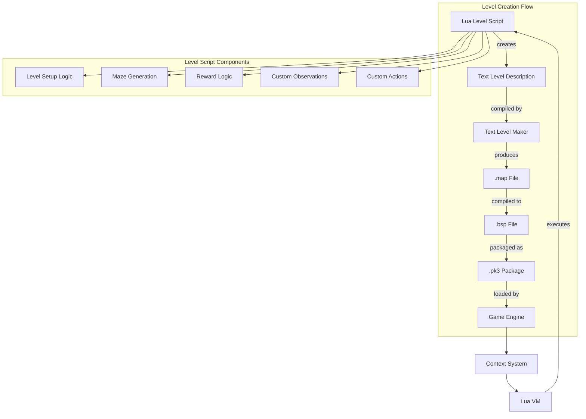

The level generation process typically involves:
1. A Lua script defines the level logic
2. The script may use maze generation to create a procedural layout
3. This is converted to a text level description
4. The text level is compiled to a .map file
5. The .map file is compiled to a .bsp file (Binary Space Partition)
6. The .bsp file is packaged in a .pk3 file for loading
7. The game engine loads the .pk3 file

Sources:
- [deepmind/engine/lua_maze_generation.h](https://github.com/google-deepmind/lab/blob/master/deepmind/engine/lua_maze_generation.h)
- [deepmind/engine/lua_text_level_maker.h](https://github.com/google-deepmind/lab/blob/master/deepmind/engine/lua_text_level_maker.h)
- [deepmind/engine/context.cc:563-574](https://github.com/google-deepmind/lab/blob/master/deepmind/engine/context.cc)
- [engine/code/deepmind/dmlab_connect.c:336-397](https://github.com/google-deepmind/lab/blob/master/engine/code/deepmind/dmlab_connect.c)

## Observation and Action Systems

DeepMind Lab provides a flexible system for defining observations and actions that agents can use to interact with the environment.

### Observation Types and Flow

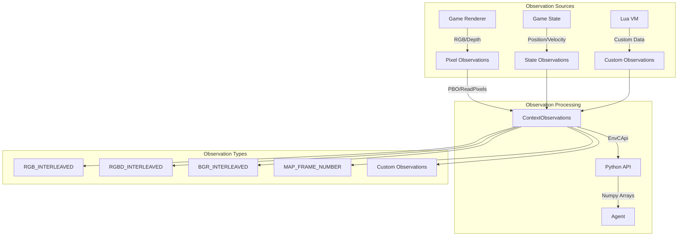

### Action System

The action system in DeepMind Lab defines several standard actions:

| Action Name                     | Type    | Description                               |
|---------------------------------|---------|-------------------------------------------|
| `LOOK_LEFT_RIGHT_PIXELS_PER_FRAME` | Discrete | Angular velocity for horizontal looking   |
| `LOOK_DOWN_UP_PIXELS_PER_FRAME`    | Discrete | Angular velocity for vertical looking     |
| `STRAFE_LEFT_RIGHT`              | Discrete | Movement left/right                        |
| `MOVE_BACK_FORWARD`              | Discrete | Movement backward/forward                  |
| `FIRE`                           | Discrete | Fire weapon                                |
| `JUMP`                           | Discrete | Jump                                       |
| `CROUCH`                         | Discrete | Crouch                                     |

Custom actions can also be defined through the Lua API.

Sources:
- [engine/code/deepmind/dmlab_connect.c:74-116](https://github.com/google-deepmind/lab/blob/master/engine/code/deepmind/dmlab_connect.c)
- [engine/code/deepmind/dmlab_connect.c:213-296](https://github.com/google-deepmind/lab/blob/master/engine/code/deepmind/dmlab_connect.c)
- [deepmind/engine/context_observations.h](https://github.com/google-deepmind/lab/blob/master/deepmind/engine/context_observations.h)
- [deepmind/engine/context_actions.h](https://github.com/google-deepmind/lab/blob/master/deepmind/engine/context_actions.h)

## Python API Interface

DeepMind Lab exposes its functionality through a Python module in `python/dmlab_module.c`. This module provides the `Lab` class that agents use to interact with the environment.

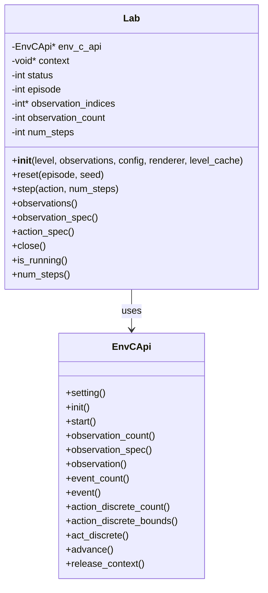

Key methods of the `Lab` class:

- `__init__(level, observations, config, renderer, level_cache)`: Initialize the environment with a specific level, desired observations, and configuration.
- `reset(episode, seed)`: Reset the environment to start a new episode with an optional seed.
- `step(action, num_steps)`: Take an action and advance the environment by a specified number of steps.
- `observations()`: Get the current observations from the environment.
- `observation_spec()`: Get the specifications of available observations.
- `action_spec()`: Get the specifications of available actions.

Sources:
- [python/dmlab_module.c:50-600](https://github.com/google-deepmind/lab/blob/master/python/dmlab_module.c)
- [public/dmlab.h:21-57](https://github.com/google-deepmind/lab/blob/master/public/dmlab.h)

## System Initialization and Startup Flow

The following diagram shows the initialization and startup sequence of DeepMind Lab:

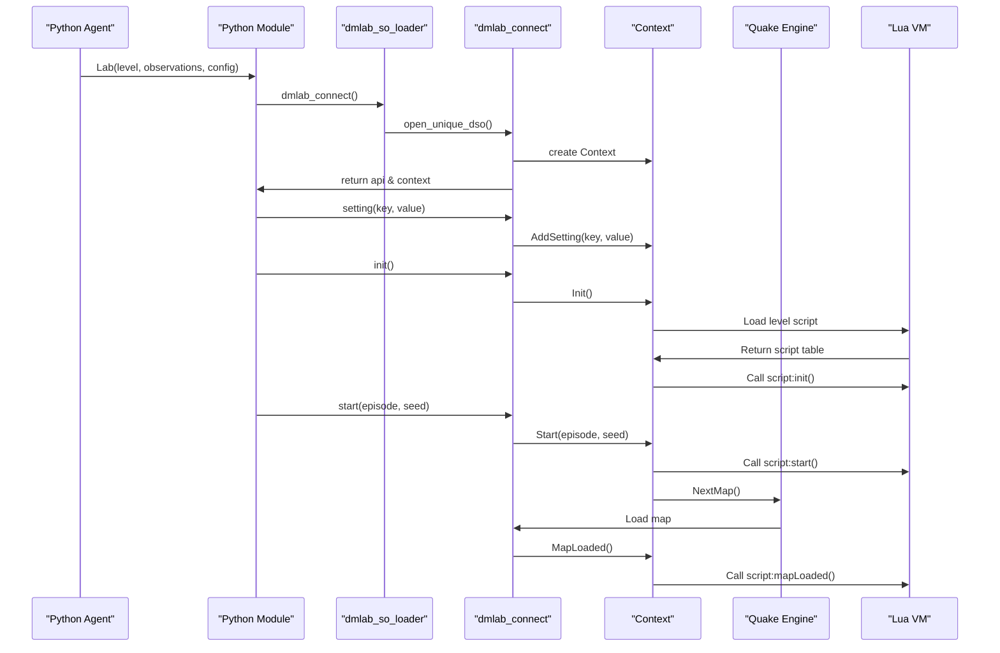

Sources:
- [python/dmlab_module.c:138-308](https://github.com/google-deepmind/lab/blob/master/python/dmlab_module.c)
- [engine/code/deepmind/dmlab_connect.c:500-836](https://github.com/google-deepmind/lab/blob/master/engine/code/deepmind/dmlab_connect.c)
- [deepmind/engine/context.cc:700-848](https://github.com/google-deepmind/lab/blob/master/deepmind/engine/context.cc)
- [public/dmlab_so_loader.cc:136-232](https://github.com/google-deepmind/lab/blob/master/public/dmlab_so_loader.cc)

## Properties System

DeepMind Lab includes a property system (added in API version 1.4) that allows dynamic querying and modifying of environment state. This system provides a standard way for scripts to expose and consume custom properties.

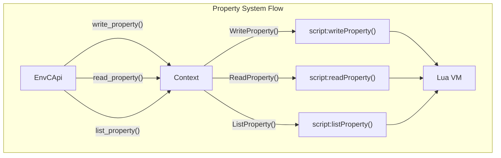

Properties can have different attributes:
- `Readable`: Property can be read
- `Writable`: Property can be written
- `ReadWritable`: Property can be both read and written
- `Custom`: Property has custom behavior defined by scripts

Sources:
- [RELEASE_NOTES.md:34-50](https://github.com/google-deepmind/lab/blob/master/RELEASE_NOTES.md)
- [deepmind/include/deepmind_hooks.h:133-144](https://github.com/google-deepmind/lab/blob/master/deepmind/include/deepmind_hooks.h)
- [deepmind/engine/context.h:401-411](https://github.com/google-deepmind/lab/blob/master/deepmind/engine/context.h)

## Integration with Game Engine

DeepMind Lab integrates with the Quake III Arena engine through a set of hooks and callbacks that allow the Context system to control and interact with the game engine.

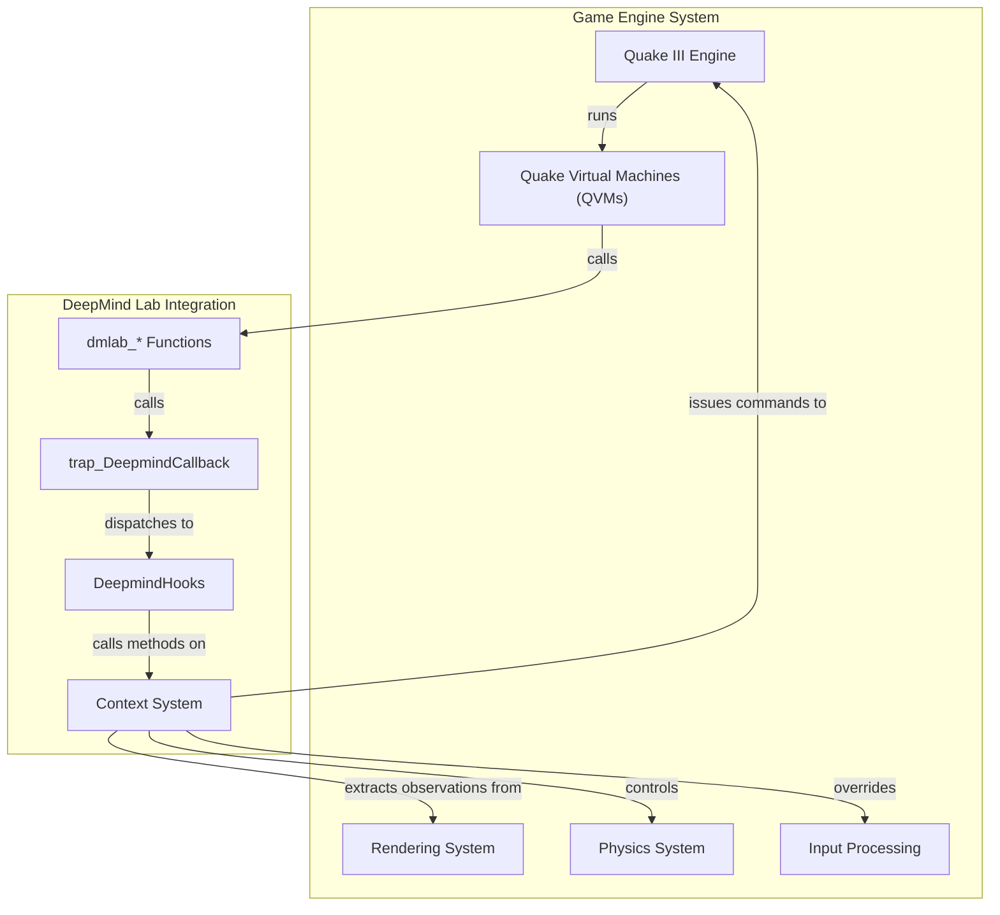

The integration happens through several key mechanisms:
1. The DeepmindHooks structure defines function pointers that the game engine calls
2. The trap_DeepmindCallback function allows the game code to call into the Context system
3. Various dmlab_* functions in the game code provide specific functionality
4. The Context system can issue console commands to control the engine

Sources:
- [engine/code/deepmind/dm_public.h:19-60](https://github.com/google-deepmind/lab/blob/master/engine/code/deepmind/dm_public.h)
- [engine/code/deepmind/dm_local.h:19-266](https://github.com/google-deepmind/lab/blob/master/engine/code/deepmind/dm_local.h)
- [engine/code/qcommon/deepmind_hooks.c:19-247](https://github.com/google-deepmind/lab/blob/master/engine/code/qcommon/deepmind_hooks.c)

## Conclusion

The architecture of DeepMind Lab is designed to provide a flexible, extensible platform for reinforcement learning research. The system cleanly separates the game engine from the reinforcement learning interfaces, allowing researchers to focus on agent development without worrying about the underlying implementation details.

Key features of the architecture include:
- A modular design with clear separation between components
- A powerful Lua scripting system for customizing environments
- A standardized API for agent interaction
- Support for procedural content generation
- Flexible observation and action systems

This architecture enables DeepMind Lab to serve as a versatile platform for a wide range of research in reinforcement learning, from navigation tasks to complex problem-solving scenarios.

---

# Page: Features

# Features

<details>
<summary>Relevant source files</summary>

The following files were used as context for generating this wiki page:

- [README.md](README.md)
- [RELEASE_NOTES.md](RELEASE_NOTES.md)
- [docs/users/observations.md](docs/users/observations.md)
- [docs/users/python_api.md](docs/users/python_api.md)
- [docs/users/run_from_script.md](docs/users/run_from_script.md)
- [engine/code/deepmind/dmlab_connect.c](engine/code/deepmind/dmlab_connect.c)
- [python/dmlab_module.c](python/dmlab_module.c)
- [python/pip_package/BUILD](python/pip_package/BUILD)
- [python/pip_package/README.md](python/pip_package/README.md)
- [python/pip_package/__init__.py](python/pip_package/__init__.py)
- [python/pip_package/build_pip_package.sh](python/pip_package/build_pip_package.sh)
- [python/pip_package/setup.py](python/pip_package/setup.py)
- [python/random_agent.py](python/random_agent.py)
- [python/tests/dmlab_module_test.py](python/tests/dmlab_module_test.py)
- [python/tests/random_agent_test.py](python/tests/random_agent_test.py)
- [python/tests/render_test.py](python/tests/render_test.py)
- [testing/recording_test.cc](testing/recording_test.cc)
- [third_party/rl_api/env_c_api.h](third_party/rl_api/env_c_api.h)
- [third_party/rl_api/env_c_api_bind.h](third_party/rl_api/env_c_api_bind.h)
- [third_party/rl_api/env_c_api_example.cc](third_party/rl_api/env_c_api_example.cc)
- [third_party/rl_api/env_c_api_example_test.cc](third_party/rl_api/env_c_api_example_test.cc)

</details>


This page outlines the key features and capabilities of DeepMind Lab as a 3D learning environment and research platform for agent-based AI research. It focuses on what DeepMind Lab offers to researchers and developers building reinforcement learning agents. For information about the underlying architecture, see [Architecture](#1.1), and for setup instructions, see [Getting Started](#2).

## Core Features Overview

DeepMind Lab provides a rich feature set designed specifically for reinforcement learning research in 3D environments.

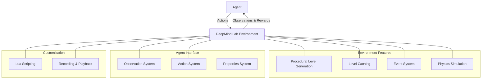

Sources: [RELEASE_NOTES.md](RELEASE_NOTES.md), [README.md](README.md), [python/dmlab_module.c](python/dmlab_module.c)

## 3D Environment

DeepMind Lab is built on the Quake III Arena engine via ioquake3, providing a mature 3D physics engine and rendering system.

### Features:
- **Rich 3D Worlds**: Full 3D navigation with physics simulation 
- **Variety of Tasks**: Navigation puzzles, exploration challenges, item collection
- **Puzzle-Solving Tasks**: Complex environments requiring strategy and planning
- **Procedural Generation**: Dynamically created levels with configurable difficulty
- **Themed Environments**: Multiple visual themes and scenarios

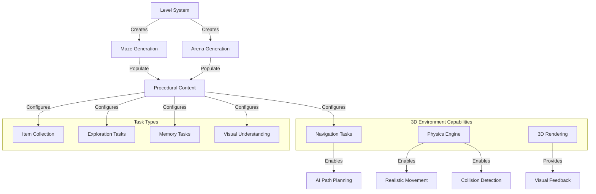

Sources: [README.md](README.md), [engine/code/deepmind/dmlab_connect.c](engine/code/deepmind/dmlab_connect.c)

## Observation System

DeepMind Lab provides a flexible observation system that can deliver various types of information to the agent. Observations are tensors (or strings) with well-defined shapes that agents can use to understand the environment.

### Standard Observations

| Observation Name | Type/Shape | Description |
|------------------|------------|-------------|
| `RGB_INTERLEAVED` | Bytes (height, width, 3) | RGB pixel values in height×width×channels format |
| `RGBD_INTERLEAVED` | Bytes (height, width, 4) | RGB pixel values with depth channel |
| `RGB` | Bytes (3, height, width) | RGB pixel values in planar format |
| `RGBD` | Bytes (4, height, width) | RGB pixel values with depth in planar format |
| `BGR_INTERLEAVED` | Bytes (height, width, 3) | BGR pixel values interleaved |
| `BGRD_INTERLEAVED` | Bytes (height, width, 4) | BGR pixel values with depth interleaved |

### Additional Observations

| Observation Name | Type/Shape | Description |
|------------------|------------|-------------|
| `VEL.TRANS` | Doubles (3) | Player's translational velocity |
| `VEL.ROT` | Doubles (3) | Player's rotational velocity |
| `INSTR` | String | Textual instructions from level to agent |
| `DEBUG.POS.TRANS` | Doubles (3) | Player's world position |
| `DEBUG.POS.ROT` | Doubles (3) | Player's world orientation |

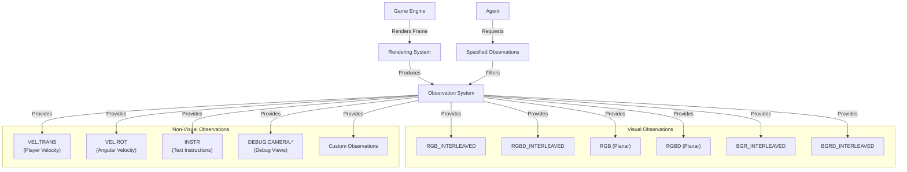

Sources: [docs/users/observations.md](docs/users/observations.md), [python/dmlab_module.c:858-922](python/dmlab_module.c), [engine/code/deepmind/dmlab_connect.c:106-116](engine/code/deepmind/dmlab_connect.c)

## Action System

DeepMind Lab provides a flexible action interface that allows agents to interact with the environment through discrete actions.

### Standard Actions

| Action Name | Value Range | Description |
|-------------|-------------|-------------|
| `LOOK_LEFT_RIGHT_PIXELS_PER_FRAME` | -512 to 512 | Angular velocity for looking left/right |
| `LOOK_DOWN_UP_PIXELS_PER_FRAME` | -512 to 512 | Angular velocity for looking up/down |
| `STRAFE_LEFT_RIGHT` | -1 to 1 | Movement left/right |
| `MOVE_BACK_FORWARD` | -1 to 1 | Movement backward/forward |
| `FIRE` | 0 to 1 | Fire weapon |
| `JUMP` | 0 to 1 | Jump |
| `CROUCH` | 0 to 1 | Crouch |

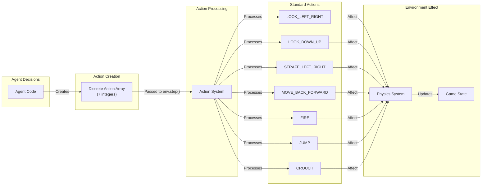

Sources: [engine/code/deepmind/dmlab_connect.c:74-92](engine/code/deepmind/dmlab_connect.c), [python/tests/dmlab_module_test.py:61-78](python/tests/dmlab_module_test.py), [python/random_agent.py:37-48](python/random_agent.py)

## Level Generation and Caching

DeepMind Lab provides powerful level generation capabilities, allowing researchers to create diverse environments for training and testing agents.

### Level Generation Features

- **Procedural Maze Generation**: Create complex mazes with configurable parameters
- **Text-Based Level Descriptions**: Define levels using human-readable text format
- **Programmatic Level Creation**: Generate levels using Lua scripts
- **Level Factories**: Produce variations of environments with consistent properties
- **Theme Customization**: Change visual appearance and gameplay elements

### Level Caching

Level caching significantly improves performance by storing compiled levels for reuse:

- **Local Level Cache**: Caches levels on the local machine
- **Global Level Cache**: Shares cached levels across experiments
- **Performance Benefits**: Avoids costly recompilation of procedurally generated levels
- **Consistent Testing**: Ensures reproducibility across experimental runs

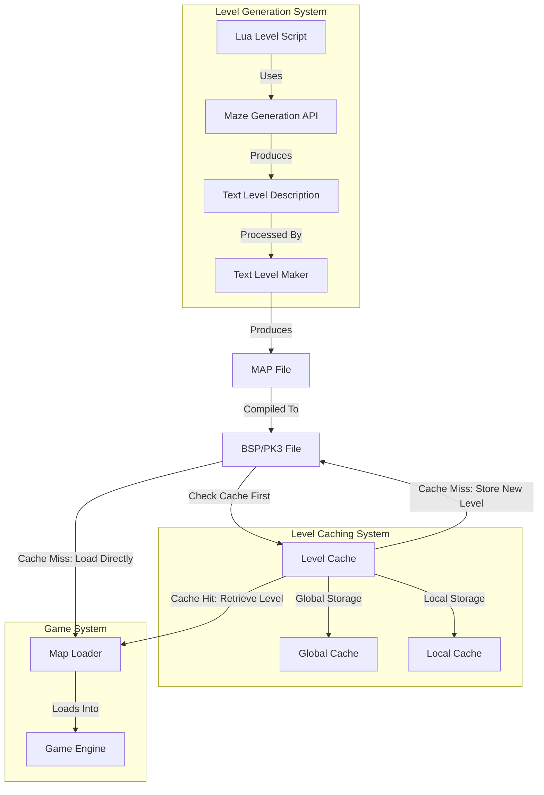

Sources: [RELEASE_NOTES.md:202-204](RELEASE_NOTES.md), [python/dmlab_module.c:181-207](python/dmlab_module.c), [python/pip_package/README.md:81-126](python/pip_package/README.md)

## Property System

DeepMind Lab includes a property system that allows dynamic querying and modification of environment state. This feature was introduced in the December 2020 release.

### Property System Features:

- **Dynamic State Queries**: Read current environment state through properties
- **Runtime Configuration**: Modify environment settings during execution
- **Custom Properties**: Level scripts can register and consume custom properties
- **Attribute Control**: Properties can be read-only, write-only, or read-write
- **Command Execution**: Issue Quake console commands via a write-only property

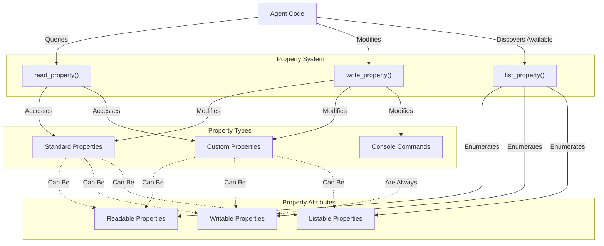

Sources: [RELEASE_NOTES.md:35-44](RELEASE_NOTES.md), [third_party/rl_api/env_c_api.h:185-208](third_party/rl_api/env_c_api.h), [third_party/rl_api/env_c_api_example.cc:188-238](third_party/rl_api/env_c_api_example.cc)

## Recording and Playback

DeepMind Lab provides tools for recording agent experiences and playing them back for analysis or demonstration purposes.

### Recording Features

- **Demo Recording**: Save gameplay sessions for later analysis and playback
- **Demo Playback**: Replay previously recorded demos
- **Video Recording**: Capture gameplay as video files
- **Reproducibility**: Saved demos can be used to validate agent behavior

```mermaid
graph TD
    subgraph "Recording"
        RecordSetting["record Setting"]
        DemofilesSetting["demofiles Setting"]
        Demo["Demo Files (.dm_71)"]
        VideoSetting["video Setting"]
        VideoFiles["Video Files"]
    end
    
    subgraph "Playback"
        DemoSetting["demo Setting"]
        DemoPlayback["Demo Playback"]
        VideoPlayer["External Video Player"]
    end
    
    Agent["Agent Run"] -->|"Enables"| RecordSetting
    RecordSetting -->|"Creates"| Demo
    DemofilesSetting -->|"Configures Path For"| Demo
    
    Agent -->|"Enables"| VideoSetting
    VideoSetting -->|"Creates"| VideoFiles
    
    DemoSetting -->|"Loads"| Demo
    Demo -->|"Drives"| DemoPlayback
    DemoPlayback -->|"Reproduces"| Environment["Environment State"]
    
    VideoFiles -->|"Viewed In"| VideoPlayer
```

Sources: [RELEASE_NOTES.md:292-337](RELEASE_NOTES.md), [testing/recording_test.cc](testing/recording_test.cc), [python/random_agent.py:140-154](python/random_agent.py)

## API Options

DeepMind Lab offers multiple API options for researchers with different requirements.

### Python API

The Python API is the most commonly used interface:

```python
import deepmind_lab
env = deepmind_lab.Lab('lt_chasm', ['RGB_INTERLEAVED'])
env.reset()
action = numpy.zeros([7], dtype=numpy.intc)  # No-op action
reward = env.step(action)
observation = env.observations()['RGB_INTERLEAVED']
```

### C/C++ API (EnvCApi)

The C/C++ API provides lower-level access for advanced integration:

```c
// Create and initialize the environment
EnvCApi env_c_api;
void* context;
dmlab_connect(&params, &env_c_api, &context);
env_c_api.init(context);
env_c_api.start(context, episode_id, seed);

// Interact with the environment
int discrete_actions[7] = {0};
env_c_api.act_discrete(context, discrete_actions);
double reward;
EnvCApi_EnvironmentStatus status = env_c_api.advance(context, 1, &reward);
```

### dm_env Integration

DeepMind's standard reinforcement learning API:

```python
from deepmind_lab import dmenv_module
env = dmenv_module.Lab(level='lt_chasm', observation_names=['RGB_INTERLEAVED'])
timestep = env.reset()
action = numpy.zeros([7], dtype=numpy.intc)
timestep = env.step(action)
```

```mermaid
graph TD
    subgraph "API Options"
        PythonAPI["Python API\ndeepmind_lab.Lab"]
        CAPI["C/C++ API\nEnvCApi"]
        DMEnvAPI["dm_env API\ndmenv_module.Lab"]
    end
    
    subgraph "Implementation"
        PythonBinding["Python Binding\ndmlab_module.c"]
        EnvCApiImpl["EnvCApi Implementation\ndmlab_connect.c"]
        DmEnvAdapter["dm_env Adapter\ndmenv_module.py"]
    end
    
    subgraph "Distribution Methods"
        BazelBuild["Bazel Build"]
        PIPPackage["PIP Package"]
    end
    
    PythonAPI -->|"Implemented In"| PythonBinding
    CAPI -->|"Implemented In"| EnvCApiImpl
    DMEnvAPI -->|"Built On"| PythonAPI
    DMEnvAPI -->|"Implemented In"| DmEnvAdapter
    
    PythonBinding -->|"Calls"| EnvCApiImpl
    
    BazelBuild -->|"Produces"| PythonAPI & CAPI & DMEnvAPI
    PIPPackage -->|"Includes"| PythonAPI & DMEnvAPI
```

Sources: [python/dmlab_module.c](python/dmlab_module.c), [engine/code/deepmind/dmlab_connect.c](engine/code/deepmind/dmlab_connect.c), [python/pip_package/README.md:192-215](python/pip_package/README.md), [docs/users/python_api.md](docs/users/python_api.md)

## Events System

DeepMind Lab includes an events system that allows tracking and responding to in-game events.

### Event System Features:

- **Custom Event Types**: Define custom events with associated observations
- **Event Querying**: Retrieve events that occurred during gameplay
- **Event-Driven Logic**: Trigger responses based on specific events
- **Event Observations**: Events can carry additional observation data

```mermaid
graph TD
    subgraph "Event System"
        EventCreation["Event Creation"]
        EventStorage["Event Queue"]
        EventRetrieval["env.events()"]
    end
    
    subgraph "Event Components"
        EventType["Event Type Name"]
        EventObservations["Associated Observations"]
    end
    
    Environment["Environment"] -->|"Generates"| EventCreation
    EventCreation -->|"Stores"| EventStorage
    EventStorage -->|"Retrieved By"| EventRetrieval
    Agent["Agent Code"] -->|"Calls"| EventRetrieval
    
    EventRetrieval -->|"Returns"| EventTuple["(Type, Observations)"]
    EventType & EventObservations -->|"Compose"| EventTuple
```

Sources: [python/tests/dmlab_module_test.py:148-196](python/tests/dmlab_module_test.py), [RELEASE_NOTES.md:326-331](RELEASE_NOTES.md)

## Customization via Lua Scripting

DeepMind Lab uses Lua scripts for extensive customization of environments, allowing researchers to define custom behaviors, observation processing, and more.

### Lua Scripting Features:

- **Level Definition**: Define level structure, rewards, and gameplay logic
- **Custom Observations**: Create specialized observation types
- **Custom Actions**: Define unique actions for specific research needs
- **Reward Shaping**: Design complex reward functions
- **Game Logic**: Implement custom game rules and mechanics
- **Tensor Operations**: Process and transform data efficiently
- **Image Processing**: Manipulate visual data

```mermaid
graph TD
    subgraph "Lua Scripting System"
        LuaVM["Lua Virtual Machine"]
        LuaAPI["DeepMind Lab Lua API"]
        LevelScripts["Level Scripts"]
    end
    
    subgraph "Customizable Components"
        CustomObservations["Custom Observations"]
        CustomActions["Custom Actions"]
        RewardFunctions["Reward Functions"]
        GameLogic["Game Logic"]
        LevelGeneration["Level Generation"]
    end
    
    subgraph "Engine Integration"
        Context["DeepmindContext"]
        GameHooks["Game Engine Hooks"]
    end
    
    LuaVM -->|"Executes"| LevelScripts
    LevelScripts -->|"Use"| LuaAPI
    LuaAPI -->|"Registers"| CustomObservations & CustomActions & RewardFunctions & GameLogic & LevelGeneration
    
    Context -->|"Manages"| LuaVM
    LuaAPI -->|"Interfaces With"| GameHooks
    GameHooks -->|"Modify"| GameEngine["Game Engine Behavior"]
    
    CustomObservations -->|"Extend"| ObservationSystem["Observation System"]
    CustomActions -->|"Extend"| ActionSystem["Action System"]
    RewardFunctions -->|"Define"| RewardCalculation["Reward Calculation"]
    GameLogic -->|"Controls"| GameFlow["Game Flow"]
    LevelGeneration -->|"Creates"| Environments["Game Environments"]
```

Sources: [RELEASE_NOTES.md:327-341](RELEASE_NOTES.md), [README.md:107-108](README.md)

## Other Features

### Performance Features
- **Level Caching**: Significant performance improvements for procedurally generated levels
- **Rendering Options**: Software or hardware rendering
- **Reduced UI Modes**: Options to disable UI elements for faster rendering
- **Fixed Time Step**: Control simulation speed independently of rendering

### Research Tools
- **Randomization Control**: Seed control for reproducible experiments
- **Episode Configuration**: Fine-grained control over episodes and resets
- **Team Play Settings**: Configure team gameplay environments
- **Gadget Selection**: Control for in-game gadget selection and switching

Sources: [RELEASE_NOTES.md](RELEASE_NOTES.md), [python/dmlab_module.c:630-648](python/dmlab_module.c)

---

# Page: Getting Started

# Getting Started

<details>
<summary>Relevant source files</summary>

The following files were used as context for generating this wiki page:

- [.github/workflows/precommit.yml](.github/workflows/precommit.yml)
- [.precommit.bazelrc](.precommit.bazelrc)
- [BUILD](BUILD)
- [README.md](README.md)
- [docs/users/build.md](docs/users/build.md)
- [examples/game_main.py](examples/game_main.py)
- [public/dmlab_connect_test.cc](public/dmlab_connect_test.cc)
- [python/pip_package/BUILD](python/pip_package/BUILD)
- [python/pip_package/README.md](python/pip_package/README.md)
- [python/pip_package/__init__.py](python/pip_package/__init__.py)
- [python/pip_package/build_pip_package.sh](python/pip_package/build_pip_package.sh)
- [python/pip_package/setup.py](python/pip_package/setup.py)
- [python/random_agent_simple.py](python/random_agent_simple.py)
- [python/tests/BUILD](python/tests/BUILD)
- [python/tests/benchmark.py](python/tests/benchmark.py)
- [python/tests/level_cache_test.py](python/tests/level_cache_test.py)
- [python/tests/utils/BUILD](python/tests/utils/BUILD)
- [python/tests/utils/game_controller_test.py](python/tests/utils/game_controller_test.py)
- [python/tests/utils/maze_game_controller.py](python/tests/utils/maze_game_controller.py)
- [python/tests/utils/maze_game_controller_test.py](python/tests/utils/maze_game_controller_test.py)
- [python/tests/utils/test_environment_decorator.py](python/tests/utils/test_environment_decorator.py)
- [python/tests/utils/test_environment_decorator_test.py](python/tests/utils/test_environment_decorator_test.py)
- [python_system.bzl](python_system.bzl)

</details>


This document guides you through the process of setting up and using DeepMind Lab, a 3D learning environment based on the Quake III Arena engine, designed for reinforcement learning research. For an overview of DeepMind Lab architecture and features, see [Overview](#1) and [Architecture](#1.1). For details on individual API components, see [Python API](#3).

## Prerequisites and Dependencies

DeepMind Lab requires several dependencies to build and run effectively. The installation process differs slightly based on your operating system.

### Required Software

- **Bazel**: Build system used by DeepMind Lab
- **Python**: 2.7 or 3.5+ with NumPy and PIL/Pillow
- **SDL2**: For windowing and input when using graphical mode
- **OpenGL/EGL/OSMesa**: For rendering (either hardware-accelerated or software)
- **Additional libraries**: Varies by platform

### Platform-Specific Dependencies

#### Debian/Ubuntu

```bash
sudo apt-get install libffi-dev gettext freeglut3-dev libsdl2-dev \
     zip libosmesa6-dev python-dev python-numpy python-pil python-enum34 \
     python3-dev python3-numpy python3-pil
```

#### Red Hat Enterprise Linux/CentOS

```bash
sudo yum -y install unzip java-1.8.0-openjdk libffi-devel gcc gcc-c++ \
     java-1.8.0-openjdk-devel freeglut-devel python-devel python-imaging \
     numpy python36-numpy python36-pillow python36-devel SDL2 SDL2-devel \
     mesa-libOSMesa-devel zip
```

#### SUSE Linux

```bash
sudo zypper --non-interactive install gcc gcc-c++ java-1_8_0-openjdk \
     java-1_8_0-openjdk-devel libOSMesa-devel freeglut-devel libSDL-devel \
     python-devel python-numpy-devel python-imaging
```

Sources: [docs/users/build.md:32-70](), [README.md:138-171]()

## Installation Methods

DeepMind Lab can be installed in two primary ways: building from source with Bazel or using pip for Python integration.

### Diagram: Installation Methods

```mermaid
graph TD
    User["User"]
    
    subgraph "Installation Methods"
        SourceInstall["Source Installation"]
        PipInstall["Pip Installation"]
    end
    
    subgraph "Build System Components"
        BazelBuild["Bazel Build"]
        BazelTarget1["//:deepmind_lab.so"]
        BazelTarget2["//:python_random_agent"]
        BazelTarget3["//:game"]
    end
    
    subgraph "Python Package Components"
        PipPackage["deepmind_lab Package"]
        NativeModule["deepmind_lab.so Module"]
        DMEnvModule["dmenv_module"]
    end
    
    User --> SourceInstall
    User --> PipInstall
    
    SourceInstall --> BazelBuild
    BazelBuild --> BazelTarget1
    BazelBuild --> BazelTarget2
    BazelBuild --> BazelTarget3
    
    PipInstall --> PipPackage
    PipPackage --> NativeModule
    PipPackage --> DMEnvModule
    
    NativeModule --> BazelTarget1
```

Sources: [README.md:42-65](), [docs/users/build.md:22-91](), [python/pip_package/README.md:8-46]()

### Building from Source (Recommended)

Follow these steps to build DeepMind Lab from source:

1. **Install Bazel** from [bazel.io](https://docs.bazel.build/versions/master/install.html)

2. **Clone the repository**:
   ```bash
   git clone https://github.com/deepmind/lab
   cd lab
   ```

3. **Build the Python interface**:
   ```bash
   bazel build -c opt //:deepmind_lab.so
   ```

4. **Verify the installation** by running tests:
   ```bash
   bazel test -c opt //python/tests:python_module_test
   ```

5. **Run a sample random agent**:
   ```bash
   bazel run -c opt //:python_random_agent --define graphics=sdl -- \
             --length=10000 --width=640 --height=480
   ```

Sources: [README.md:42-65](), [docs/users/build.md:22-91]()

### Installing via pip

For using DeepMind Lab as a Python module without modifying the code:

1. **Build the pip package**:
   ```bash
   git clone https://github.com/deepmind/lab
   cd lab
   bazel build -c opt --python_version=PY3 //python/pip_package:build_pip_package
   ./bazel-bin/python/pip_package/build_pip_package /tmp/dmlab_pkg
   ```

2. **Install the package**:
   ```bash
   pip install /tmp/dmlab_pkg/deepmind_lab-1.0-py3-none-any.whl
   ```

For Python 2 (if required), use `--python_version=PY2` in the build command.

Sources: [python/pip_package/README.md:16-138](), [python/pip_package/BUILD:1-16]()

## Basic Usage

### Diagram: Agent-Environment Interaction

```mermaid
graph TD
    subgraph "Agent Code"
        AgentLogic["Agent Logic"]
    end
    
    subgraph "DeepMind Lab Python API"
        LabClass["deepmind_lab.Lab Class"]
        Reset["env.reset()"]
        Step["env.step(action)"]
        Observations["env.observations()"]
    end
    
    subgraph "Internal Engine"
        Context["DeepmindContext"]
        GameEngine["Quake III Game Engine"]
        LuaVM["Lua VM"]
        LevelScript["Level Script"]
    end
    
    AgentLogic -->|"Create environment"| LabClass
    AgentLogic -->|"Start episode"| Reset
    AgentLogic -->|"Send actions"| Step
    AgentLogic -->|"Receive observations"| Observations
    
    LabClass --> Context
    Reset --> Context
    Step --> Context
    Context -->|"Returns"| Observations
    
    Context --> GameEngine
    Context --> LuaVM
    LuaVM --> LevelScript
    GameEngine -->|"Game state"| Context
```

Sources: [examples/game_main.py:1-97](), [python/random_agent_simple.py:1-83]()

### Running a Random Agent

To run a simple random agent and observe its behavior:

```bash
# With visual output (requires a display)
bazel run -c opt //:python_random_agent --define graphics=sdl -- \
         --length=10000 --width=640 --height=480

# Headless (for server environments)
bazel run -c opt //:python_random_agent --define headless=osmesa
```

The `--length` parameter controls how many steps the agent will take.

Sources: [README.md:52-66](), [.github/workflows/precommit.yml:52-52]()

### Playing as a Human

To interact with DeepMind Lab environments as a human:

```bash
bazel run -c opt :game -- --level_script=tests/empty_room_test

# With additional logging
bazel run -c opt :game -- -l tests/empty_room_test -s logToStdErr=true
```

To view specific observations during gameplay:

```bash
bazel run -c opt :game -- --level_script=lt_chasm --observation VEL.TRANS --observation VEL.ROT
```

Sources: [README.md:69-86]()

### Python API Basic Example

Here's a basic example of using the Python API:

```python
import deepmind_lab
import numpy as np

# Create a new environment
env = deepmind_lab.Lab(
    'seekavoid_arena_01',  # Level script
    ['RGB_INTERLEAVED'],   # Observations 
    {'fps': '30', 'width': '80', 'height': '60'}  # Config
)

# Reset environment and get initial observations
env.reset()

# Create a simple action (move forward)
action = np.zeros([7], dtype=np.intc)
action[3] = 1  # Forward movement

# Execute steps and collect rewards
for _ in range(100):
    reward = env.step(action)
    if not env.is_running():
        # Episode ended - reset environment
        env.reset()
```

Sources: [examples/game_main.py:30-63](), [python/random_agent_simple.py:46-61]()

### Using the dm_env API

DeepMind Lab also provides bindings to the DeepMind "dm_env" API:

```python
from deepmind_lab import dmenv_module as dm_env_lab

# Create a new environment using the dm_env API
env = dm_env_lab.Lab(
    level='seekavoid_arena_01', 
    observation_names=['RGB_INTERLEAVED'],
    config={'fps': '30', 'width': '80', 'height': '60'}
)

# Reset the environment to start a new episode
timestep = env.reset()

# Take actions and observe results using the dm_env API
action = [0, 0, 0, 1, 0, 0, 0]  # Move forward
timestep = env.step(action)
```

Sources: [python/pip_package/README.md:193-217](), [python/pip_package/__init__.py:1-32]()

## Level Caching

DeepMind Lab supports caching generated levels to improve startup time for procedurally generated levels.

```python
import os
import deepmind_lab

class SimpleLevelCache(object):
    def __init__(self, cache_dir):
        self._cache_dir = cache_dir
        os.makedirs(cache_dir, exist_ok=True)
        
    def fetch(self, key, pk3_path):
        """Try to fetch cached level."""
        path = os.path.join(self._cache_dir, key)
        if os.path.isfile(path):
            import shutil
            shutil.copyfile(path, pk3_path)
            return True
        return False
        
    def write(self, key, pk3_path):
        """Write generated level to cache."""
        path = os.path.join(self._cache_dir, key)
        import shutil
        shutil.copyfile(pk3_path, path)

# Create environment with level cache
cache = SimpleLevelCache("/tmp/dmlab_cache")
env = deepmind_lab.Lab(
    level='contributed/dmlab30/explore_goal_locations_small',
    observations=['RGB_INTERLEAVED'],
    config={'width': '96', 'height': '72'},
    level_cache=cache
)
```

Sources: [python/tests/level_cache_test.py:33-150]()

## Testing and Benchmarking

DeepMind Lab includes utilities for testing and benchmarking environments:

```bash
# Run the benchmark script to measure performance
bazel run //python/tests:python_benchmark

# Run a specific test
bazel test -c opt //python/tests:python_module_test
```

For custom test environments, the `TestEnvironmentDecorator` provides utilities for:
- Collecting cumulative rewards
- Accumulating events
- Saving rendered frames as images

Sources: [python/tests/utils/test_environment_decorator.py:1-125](), [python/tests/benchmark.py:1-110]()

## Game Controller Utilities

For more sophisticated agent behavior, DeepMind Lab includes game controller utilities:

```python
import deepmind_lab
from python.tests.utils import game_controller

# Create environment with required observations
env = deepmind_lab.Lab(
    'seekavoid_arena_01',
    ['VEL.ROT', 'VEL.TRANS', 'DEBUG.POS.ROT', 'DEBUG.POS.TRANS']
)
env.reset()

# Create controller
controller = game_controller.GameController(env)

# Use high-level movement commands
controller.look_at_2d(90)  # Look right
controller.move_to(100, 0)  # Move to coordinates (100, 0)
controller.stop()  # Stop moving
```

For maze navigation, the `MazeGameController` provides additional utilities:

```python
from python.tests.utils import maze_game_controller

# Create environment with required observations
env = deepmind_lab.Lab(
    'tests/maze_navigation_test', 
    maze_game_controller.REQUIRED_OBSERVATIONS
)
env.reset()

# Create maze controller
controller = maze_game_controller.MazeGameController(env)

# Move to specific maze cell
controller.move_to(2, 5)

# Find path to destination
path = controller.find_path(5, 1)
controller.follow_path(path)
```

Sources: [python/tests/utils/game_controller_test.py:1-102](), [python/tests/utils/maze_game_controller.py:1-225](), [python/tests/utils/maze_game_controller_test.py:1-74]()

## Rendering Options

DeepMind Lab supports different rendering options for different use cases:

- **SDL Rendering** (`--define graphics=sdl`): For visual output, requires a display
- **Headless Rendering**:
  - **OSMesa** (`--define headless=osmesa`): Software rendering
  - **EGL** (`--define graphics=osmesa_or_egl`): Hardware-accelerated off-screen rendering
  - **GLX** (`--define graphics=osmesa_or_glx`): Alternative hardware rendering

For most reinforcement learning workloads, headless rendering is preferred.

Sources: [README.md:162-172](), [BUILD:936-975]()

## Next Steps

Now that you've got DeepMind Lab up and running, you can explore:

- [Python API](#3) for detailed API documentation
- [Lua Scripting](#5) to customize environments
- [Level Generation](#6) to create your own levels
- [Observations and Actions](#7) to understand available inputs and outputs

---

# Page: Installation

# Installation

<details>
<summary>Relevant source files</summary>

The following files were used as context for generating this wiki page:

- [.github/workflows/precommit.yml](.github/workflows/precommit.yml)
- [.precommit.bazelrc](.precommit.bazelrc)
- [BUILD](BUILD)
- [README.md](README.md)
- [WORKSPACE](WORKSPACE)
- [bazel/dm_env.BUILD](bazel/dm_env.BUILD)
- [bazel/pybind11.BUILD](bazel/pybind11.BUILD)
- [bazel/tree.BUILD](bazel/tree.BUILD)
- [docs/users/build.md](docs/users/build.md)
- [public/dmlab_connect_test.cc](public/dmlab_connect_test.cc)
- [python/pip_package/BUILD](python/pip_package/BUILD)
- [python/pip_package/README.md](python/pip_package/README.md)
- [python/pip_package/__init__.py](python/pip_package/__init__.py)
- [python/pip_package/build_pip_package.sh](python/pip_package/build_pip_package.sh)
- [python/pip_package/setup.py](python/pip_package/setup.py)
- [python/tests/BUILD](python/tests/BUILD)
- [python/tests/utils/BUILD](python/tests/utils/BUILD)
- [python_system.bzl](python_system.bzl)

</details>


This page provides detailed instructions for installing DeepMind Lab, a 3D learning environment based on the Quake III Arena engine used for artificial intelligence research. This document focuses specifically on installation procedures for both building from source and using the Python package. For information about using DeepMind Lab after installation, see [Basic Usage](#2.2).

## System Requirements

DeepMind Lab has been tested on several Linux distributions:

| Distribution | Versions Tested |
| ------------ | --------------- |
| Debian | 9 (Stretch) and newer |
| Ubuntu | 16.04 (Xenial) and newer |
| Red Hat Enterprise Linux / CentOS | 7.6 and newer |
| SUSE Linux Enterprise Server | 12 and newer |

DeepMind Lab requires:
- A C++17 compatible compiler
- Python (both Python 2.7 and Python 3.5+ are supported, Python 3 is recommended)
- Bazel build system (for building from source)

Sources: [README.md:41-65](), [docs/users/build.md:12-14]()

## Required Dependencies

The following dependencies are needed to build and run DeepMind Lab:

| Dependency | Purpose |
| ---------- | ------- |
| SDL2 | Windowing and input handling |
| OpenGL | Rendering (for human play) |
| OSMesa/EGL/GLX | Headless rendering (for agent training) |
| Python | Programming interface |
| NumPy | Array operations for Python interface |
| Pillow/PIL | Image processing for Python |
| Bazel | Build system |

### Installing Dependencies

#### Debian/Ubuntu

```bash
sudo apt-get install libffi-dev gettext freeglut3-dev libsdl2-dev \
  zip libosmesa6-dev python3-dev python3-numpy python3-pil
```

For building a PIP package, also install:
```bash
sudo apt-get install python3-setuptools python3-wheel python3-pip python3-virtualenv
```

#### Red Hat/CentOS

```bash
sudo yum -y install unzip java-1.8.0-openjdk libffi-devel gcc gcc-c++ \
  java-1.8.0-openjdk-devel freeglut-devel python3-devel python3-numpy \
  python3-pillow SDL2 SDL2-devel mesa-libOSMesa-devel zip
```

#### SUSE Linux

```bash
sudo zypper --non-interactive install gcc gcc-c++ java-1_8_0-openjdk \
  java-1_8_0-openjdk-devel libOSMesa-devel freeglut-devel libSDL-devel \
  python3-devel python3-numpy-devel python3-Pillow
```

Sources: [docs/users/build.md:33-70](), [.github/workflows/precommit.yml:35-40]()

## Build System Architecture

### DeepMind Lab Installation Flow

```mermaid
graph TD
    A["Source Code Repository"] --> B["Bazel Build System"]
    B --> C["Python Module<br>deepmind_lab.so"]
    B --> D["Game Binary<br>:game"]
    B --> E["PIP Package Builder<br>build_pip_package"]
    
    E --> F["Wheel File (.whl)"]
    F --> G["Installed Python Package"]
    
    C --> H["Direct Usage<br>from Build Directory"]
    G --> I["Import as Python Package"]
    
    H --> J["Python Applications"]
    I --> J
```

DeepMind Lab uses Bazel as its build system. The main configuration files are:

- `WORKSPACE`: Defines external dependencies (like SDL2, OpenGL, Python)
- `BUILD`: Defines build targets and dependencies between components
- `.bazelrc` and `.precommit.bazelrc`: Contains default build options

Sources: [BUILD:1-1088](), [WORKSPACE:1-165](), [.precommit.bazelrc:1-15]()

## Building from Source

This section covers building DeepMind Lab from source using Bazel.

### Step 1: Install Bazel

Follow the [official Bazel installation guide](https://docs.bazel.build/versions/master/install.html) to install Bazel on your system.

### Step 2: Clone DeepMind Lab Repository

```bash
git clone https://github.com/deepmind/lab.git
cd lab
```

### Step 3: Build the Python Module

```bash
bazel build -c opt //:deepmind_lab.so
```

The `-c opt` flag enables compiler optimizations for better performance.

### Step 4: Test the Build (Optional)

```bash
bazel test -c opt //python/tests:python_module_test
```

### Step 5: Run a Sample Agent (Optional)

```bash
bazel run -c opt //:python_random_agent
```

For an interactive human-playable version:

```bash
bazel run -c opt --define graphics=sdl //:game -- \
  --level_script=tests/empty_room_test --level_setting=logToStdErr=true
```

Sources: [README.md:42-77](), [docs/users/build.md:21-44](), [docs/users/build.md:71-94]()

## DeepMind Lab Component Architecture

```mermaid
graph TD
    A["Python API<br>Lab Class"] --> B["Native Module<br>deepmind_lab.so"]
    A --> C["dm_env API<br>dmenv_module.py"]
    
    B --> D["EnvCApi<br>C API Interface"]
    D --> E["DeepmindContext<br>Core Component"]
    
    E --> F["Game Engine<br>Quake III Arena"]
    E --> G["Lua VM<br>Scripting System"]
    
    G --> H["Level Generation"]
    G --> I["Game Logic"]
    G --> J["Reward Functions"]
    
    F --> K["Rendering System<br>SDL/OSMesa/EGL/GLX"]
    F --> L["Physics System"]
    
    K --> M["Observations<br>RGB, Depth, etc."]
    M --> A
```

Sources: [BUILD:801-869](), [BUILD:562-564](), [BUILD:974-995](), [public/dmlab_connect_test.cc:1-57]()

## Installation via PIP Package

DeepMind Lab can be installed as a Python package using pip. This is recommended for users who want to use DeepMind Lab without modifying its source code.

### Building the PIP Package

First, build the package script:

```bash
bazel build -c opt //python/pip_package:build_pip_package
```

Run the package script to create the wheel file:

```bash
./bazel-bin/python/pip_package/build_pip_package /tmp/dmlab_pkg
```

Install the wheel file:

```bash
pip install /tmp/dmlab_pkg/deepmind_lab-1.0-py3-none-any.whl
```

### Using a Virtual Environment (Recommended)

It's recommended to install DeepMind Lab in a virtual environment:

```bash
virtualenv dmlab_env
source dmlab_env/bin/activate
pip install numpy  # If not using --system-site-packages
pip install /tmp/dmlab_pkg/deepmind_lab-1.0-py3-none-any.whl
```

Sources: [python/pip_package/README.md:8-79](), [python/pip_package/build_pip_package.sh:1-66](), [python/pip_package/setup.py:1-21]()

## Python 2 vs Python 3 Support

DeepMind Lab supports both Python 2 and Python 3. By default, it builds for Python 3.

- For Python 2: Add `--python_version=PY2` to your Bazel commands
- For Python 3: Add `--python_version=PY3` or omit (default since Bazel 0.27)

For example, to build the PIP package for Python 2:

```bash
bazel build -c opt --python_version=PY2 //python/pip_package:build_pip_package
```

And when running the PIP package build script:

```bash
PYTHON_BIN_PATH="/usr/bin/python2" ./bazel-bin/python/pip_package/build_pip_package /tmp/dmlab_pkg
```

The Python system detection is handled by the `python_system.bzl` Bazel rule, which locates your system's Python installation and NumPy headers.

Sources: [python/pip_package/README.md:44-60](), [python_system.bzl:1-73](), [BUILD:1022-1033]()

## Rendering Options

```mermaid
graph TD
    A["DeepMind Lab<br>Rendering Options"] --> B["Rendering Backends"]
    
    B --> C["SDL<br>Human Play"]
    B --> D["Headless Backends<br>Agent Training"]
    
    D --> E["OSMesa<br>Software Rendering"]
    D --> F["EGL<br>Hardware Accelerated"]
    D --> G["GLX<br>Hardware Accelerated"]
    
    C --> H["Window-Based<br>Visualization"]
    E --> I["Offscreen<br>Rendering"]
    F --> I
    G --> I
    
    I --> J["Agent<br>Observations"]
    H --> K["Human<br>Interaction"]
```

DeepMind Lab supports multiple rendering backends:

1. **SDL** - For human play with window visualization
2. **OSMesa** - Software rendering for headless environments
3. **EGL/GLX** - Hardware-accelerated rendering for headless environments

To specify the rendering backend:

```bash
# For SDL (human play)
bazel build -c opt --define graphics=sdl //:game

# For headless with OSMesa or EGL (for training agents)
bazel build -c opt --define headless=osmesa //:python_random_agent
# or
bazel build -c opt --define headless=egl //:python_random_agent
```

Sources: [BUILD:802-892](), [BUILD:937-1008](), [README.md:156-169]()

## Verifying the Installation

Create a file `test_lab.py` with the following content:

```python
import deepmind_lab
import numpy as np

# Create a new environment object
lab = deepmind_lab.Lab("demos/extra_entities", ['RGB_INTERLEAVED'],
                      {'fps': '30', 'width': '80', 'height': '60'})
lab.reset(seed=1)

# Execute 100 walk-forward steps and sum the returned rewards
reward_sum = sum(
    [lab.step(np.array([0,0,0,1,0,0,0], dtype=np.intc)) for i in range(0, 100)])
print("Total reward:", reward_sum)
```

Run the script:
```bash
python test_lab.py
```

If the installation is successful, the script should print diagnostic information followed by a total reward of 4.0 (for the example level).

Sources: [python/pip_package/README.md:149-176]()

## Troubleshooting

### NumPy Compatibility

If you encounter errors related to NumPy, ensure that the version used to build DeepMind Lab matches the one you're using at runtime. You can find your NumPy include path by running:

```python
import numpy as np
print(np.get_include())
```

### Python Path Issues

DeepMind Lab uses the `python_system.bzl` rule to find your system's Python installation. If Python cannot be found, you may need to ensure that the correct Python is in your PATH or explicitly set the Python binary path:

```bash
PYTHON_BIN_PATH="/usr/bin/python3" ./bazel-bin/python/pip_package/build_pip_package /tmp/dmlab_pkg
```

### Missing Libraries

If you get "missing library" errors when trying to import the module, make sure all dependencies are installed. The error message should indicate which library is missing.

### Build Errors

If you encounter build errors, check that you're using a compatible compiler with C++17 support. Recent versions of DeepMind Lab require GCC 7+ or Clang 5+.

Sources: [docs/users/build.md:96-131](), [.github/workflows/precommit.yml:25-52]()

## Integration with dm_env API

DeepMind Lab provides integration with DeepMind's general reinforcement learning API `dm_env`. The adapter module `dmenv_module.py` is included in the PIP package and can be imported with:

```python
from deepmind_lab import dmenv_module
```

To install the additional dependencies required for using the dm_env integration:

```bash
pip install /tmp/dmlab_pkg/deepmind_lab-1.0-py3-none-any.whl[dmenv_module]
```

Sources: [python/pip_package/__init__.py:1-23](), [python/pip_package/README.md:199-218](), [bazel/dm_env.BUILD:1-33]()

---

# Page: Basic Usage

# Basic Usage

<details>
<summary>Relevant source files</summary>

The following files were used as context for generating this wiki page:

- [README.md](README.md)
- [docs/users/observations.md](docs/users/observations.md)
- [docs/users/python_api.md](docs/users/python_api.md)
- [docs/users/run_from_script.md](docs/users/run_from_script.md)
- [examples/game_main.py](examples/game_main.py)
- [python/pip_package/BUILD](python/pip_package/BUILD)
- [python/pip_package/README.md](python/pip_package/README.md)
- [python/pip_package/__init__.py](python/pip_package/__init__.py)
- [python/pip_package/build_pip_package.sh](python/pip_package/build_pip_package.sh)
- [python/pip_package/setup.py](python/pip_package/setup.py)
- [python/random_agent.py](python/random_agent.py)
- [python/random_agent_simple.py](python/random_agent_simple.py)
- [python/tests/benchmark.py](python/tests/benchmark.py)
- [python/tests/dmlab_module_test.py](python/tests/dmlab_module_test.py)
- [python/tests/level_cache_test.py](python/tests/level_cache_test.py)
- [python/tests/random_agent_test.py](python/tests/random_agent_test.py)
- [python/tests/render_test.py](python/tests/render_test.py)
- [python/tests/utils/game_controller_test.py](python/tests/utils/game_controller_test.py)
- [python/tests/utils/maze_game_controller.py](python/tests/utils/maze_game_controller.py)
- [python/tests/utils/maze_game_controller_test.py](python/tests/utils/maze_game_controller_test.py)
- [python/tests/utils/test_environment_decorator.py](python/tests/utils/test_environment_decorator.py)
- [python/tests/utils/test_environment_decorator_test.py](python/tests/utils/test_environment_decorator_test.py)

</details>


This guide covers the fundamentals of using DeepMind Lab after installation. It shows how to create environments, interact with them through the Python API, and implement simple agents. For installation instructions, see [Installation](#2.1), and for command-line options, see [Command-Line Options](#2.3).

## Environment Creation

To use DeepMind Lab, you first need to create an environment instance using the `Lab` class.

```python
import deepmind_lab

# Create a Lab environment
env = deepmind_lab.Lab(
    level='lt_chasm',                 # Level script to load
    observations=['RGB_INTERLEAVED'],  # Observations to return
    config={                           # Optional configuration
        'width': '640',                # Screen width in pixels
        'height': '480',               # Screen height in pixels
        'fps': '60'                    # Frames per second
    }
)
```

The `Lab` constructor has the following parameters:

- `level`: The level script to load (e.g., 'lt_chasm', 'seekavoid_arena_01')
- `observations`: A list of observation names to return (e.g., 'RGB_INTERLEAVED', 'RGBD')
- `config`: Optional configuration parameters
- `renderer`: Rendering backend ('software' or 'hardware')
- `level_cache`: Optional level cache object for performance improvement

### Basic Environment Setup

```mermaid
graph TD
    subgraph "Environment Creation"
        L["Lab Constructor"] -->|"Initialize"| ENV["DeepMind Lab Environment"]
        L -->|"Specifies"| LEV["Level Script"]
        L -->|"Defines"| OBS["Observation Types"]
        L -->|"Sets"| CFG["Configuration"]
        CFG -->|"Contains"| RES["Resolution (width, height)"]
        CFG -->|"Contains"| FPS["Frame Rate"]
        CFG -->|"Contains"| OPTS["Level-specific Options"]
    end

    subgraph "Renderer Options"
        ENV -->|"Uses"| REND["Renderer"]
        REND -->|"Option"| SW["Software (OSMesa)"]
        REND -->|"Option"| HW["Hardware (EGL/GLX)"]
        REND -->|"Option"| SDL["SDL (for display)"]
    end
```

Sources: [README.md:42-66](). [python/pip_package/README.md:1-189](). [docs/users/python_api.md:1-75]().

## Environment Interaction Loop

The basic interaction loop with a DeepMind Lab environment follows these steps:

1. **Reset** the environment to start a new episode
2. **Observe** the current state
3. **Act** by selecting an action
4. **Step** the environment forward
5. Repeat steps 2-4 until the episode ends

```mermaid
sequenceDiagram
    participant Agent
    participant Environment as DeepMind Lab Environment
    
    Agent->>Environment: reset()
    loop Episode Running
        Agent->>Environment: observations()
        Environment-->>Agent: observation dict
        Agent->>Agent: select action
        Agent->>Environment: step(action, num_steps)
        Environment-->>Agent: reward
        Environment->>Environment: is_running()?
    end
```

Sources: [python/random_agent.py:151-175](). [examples/game_main.py:31-62]().

### Basic Usage Example

Here's a minimal example showing the complete interaction loop:

```python
import deepmind_lab
import numpy as np

# Create environment
env = deepmind_lab.Lab('seekavoid_arena_01', ['RGB_INTERLEAVED'])

# Reset the environment
env.reset()

# Create an action - 7 dimensions for movement and looking
action = np.zeros([7], dtype=np.intc)

# Run for 100 steps
for _ in range(100):
    if not env.is_running():
        print('Environment stopped early')
        env.reset()
    
    # Get observations
    obs = env.observations()
    rgb_image = obs['RGB_INTERLEAVED']
    
    # Set some action (move forward)
    action[3] = 1  # Forward movement
    
    # Execute action and get reward
    reward = env.step(action, num_steps=4)
    print(f"Reward: {reward}")
```

Sources: [examples/game_main.py:31-62](). [python/tests/dmlab_module_test.py:92-102]().

## Understanding Observations

DeepMind Lab provides various observation types that can be requested when creating the environment. The environment will only return the observations that were specified during initialization.

### Common Observation Types

| Observation Name | Type/Shape | Description |
|------------------|------------|-------------|
| `RGB_INTERLEAVED` | Bytes (height, width, 3) | Player view, with RGB channels interleaved |
| `RGBD_INTERLEAVED` | Bytes (height, width, 4) | Player view with depth, channels interleaved |
| `RGB` | Bytes (3, height, width) | Player view, with RGB channels planar |
| `RGBD` | Bytes (4, height, width) | Player view with depth, channels planar |
| `VEL.TRANS` | Doubles (3) | Player relative velocity |
| `VEL.ROT` | Doubles (3) | Player relative angular velocity |

You can check the available observations and their specifications:

```python
env = deepmind_lab.Lab('lt_chasm', [])
observation_spec = env.observation_spec()
print(observation_spec)
```

Sources: [docs/users/observations.md:1-35](). [docs/users/python_api.md:166-208]().

## Actions and Control

DeepMind Lab uses a 7-dimensional action space by default:

```mermaid
graph LR
    subgraph "Default Action Space (7 dimensions)"
        A0["LOOK_LEFT_RIGHT_PIXELS_PER_FRAME"] 
        A1["LOOK_DOWN_UP_PIXELS_PER_FRAME"]
        A2["STRAFE_LEFT_RIGHT"] 
        A3["MOVE_BACK_FORWARD"]
        A4["FIRE"]
        A5["JUMP"]
        A6["CROUCH"]
    end
```

You can query the action specifications:

```python
env = deepmind_lab.Lab('lt_chasm', ['RGB_INTERLEAVED'])
action_spec = env.action_spec()
print(action_spec)
```

Actions are provided as numpy arrays of integer type:

```python
import numpy as np
action = np.zeros([7], dtype=np.intc)  # No action
action[3] = 1  # Move forward
```

Sources: [python/random_agent.py:30-55](). [docs/users/python_api.md:220-235]().

## Implementing a Simple Agent

Here's how to implement a basic random agent that interacts with DeepMind Lab:

```python
import deepmind_lab
import numpy as np
import random

# Create action arrays for common movements
def _action(*entries):
    return np.array(entries, dtype=np.intc)

# Define discrete actions
ACTIONS = {
    'look_left': _action(-20, 0, 0, 0, 0, 0, 0),
    'look_right': _action(20, 0, 0, 0, 0, 0, 0),
    'look_up': _action(0, 10, 0, 0, 0, 0, 0),
    'look_down': _action(0, -10, 0, 0, 0, 0, 0),
    'strafe_left': _action(0, 0, -1, 0, 0, 0, 0),
    'strafe_right': _action(0, 0, 1, 0, 0, 0, 0),
    'forward': _action(0, 0, 0, 1, 0, 0, 0),
    'backward': _action(0, 0, 0, -1, 0, 0, 0),
    'fire': _action(0, 0, 0, 0, 1, 0, 0),
    'jump': _action(0, 0, 0, 0, 0, 1, 0),
    'crouch': _action(0, 0, 0, 0, 0, 0, 1)
}

ACTION_LIST = list(ACTIONS.values())

# Create environment
env = deepmind_lab.Lab(
    'lt_chasm', 
    ['RGB_INTERLEAVED'],
    config={'width': '80', 'height': '80'}
)

# Reset environment
env.reset()

# Run for 100 steps
for _ in range(100):
    if not env.is_running():
        print('Environment stopped early')
        env.reset()
    
    # Get observations
    obs = env.observations()
    
    # Choose random action
    action = random.choice(ACTION_LIST)
    
    # Execute action
    reward = env.step(action, num_steps=1)
    print(f"Reward: {reward}")
```

Sources: [python/random_agent.py:30-56](). [python/random_agent_simple.py:27-42]().

## Data Flow in DeepMind Lab

The following diagram illustrates the data flow between the Python API and the underlying DeepMind Lab system:

```mermaid
graph TD
    subgraph "Python Layer"
        PyAgent["Python Agent"]
        PyAPI["deepmind_lab.Lab Class"]
    end
    
    subgraph "C/C++ Layer"
        CEnvAPI["EnvCApi Interface"]
        Context["Context System"]
        LuaVM["Lua VM"]
    end
    
    subgraph "Game Engine"
        Engine["Quake III Arena Engine"]
    end
    
    PyAgent -->|"Calls"| PyAPI
    PyAPI -->|"1. reset()"| CEnvAPI
    PyAPI -->|"2. observations()"| CEnvAPI
    PyAPI -->|"3. step(action)"| CEnvAPI
    PyAPI -->|"4. is_running()"| CEnvAPI
    
    CEnvAPI -->|"Controls"| Context
    Context -->|"Manages"| LuaVM
    Context -->|"Interfaces with"| Engine
    
    Engine -->|"Renders frames"| Context
    Context -->|"Provides observations"| CEnvAPI
    CEnvAPI -->|"Returns data"| PyAPI
    PyAPI -->|"Returns data"| PyAgent
```

Sources: [python/pip_package/README.md:193-218](). [docs/users/python_api.md:1-30]().

## Advanced Usage

### Level Caching

For levels that generate new maps for each episode, you can improve performance using a level cache:

```python
class LevelCache(object):
    def __init__(self, cache_dir):
        self._cache_dir = cache_dir

    def fetch(self, key, pk3_path):
        # Return True if key was found in cache, False otherwise
        # If found, copy cached level to pk3_path
        pass

    def write(self, key, pk3_path):
        # Save the level at pk3_path to the cache with the given key
        pass

# Use the cache when creating the environment
env = deepmind_lab.Lab(
    level='contributed/dmlab30/explore_goal_locations_small',
    observations=['RGB_INTERLEAVED'],
    level_cache=LevelCache('/tmp/level_cache')
)
```

Sources: [python/tests/level_cache_test.py:42-150](). [docs/users/python_api.md:81-126]().

### Environment Configuration

The table below shows common configuration options you can provide to the `Lab` constructor:

| Option | Description | Default |
|--------|-------------|---------|
| `width` | Horizontal resolution of observation frames | `'320'` |
| `height` | Vertical resolution of observation frames | `'240'` |
| `fps` | Frames per second | `'60'` |
| `levelDirectory` | Optional path to level directory | `''` |
| `appendCommand` | Commands for the internal Quake console | `''` |
| `mixerSeed` | Value combined with seeds for unique subsets | `'0'` |

Additional level-specific options can also be provided in the config dictionary.

Sources: [docs/users/python_api.md:30-45](). [python/pip_package/README.md:152-175]().

### Command Line Examples

DeepMind Lab also includes example utilities for running environments:

1. Play as a human:
```bash
bazel run :game -- --level_script=tests/empty_room_test
```

2. Run a random agent:
```bash
bazel run :python_random_agent -- --length=10000 --width=640 --height=480
```

Sources: [README.md:67-96]().

---

# Page: Command-Line Options

# Command-Line Options

<details>
<summary>Relevant source files</summary>

The following files were used as context for generating this wiki page:

- [deepmind/engine/context_actions.cc](deepmind/engine/context_actions.cc)
- [deepmind/engine/context_events.cc](deepmind/engine/context_events.cc)
- [deepmind/engine/context_observations.cc](deepmind/engine/context_observations.cc)
- [deepmind/level_generation/compile_map.cc](deepmind/level_generation/compile_map.cc)
- [deepmind/level_generation/text_level/char_grid.cc](deepmind/level_generation/text_level/char_grid.cc)
- [deepmind/level_generation/text_level/lua_bindings.cc](deepmind/level_generation/text_level/lua_bindings.cc)
- [deepmind/level_generation/text_level/translate_text_level_test.cc](deepmind/level_generation/text_level/translate_text_level_test.cc)
- [deepmind/support/test_srcdir.cc](deepmind/support/test_srcdir.cc)
- [deepmind/util/run_executable.cc](deepmind/util/run_executable.cc)
- [examples/game_main.c](examples/game_main.c)
- [examples/game_main.py](examples/game_main.py)
- [python/random_agent_simple.py](python/random_agent_simple.py)
- [python/tests/benchmark.py](python/tests/benchmark.py)
- [python/tests/level_cache_test.py](python/tests/level_cache_test.py)
- [python/tests/utils/game_controller_test.py](python/tests/utils/game_controller_test.py)
- [python/tests/utils/maze_game_controller.py](python/tests/utils/maze_game_controller.py)
- [python/tests/utils/maze_game_controller_test.py](python/tests/utils/maze_game_controller_test.py)
- [python/tests/utils/test_environment_decorator.py](python/tests/utils/test_environment_decorator.py)
- [python/tests/utils/test_environment_decorator_test.py](python/tests/utils/test_environment_decorator_test.py)

</details>


This document describes the command-line options available in DeepMind Lab for both the C/C++ and Python interfaces. These options allow you to configure various aspects of the environment, such as the level to run, visual settings, and randomization parameters. For information about creating custom agents using the Python API, see [Creating Custom Agents](#3.3).

## 1. Overview

DeepMind Lab provides command-line interfaces through both its C/C++ executable (`game_main`) and Python API. These options allow researchers and developers to configure the environment without modifying code.

```mermaid
graph TD
    subgraph "Command-Line Interface"
        CLI["C Game Executable\n(game_main.c)"]
        PyAPI["Python API\n(game_main.py, etc.)"]
    end
    
    subgraph "Environment Configuration Flow"
        CLI -->|"--level_script,\n--level_setting"| EnvSettings["Environment Settings"]
        PyAPI -->|"level_script,\nlevel_settings dict"| EnvSettings
        EnvSettings --> Context["Context System"]
        Context --> LuaVM["Lua VM"]
        Context --> GameEngine["Game Engine"]
    end
    
    subgraph "Runtime Options"
        CLI -->|"--observation,\n--num_episodes,\n--start_index"| Runtime["Runtime Behavior"]
        PyAPI -->|"num_episodes,\nobservations list"| Runtime
    end
```

Sources: [examples/game_main.c:59-87](), [examples/game_main.py:65-96]()

## 2. C/C++ Command-Line Options

The C/C++ executable provides a set of command-line options for configuring and running DeepMind Lab environments.

### 2.1 Usage Format

```
game --level_script <level> \
     [--level_setting key=value [...]] \
     [--observation <S>] \
     [--num_episodes <N>] \
     [--start_index <N>] \
     [--print_events] \
     [--random_seed <S>] \
     [--mixer_seed <M>] \
     [--fps <F>]
```

Sources: [examples/game_main.c:59-87]()

### 2.2 Available Options

| Option | Short | Type | Description | Default |
|--------|-------|------|-------------|---------|
| `--level_script` | `-l` | string | The level script to run (required) | None |
| `--level_setting` | `-s` | key=value | Key-value settings passed to the level script | None |
| `--observation` | `-o` | string | Observation to print each frame | None |
| `--num_episodes` | `-e` | integer | Number of episodes to play | 1 |
| `--start_index` | `-i` | integer | Starting episode index | 0 |
| `--print_events` | `-p` | flag | Print events emitted by the environment | False |
| `--random_seed` | `-r` | integer | Seed for random content generation | 1 |
| `--mixer_seed` | `-m` | integer | XOR mask applied to random seed | 0 |
| `--fps` | `-f` | integer | Frames per second | 250 |
| `--help` | `-h` | flag | Display help message | N/A |

Sources: [examples/game_main.c:95-106](), [examples/game_main.c:112-181]()

### 2.3 Option Details

#### Level Script
The `--level_script` option specifies which level to load. Levels are Lua scripts stored in the `assets/game_scripts/` directory. For example, `--level_script seekavoid_arena_01` will load `assets/game_scripts/seekavoid_arena_01.lua`.

#### Level Settings
The `--level_setting` option allows you to pass key-value pairs to the level script. This can be used to configure level-specific parameters. This option can be specified multiple times to set different parameters:

```
--level_setting width=640 --level_setting height=480
```

Common level settings include:
- `width`: Screen width in pixels (default: 640)
- `height`: Screen height in pixels (default: 480)
- `fps`: Frames per second (can also be set with `--fps`)
- `random_seed`: Random seed for procedural generation

#### Observations
The `--observation` option specifies which observations to print during execution. This option can be provided multiple times to print different observations:

```
--observation RGB_INTERLEAVED --observation PLAYER_POSITION
```

Sources: [examples/game_main.c:112-181](), [examples/game_main.c:225-238]()

## 3. Python API Command-Line Options

DeepMind Lab's Python API uses argparse to handle command-line options in example scripts.

### 3.1 Common Python Command-Line Options

```mermaid
graph TD
    subgraph "Python Script Options"
        LevelScript["--level_script"]
        LevelSettings["--level_settings"]
        RunfilesPath["--runfiles_path"]
        NumEpisodes["--num_episodes"]
    end
    
    subgraph "Example Script Options"
        FrameCount["--frame_count"]
        Width["--width"]
        Height["--height"]
    end
    
    subgraph "Python API"
        Parser["argparse.ArgumentParser"]
        LabEnv["deepmind_lab.Lab()"]
    end
    
    LevelScript --> Parser
    LevelSettings --> Parser
    RunfilesPath --> Parser
    NumEpisodes --> Parser
    FrameCount --> Parser
    Width --> Parser
    Height --> Parser
    
    Parser -->|"parse_args()"| Config["Configuration Dict"]
    Config --> LabEnv
    RunfilesPath -->|"set_runfiles_path()"| DeepMindLab["DeepMind Lab System"]
```

Sources: [examples/game_main.py:65-96](), [python/random_agent_simple.py:67-82](), [python/tests/benchmark.py:88-94]()

### 3.2 Python API Option Details

| Option | Type | Description | Typical Default |
|--------|------|-------------|----------------|
| `--level_script` | string | Level script to load | 'seekavoid_arena_01' |
| `--level_settings` | list of key=value | Key-value pairs for level configuration | [] |
| `--runfiles_path` | string | Path to DeepMind Lab data files | None |
| `--num_episodes` | integer | Number of episodes to play | 1 |
| `--frame_count` | integer | Number of frames to run (in some examples) | 1000 |
| `--width` | integer | Screen width in pixels | Varies (80-640) |
| `--height` | integer | Screen height in pixels | Varies (80-480) |

Sources: [examples/game_main.py:65-96](), [python/random_agent_simple.py:67-82]()

### 3.3 Converting Command-Line Arguments to Configuration

The Python API typically converts command-line arguments into a configuration dictionary:

```python
config = {
    k: v
    for k, v in [six.ensure_str(s).split('=') for s in args.level_settings]
}
```

This dictionary is then passed to the `deepmind_lab.Lab()` constructor:

```python
env = deepmind_lab.Lab(level_script, ['RGB_INTERLEAVED'], config=config)
```

Sources: [examples/game_main.py:89-96]()

## 4. Common Environment Configuration Options

### 4.1 Universal Settings

These settings can be applied to any level:

| Setting | Type | Description | Default |
|---------|------|-------------|---------|
| `width` | integer | Screen width in pixels | 640 |
| `height` | integer | Screen height in pixels | 480 |
| `fps` | integer | Frames per second | 250 |
| `random_seed` | integer | Seed for random generation | 1 |
| `mixerSeed` | integer | XOR mask for random seed | 0 |
| `levelName` | string | Name of the level script | Required |
| `nativeApp` | boolean | Whether to run as native application | true (for game_main) |

Sources: [examples/game_main.c:283-295](), [examples/game_main.c:311-322]()

### 4.2 Default Values

The C/C++ executable sets these defaults:

```c
// Default width and height
env_c_api.setting(context, "width", "640")
env_c_api.setting(context, "height", "480")

// Default nativeApp setting for game_main
env_c_api.setting(context, "nativeApp", "true")

// Default FPS
env_c_api.setting(context, "appendCommand", " +set com_maxfps 250")
```

Sources: [examples/game_main.c:283-295](), [examples/game_main.c:311-322]()

## 5. Command-Line Flow Architecture

The following diagram illustrates how command-line options flow through the DeepMind Lab system:

```mermaid
graph TD
    subgraph "Command Input"
        CmdOptions["Command-Line Options"]
        PyArguments["Python Arguments"]
    end
    
    subgraph "Processing Layer"
        GetOpt["getopt_long()\nin game_main.c"]
        ArgParse["argparse\nin Python"]
        
        CmdOptions --> GetOpt
        PyArguments --> ArgParse
    end
    
    subgraph "API Layer"
        EnvCApi["EnvCApi\nSetting Interface"]
        LabClass["Lab Class\nConfiguration Dict"]
        
        GetOpt -->|"env_c_api.setting()"| EnvCApi
        ArgParse --> LabClass
        LabClass -->|"dmlab_connect()"| EnvCApi
    end
    
    subgraph "Environment"
        Context["DeepmindContext"]
        LuaVM["Lua VM"]
        GameEngine["Quake III Arena Engine"]
        
        EnvCApi --> Context
        Context --> LuaVM
        Context --> GameEngine
        LuaVM -->|"Configures"| GameEngine
    end
```

Sources: [examples/game_main.c:89-181](), [examples/game_main.c:268-330]()

## 6. Examples

### 6.1 Basic C/C++ Usage

Run a specific level with default settings:

```bash
./game --level_script seekavoid_arena_01
```

Run with custom resolution and FPS:

```bash
./game --level_script seekavoid_arena_01 --level_setting width=1280 --level_setting height=720 --fps 60
```

Run with a specific random seed and monitor observations:

```bash
./game --level_script seekavoid_arena_01 --random_seed 42 --observation RGB_INTERLEAVED --observation PLAYER_POSITION
```

Sources: [examples/game_main.c:259-394]()

### 6.2 Python API Usage

Basic usage pattern:

```python
parser = argparse.ArgumentParser(description=__doc__)
parser.add_argument('--level_script', type=str, default='seekavoid_arena_01')
parser.add_argument('--level_settings', type=str, default=[], action='append')
args = parser.parse_args()

config = {k: v for k, v in [s.split('=') for s in args.level_settings]}
env = deepmind_lab.Lab(args.level_script, ['RGB_INTERLEAVED'], config=config)
```

Specifying runfiles path:

```python
if args.runfiles_path:
    deepmind_lab.set_runfiles_path(args.runfiles_path)
```

Sources: [examples/game_main.py:65-96](), [python/random_agent_simple.py:67-82]()

## 7. Common Settings Use Cases

### 7.1 Level Cache Settings

DeepMind Lab has a level caching system that can be configured through Python. This allows precomputed level data to be cached for faster loading:

```python
class LevelCache(object):
    def __init__(self, cache_dir):
        self._cache_dir = cache_dir
        
    def fetch(self, key, pk3_path):
        # Try to fetch cached level
        
    def write(self, key, pk3_path):
        # Save level to cache

env = deepmind_lab.Lab(
    level='contributed/dmlab30/explore_goal_locations_small',
    observations=['RGB_INTERLEAVED'],
    config={'width': '96', 'height': '72'},
    level_cache=LevelCache(cache_dir='/tmp/level_cache'))
```

Sources: [python/tests/level_cache_test.py:42-50](), [python/tests/level_cache_test.py:118-150]()

### 7.2 Testing and Benchmarking

Settings are often used for testing and benchmarking:

```python
# Run benchmarks at different resolutions and observation types
for level_script in ['nav_maze_static_01', 'lt_space_bounce_hard']:
    for width, height in [(84, 84), (160, 120), (320, 240)]:
        for observation_spec in ['RGB', 'RGBD']:
            run(length, width, height, fps, level_script, observation_spec)
```

Sources: [python/tests/benchmark.py:100-105]()

---

# Page: Python API

# Python API

<details>
<summary>Relevant source files</summary>

The following files were used as context for generating this wiki page:

- [README.md](README.md)
- [RELEASE_NOTES.md](RELEASE_NOTES.md)
- [docs/users/observations.md](docs/users/observations.md)
- [docs/users/python_api.md](docs/users/python_api.md)
- [docs/users/run_from_script.md](docs/users/run_from_script.md)
- [engine/code/deepmind/dmlab_connect.c](engine/code/deepmind/dmlab_connect.c)
- [python/dmlab_module.c](python/dmlab_module.c)
- [python/pip_package/BUILD](python/pip_package/BUILD)
- [python/pip_package/README.md](python/pip_package/README.md)
- [python/pip_package/__init__.py](python/pip_package/__init__.py)
- [python/pip_package/build_pip_package.sh](python/pip_package/build_pip_package.sh)
- [python/pip_package/setup.py](python/pip_package/setup.py)
- [python/random_agent.py](python/random_agent.py)
- [python/tests/dmlab_module_test.py](python/tests/dmlab_module_test.py)
- [python/tests/random_agent_test.py](python/tests/random_agent_test.py)
- [python/tests/render_test.py](python/tests/render_test.py)
- [testing/recording_test.cc](testing/recording_test.cc)
- [third_party/rl_api/env_c_api.h](third_party/rl_api/env_c_api.h)
- [third_party/rl_api/env_c_api_bind.h](third_party/rl_api/env_c_api_bind.h)
- [third_party/rl_api/env_c_api_example.cc](third_party/rl_api/env_c_api_example.cc)
- [third_party/rl_api/env_c_api_example_test.cc](third_party/rl_api/env_c_api_example_test.cc)

</details>


This page provides a comprehensive overview of the Python API for DeepMind Lab, which is the primary recommended way to interact with the DeepMind Lab environment for agent-based AI research. The Python API provides a convenient interface for creating environments, configuring settings, executing actions, and receiving observations.

For information about the dm_env integration, see [dm_env Integration](#3.2). For details about creating custom agents, see [Creating Custom Agents](#3.3).

## Python API Architecture

The Python API is implemented as a bridge between Python code and the underlying C/C++ implementation of DeepMind Lab. Understanding this architecture helps when working with the API.

```mermaid
graph TD
    subgraph "Agent Code"
        Agent["Python Agent Code"]
    end

    subgraph "Python API Layer"
        PythonModule["deepmind_lab Module"]
        LabClass["Lab Class"]
        LevelCache["Level Cache\n(Optional)"]
    end

    subgraph "C/C++ Layer"
        PythonBindings["Python Bindings\n(dmlab_module.c)"]
        EnvCApi["EnvCApi Interface"]
        DMLConnect["dmlab_connect"]
    end

    subgraph "DeepMind Lab Core"
        Context["DeepmindContext"]
        GameEngine["Game Engine\n(Quake III Arena)"]
        LuaVM["Lua VM"]
    end

    Agent -->|"import deepmind_lab"| PythonModule
    Agent -->|"Lab(...)"| LabClass
    Agent -->|"observations(), step(), etc."| LabClass
    LabClass -->|"API calls"| PythonBindings
    LabClass -.->|"optional"| LevelCache
    PythonBindings -->|"function calls"| EnvCApi
    EnvCApi -->|"init, start, etc."| DMLConnect
    DMLConnect -->|"controls"| Context
    Context -->|"manages"| GameEngine
    Context -->|"executes"| LuaVM

    classDef core fill:#f9f9f9,stroke:#333,stroke-width:1px;
    classDef api fill:#f9f9f9,stroke:#333,stroke-width:1px;
    class PythonModule,LabClass,LevelCache api;
    class Context,GameEngine,LuaVM core;
```

Sources: 
- [python/dmlab_module.c]()
- [engine/code/deepmind/dmlab_connect.c]()
- [third_party/rl_api/env_c_api.h]()

## API Initialization and Execution Flow

This diagram illustrates the typical flow when using the DeepMind Lab Python API, from initialization to environment execution.

```mermaid
sequenceDiagram
    participant Agent as "Agent Code"
    participant Lab as "Lab Class"
    participant EnvC as "EnvCApi"
    participant DM as "DeepmindContext"
    participant Game as "Game Engine"
    
    Agent->>Lab: Lab(level, observations, config)
    Lab->>EnvC: dmlab_connect()
    EnvC->>DM: Create context
    Lab->>EnvC: setting(key, value)
    Lab->>EnvC: init()
    Note over Lab,DM: Environment initialized
    
    Agent->>Lab: reset(episode, seed)
    Lab->>EnvC: start(episode, seed)
    EnvC->>DM: Load level
    DM->>Game: Render first frame
    
    loop Episode execution
        Agent->>Lab: observations()
        Lab->>EnvC: observation()
        EnvC->>DM: Get observation data
        DM->>Game: Render frame if needed
        DM-->>Lab: Return observation data
        Lab-->>Agent: Return observations dict
        
        Agent->>Lab: step(action, num_steps)
        Lab->>EnvC: act_discrete(actions)
        Lab->>EnvC: advance(num_steps)
        EnvC->>DM: Execute actions
        DM->>Game: Update game state
        DM-->>Lab: Return reward
        Lab-->>Agent: Return reward
    end
    
    Agent->>Lab: close()
    Lab->>EnvC: release_context()
```

Sources:
- [python/dmlab_module.c:138-309]()
- [python/dmlab_module.c:311-354]()
- [python/dmlab_module.c:379-431]()
- [engine/code/deepmind/dmlab_connect.c:713-750]()
- [engine/code/deepmind/dmlab_connect.c:775-836]()

## Lab Class API

The `Lab` class is the primary interface for interacting with DeepMind Lab environments in Python.

### Constructor

```
Lab(level, observations, config={}, renderer='software', level_cache=None, temp_folder=None)
```

| Parameter | Type | Description |
|-----------|------|-------------|
| `level` | string | The level script to load (e.g., 'lt_chasm', 'seekavoid_arena_01') |
| `observations` | list | List of observation names to be returned by the environment |
| `config` | dict | Optional configuration parameters as key-value string pairs |
| `renderer` | string | Renderer type ('software' or 'hardware') |
| `level_cache` | object | Optional object implementing level caching interface |
| `temp_folder` | string | Optional path to store temporary files |

Common config parameters:

| Parameter | Description | Default |
|-----------|-------------|---------|
| `width` | Horizontal resolution of observations | '320' |
| `height` | Vertical resolution of observations | '240' |
| `fps` | Frames per second | '60' |
| `levelDirectory` | Path to level directory | '' |
| `mixerSeed` | Value combined with seed for random number generation | '0' |

Sources:
- [python/dmlab_module.c:138-209]()
- [docs/users/python_api.md:22-125]()

### Key Methods

| Method | Description |
|--------|-------------|
| `reset(episode=-1, seed=None)` | Starts a new episode with optional episode index and seed |
| `step(action, num_steps=1)` | Executes action for num_steps frames and returns reward |
| `observations()` | Returns a dictionary of requested observations |
| `events()` | Returns events that occurred since last reset or step |
| `num_steps()` | Returns number of frames since last reset |
| `is_running()` | Returns whether environment is in a running state |
| `observation_spec()` | Returns specifications of available observations |
| `action_spec()` | Returns specifications of available actions |
| `close()` | Closes the environment and releases resources |
| `fps()` | Returns the frames per second setting |
| `write_property(key, value)` | Writes to an environment property |
| `read_property(key)` | Reads an environment property |
| `properties(key="")` | Lists sub-properties of an environment property |

Sources:
- [python/dmlab_module.c:311-780]()
- [docs/users/python_api.md:130-256]()

## Observations

The environment provides various types of observations, which can be specified when creating the Lab instance.

### Standard Observations

| Observation Name | Type/Shape | Description |
|------------------|------------|-------------|
| `RGB_INTERLEAVED` | Bytes (height, width, 3) | RGB image with interleaved channels |
| `RGBD_INTERLEAVED` | Bytes (height, width, 4) | RGBD image with interleaved channels |
| `RGB` | Bytes (3, height, width) | RGB image with planar channels |
| `RGBD` | Bytes (4, height, width) | RGBD image with planar channels |
| `BGR_INTERLEAVED` | Bytes (height, width, 3) | BGR image with interleaved channels |
| `BGRD_INTERLEAVED` | Bytes (height, width, 4) | BGRD image with interleaved channels |
| `MAP_FRAME_NUMBER` | Doubles (1) | Current frame number since level start |

### Custom Observations

| Observation Name | Type/Shape | Description |
|------------------|------------|-------------|
| `VEL.TRANS` | Doubles (3) | Player's relative velocity |
| `VEL.ROT` | Doubles (3) | Player's relative angular velocity |
| `INSTR` | String | Textual message from level to agent |
| `TEAM.SCORE` | Doubles (2) | Team scores (your team, their team) |

```mermaid
graph LR
    subgraph "Available Observation Types"
        RGB["RGB[_INTERLEAVED]"]
        RGBD["RGBD[_INTERLEAVED]"]
        BGR["BGR[_INTERLEAVED]"]
        BGRD["BGRD[_INTERLEAVED]"]
        VEL["VEL.TRANS\nVEL.ROT"]
        META["MAP_FRAME_NUMBER\nINSTR\nTEAM.SCORE"]
        DEBUG["DEBUG.*"]
    end
    
    subgraph "Agent"
        AGENT["Agent Code"]
    end
    
    subgraph "Python API"
        ObsMethod["observations()"]
    end
    
    AGENT -->|"requests"| ObsMethod
    ObsMethod -->|"returns dict with"| RGB
    ObsMethod -->|"returns dict with"| RGBD
    ObsMethod -->|"returns dict with"| BGR
    ObsMethod -->|"returns dict with"| BGRD
    ObsMethod -->|"returns dict with"| VEL
    ObsMethod -->|"returns dict with"| META
    ObsMethod -->|"returns dict with"| DEBUG
```

Sources:
- [docs/users/observations.md:1-117]()
- [engine/code/deepmind/dmlab_connect.c:95-116]()
- [python/dmlab_module.c:576-610]()

## Actions

The API provides a standard set of discrete actions for controlling the agent in the environment.

### Standard Actions

| Action Name | Value Range | Description |
|-------------|-------------|-------------|
| `LOOK_LEFT_RIGHT_PIXELS_PER_FRAME` | [-512, 512] | Angular velocity for looking left/right |
| `LOOK_DOWN_UP_PIXELS_PER_FRAME` | [-512, 512] | Angular velocity for looking down/up |
| `STRAFE_LEFT_RIGHT` | [-1, 1] | Movement left/right |
| `MOVE_BACK_FORWARD` | [-1, 1] | Movement backward/forward |
| `FIRE` | [0, 1] | Fire weapon |
| `JUMP` | [0, 1] | Jump |
| `CROUCH` | [0, 1] | Crouch |

The actions are provided as a NumPy array of integers with shape determined by the action space.

```python
# Example of a discrete action array
action = np.array([0, 0, 0, 1, 0, 0, 0], dtype=np.intc)  # Move forward
```

Sources:
- [engine/code/deepmind/dmlab_connect.c:74-92]()
- [python/dmlab_module.c:379-431]()
- [python/random_agent.py:36-55]()

## Level Caching

Level caching can significantly improve performance for procedurally generated levels by reusing compiled levels instead of regenerating them each episode.

### Level Cache Interface

To use level caching, you must provide an object with the following methods:

| Method | Description |
|--------|-------------|
| `fetch(key, pk3_path)` | Tries to fetch a cached level, returns True if successful |
| `write(key, pk3_path)` | Writes a level to the cache |

Example implementation:

```python
class LevelCache:
    def __init__(self, cache_dir):
        self._cache_dir = cache_dir

    def fetch(self, key, pk3_path):
        # Try to fetch cached level
        # Return True if successful, False otherwise
        
    def write(self, key, pk3_path):
        # Write level to cache
```

Sources:
- [python/dmlab_module.c:104-136]()
- [docs/users/python_api.md:81-126]()

## dm_env Integration

DeepMind Lab also provides integration with the DeepMind Environment API (dm_env), which offers a standardized interface for reinforcement learning environments.

```mermaid
graph TD
    subgraph "Agent Code using dm_env API"
        Agent["RL Agent"]
    end
    
    subgraph "dm_env Integration"
        DMEnvModule["dmenv_module"]
        DMEnvLab["Lab class (dm_env)"]
    end
    
    subgraph "DeepMind Lab Python API"
        LabClass["deepmind_lab.Lab"]
    end
    
    Agent -->|"import"| DMEnvModule
    Agent -->|"reset()"| DMEnvLab
    Agent -->|"step(action)"| DMEnvLab
    Agent -->|"observation()"| DMEnvLab
    DMEnvModule -->|"wraps"| LabClass
    DMEnvLab -->|"uses"| LabClass
```

To use the dm_env integration:

```python
from deepmind_lab import dmenv_module

# Create a DM Lab environment with the dm_env API
env = dmenv_module.Lab(
    level='lt_chasm',
    observation_names=['RGB_INTERLEAVED'],
    config={'width': '320', 'height': '240'}
)

# Use standard dm_env methods
timestep = env.reset()
action = agent.select_action(timestep)
next_timestep = env.step(action)
```

Sources:
- [RELEASE_NOTES.md:38-40]()
- [python/pip_package/README.md:193-218]()
- [python/pip_package/__init__.py:13-22]()

## Basic Usage Example

Here's a simple example demonstrating how to use the DeepMind Lab Python API:

```python
import deepmind_lab
import numpy as np

# Create environment
env = deepmind_lab.Lab(
    'lt_chasm',                    # Level name
    ['RGB_INTERLEAVED'],           # Observations to return
    config={
        'width': '640',            # Screen width
        'height': '480',           # Screen height 
        'fps': '60'                # Frames per second
    }
)

# Start a new episode
env.reset(seed=42)

# Action vector - [look_left_right, look_down_up, strafe_left_right, 
#                  move_back_forward, fire, jump, crouch]
action = np.zeros([7], dtype=np.intc)  

# Step the environment
for _ in range(100):
    # Move forward
    action[3] = 1
    
    # Execute the action and get the reward
    reward = env.step(action, num_steps=4)
    
    # Get observations
    observations = env.observations()
    rgb_image = observations['RGB_INTERLEAVED']
    
    # Process observations and determine next action
    # ...

# Close the environment
env.close()
```

Sources:
- [python/random_agent.py:140-176]()
- [python/tests/dmlab_module_test.py:92-102]()

## Best Practices and Tips

1. **Resource Management**:
   - Always call `close()` when you're done with an environment to release resources.
   - Use a context manager or try/finally block to ensure proper cleanup.

2. **Performance Optimization**:
   - Use level caching for procedurally generated levels to avoid recompilation.
   - Consider using `BGR_INTERLEAVED` instead of `RGB_INTERLEAVED` if it better matches your processing pipeline.
   - Set appropriate screen resolution - higher resolutions require more processing.

3. **Common Gotchas**:
   - Make sure action arrays have the correct data type (`np.intc`).
   - Check that observations you request actually exist using `observation_spec()`.
   - Be aware that some observation names (`RGB_INTERLACED` and `RGBD_INTERLACED`) are deprecated and will be removed in future releases.

4. **Extensions**:
   - Custom observations can be added via Lua scripts.
   - The property system allows for flexible runtime environment configuration.

Sources:
- [python/tests/dmlab_module_test.py:30-266]()
- [RELEASE_NOTES.md:250-255]()
- [docs/users/python_api.md:127-256]()

---

# Page: Lab Class

# Lab Class

<details>
<summary>Relevant source files</summary>

The following files were used as context for generating this wiki page:

- [README.md](README.md)
- [RELEASE_NOTES.md](RELEASE_NOTES.md)
- [docs/users/observations.md](docs/users/observations.md)
- [docs/users/python_api.md](docs/users/python_api.md)
- [docs/users/run_from_script.md](docs/users/run_from_script.md)
- [engine/code/deepmind/dmlab_connect.c](engine/code/deepmind/dmlab_connect.c)
- [python/dmlab_module.c](python/dmlab_module.c)
- [python/pip_package/BUILD](python/pip_package/BUILD)
- [python/pip_package/README.md](python/pip_package/README.md)
- [python/pip_package/__init__.py](python/pip_package/__init__.py)
- [python/pip_package/build_pip_package.sh](python/pip_package/build_pip_package.sh)
- [python/pip_package/setup.py](python/pip_package/setup.py)
- [python/random_agent.py](python/random_agent.py)
- [python/tests/dmlab_module_test.py](python/tests/dmlab_module_test.py)
- [python/tests/random_agent_test.py](python/tests/random_agent_test.py)
- [python/tests/render_test.py](python/tests/render_test.py)
- [testing/recording_test.cc](testing/recording_test.cc)
- [third_party/rl_api/env_c_api.h](third_party/rl_api/env_c_api.h)
- [third_party/rl_api/env_c_api_bind.h](third_party/rl_api/env_c_api_bind.h)
- [third_party/rl_api/env_c_api_example.cc](third_party/rl_api/env_c_api_example.cc)
- [third_party/rl_api/env_c_api_example_test.cc](third_party/rl_api/env_c_api_example_test.cc)

</details>


The `Lab` class is the primary interface for interacting with the DeepMind Lab environment through Python. This page documents the class's purpose, construction, methods for environment interaction, and advanced features. For information about how DeepMind Lab integrates with the `dm_env` API standard, see [dm_env Integration](#3.2).

## Overview

The `Lab` class serves as the bridge between Python code (typically agent implementations) and the underlying C/C++ DeepMind Lab environment. It provides methods for controlling the environment, receiving observations, sending actions, and retrieving environment information.

```mermaid
graph TD
    subgraph "Python Layer"
        Agent["Agent Code"]
        LabClass["deepmind_lab.Lab Class"]
    end
    
    subgraph "Internal Connection Layer"
        PyModule["Python Module\n(dmlab_module.c)"]
        EnvC["EnvCApi Interface"]
    end
    
    subgraph "Native Layer"
        Context["DeepmindContext"]
        Engine["Game Engine\n(Quake III Arena)"]
    end
    
    Agent -->|"calls"| LabClass
    LabClass -->|"implemented by"| PyModule
    PyModule -->|"connects to"| EnvC
    EnvC -->|"controls"| Context
    Context -->|"interacts with"| Engine
```

Sources: [python/dmlab_module.c:56-66](), [engine/code/deepmind/dmlab_connect.c:28-40](), [third_party/rl_api/env_c_api.h:97-132]()

## Construction

The `Lab` class constructor creates a new DeepMind Lab environment instance with specified parameters.

### Signature

```python
deepmind_lab.Lab(level, observations, config={}, renderer='software', level_cache=None, temp_folder=None)
```

### Parameters

| Parameter | Type | Description |
|-----------|------|-------------|
| `level` | string | The level to load. Can be a level name or path. |
| `observations` | list of strings | List of observation names that will be returned by `observations()`. |
| `config` | dict | Optional configuration parameters for the environment. |
| `renderer` | string | Optional renderer type: 'software' or 'hardware'. |
| `level_cache` | object | Optional level cache object for faster level loading. |
| `temp_folder` | string | Optional path to temporary folder for DeepMind Lab files. |

Sources: [python/dmlab_module.c:138-166](), [docs/users/python_api.md:23-42]()

### Common Configuration Options

| Option | Description | Default |
|--------|-------------|---------|
| `width` | Horizontal resolution of the observation frames | `'320'` |
| `height` | Vertical resolution of the observation frames | `'240'` |
| `fps` | Frames per second | `'60'` |
| `levelDirectory` | Path to level directory (relative to game_scripts/levels) | `''` |
| `mixerSeed` | Value combined with seeds to define unique subsets of seeds | `'0'` |

Sources: [docs/users/python_api.md:32-40](), [engine/code/deepmind/dmlab_connect.c:500-712]()

### Example Creation

```python
import deepmind_lab
import numpy as np

# Create a simple environment
env = deepmind_lab.Lab(
    'lt_chasm',                    # Level name
    ['RGB_INTERLEAVED'],           # Observations to return
    config={                       # Configuration
        'width': '640',            # Screen width in pixels
        'height': '480',           # Screen height in pixels
        'fps': '60'                # Frames per second
    },
    renderer='software'            # Rendering method
)
```

Sources: [python/pip_package/README.md:152-155](), [docs/users/python_api.md:52-59]()

## Environment Lifecycle

The following diagram shows the typical lifecycle of a `Lab` instance and the key methods used to interact with it:

```mermaid
stateDiagram-v2
    [*] --> Uninitialized: Lab()
    Uninitialized --> Ready: reset()
    Ready --> Running: step()
    Running --> Running: step(), observations()
    Running --> Terminated: Environment completes level
    Running --> Ready: reset()
    Terminated --> Ready: reset()
    Ready --> [*]: close()
    Running --> [*]: close()
    Terminated --> [*]: close()
```

Sources: [python/dmlab_module.c:311-354](), [python/dmlab_module.c:379-430](), [python/dmlab_module.c:576-610](), [python/dmlab_module.c:676-682]()

## Core Methods

### Environment Control

| Method | Description |
|--------|-------------|
| `reset(episode=-1, seed=None)` | Resets the environment to its initial state. Optional parameters specify episode number and random seed. |
| `step(action, num_steps=1)` | Advances the environment by executing the action for num_steps frames. Returns the reward. |
| `close()` | Releases resources associated with the environment. |
| `is_running()` | Returns True if the environment is in the Running state, False otherwise. |
| `num_steps()` | Returns the number of frames since the last reset. |

Sources: [python/dmlab_module.c:311-354](), [python/dmlab_module.c:379-430](), [python/dmlab_module.c:356-358](), [python/dmlab_module.c:371-377](), [python/dmlab_module.c:676-682]()

### Information Methods

| Method | Description |
|--------|-------------|
| `observation_spec()` | Returns a list of dictionaries describing available observations. |
| `action_spec()` | Returns a list of dictionaries describing available actions. |
| `observations()` | Returns a dictionary containing the requested observations. |
| `events()` | Returns a list of events that have occurred since the last call to reset() or step(). |

Sources: [python/dmlab_module.c:446-501](), [python/dmlab_module.c:503-528](), [python/dmlab_module.c:576-610](), [python/dmlab_module.c:612-674]()

### Property Methods

| Method | Description |
|--------|-------------|
| `write_property(key, value)` | Writes a property value to the environment. |
| `read_property(key)` | Reads a property value from the environment. |
| `properties(key="")` | Lists properties and their attributes. |

Sources: [python/dmlab_module.c:684-708](), [python/dmlab_module.c:710-742](), [python/dmlab_module.c:750-780]()

## Actions and Observations

### Action Structure

Actions are provided to the `step()` method as NumPy arrays of integer type (`np.intc`). The default DeepMind Lab actions are:

| Index | Name | Range | Description |
|-------|------|-------|-------------|
| 0 | LOOK_LEFT_RIGHT_PIXELS_PER_FRAME | -512 to 512 | Angular velocity for looking left/right |
| 1 | LOOK_DOWN_UP_PIXELS_PER_FRAME | -512 to 512 | Angular velocity for looking down/up |
| 2 | STRAFE_LEFT_RIGHT | -1 to 1 | Movement left/right |
| 3 | MOVE_BACK_FORWARD | -1 to 1 | Movement backward/forward |
| 4 | FIRE | 0 to 1 | Fire weapon |
| 5 | JUMP | 0 to 1 | Jump |
| 6 | CROUCH | 0 to 1 | Crouch |

Sources: [engine/code/deepmind/dmlab_connect.c:74-93](), [python/dmlab_module.c:861-880](), [python/tests/dmlab_module_test.py:70-78]()

### Observation Types

The environment provides various types of observations, which can be requested during environment creation:

| Observation Name | Type/Shape | Description |
|------------------|------------|-------------|
| RGB_INTERLEAVED | Bytes (height, width, 3) | RGB pixels in height × width × color format |
| RGBD_INTERLEAVED | Bytes (height, width, 4) | RGB + depth pixels |
| RGB | Bytes (3, height, width) | RGB pixels in planar format |
| RGBD | Bytes (4, height, width) | RGB + depth pixels in planar format |
| BGR_INTERLEAVED | Bytes (height, width, 3) | BGR pixels in interleaved format |
| BGRD_INTERLEAVED | Bytes (height, width, 4) | BGR + depth pixels in interleaved format |
| VEL.TRANS | Doubles (3) | Player's translational velocity |
| VEL.ROT | Doubles (3) | Player's rotational velocity |

Sources: [docs/users/observations.md:12-47](), [python/dmlab_module.c:935-974]()

## Data Flow

The following diagram illustrates how data flows between the agent and the DeepMind Lab environment through the `Lab` class:

```mermaid
sequenceDiagram
    participant Agent
    participant LabClass as deepmind_lab.Lab
    participant Native as Native Environment
    
    Agent->>LabClass: Lab(level, observations, config)
    LabClass->>Native: Initialize environment
    Note over LabClass,Native: Environment created but not started
    
    Agent->>LabClass: reset(seed=seed)
    LabClass->>Native: start(episode, seed)
    Native-->>LabClass: Environment ready
    LabClass-->>Agent: True
    
    loop Until termination
        Agent->>LabClass: observations()
        LabClass->>Native: Get observations
        Native-->>LabClass: Return observation data
        LabClass-->>Agent: {observation_name: data, ...}
        
        Agent->>LabClass: step(action, num_steps)
        LabClass->>Native: Set action
        LabClass->>Native: Advance environment
        Native-->>LabClass: Return reward and status
        LabClass-->>Agent: reward
        
        opt Environment Terminated
            Native-->>LabClass: Status = Terminated
            LabClass-->>Agent: is_running() = False
            break
        end
    end
    
    Agent->>LabClass: close()
    LabClass->>Native: Release resources
```

Sources: [python/dmlab_module.c:311-354](), [python/dmlab_module.c:379-430](), [python/dmlab_module.c:576-610](), [engine/code/deepmind/dmlab_connect.c:775-836]()

## Advanced Features

### Level Caching

The `level_cache` parameter allows reusing previously compiled levels, significantly improving performance for procedurally generated levels.

A level cache object must implement two methods:
- `fetch(key, pk3_path)`: Returns `True` if the level exists in cache and copies it to `pk3_path`
- `write(key, pk3_path)`: Stores the level at `pk3_path` in the cache with the given key

```python
class SimpleFileCache:
    def __init__(self, cache_dir):
        self._cache_dir = cache_dir
        os.makedirs(cache_dir, exist_ok=True)
        
    def fetch(self, key, pk3_path):
        cache_path = os.path.join(self._cache_dir, key)
        if os.path.exists(cache_path):
            shutil.copyfile(cache_path, pk3_path)
            return True
        return False
        
    def write(self, key, pk3_path):
        cache_path = os.path.join(self._cache_dir, key)
        shutil.copyfile(pk3_path, cache_path)
        
# Usage
cache = SimpleFileCache("/tmp/dmlab_cache")
env = deepmind_lab.Lab("explore_goal_locations_small", 
                       ["RGB_INTERLEAVED"], 
                       level_cache=cache)
```

Sources: [python/dmlab_module.c:104-136](), [python/dmlab_module.c:201-208](), [docs/users/python_api.md:81-126]()

### Recording and Playback

DeepMind Lab supports recording and playing back demos:

```python
# Record gameplay
env = deepmind_lab.Lab(
    'lt_chasm', 
    ['RGB_INTERLEAVED'],
    config={'record': 'my_recording_name'}
)

# Play back recorded gameplay
env = deepmind_lab.Lab(
    'lt_chasm', 
    ['RGB_INTERLEAVED'],
    config={'demo': 'my_recording_name'}
)
```

Sources: [engine/code/deepmind/dmlab_connect.c:657-674](), [testing/recording_test.cc:115-213]()

## Error Handling

The `Lab` class throws exceptions for various error conditions:

| Error Type | Typical Cause |
|------------|---------------|
| `RuntimeError` | Environment initialization failure, invalid state transitions |
| `ValueError` | Invalid parameter values, incorrect observation or action types |
| `KeyError` | Unknown property names |
| `TypeError` | Incorrect data types for properties |

Each method documents the specific exceptions it might raise. Always check for exceptions when using the `Lab` class, especially during environment creation and reset.

Sources: [python/dmlab_module.c:516-524](), [python/dmlab_module.c:339-348](), [python/dmlab_module.c:694-708](), [python/dmlab_module.c:729-740]()

## Complete Usage Example

Here's a complete example demonstrating the core functionality of the `Lab` class:

```python
import deepmind_lab
import numpy as np

# Create environment
env = deepmind_lab.Lab(
    'lt_chasm',                       # Level name
    ['RGB_INTERLEAVED', 'VEL.TRANS'], # Observations to return
    config={
        'width': '320',
        'height': '240',
        'fps': '60'
    }
)

# Print action and observation specs
print("Action spec:", env.action_spec())
print("Observation spec:", env.observation_spec())

# Initialize environment
env.reset(seed=42)

# Create action array
action = np.zeros([7], dtype=np.intc)  # No-op action

# Run for 100 steps
for i in range(100):
    if not env.is_running():
        print("Environment stopped early")
        break
        
    # Get observations
    obs = env.observations()
    rgb = obs['RGB_INTERLEAVED']    # Camera view
    vel = obs['VEL.TRANS']          # Velocity
    
    # Process observations and determine next action
    # ...
    
    # Take a step in the environment
    reward = env.step(action)
    print(f"Step {i}, Reward: {reward}")
    
    # Modify action for next step
    action[3] = 1  # Move forward
    
# Close the environment
env.close()
```

Sources: [python/random_agent.py:140-175](), [python/tests/dmlab_module_test.py:92-102]()

## Internal Implementation

The `Lab` class is implemented in C as a Python module. It connects to the C/C++ DeepMind Lab environment through the `EnvCApi` interface.

```mermaid
classDiagram
    class LabObject {
        +EnvCApi* env_c_api
        +void* context
        +int status
        +int episode
        +int* observation_indices
        +int observation_count
        +int num_steps
        +PyObject* level_cache_context
    }
    
    class EnvCApi {
        +setting()
        +init()
        +start()
        +release_context()
        +error_message()
        +observation_count()
        +observation_spec()
        +observation()
        +action_discrete_count()
        +action_discrete_bounds()
        +act_discrete()
        +advance()
        +event_count()
        +event()
    }
    
    class DeepmindContext {
        +hooks
        +userdata
    }
    
    LabObject --> EnvCApi : uses
    EnvCApi --> DeepmindContext : controls
```

Sources: [python/dmlab_module.c:50-66](), [third_party/rl_api/env_c_api.h:234-443](), [engine/code/deepmind/dmlab_connect.c:486-502]()

## Performance Considerations

- Use level caching for procedurally generated levels to avoid expensive recompilation
- Choose appropriate observation types (interleaved is faster than planar)
- Consider using a hardware renderer when possible
- Setting appropriate FPS, width, and height values can significantly affect performance

Sources: [docs/users/python_api.md:81-87](), [docs/users/observations.md:29-30](), [docs/users/python_api.md:62-74]()

---

# Page: dm_env Integration

# dm_env Integration

<details>
<summary>Relevant source files</summary>

The following files were used as context for generating this wiki page:

- [README.md](README.md)
- [RELEASE_NOTES.md](RELEASE_NOTES.md)
- [WORKSPACE](WORKSPACE)
- [bazel/dm_env.BUILD](bazel/dm_env.BUILD)
- [bazel/pybind11.BUILD](bazel/pybind11.BUILD)
- [bazel/tree.BUILD](bazel/tree.BUILD)
- [engine/code/deepmind/dmlab_connect.c](engine/code/deepmind/dmlab_connect.c)
- [python/dmlab_module.c](python/dmlab_module.c)
- [python/pip_package/BUILD](python/pip_package/BUILD)
- [python/pip_package/README.md](python/pip_package/README.md)
- [python/pip_package/__init__.py](python/pip_package/__init__.py)
- [python/pip_package/build_pip_package.sh](python/pip_package/build_pip_package.sh)
- [python/pip_package/setup.py](python/pip_package/setup.py)
- [testing/recording_test.cc](testing/recording_test.cc)
- [third_party/rl_api/env_c_api.h](third_party/rl_api/env_c_api.h)
- [third_party/rl_api/env_c_api_bind.h](third_party/rl_api/env_c_api_bind.h)
- [third_party/rl_api/env_c_api_example.cc](third_party/rl_api/env_c_api_example.cc)
- [third_party/rl_api/env_c_api_example_test.cc](third_party/rl_api/env_c_api_example_test.cc)

</details>


This page explains how DeepMind Lab integrates with the `dm_env` API, an alternative interface to DeepMind Lab environments that follows DeepMind's standard reinforcement learning environment API. The integration allows researchers who are familiar with the `dm_env` interface to use DeepMind Lab environments without having to learn the native DeepMind Lab API. For information about the native Python API, see [Python API](#3).

## What is dm_env?

`dm_env` is DeepMind's standard API for reinforcement learning environments, released as an open-source Python package. The `dm_env` API provides a consistent interface to environments, enabling researchers to write agents that can interact with different environments without changes to the agent code.

The `dm_env` API defines:
- Standard objects for observations, actions, and rewards
- Standard methods for environment interaction (reset, step)
- Consistent typing via specs that describe the format of observations and actions
- A set of well-defined environment states (TERMINATED, TRUNCATED, etc.)

Sources: [RELEASE_NOTES.md:34-39](). [python/pip_package/README.md:200-203]().

## Architecture Overview

DeepMind Lab integrates with `dm_env` through an adapter module called `dmenv_module`. This module translates between the `dm_env` interface and DeepMind Lab's native interface, allowing agents built using the `dm_env` paradigm to control DeepMind Lab environments.

```mermaid
graph TD
    subgraph "Agent Code"
        Agent["RL Agent"]
    end
    
    subgraph "DeepMind Lab Integration" 
        DmEnvAPI["dm_env API Interface"]
        DmEnvModule["dmenv_module.py\nAdapter"]
        LabAPI["deepmind_lab.Lab\nNative Python API"]
    end
    
    subgraph "DeepMind Lab Core"
        EnvCApi["EnvCApi\nC Interface"]
        DmlabConnect["dmlab_connect()\nEntry Point"]
        Context["DeepmindContext\nEnvironment State"]
    end
    
    Agent -->|"interacts via"| DmEnvAPI
    DmEnvAPI -->|"calls"| DmEnvModule
    DmEnvModule -->|"translates to"| LabAPI
    LabAPI -->|"calls"| DmlabConnect
    DmlabConnect -->|"initializes"| EnvCApi
    EnvCApi -->|"controls"| Context
```

The adapter module translates between:
- `dm_env`'s `TimeStep` objects and DeepMind Lab's observation dictionaries
- `dm_env`'s action specs and DeepMind Lab's discrete actions
- `dm_env`'s environment states and DeepMind Lab's status codes

Sources: [RELEASE_NOTES.md:34-39](). [WORKSPACE:134-139](). [python/pip_package/__init__.py:13-22]().

## Installation and Setup

The `dm_env` integration is included in the DeepMind Lab Python package as the `dmenv_module`. To use it, you'll need to install the additional `dm_env` dependency.

### Installation

When installing the DeepMind Lab package via pip, include the `dmenv_module` extra:

```
pip install deepmind_lab[dmenv_module]
```

Or, if installing from a local wheel file:

```
pip install /path/to/deepmind_lab-1.0-py3-none-any.whl[dmenv_module]
```

Sources: [python/pip_package/README.md:207-212](). [python/pip_package/setup.py:17-18]().

## Using the dm_env Interface

The `dm_env` interface follows a standard pattern for reinforcement learning environments:

```mermaid
sequenceDiagram
    participant Agent
    participant Environment
    
    Agent->>Environment: create Lab environment
    Environment-->>Agent: environment instance
    
    Agent->>Environment: reset()
    Environment-->>Agent: initial TimeStep
    
    loop Interaction
        Agent->>Environment: step(action)
        Environment-->>Agent: TimeStep(observation, reward, discount, step_type)
        alt if step_type == TERMINATED or TRUNCATED
            Agent->>Environment: reset()
            Environment-->>Agent: new initial TimeStep
        end
    end
```

### Basic Usage

```python
from deepmind_lab import dmenv_module as dm_env_lab
import numpy as np

# Create a DeepMind Lab environment using the dm_env interface
environment = dm_env_lab.Lab(
    level='lt_chasm',  # Level name
    observation_names=['RGB_INTERLEAVED'],  # Requested observations
    config={'fps': '30'}  # Configuration settings
)

# Reset the environment to get the initial TimeStep
time_step = environment.reset()

# Interact with the environment
while not time_step.last():
    # Select a random action
    action = np.random.randint(
        low=environment.action_spec().minimum,
        high=environment.action_spec().maximum + 1,
        size=environment.action_spec().shape
    )
    
    # Take a step in the environment
    time_step = environment.step(action)
    
    # Process observation and reward
    observation = time_step.observation['RGB_INTERLEAVED']
    reward = time_step.reward
```

Sources: [python/pip_package/__init__.py:13-22](). [python/pip_package/README.md:200-218]().

## Differences from the Native API

The `dm_env` interface differs from the native DeepMind Lab Python API in several important ways:

| Feature | Native API | dm_env API |
|---------|------------|------------|
| Environment Creation | `deepmind_lab.Lab(level='...', observations=['...'])` | `dmenv_module.Lab(level='...', observation_names=['...'], config={})` |
| Reset Method | Returns boolean success | Returns `dm_env.TimeStep` with initial observation |
| Step Method | Takes array of actions and returns reward | Takes array of actions and returns `dm_env.TimeStep` with observation, reward, and step type |
| Observation Access | Via `observations()` method | Via `time_step.observation` dict |
| Action Format | Array of integers | According to `action_spec()` |
| Episode Termination | Check via `is_running()` | Check via `time_step.step_type` |
| Properties/Settings | Via `read_property()` and `write_property()` | Limited to initial configuration |

### Limitations

Some features of the native DeepMind Lab API are not fully exposed through the `dm_env` interface:

1. **Dynamic Observation Shapes**: `dm_env` specs do not allow dynamic shapes, while DeepMind Lab's native API supports them.
2. **Custom Events**: The events system in DeepMind Lab is not directly exposed through the `dm_env` API.
3. **Property System**: The dynamic querying and modifying of environment state via the property system is not fully exposed.

Sources: [python/pip_package/README.md:213-218](). [python/pip_package/__init__.py:13-22]().

## Technical Details

The integration works through an adapter layer that bridges between the `dm_env` abstract classes and DeepMind Lab's implementation:

```mermaid
graph TD
    subgraph "dm_env Abstract Classes"
        Environment["dm_env.Environment\nAbstract Base Class"]
        TimeStep["dm_env.TimeStep\nEnvironment State"]
        Specs["dm_env.specs\nObservation/Action Specs"]
    end
    
    subgraph "DeepMind Lab dm_env Implementation"
        LabImpl["dmenv_module.Lab\nImplementation"]
        TimeStepImpl["TimeStep Implementation"]
        SpecsImpl["Specs Implementation"]
    end
    
    subgraph "DeepMind Lab Native"
        NativeAPI["deepmind_lab.Lab\nNative Implementation"]
        EnvCApi["EnvCApi\nC/C++ Interface"]
    end
    
    Environment -->|"extended by"| LabImpl
    TimeStep -->|"implemented as"| TimeStepImpl
    Specs -->|"implemented as"| SpecsImpl
    
    LabImpl -->|"wraps"| NativeAPI
    TimeStepImpl -->|"created from"| NativeAPI
    SpecsImpl -->|"reflects"| NativeAPI
    
    NativeAPI -->|"uses"| EnvCApi
```

The adapter module maps key concepts between the two APIs:

1. The `dm_env.Environment` interface is implemented by a `Lab` class in `dmenv_module.py`
2. The class wraps a native DeepMind Lab instance and translates between APIs
3. `dm_env.TimeStep` objects are created based on DeepMind Lab's internal state
4. Observation and action specs use `dm_env.specs` classes to describe types and shapes

Under the hood, both interfaces ultimately call into the same `EnvCApi` C interface, which provides the core functionality of DeepMind Lab environments.

Sources: [engine/code/deepmind/dmlab_connect.c:38-53](). [third_party/rl_api/env_c_api.h:123-128](). [WORKSPACE:134-139]().

## Version and History

The `dm_env` integration was added in the December 2020 release of DeepMind Lab. It has been part of the standard distribution since then.

When using the module, it's important to check compatibility with your version of `dm_env`, especially if you're using other DeepMind environments or libraries that depend on specific versions of the API.

Sources: [RELEASE_NOTES.md:34-39]().

---

# Page: Creating Custom Agents

# Creating Custom Agents

<details>
<summary>Relevant source files</summary>

The following files were used as context for generating this wiki page:

- [docs/users/observations.md](docs/users/observations.md)
- [docs/users/python_api.md](docs/users/python_api.md)
- [docs/users/run_from_script.md](docs/users/run_from_script.md)
- [examples/game_main.py](examples/game_main.py)
- [python/random_agent.py](python/random_agent.py)
- [python/random_agent_simple.py](python/random_agent_simple.py)
- [python/tests/benchmark.py](python/tests/benchmark.py)
- [python/tests/dmlab_module_test.py](python/tests/dmlab_module_test.py)
- [python/tests/level_cache_test.py](python/tests/level_cache_test.py)
- [python/tests/random_agent_test.py](python/tests/random_agent_test.py)
- [python/tests/render_test.py](python/tests/render_test.py)
- [python/tests/utils/game_controller_test.py](python/tests/utils/game_controller_test.py)
- [python/tests/utils/maze_game_controller.py](python/tests/utils/maze_game_controller.py)
- [python/tests/utils/maze_game_controller_test.py](python/tests/utils/maze_game_controller_test.py)
- [python/tests/utils/test_environment_decorator.py](python/tests/utils/test_environment_decorator.py)
- [python/tests/utils/test_environment_decorator_test.py](python/tests/utils/test_environment_decorator_test.py)

</details>


This document explains how to create custom agents that interact with the DeepMind Lab environment. A custom agent in this context is a Python class that receives observations from the environment, processes them, and returns appropriate actions. This guide covers the agent-environment interface, observation and action spaces, and provides templates and examples for implementing your own agents.

For information about the Python API that agents use to interact with the environment, see [Python API](#3).

## Agent-Environment Interface

In DeepMind Lab, agents interact with the environment in a loop: the environment provides observations, the agent determines actions based on those observations, and the environment updates its state based on the actions, producing new observations and rewards.

```mermaid
flowchart TD
    subgraph "Agent"
        Process["Process Observations"]
        Select["Select Actions"]
        Memory["Internal State/Memory"]
    end

    subgraph "Environment"
        Lab["deepmind_lab.Lab"]
        Physics["Physics Simulation"]
        Rules["Game Rules"]
    end

    Lab -->|"observations()"| Process
    Process --> Memory
    Memory --> Select
    Process --> Select
    Select -->|"step(action)"| Lab
    Lab --> Physics
    Physics --> Rules
    Rules --> Lab
```

Sources: [python/random_agent.py:30-55](python/random_agent.py:30-55), [examples/game_main.py:31-62](examples/game_main.py:31-62)

### Environment Creation and Initialization

Before an agent can interact with the environment, you need to create and initialize the environment:

```python
import deepmind_lab
import numpy as np

# Create the environment
env = deepmind_lab.Lab(
    level='seekavoid_arena_01',  # Level to load
    observations=['RGB_INTERLEAVED'],  # Observations to request
    config={
        'width': '320',  # Screen width
        'height': '240'  # Screen height
    }
)

# Reset the environment to start a new episode
env.reset()
```

Sources: [examples/game_main.py:31-34](examples/game_main.py:31-34), [python/random_agent.py:140-156](python/random_agent.py:140-156)

## Basic Agent Structure

A custom agent in DeepMind Lab typically follows this basic structure:

```mermaid
classDiagram
    class Agent {
        +__init__(action_spec)
        +step(reward, observation) : action
        +reset()
        -internal_state
    }
    
    class EnvironmentInterface {
        +observations()
        +step(action, num_steps)
        +reset()
        +action_spec()
        +observation_spec()
    }
    
    Agent --> EnvironmentInterface : interacts with
```

The minimum requirements for a custom agent are:

1. An initialization method that sets up the agent
2. A `step` method that takes observations (and potentially rewards) and returns actions
3. Optional: a `reset` method to reset the agent's internal state

Sources: [python/random_agent.py:34-55](python/random_agent.py:34-55), [python/random_agent.py:58-138](python/random_agent.py:58-138), [python/random_agent_simple.py:30-43](python/random_agent_simple.py:30-43)

## Understanding Observations and Actions

### Observation Space

DeepMind Lab provides various observation types that your agent can use to perceive the environment. The most common observation types include:

| Observation Name | Type/Shape | Description |
|------------------|------------|-------------|
| `RGB_INTERLEAVED` | Bytes (height, width, 3) | Player's view in RGB format, interleaved |
| `RGBD_INTERLEAVED` | Bytes (height, width, 4) | Player's view with depth, interleaved |
| `RGB` | Bytes (3, height, width) | Player's view in RGB format, planar |
| `RGBD` | Bytes (4, height, width) | Player's view with depth, planar |
| `VEL.TRANS` | Doubles (3) | Player's translational velocity |
| `VEL.ROT` | Doubles (3) | Player's rotational velocity |

You can request specific observations when creating the environment:

```python
env = deepmind_lab.Lab(
    level='seekavoid_arena_01',
    observations=['RGB_INTERLEAVED', 'VEL.TRANS']
)
```

To get the complete list of available observations and their specifications:

```python
observation_spec = env.observation_spec()
print(observation_spec)
```

Sources: [docs/users/observations.md:1-46](docs/users/observations.md:1-46), [docs/users/python_api.md:166-208](docs/users/python_api.md:166-208)

### Action Space

Actions in DeepMind Lab are represented as integer arrays corresponding to different control inputs:

```mermaid
flowchart LR
    subgraph "Action Vector"
        LOOK_LR["LOOK_LEFT_RIGHT"]
        LOOK_UD["LOOK_DOWN_UP"]
        STRAFE["STRAFE_LEFT_RIGHT"]
        MOVE["MOVE_BACK_FORWARD"]
        FIRE["FIRE"]
        JUMP["JUMP"]
        CROUCH["CROUCH"]
    end
    
    Agent -->|"Produces"| ActionVector["Action Vector [7]"]
    ActionVector --> LOOK_LR
    ActionVector --> LOOK_UD
    ActionVector --> STRAFE
    ActionVector --> MOVE
    ActionVector --> FIRE
    ActionVector --> JUMP
    ActionVector --> CROUCH
    
    ActionVector -->|"env.step(action)"| Environment
```

The action space consists of 7 dimensions:

| Index | Action Name | Min | Max | Description |
|-------|-------------|-----|-----|-------------|
| 0 | `LOOK_LEFT_RIGHT_PIXELS_PER_FRAME` | -512 | 512 | Look left/right (negative = left) |
| 1 | `LOOK_DOWN_UP_PIXELS_PER_FRAME` | -512 | 512 | Look down/up (negative = down) |
| 2 | `STRAFE_LEFT_RIGHT` | -1 | 1 | Strafe left/right (negative = left) |
| 3 | `MOVE_BACK_FORWARD` | -1 | 1 | Move backward/forward (negative = backward) |
| 4 | `FIRE` | 0 | 1 | Fire (1 = fire) |
| 5 | `JUMP` | 0 | 1 | Jump (1 = jump) |
| 6 | `CROUCH` | 0 | 1 | Crouch (1 = crouch) |

To get the action specification from the environment:

```python
action_spec = env.action_spec()
print(action_spec)
```

Sources: [docs/users/python_api.md:219-235](docs/users/python_api.md:219-235), [python/random_agent.py:37-49](python/random_agent.py:37-49)

## Implementing a Custom Agent

Now that we understand the interface, let's look at how to implement a custom agent.

### Basic Agent Template

Here's a template for a basic agent:

```python
import numpy as np

class MyCustomAgent:
    def __init__(self, action_spec):
        # Store information about the action space
        self.action_spec = action_spec
        self.num_actions = len(action_spec)
        
        # Initialize any internal state
        self.reset()
    
    def step(self, reward, observation):
        """Process the environment's response and return an action.
        
        Args:
            reward: The reward received from the previous action
            observation: The current observation from the environment
            
        Returns:
            An action vector (numpy array of integers)
        """
        # Process the observation and determine the next action
        # This is where your agent's logic goes
        
        # Example: return a zero action vector
        action = np.zeros([self.num_actions], dtype=np.intc)
        
        return action
    
    def reset(self):
        """Reset the agent's internal state."""
        # Reset any internal state variables
        pass
```

Sources: [python/random_agent.py:34-55](python/random_agent.py:34-55), [python/random_agent_simple.py:30-43](python/random_agent_simple.py:30-43)

### Agent-Environment Interaction Loop

Here's how to use your agent in the environment:

```python
# Create and initialize the environment
env = deepmind_lab.Lab('level_name', ['RGB_INTERLEAVED'])
env.reset()

# Create the agent
agent = MyCustomAgent(env.action_spec())

# Run the agent-environment loop
for _ in range(1000):  # Run for 1000 steps
    if not env.is_running():
        print('Environment stopped early')
        env.reset()
        agent.reset()
    
    # Get the observations from the environment
    obs = env.observations()
    
    # Let the agent decide the next action
    action = agent.step(reward, obs['RGB_INTERLEAVED'])
    
    # Execute the action and get the reward
    reward = env.step(action, num_steps=1)
    
    print('Reward received:', reward)
```

Sources: [python/random_agent.py:163-175](python/random_agent.py:163-175), [examples/game_main.py:54-62](examples/game_main.py:54-62)

## Example Agent Implementations

Here are some example agent implementations to help you get started.

### Random Agent

This agent selects random actions from the action space:

```python
class RandomAgent:
    """Basic random agent for DeepMind Lab."""
    def __init__(self, action_spec):
        self.action_spec = action_spec
        self.action_count = len(action_spec)

    def step(self, reward=0, observation=None):
        """Choose a random amount of a randomly selected action."""
        action_choice = random.randint(0, self.action_count - 1)
        action_amount = random.randint(
            self.action_spec[action_choice]['min'],
            self.action_spec[action_choice]['max'])
        
        action = np.zeros([self.action_count], dtype=np.intc)
        action[action_choice] = action_amount
        return action
```

Sources: [python/random_agent_simple.py:30-43](python/random_agent_simple.py:30-43)

### Discretized Random Agent

This agent selects from a set of predefined action combinations:

```python
class DiscretizedRandomAgent:
    """Simple agent with predefined actions."""
    
    # Define a set of discrete actions
    ACTIONS = {
        'look_left': np.array([-20, 0, 0, 0, 0, 0, 0], dtype=np.intc),
        'look_right': np.array([20, 0, 0, 0, 0, 0, 0], dtype=np.intc),
        'look_up': np.array([0, 10, 0, 0, 0, 0, 0], dtype=np.intc),
        'look_down': np.array([0, -10, 0, 0, 0, 0, 0], dtype=np.intc),
        'strafe_left': np.array([0, 0, -1, 0, 0, 0, 0], dtype=np.intc),
        'strafe_right': np.array([0, 0, 1, 0, 0, 0, 0], dtype=np.intc),
        'forward': np.array([0, 0, 0, 1, 0, 0, 0], dtype=np.intc),
        'backward': np.array([0, 0, 0, -1, 0, 0, 0], dtype=np.intc),
        'fire': np.array([0, 0, 0, 0, 1, 0, 0], dtype=np.intc),
        'jump': np.array([0, 0, 0, 0, 0, 1, 0], dtype=np.intc),
        'crouch': np.array([0, 0, 0, 0, 0, 0, 1], dtype=np.intc)
    }
    
    ACTION_LIST = list(ACTIONS.values())
    
    def step(self, unused_reward=0, unused_image=None):
        """Return a random action from the predefined list."""
        return random.choice(self.ACTION_LIST)
```

Sources: [python/random_agent.py:34-55](python/random_agent.py:34-55)

### Spring Agent (Smooth Movement)

For more realistic movement patterns, this agent uses spring-like forces to create smooth transitions between actions:

```python
class SpringAgent:
    """An agent using spring-like forces for smooth action evolution."""
    
    def __init__(self, action_spec):
        self.action_spec = action_spec
        
        # Natural frequency for the spring motion
        self.omega = np.array([
            0.1,  # look left-right
            0.1,  # look up-down
            0.1,  # strafe left-right
            0.1,  # forward-backward
            0.0,  # fire
            0.0,  # jumping
            0.0   # crouching
        ])
        
        # Scaling factors for actions
        self.velocity_scaling = np.array([2.5, 2.5, 0.01, 0.01, 1, 1, 1])
        
        # Extract action limits
        self.indices = {a['name']: i for i, a in enumerate(self.action_spec)}
        self.mins = np.array([a['min'] for a in self.action_spec])
        self.maxs = np.array([a['max'] for a in self.action_spec])
        
        self.reset()
    
    def step(self, reward, unused_frame):
        # Generate random target action
        action = (self.maxs - self.mins) * np.random.random_sample(
            size=[len(self.action_spec)]) + self.mins
        
        # Apply spring dynamics for smooth transitions
        self.velocity = self.critically_damped_derivative(
            1, self.omega, action, self.velocity)
        
        # Update action with smoothed values
        self.action = self.velocity / self.velocity_scaling + 0.5 * self.action
        
        # Special handling for discrete actions
        self.action[self.indices['FIRE']] = int(np.random.random() > 0.99)
        self.action[self.indices['JUMP']] = int(np.random.random() > 0.995)
        self.action[self.indices['CROUCH']] = int(np.random.random() > 0.995)
        
        # Clip to valid range and return
        return self.clip_action(self.action)
    
    def clip_action(self, action):
        return np.clip(action, self.mins, self.maxs).astype(np.intc)
    
    def reset(self):
        self.velocity = np.zeros([len(self.action_spec)])
        self.action = np.zeros([len(self.action_spec)])
```

Sources: [python/random_agent.py:58-138](python/random_agent.py:58-138)

## Advanced Agent Techniques

### Game Controller Wrapper

For higher-level control, you can implement a game controller wrapper that provides more abstract commands:

```mermaid
flowchart TD
    subgraph "High-Level Agent"
        StrategicDecisions["Strategic Decisions"]
        TaskPlanning["Task Planning"]
    end
    
    subgraph "Game Controller"
        direction["look_at_2d()"]
        movement["move_to()"]
        stopping["stop()"]
    end
    
    subgraph "Low-Level Actions"
        LookLeftRight["LOOK_LEFT_RIGHT"]
        LookUpDown["LOOK_DOWN_UP"]
        Strafe["STRAFE_LEFT_RIGHT"]
        Move["MOVE_BACK_FORWARD"]
    end
    
    StrategicDecisions --> TaskPlanning
    TaskPlanning -->|"High-level commands"| direction
    TaskPlanning -->|"High-level commands"| movement
    TaskPlanning -->|"High-level commands"| stopping
    
    direction -->|"Converts to"| LookLeftRight
    direction -->|"Converts to"| LookUpDown
    movement -->|"Converts to"| Strafe
    movement -->|"Converts to"| Move
    
    LookLeftRight -->|"env.step()"| Environment
    LookUpDown -->|"env.step()"| Environment
    Strafe -->|"env.step()"| Environment
    Move -->|"env.step()"| Environment
```

The DeepMind Lab test utilities include a `GameController` class that provides high-level movement controls:

```python
from python.tests.utils import game_controller

# Create the controller
controller = game_controller.GameController(env)

# Use high-level commands
controller.look_at_2d(45.0)  # Look at 45 degrees
controller.move_to(100.0, 200.0)  # Move to position (100, 200)
controller.stop()  # Stop moving
```

Sources: [python/tests/utils/game_controller_test.py:30-71](python/tests/utils/game_controller_test.py:30-71)

### Maze Navigation

For maze-based levels, you can use the `MazeGameController` to navigate mazes easily:

```python
from python.tests.utils import maze_game_controller

# Create the controller (requires specific observations)
controller = maze_game_controller.MazeGameController(env)

# Use high-level maze navigation commands
current_pos = controller.maze_position()  # Get current position in maze
path = controller.find_path(5, 3)  # Find path to position (5, 3)
controller.follow_path(path)  # Follow the path
controller.move_to(5, 3)  # Move to position (5, 3) directly
```

Sources: [python/tests/utils/maze_game_controller.py:98-224](python/tests/utils/maze_game_controller.py:98-224), [python/tests/utils/maze_game_controller_test.py:17-67](python/tests/utils/maze_game_controller_test.py:17-67)

## Best Practices for Agent Development

### Testing Your Agent

You can use the test environment decorator to help debug and analyze your agent's behavior:

```python
from python.tests.utils import test_environment_decorator

# Wrap the environment with the test decorator
test_env = test_environment_decorator.TestEnvironmentDecorator(env)

# Use additional functionality
accumulated_reward = test_env.accumulated_reward()
events = test_env.accumulated_events()

# Save frames for visual inspection
test_env.save_frames('/tmp/agent_frames')
```

Sources: [python/tests/utils/test_environment_decorator.py:29-125](python/tests/utils/test_environment_decorator.py:29-125), [python/tests/utils/test_environment_decorator_test.py:93-186](python/tests/utils/test_environment_decorator_test.py:93-186)

### Performance Optimization

To optimize the performance of your agent:

1. Use `RGB_INTERLEAVED` instead of `RGB` for slightly better performance
2. Consider using the level cache for procedurally generated levels
3. Minimize the number of observations requested
4. Use appropriate resolution settings (`width` and `height`)

```python
# Example of using a level cache
class LevelCache:
    def __init__(self, cache_dir):
        self._cache_dir = cache_dir

    def fetch(self, key, pk3_path):
        path = os.path.join(self._cache_dir, key)
        if os.path.isfile(path):
            shutil.copyfile(path, pk3_path)
            return True
        return False

    def write(self, key, pk3_path):
        path = os.path.join(self._cache_dir, key)
        shutil.copyfile(pk3_path, path)

# Create the environment with cache
env = deepmind_lab.Lab(
    'level_name',
    ['RGB_INTERLEAVED'],
    config={'width': '160', 'height': '120'},
    level_cache=LevelCache('/tmp/level_cache')
)
```

Sources: [python/tests/level_cache_test.py:33-156](python/tests/level_cache_test.py:33-156), [docs/users/python_api.md:81-126](docs/users/python_api.md:81-126), [python/tests/benchmark.py:52-84](python/tests/benchmark.py:52-84)

## Conclusion

Creating custom agents for DeepMind Lab involves understanding the environment interface, observation and action spaces, and implementing an agent class that can process observations and select appropriate actions. 

Start with the basic templates and examples provided in this guide, and gradually build more sophisticated agent behaviors as you become comfortable with the environment. The utility classes like `GameController` and `MazeGameController` can help simplify complex navigation tasks, allowing you to focus on higher-level agent strategies.

For further exploration, examine the example agents in the codebase and experiment with different environment configurations to create challenging and interesting scenarios for your agents to solve.

---

# Page: C/C++ API

# C/C++ API

<details>
<summary>Relevant source files</summary>

The following files were used as context for generating this wiki page:

- [RELEASE_NOTES.md](RELEASE_NOTES.md)
- [deepmind/engine/callbacks.cc](deepmind/engine/callbacks.cc)
- [deepmind/engine/callbacks_test.cc](deepmind/engine/callbacks_test.cc)
- [deepmind/include/deepmind_context.h](deepmind/include/deepmind_context.h)
- [engine/code/deepmind/dmlab_connect.c](engine/code/deepmind/dmlab_connect.c)
- [game_scripts/levels/tests/event_test.lua](game_scripts/levels/tests/event_test.lua)
- [game_scripts/levels/tests/text_observation_test.lua](game_scripts/levels/tests/text_observation_test.lua)
- [public/dmlab.h](public/dmlab.h)
- [public/dmlab_so_loader.cc](public/dmlab_so_loader.cc)
- [public/file_reader_types.h](public/file_reader_types.h)
- [python/dmlab_module.c](python/dmlab_module.c)
- [testing/recording_test.cc](testing/recording_test.cc)
- [third_party/rl_api/env_c_api.h](third_party/rl_api/env_c_api.h)
- [third_party/rl_api/env_c_api_bind.h](third_party/rl_api/env_c_api_bind.h)
- [third_party/rl_api/env_c_api_example.cc](third_party/rl_api/env_c_api_example.cc)
- [third_party/rl_api/env_c_api_example_test.cc](third_party/rl_api/env_c_api_example_test.cc)

</details>


The C/C++ API provides the core interface for interacting with the DeepMind Lab environment. It serves as the foundation for higher-level interfaces such as the [Python API](#3) and enables direct integration with C/C++ applications. This document explains the architecture, key components, and usage patterns of this low-level API.

## Architecture Overview

The C/C++ API sits between client applications and the DeepMind Lab engine, providing a standardized interface for environment interaction. It implements the EnvCApi specification which defines a consistent contract for RL environments.

```mermaid
graph TD
    subgraph "Client Application"
        Client[Client Code]
    end

    subgraph "C/C++ API Layer"
        EnvCAPI["EnvCApi Interface"]
        Connect["dmlab_connect()"]
        Context["DeepmindContext"]
    end

    subgraph "Engine Layer"
        GameContext["GameContext"]
        LuaVM["Lua VM"]
        GameEngine["Quake III Arena Engine"]
    end

    Client -->|"Calls"| Connect
    Connect -->|"Initializes"| EnvCAPI
    EnvCAPI -->|"Controls"| Context
    Context -->|"Manages"| GameContext
    GameContext -->|"Interacts with"| GameEngine
    GameContext -->|"Uses"| LuaVM

    classDef component font-weight:bold;
    class EnvCAPI,Connect,Context component;
```

Sources: [public/dmlab.h:61-73](), [engine/code/deepmind/dmlab_connect.c:498-511](), [third_party/rl_api/env_c_api.h:97-448]()

## Key Components

### 1. EnvCApi Interface

EnvCApi is the core interface that defines how clients interact with the environment. It's a C struct containing function pointers for all supported operations:

```mermaid
classDiagram
    class EnvCApi {
        <<interface>>
        +setting(context, key, value) int
        +init(context) int
        +start(context, episode_id, seed) int
        +advance(context, num_steps, *reward) EnvCApi_EnvironmentStatus
        +observation(context, observation_idx, *obs) void
        +action_discrete_count(context) int
        +act_discrete(context, actions_discrete[]) void
        +release_context(context) void
        ... (many other methods)
    }

    class Context {
        void* context
    }

    EnvCApi -- Context : operates on
```

Sources: [third_party/rl_api/env_c_api.h:234-448]()

The EnvCApi interface is organized into several functional categories:

1. **Setup, Start and Termination**: Functions for initialization, starting episodes, and cleaning up resources
2. **Metadata Querying/Setting**: Functions for retrieving information about actions, observations, and events
3. **Run Loop**: Functions for the core environment loop (observing, acting, advancing)
4. **Property System**: Functions for reading and writing environment properties

Sources: [third_party/rl_api/env_c_api.h:236-447]()

### 2. Connection Mechanism

The connection to DeepMind Lab is established through the `dmlab_connect` function:

```c
int dmlab_connect(
    const DeepMindLabLaunchParams* params,
    EnvCApi* env_c_api,
    void** context);
```

This function initializes the environment, populates the EnvCApi struct with function pointers, and returns a context pointer that will be used for all subsequent calls.

Sources: [public/dmlab.h:70-73](), [engine/code/deepmind/dmlab_connect.c:496-260](), [public/dmlab_so_loader.cc:196-260]()

### 3. DeepmindContext

The DeepmindContext structure bridges the gap between the API and the game engine, containing:

```mermaid
classDiagram
    class DeepmindContext {
        DeepmindCalls calls
        void* context
        DeepmindHooks hooks
        void* userdata
    }
```

Sources: [deepmind/include/deepmind_context.h:37-42]()

### 4. GameContext

The GameContext is an internal structure that maintains the state of the environment. It contains:

- References to the DeepMind context
- Game state (dimensions, images, etc.)
- Performance settings
- Recording state
- Rendering configuration

Sources: [engine/code/deepmind/dmlab_connect.c:134-176]()

## API Lifecycle

The typical lifecycle of using the C/C++ API follows this pattern:

```mermaid
sequenceDiagram
    participant Client
    participant API as EnvCApi
    participant Engine as Game Engine

    Client->>API: dmlab_connect(params, &api, &context)
    activate API
    API->>Engine: Initialize environment
    Engine-->>API: Return initialized state
    API-->>Client: Return success (0)
    deactivate API

    Client->>API: api.setting(context, key, value)
    Client->>API: api.init(context)

    loop For each episode
        Client->>API: api.start(context, episode_id, seed)
        
        loop Until episode ends
            Client->>API: api.observation(context, idx, &obs)
            Client->>API: api.act_discrete(context, actions)
            Client->>API: status = api.advance(context, steps, &reward)
            alt status != Running
                Client->>Client: Break loop
            end
        end
    end

    Client->>API: api.release_context(context)
```

Sources: [engine/code/deepmind/dmlab_connect.c:714-750](), [engine/code/deepmind/dmlab_connect.c:775-835](), [third_party/rl_api/env_c_api_example_test.cc:289-347]()

## API Initialization

### Launch Parameters

The `DeepMindLabLaunchParams` structure is used to configure the environment during initialization:

```c
struct DeepMindLabLaunchParams_s {
  const char* runfiles_path;
  DeepMindLabRenderer renderer;
  DeepMindLabLevelCacheParams level_cache_params;
  DeepmindFileReaderType* file_reader_override;
  const char* optional_temp_folder;
  const DeepMindReadOnlyFileSystem* read_only_file_system;
};
```

Sources: [public/dmlab.h:43-59]()

### Connection Process

1. Create and populate a `DeepMindLabLaunchParams` structure
2. Call `dmlab_connect` to initialize the environment
3. Verify successful connection (return value is 0)
4. Use the returned EnvCApi struct and context pointer for further interactions

Example connection pattern:

```c
DeepMindLabLaunchParams params = {};
params.runfiles_path = "path/to/deepmind_lab";
params.renderer = DeepMindLabRenderer_Software;

EnvCApi env_c_api;
void* context;
if (dmlab_connect(&params, &env_c_api, &context) != 0) {
    // Handle error
}
```

Sources: [testing/recording_test.cc:115-122](), [public/dmlab_so_loader.cc:196-260]()

## Environment Configuration

After connecting, you can configure the environment using the `setting` function:

```c
// Set the level name
env_c_api.setting(context, "levelName", "seekavoid_arena_01");

// Set screen dimensions
env_c_api.setting(context, "width", "64");
env_c_api.setting(context, "height", "64");

// Set frame rate
env_c_api.setting(context, "fps", "60");
```

Once all settings are applied, call `init` to initialize the environment:

```c
if (env_c_api.init(context) != 0) {
    // Handle initialization error
}
```

Sources: [engine/code/deepmind/dmlab_connect.c:512-712](), [python/dmlab_module.c:238-280]()

## Running Episodes

### Starting an Episode

To start an episode, call the `start` function with an episode ID and random seed:

```c
if (env_c_api.start(context, episode_id, seed) != 0) {
    // Handle start error
}
```

Sources: [engine/code/deepmind/dmlab_connect.c:775-835](), [python/dmlab_module.c:338-352]()

### The Run Loop

The main run loop consists of:

1. Getting observations
2. Taking actions
3. Advancing the environment
4. Checking the environment status

```c
EnvCApi_Observation observation;
env_c_api.observation(context, observation_index, &observation);

int actions[3] = {0, 1, 0};  // Example actions
env_c_api.act_discrete(context, actions);

double reward;
EnvCApi_EnvironmentStatus status = env_c_api.advance(context, 1, &reward);

if (status != EnvCApi_EnvironmentStatus_Running) {
    // Episode has ended
}
```

Sources: [third_party/rl_api/env_c_api_example_test.cc:289-347](), [python/dmlab_module.c:416-430]()

## Observations and Actions

### Discrete Actions

Discrete actions represent digital inputs (like button presses). The API provides functions to:

- Get the number of discrete actions: `action_discrete_count`
- Get the name of an action: `action_discrete_name`
- Get the bounds of an action: `action_discrete_bounds`
- Set action values: `act_discrete`

```c
int action_count = env_c_api.action_discrete_count(context);
int actions[action_count];
// ... populate actions array
env_c_api.act_discrete(context, actions);
```

Sources: [engine/code/deepmind/dmlab_connect.c:842-881](), [third_party/rl_api/env_c_api.h:334-362]()

### Observations

Observations represent the agent's view of the environment. The API provides:

- Functions to get observation metadata: `observation_count`, `observation_name`, `observation_spec`
- Function to get the current observation: `observation`

```c
EnvCApi_ObservationSpec spec;
env_c_api.observation_spec(context, obs_index, &spec);

EnvCApi_Observation obs;
env_c_api.observation(context, obs_index, &obs);

// Access observation data based on its type
if (obs.spec.type == EnvCApi_ObservationBytes) {
    // Process byte data in obs.payload.bytes
} else if (obs.spec.type == EnvCApi_ObservationDoubles) {
    // Process double data in obs.payload.doubles
}
```

Sources: [engine/code/deepmind/dmlab_connect.c:984-1023](), [third_party/rl_api/env_c_api.h:365-383](), [python/dmlab_module.c:530-574]()

## Property System

The Property system allows dynamic querying and modification of environment state:

```mermaid
graph LR
    A["Client Code"] -->|"write_property()"| B["C/C++ API"]
    A -->|"read_property()"| B
    A -->|"list_property()"| B
    B -->|"Modifies/Reads"| C["Environment State"]
```

Sources: [third_party/rl_api/env_c_api.h:186-208](), [RELEASE_NOTES.md:35-50]()

Each property has attributes that define what operations are allowed:
- Readable: Can be read via `read_property`
- Writable: Can be set via `write_property`
- Listable: Has sub-properties accessible via `list_property`

Example usage:

```c
// Reading a property
const char* value;
if (env_c_api.read_property(context, "prop_name", &value) == 
    EnvCApi_PropertyResult_Success) {
    // Use the property value
}

// Writing a property
env_c_api.write_property(context, "prop_name", "new_value");

// Listing properties
env_c_api.list_property(context, userdata, "prop_list",
    [](void* userdata, const char* key, EnvCApi_PropertyAttributes attr) {
        // Process each property
    });
```

Sources: [third_party/rl_api/env_c_api_example_test.cc:147-243](), [python/dmlab_module.c:712-780]()

## Error Handling

Most API functions return an integer status code (0 for success, non-zero for failure). When an error occurs, you can retrieve an error message:

```c
if (env_c_api.init(context) != 0) {
    const char* error_msg = env_c_api.error_message(context);
    printf("Error: %s\n", error_msg);
}
```

Sources: [third_party/rl_api/env_c_api.h:266-269](), [engine/code/deepmind/dmlab_connect.c:506-510]()

## Memory Management

The API manages resources associated with the context. When you're done with the environment, you must release the context:

```c
env_c_api.release_context(context);
```

Sources: [public/dmlab_so_loader.cc:64-95](), [third_party/rl_api/env_c_api.h:261-264]()

## API Version

The EnvCApi has version information that clients can check to ensure compatibility:

```c
#define DEEPMIND_ENV_C_API_VERSION_MAJOR 2
#define DEEPMIND_ENV_C_API_VERSION_MINOR 0
```

The version follows specific compatibility rules:
- ABI compatibility: Environment and client must be compiled at the same version
- API stability for clients within minor versions: Clients can be recompiled against upgraded API with the same major version
- Major version changes may require migration

Sources: [third_party/rl_api/env_c_api.h:55-81](), [RELEASE_NOTES.md:5-11]()

## Example Integration

This simplified example shows the basic pattern for using the C/C++ API:

```c
// Initialize the environment
DeepMindLabLaunchParams params = {};
params.runfiles_path = "path/to/deepmind_lab";
params.renderer = DeepMindLabRenderer_Software;

EnvCApi env_c_api;
void* context;
if (dmlab_connect(&params, &env_c_api, &context) != 0) {
    // Handle error
    return 1;
}

// Configure the environment
env_c_api.setting(context, "levelName", "seekavoid_arena_01");
env_c_api.setting(context, "width", "64");
env_c_api.setting(context, "height", "64");

if (env_c_api.init(context) != 0) {
    // Handle initialization error
    return 1;
}

// Run episodes
for (int episode = 0; episode < 10; ++episode) {
    if (env_c_api.start(context, episode, time(NULL)) != 0) {
        // Handle start error
        break;
    }
    
    // Prepare action array
    int action_count = env_c_api.action_discrete_count(context);
    int actions[action_count];
    memset(actions, 0, sizeof(actions));
    
    // Run episode
    EnvCApi_EnvironmentStatus status;
    do {
        // Get observations if needed
        EnvCApi_Observation obs;
        env_c_api.observation(context, 0, &obs);
        
        // Update actions based on observation
        // ...
        
        // Apply actions
        env_c_api.act_discrete(context, actions);
        
        // Advance environment
        double reward;
        status = env_c_api.advance(context, 1, &reward);
        
        // Process reward
        // ...
    } while (status == EnvCApi_EnvironmentStatus_Running);
}

// Cleanup
env_c_api.release_context(context);
```

Sources: [third_party/rl_api/env_c_api_example.cc:264-268](), [testing/recording_test.cc:115-133](), [third_party/rl_api/env_c_api_example_test.cc:289-347]()

## Relationship to Other Components

The C/C++ API serves as the foundation for other interfaces in DeepMind Lab:

```mermaid
graph TD
    A["Python API (deepmind_lab.Lab)"] -->|"Uses"| B["C/C++ API (EnvCApi)"]
    C["dm_env API"] -->|"Uses"| B
    B -->|"Controls"| D["DeepMind Lab Environment"]
    D -->|"Built on"| E["Quake III Arena Engine"]
```

Sources: [python/dmlab_module.c:214-247](), [public/dmlab_so_loader.cc:196-260]()

The C/C++ API is implemented in `dmlab_connect.c` and exposed through `dmlab.h`, with the interface defined in `env_c_api.h`. Python bindings and other higher-level interfaces are built on top of this foundation.

---

# Page: EnvCApi

# EnvCApi

<details>
<summary>Relevant source files</summary>

The following files were used as context for generating this wiki page:

- [RELEASE_NOTES.md](RELEASE_NOTES.md)
- [deepmind/engine/callbacks.cc](deepmind/engine/callbacks.cc)
- [deepmind/engine/callbacks_test.cc](deepmind/engine/callbacks_test.cc)
- [deepmind/include/deepmind_context.h](deepmind/include/deepmind_context.h)
- [engine/code/deepmind/dmlab_connect.c](engine/code/deepmind/dmlab_connect.c)
- [game_scripts/levels/tests/event_test.lua](game_scripts/levels/tests/event_test.lua)
- [game_scripts/levels/tests/text_observation_test.lua](game_scripts/levels/tests/text_observation_test.lua)
- [public/dmlab.h](public/dmlab.h)
- [public/dmlab_so_loader.cc](public/dmlab_so_loader.cc)
- [public/file_reader_types.h](public/file_reader_types.h)
- [python/dmlab_module.c](python/dmlab_module.c)
- [testing/recording_test.cc](testing/recording_test.cc)
- [third_party/rl_api/env_c_api.h](third_party/rl_api/env_c_api.h)
- [third_party/rl_api/env_c_api_bind.h](third_party/rl_api/env_c_api_bind.h)
- [third_party/rl_api/env_c_api_example.cc](third_party/rl_api/env_c_api_example.cc)
- [third_party/rl_api/env_c_api_example_test.cc](third_party/rl_api/env_c_api_example_test.cc)

</details>


This document provides a comprehensive overview of the Environment C API (EnvCApi) interface in DeepMind Lab. EnvCApi is a standardized C interface that allows agents to interact with reinforcement learning environments. It defines how to initialize environments, retrieve observations, perform actions, and handle environment events. This interface serves as the primary bridge between DeepMind Lab's internal game engine and external agent code.

## Purpose and Scope

EnvCApi provides a stable interface for agent-environment interactions in reinforcement learning. It enables:

- Standardized environment lifecycle management
- Retrieval of observations from the environment
- Execution of actions within the environment
- Property management for configuring environments
- Event handling for monitoring environment state

For information about the specific Python implementation of this API, see [Python API](#3). For information about context management in DeepMind Lab, see [DeepmindContext](#4.2).

## API Structure and Version

EnvCApi uses a C-style interface defined by a set of function pointers within a struct. This allows for language-agnostic bindings while maintaining performance.

```mermaid
classDiagram
    class "EnvCApi" {
        +setting()
        +init()
        +start()
        +release_context()
        +error_message()
        +write_property()
        +read_property()
        +list_property()
        +environment_name()
        +action_discrete_count()
        +action_discrete_name()
        +action_discrete_bounds()
        +action_continuous_count()
        +action_continuous_name()
        +action_continuous_bounds()
        +action_text_count()
        +action_text_name()
        +observation_count()
        +observation_name()
        +observation_spec()
        +event_type_count()
        +event_type_name()
        +observation()
        +event_count()
        +event()
        +act_discrete()
        +act_continuous()
        +act_text()
        +advance()
    }
```

The API follows semantic versioning (MAJOR.MINOR) to manage compatibility:

- Major version changes (e.g., 1.x → 2.0) may require client code migration
- Minor version changes (e.g., 1.3 → 1.4) are backward compatible for clients

As of the latest release, the EnvCApi is at version 2.0, updated from 1.4 as noted in the [RELEASE_NOTES.md:1-11]().

Sources: [third_party/rl_api/env_c_api.h:55-86](), [RELEASE_NOTES.md:1-11]()

## Key Data Structures

### Core Structures

```mermaid
classDiagram
    EnvCApi <-- EnvCApi_Observation
    EnvCApi <-- EnvCApi_Event
    EnvCApi_Observation <-- EnvCApi_ObservationSpec
    EnvCApi_Observation -- ObservationPayload
    EnvCApi_Event -- EnvCApi_Observation

    class "EnvCApi" {
        Function pointers for environment control
    }
    class "EnvCApi_ObservationSpec" {
        +EnvCApi_ObservationType type
        +int dims
        +const int* shape
    }
    class "EnvCApi_Observation" {
        +EnvCApi_ObservationSpec spec
        +payload union
    }
    class "ObservationPayload" {
        +const double* doubles
        +const unsigned char* bytes
        +const char* string
    }
    class "EnvCApi_Event" {
        +int id
        +int observation_count
        +const EnvCApi_Observation* observations
    }
```

The key data structures in EnvCApi include:

- **EnvCApi**: Main structure containing function pointers for all API operations
- **EnvCApi_ObservationSpec**: Describes the shape and type of observations
- **EnvCApi_Observation**: Contains observation data and its specification
- **EnvCApi_Event**: Represents events with associated observations
- **EnvCApi_TextAction**: Represents text actions that can be performed

Sources: [third_party/rl_api/env_c_api.h:97-173]()

### Environment Status

The environment can be in one of four states:

- **Running**: Episode is active, actions can be taken
- **Terminated**: Episode has reached a terminal state naturally
- **Interrupted**: Episode ended without reaching a terminal state
- **Error**: An error occurred, episode is no longer active

Sources: [third_party/rl_api/env_c_api.h:123-128]()

## Initialization and Connection

### Connection Process

```mermaid
sequenceDiagram
    participant Agent as "Agent/Client"
    participant dmlab_connect as "dmlab_connect()"
    participant EnvCApi as "EnvCApi Structure"
    participant GameContext as "GameContext"
    participant DMContext as "DeepmindContext"
    
    Agent->>dmlab_connect: Call with launch params
    dmlab_connect->>GameContext: Create
    dmlab_connect->>DMContext: Setup
    dmlab_connect->>EnvCApi: Populate function pointers
    dmlab_connect-->>Agent: Return EnvCApi and context
    Agent->>EnvCApi: setting() calls
    Agent->>EnvCApi: init()
    Agent->>EnvCApi: start()
    loop Interaction
        Agent->>EnvCApi: act_discrete()/act_continuous()/act_text()
        Agent->>EnvCApi: advance()
        Agent->>EnvCApi: observation()
    end
    Agent->>EnvCApi: release_context()
```

Initializing an environment involves these steps:

1. **Connect to the environment**:
   ```c
   int dmlab_connect(const DeepMindLabLaunchParams* params, 
                     EnvCApi* env_c_api, void** context);
   ```

2. **Configure environment settings**:
   ```c
   // Apply settings before initialization
   env_c_api->setting(context, "levelName", "seekavoid_arena_01");
   env_c_api->setting(context, "width", "640");
   env_c_api->setting(context, "height", "480");
   ```

3. **Initialize the environment**:
   ```c
   env_c_api->init(context);
   ```

4. **Start an episode**:
   ```c
   env_c_api->start(context, episode_id, seed);
   ```

Sources: [public/dmlab.h:60-73](), [engine/code/deepmind/dmlab_connect.c:500-502](), [python/dmlab_module.c:214-317]()

## Observation System

### Observation Types and Retrieval

EnvCApi supports three observation types:

- **Doubles**: For numeric data (`EnvCApi_ObservationDoubles`)
- **Bytes**: For image data and other byte arrays (`EnvCApi_ObservationBytes`)
- **String**: For text data (`EnvCApi_ObservationString`)

Each observation has a specification describing its dimensionality and shape:

```c
struct EnvCApi_ObservationSpec_s {
  EnvCApi_ObservationType type;
  int dims;
  const int* shape;
};
```

### Observation Workflow

```mermaid
flowchart TD
    A["Agent Code"] -->|"observation_count()"| B["Get Count"]
    B -->|"observation_spec()"| C["Get Specs"]
    C -->|"observation()"| D["Get Observation"]
    D --> E["Process Data"]
    
    subgraph "Engine Side"
    F["Render Frame"] --> G["Capture Data"]
    G --> H["Prepare Observation"]
    end
    
    D -.->|"request"| H
    H -.->|"data"| D
```

To retrieve observations:

1. Get the number of available observations:
   ```c
   int obs_count = env_c_api->observation_count(context);
   ```

2. Get the specification for each observation:
   ```c
   EnvCApi_ObservationSpec spec;
   env_c_api->observation_spec(context, obs_idx, &spec);
   ```

3. Retrieve the actual observation:
   ```c
   EnvCApi_Observation obs;
   env_c_api->observation(context, obs_idx, &obs);
   ```

In DeepMind Lab, common observations include:
- `RGB_INTERLEAVED` (or deprecated `RGB_INTERLACED`): RGB image data
- `RGBD_INTERLEAVED` (or deprecated `RGBD_INTERLACED`): RGB image with depth
- `RGB`: Planar RGB data
- `RGBD`: Planar RGB with depth
- `BGR_INTERLEAVED`: BGR image data
- `BGRD_INTERLEAVED`: BGR image with depth
- `MAP_FRAME_NUMBER`: Current frame number

Sources: [engine/code/deepmind/dmlab_connect.c:94-116](), [engine/code/deepmind/dmlab_connect.c:984-1047](), [third_party/rl_api/env_c_api.h:132-149]()

## Action System

### Action Types

EnvCApi supports three action types:

1. **Discrete Actions**: Integer values within specified bounds
   ```c
   void act_discrete(void* context, const int actions_discrete[]);
   ```

2. **Continuous Actions**: Floating-point values within specified bounds
   ```c
   void act_continuous(void* context, const double actions_continuous[]);
   ```

3. **Text Actions**: String values
   ```c
   void act_text(void* context, const EnvCApi_TextAction actions_text[]);
   ```

### Action Flow

```mermaid
flowchart TD
    A["Agent Code"] --> B["action_discrete_count()"]
    A --> C["action_continuous_count()"]
    A --> D["action_text_count()"]
    
    B --> E["action_discrete_bounds()"]
    C --> F["action_continuous_bounds()"]
    
    E --> G["act_discrete()"]
    F --> H["act_continuous()"]
    D --> I["act_text()"]
    
    G --> J["advance()"]
    H --> J
    I --> J
    
    J --> K["Environment State Change"]
```

Standard actions in DeepMind Lab include:
- `LOOK_LEFT_RIGHT_PIXELS_PER_FRAME`: Angular velocity for looking left/right
- `LOOK_DOWN_UP_PIXELS_PER_FRAME`: Angular velocity for looking up/down
- `STRAFE_LEFT_RIGHT`: Sideways movement
- `MOVE_BACK_FORWARD`: Forward/backward movement
- `FIRE`: Shooting action
- `JUMP`: Jumping action
- `CROUCH`: Crouching action

Sources: [engine/code/deepmind/dmlab_connect.c:74-92](), [engine/code/deepmind/dmlab_connect.c:879-890](), [third_party/rl_api/env_c_api.h:342-362]()

## Property System

The property system allows for dynamic querying and modification of environment state. Properties are key-value pairs with string representations.

### Property Attributes

Properties can have one or more attributes:
- **Readable**: Can be read via `read_property()`
- **Writable**: Can be set via `write_property()`
- **Listable**: Has sub-properties that can be enumerated

### Property Access

```mermaid
flowchart TD
    A["Agent Code"] --> B["list_property()"]
    B --> C["Enumerate Properties"]
    
    A --> D["read_property()"]
    D --> E["Get Value"]
    
    A --> F["write_property()"]
    F --> G["Set Value"]
    
    G --> H["Environment Configuration Change"]
```

Property operations return result codes:
- `Success`: Operation completed successfully
- `NotFound`: Property does not exist
- `PermissionDenied`: Operation not allowed on the property
- `InvalidArgument`: Property could not accept provided value

Sources: [third_party/rl_api/env_c_api.h:187-207](), [third_party/rl_api/env_c_api.h:294-328](), [RELEASE_NOTES.md:49-51]()

## Events System

The events system allows the environment to communicate significant occurrences to the agent, separate from the regular observation-action loop.

### Event Structure

```c
struct EnvCApi_Event_s {
  int id;
  int observation_count;
  const EnvCApi_Observation* observations;
};
```

### Event Flow

```mermaid
flowchart TD
    A["Environment"] --> B["Generate Event"]
    B --> C["Store Event"]
    
    D["Agent Code"] --> E["event_count()"]
    E --> F["Check for Events"]
    F --> G["event()"]
    G --> H["Process Event Data"]
    
    C -.->|"provides"| G
```

To retrieve events:

1. Get the number of pending events:
   ```c
   int event_count = env_c_api->event_count(context);
   ```

2. Retrieve each event:
   ```c
   EnvCApi_Event event;
   env_c_api->event(context, event_idx, &event);
   ```

3. Interpret the event using its ID and the event type name:
   ```c
   const char* event_type = env_c_api->event_type_name(context, event.id);
   ```

Sources: [third_party/rl_api/env_c_api.h:160-167](), [third_party/rl_api/env_c_api.h:408-416](), [game_scripts/levels/tests/event_test.lua:32-36]()

## Integration with Python

DeepMind Lab provides Python bindings for the EnvCApi through the `deepmind_lab` Python module.

### Python Integration Architecture

```mermaid
flowchart TD
    A["Python Agent"] --> B["deepmind_lab.Lab"]
    B --> C["Python Bindings"]
    C --> D["dmlab_connect()"]
    D --> E["EnvCApi"]
    E --> F["Game Engine"]
    
    subgraph "PythonModule"
    B
    C
    end
    
    subgraph "C/C++ Interface"
    D
    E
    end
    
    subgraph "Game Engine"
    F
    end
```

The Python API implements methods that map directly to EnvCApi functions:
- `Lab.reset()` → `start()`
- `Lab.step()` → `act_discrete()` + `advance()`
- `Lab.observations()` → `observation()`
- `Lab.events()` → `event()`
- `Lab.close()` → `release_context()`

Sources: [python/dmlab_module.c:139-237](), [python/dmlab_module.c:311-354](), [python/dmlab_module.c:576-610]()

## Environment Lifecycle

### Complete Lifecycle Flow

```mermaid
stateDiagram-v2
    [*] --> Closed: dmlab_connect()
    Closed --> Uninitialized: setting()
    Uninitialized --> Initialized: init()
    Initialized --> Running: start()
    Running --> Running: act_discrete()/advance()/observation()
    Running --> Terminated: advance() returns Terminated
    Running --> Interrupted: advance() returns Interrupted
    Running --> Error: advance() returns Error
    Terminated --> Running: start()
    Interrupted --> Running: start()
    Error --> Running: start()
    Running --> Closed: release_context()
    Terminated --> Closed: release_context()
    Interrupted --> Closed: release_context()
    Error --> Closed: release_context()
    Closed --> [*]
```

The environment lifecycle follows these main states:
1. **Closed**: Before connecting or after releasing
2. **Uninitialized**: After connecting but before initialization
3. **Initialized**: After initialization but before starting
4. **Running**: During active episode
5. **Terminated/Interrupted/Error**: After episode ends

Sources: [third_party/rl_api/env_c_api.h:234-446](), [engine/code/deepmind/dmlab_connect.c:714-750](), [engine/code/deepmind/dmlab_connect.c:775-835]()

## Example Usage

Here's a simplified example of using EnvCApi in C:

```c
// Connect to environment
DeepMindLabLaunchParams params = {.runfiles_path = "/path/to/lab"};
EnvCApi env_c_api;
void* context;
dmlab_connect(&params, &env_c_api, &context);

// Configure and initialize
env_c_api.setting(context, "levelName", "seekavoid_arena_01");
env_c_api.init(context);

// Start episode
env_c_api.start(context, /*episode_id=*/0, /*seed=*/123);

// Game loop
while (true) {
  // Execute action
  int actions[7] = {0, 0, 0, 1, 0, 0, 0}; // Move forward
  env_c_api.act_discrete(context, actions);
  
  // Advance environment
  double reward;
  EnvCApi_EnvironmentStatus status = env_c_api.advance(context, 1, &reward);
  if (status != EnvCApi_EnvironmentStatus_Running) break;
  
  // Get observations
  EnvCApi_Observation obs;
  env_c_api.observation(context, 0, &obs); // RGB observation
  
  // Process observation and reward...
}

// Clean up
env_c_api.release_context(context);
```

Sources: [third_party/rl_api/env_c_api_example_test.cc:39-81](), [testing/recording_test.cc:116-148]()

## Conclusion

EnvCApi provides a standardized interface for agent-environment interaction in DeepMind Lab. It manages the full lifecycle of environments, handles observations and actions, and provides systems for properties and events. The C interface enables language-agnostic bindings while maintaining performance, making it suitable for reinforcement learning research and development.

---

# Page: DeepmindContext

# DeepmindContext

<details>
<summary>Relevant source files</summary>

The following files were used as context for generating this wiki page:

- [deepmind/engine/callbacks.cc](deepmind/engine/callbacks.cc)
- [deepmind/engine/callbacks_test.cc](deepmind/engine/callbacks_test.cc)
- [deepmind/engine/context.cc](deepmind/engine/context.cc)
- [deepmind/engine/context.h](deepmind/engine/context.h)
- [deepmind/include/deepmind_context.h](deepmind/include/deepmind_context.h)
- [deepmind/include/deepmind_hooks.h](deepmind/include/deepmind_hooks.h)
- [docs/developers/reference/lua_api.md](docs/developers/reference/lua_api.md)
- [engine/code/deepmind/dm_local.c](engine/code/deepmind/dm_local.c)
- [engine/code/deepmind/dm_local.h](engine/code/deepmind/dm_local.h)
- [engine/code/deepmind/dm_public.h](engine/code/deepmind/dm_public.h)
- [engine/code/game/g_active.c](engine/code/game/g_active.c)
- [engine/code/game/g_local.h](engine/code/game/g_local.h)
- [engine/code/game/g_mover.c](engine/code/game/g_mover.c)
- [engine/code/game/g_spawn.c](engine/code/game/g_spawn.c)
- [engine/code/qcommon/deepmind_hooks.c](engine/code/qcommon/deepmind_hooks.c)
- [engine/code/qcommon/q_shared.h](engine/code/qcommon/q_shared.h)
- [engine/code/qcommon/surfaceflags.h](engine/code/qcommon/surfaceflags.h)
- [game_scripts/levels/tests/event_test.lua](game_scripts/levels/tests/event_test.lua)
- [game_scripts/levels/tests/text_observation_test.lua](game_scripts/levels/tests/text_observation_test.lua)
- [public/dmlab.h](public/dmlab.h)
- [public/dmlab_so_loader.cc](public/dmlab_so_loader.cc)
- [public/file_reader_types.h](public/file_reader_types.h)

</details>


## Purpose and Overview

The DeepmindContext is a core component in DeepMind Lab that serves as the central connection point between the game engine (based on Quake III Arena) and the ML/AI components. It functions as the primary mediation layer, enabling bidirectional communication through a defined API. For information about the Python-facing API that leverages this context system, see [Python API](#3).

Sources: [deepmind/include/deepmind_context.h:35-42](), [deepmind/engine/context.h:52-54]()

## Architecture

DeepmindContext follows a bridge pattern that connects the game engine with the AI components through a well-defined interface of hooks and callbacks. This design enables the separation of concerns between the game simulation and the reinforcement learning environment.

```mermaid
graph TD
    subgraph "Game Engine Layer"
        GameEngine["Quake III Arena Engine"]
        DM_Hooks["DeepmindHooks\n(Engine → Context)"]
        DM_Calls["DeepmindCalls\n(Context → Engine)"]
    end

    subgraph "Context Layer"
        DM_Context["DeepmindContext\nStruct"]
        Context["Context Class\n(Implementation)"]
        DM_Context --> |"userdata"| Context
        DM_Context --> |"hooks"| DM_Hooks
        DM_Context --> |"calls"| DM_Calls
    end

    subgraph "Scripting Layer"
        LuaVM["Lua VM"]
        LuaScripts["Level Scripts"]
    end

    subgraph "Learning Environment Layer"
        EnvCApi["EnvCApi Interface"]
        PythonModule["Python Module"]
    end

    GameEngine <--> DM_Hooks
    GameEngine <--> DM_Calls
    DM_Hooks <--> Context
    DM_Calls <--> Context
    Context <--> LuaVM
    LuaVM <--> LuaScripts
    Context <--> EnvCApi
    EnvCApi <--> PythonModule
```

Sources: [deepmind/include/deepmind_context.h:35-42](), [deepmind/engine/context.h:54-566](), [engine/code/qcommon/deepmind_hooks.c:30-251]()

## Structure of DeepmindContext

The DeepmindContext is a C structure that contains:

1. **DeepmindCalls calls**: Function pointers that allow the context to call into the game engine
2. **void* context**: A pointer used by the engine when calls are made
3. **DeepmindHooks hooks**: Function pointers that allow the game engine to call into the context
4. **void* userdata**: A pointer to the actual implementation (Context class)

```mermaid
classDiagram
    class DeepmindContext {
        DeepmindCalls calls
        void* context
        DeepmindHooks hooks
        void* userdata
    }
    
    class Context {
        lua::Vm lua_vm_
        ContextGame game_
        ContextEvents events_
        ContextObservations observations_
        ContextActions custom_actions_
        ContextPickups pickups_
        ContextEntities game_entities_
    }
    
    class DeepmindHooks {
        add_setting()
        set_level_name()
        set_level_directory()
        init()
        start()
        next_map()
        game_type()
        set_actions()
        get_actions()
        custom_observation()
        custom_observation_spec()
        ... and many more
    }
    
    DeepmindContext --> Context : userdata
    DeepmindContext --> DeepmindHooks : hooks
```

Sources: [deepmind/include/deepmind_context.h:37-42](), [deepmind/engine/context.h:54-566]()

## Context Class Implementation

The Context class (`deepmind::lab::Context`) is the actual implementation of the "userdata" in DeepmindContext. It manages:

1. **Lua VM**: A Lua virtual machine for scripting
2. **Game state**: Current game information
3. **Observations**: State information provided to agents
4. **Actions**: Inputs from agents
5. **Events**: Game events tracking
6. **Entities**: Game world entities
7. **Pickups**: Collectible items

The Context class provides methods that correspond to the hooks in DeepmindHooks, handling various game events, player actions, observations, etc.

### Key Components of the Context Class

```mermaid
graph TD
    Context["Context Class"] --> LuaVM["lua_vm_\n(Lua Virtual Machine)"]
    Context --> Game["game_\n(ContextGame)"]
    Context --> Events["events_\n(ContextEvents)"]
    Context --> Observations["observations_\n(ContextObservations)"]
    Context --> Actions["custom_actions_\n(ContextActions)"]
    Context --> Pickups["pickups_\n(ContextPickups)"]
    Context --> Entities["game_entities_\n(ContextEntities)"]
    Context --> ScriptTable["script_table_ref_\n(Lua Table Ref)"]
    
    LuaVM --> LevelScripts["Level Lua Scripts"]
    Game --> GameState["Game State Management"]
    Events --> EventTracking["Event Tracking System"]
    Observations --> ObservationSystem["Agent Observations"]
    Actions --> ActionSystem["Agent Actions"]
    Pickups --> PickupSystem["Item Pickup System"]
    Entities --> EntitySystem["Entity Management"]
```

Sources: [deepmind/engine/context.h:54-566](), [deepmind/engine/context.cc:79-587]()

## Initialization and Lifecycle

The lifecycle of a DeepmindContext involves:

1. **Creation**: Created via `dmlab_create_context()`
2. **Initialization**: Initialized with settings and level information
3. **Execution**: Processes game frames, observations, actions
4. **Destruction**: Destroyed via `dmlab_release_context()`

### Creation and Initialization Flow

```mermaid
sequenceDiagram
    participant EC as "External Code"
    participant DC as "DeepmindContext"
    participant Ctx as "Context Class"
    participant LVM as "Lua VM"
    
    EC->>DC: dmlab_create_context()
    DC->>Ctx: new Context()
    Ctx->>LVM: Create Lua VM
    DC->>EC: Return initialized context
    
    EC->>DC: hooks.add_setting()
    DC->>Ctx: AddSetting()
    
    EC->>DC: hooks.set_level_name()
    DC->>Ctx: SetLevelName()
    
    EC->>DC: hooks.init()
    DC->>Ctx: Init()
    Ctx->>LVM: Load level script
    LVM->>Ctx: Return script table
    
    EC->>DC: hooks.start()
    DC->>Ctx: Start()
    Ctx->>LVM: Call script start()
```

Sources: [deepmind/engine/callbacks.cc:48-72](), [deepmind/engine/context.cc:587-608](), [deepmind/engine/context.cc:720-815](), [deepmind/engine/context.cc:817-834]()

## Hook Mechanism

The hook mechanism enables bidirectional communication between the game engine and the Context. The hooks are defined in DeepmindHooks and implemented in the Context class.

### Hook Categories

| Category | Description | Examples |
|----------|-------------|----------|
| **Initialization** | Hooks for setting up the environment | `add_setting`, `set_level_name`, `init`, `start` |
| **Level Management** | Hooks for managing game levels | `next_map`, `map_loaded`, `map_finished` |
| **Player Actions** | Hooks for handling player inputs | `set_actions`, `get_actions`, `custom_action_discrete_apply` |
| **Observations** | Hooks for providing environment state | `custom_observation`, `custom_observation_spec` |
| **Entity Interaction** | Hooks for entity-related events | `can_pickup`, `override_pickup`, `can_trigger` |
| **Events** | Hooks for event handling | `game_event`, `events.clear`, `events.count` |

### Hook Call Flow Example

```mermaid
sequenceDiagram
    participant GE as "Game Engine"
    participant DMH as "deepmind_hooks.c"
    participant DM as "dm_local.c"
    participant DMC as "DeepmindContext"
    participant Ctx as "Context"
    
    GE->>DM: dmlab_can_pickup()
    DM->>DMH: trap_DeepmindCallback(DEEPMIND_CAN_PICKUP, ...)
    DMH->>DMC: hooks.can_pickup(ctx->userdata, ...)
    DMC->>Ctx: CanPickup(...)
    Ctx->>DMC: Return result
    DMC->>DMH: Return result
    DMH->>DM: Return result
    DM->>GE: Return result
```

Sources: [deepmind/include/deepmind_hooks.h:34-440](), [engine/code/qcommon/deepmind_hooks.c:26-251](), [engine/code/deepmind/dm_local.c:22-202]()

## Integration with Game Engine

The game engine (based on Quake III Arena) integrates with DeepmindContext through several layers:

1. **DeepmindHooks**: Function pointers for the engine to call into the context
2. **deepmind_hooks.c**: Implements the callback handling from engine to context
3. **dm_local.h/c**: Provides local functions for the game code to interact with the context

### Engine-Context Integration Flow

```mermaid
graph TD
    subgraph "Game Engine Code"
        G_Active["g_active.c"]
        G_Spawn["g_spawn.c"]
        G_Mover["g_mover.c"]
    end
    
    subgraph "DeepMind Integration Layer"
        DM_Local["dm_local.c/h"]
        DM_Hooks["deepmind_hooks.c"]
    end
    
    subgraph "Context System"
        DeepmindCtx["DeepmindContext"]
        ContextImpl["Context Class"]
    end
    
    G_Active --> DM_Local
    G_Spawn --> DM_Local
    G_Mover --> DM_Local
    
    DM_Local --> DM_Hooks
    DM_Hooks --> DeepmindCtx
    DeepmindCtx --> ContextImpl
```

Sources: [engine/code/qcommon/deepmind_hooks.c:26-251](), [engine/code/deepmind/dm_local.c:22-202](), [engine/code/deepmind/dm_public.h:22-60]()

## Lua Scripting Integration

The Context class manages a Lua VM that executes level scripts and custom logic. This enables researchers to define custom environments without modifying the core C/C++ code.

### Key Lua Integration Points

```mermaid
graph TD
    Context["Context Class"] --> LuaVM["lua_vm_"]
    LuaVM --> ScriptTable["script_table_ref_"]
    
    ScriptTable --> Init["init()"]
    ScriptTable --> Start["start()"]
    ScriptTable --> NextMap["nextMap()"]
    ScriptTable --> CustomObs["customObservation()"]
    ScriptTable --> HasEpisodeFinished["hasEpisodeFinished()"]
    ScriptTable --> UpdateSpawnVars["updateSpawnVars()"]
    
    Context --> |"RunLuaSnippet()"| LuaVM
    Context --> |"CallInit()"| Init
    Context --> |"Start()"| Start
    Context --> |"NextMap()"| NextMap
    Context --> |"MutableObservations()->Observation()"| CustomObs
    Context --> |"HasEpisodeFinished()"| HasEpisodeFinished
```

The level scripts can define various callback functions that the Context will call during execution, such as:

- `init(settings)`: Called at environment initialization
- `start(episode, seed)`: Called at the start of each episode
- `nextMap()`: Called when a map needs to be loaded
- `customObservation(name)`: Called to get custom observations
- `hasEpisodeFinished(time)`: Called to check if the episode is done

Sources: [deepmind/engine/context.cc:726-815](), [deepmind/engine/context.cc:817-834](), [deepmind/engine/context.cc:850-866](), [deepmind/engine/context.cc:902-915](), [docs/developers/reference/lua_api.md:1-584]()

## EnvCApi Integration

The DeepmindContext system is exposed to Python through the EnvCApi interface, allowing it to be used as a reinforcement learning environment.

```mermaid
graph TD
    subgraph "Python Layer"
        PythonEnv["Python Environment"]
        DMLab["deepmind_lab.Lab"]
    end
    
    subgraph "C/C++ Layer"
        EnvCApi["EnvCApi"]
        DMLabConnect["dmlab_connect()"]
        DeepmindCtx["DeepmindContext"]
    end
    
    subgraph "Implementation Layer"
        Context["Context Class"]
        LuaVM["Lua VM"]
        GameSystems["Game Systems"]
    end
    
    PythonEnv --> DMLab
    DMLab --> DMLabConnect
    DMLabConnect --> EnvCApi
    EnvCApi --> DeepmindCtx
    DeepmindCtx --> Context
    Context --> LuaVM
    Context --> GameSystems
```

Sources: [public/dmlab_so_loader.cc:196-260](), [public/dmlab.h:60-73]()

## Error Handling and Debugging

The DeepmindContext includes mechanisms for error reporting and debugging:

1. **Error Messages**: The Context maintains an error message string that can be accessed via `ErrorMessage()`
2. **Lua Error Handling**: Errors in Lua scripts are captured and reported
3. **Console Commands**: The Context can issue console commands to the game engine for debugging

Sources: [deepmind/engine/context.h:384-389](), [deepmind/engine/context.cc:885-901]()

## Summary

The DeepmindContext is the central bridge between the game engine and the ML/AI components in DeepMind Lab. It:

1. Manages bidirectional communication through hooks and callbacks
2. Maintains game state, observations, actions, and events
3. Provides a Lua scripting environment for custom logic
4. Integrates with the EnvCApi for reinforcement learning research

Its modular design allows researchers to create custom environments without modifying the core code, making it a flexible platform for reinforcement learning research.

Sources: [deepmind/include/deepmind_context.h:35-42](), [deepmind/engine/context.h:54-566](), [deepmind/engine/context.cc:79-587]()

---

# Page: Game Engine Integration

# Game Engine Integration

<details>
<summary>Relevant source files</summary>

The following files were used as context for generating this wiki page:

- [deepmind/engine/context_game.cc](deepmind/engine/context_game.cc)
- [deepmind/engine/context_game.h](deepmind/engine/context_game.h)
- [deepmind/include/deepmind_calls.h](deepmind/include/deepmind_calls.h)
- [engine/code/cgame/cg_draw.c](engine/code/cgame/cg_draw.c)
- [engine/code/cgame/cg_local.h](engine/code/cgame/cg_local.h)
- [engine/code/cgame/cg_main.c](engine/code/cgame/cg_main.c)
- [engine/code/cgame/cg_public.h](engine/code/cgame/cg_public.h)
- [engine/code/cgame/cg_view.c](engine/code/cgame/cg_view.c)
- [engine/code/client/cl_cgame.c](engine/code/client/cl_cgame.c)
- [engine/code/client/cl_scrn.c](engine/code/client/cl_scrn.c)
- [engine/code/client/client.h](engine/code/client/client.h)
- [engine/code/renderercommon/tr_types.h](engine/code/renderercommon/tr_types.h)
- [engine/code/server/sv_game.c](engine/code/server/sv_game.c)

</details>


This page describes how DeepMind Lab integrates with and interfaces to the modified Quake III Arena game engine. It covers the communication pathways, core integration points, and how the game engine is controlled by the DeepMind Lab environment. For information about the Lua scripting interface, see [Lua Scripting](#5), and for observation handling, see [Observations and Actions](#7).

## Core Integration Architecture

DeepMind Lab tightly integrates with a modified version of the Quake III Arena engine to provide a 3D environment for reinforcement learning. The integration architecture creates a bidirectional communication channel between DeepMind's ML systems and the game engine.

```mermaid
graph TD
    subgraph "DeepMind Layer"
        Context["DeepmindContext"] --> ContextGame["ContextGame"]
        ContextGame --> EnvCApi["EnvCApi Interface"]
        EnvCApi --> PythonBindings["Python Bindings"]
    end
    
    subgraph "Engine Interface Layer"
        DeepmindCalls["DeepmindCalls struct"] 
        DeepmindHooks["DeepmindHooks"]
    end
    
    subgraph "Quake III Arena Engine"
        GameClient["CGame (Client Game)"]
        GameServer["Game (Server)"]
        Renderer["Renderer"]
        Client["Client"]
    end
    
    ContextGame <--> DeepmindCalls
    DeepmindHooks <--> GameClient
    DeepmindHooks <--> GameServer
    GameClient <--> Renderer
    GameClient <--> Client
    
    classDef default fill:#ffffff,stroke:#000000,stroke-width:1px;
```

Sources:
- [deepmind/engine/context_game.h:18-167]()
- [deepmind/include/deepmind_calls.h:22-129]()
- [engine/code/cgame/cg_public.h:22-247]()

## DeepmindCalls Interface

The `DeepmindCalls` structure represents the primary interface for DeepMind to control the game engine. It is a collection of function pointers that allow DeepMind's code to call into the game engine. These functions are implemented by the engine and made available to DeepMind for interaction.

```mermaid
classDiagram
    class "DeepmindCalls" {
        void (*add_score)(int player_id, double score)
        void (*screen_shape)(int* width, int* height, int* buff_width, int* buff_height)
        void (*execute_console_command)(const char* cmd)
        int (*engine_frame_period_msec)(void)
        int (*total_engine_time_msec)(void)
        double (*total_time_seconds)(void)
        void (*add_bot)(const char* name, double skill, const char* team)
        int (*player_score)(void* context)
        bool (*update_rgba_texture)(const char* name, int width, int height, const unsigned char* data)
        float (*raycast)(const float start[3], const float end[3])
        bool (*in_fov)(const float start[3], const float end[3], const float angles[3], float fov)
        void (*render_custom_view)(int width, int height, unsigned char* buffer)
        bool (*is_map_loading)()
    }
```

Sources:
- [deepmind/include/deepmind_calls.h:34-123]()

## ContextGame Class

The `ContextGame` class is the central component in DeepMind Lab's game engine integration. It maintains the state of the game environment, handles communication with the engine, and provides interfaces for Lua scripts to interact with the game world.

```mermaid
classDiagram
    class "ContextGame" {
        PlayerView player_view_
        DeepmindCalls* deepmind_calls_
        bool map_finished_
        util::SmoothExponentialDecayAt60~Eigen::Vector3d~ velocity_smoother_
        std::string executable_runfiles_
        DeepmindFileReaderType* file_reader_override_
        DeepMindReadOnlyFileSystem read_only_file_system_
        std::string temp_folder_
        
        +Init() int
        +Module(lua_State* L) lua::NResultsOr
        +SetPlayerState(const float pos[3], const float vel[3], const float angles[3], ...) void
        +GetPlayerView() const PlayerView&
        +SmoothedAcceleration() const Eigen::Vector3d&
        +GetCustomView(int* width, int* height, float position[3], ...) void
        +SetCustomView(int width, int height, const std::array<float, 3>& pos, ...) void
        +IssueConsoleCommands() void
        +AddConsoleCommand(absl::string_view command) void
    }
    
    class "PlayerView" {
        Eigen::Vector3d pos
        Eigen::Vector3d eyePos
        Eigen::Vector3d vel
        Eigen::Vector3d angles
        Eigen::Vector3d anglesVel
        int team_score
        int other_team_score
        int player_id
        int timestamp_msec
        double height
        bool teleporter_flip[2]
    }
```

Sources:
- [deepmind/engine/context_game.h:37-165]()
- [deepmind/engine/context_game.cc:386-521]()

## Integration Flow

The following diagram illustrates how commands and data flow between the DeepMind Lab environment and the Quake III Arena engine.

```mermaid
sequenceDiagram
    participant Agent as "ML Agent"
    participant Python as "Python API"
    participant EnvCApi as "EnvCApi"
    participant Context as "ContextGame"
    participant DeepmindCalls as "DeepmindCalls"
    participant Engine as "Game Engine"
    
    Agent->>Python: Request action
    Python->>EnvCApi: Call step() with action
    EnvCApi->>Context: Process action
    Context->>DeepmindCalls: Execute command
    DeepmindCalls->>Engine: Perform game operation
    Engine->>DeepmindCalls: Update game state
    DeepmindCalls->>Context: Update player state
    Context->>EnvCApi: Provide observations
    EnvCApi->>Python: Return observations, reward
    Python->>Agent: Provide environment response
```

Sources:
- [deepmind/engine/context_game.cc:446-501]()
- [deepmind/include/deepmind_calls.h:38-123]()

## Custom View Rendering

DeepMind Lab can request custom views of the game world outside the normal first-person perspective. This is essential for creating various types of observations for reinforcement learning agents.

```mermaid
graph TD
    subgraph "DeepMind Layer"
        ContextGame["ContextGame"]
        SetCustomView["SetCustomView()"]
        GetCustomView["GetCustomView()"]
    end
    
    subgraph "Game Engine"
        CG_DrawCustomView["CG_DrawCustomView()"]
        RenderScene["Render Scene"]
        RenderCustomView["DeepmindCalls::render_custom_view()"]
    end
    
    ContextGame -- "1. Set parameters" --> SetCustomView
    SetCustomView -- "2. Store view parameters" --> ContextGame
    CG_DrawCustomView -- "3. Request parameters" --> GetCustomView
    GetCustomView -- "4. Return parameters" --> CG_DrawCustomView
    CG_DrawCustomView -- "5. Setup view" --> RenderScene
    RenderScene -- "6. Render image" --> RenderCustomView
    RenderCustomView -- "7. Return image data" --> ContextGame
```

Sources:
- [deepmind/engine/context_game.cc:493-512]()
- [engine/code/cgame/cg_main.c:46-88]()
- [engine/code/cgame/cg_view.c:415-542]()

## Engine Callbacks to Lua

The game engine integration allows Lua scripts to interact with the engine through a set of predefined functions exposed via the `LuaGameModule` class. These functions enable scripts to modify game state, query information, and control game elements.

| Function Name | Purpose |
|---------------|---------|
| `addScore` | Add score to a player |
| `finishMap` | Signal that the current map/episode should end |
| `playerInfo` | Get information about the player's position, angle, etc. |
| `updateTexture` | Update an in-game texture with custom RGBA data |
| `episodeTimeSeconds` | Get the current episode time in seconds |
| `raycast` | Cast a ray in the world and return hit information |
| `inFov` | Check if a point is within the field of view |
| `renderCustomView` | Generate a custom camera view of the scene |
| `screenShape` | Get screen dimensions |
| `console` | Execute a console command |

Sources:
- [deepmind/engine/context_game.cc:76-94]()
- [deepmind/engine/context_game.cc:97-370]()

## Game System Calls

The Quake III Arena engine communicates with the DeepMind integration through a set of system calls. These allow the engine to notify DeepMind about events and request actions. The main entry point is `CG_CgameSystemCalls` on the client side and `SV_GameSystemCalls` on the server side.

```mermaid
graph TD
    subgraph "Client Game VM"
        vmMain["vmMain()"]
        CG_INIT["CG_INIT"]
        CG_SHUTDOWN["CG_SHUTDOWN"]
        CG_DRAW_ACTIVE_FRAME["CG_DRAW_ACTIVE_FRAME"]
        CG_DRAW_CUSTOM_VIEW["CG_DRAW_CUSTOM_VIEW"]
    end
    
    subgraph "Client Engine"
        CL_CgameSystemCalls["CL_CgameSystemCalls()"]
        CGAME_IMPORT["cgameImport_t functions"]
        CG_DEEPMIND_CALLBACK["CG_DEEPMIND_CALLBACK"]
    end
    
    subgraph "DeepMind Integration"
        DeepmindHooks["DeepmindHooks"]
        ContextGame["ContextGame"]
    end
    
    vmMain -- "Dispatch commands" --> CG_INIT
    vmMain -- "Dispatch commands" --> CG_SHUTDOWN
    vmMain -- "Dispatch commands" --> CG_DRAW_ACTIVE_FRAME
    vmMain -- "Dispatch commands" --> CG_DRAW_CUSTOM_VIEW
    
    CG_INIT --> CL_CgameSystemCalls
    CG_SHUTDOWN --> CL_CgameSystemCalls
    CG_DRAW_ACTIVE_FRAME --> CL_CgameSystemCalls
    CG_DRAW_CUSTOM_VIEW --> CL_CgameSystemCalls
    
    CL_CgameSystemCalls -- "Import functions" --> CGAME_IMPORT
    CGAME_IMPORT --> CG_DEEPMIND_CALLBACK
    CG_DEEPMIND_CALLBACK --> DeepmindHooks
    DeepmindHooks --> ContextGame
```

Sources:
- [engine/code/client/cl_cgame.c:412-462]()
- [engine/code/cgame/cg_main.c:46-88]()
- [engine/code/cgame/cg_public.h:74-187]()
- [engine/code/cgame/cg_public.h:199-245]()

## Player State Synchronization

One of the key integration points is player state synchronization. The game engine updates player position, velocity, orientation, and other state information, which is then passed to the DeepMind environment.

```mermaid
graph TD
    subgraph "Game Engine"
        GameState["Game State"]
        CG_DrawActiveFrame["CG_DrawActiveFrame()"]
        UpdatePlayerState["Update Player State"]
    end
    
    subgraph "DeepMind Hook"
        DM_update_player_state["DM_update_player_state()"]
    end
    
    subgraph "DeepMind Context"
        SetPlayerState["ContextGame::SetPlayerState()"]
        PlayerView["PlayerView Structure"]
    end
    
    GameState --> CG_DrawActiveFrame
    CG_DrawActiveFrame --> UpdatePlayerState
    UpdatePlayerState --> DM_update_player_state
    DM_update_player_state --> SetPlayerState
    SetPlayerState --> PlayerView
```

Sources:
- [deepmind/engine/context_game.cc:447-491]()
- [deepmind/engine/context_game.h:40-53]()

## Console Command Integration

The integration allows DeepMind to issue console commands to the game engine, enabling direct control over many engine functions.

```mermaid
graph TD
    subgraph "Lua Script"
        LuaGame["game.console()"]
    end
    
    subgraph "DeepMind Context"
        AddConsoleCommand["ContextGame::AddConsoleCommand()"]
        console_commands["console_commands_ vector"]
        IssueConsoleCommands["ContextGame::IssueConsoleCommands()"]
    end
    
    subgraph "Game Engine"
        ExecuteConsoleCommand["DeepmindCalls::execute_console_command()"]
        EngineConsoleSystem["Engine Console System"]
    end
    
    LuaGame --> AddConsoleCommand
    AddConsoleCommand --> console_commands
    IssueConsoleCommands --> console_commands
    IssueConsoleCommands --> ExecuteConsoleCommand
    ExecuteConsoleCommand --> EngineConsoleSystem
```

Sources:
- [deepmind/engine/context_game.cc:129-157]()
- [deepmind/engine/context_game.cc:514-519]()
- [deepmind/include/deepmind_calls.h:48]()

## Custom Textures

DeepMind Lab can dynamically update textures in the game, which is useful for creating custom environments or displaying information within the game world.

```mermaid
graph TD
    subgraph "Lua Script"
        UpdateTexture["game.updateTexture()"]
    end
    
    subgraph "DeepMind Context"
        LuaUpdateTexture["LuaGameModule::UpdateTexture()"]
        ContextGameTexture["ContextGame texture handling"]
    end
    
    subgraph "Game Engine"
        DeepmindCallsTexture["DeepmindCalls::update_rgba_texture()"]
        EngineTextureSystem["Engine Texture System"]
    end
    
    UpdateTexture --> LuaUpdateTexture
    LuaUpdateTexture --> ContextGameTexture
    ContextGameTexture --> DeepmindCallsTexture
    DeepmindCallsTexture --> EngineTextureSystem
```

Sources:
- [deepmind/engine/context_game.cc:238-262]()
- [deepmind/include/deepmind_calls.h:105-112]()

## Rendering System Integration

The game engine's rendering system has been integrated with DeepMind Lab to support custom views, texture updates, and specific rendering requirements for reinforcement learning.

```mermaid
graph TD
    subgraph "Game Engine Rendering"
        CG_DrawActiveFrame["CG_DrawActiveFrame()"]
        CG_DrawCustomView["CG_DrawCustomView()"]
        RefDef["refdef_t Structure"]
        RenderScene["RE_RenderScene()"]
    end
    
    subgraph "DeepMind Context"
        GetCustomView["ContextGame::GetCustomView()"]
        SetCustomView["ContextGame::SetCustomView()"]
    end
    
    subgraph "DeepMind Calls"
        RenderCustomView["DeepmindCalls::render_custom_view()"]
    end
    
    CG_DrawActiveFrame --> RefDef
    CG_DrawCustomView --> GetCustomView
    GetCustomView --> RefDef
    RefDef --> RenderScene
    RenderScene --> RenderCustomView
    RenderCustomView --> SetCustomView
```

Sources:
- [engine/code/cgame/cg_view.c:415-542]()
- [deepmind/engine/context_game.cc:493-512]()
- [engine/code/renderercommon/tr_types.h:126-142]()

## File System Integration

DeepMind Lab integrates with the game engine's file system to support loading and saving of files, which is essential for many reinforcement learning scenarios.

```mermaid
graph TD
    subgraph "Lua Script"
        LoadFile["game.loadFileToString()/loadFileToByteTensor()"]
        CopyFile["game.copyFileToLocation()"]
    end
    
    subgraph "DeepMind Context"
        FileReaderOverride["FileReaderOverride()"]
        ReadOnlyFileSystem["ReadOnlyFileSystem"]
        GetContents["util::GetContents()"]
        SetContents["util::SetContents()"]
    end
    
    subgraph "Game Engine"
        FS_Read["FS_Read()"]
        FS_Write["FS_Write()"]
    end
    
    LoadFile --> FileReaderOverride
    LoadFile --> GetContents
    CopyFile --> FileReaderOverride
    CopyFile --> SetContents
    FileReaderOverride --> FS_Read
    GetContents --> FS_Read
    SetContents --> FS_Write
```

Sources:
- [deepmind/engine/context_game.cc:279-370]()
- [deepmind/engine/context_game.h:109-115]()

## Summary

The game engine integration in DeepMind Lab creates a bidirectional communication channel between DeepMind's ML systems and the Quake III Arena engine. This integration enables:

1. ML agents to send actions to and receive observations from the 3D environment
2. Custom rendering for various observation types
3. Dynamic environment modification through console commands
4. Synchronization of player and world state
5. Custom textures and visual elements
6. Integration with the file system for data loading and saving

The key components in this integration are the `ContextGame` class, which manages the DeepMind side of the integration, and the `DeepmindCalls` structure, which provides function pointers for DeepMind to call into the game engine. These components work together to create a powerful and flexible 3D environment for reinforcement learning research.

---

# Page: Lua Scripting

# Lua Scripting

<details>
<summary>Relevant source files</summary>

The following files were used as context for generating this wiki page:

- [deepmind/engine/context.cc](deepmind/engine/context.cc)
- [deepmind/engine/context.h](deepmind/engine/context.h)
- [deepmind/include/deepmind_hooks.h](deepmind/include/deepmind_hooks.h)
- [deepmind/lua/push.h](deepmind/lua/push.h)
- [deepmind/lua/push_test.cc](deepmind/lua/push_test.cc)
- [deepmind/lua/read.h](deepmind/lua/read.h)
- [deepmind/lua/read_test.cc](deepmind/lua/read_test.cc)
- [deepmind/lua/table_ref.h](deepmind/lua/table_ref.h)
- [deepmind/lua/table_ref_test.cc](deepmind/lua/table_ref_test.cc)
- [docs/developers/reference/lua_api.md](docs/developers/reference/lua_api.md)
- [engine/code/deepmind/dm_local.c](engine/code/deepmind/dm_local.c)
- [engine/code/deepmind/dm_local.h](engine/code/deepmind/dm_local.h)
- [engine/code/deepmind/dm_public.h](engine/code/deepmind/dm_public.h)
- [engine/code/game/g_active.c](engine/code/game/g_active.c)
- [engine/code/game/g_local.h](engine/code/game/g_local.h)
- [engine/code/game/g_mover.c](engine/code/game/g_mover.c)
- [engine/code/game/g_spawn.c](engine/code/game/g_spawn.c)
- [engine/code/qcommon/deepmind_hooks.c](engine/code/qcommon/deepmind_hooks.c)
- [engine/code/qcommon/q_shared.h](engine/code/qcommon/q_shared.h)
- [engine/code/qcommon/surfaceflags.h](engine/code/qcommon/surfaceflags.h)

</details>


DeepMind Lab utilizes Lua as its primary scripting language to customize environment behavior, define level logic, and control in-game interactions. This page describes how Lua is integrated into DeepMind Lab, the available APIs, and how to effectively use Lua to create custom environments.

For information about specific Lua modules like tensor operations, see [Tensor Operations](#5.2), and for details on image processing in Lua scripts, see [Image Processing](#5.3).

## Lua Integration Architecture

DeepMind Lab embeds a Lua virtual machine (VM) within its core architecture. The Lua VM serves as the bridge between the agent's Python interface and the underlying Quake III Arena game engine.

```mermaid
graph TD
    subgraph "DeepMind Lab Core Architecture"
        Context["Context System"]
        LuaVM["Lua VM"]
        Engine["Quake III Arena Engine"]
    end

    subgraph "Script Execution Flow"
        LevelScript["Level Script (.lua)"]
        LuaCallbacks["Lua Callbacks<br/>(init, start, nextMap, etc.)"]
        CustomLogic["Custom Game Logic"]
    end

    subgraph "Engine Integration"
        DeepmindHooks["DeepmindHooks"]
        EngineCalls["Engine Callback Functions"]
    end

    Context -- "initializes" --> LuaVM
    LuaVM -- "executes" --> LevelScript
    LevelScript -- "implements" --> LuaCallbacks
    LuaCallbacks -- "define" --> CustomLogic
    
    Context -- "registers" --> DeepmindHooks
    DeepmindHooks -- "triggers" --> EngineCalls
    EngineCalls -- "call into" --> Context
    Context -- "calls" --> LuaVM
    
    Engine -- "events" --> DeepmindHooks
```

Sources: 
- [deepmind/engine/context.cc:588-686](deepmind/engine/context.cc:588-686)
- [deepmind/engine/context.h:52-74](deepmind/engine/context.h:52-74)
- [deepmind/include/deepmind_hooks.h:35-439](deepmind/include/deepmind_hooks.h:35-439)

### Core Components

The Lua scripting system consists of several key components:

1. **Context System**: The central hub that manages the Lua VM and connects it to the game engine.
2. **Lua VM**: An embedded Lua interpreter that executes the scripts.
3. **DeepmindHooks**: A system of callback functions that lets the engine call into the Lua scripts.
4. **Level Scripts**: Lua scripts that define environment behavior.

## Lua Module Registration

When DeepMind Lab initializes, it registers several modules with the Lua VM that provide specialized functionality:

```mermaid
graph TD
    LuaVM["Lua VM"]
    
    subgraph "Core Modules"
        Tensor["dmlab.system.tensor<br/>(Tensor operations)"]
        Image["dmlab.system.image<br/>(Image manipulation)"]
        Random["dmlab.system.random<br/>(Random number generation)"]
    end
    
    subgraph "Environment Modules"
        Game["dmlab.system.game<br/>(Game state access)"]
        Events["dmlab.system.events<br/>(Event management)"]
        Entities["dmlab.system.game_entities<br/>(Entity handling)"]
        Pickups["dmlab.system.pickups_spawn<br/>(Item spawning)"]
    end
    
    subgraph "Level Generation Modules"
        MazeGen["dmlab.system.maze_generation<br/>(Maze creation)"]
        MapMaker["dmlab.system.map_maker<br/>(Level creation)"]
        Model["dmlab.system.model<br/>(3D model handling)"]
        Transform["dmlab.system.transform<br/>(Geometric transforms)"]
    end
    
    LuaVM -- "registers" --> Tensor
    LuaVM -- "registers" --> Image
    LuaVM -- "registers" --> Random
    LuaVM -- "registers" --> Game
    LuaVM -- "registers" --> Events
    LuaVM -- "registers" --> Entities
    LuaVM -- "registers" --> Pickups
    LuaVM -- "registers" --> MazeGen
    LuaVM -- "registers" --> MapMaker
    LuaVM -- "registers" --> Model
    LuaVM -- "registers" --> Transform
```

Sources:
- [deepmind/engine/context.cc:742-785](deepmind/engine/context.cc:742-785)

## Script Loading Process

The DeepMind Lab environment loads Lua scripts using a specific process:

1. **Level Name Resolution**: The system first resolves the level name to a file path
2. **Script Execution**: The Lua script is executed and must return a table or userdata
3. **Initialization**: The `init` function of the returned table is called with settings
4. **API Registration**: Script functions like `customObservationSpec` are registered with the system

```mermaid
sequenceDiagram
    participant C as Context
    participant LV as Lua VM
    participant LS as Level Script
    
    C->>C: GetLevelPath()
    C->>LV: PushScriptFile(level_path)
    LV->>LS: Executes script
    LS-->>LV: Returns table or userdata
    LV-->>C: Returns script_table_ref
    C->>LV: CallInit() with settings
    LV->>LS: Calls init(settings)
    
    Note over C,LS: After initialization
    
    C->>LV: Read observation specs
    LV->>LS: Calls customObservationSpec()
    LS-->>LV: Returns observation specs
    LV-->>C: Registers custom observations
    
    C->>LV: Read action specs
    LV->>LS: Calls customActionSpec()
    LS-->>LV: Returns action specs
    LV-->>C: Registers custom actions
```

Sources:
- [deepmind/engine/context.cc:721-814](deepmind/engine/context.cc:721-814)

## Lua API Callbacks

The Lua API in DeepMind Lab provides a variety of callback functions that scripts can implement to customize environment behavior. These callbacks are called at specific points in the simulation flow.

### Key Callbacks

| Callback | Purpose | Called When |
|----------|---------|-------------|
| `init(settings)` | Initialize the level with settings | At environment creation |
| `start(episode, seed)` | Start a new episode | At the beginning of each episode |
| `nextMap()` | Provide the next map name | Whenever a map needs to be loaded |
| `updateSpawnVars(spawnVars)` | Customize entity settings | For each entity when loading a map |
| `customObservationSpec()` | Define custom observations | After initialization |
| `customObservation(name)` | Provide observation data | When agent requests an observation |
| `hasEpisodeFinished(timeInSeconds)` | Determine if episode is over | At the end of each frame |
| `pickup(spawnId, playerId)` | Handle pickup events | When an item is picked up |
| `createPickup(class_name)` | Create custom items | When a pickup needs to be created |
| `extraEntities()` | Add additional entities | After processing built-in entities |

Sources:
- [docs/developers/reference/lua_api.md:31-536](docs/developers/reference/lua_api.md:31-536)
- [deepmind/engine/context.cc:792-915](deepmind/engine/context.cc:792-915)

### Callback Execution Flow

```mermaid
graph TD
    subgraph "Initialization Phase"
        Init["init(settings)"]
        CustomSpec["customObservationSpec()"]
        CustomActionSpec["customActionSpec()"]
    end
    
    subgraph "Episode Start"
        Start["start(episode, seed)"]
        NextMap["nextMap()"]
        MapLoaded["mapLoaded()"]
    end
    
    subgraph "Per-Frame Execution"
        HasFinished["hasEpisodeFinished(time)"]
        CustomAction["customDiscreteActions(actions)"]
        CustomObs["customObservation(name)"]
    end
    
    subgraph "Event Handling"
        UpdateSpawn["updateSpawnVars(spawnVars)"]
        CanPickup["canPickup(spawnId, playerId)"]
        Pickup["pickup(spawnId, playerId)"]
        GameEvent["gameEvent(eventName, eventData)"]
    end
    
    Init --> CustomSpec
    CustomSpec --> CustomActionSpec
    CustomActionSpec --> Start
    Start --> NextMap
    NextMap --> UpdateSpawn
    UpdateSpawn --> MapLoaded
    
    MapLoaded --> HasFinished
    HasFinished --> CustomAction
    CustomAction --> CustomObs
    
    CanPickup -.-> Pickup
    Pickup -.-> GameEvent
```

Sources:
- [docs/developers/reference/lua_api.md:31-185](docs/developers/reference/lua_api.md:31-185)

## Engine-to-Lua Communication

DeepMind Lab implements a callback system that allows the game engine to communicate with Lua scripts. This is implemented through the `DeepmindHooks` structure and corresponding engine code.

```mermaid
graph TD
    subgraph "Engine Side"
        Engine["Quake III Engine"]
        DeepmindCallback["trap_DeepmindCallback functions"]
        DM_Public["dm_public.h enumerations"]
    end
    
    subgraph "Native C++ Layer"
        Hooks["DeepmindHooks"]
        DMLocal["dm_local.c functions"]
        DMcallback["dmlab_callback function"]
    end
    
    subgraph "Context Layer"
        Context["Context class"]
        ContextMethods["Context methods<br/>(e.g., RunLuaSnippet, RewardOverride)"]
    end
    
    subgraph "Lua Layer"
        LuaVM["Lua VM"]
        ScriptTable["script_table_ref"]
        LuaFunction["Lua callback functions"]
    end
    
    Engine -- "invokes" --> DeepmindCallback
    DeepmindCallback -- "calls with enum value" --> DMLocal
    DMLocal -- "calls" --> DMcallback
    DMcallback -- "dispatches based on enum" --> Hooks
    Hooks -- "calls corresponding hook" --> ContextMethods
    ContextMethods -- "calls into" --> LuaVM
    LuaVM -- "invokes method on" --> ScriptTable
    ScriptTable -- "executes" --> LuaFunction
    
    DM_Public -- "defines enum values" --> DMcallback
```

Sources:
- [engine/code/deepmind/dm_local.c:22-264](engine/code/deepmind/dm_local.c:22-264)
- [engine/code/qcommon/deepmind_hooks.c:26-251](engine/code/qcommon/deepmind_hooks.c:26-251)
- [engine/code/deepmind/dm_public.h:22-60](engine/code/deepmind/dm_public.h:22-60)

## Lua Value Handling

DeepMind Lab provides utility functions to simplify communication between C++ and Lua through the `push.h` and `read.h` interfaces.

### Reading Values from Lua

The `Read` function family converts Lua values on the stack to C++ types:

```cpp
// Read a number from stack position idx
double result;
if (IsFound(Read(L, idx, &result))) {
    // Use result
}

// Read a string from stack position idx
std::string text;
if (IsFound(Read(L, idx, &text))) {
    // Use text
}

// Read a table from stack position idx into a vector
std::vector<double> values;
if (IsFound(Read(L, idx, &values))) {
    // Use values
}
```

Sources:
- [deepmind/lua/read.h:127-407](deepmind/lua/read.h:127-407)
- [deepmind/lua/read_test.cc:51-266](deepmind/lua/read_test.cc:51-266)

### Pushing Values to Lua

The `Push` function family converts C++ values to Lua values on the stack:

```cpp
// Push a number onto the stack
Push(L, 42.0);

// Push a string onto the stack
Push(L, "Hello, world!");

// Push a vector onto the stack as a Lua table
std::vector<double> values = {1.0, 2.0, 3.0};
Push(L, values);
```

Sources:
- [deepmind/lua/push.h:40-155](deepmind/lua/push.h:40-155)
- [deepmind/lua/push_test.cc:48-257](deepmind/lua/push_test.cc:48-257)

## TableRef: Working with Lua Tables

DeepMind Lab provides the `TableRef` class to simplify working with Lua tables from C++:

```mermaid
graph TD
    subgraph "TableRef Operations"
        Create["TableRef::Create(L)"]
        LookUp["table.LookUp(key, &value)"]
        Insert["table.Insert(key, value)"]
        Contains["table.Contains(key)"]
        Keys["table.Keys<T>()"]
    end
    
    subgraph "Member Functions"
        PushTable["table.PushTable()"]
        PushFunction["table.PushFunction(key)"]
        PushMemberFunction["table.PushMemberFunction(key)"]
    end
    
    subgraph "Lifecycle"
        Constructor["TableRef()"]
        MoveConstructor["TableRef(TableRef&&)"]
        CopyConstructor["TableRef(const TableRef&)"]
        Destructor["~TableRef()"]
    end
    
    Create --> Constructor
    
    LookUp --> PushTable
    Insert --> PushTable
    Contains --> PushTable
    
    PushFunction --> PushTable
    PushMemberFunction --> PushTable
```

Sources:
- [deepmind/lua/table_ref.h:46-221](deepmind/lua/table_ref.h:46-221)
- [deepmind/lua/table_ref_test.cc:100-266](deepmind/lua/table_ref_test.cc:100-266)

## Typical Script Structure

A typical DeepMind Lab level script follows this general structure:

```lua
-- Define module table
local api = {}

-- Initialize the level
function api:init(settings)
    -- Initialize level state based on settings
end

-- Start a new episode
function api:start(episode, seed)
    -- Reset level state for new episode
end

-- Provide the next map
function api:nextMap()
    -- Return the map name to load
    return "map_name"
end

-- Determine if episode is finished
function api:hasEpisodeFinished(timeInSeconds)
    -- Return true/false based on level conditions
    return false
end

-- Define custom observations
function api:customObservationSpec()
    return {
        {name = "OBSERVATION_NAME", type = "bytes", shape = {0}},
        -- Additional observations...
    }
end

function api:customObservation(name)
    -- Return observation data based on name
end

-- Return the API table
return api
```

Sources:
- [docs/developers/reference/lua_api.md:31-536](docs/developers/reference/lua_api.md:31-536)

## Entity and Pickup System

DeepMind Lab provides a powerful entity and pickup system that can be customized through Lua:

```mermaid
graph TD
    subgraph "Engine Side"
        SpawnEntity["G_Spawn"]
        SpawnItem["G_SpawnItem"]
        Touch["Touch_Item"]
    end
    
    subgraph "DM Interface"
        UpdateSpawnVars["dmlab_update_spawn_vars"]
        MakeExtraEntities["dmlab_make_extra_entities"]
        ReadExtraEntity["dmlab_read_extra_entity"]
        CanPickup["dmlab_can_pickup"]
        OverridePickup["dmlab_override_pickup"]
    end
    
    subgraph "Context"
        ContextMethods["Context methods"]
        PickupsMethods["ContextPickups methods"]
    end
    
    subgraph "Lua Side"
        UpdateSpawnVarsLua["updateSpawnVars(spawnVars)"]
        ExtraEntitiesLua["extraEntities()"]
        CanPickupLua["canPickup(spawnId, playerId)"]
        PickupLua["pickup(spawnId, playerId)"]
        CreatePickupLua["createPickup(class_name)"]
    end
    
    SpawnEntity -- "for each entity" --> UpdateSpawnVars
    UpdateSpawnVars -- "calls" --> ContextMethods
    ContextMethods -- "calls" --> UpdateSpawnVarsLua
    
    SpawnEntity -- "after standard entities" --> MakeExtraEntities
    MakeExtraEntities -- "calls" --> ContextMethods
    ContextMethods -- "calls" --> ExtraEntitiesLua
    ExtraEntitiesLua -- "returns entity list" --> MakeExtraEntities
    MakeExtraEntities -- "for each extra entity" --> ReadExtraEntity
    
    Touch -- "when item touched" --> CanPickup
    CanPickup -- "calls" --> ContextMethods
    ContextMethods -- "calls" --> CanPickupLua
    
    Touch -- "if can pickup" --> OverridePickup
    OverridePickup -- "calls" --> ContextMethods
    ContextMethods -- "calls" --> PickupLua
    
    PickupsMethods -- "for custom items" --> CreatePickupLua
```

Sources:
- [engine/code/game/g_spawn.c:22-785](engine/code/game/g_spawn.c:22-785)
- [engine/code/deepmind/dm_local.h:38-96](engine/code/deepmind/dm_local.h:38-96)
- [docs/developers/reference/lua_api.md:315-382](docs/developers/reference/lua_api.md:315-382)

## Context-Lua Interaction

The `Context` class serves as the bridge between the C++ engine and Lua scripts, managing script execution and data transfer:

```mermaid
graph TD
    subgraph "Context Class Methods"
        Init["Context::Init()"]
        Start["Context::Start()"]
        MapLoaded["Context::MapLoaded()"]
        NextMap["Context::NextMap()"]
        RunLuaSnippet["Context::RunLuaSnippet()"]
        HasEpisodeFinished["Context::HasEpisodeFinished()"]
    end
    
    subgraph "Lua VM Management"
        LuaVM["lua_vm_"]
        ScriptTable["script_table_ref_"]
        PushScript["lua::PushScript"]
        Call["lua::Call"]
    end
    
    subgraph "Lua API Registration"
        AddModule["lua_vm_.AddCModuleToSearchers()"]
        SystemModules["System modules (tensor, image, etc.)"]
        GameModules["Game modules (game, events, etc.)"]
    end
    
    Init -- "loads script" --> PushScript
    PushScript -- "executes" --> ScriptTable
    Init -- "registers modules" --> AddModule
    AddModule -- "adds" --> SystemModules
    AddModule -- "adds" --> GameModules
    
    Start -- "calls" --> Call
    Call -- "invokes 'start'" --> ScriptTable
    
    MapLoaded -- "calls" --> Call
    Call -- "invokes 'mapLoaded'" --> ScriptTable
    
    NextMap -- "calls" --> Call
    Call -- "invokes 'nextMap'" --> ScriptTable
    
    HasEpisodeFinished -- "calls" --> Call
    Call -- "invokes 'hasEpisodeFinished'" --> ScriptTable
    
    RunLuaSnippet -- "executes" --> LuaVM
```

Sources:
- [deepmind/engine/context.cc:721-901](deepmind/engine/context.cc:721-901)
- [deepmind/engine/context.h:52-566](deepmind/engine/context.h:52-566)

## Best Practices for Lua Scripting

When writing Lua scripts for DeepMind Lab, consider the following best practices:

1. **Modularity**: Break down complex logic into separate Lua modules
2. **Performance**: Optimize computational-heavy code sections, particularly in per-frame callbacks
3. **Error Handling**: Use proper error checking in callbacks to prevent crashes
4. **State Management**: Keep track of state in local variables or in the API table
5. **Documentation**: Comment your code and document the API your level provides

Example pattern for a well-structured level script:

```lua
local api = {}

-- Import utility modules
local game = require 'dmlab.system.game'
local tensor = require 'dmlab.system.tensor'
local helpers = require 'common.helpers'

-- Private state variables
local timeLimit = 60
local score = 0

-- Initialization
function api:init(settings)
  timeLimit = tonumber(settings.timeLimit) or timeLimit
  return true
end

-- Custom API implementation
function api:hasEpisodeFinished(timeSeconds)
  return timeSeconds >= timeLimit
end

-- Return the API
return api
```

Sources:
- [docs/developers/reference/lua_api.md:130-278](docs/developers/reference/lua_api.md:130-278)

## Advanced Features

### Custom Observations

DeepMind Lab allows defining custom observations through Lua:

```lua
function api:customObservationSpec()
  return {
    {name = 'TEXT_MESSAGE', type = 'bytes', shape = {0}},
    {name = 'LOCATION', type = 'doubles', shape = {3}},
  }
end

function api:customObservation(name)
  if name == 'TEXT_MESSAGE' then
    return tensor.ByteTensor('Current objective: Find the goal')
  elseif name == 'LOCATION' then
    return tensor.DoubleTensor{
      game.playerInfo().pos.x,
      game.playerInfo().pos.y,
      game.playerInfo().pos.z,
    }
  end
end
```

Sources:
- [docs/developers/reference/lua_api.md:211-259](docs/developers/reference/lua_api.md:211-259)

### Custom Actions

Custom actions allow defining additional inputs for agents:

```lua
function api:customActionSpec()
  return {
    {name = 'JUMP', min = 0, max = 1},
    {name = 'FIRE', min = 0, max = 1},
  }
end

function api:customDiscreteActions(actions)
  -- Store custom actions for use in modifyControl
  self._jumpAction = actions[1]
  self._fireAction = actions[2]
end

function api:modifyControl(controls)
  -- Apply custom actions to standard controls
  if self._jumpAction == 1 then
    controls.crouch_jump = 1
  end
  if self._fireAction == 1 then
    controls.buttonsDown = 1  -- Primary fire button
  end
  return controls
end
```

Sources:
- [docs/developers/reference/lua_api.md:171-208](docs/developers/reference/lua_api.md:171-208)

---

# Page: Lua API Overview

# Lua API Overview

<details>
<summary>Relevant source files</summary>

The following files were used as context for generating this wiki page:

- [deepmind/engine/BUILD](deepmind/engine/BUILD)
- [deepmind/engine/context.cc](deepmind/engine/context.cc)
- [deepmind/engine/context.h](deepmind/engine/context.h)
- [deepmind/include/BUILD](deepmind/include/BUILD)
- [deepmind/include/deepmind_hooks.h](deepmind/include/deepmind_hooks.h)
- [deepmind/level_generation/BUILD](deepmind/level_generation/BUILD)
- [deepmind/level_generation/map_builder/BUILD](deepmind/level_generation/map_builder/BUILD)
- [deepmind/level_generation/text_level/BUILD](deepmind/level_generation/text_level/BUILD)
- [deepmind/level_generation/text_maze_generation/BUILD](deepmind/level_generation/text_maze_generation/BUILD)
- [deepmind/lua/BUILD](deepmind/lua/BUILD)
- [deepmind/model_generation/BUILD](deepmind/model_generation/BUILD)
- [deepmind/support/BUILD](deepmind/support/BUILD)
- [deepmind/tensor/BUILD](deepmind/tensor/BUILD)
- [deepmind/util/BUILD](deepmind/util/BUILD)
- [docs/developers/reference/lua_api.md](docs/developers/reference/lua_api.md)
- [engine/code/deepmind/dm_local.c](engine/code/deepmind/dm_local.c)
- [engine/code/deepmind/dm_local.h](engine/code/deepmind/dm_local.h)
- [engine/code/deepmind/dm_public.h](engine/code/deepmind/dm_public.h)
- [engine/code/game/g_active.c](engine/code/game/g_active.c)
- [engine/code/game/g_local.h](engine/code/game/g_local.h)
- [engine/code/game/g_mover.c](engine/code/game/g_mover.c)
- [engine/code/game/g_spawn.c](engine/code/game/g_spawn.c)
- [engine/code/qcommon/deepmind_hooks.c](engine/code/qcommon/deepmind_hooks.c)
- [engine/code/qcommon/q_shared.h](engine/code/qcommon/q_shared.h)
- [engine/code/qcommon/surfaceflags.h](engine/code/qcommon/surfaceflags.h)
- [lua_tests/BUILD](lua_tests/BUILD)
- [testing/BUILD](testing/BUILD)

</details>


This document provides a technical overview of the Lua scripting API in DeepMind Lab, explaining how it integrates with the core C++ engine to enable customizable environments, observations, rewards, and procedural level generation. For information about specific Lua operations like tensor manipulation or image processing, see [Tensor Operations](#5.2) and [Image Processing](#5.3).

## Architecture

DeepMind Lab implements Lua integration through a Context system that manages a Lua VM and bridges the gap between the native C++ engine (based on Quake III Arena) and Lua scripts. This architecture allows researchers to customize environment behavior without modifying the core C++ codebase.

```mermaid
graph TD
    subgraph "Core Systems"
        Context["Context Class"]
        LuaVM["Lua VM"]
        GameEngine["Quake III Arena Engine"]
        
        Context -->|"initializes"| LuaVM
        Context <-->|"DeepmindHooks"| GameEngine
    end
    
    subgraph "Lua Environment"
        LuaVM -->|"loads"| LevelScript["Level Script"]
        LuaVM -->|"provides"| SystemModules["System Modules"]
        LevelScript -->|"implements"| Callbacks["Lua Callbacks"]
        LevelScript -->|"requires"| SystemModules
    end
    
    subgraph "External Interface"
        EnvCApi["EnvCApi"]
        PythonAPI["Python API"]
        PythonAPI -->|"calls"| EnvCApi
        EnvCApi <-->|"calls"| Context
    end
```

Sources: [deepmind/engine/context.h](), [deepmind/engine/context.cc]()

## Lua VM Initialization

The Context class initializes a Lua VM and registers various C++ modules and callbacks during environment setup. The initialization sequence is:

1. Create a Lua VM
2. Load the specified level script
3. Register system modules
4. Execute the level script which returns a table of callback implementations
5. Call `init` callback to initialize the environment

```mermaid
sequenceDiagram
    participant C as Context
    participant VM as Lua VM
    participant S as Level Script
    
    C->>VM: Initialize Lua VM
    C->>VM: Register system modules
    C->>VM: Load level script
    VM->>S: Execute script
    S->>VM: Return script table
    C->>S: Call "init" callback with settings
    C->>S: Call "nextMap" to determine map to load
    C->>S: Call "start" to begin episode
    
    loop Environment simulation
        C->>S: Call callbacks (customObservation, hasEpisodeFinished, etc.)
    end
```

Sources: [deepmind/engine/context.cc:588-686](), [deepmind/engine/context.cc:721-814]()

## System Modules

DeepMind Lab registers several Lua modules that expose C++ functionality to Lua scripts. These modules are accessible through the `require` function in Lua.

| Module Name | Purpose | Implementation |
|-------------|---------|----------------|
| `dmlab.system.tensor` | Creates and manipulates multidimensional arrays | [deepmind/tensor/lua_tensor.cc]() |
| `dmlab.system.image` | Loads and manipulates images | [deepmind/engine/lua_image.cc]() |
| `dmlab.system.maze_generation` | Generates procedural mazes | [deepmind/engine/lua_maze_generation.cc]() |
| `dmlab.system.map_maker` | Creates maps from text descriptions | [deepmind/engine/lua_text_level_maker.cc]() |
| `dmlab.system.game` | Provides game engine access | [deepmind/engine/context_game.cc]() |
| `dmlab.system.events` | Handles game events | [deepmind/engine/context_events.cc]() |
| `dmlab.system.game_entities` | Manages game entities | [deepmind/engine/context_entities.cc]() |
| `dmlab.system.pickups_spawn` | Manages pickup items | [deepmind/engine/context_pickups.cc]() |
| `dmlab.system.random` | Provides random number generation | [deepmind/engine/lua_random.cc]() |
| `dmlab.system.model` | Creates and manipulates 3D models | [deepmind/model_generation/lua_model.cc]() |
| `dmlab.system.transform` | Performs geometric transformations | [deepmind/model_generation/lua_transform.cc]() |

These modules are registered with the Lua VM in the `Context::Init()` method:

Sources: [deepmind/engine/context.cc:746-785]()

## Lua Callbacks

The environment invokes specific Lua functions (callbacks) in your level script at key points during execution. Below are the most important callbacks:

| Callback | Description | Required? | Called By |
|----------|-------------|-----------|-----------|
| `init(settings)` | Initializes the level with provided settings | No | [deepmind/engine/context.cc:808-814]() |
| `start(episode, seed)` | Starts a new episode | No | [deepmind/engine/context.cc:817-834]() |
| `nextMap()` | Returns the name of the map to load | **Yes** | [deepmind/engine/context.cc:903-915]() |
| `hasEpisodeFinished(timeInSeconds)` | Determines if episode should end | No | [deepmind/engine/context.cc:850-866]() |
| `customObservation(name)` | Returns a custom observation tensor | No | [deepmind/engine/context_observations.cc]() |
| `customObservationSpec()` | Defines custom observation specifications | No | [deepmind/engine/context_observations.cc]() |
| `updateSpawnVars(spawnVars)` | Modifies entity spawn settings | No | [deepmind/engine/context_pickups.cc]() |

The callback execution flow is visualized below:

```mermaid
flowchart TD
    Start[Environment Start] --> Init[init(settings)]
    Init --> NextMap[nextMap()]
    NextMap --> MapLoaded[mapLoaded()]
    MapLoaded --> StartEpisode[start(episode, seed)]
    
    StartEpisode --> Loop[Environment Loop]
    
    Loop --> |For each frame| CustomObs[customObservation()]
    Loop --> |For each frame| HasFinished{hasEpisodeFinished()?}
    
    HasFinished -->|Yes| StartEpisode
    HasFinished -->|No| Loop
    
    subgraph "Entity Handling"
        MapLoaded -..-> UpdateSpawn[updateSpawnVars()]
        UpdateSpawn -..-> ExtraEntities[extraEntities()]
    end
```

Sources: [deepmind/engine/context.cc](), [docs/developers/reference/lua_api.md]()

## Callback Implementation Pattern

The Context class uses a consistent pattern to invoke Lua callbacks:

1. Reset the Lua stack with `lua::StackResetter`
2. Push the function to call with `script_table_ref_.PushMemberFunction(name)`
3. Push arguments with `lua::Push(L, arg)`
4. Call the function with `lua::Call(L, numArgs)`
5. Process the return values

For example, here's how the `hasEpisodeFinished` callback is invoked:

```cpp
lua_State* L = lua_vm_.get();
lua::StackResetter stack_resetter(L);
script_table_ref_.PushMemberFunction("hasEpisodeFinished");
if (lua_isnil(L, -2)) {
  return elapsed_episode_time_seconds >= kDefaultEpisodeLengthSeconds;
}
lua::Push(L, elapsed_episode_time_seconds);
auto result = lua::Call(L, 2);
CHECK(result.ok()) << "[hasEpisodeFinished] - " << result.error();
CHECK(result.n_results() == 1) << "[hasEpisodeFinished] - Expect single return value of true or false.";
bool finish_episode = false;
CHECK(IsFound(lua::Read(L, -1, &finish_episode)))
    << "[hasEpisodeFinished] - Must return a boolean.";
return finish_episode;
```

Sources: [deepmind/engine/context.cc:850-866]()

## Type Mapping

DeepMind Lab implements a bidirectional mapping between C++ and Lua types:

| C++ Type | Lua Type | Implementation |
|----------|----------|----------------|
| `bool` | boolean | [deepmind/lua/push.h](), [deepmind/lua/read.h]() |
| `int`, `float`, `double` | number | [deepmind/lua/push.h](), [deepmind/lua/read.h]() |
| `std::string` | string | [deepmind/lua/push.h](), [deepmind/lua/read.h]() |
| `std::vector<T>` | table (array) | [deepmind/lua/push.h](), [deepmind/lua/read.h]() |
| `absl::flat_hash_map<K, V>` | table (dictionary) | [deepmind/lua/push.h](), [deepmind/lua/read.h]() |
| Custom classes | userdata with metatable | [deepmind/lua/class.h]() |
| `tensor::TensorView` | Lua tensor object | [deepmind/tensor/lua_tensor.cc]() |

## Tensor System

A fundamental component of the Lua API is the tensor system, which allows for efficient creation and manipulation of multi-dimensional arrays. Tensors are used for observations, rewards, and other data processing.

```mermaid
graph TD
    subgraph "C++ Implementation"
        TensorView["tensor::TensorView"]
        LuaTensor["LuaTensor C++ Class"]
        LuaTensor -->|wraps| TensorView
    end
    
    subgraph "Lua Interface"
        TensorModule["dmlab.system.tensor module"]
        ByteTensor["tensor.ByteTensor(dims...)"]
        DoubleTensor["tensor.DoubleTensor(dims...)"]
        
        TensorModule -->|provides| ByteTensor
        TensorModule -->|provides| DoubleTensor
        
        ByteTensor -->|creates| LuaTensor
        DoubleTensor -->|creates| LuaTensor
    end
    
    subgraph "Usage in Callbacks"
        CustomObs["customObservation() callback"]
        CustomObs -->|returns| ByteTensor
    end
```

Sources: [deepmind/tensor/tensor_view.h](), [deepmind/tensor/lua_tensor.cc](), [deepmind/tensor/lua_tensor.h]()

## Context and Hooks Integration

The DeepMind Lab environment integrates Lua scripting with the game engine through a system of hooks defined in [deepmind/include/deepmind_hooks.h](). These hooks are implemented by the Context class and are called by the engine.

```mermaid
graph TD
    subgraph "Game Engine"
        Engine["Quake III Arena Engine"]
        Callbacks["C Callback Functions"]
        Engine -->|calls| Callbacks
    end
    
    subgraph "DeepMind Integration"
        Hooks["DeepmindHooks Struct"]
        Context["Context Class"]
        LuaCallbacks["Lua Callback Implementations"]
        
        Callbacks -->|dispatch through| Hooks
        Hooks -->|implemented by| Context
        Context -->|delegates to| LuaCallbacks
    end
    
    subgraph "Game Logic Implementation"
        LuaScript["Level Lua Script"]
        LuaCallbacks -->|invokes| LuaScript
    end
```

Sources: [deepmind/include/deepmind_hooks.h](), [engine/code/deepmind/dm_local.c](), [engine/code/qcommon/deepmind_hooks.c]()

## Level Script Example

A minimal level script in DeepMind Lab implements at least the `nextMap` callback:

```lua
local api = {}

function api:init(settings)
  -- Initialize level variables
end

function api:start(episode, seed)
  -- Set up the episode
end

function api:nextMap()
  return "map_name"  -- Return the name of the map to load
end

function api:customObservationSpec()
  return {
    {name = "CUSTOM_OBSERVATION", type = "bytes", shape = {10, 20}},
  }
end

function api:customObservation(name)
  if name == "CUSTOM_OBSERVATION" then
    local tensor = require 'dmlab.system.tensor'
    return tensor.ByteTensor(10, 20):fill(1)  -- Return a 10x20 tensor filled with 1s
  end
end

return api  -- Return the API table
```

Sources: [docs/developers/reference/lua_api.md]()

## Conclusion

The Lua API in DeepMind Lab provides a powerful interface for customizing environments, observations, rewards, and level generation. By implementing key callbacks and utilizing the provided system modules, researchers can create complex, custom environments without modifying the core C++ codebase.

For more details on specific aspects of the API, refer to:
- [Tensor Operations](#5.2)
- [Image Processing](#5.3)
- [C++ to Lua Integration](#5.4)

Sources: [deepmind/engine/context.h](), [deepmind/engine/context.cc](), [deepmind/include/deepmind_hooks.h](), [docs/developers/reference/lua_api.md]()

---

# Page: Tensor Operations

# Tensor Operations

<details>
<summary>Relevant source files</summary>

The following files were used as context for generating this wiki page:

- [deepmind/tensor/lua_tensor.cc](deepmind/tensor/lua_tensor.cc)
- [deepmind/tensor/lua_tensor.h](deepmind/tensor/lua_tensor.h)
- [deepmind/tensor/lua_tensor_benchmark.cc](deepmind/tensor/lua_tensor_benchmark.cc)
- [deepmind/tensor/lua_tensor_test.cc](deepmind/tensor/lua_tensor_test.cc)
- [deepmind/tensor/tensor_view.cc](deepmind/tensor/tensor_view.cc)
- [deepmind/tensor/tensor_view.h](deepmind/tensor/tensor_view.h)
- [deepmind/tensor/tensor_view_test.cc](deepmind/tensor/tensor_view_test.cc)
- [docs/developers/reference/tensor.md](docs/developers/reference/tensor.md)

</details>


This document provides a comprehensive guide to working with tensors in the DeepMind Lab Lua scripting environment. It explains how to perform various operations on tensors, including creation, manipulation, and mathematical operations. For an overview of the tensor system and its features, see [Lua API Overview](#5.1).

The tensor system in DeepMind Lab is designed to be similar to tensor libraries like PyTorch, offering efficient handling of numerical data with a rich set of operations.

## Tensor Hierarchy and Structure

The tensor system in DeepMind Lab consists of a layered architecture that provides tensor operations through the Lua scripting interface. Understanding this hierarchy is essential for effectively working with tensors.

```mermaid
classDiagram
    class "Layout" {
        -shape_: ShapeVector
        -stride_: StrideVector
        -offset_: size_t
        +Transpose(dim0, dim1): bool
        +Select(dim, index): bool
        +Narrow(dim, index, size): bool
        +Reverse(dim): bool
        +Reshape(new_shape): bool
    }
    
    class "TensorView~T~" {
        -storage_: T*
        +ForEach(f)
        +ForEachMutable(f)
        +Sum(): double
        +Product(): double
        +LengthSquared(): double
        +DotProduct(other): double
        +Assign(value)
        +Add(value)
        +Mul(value)
        +Div(value)
        +Sub(value)
    }
    
    class "LuaTensor~T~" {
        -tensor_view_: View
        -storage_validity_: shared_ptr<StorageValidity>
        +Clone()
        +Transpose(dim1, dim2)
        +Select(dim, index)
        +Narrow(dim, index, size)
        +Reverse(dim)
        +Apply(func)
        +ApplyIndexed(func)
        +Val()
    }
    
    class "StorageValidity" {
        -tag_: Tag
        +Invalidate()
        +IsValid(): bool
        +OwnsStorage(): bool
    }
    
    Layout <|-- TensorView~T~
    TensorView~T~ <.. LuaTensor~T~
    LuaTensor~T~ o-- StorageValidity
```

Sources: [deepmind/tensor/lua_tensor.h:50-962](), [deepmind/tensor/tensor_view.h:46-394](), [deepmind/tensor/tensor_view.h:398-960]()

The diagram shows the key components:
- **Layout**: Manages shape and stride information for tensors
- **TensorView**: Adds storage management to Layout
- **LuaTensor**: Lua interface for TensorView with additional functionality
- **StorageValidity**: Manages tensor storage lifetime and validity

## Tensor Types and Creation

DeepMind Lab provides various tensor types to handle different data requirements.

### Available Tensor Types

| Tensor Type | Lua Constructor | Conversion Method | C++ Type |
|-------------|-----------------|-------------------|----------|
| ByteTensor  | `tensor.ByteTensor` | `:byte()` | `uint8_t` |
| CharTensor  | `tensor.CharTensor` | `:char()` | `int8_t` |
| Int16Tensor | `tensor.Int16Tensor` | `:int16()` | `int16_t` |
| Int32Tensor | `tensor.Int32Tensor` | `:int32()` | `int32_t` |
| Int64Tensor | `tensor.Int64Tensor` | `:int64()` | `int64_t` |
| FloatTensor | `tensor.FloatTensor` | `:float()` | `float` |
| DoubleTensor | `tensor.DoubleTensor` | `:double()` | `double` |

Sources: [deepmind/tensor/lua_tensor.h:929-962](), [deepmind/tensor/lua_tensor.cc:41-48]()

### Tensor Creation Methods

There are multiple ways to create tensors in the Lua environment:

```mermaid
flowchart TD
    Create["Tensor Creation Methods"]
    Dimensions["From Dimensions\ntensor.DoubleTensor(dim1, dim2, ...)"]
    Tables["From Tables\ntensor.DoubleTensor{{1,2}, {3,4}}"]
    Range["From Range\ntensor.DoubleTensor{range={from, to, step}}"]
    File["From File\ntensor.DoubleTensor{file={name=...}}"]
    Conversion["From Type Conversion\nexistingTensor:double()"]
    
    Create --> Dimensions
    Create --> Tables
    Create --> Range
    Create --> File
    Create --> Conversion
```

Sources: [deepmind/tensor/lua_tensor.h:255-413](), [docs/developers/reference/tensor.md:149-226]()

#### Creating from Dimensions

Creates a zero-initialized tensor with the specified dimensions:

```lua
tensor.DoubleTensor(3, 4)  -- Creates a 3x4 zero matrix
```

#### Creating from Tables

Creates a tensor with values from a nested Lua table:

```lua
tensor.DoubleTensor{{1, 2}, {3, 4}}  -- Creates a 2x2 matrix
```

#### Creating from Range

Creates a tensor with values in a specified range:

```lua
tensor.DoubleTensor{range={1, 5}}     -- [1, 2, 3, 4, 5]
tensor.DoubleTensor{range={2, 10, 2}} -- [2, 4, 6, 8, 10]
```

#### Creating from File

Creates a tensor by reading data from a file:

```lua
tensor.FloatTensor{file={name="data.bin", byteOffset=0, numElements=100}}
```

## Tensor Operations

DeepMind Lab's tensor system provides a rich set of operations for manipulating and computing with tensors.

### Layout Operations

Layout operations change how the tensor is viewed but don't modify the underlying data.

```mermaid
flowchart TD
    Layout["Layout Operations"]
    Transpose["transpose(dim1, dim2)\nSwaps two dimensions"]
    Select["select(dim, index)\nReduces tensor dimension by slicing"]
    Narrow["narrow(dim, index, size)\nNarrows a dimension"]
    Reverse["reverse(dim)\nReverses data order along a dimension"]
    Reshape["reshape(newShape)\nChanges tensor shape"]
    
    Layout --> Transpose
    Layout --> Select
    Layout --> Narrow
    Layout --> Reverse
    Layout --> Reshape
```

Sources: [deepmind/tensor/tensor_view.h:68-337](), [docs/developers/reference/tensor.md:432-557]()

#### Transpose

Swaps two dimensions of a tensor:

```lua
local t = tensor.DoubleTensor{{1, 2}, {3, 4}, {5, 6}}  -- 3x2 tensor
local transposed = t:transpose(1, 2)  -- 2x3 tensor
```

#### Select

Slices a tensor along a dimension:

```lua
local t = tensor.DoubleTensor{{1, 2, 3}, {4, 5, 6}}
local row1 = t:select(1, 1)  -- [1, 2, 3]
local col2 = t:select(2, 2)  -- [2, 5]
```

#### Narrow

Narrows a tensor along a dimension:

```lua
local t = tensor.DoubleTensor{range={1, 10}}:reshape{2, 5}
local narrowed = t:narrow(2, 2, 3)  -- Selects columns 2-4
```

#### Reverse

Reverses the order of elements along a dimension:

```lua
local t = tensor.DoubleTensor{range={1, 9}}:reshape{3, 3}
local reversed = t:reverse(1)  -- Reverses the rows
```

#### Reshape

Changes the shape of a tensor while keeping the same data:

```lua
local t = tensor.DoubleTensor{range={1, 12}}  -- [1, 2, 3, ..., 12]
local reshaped = t:reshape{3, 4}  -- 3x4 matrix
```

### Accumulation Operations

These operations combine all elements of a tensor into a single value.

```mermaid
flowchart LR
    Tensor["Tensor\nData"]
    Sum["sum()"]
    Product["product()"]
    LengthSquared["lengthSquared()"]
    DotProduct["dot(otherTensor)"]
    
    Tensor --> Sum --> Result1["Single Value"]
    Tensor --> Product --> Result2["Single Value"]
    Tensor --> LengthSquared --> Result3["Single Value"]
    Tensor --> DotProduct --> Result4["Single Value"]
```

Sources: [deepmind/tensor/tensor_view.h:760-869](), [docs/developers/reference/tensor.md:585-643]()

#### Sum

Calculates the sum of all elements:

```lua
local t = tensor.DoubleTensor{1, 2, 3, 4}
assert(t:sum() == 10)
```

#### Product

Calculates the product of all elements:

```lua
local t = tensor.DoubleTensor{2, 3, 4}
assert(t:product() == 24)
```

#### LengthSquared

Calculates the sum of squares of all elements:

```lua
local t = tensor.DoubleTensor{1, 2, 3}
assert(t:lengthSquared() == 14)  -- 1² + 2² + 3² = 14
```

#### Dot Product

Calculates the dot product with another tensor:

```lua
local t1 = tensor.DoubleTensor{1, 2, 3}
local t2 = tensor.DoubleTensor{4, 5, 6}
assert(t1:dot(t2) == 32)  -- 1*4 + 2*5 + 3*6 = 32
```

### Element-wise Operations

These operations apply transformations to each element of a tensor.

#### Scalar Operations

Apply an operation between each tensor element and a scalar value.

```mermaid
flowchart TD
    T["Tensor"] --> Op["Operation"]
    S["Scalar Value"] --> Op
    Op --> R["Result Tensor"]
    
    subgraph Operations
        Fill["fill(value)\nSet all elements to value"]
        Add["add(value)\nAdd value to all elements"]
        Mul["mul(value)\nMultiply all elements by value"]
        Div["div(value)\nDivide all elements by value"]
        Sub["sub(value)\nSubtract value from all elements"]
    end
    
    Op --- Operations
```

Sources: [deepmind/tensor/tensor_view.h:482-510](), [docs/developers/reference/tensor.md:644-792]()

Example usage:

```lua
local t = tensor.DoubleTensor{range={1, 5}}  -- [1, 2, 3, 4, 5]
t:fill(10)   -- [10, 10, 10, 10, 10]
t:add(2)     -- [12, 12, 12, 12, 12]
t:mul(2)     -- [24, 24, 24, 24, 24]
t:div(6)     -- [4, 4, 4, 4, 4]
t:sub(1)     -- [3, 3, 3, 3, 3]
```

#### Component Operations

Apply operations between corresponding elements of two tensors.

```mermaid
flowchart LR
    T1["Tensor 1"] --> Op
    T2["Tensor 2"] --> Op
    Op --> R["Result Tensor"]
    
    subgraph Component Operations
        Copy["copy(tensor)\nCopy values from tensor"]
        CMul["cmul(tensor)\nElement-wise multiplication"]
        CAdd["cadd(tensor)\nElement-wise addition"]
        CDiv["cdiv(tensor)\nElement-wise division"]
        CSub["csub(tensor)\nElement-wise subtraction"]
    end
    
    Op --- Component Operations
```

Sources: [deepmind/tensor/tensor_view.h:516-538](), [docs/developers/reference/tensor.md:793-872]()

Example usage:

```lua
local t1 = tensor.DoubleTensor{1, 2, 3}
local t2 = tensor.DoubleTensor{10, 20, 30}

t1:copy(t2)   -- t1 becomes [10, 20, 30]
t1:cmul(t2)   -- t1 becomes [100, 400, 900]
t1:cadd(t2)   -- t1 becomes [110, 420, 930]
t1:cdiv(t2)   -- t1 becomes [11, 21, 31]
t1:csub(t2)   -- t1 becomes [1, 1, 1]
```

### Matrix Operations

The tensor system supports matrix multiplication for rank-2 tensors.

```mermaid
flowchart LR
    A["Matrix A\n(m × n)"] --> MMul["mmul()"]
    B["Matrix B\n(n × p)"] --> MMul
    MMul --> C["Matrix C\n(m × p)"]
```

Sources: [deepmind/tensor/lua_tensor.h:848-870](), [deepmind/tensor/tensor_view.h:686-759]()

Example:

```lua
local a = tensor.DoubleTensor{{1, 2}, {3, 4}}  -- 2x2 matrix
local b = tensor.DoubleTensor{{5, 6}, {7, 8}}  -- 2x2 matrix
local c = a:mmul(b)  -- Matrix multiplication: 2x2 matrix
```

### Transformation and Utility Operations

#### Apply and ApplyIndexed

Apply a function to every element of a tensor:

```lua
local t = tensor.DoubleTensor{1, 2, 3, 4}
t:apply(function(val) return val * val end)  -- [1, 4, 9, 16]

t:applyIndexed(function(val, index) 
  return val + index[1]  -- Add the 1-based index to each value
end)  -- [2, 6, 12, 20]
```

Sources: [deepmind/tensor/lua_tensor.h:587-622](), [deepmind/tensor/lua_tensor.h:656-683]()

#### Clamp

Clamps all tensor values to a specified range:

```lua
local t = tensor.DoubleTensor{-10, 5, 20, 30}
t:clamp(0, 25)  -- [0, 5, 20, 25]
```

Sources: [deepmind/tensor/lua_tensor.h:624-654](), [docs/developers/reference/tensor.md:390-430]()

#### Rounding Operations

Apply rounding operations to tensor elements:

```lua
local t = tensor.DoubleTensor{-2.7, -1.2, 0.3, 1.8}
t:floor()  -- [-3, -2, 0, 1]
t:ceil()   -- [-2, -1, 1, 2]
t:round()  -- [-3, -1, 0, 2]
```

Sources: [deepmind/tensor/lua_tensor.h:784-788](), [deepmind/tensor/tensor_view.h:869-891]()

## Tensor Storage Model

Understanding how tensor storage works is important for efficient tensor operations. Tensors can share storage, making operations like transpose and select very efficient.

```mermaid
flowchart TD
    Storage["Storage\n(Actual Data)"]
    
    View1["TensorView A\n(2×3 Matrix)"]
    View2["TensorView B\n(Transpose of A: 3×2)"]
    View3["TensorView C\n(Row 1 of A: 1×3)"]
    
    Storage --> |"shared\nstorage"| View1
    Storage --> |"shared\nstorage"| View2
    Storage --> |"shared\nstorage"| View3
    
    View1 --- |"transpose(1,2)"| View2
    View1 --- |"select(1,1)"| View3
```

Sources: [deepmind/tensor/lua_tensor.h:96-125](), [docs/developers/reference/tensor.md:6-14]()

Key points about tensor storage:
- Multiple tensor views can share the same underlying storage
- Layout operations (transpose, select, narrow, etc.) create new views of the same storage
- Modifying data in one tensor affects all tensors sharing that storage
- Creating a new tensor or using conversion methods creates fresh, unshared storage

## Reading and Writing Tensor Values

### Using val() method

The `val()` method provides a flexible way to read and write tensor values:

```lua
-- Reading a single element
local t = tensor.DoubleTensor{{1, 2}, {3, 4}}
assert(t(1, 1):val() == 1)  -- Read single value 

-- Reading entire tensor as table
local values = t:val()
assert(values[1][1] == 1)

-- Writing a single element
t(1, 1):val(10)  -- Changes to [[10, 2], [3, 4]]

-- Writing entire tensor from table
t:val{{11, 12}, {13, 14}}  -- Changes to [[11, 12], [13, 14]]
```

Sources: [deepmind/tensor/lua_tensor.h:506-546](), [docs/developers/reference/tensor.md:62-123]()

## Performance Considerations

When working with tensors, certain operations are more efficient than others:

1. **Shared Storage**: Layout operations (transpose, select, narrow) are very efficient as they don't copy data, just create new views

2. **Contiguous vs Non-Contiguous**: Operations on contiguous tensors (those with data stored in memory with fixed strides) are faster than on non-contiguous tensors

3. **In-place Operations**: Operations like `fill()`, `add()`, etc. that modify the tensor in-place are more efficient than creating new tensors

4. **Batch Operations**: Using component operations like `cadd()` on the whole tensor is more efficient than element-by-element operations

Sources: [deepmind/tensor/lua_tensor_benchmark.cc:1-220](), [deepmind/tensor/tensor_view.h:344-394]()

## Practical Examples

### Image Processing

```lua
-- Create a 100x100 grayscale image filled with zeros
local image = tensor.ByteTensor(100, 100):fill(0)

-- Draw a diagonal line
for i = 1, 100 do
  image(i, i):val(255)  -- White diagonal
end

-- Horizontal gradient
local gradient = tensor.ByteTensor(100, 100)
for i = 1, 100 do
  gradient:select(2, i):fill(i * 2.55)  -- Gradient from dark to light
end

-- Combine images (add with clamping)
image:cadd(gradient)
image:clamp(0, 255)
```

### Matrix Operations

```lua
-- Create matrices
local A = tensor.DoubleTensor(5, 3):apply(function() return math.random() end)
local B = tensor.DoubleTensor(3, 4):apply(function() return math.random() end)

-- Matrix multiplication
local C = A:mmul(B)  -- 5x4 result

-- Transpose and dot product
local AT = A:transpose(1, 2)  -- 3x5
local D = AT:mmul(A)  -- 3x3 matrix A^T * A
```

### Data Preprocessing

```lua
-- Load data
local data = tensor.FloatTensor{file = {name = "dataset.bin"}}

-- Normalize data to range [0,1]
local min = data:clone():fill(data:val()):apply(function(v) return math.min(v) end)
local max = data:clone():fill(data:val()):apply(function(v) return math.max(v) end)
local normalized = data:clone():sub(min):div(max - min)

-- Split into batches
local batchSize = 32
local numBatches = math.floor(normalized:size() / batchSize)
local batches = {}
for i = 1, numBatches do
  table.insert(batches, normalized:narrow(1, (i-1)*batchSize + 1, batchSize))
end
```

This page provides a comprehensive reference for tensor operations in DeepMind Lab. By understanding and utilizing these operations effectively, you can build powerful Lua scripts for various tasks in the lab environment.

---

# Page: Image Processing

# Image Processing

<details>
<summary>Relevant source files</summary>

The following files were used as context for generating this wiki page:

- [deepmind/engine/lua_image.cc](deepmind/engine/lua_image.cc)
- [deepmind/engine/lua_image.h](deepmind/engine/lua_image.h)
- [deepmind/engine/lua_image_test.cc](deepmind/engine/lua_image_test.cc)
- [docs/developers/reference/image.md](docs/developers/reference/image.md)
- [lua_tests/image_test.lua](lua_tests/image_test.lua)
- [lua_tests/read_file_test.lua](lua_tests/read_file_test.lua)
- [lua_tests/set_test.lua](lua_tests/set_test.lua)

</details>


This page documents the image processing capabilities available in DeepMind Lab through the Lua API. The image processing system provides functionality for loading, manipulating, and transforming images, which is particularly useful for procedural content generation, customizing environments, and implementing visual effects in DeepMind Lab levels.

## Overview

The image processing functionality is exposed through the `dmlab.system.image` Lua module, which provides methods for:

1. Loading PNG images from files or in-memory data
2. Scaling images using different interpolation methods
3. Manipulating colors through hue adjustments
4. Applying masked patterns to images

```mermaid
graph TB
    subgraph "Image Processing System"
        load["image.load()"]
        scale["image.scale()"]
        setHue["image.setHue()"]
        setMaskedPattern["image.setMaskedPattern()"]
    end

    subgraph "Input Sources"
        files["PNG Files"]
        memoryData["In-memory PNG Data"]
        tensorData["ByteTensor Data"]
    end

    subgraph "Output Data"
        byteTensor["ByteTensor"]
    end

    files --> load
    memoryData --> load
    tensorData --> scale
    tensorData --> setHue
    tensorData --> setMaskedPattern
    
    load --> byteTensor
    scale --> byteTensor
    setHue --> byteTensor
    setMaskedPattern --> byteTensor
```

Sources: [deepmind/engine/lua_image.cc](), [deepmind/engine/lua_image.h](), [docs/developers/reference/image.md]()

## Loading Images

DeepMind Lab supports loading PNG images through the `image.load()` function. This function takes a file path or in-memory data and returns a ByteTensor containing the image data.

### Loading from Files

```lua
local image = require 'dmlab.system.image'
local helpers = require 'common.helpers'

local imageTensor = image.load(helpers.dirname(FILE_NAME) .. "path/to/image.png")
```

### Loading from Memory

```lua
local image = require 'dmlab.system.image'
local game = require 'dmlab.system.game'
local helpers = require 'common.helpers'

local filename = helpers.dirname(FILE_NAME) .. "path/to/image.png"
local pngContents = game:loadFileToString(filename)
local imageTensor = image.load('content:.png', pngContents)
```

The resulting tensor will have shape `{height, width, channels}`, where `channels` is 1, 2, 3, or 4 depending on the image format (grayscale, grayscale with alpha, RGB, or RGBA).

Sources: [deepmind/engine/lua_image.cc:156-201](), [docs/developers/reference/image.md:7-38]()

## Image Scaling

The image processing system provides the ability to scale images through the `image.scale()` function. This function supports both upscaling and downscaling with different interpolation methods.

```mermaid
graph LR
    subgraph "Scaling Process"
        direction TB
        source["Source Image\nByteTextor"] --> 
        selectAlgorithm["Select Algorithm"] --> 
        scaleRows["Scale Rows"] --> 
        scaleColumns["Scale Columns"] --> 
        result["Scaled Image\nByteTensor"]
    end
    
    subgraph "Algorithms"
        direction TB
        bilinear["LinearMagnifier\n(Bilinear)"]
        nearest["NearestMagnifier\n(Nearest Neighbor)"]
        averaging["averagingMinify\n(Downscaling)"]
    end
    
    selectAlgorithm -.- bilinear
    selectAlgorithm -.- nearest
    selectAlgorithm -.- averaging
```

### Scaling Function Signature

```lua
local scaledImage = image.scale(sourceImage, targetHeight, targetWidth, mode)
```

Parameters:
- `sourceImage`: A ByteTensor with shape `{height, width, channels}`
- `targetHeight`: The desired height of the output image
- `targetWidth`: The desired width of the output image
- `mode` (optional): Scaling algorithm, either `'bilinear'` (default) or `'nearest'`

### Scaling Algorithms

The system uses different algorithms depending on the scaling operation:

1. **Bilinear Interpolation**: Used for upscaling when `mode` is `'bilinear'`
2. **Nearest Neighbor**: Used for upscaling when `mode` is `'nearest'`
3. **Averaging**: Always used for downscaling, regardless of `mode`

#### Example

```lua
local image = require 'dmlab.system.image'
local tensor = require 'dmlab.system.tensor'

local src = tensor.ByteTensor{
  {{255, 0, 0}, {0, 255, 0}},
  {{0, 0, 255}, {255, 255, 255}}
}

-- Scale to 4x4 using bilinear interpolation (default)
local tgt1 = image.scale(src, 4, 4)

-- Scale to 4x4 using nearest neighbor interpolation
local tgt2 = image.scale(src, 4, 4, 'nearest')
```

Sources: [deepmind/engine/lua_image.cc:203-491](), [docs/developers/reference/image.md:40-73]()

## Color Manipulation

The image processing system includes functions for manipulating the colors of images.

### Setting Hue

The `image.setHue()` function allows changing the hue of an image while preserving its saturation and lightness.

```mermaid
graph LR
    subgraph "Hue Adjustment Process"
        direction TB
        rgbImage["RGB Image"] -->
        rgbToHsl["RGB to HSL Conversion"] -->
        changeHue["Change Hue Value"] -->
        hslToRgb["HSL to RGB Conversion"] -->
        modifiedImage["Modified RGB Image"]
    end
```

```lua
local image = require 'dmlab.system.image'
local tensor = require 'dmlab.system.tensor'

local src = tensor.ByteTensor{
    {255, 0, 0},    -- Red
    {127, 0, 0},    -- Dark red
    {255, 127, 127} -- Light red
}

-- Change to green (hue = 120 degrees)
image.setHue(src, 120)
-- src now contains green pixels with the same lightness and saturation
```

The function converts RGB colors to HSL (Hue, Saturation, Lightness), changes the hue value, and then converts back to RGB. This preserves the lightness and saturation of the original image, meaning whites remain white and blacks remain black.

Sources: [deepmind/engine/lua_image.cc:493-631](), [docs/developers/reference/image.md:75-118]()

### Masked Pattern Application

The `image.setMaskedPattern()` function applies a colored pattern to an image, using the image's alpha channel as a mask.

```mermaid
graph TB
    subgraph "Masked Pattern Process"
        direction TB
        sourceImage["Source Image (RGBA)"] --> 
        patternColor["Calculate Pattern Color"] --> 
        blend["Blend Source & Pattern"] --> 
        result["Result Image (RGBA)"]
    end
    
    subgraph "Inputs"
        patternImage["Pattern Image (Grayscale)"]
        color1["Color 1 (RGB)"]
        color2["Color 2 (RGB)"]
    end
    
    patternImage --> patternColor
    color1 --> patternColor
    color2 --> patternColor
```

```lua
local image = require 'dmlab.system.image'
local tensor = require 'dmlab.system.tensor'

-- Source image with varying alpha values
local img = tensor.ByteTensor{
    {{255, 0, 0, 0}, {255, 0, 0, 128}, {255, 0, 0, 255}},
    {{255, 0, 0, 0}, {255, 0, 0, 128}, {255, 0, 0, 255}},
    {{255, 0, 0, 0}, {255, 0, 0, 128}, {255, 0, 0, 255}}
}

-- Pattern image (grayscale)
local pat = tensor.ByteTensor{
    {{255}, {255}, {255}},
    {{128}, {128}, {128}},
    {{0}, {0}, {0}}
}

-- Apply pattern (green to blue gradient based on pattern)
local result = image.setMaskedPattern(img, pat, {0, 255, 0}, {0, 0, 255})
```

The function performs the following operations:
1. For each pixel in the pattern, interpolates between `color1` (for pattern value 255) and `color2` (for pattern value 0)
2. For each pixel in the source image, interpolates between the original color (for alpha value 0) and the pattern color (for alpha value 255)
3. Sets the alpha channel of the result to 255

This is useful for creating visually distinct and customized textures and elements in the environment.

Sources: [deepmind/engine/lua_image.cc:633-752](), [docs/developers/reference/image.md:120-194]()

## Implementation Details

### Internal Data Structure

Internally, all image data is stored in tensors with the shape `{height, width, channels}`, where:
- `height`: Number of rows in the image
- `width`: Number of columns in the image
- `channels`: Number of color channels (1 for grayscale, 2 for grayscale with alpha, 3 for RGB, 4 for RGBA)

### PNG Loading

The PNG loading functionality is implemented using the libpng library. The process involves:
1. Opening and validating the PNG file
2. Reading the PNG header to determine image dimensions and format
3. Converting the PNG data to a ByteTensor

```mermaid
graph TB
    subgraph "PNG Loading Process"
        checkSignature["Check PNG Signature"] -->
        createReadStruct["Create PNG Read Structure"] -->
        readHeader["Read PNG Header"] -->
        parsePixels["Parse Pixel Data"] -->
        createTensor["Create ByteTensor"]
    end
```

Source: [deepmind/engine/lua_image.cc:51-154]()

### Scaling Implementation

The scaling implementation uses a two-pass approach:
1. First, scale the rows of the image
2. Then, scale the columns of the resulting image

For upscaling, two algorithms are available:
- `LinearMagnifier`: Performs bilinear interpolation between pixels
- `NearestMagnifier`: Selects the nearest source pixel for each target pixel

For downscaling, the `averagingMinify` function is always used, which computes the average of all source pixels that map to a single target pixel.

Source: [deepmind/engine/lua_image.cc:203-438]()

### Color Space Conversion

The color manipulation functions perform conversions between the RGB and HSL color spaces:
- `RgbToSl`: Converts RGB values to Saturation and Lightness components
- `HslToRgb`: Converts Hue, Saturation, and Lightness values to RGB

The Hue value is specified in degrees (0-360), while Saturation and Lightness are in the range [0, 1].

Source: [deepmind/engine/lua_image.cc:493-575]()

## Conclusion

The image processing system in DeepMind Lab provides a versatile set of tools for loading, scaling, and manipulating images. These functions are useful for creating visually rich and dynamic environments in DeepMind Lab.

For information on other tensor operations in Lua, see [Tensor Operations](#5.2).
For details on how C++ integrates with Lua in DeepMind Lab, see [C++ to Lua Integration](#5.4).

---

# Page: C++ to Lua Integration

# C++ to Lua Integration

<details>
<summary>Relevant source files</summary>

The following files were used as context for generating this wiki page:

- [deepmind/engine/context.cc](deepmind/engine/context.cc)
- [deepmind/engine/context.h](deepmind/engine/context.h)
- [deepmind/include/deepmind_hooks.h](deepmind/include/deepmind_hooks.h)
- [deepmind/lua/push.h](deepmind/lua/push.h)
- [deepmind/lua/push_test.cc](deepmind/lua/push_test.cc)
- [deepmind/lua/read.h](deepmind/lua/read.h)
- [deepmind/lua/read_test.cc](deepmind/lua/read_test.cc)
- [deepmind/lua/table_ref.h](deepmind/lua/table_ref.h)
- [deepmind/lua/table_ref_test.cc](deepmind/lua/table_ref_test.cc)
- [docs/developers/reference/lua_api.md](docs/developers/reference/lua_api.md)
- [engine/code/deepmind/dm_local.c](engine/code/deepmind/dm_local.c)
- [engine/code/deepmind/dm_local.h](engine/code/deepmind/dm_local.h)
- [engine/code/deepmind/dm_public.h](engine/code/deepmind/dm_public.h)
- [engine/code/game/g_active.c](engine/code/game/g_active.c)
- [engine/code/game/g_local.h](engine/code/game/g_local.h)
- [engine/code/game/g_mover.c](engine/code/game/g_mover.c)
- [engine/code/game/g_spawn.c](engine/code/game/g_spawn.c)
- [engine/code/qcommon/deepmind_hooks.c](engine/code/qcommon/deepmind_hooks.c)
- [engine/code/qcommon/q_shared.h](engine/code/qcommon/q_shared.h)
- [engine/code/qcommon/surfaceflags.h](engine/code/qcommon/surfaceflags.h)

</details>


This document explains how DeepMind Lab integrates C++ and Lua, allowing bidirectional communication between the core engine (implemented in C++) and customizable game logic (written in Lua). The integration enables researchers to modify environment behavior through Lua scripting while maintaining the performance benefits of the C++ engine.

For information about using the Lua API to create custom environments, see [Lua Scripting](#5).

## Integration Architecture

DeepMind Lab's C++ to Lua integration revolves around a few core mechanisms:

1. The `Context` class manages a Lua virtual machine and serves as the central hub between the engine and Lua scripts
2. A callback system allows C++ code to invoke Lua functions
3. Data transfer mechanisms move values between C++ and Lua
4. A module system exposes C++ functionality as Lua modules

```mermaid
graph TB
    subgraph "C++ Engine"
        Context["Context (Central Hub)"]
        Hooks["DeepmindHooks"]
        Callbacks["Callback System"]
        DataPush["Push Mechanism"]
        DataRead["Read Mechanism"]
    end

    subgraph "Lua Environment"
        LuaVM["Lua Virtual Machine"]
        Scripts["Level Scripts"]
        Modules["C++ Modules Exposed to Lua"]
    end

    Context -- "manages" --> LuaVM
    Hooks -- "invokes" --> Callbacks
    Callbacks -- "calls" --> Scripts
    DataPush -- "transfers data to" --> LuaVM
    LuaVM -- "returns data to" --> DataRead
    Context -- "registers" --> Modules
    Scripts -- "uses" --> Modules

    classDef main fill:#f9f9f9,stroke:#333,stroke-width:1px;
    class Context,LuaVM main;
```

Sources:
- [deepmind/engine/context.h:52-566]()
- [deepmind/engine/context.cc:79-548]()
- [deepmind/include/deepmind_hooks.h:35-438]()

## Context Class: The Central Hub

The `Context` class serves as the bridge between the C++ game engine and the Lua scripting environment. It:

1. Manages a Lua virtual machine (VM)
2. Initializes the hooks between engine and Lua
3. Loads and runs Lua level scripts
4. Registers C++ functionality as Lua modules
5. Transfers data between C++ and Lua

```mermaid
classDiagram
    class Context {
        -lua::Vm lua_vm_
        -std::string level_name_
        -lua::TableRef script_table_ref_
        +Init() int
        +Start(episode, seed) int
        +RunLuaSnippet(buf, buf_len) int
        +MapLoaded() int
        +HasEpisodeFinished(time) bool
    }

    class DeepmindHooks {
        +add_setting()
        +set_level_name()
        +init()
        +start()
        +run_lua_snippet()
        +map_loaded()
        +has_episode_finished()
        +many other callbacks...
    }
    
    Context --> "1" DeepmindHooks : initializes
```

Sources:
- [deepmind/engine/context.h:54-566]()
- [deepmind/engine/context.cc:587-686]()

### Initialization Flow

When DeepMind Lab starts, it:

1. Creates a `Context` instance with a Lua VM
2. Initializes engine hooks to point to `Context` methods
3. Sets environment settings and level name
4. Calls `Context::Init()` which loads and runs the level script
5. Calls `Context::Start()` to begin the episode

```mermaid
sequenceDiagram
    participant Engine as "Game Engine"
    participant Context as "Context"
    participant Lua as "Lua VM"
    
    Engine->>Context: Create Context with Lua VM
    Engine->>Context: AddSetting(key, value)
    Engine->>Context: SetLevelName(level_name)
    Engine->>Context: Init()
    Context->>Lua: Load level script
    Lua-->>Context: Return script table
    Context->>Lua: Call "init" function
    Engine->>Context: Start(episode, seed)
    Context->>Lua: Call "start" function
```

Sources:
- [deepmind/engine/context.cc:586-847]()
- [deepmind/engine/context.cc:99-104]()

## Data Transfer Between C++ and Lua

DeepMind Lab uses two primary mechanisms for data transfer:

1. **Push**: Moving data from C++ to Lua stack
2. **Read**: Extracting data from Lua stack to C++

### Push Mechanism

The `Push` functions transfer C++ values onto the Lua stack:

| C++ Type | Lua Type | Function |
|----------|----------|----------|
| `std::string`, `const char*`, `absl::string_view` | string | `Push(L, string_value)` |
| `int`, `float`, `double` | number | `Push(L, numeric_value)` |
| `bool` | boolean | `Push(L, bool_value)` |
| `std::vector<T>`, `std::array<T,N>` | table (array) | `Push(L, array_value)` |
| `absl::flat_hash_map<K,V>` | table (dictionary) | `Push(L, map_value)` |
| `lua_CFunction` | function | `Push(L, function_ptr)` |
| `void*` | userdata | `Push(L, pointer)` |
| `absl::variant<...>` | (varies) | `Push(L, variant_value)` |
| `TableRef` | table | `Push(L, table_ref)` |

Sources:
- [deepmind/lua/push.h:39-156]()
- [deepmind/lua/push_test.cc:42-257]()

### Read Mechanism

The `Read` functions extract values from the Lua stack into C++ variables, with error handling:

| Lua Type | C++ Type | Result Type | Function |
|----------|----------|-------------|----------|
| string | `std::string`, `absl::string_view` | `ReadResult` | `Read(L, idx, &string_var)` |
| number | `int`, `float`, `double` | `ReadResult` | `Read(L, idx, &number_var)` |
| boolean | `bool` | `ReadResult` | `Read(L, idx, &bool_var)` |
| table (array) | `std::vector<T>`, `std::array<T,N>` | `ReadResult` | `Read(L, idx, &array_var)` |
| table (dict) | `absl::flat_hash_map<K,V>` | `ReadResult` | `Read(L, idx, &map_var)` |
| function | `lua_CFunction` | `ReadResult` | `Read(L, idx, &function_var)` |
| userdata | `T*` | `ReadResult` | `Read(L, idx, &pointer_var)` |
| any/varies | `absl::variant<...>` | `ReadResult` | `Read(L, idx, &variant_var)` |
| table/userdata | `TableRef` | `ReadResult` | `Read(L, idx, &table_ref)` |

`ReadResult` can be:
- `kFound` - Value was successfully read
- `kNotFound` - Value is nil or missing
- `kTypeMismatch` - Value exists but has wrong type

Sources:
- [deepmind/lua/read.h:42-467]()
- [deepmind/lua/read_test.cc:37-315]()

## TableRef: Working with Lua Tables

The `TableRef` class provides a convenient way to work with Lua tables from C++. It stores a reference to a Lua table in the registry and provides methods to access and modify it.

```mermaid
classDiagram
    class TableRef {
        -lua_State* lua_state_
        -int table_reference_
        +Create(L) TableRef
        +LookUp(key, value) ReadResult
        +Insert(key, value) void
        +CreateSubTable(key) TableRef
        +PushMemberFunction(key) void
        +Keys~T~() vector~T~
        +Contains(key) bool
    }
```

Example usage:

```cpp
// Create a new table
TableRef table = TableRef::Create(L);

// Insert values
table.Insert("name", "apple");
table.Insert("color", "red");
table.Insert("weight", 0.5);

// Create a subtable
TableRef subtable = table.CreateSubTable("nutrients");
subtable.Insert("vitamin_c", 4.6);

// Access values
std::string name;
if (IsFound(table.LookUp("name", &name))) {
    // Use name...
}

// Call a member function on a table
table.PushMemberFunction("process");
// Now "process" function and the table are on the stack
// Call with: lua::Call(L, 1, 0);
```

Sources:
- [deepmind/lua/table_ref.h:32-227]()
- [deepmind/lua/table_ref_test.cc:101-126]()
- [deepmind/lua/table_ref_test.cc:160-179]()
- [deepmind/lua/table_ref_test.cc:181-200]()

## Exposing C++ Functionality to Lua

DeepMind Lab exposes C++ functionality to Lua through modules. These modules are registered with the Lua VM during initialization and can be required in Lua scripts.

```mermaid
graph TB
    subgraph "Context Initialization"
        Init["Context::Init()"]
        AddModules["Add C++ Modules to Lua"]
    end
    
    subgraph "C++ Modules"
        TensorModule["dmlab.system.tensor"]
        MazeGenModule["dmlab.system.maze_generation"]
        MapMakerModule["dmlab.system.map_maker"]
        GameModule["dmlab.system.game"]
        EventsModule["dmlab.system.events"]
        PickupsModule["dmlab.system.pickups_spawn"]
        RandomModule["dmlab.system.random"]
        ModelModule["dmlab.system.model"]
        ImageModule["dmlab.system.image"]
    end
    
    subgraph "Lua Scripts"
        RequireModule["require 'module_name'"]
        UseModule["Use module functions"]
    end
    
    Init --> AddModules
    AddModules --> TensorModule
    AddModules --> MazeGenModule
    AddModules --> MapMakerModule
    AddModules --> GameModule
    AddModules --> EventsModule
    AddModules --> PickupsModule
    AddModules --> RandomModule
    AddModules --> ModelModule
    AddModules --> ImageModule
    
    TensorModule --> RequireModule
    MazeGenModule --> RequireModule
    MapMakerModule --> RequireModule
    GameModule --> RequireModule
    EventsModule --> RequireModule
    PickupsModule --> RequireModule
    RandomModule --> RequireModule
    ModelModule --> RequireModule
    ImageModule --> RequireModule
    
    RequireModule --> UseModule
```

Key C++ modules exposed to Lua:

| Module Name | Purpose | Function |
|-------------|---------|----------|
| `dmlab.system.tensor` | Tensor manipulation | `tensor::LuaTensorConstructors` |
| `dmlab.system.maze_generation` | Create mazes | `LuaMazeGeneration::Require` |
| `dmlab.system.map_maker` | Generate maps | `MapMakerModule` |
| `dmlab.system.game` | Game state | `ContextGame::Module` |
| `dmlab.system.events` | Event system | `ContextEvents::Module` |
| `dmlab.system.pickups_spawn` | Item pickup system | `ContextPickups::Module` |
| `dmlab.system.random` | Random number generation | `LuaRandom::Require` |
| `dmlab.system.model` | Model creation | `ModelModule` |
| `dmlab.system.image` | Image manipulation | `LuaImageRequire` |
| `dmlab.system.transform` | Geometry transforms | `LuaTransform::Require` |

The modules are registered in `Context::Init()` using `lua_vm_.AddCModuleToSearchers()`.

Sources:
- [deepmind/engine/context.cc:743-785]()

## Callback System: C++ Calling Lua

DeepMind Lab uses a callback system that allows C++ code to invoke functions in Lua scripts. The system works like this:

1. C++ registers hooks with function pointers to C++ methods
2. Engine calls these hooks during gameplay
3. C++ methods invoke corresponding Lua script functions
4. Results from Lua are returned to the engine

```mermaid
flowchart TB
    subgraph "Game Engine (C++)"
        Engine["Game Engine"]
        Hooks["DeepmindHooks"]
    end
    
    subgraph "DeepMind System (C++)"
        Context["Context Class"]
        CallIntoLua["Call into Lua Functions"]
    end
    
    subgraph "Lua Script"
        LuaFunctions["Lua API Functions:
        - init
        - start
        - nextMap
        - updateSpawnVars
        - createPickup
        - hasEpisodeFinished
        - Many others..."]
    end
    
    Engine -->|"calls hook"| Hooks
    Hooks -->|"invokes method"| Context
    Context -->|"pushes function and calls"| CallIntoLua
    CallIntoLua -->|"executes"| LuaFunctions
    LuaFunctions -->|"returns results"| CallIntoLua
    CallIntoLua -->|"returns results"| Context
    Context -->|"returns results"| Hooks
    Hooks -->|"returns results"| Engine
```

The most important callbacks from C++ to Lua include:

| C++ Function | Lua Function | Purpose |
|--------------|--------------|---------|
| `Context::Init()` | `init` | Initialize level with settings |
| `Context::Start()` | `start` | Start an episode |
| `Context::NextMap()` | `nextMap` | Get the name of the map to load |
| `Context::MapLoaded()` | `mapLoaded` | Called when map is loaded |
| `Context::HasEpisodeFinished()` | `hasEpisodeFinished` | Check if episode should end |
| `Context::UpdateInventory()` | `updateInventory` | Update player inventory |
| `Context::RunLuaSnippet()` | (custom code) | Run arbitrary Lua code |
| `Context::MutablePickups()->UpdateSpawnVars()` | `updateSpawnVars` | Modify entity spawn variables |
| `Context::MutablePickups()->CanPickup()` | `canPickup` | Check if item can be picked up |
| `Context::MutablePickups()->OverridePickup()` | `pickup` | Handle item pickup |

Sources:
- [deepmind/engine/context.cc:721-835]()
- [deepmind/engine/context.cc:850-866]()
- [deepmind/engine/context.cc:902-914]()
- [deepmind/include/deepmind_hooks.h:146-438]()
- [docs/developers/reference/lua_api.md:35-546]()

## Engine to DeepMind Lab Bridge

The connection between the Quake III Arena engine and DeepMind Lab happens through a callback system defined in `deepmind_hooks.c` and `dm_local.c`. This system works as follows:

```mermaid
sequenceDiagram
    participant QEngine as "Quake Engine"
    participant DMLocal as "dm_local.c"
    participant DMHooks as "deepmind_hooks.c"
    participant Context as "Context (C++)"
    participant Lua as "Lua Script"
    
    QEngine->>DMLocal: Call trap_DeepmindCallback()
    DMLocal->>DMHooks: Forward to dmlab_callback()
    DMHooks->>Context: Invoke appropriate hook function
    Context->>Lua: Call corresponding Lua function
    Lua-->>Context: Return result
    Context-->>DMHooks: Return to hook
    DMHooks-->>DMLocal: Return to trap function
    DMLocal-->>QEngine: Return to engine
```

This bridging mechanism is what allows the game engine to call into the DeepMind Lab system, which then calls into Lua scripts.

Sources:
- [engine/code/deepmind/dm_local.c:22-264]()  
- [engine/code/qcommon/deepmind_hooks.c:26-251]()
- [engine/code/deepmind/dm_local.h:19-264]()
- [engine/code/deepmind/dm_public.h:22-60]()

## Common Integration Patterns

### 1. Engine Events Calling Lua Functions

```mermaid
sequenceDiagram
    participant Engine as "Game Engine"
    participant Context as "Context"
    participant TableRef as "script_table_ref_"
    participant Lua as "Lua Script"
    
    Engine->>Context: Event (e.g., map loaded)
    Context->>TableRef: PushMemberFunction("mapLoaded")
    TableRef->>Lua: Call "mapLoaded" function
    Lua-->>Context: Return result
    Context-->>Engine: Return success/failure
```

Sources:
- [deepmind/engine/context.cc:836-848]()

### 2. Lua Custom Observations

```mermaid
sequenceDiagram
    participant Engine as "Game Engine"
    participant Context as "Context"
    participant Observations as "ContextObservations"
    participant Script as "Lua Script"
    
    Engine->>Context: Request observation
    Context->>Observations: Call Observation()
    Observations->>Script: Call "customObservation"
    Script-->>Observations: Return tensor data
    Observations-->>Context: Return observation
    Context-->>Engine: Return to engine
```

Sources:
- [deepmind/engine/context.cc:402-406]()

### 3. Custom Entity Spawning

```mermaid
sequenceDiagram
    participant Engine as "Game Engine"
    participant DMLocal as "dm_local.c"
    participant Hooks as "DeepmindHooks"
    participant Context as "Context"
    participant Script as "Lua Script"
    
    Engine->>DMLocal: dmlab_update_spawn_vars()
    DMLocal->>Hooks: Invoke spawn vars hook
    Hooks->>Context: Call UpdateSpawnVars()
    Context->>Script: Call "updateSpawnVars"
    Script-->>Context: Return modified vars
    Context-->>Hooks: Return result
    Hooks-->>DMLocal: Return success/failure
    DMLocal-->>Engine: Spawn entity (or not)
```

Sources:
- [engine/code/deepmind/dm_local.c:55-65]()
- [engine/code/qcommon/deepmind_hooks.c:32-38]()

## Conclusion

The C++ to Lua integration in DeepMind Lab provides a flexible system for customizing environment behavior through Lua scripts while maintaining the performance benefits of the C++ engine. The `Context` class serves as the central hub for this integration, managing data transfer, callback invocation, and module registration.

This bidirectional communication allows researchers to:

1. Create custom game levels with specialized logic
2. Define custom observations, actions, and rewards
3. Implement procedural environment generation
4. Intercept and modify game events
5. Create custom game mechanics

By understanding this integration system, developers can create sophisticated custom environments for reinforcement learning research or extend the capabilities of DeepMind Lab itself.

---

# Page: Level Generation

# Level Generation

<details>
<summary>Relevant source files</summary>

The following files were used as context for generating this wiki page:

- [deepmind/engine/context_actions.cc](deepmind/engine/context_actions.cc)
- [deepmind/engine/context_events.cc](deepmind/engine/context_events.cc)
- [deepmind/engine/context_observations.cc](deepmind/engine/context_observations.cc)
- [deepmind/engine/lua_maze_generation.cc](deepmind/engine/lua_maze_generation.cc)
- [deepmind/engine/lua_maze_generation.h](deepmind/engine/lua_maze_generation.h)
- [deepmind/engine/lua_maze_generation_test.cc](deepmind/engine/lua_maze_generation_test.cc)
- [deepmind/engine/lua_random.cc](deepmind/engine/lua_random.cc)
- [deepmind/engine/lua_random.h](deepmind/engine/lua_random.h)
- [deepmind/engine/lua_random_test.cc](deepmind/engine/lua_random_test.cc)
- [deepmind/engine/lua_text_level_maker.cc](deepmind/engine/lua_text_level_maker.cc)
- [deepmind/engine/lua_text_level_maker.h](deepmind/engine/lua_text_level_maker.h)
- [deepmind/level_generation/compile_map.cc](deepmind/level_generation/compile_map.cc)
- [deepmind/level_generation/text_level/char_grid.cc](deepmind/level_generation/text_level/char_grid.cc)
- [deepmind/level_generation/text_level/lua_bindings.cc](deepmind/level_generation/text_level/lua_bindings.cc)
- [deepmind/level_generation/text_level/translate_text_level_test.cc](deepmind/level_generation/text_level/translate_text_level_test.cc)
- [deepmind/support/test_srcdir.cc](deepmind/support/test_srcdir.cc)
- [deepmind/util/run_executable.cc](deepmind/util/run_executable.cc)
- [examples/game_main.c](examples/game_main.c)

</details>


Level Generation in DeepMind Lab refers to the system for creating, manipulating, and converting level layouts that can be used in the RL environment. This page documents how levels are represented, generated, and compiled into playable maps that agents can interact with. For information about how agents interact with these levels, see [Observations and Actions](#7).

## Level Generation Architecture

Level generation in DeepMind Lab follows a pipeline from text-based representations to compiled game maps:

```mermaid
flowchart TD
    subgraph "Text Representation"
        TextLevel["Text Level Description"]
        MazeGen["Maze Generation System"]
        TextLevel <--> MazeGen
    end
    
    subgraph "Compilation"
        MapConverter["Text Level Maker"]
        MapCompiler["Map Compiler"]
        Pk3File["PK3 Package"]
        
        TextLevel --> MapConverter
        MapConverter --> |".map file"| MapCompiler
        MapCompiler --> Pk3File
    end
    
    subgraph "Runtime"
        GameEngine["Quake III Engine"]
        Pk3File --> GameEngine
        Agent["Agent"]
        Agent <--> GameEngine
    end
    
    subgraph "Support Systems"
        RandomSystem["Random Number Generator"]
        LevelCache["Level Cache"]
        CustomEntities["Custom Entity Callbacks"]
        
        RandomSystem --> MazeGen
        RandomSystem --> MapConverter
        LevelCache <--> MapCompiler
        CustomEntities --> MapConverter
    end
```

Sources: [deepmind/engine/lua_maze_generation.h](), [deepmind/engine/lua_maze_generation.cc](), [deepmind/engine/lua_text_level_maker.h](), [deepmind/level_generation/compile_map.cc]()

## Text Level Representation

Levels in DeepMind Lab are initially represented as text grids, where different characters represent different elements of the level (walls, doors, player spawns, etc.).

### Level Layers

Each text level consists of two main layers:

1. **Entity Layer**: Defines the physical structure and game elements
2. **Variations Layer**: Provides additional metadata for theming and variations

```mermaid
graph TD
    subgraph "Text Level Structure"
        EntityLayer["Entity Layer<br>*=wall, P=player, G=goal<br>'space'=empty space, etc."]
        VariationsLayer["Variations Layer<br>A,B,C...=room identifiers<br>.=default variation"]
        
        EntityLayer --- VariationsLayer
    end

    subgraph "Sample Level"
        Entity["`*********
*   *   *
* P *   *
*****G***`"]

        Variation["`.........
.AAA.BBB.
.AAA.BBB.
.........`"]
        
        Entity --- Variation
    end
```

Sources: [deepmind/engine/lua_maze_generation_test.cc:89-105](), [deepmind/level_generation/text_level/translate_text_level_test.cc:49-65]()

### Default Character Meanings

| Character | Entity Layer Meaning      | Character | Entity Layer Meaning       |
|-----------|---------------------------|-----------|----------------------------|
| `*`       | Wall                      | `P`       | Player spawn               |
| ` ` (space)| Empty space              | `G`       | Goal/pickup                |
| `H`       | Horizontal door           | `I`       | Vertical door              |
| `x`       | Custom entity (example)   | `.`       | Default variation          |
| `A-Z`     | Variation identifiers     |           |                            |

Sources: [deepmind/level_generation/text_level/translate_text_level_test.cc:49-65]()

## Maze Generation System

The maze generation system provides tools for creating and manipulating maze-like level structures programmatically.

### Core Components

```mermaid
classDiagram
    class LuaMazeGeneration {
        +Create(lua_State*)
        +CreateRandom(lua_State*)
        +EntityLayer()
        +VariationsLayer()
        +FindRooms()
        +VisitRandomPath()
        +Rotate()
        +CountEntities()
    }
    
    class TextMaze {
        -entity_layer
        -variations_layer
        +SetCell()
        +GetCell()
        +Paste()
        +Rotate()
    }
    
    class LuaRoom {
        +Visit()
        +Size()
    }
    
    LuaMazeGeneration --> TextMaze : contains
    LuaMazeGeneration --> LuaRoom : creates
```

Sources: [deepmind/engine/lua_maze_generation.h:33-202](), [deepmind/engine/lua_maze_generation.cc:69-114](), [deepmind/engine/lua_maze_generation.cc:318-317]()

### Creating Mazes

Mazes can be created in several ways:

1. **Empty Maze** - Create a maze of a specific size:

```lua
local maze = maze_generation.mazeGeneration{width = 5, height = 3}
```

2. **From Text** - Create a maze from text description:

```lua
local maze = maze_generation.mazeGeneration{
  entity = entityLayer,
  variations = variationsLayer
}
```

3. **Random Maze** - Generate a procedural maze with rooms and corridors:

```lua
local maze = maze_generation.randomMazeGeneration{
    random = random_generator,
    width = 15,
    height = 13,
    maxRooms = 3,
    extraConnectionProbability = 0.0,
    simplify = false,
}
```

Sources: [deepmind/engine/lua_maze_generation_test.cc:65-86](), [deepmind/engine/lua_maze_generation_test.cc:89-112](), [deepmind/engine/lua_maze_generation_test.cc:262-275]()

### Random Maze Generation

The random maze generation algorithm creates a structure with rooms and corridors:

```mermaid
graph TD
    subgraph "Random Maze Generation Process"
        Direction1["1. Place Random Rooms"]
        Direction2["2. Fill Remaining Space with Corridors"]
        Direction3["3. Connect Adjacent Regions"]
        Direction4["4. Add Variations to Rooms"]
        Direction5["5. Optional: Simplify the Maze"]
        Direction6["6. Add Entities (Spawns, Objects, Doors)"]
        
        Direction1 --> Direction2
        Direction2 --> Direction3
        Direction3 --> Direction4
        Direction4 --> Direction5
        Direction5 --> Direction6
    end
```

Sources: [deepmind/engine/lua_maze_generation.cc:171-317]()

Random maze generation parameters:

| Parameter                   | Description                                     | Default |
|-----------------------------|-------------------------------------------------|---------|
| `width`, `height`           | Dimensions of the maze (must be odd)            | -       |
| `maxRooms`                  | Maximum number of rooms to generate             | 0       |
| `roomMinSize`, `roomMaxSize`| Min/max dimensions of rooms (must be odd)       | 3, 7    |
| `extraConnectionProbability`| Chance of extra connections between regions     | 0.05    |
| `simplify`                  | Whether to remove dead ends and horseshoe bends | true    |
| `roomSpawnCount`            | Number of spawn points per room                 | 0       |
| `roomObjectCount`           | Number of objects per room                      | 0       |
| `spawn`, `object`           | Characters to use for spawns and objects        | P, G    |
| `hasDoors`                  | Whether to add doors between rooms              | false   |

Sources: [deepmind/engine/lua_maze_generation.cc:171-317](), [deepmind/engine/lua_maze_generation.h:67-89]()

### Manipulating Mazes

The maze generation system provides several functions for manipulating mazes:

1. **Cell Access and Modification**:
   - `getEntityCell(row, col)` / `setEntityCell(row, col, character)`
   - `getVariationsCell(row, col)` / `setVariationsCell(row, col, character)`
   - `fillEntityRect{row, col, height, width, character}`

2. **Structural Operations**:
   - `rotate(clockwiseRotations)` - Creates a rotated copy of the maze
   - `paste(row, col, maze)` - Inserts another maze at the specified position

3. **Analysis and Path Finding**:
   - `findRooms([wallChars])` - Identifies separate room regions
   - `visitFill{cell={row, col}, wall="*", func=callback}` - Flood fill from a point
   - `visitRandomPath{from={row, col}, to={row, col}, func=callback}` - Find random path

4. **Utility Functions**:
   - `size()` - Returns maze dimensions
   - `countEntities(characters)` / `countVariations(characters)` - Count occurrences
   - `toWorldPos(row, col)` / `fromWorldPos(x, y)` - Convert between grid and world coordinates

Sources: [deepmind/engine/lua_maze_generation.cc:320-612](), [deepmind/engine/lua_maze_generation_test.cc:138-157](), [deepmind/engine/lua_maze_generation_test.cc:230-257](), [deepmind/engine/lua_maze_generation_test.cc:593-636](), [deepmind/engine/lua_maze_generation_test.cc:650-700]()

## Text Level Compilation

The text level compilation system converts maze representations into playable game maps.

### Compilation Pipeline

```mermaid
flowchart LR
    TextMaze["Text Maze<br>(Entity & Variations)"] --> TextLevelMaker["LuaTextLevelMaker"]
    TextLevelMaker --> MapFile[".map File<br>(Quake III Format)"]
    MapFile --> MapCompiler["Map Compiler<br>(compile_map.sh)"]
    MapCompiler --> PK3["PK3 Package<br>(Playable Level)"]
    
    Theme["Level Theme<br>(Textures, Models)"] --> TextLevelMaker
    CustomEntities["Custom Entity Callbacks"] --> TextLevelMaker
    RandomGenerator["Random Number Generator"] --> TextLevelMaker
    LevelCache["Level Cache"] <--> MapCompiler
```

Sources: [deepmind/engine/lua_text_level_maker.cc:315-415](), [deepmind/level_generation/compile_map.cc:77-139]()

### LuaTextLevelMaker

The `LuaTextLevelMaker` class provides the interface for converting text levels to map files:

```lua
local map_path = text_level_maker:mapFromTextLevel{
  entityLayer = entity_layer_string,
  variationsLayer = variations_layer_string,
  mapName = "my_level",
  callback = custom_entity_handler,  -- optional
  theme = level_theme                -- optional
}
```

Sources: [deepmind/engine/lua_text_level_maker.cc:342-415]()

### Custom Entity Handlers

Custom entity handlers allow defining special behavior for particular characters in the entity layer:

```lua
local function my_custom_handler(i, j, entity_char, emitter)
  if entity_char == 'x' then
    return emitter:makeEntity{
      i = i,
      j = j,
      classname = "special_entity",
      attributes = {
        attribute1 = "value1",
        attribute2 = "value2"
      }
    }
  end
  return nil  -- Let default handler process other characters
end
```

The `emitter` object provides methods for creating various map elements:

| Method | Description |
|--------|-------------|
| `makeEntity` | Create a custom entity |
| `makeSpawnPoint` | Create a player spawn point |
| `makeDoor` | Create a door entity |
| `makeFenceDoor` | Create a fence door entity |
| `addPlatform` | Add a platform at a position |
| `addGlassColumn` | Add a glass column |

Sources: [deepmind/level_generation/text_level/lua_bindings.cc:58-185](), [deepmind/level_generation/text_level/translate_text_level_test.cc:122-145]()

### Theming System

The theming system allows customizing the appearance of levels through textures and models:

```lua
local theme = {
  mazeVariation = function(self, variation)
    return {
      floor = { tex = "textures/floor1", width = 1024, height = 1024 },
      ceiling = { tex = "textures/ceiling1", width = 1024, height = 1024 },
      wallN = { tex = "textures/wall1", width = 1024, height = 1024 },
      wallE = { tex = "textures/wall1", width = 1024, height = 1024 },
      wallS = { tex = "textures/wall1", width = 1024, height = 1024 },
      wallW = { tex = "textures/wall1", width = 1024, height = 1024 },
      riser = { tex = "textures/riser1", width = 1024, height = 1024 },
      tread = { tex = "textures/tread1", width = 1024, height = 1024 },
    }
  end,
  
  placeWallDecals = function(self, args)
    -- Add decorations to walls
  end,
  
  placeFloorModels = function(self, args)
    -- Add models to the floor
  end
}
```

Sources: [deepmind/engine/lua_text_level_maker.cc:106-306]()

## Randomness and Reproducibility

The level generation system uses a pseudo-random number generator (PRNG) to ensure reproducible level generation, which is crucial for reinforcement learning experiments.

### LuaRandom

The `LuaRandom` class provides an interface to the C++ random number generator:

```mermaid
classDiagram
    class LuaRandom {
        -prbg_: std::mt19937_64*
        -mixer_seq_: std::uint64_t
        +Seed(value)
        +UniformInt(a, b)
        +UniformReal(a, b)
        +NormalDistribution(mean, stddev)
        +DiscreteDistribution(weights)
    }
    
    class TextLevelMaker {
        -prng_: std::mt19937_64
        -mixer_seed_: std::uint32_t
        +ViewRandomness()
    }
    
    class LuaMazeGeneration {
        -mixer_seq_: std::uint64_t
        +CreateRandom()
    }
    
    LuaMazeGeneration --> LuaRandom : uses
    TextLevelMaker --> LuaRandom : creates via\nViewRandomness()
```

Sources: [deepmind/engine/lua_random.h:40-129](), [deepmind/engine/lua_random.cc:60-140](), [deepmind/engine/lua_text_level_maker.cc:411-415]()

### Seed Management

The random number generator uses seeds to ensure reproducibility:

```lua
local random = random_gen:randomGen()  -- Get random generator
random:seed(123)                       -- Set a specific seed
local maze = maze_generation.randomMazeGeneration{
    random = random,
    -- other parameters...
}
```

With the same seed, the same level will be generated consistently, which is important for reproducible experiments.

Sources: [deepmind/engine/lua_random.cc:87-99](), [deepmind/engine/lua_random_test.cc:50-87]()

## Integration with Game Engine

The generated levels are loaded into the game engine at runtime:

```mermaid
flowchart TD
    subgraph "Runtime System"
        Context["DeepmindContext"] --> GameEngine["Quake III Arena Engine"]
        
        PK3["PK3 Package"] --> GameEngine
        
        LuaVM["Lua VM"] --> Context
        
        subgraph "Agent Interface"
            Observations["Observation System"]
            Actions["Action System"]
            Events["Event System"]
        end
        
        Context --> Observations
        Context --> Actions
        Context --> Events
        
        Agent["Agent Code"] <--> Actions
        Agent <--> Observations
        Agent <--> Events
    end
```

Sources: [deepmind/engine/context_observations.cc](), [deepmind/engine/context_actions.cc](), [deepmind/engine/context_events.cc]()

## Level Cache System

To improve performance, especially for procedurally generated levels, DeepMind Lab includes a level caching system:

```mermaid
flowchart TD
    subgraph "Level Cache System"
        LevelCache["Level Cache"]
        LocalCache["Local Cache Directory"]
        GlobalCache["Global Cache (optional)"]
        
        LevelCache --> LocalCache
        LevelCache --> GlobalCache
    end
    
    MapCompiler["Map Compiler"] --> |"Check for existing level"| LevelCache
    LevelCache --> |"Return cached level if exists"| MapCompiler
    MapCompiler --> |"Store compiled level"| LevelCache
```

The level cache stores compiled maps based on their content hash, avoiding redundant compilation of identical levels.

Sources: [deepmind/level_generation/compile_map.cc:77-139](), [deepmind/engine/lua_text_level_maker.cc:316-327]()

## Example Usage

Here's a complete example of creating and compiling a level:

```lua
-- Create a random maze
local random = random_gen:randomGen()
random:seed(123)

local maze = maze_generation.randomMazeGeneration{
    random = random,
    width = 15,
    height = 13,
    maxRooms = 3,
    roomSpawnCount = 1,
    roomObjectCount = 1,
    hasDoors = true
}

-- Add custom elements to the maze
maze:setEntityCell(5, 5, 'x')  -- Add a custom entity

-- Compile the maze to a playable level
local map_path = text_level_maker:mapFromTextLevel{
    entityLayer = maze:entityLayer(),
    variationsLayer = maze:variationsLayer(),
    mapName = "random_level",
    callback = function(i, j, entity_char, emitter)
        if entity_char == 'x' then
            return emitter:makeEntity{
                i = i,
                j = j,
                classname = "info_item",
                attributes = { item = "weapon_rocketlauncher" }
            }
        end
        return nil
    end
}

-- The map_path can now be used to load the level in the game
```

Sources: [deepmind/engine/lua_maze_generation_test.cc:349-367](), [deepmind/level_generation/text_level/translate_text_level_test.cc:122-145]()

---

# Page: Maze Generation

# Maze Generation

<details>
<summary>Relevant source files</summary>

The following files were used as context for generating this wiki page:

- [deepmind/engine/lua_maze_generation.cc](deepmind/engine/lua_maze_generation.cc)
- [deepmind/engine/lua_maze_generation.h](deepmind/engine/lua_maze_generation.h)
- [deepmind/engine/lua_maze_generation_test.cc](deepmind/engine/lua_maze_generation_test.cc)
- [deepmind/engine/lua_random.cc](deepmind/engine/lua_random.cc)
- [deepmind/engine/lua_random.h](deepmind/engine/lua_random.h)
- [deepmind/engine/lua_random_test.cc](deepmind/engine/lua_random_test.cc)
- [deepmind/engine/lua_text_level_maker.cc](deepmind/engine/lua_text_level_maker.cc)
- [deepmind/engine/lua_text_level_maker.h](deepmind/engine/lua_text_level_maker.h)

</details>


This document details the maze generation system within DeepMind Lab, which provides functionality to create and manipulate procedurally generated mazes for reinforcement learning environments. The maze generation system serves as a foundation for the broader level generation pipeline, creating the underlying structure that can be translated into 3D game levels. For information about converting these generated mazes into actual game levels, see [Text Level Format](#6.2) and [Level Factories](#6.3).

## Overview of the Maze Generation System

The maze generation system in DeepMind Lab uses a text-based representation where characters in a grid represent different elements of the maze (walls, corridors, rooms, etc.). The system is implemented as a C++ module with a Lua API, allowing researchers to create and manipulate mazes programmatically.

### Key Features

- Creation of empty mazes with specified dimensions
- Generation of random mazes with customizable parameters
- Room detection and manipulation
- Path finding between points in the maze
- Integration with the system's random number generator for reproducible results
- Various maze transformation operations (rotation, pasting, etc.)

### Maze Representation

In DeepMind Lab, mazes are represented using a 2D character grid with two main layers:

1. **Entity Layer**: Represents the physical structure of the maze, including walls, corridors, entities, etc.
2. **Variations Layer**: Contains additional information about regions, such as room identifiers or custom properties

```mermaid
graph TD
    subgraph "LuaMazeGeneration Object"
        EntityLayer["Entity Layer\n(walls, corridors, doors, items)"]
        VariationsLayer["Variations Layer\n(room IDs, region types)"]
        
        TextMaze["maze_generation::TextMaze"]
        
        TextMaze --> EntityLayer
        TextMaze --> VariationsLayer
    end
    
    subgraph "Common Character Meanings"
        Wall["'*' - Wall"]
        Space["' ' - Empty space (corridor)"]
        Player["'P' - Player spawn"]
        Goal["'G' - Goal"]
        DoorH["'H' - Horizontal door"]
        DoorV["'I' - Vertical door"]
        RoomId["'A'-'Z' - Room identifiers\n(in variations layer)"]
    end
```

Sources: [deepmind/engine/lua_maze_generation.h:35-196](), [deepmind/engine/lua_maze_generation_test.cc:138-136]()

## Creating Mazes

There are two primary ways to create mazes using the maze generation system:

### 1. Empty Maze Creation

You can create an empty maze of a specified size:

```lua
local maze_generation = require 'dmlab.system.maze_generation'
local maze = maze_generation.mazeGeneration{width = 5, height = 3}
-- Creates a 5x3 maze filled with walls (*)
```

### 2. Predefined Maze Creation

You can also create a maze from predefined string representations:

```lua
local entityLayer = [[
*******
*   *G*
* * * *
*P*   *
*******
]]

local variationsLayer = [[
.......
.ABC.E.
.A.C.E.
.A.CDE.
.......
]]

local maze = maze_generation.mazeGeneration{
  entity = entityLayer,
  variations = variationsLayer
}
```

Sources: [deepmind/engine/lua_maze_generation.cc:137-169](), [deepmind/engine/lua_maze_generation_test.cc:89-136]()

### 3. Random Maze Generation

The most powerful feature is the ability to generate random mazes with customizable parameters:

```lua
local maze_generation = require 'dmlab.system.maze_generation'
local sys_random = require 'dmlab.system.sys_random'

sys_random:seed(123) -- Set seed for reproducibility

local maze = maze_generation.randomMazeGeneration{
    random = sys_random,     -- Random number generator
    width = 15,              -- Width of maze (must be odd)
    height = 13,             -- Height of maze (must be odd)
    maxRooms = 3,            -- Maximum number of rooms
    roomMinSize = 3,         -- Minimum room size (must be odd)
    roomMaxSize = 7,         -- Maximum room size (must be odd)
    extraConnectionProbability = 0.05, -- Chance of extra connections
    simplify = true,         -- Remove dead ends and horseshoe bends
    hasDoors = true,         -- Add doors between rooms
    roomSpawnCount = 1,      -- Spawns per room
    roomObjectCount = 1,     -- Objects per room
    spawn = 'P',             -- Character for spawn points
    object = 'G'             -- Character for objects
}
```

The random maze generation algorithm creates rooms and corridors with the following process:

```mermaid
flowchart TD
    Start["Random Maze Generation"] --> CreateTextMaze["Create empty TextMaze"]
    CreateTextMaze --> GenerateRooms["Generate random rooms\nwithin size constraints"]
    GenerateRooms --> FillCorridors["Fill remaining space\nwith maze corridors"]
    FillCorridors --> ConnectRegions["Connect adjacent regions\nwith at least one path"]
    ConnectRegions --> AddExtraConnections["Add extra connections\nbased on probability"]
    AddExtraConnections --> AddVariations["Add variations for rooms\n(A-Z characters)"]
    
    subgraph "Optional Steps"
        SimplifyMaze["Remove dead ends\nand horseshoe bends"]
        AddEntities["Add spawn points\nand objects to rooms"]
        AddDoors["Add doors between\nrooms and corridors"]
    end
    
    AddVariations --> SimplifyMaze
    SimplifyMaze --> AddEntities
    AddEntities --> AddDoors
    AddDoors --> Return["Return maze object"]
```

Sources: [deepmind/engine/lua_maze_generation.cc:171-318](), [deepmind/engine/lua_maze_generation_test.cc:262-347]()

## Accessing and Manipulating Mazes

Once a maze has been created, you can access and modify its cells:

### Basic Getters and Setters

```lua
-- Get cell values
local entityChar = maze:getEntityCell(row, col)
local variationChar = maze:getVariationsCell(row, col)

-- Set cell values
maze:setEntityCell(row, col, 'P')
maze:setVariationsCell(row, col, 'A')

-- Get full string representation
local entityLayerStr = maze:entityLayer()
local variationsLayerStr = maze:variationsLayer()

-- Get maze dimensions
local height, width = maze:size()
```

Sources: [deepmind/engine/lua_maze_generation.cc:346-430](), [deepmind/engine/lua_maze_generation_test.cc:138-177]()

### Finding and Working with Rooms

The maze generation system provides functionality to identify and work with rooms:

```lua
-- Find all rooms in the maze (where '*' are walls)
local rooms = maze:findRooms("*")

-- Iterate over each room
for i, room in ipairs(rooms) do
    -- Get room size
    local size = room:size()
    
    -- Visit each cell in the room
    room:visit(function(row, col)
        -- Do something with each cell
        maze:setVariationsCell(row, col, 'A')
    end)
end
```

Sources: [deepmind/engine/lua_maze_generation.cc:432-454](), [deepmind/engine/lua_maze_generation_test.cc:179-228]()

### Flood Fill and Path Finding

The system provides utilities for flood filling and path finding:

```lua
-- Flood fill from a specific cell
maze:visitFill{
    cell = {5, 7},     -- Starting position
    wall = "*",        -- Wall characters to stop at
    func = function(row, col, distance)
        -- Called for each reachable cell with distance from start
    end
}

-- Find a random path between two points
maze:visitRandomPath{
    random = sys_random,  -- Random number generator
    from = {2, 2},        -- Start position
    to = {10, 10},        -- End position 
    wall = "*",           -- Wall characters to avoid
    func = function(row, col)
        -- Called for each cell in the path
    end
}
```

Sources: [deepmind/engine/lua_maze_generation.cc:521-612](), [deepmind/engine/lua_maze_generation_test.cc:575-648]()

## Random Number Generation Integration

The maze generation system is tightly integrated with the DeepMind Lab random number generation system to ensure reproducible results:

```mermaid
graph TD
    subgraph "Random Number Generation"
        LuaRandom["LuaRandom\n(deepmind.lab.RandomView)"]
        StdRNG["std::mt19937_64\n(C++ PRNG)"]
        MixerSeq["mixer_seq_\n(Seed Modifier)"]
        
        LuaRandom -->|"wraps"| StdRNG
        MixerSeq -->|"modifies seeds"| StdRNG
    end
    
    subgraph "Maze Generation"
        MazeGenModule["dmlab.system.maze_generation"]
        RandomMazeGen["randomMazeGeneration()"]
        VisitRandomPath["visitRandomPath()"]
        
        MazeGenModule --> RandomMazeGen
        MazeGenModule --> VisitRandomPath
    end
    
    LuaRandom -->|"provides randomness"| RandomMazeGen
    LuaRandom -->|"provides randomness"| VisitRandomPath
```

The random number generator is crucial for:
- Creating random maze layouts
- Placing rooms randomly
- Generating random paths between points
- Adding random connections between regions

The system uses a 64-bit Mersenne Twister algorithm (`std::mt19937_64`) for high-quality random number generation, which can be seeded for reproducible results.

Sources: [deepmind/engine/lua_random.h:28-134](), [deepmind/engine/lua_random.cc:19-144](), [deepmind/engine/lua_maze_generation.cc:39-62]()

## System Architecture

The maze generation system is implemented as a C++ module with a Lua API. Here's the overall architecture:

```mermaid
classDiagram
    class LuaMazeGeneration {
        +TextMaze text_maze_
        +static Register(lua_State* L)
        +static Require(lua_State* L)
        +static Create(lua_State* L)
        +static CreateRandom(lua_State* L)
        +EntityLayer(lua_State* L)
        +VariationsLayer(lua_State* L)
        +GetEntityCell(lua_State* L)
        +SetEntityCell(lua_State* L)
        +FindRooms(lua_State* L)
        +VisitFill(lua_State* L)
        +VisitRandomPath(lua_State* L)
    }
    
    class TextMaze {
        +Size size
        +char[][] entityLayer
        +char[][] variationsLayer
        +GetCell(Layer, Pos)
        +SetCell(Layer, Pos, char)
        +FindRooms()
        +VisitFill()
    }
    
    class LuaRoom {
        +vector<Pos> room_
        +Visit(lua_State* L)
        +Size(lua_State* L)
    }
    
    class LuaRandom {
        +mt19937_64* prbg_
        +Seed(lua_State* L)
        +UniformInt(lua_State* L)
        +UniformReal(lua_State* L)
    }
    
    LuaMazeGeneration --> TextMaze : contains
    LuaMazeGeneration --> LuaRoom : creates
    LuaMazeGeneration ..> LuaRandom : uses
```

Sources: [deepmind/engine/lua_maze_generation.h:32-202](), [deepmind/engine/lua_maze_generation.cc:69-114](), [deepmind/engine/lua_random.h:40-129]()

## Integration with Level Generation

The maze generation system is one component in the overall level generation pipeline:

```mermaid
graph TD
    subgraph "Maze Generation"
        MazeGen["LuaMazeGeneration"]
        RandomMaze["randomMazeGeneration()"]
        MazeOut["Text Maze Output"]
        
        MazeGen --> RandomMaze
        RandomMaze --> MazeOut
    end
    
    subgraph "Level Generation"
        LevelMaker["LuaTextLevelMaker"]
        TextLevelConversion["TranslateTextLevel()"]
        MapCompilation["RunMapCompileFor()"]
        
        LevelMaker --> TextLevelConversion
        TextLevelConversion --> MapCompilation
    end
    
    MazeOut -->|"entityLayer\nvariationsLayer"| TextLevelConversion
    MapCompilation -->|"creates"| Pk3File[".pk3 Game Level"]
```

The maze generation system creates text-based maze representations that can be passed to the level generation system, which transforms them into 3D game levels:

1. Generate a maze using `LuaMazeGeneration`
2. Extract the entity and variations layers
3. Pass these layers to `LuaTextLevelMaker:mapFromTextLevel()`
4. The text level maker converts the 2D representation to a 3D map
5. The resulting .pk3 file is loaded by the game engine

Sources: [deepmind/engine/lua_text_level_maker.cc:316-415](), [deepmind/engine/lua_maze_generation.cc:346-354]()

## Example Use Cases

### 1. Creating a Simple Random Maze

```lua
local maze_generation = require 'dmlab.system.maze_generation'
local sys_random = require 'dmlab.system.sys_random'

-- Set seed for reproducibility
sys_random:seed(42)

-- Create a random maze with default settings
local maze = maze_generation.randomMazeGeneration{
    random = sys_random,
    width = 11,
    height = 11,
    maxRooms = 2
}

-- Get the string representation
local entityLayer = maze:entityLayer()
local variationsLayer = maze:variationsLayer()

-- Use these layers with the text level maker to create a 3D level
```

### 2. Finding a Path Through a Maze

```lua
local path_found = maze:visitRandomPath{
    random = sys_random,
    from = {2, 2},    -- Starting position (player spawn)
    to = {9, 9},      -- Ending position (goal)
    wall = "*",       -- Wall characters to avoid
    func = function(row, col)
        -- Mark the path with breadcrumbs
        if maze:getEntityCell(row, col) == ' ' then
            maze:setEntityCell(row, col, '.')
        end
    end
}

-- path_found will be true if a path was found
```

### 3. Creating Rooms and Connecting Them

```lua
-- Create an empty maze
local maze = maze_generation.mazeGeneration{width = 21, height = 21}

-- Function to create a room
local function createRoom(top, left, height, width)
    for row = top, top + height - 1 do
        for col = left, left + width - 1 do
            maze:setEntityCell(row, col, ' ')
        end
    end
end

-- Create rooms
createRoom(2, 2, 5, 5)   -- Top-left room
createRoom(2, 14, 5, 5)  -- Top-right room
createRoom(14, 2, 5, 5)  -- Bottom-left room
createRoom(14, 14, 5, 5) -- Bottom-right room

-- Connect rooms with corridors
for col = 7, 14 do maze:setEntityCell(4, col, ' ') end  -- Horizontal top
for row = 7, 14 do maze:setEntityCell(row, 4, ' ') end  -- Vertical left
for col = 7, 14 do maze:setEntityCell(16, col, ' ') end -- Horizontal bottom
for row = 7, 14 do maze:setEntityCell(row, 16, ' ') end -- Vertical right
```

Sources: [deepmind/engine/lua_maze_generation_test.cc:262-347](), [deepmind/engine/lua_maze_generation_test.cc:575-648]()

## Common Configurations and Parameters

The following table summarizes the key parameters for random maze generation:

| Parameter | Default | Description |
|-----------|---------|-------------|
| `width` | (required) | Width of the maze (must be odd) |
| `height` | (required) | Height of the maze (must be odd) |
| `random` | (required) | Random number generator |
| `maxRooms` | 0 | Maximum number of rooms |
| `maxVariations` | 26 | Maximum number of variations (A-Z) |
| `roomMinSize` | 3 | Minimum room size (must be odd) |
| `roomMaxSize` | 7 | Maximum room size (must be odd) |
| `retryCount` | 1000 | Maximum attempts to lay out rooms |
| `extraConnectionProbability` | 0.05 | Probability of additional connections |
| `simplify` | true | Remove dead ends and horseshoe bends |
| `roomSpawnCount` | 0 | Number of spawn points per room |
| `roomObjectCount` | 0 | Number of objects per room |
| `spawn` | 'P' | Character for spawn points |
| `object` | 'G' | Character for objects |
| `hasDoors` | false | Whether to add doors between rooms |

Sources: [deepmind/engine/lua_maze_generation.cc:171-318]()

## Limitations and Considerations

1. **Size Constraints**: Both `width` and `height` must be odd numbers for proper maze generation.
2. **Room Size Constraints**: Both `roomMinSize` and `roomMaxSize` must be odd numbers.
3. **Maximum Variations**: The system supports up to 26 variations (A-Z).
4. **Performance**: Large mazes or mazes with many rooms may take longer to generate.
5. **Reproducibility**: To ensure reproducible results, always set the seed of the random number generator.

Sources: [deepmind/engine/lua_maze_generation.cc:183-248]()

---

# Page: Text Level Format

# Text Level Format

<details>
<summary>Relevant source files</summary>

The following files were used as context for generating this wiki page:

- [deepmind/engine/context_actions.cc](deepmind/engine/context_actions.cc)
- [deepmind/engine/context_events.cc](deepmind/engine/context_events.cc)
- [deepmind/engine/context_observations.cc](deepmind/engine/context_observations.cc)
- [deepmind/engine/lua_maze_generation.cc](deepmind/engine/lua_maze_generation.cc)
- [deepmind/engine/lua_maze_generation.h](deepmind/engine/lua_maze_generation.h)
- [deepmind/engine/lua_maze_generation_test.cc](deepmind/engine/lua_maze_generation_test.cc)
- [deepmind/engine/lua_random.cc](deepmind/engine/lua_random.cc)
- [deepmind/engine/lua_random.h](deepmind/engine/lua_random.h)
- [deepmind/engine/lua_random_test.cc](deepmind/engine/lua_random_test.cc)
- [deepmind/engine/lua_text_level_maker.cc](deepmind/engine/lua_text_level_maker.cc)
- [deepmind/engine/lua_text_level_maker.h](deepmind/engine/lua_text_level_maker.h)
- [deepmind/level_generation/compile_map.cc](deepmind/level_generation/compile_map.cc)
- [deepmind/level_generation/text_level/char_grid.cc](deepmind/level_generation/text_level/char_grid.cc)
- [deepmind/level_generation/text_level/lua_bindings.cc](deepmind/level_generation/text_level/lua_bindings.cc)
- [deepmind/level_generation/text_level/translate_text_level_test.cc](deepmind/level_generation/text_level/translate_text_level_test.cc)
- [deepmind/support/test_srcdir.cc](deepmind/support/test_srcdir.cc)
- [deepmind/util/run_executable.cc](deepmind/util/run_executable.cc)
- [examples/game_main.c](examples/game_main.c)

</details>


The Text Level Format is a system within DeepMind Lab that allows for defining 3D game environments using simple ASCII text representations. It provides an abstraction layer that makes it easier to create, modify, and procedurally generate levels without requiring expertise in 3D modeling or game design. For information about maze generation algorithms, see [Maze Generation](#6.1), and for custom level creation workflows, see [Custom Level Creation](#6.4).

## Overview

The Text Level Format consists of two primary components:

1. **Entity Layer**: Defines the physical structure and entities of the level
2. **Variations Layer**: Specifies visual appearance and texture variations

These text representations are translated into Quake III Arena map format (.map) and then compiled into PK3 packages that can be loaded by the DeepMind Lab game engine.

```mermaid
graph TD
    TextFormat["Text Level Format"] --> EntityLayer["Entity Layer"]
    TextFormat --> VariationsLayer["Variations Layer"]
    EntityLayer --> Translation["Text Translation"]
    VariationsLayer --> Translation
    Translation --> MapFile[".map File"]
    MapFile --> Compilation["Map Compilation"]
    Compilation --> Package[".pk3 Package"]
    MazeGen["Maze Generation"] --> EntityLayer
    MazeGen --> VariationsLayer
    Package --> Engine["Game Engine"]
```

Sources: `deepmind/engine/lua_text_level_maker.cc`, `deepmind/level_generation/text_level/translate_text_level_test.cc`

## Entity Layer

The entity layer is a grid of ASCII characters that defines the core structure of the level. Each character represents a specific element in the 3D environment:

| Character | Description | 3D Element |
|-----------|-------------|------------|
| `*` | Wall | Solid barrier |
| `H` | Horizontal door/gate | Horizontal door entity |
| `I` | Vertical door/gate | Vertical door entity |
| `P` | Player spawn | Player starting position |
| ` ` (space) | Empty area | Navigable space |
| Custom | User-defined entity | Customizable game object |

Example entity layer:
```
   ******
 ***    *********
 *    x    I    *
 ** P ***H****H**
  *   *     *   *
  ***************
```

This representation defines a simple room with walls (`*`), a player spawn point (`P`), horizontal and vertical doors (`H` and `I`), and a custom entity (`x`).

```mermaid
graph TD
    EntitySymbols["Entity Symbols"] --> Wall["* = Wall"]
    EntitySymbols --> HDoor["H = Horizontal Door"]
    EntitySymbols --> VDoor["I = Vertical Door"]
    EntitySymbols --> Player["P = Player Spawn"]
    EntitySymbols --> Space[" = Empty Space"]
    EntitySymbols --> Custom["Custom Characters = User Entities"]
```

Sources: `deepmind/level_generation/text_level/translate_text_level_test.cc:49-56`, `deepmind/engine/lua_maze_generation.cc`

## Variations Layer

The variations layer corresponds to the entity layer but uses different characters to define visual properties and texture variations:

| Character | Description |
|-----------|-------------|
| `.` | Default texture |
| `A`-`Z` | Different texture variations |
| Other | Custom theme variations |

Example variations layer:
```
.........
....AAAAAAAAAAAAAA
.
.CCCCCCCCCCCCCCCCCCCCCCCCCC
.CCCCCCCCCCCCCCCCCCCCCCC
.............
```

The variations layer is optional but provides control over the visual appearance of the level. Different regions marked with the same letter will have consistent texturing.

```mermaid
graph TD
    VarSymbols["Variation Symbols"] --> Default[". = Default Texture"]
    VarSymbols --> TexA["A = Texture Variation A"]
    VarSymbols --> TexB["B = Texture Variation B"]
    VarSymbols --> TexC["C = Texture Variation C"]
    VarSymbols --> Custom["Other = Custom Variations"]
```

Sources: `deepmind/level_generation/text_level/translate_text_level_test.cc:57-66`, `deepmind/engine/lua_maze_generation.cc`

## Translation Process

The translation process converts the text representation into a 3D environment through several steps:

1. The entity and variations layers are passed to the `TranslateTextLevel` function
2. This function generates a Quake map file (.map) containing brushes and entities
3. The map file is compiled into a PK3 package using the `RunMapCompileFor` function
4. The resulting PK3 file can be loaded by the DeepMind Lab game engine

```mermaid
sequenceDiagram
    participant Lua as "Lua Script"
    participant Maker as "LuaTextLevelMaker"
    participant Trans as "TranslateTextLevel"
    participant Comp as "MapCompiler"
    Lua->>Maker: mapFromTextLevel()
    Maker->>Trans: TranslateTextLevel()
    Trans-->>Maker: map string
    Maker->>Comp: RunMapCompileFor()
    Comp-->>Maker: success
    Maker->>Lua: .pk3 path
```

Sources: `deepmind/engine/lua_text_level_maker.cc:341-409`, `deepmind/level_generation/compile_map.cc:78-139`

## Lua API

The Text Level Format is primarily accessed through Lua scripts using the `LuaTextLevelMaker` class. The main method is `mapFromTextLevel` which takes a table with the following fields:

| Field | Description | Required |
|-------|-------------|----------|
| `entityLayer` | String containing the entity layer | Yes |
| `variationsLayer` | String containing the variations layer | No |
| `mapName` | Name for the generated map | No (defaults to "luamap") |
| `skyboxTextureName` | Texture to use for the skybox | No |
| `ceilingHeight` | Height of the ceiling | No |
| `cellSize` | Size of each cell in game units | No (defaults to 100.0) |
| `callback` | Function to handle custom entities | No |
| `allowBots` | Whether to generate bot navigation data | No (defaults to false) |

Example usage:

```lua
local level_maker = require 'dmlab.system.game_level'
local map_path = level_maker:mapFromTextLevel{
  entityLayer = [[
    *****
    *   *
    * P *
    *   *
    *****
  ]],
  variationsLayer = [[
    .....
    .AAA.
    .AAA.
    .AAA.
    .....
  ]],
  mapName = "simple_room"
}
```

Sources: `deepmind/engine/lua_text_level_maker.cc:316-409`, `deepmind/engine/lua_text_level_maker.h:55-85`

## Custom Entities

The Text Level Format allows for custom entities through a callback function. This function is called for each character in the entity layer and can create custom game objects:

```lua
local map_path = level_maker:mapFromTextLevel{
  entityLayer = entity_layer_string,
  variationsLayer = variations_layer_string,
  callback = function(i, j, character, emitter)
    if character == 'G' then
      return emitter:makeEntity{
        i = i,
        j = j,
        classname = "item_health",
        attributes = {
          angle = "90",
          origin = "0 0 20"
        }
      }
    end
    return false  -- Let the system handle default characters
  end
}
```

The callback can use several methods provided by the `MapSnippetEmitter` class:

| Method | Description |
|--------|-------------|
| `makeEntity` | Creates a custom entity at the specified position |
| `makeSpawnPoint` | Creates a player spawn point |
| `makeDoor` | Creates a door entity |
| `makeFenceDoor` | Creates a fence-style door |
| `addPlatform` | Adds a platform at the specified height |
| `addGlassColumn` | Adds a transparent column |

Sources: `deepmind/level_generation/text_level/lua_bindings.cc:58-186`, `deepmind/level_generation/text_level/translate_text_level_test.cc:122-145`

## Integration with Maze Generation

The Text Level Format integrates with DeepMind Lab's maze generation system, which can automatically create text-based maze layouts:

```lua
local maze_gen = require 'dmlab.system.maze_generation'
local maze = maze_gen.mazeGeneration{width = 15, height = 11}

-- Use the generated maze to create a level
local map_path = level_maker:mapFromTextLevel{
  entityLayer = maze:entityLayer(),
  variationsLayer = maze:variationsLayer(),
  mapName = "generated_maze"
}
```

The maze generation system provides several ways to create and manipulate text mazes:

1. `mazeGeneration`: Creates empty mazes or loads from strings
2. `randomMazeGeneration`: Generates random mazes with rooms and corridors
3. Maze manipulation methods:
   - `findRooms`: Identifies rooms in the maze
   - `visitFill`: Floods an area with a fill operation
   - `visitRandomPath`: Creates a random path between points
   - `countEntities`/`countVariations`: Counts specific characters
   - Various getter/setter methods to manipulate individual cells

Example of random maze generation:

```lua
local random = require 'dmlab.system.sys_random'
random:seed(123)

local maze = maze_gen.randomMazeGeneration{
  random = random,
  width = 15,
  height = 15,
  maxRooms = 3,
  roomMinSize = 3,
  roomMaxSize = 7,
  extraConnectionProbability = 0.1,
  hasDoors = true
}
```

Sources: `deepmind/engine/lua_maze_generation.cc:136-318`, `deepmind/engine/lua_maze_generation.h:62-198`, `deepmind/engine/lua_maze_generation_test.cc:263-314`

## Level Caching

For performance optimization, DeepMind Lab includes a level caching system that can store compiled levels to avoid recompilation:

```lua
local map_path = level_maker:mapFromTextLevel{
  entityLayer = entity_layer_string,
  mapName = "cached_level"
}
```

The caching system works by:

1. Generating an MD5 hash of the map file
2. Creating a unique key based on the map name, settings, and hash
3. Checking if a compiled PK3 with this key exists in the cache
4. Using the cached version if available, otherwise compiling and storing the result

The caching mechanism can be controlled through settings passed to the `LuaTextLevelMaker` constructor:

- `use_local_level_cache`: Uses a cache in the system's temp directory
- `use_global_level_cache`: Uses a shared cache location
- `level_cache_params`: Advanced cache configuration

Sources: `deepmind/engine/lua_text_level_maker.cc:386-409`, `deepmind/level_generation/compile_map.cc:92-139`

## Summary

The Text Level Format provides a powerful abstraction for creating 3D environments in DeepMind Lab. By representing levels as simple ASCII grids, it makes it easy to:

1. Define level layouts programmatically
2. Generate random environments
3. Customize appearance and behavior
4. Share and reproduce environments for experiments

This system forms the foundation for many of the procedurally generated environments used in reinforcement learning research with DeepMind Lab.

Sources: `deepmind/engine/lua_text_level_maker.cc`, `deepmind/engine/lua_maze_generation.cc`, `deepmind/level_generation/text_level/translate_text_level_test.cc`

---

# Page: Level Factories

# Level Factories

<details>
<summary>Relevant source files</summary>

The following files were used as context for generating this wiki page:

- [deepmind/engine/lua_maze_generation.cc](deepmind/engine/lua_maze_generation.cc)
- [deepmind/engine/lua_maze_generation.h](deepmind/engine/lua_maze_generation.h)
- [deepmind/engine/lua_maze_generation_test.cc](deepmind/engine/lua_maze_generation_test.cc)
- [deepmind/engine/lua_random.cc](deepmind/engine/lua_random.cc)
- [deepmind/engine/lua_random.h](deepmind/engine/lua_random.h)
- [deepmind/engine/lua_random_test.cc](deepmind/engine/lua_random_test.cc)
- [deepmind/engine/lua_text_level_maker.cc](deepmind/engine/lua_text_level_maker.cc)
- [deepmind/engine/lua_text_level_maker.h](deepmind/engine/lua_text_level_maker.h)
- [docs/levels.md](docs/levels.md)
- [docs/users.md](docs/users.md)
- [game_scripts/decorators/test_only.lua](game_scripts/decorators/test_only.lua)
- [game_scripts/factories/psychlab/factory.lua](game_scripts/factories/psychlab/factory.lua)
- [game_scripts/factories/rooms/keys_doors_puzzle_factory.lua](game_scripts/factories/rooms/keys_doors_puzzle_factory.lua)
- [game_scripts/levels/tests/seed_test.lua](game_scripts/levels/tests/seed_test.lua)
- [testing/load_level_test.cc](testing/load_level_test.cc)
- [testing/seed_level_test.cc](testing/seed_level_test.cc)

</details>


## Purpose and Scope

Level Factories in DeepMind Lab provide a structured approach for procedurally generating and customizing game environments. They serve as reusable components that encapsulate the logic for creating specific types of levels with configurable parameters. This document explains how level factories work, how to create them, and how to use them effectively. For information about maze generation specifics, see [Maze Generation](#6.1). For details on the text level format used to describe levels, see [Text Level Format](#6.2).

## Architecture and Integration

Level factories are Lua modules that implement a standard interface to generate game environments dynamically. They integrate with DeepMind Lab's core systems through a well-defined API structure.

### Level Factory in System Context

```mermaid
graph TD
    subgraph "Python/C++ Interface"
        LabAPI["deepmind_lab.Lab"]
        LabAPI -->|loads| LevelName["Level Name"]
    end

    subgraph "Level System" 
        LevelName -->|resolves to| LevelScript["Level Script (.lua)"]
        LevelScript -->|may use| LevelFactory["Level Factory"]
        
        LevelFactory -->|creates| LevelAPI["Level API"]
        LevelAPI -->|uses| CoreSystems
    end

    subgraph "Core Systems"
        CoreSystems["Core Systems"]
        CoreSystems --> RandomGen["Random Generation\n(lua_random)"]
        CoreSystems --> MazeGen["Maze Generation\n(lua_maze_generation)"]
        CoreSystems --> TextLevelMaker["Text Level Maker\n(lua_text_level_maker)"]
    end

    LevelAPI --> |exposes| LevelMethods["Level Methods\n(init, start, createPickup, etc.)"]
```

Sources: [game_scripts/factories/rooms/keys_doors_puzzle_factory.lua:85-139](), [deepmind/engine/lua_random.h:40-105](), [deepmind/engine/lua_maze_generation.h:32-202](), [deepmind/engine/lua_text_level_maker.h:37-93]()

### Level Factory Components and Flow

```mermaid
flowchart TD
    subgraph "Factory Module"
        CreateLevelAPI["factory.createLevelApi(kwargs)"]
        FactoryConfig["Configuration Parameters"]
    end

    subgraph "Level API Object"
        APIInit["api:init(params)"]
        APIStart["api:start(episode, seed)"]
        APIMethods["Other API Methods\n(nextMap, updateSpawnVars, etc.)"]
        
        Decorators["Optional Decorators\n(timeout, custom_observations, etc.)"]
    end

    subgraph "Level Generation"
        MapGeneration["Map Generation"]
        EntityPlacement["Entity Placement"]
        GameLogic["Game Logic"]
    end

    CreateLevelAPI -->|returns| LevelAPI["Level API"]
    FactoryConfig -->|configures| CreateLevelAPI
    
    LevelAPI -->|implements| APIInit
    LevelAPI -->|implements| APIStart
    LevelAPI -->|implements| APIMethods
    
    Decorators -->|enhance| LevelAPI
    
    APIInit -->|processes params| LevelConfig["Level Configuration"]
    APIStart -->|creates level with| MapGeneration
    APIStart -->|sets up| EntityPlacement
    APIStart -->|establishes| GameLogic
```

Sources: [game_scripts/factories/rooms/keys_doors_puzzle_factory.lua:85-139](), [game_scripts/factories/psychlab/factory.lua:33-138]()

## Creating Level Factories

A level factory is a Lua module that exports a `createLevelApi` function, which returns an API object implementing the necessary methods for the DeepMind Lab engine to interact with.

### Required Structure

```lua
local factory = {}

function factory.createLevelApi(kwargs)
  local api = {}
  
  function api:init(params)
    -- Process initialization parameters
  end
  
  function api:start(episode, seed)
    -- Initialize the level with the given seed
  end
  
  function api:nextMap()
    -- Return the map to be loaded
  end
  
  -- Implement other required methods...
  
  return api
end

return factory
```

### Core API Methods

| Method | Purpose | Typical Implementation |
|--------|---------|------------------------|
| `init(params)` | Initialize level parameters | Parse and validate configuration parameters |
| `start(episode, seed)` | Start a new episode | Initialize random generator with seed, create level layout |
| `nextMap()` | Provide map to load | Return the generated map's file path |
| `updateSpawnVars(spawnVars)` | Modify entity spawn settings | Customize entities based on level design |
| `createPickup(className)` | Define pickup characteristics | Configure items that can be collected |
| `hasEpisodeFinished(timeSeconds)` | Determine episode end | Check end conditions |

Sources: [game_scripts/factories/rooms/keys_doors_puzzle_factory.lua:97-284]()

## Level Generation and Randomization

Level factories typically generate dynamic content using randomization controlled by seeds to ensure reproducibility.

### Seed Flow in Level Factories

```mermaid
sequenceDiagram
    participant Engine as "DM Lab Engine"
    participant API as "Level API"
    participant Random as "Random System"
    participant MazeGen as "Maze Generation"
    participant MapMaker as "Map Maker"

    Engine->>API: start(episode, seed)
    API->>Random: seed(seed)
    
    Note over Random: Initializes primary RNG

    API->>Random: mapGenerationSeed()
    Random-->>API: derived_seed
    API->>MapMaker: seed(derived_seed)
    
    Note over MapMaker: Separate RNG for map generation

    API->>MazeGen: randomMazeGeneration()
    MazeGen->>Random: Get random values
    MazeGen-->>API: Generated maze layout
    
    API->>MapMaker: makeMap()
    MapMaker-->>API: Final map asset
    API-->>Engine: Return control
```

Sources: [game_scripts/factories/rooms/keys_doors_puzzle_factory.lua:115-158](), [deepmind/engine/lua_random.cc:86-99]()

### Randomization Components

Level factories use several randomization mechanisms:

1. **Primary Random Generator** - Initialized with the episode seed
   ```lua
   random:seed(seed)
   ```

2. **Map Generation Seed** - A derived seed for map layout consistency
   ```lua
   randomMap:seed(random:mapGenerationSeed())
   ```

3. **Mixer Sequence** - To ensure disjoint seed subspaces
   ```cpp
   mixer_seq_ = static_cast<std::uint64_t>(mixer_seed) << 32;
   ```

Sources: [deepmind/engine/lua_maze_generation.cc:39-61](), [deepmind/engine/lua_maze_generation.cc:568-573](), [deepmind/engine/lua_random.cc:92-95]()

## Using Level Factories

### Basic Usage Pattern

Level factories are typically used in level scripts to create customized environments:

```lua
local factory = require 'factories.rooms.keys_doors_puzzle_factory'

return factory.createLevelApi{
  episodeLengthSeconds = 120,
  levelGenerator = function(args, seed)
    -- Custom level generation logic
    return {
      map = my_map_layout,
      keys = my_keys_definition,
      doors = my_doors_definition
    }
  end
}
```

### Integration with Testing

The seed management in level factories allows for deterministic testing:

```lua
api:start(0, seed)
local random_value_1 = random:uniformReal(0, 1)

-- Reset with same seed should produce identical values
api:start(0, seed)
assert(random_value_1 == random:uniformReal(0, 1))
```

Sources: [game_scripts/levels/tests/seed_test.lua:25-41](), [testing/seed_level_test.cc:16-44]()

## Example: Keys and Doors Puzzle Factory

The Keys and Doors Puzzle Factory demonstrates a complete implementation of a level factory:

```mermaid
classDiagram
    class KeysDoorsPuzzleFactory {
        +createLevelApi(kwargs)
    }

    class LevelAPI {
        -_level
        -_keys
        -_doors
        -_map
        +init(params)
        +start(episode, seed)
        +nextMap()
        +createPickup(className)
        +pickup(entityId)
        +canTrigger(entityId, targetName)
        +trigger(entityId, targetName)
        +updateSpawnVars(spawnVars)
        +filledRectangles(args)
        +replaceModelName(modelName)
        +modifyTexture(textureName, tensorData)
        +loadTexture(textureName)
        +hasEpisodeFinished(timeSeconds)
    }
    
    KeysDoorsPuzzleFactory --> LevelAPI : creates

    class MakeMap {
        +makeMap(config)
    }

    class CustomObservations {
        +decorate(api)
    }

    class Timeout {
        +decorate(api, seconds)
    }

    LevelAPI --> MakeMap : uses
    CustomObservations --> LevelAPI : decorates
    Timeout --> LevelAPI : decorates
```

This factory:
1. Defines keys and doors with different colors
2. Places them in a generated map
3. Requires the agent to collect keys and open corresponding doors
4. Rewards the agent for successfully reaching a goal

Sources: [game_scripts/factories/rooms/keys_doors_puzzle_factory.lua:16-292]()

## Example: PsychLab Factory

The PsychLab factory demonstrates a different approach, creating a 2D screen interface within the 3D environment:

```mermaid
classDiagram
    class PsychLabFactory {
        +createLevelApi(kwargs)
    }

    class LevelAPI {
        -_mouseDown
        -_pcontinue
        -_env
        -_screen
        +init(params)
        +loadTexture(textureName)
        +modifyControl(actions)
        +hasEpisodeFinished(timeSeconds)
        +lookat(ent, looked_at, pos)
        +start(episode_id, seed)
        +updateSpawnVars(spawnVars)
        +nextMap()
    }
    
    PsychLabFactory --> LevelAPI : creates

    class CustomObservations {
        +decorate(api)
    }

    class SettingOverrides {
        +decorate(api, apiParams, decorateWithTimeout)
    }

    LevelAPI --> CustomObservations : decorated by
    LevelAPI --> SettingOverrides : decorated by
```

This factory:
1. Creates a virtual screen within the environment
2. Tracks the agent's gaze position on the screen
3. Handles click interactions
4. Facilitates cognitive experiments in a 3D environment

Sources: [game_scripts/factories/psychlab/factory.lua:16-140]()

## Best Practices for Level Factories

1. **Consistent Seed Management**: Always initialize random generators in the `start` method with the provided seed.

2. **Separation of Concerns**: Keep level generation logic separate from gameplay logic.

3. **Parameter Validation**: Validate all input parameters during initialization.

4. **Use Decorators**: Apply decorators like `custom_observations` and `timeout` to extend functionality.

5. **Documentation**: Document all configuration parameters and their effects.

6. **Testing**: Use the deterministic nature of seed-based generation for thorough testing.

Sources: [game_scripts/factories/rooms/keys_doors_puzzle_factory.lua:85-139](), [game_scripts/factories/psychlab/factory.lua:131-138]()

## Level Factory Decorators

DeepMind Lab provides several decorators that can be applied to level APIs to extend their functionality:

| Decorator | Purpose |
|-----------|---------|
| `custom_observations` | Adds custom observation capabilities |
| `timeout` | Adds time-based episode termination |
| `setting_overrides` | Manages API parameter overriding |
| `test_only` | Restricts level usage to evaluation contexts |

Sources: [game_scripts/factories/rooms/keys_doors_puzzle_factory.lua:287-288](), [game_scripts/factories/psychlab/factory.lua:131-136](), [game_scripts/decorators/test_only.lua:20-42]()

## Conclusion

Level Factories provide a powerful and flexible system for creating procedurally generated environments in DeepMind Lab. By encapsulating level generation logic in reusable factories, researchers can create diverse training and evaluation environments while maintaining control over randomization and ensuring reproducibility. The factory pattern allows for separation of concerns, making it easier to develop, test, and extend environment capabilities.

---

# Page: Custom Level Creation

# Custom Level Creation

<details>
<summary>Relevant source files</summary>

The following files were used as context for generating this wiki page:

- [deepmind/engine/lua_maze_generation.cc](deepmind/engine/lua_maze_generation.cc)
- [deepmind/engine/lua_maze_generation.h](deepmind/engine/lua_maze_generation.h)
- [deepmind/engine/lua_maze_generation_test.cc](deepmind/engine/lua_maze_generation_test.cc)
- [deepmind/engine/lua_random.cc](deepmind/engine/lua_random.cc)
- [deepmind/engine/lua_random.h](deepmind/engine/lua_random.h)
- [deepmind/engine/lua_random_test.cc](deepmind/engine/lua_random_test.cc)
- [deepmind/engine/lua_text_level_maker.cc](deepmind/engine/lua_text_level_maker.cc)
- [deepmind/engine/lua_text_level_maker.h](deepmind/engine/lua_text_level_maker.h)
- [docs/levels.md](docs/levels.md)
- [docs/users.md](docs/users.md)
- [game_scripts/decorators/test_only.lua](game_scripts/decorators/test_only.lua)
- [game_scripts/factories/psychlab/factory.lua](game_scripts/factories/psychlab/factory.lua)
- [game_scripts/factories/rooms/keys_doors_puzzle_factory.lua](game_scripts/factories/rooms/keys_doors_puzzle_factory.lua)
- [game_scripts/levels/tests/seed_test.lua](game_scripts/levels/tests/seed_test.lua)
- [testing/load_level_test.cc](testing/load_level_test.cc)
- [testing/seed_level_test.cc](testing/seed_level_test.cc)

</details>


This document provides a step-by-step guide for creating custom levels in DeepMind Lab. It covers how to define level layouts using text files, procedurally generate mazes, and compile them into playable levels. For information about maze generation algorithms, see [Maze Generation](#6.1), and for details on the text level format specification, see [Text Level Format](#6.2).

## Overview of Level Creation Process

Creating a custom level in DeepMind Lab typically involves these key steps:

```mermaid
flowchart TD
    A["Define Level Layout"] --> B["Compile to Map File"]
    B --> C["Create Level Script"]
    C --> D["Register & Test Level"]
    
    subgraph "Level Layout Definition"
        A1["Text Level Format"] --> A
        A2["Lua Maze Generation"] --> A
        A3["Manual Level Design"] --> A
    end
    
    subgraph "Map Compilation"
        B1["TextLevelMaker"] --> B
        B2["Q3 Map Compiler"] --> B
    end
    
    subgraph "Level Logic Implementation"
        C1["Define Rewards"] --> C
        C2["Set Observations"] --> C
        C3["Configure Game Rules"] --> C
    end
```

Sources: [deepmind/engine/lua_text_level_maker.cc:332-415](), [deepmind/engine/lua_maze_generation.cc:117-318]()

## Text-Based Level Creation

The simplest approach to creating a level is to define it using the text level format, which consists of two main layers:

1. **Entity Layer**: Defines walls, empty spaces, and game objects
2. **Variations Layer**: (Optional) Defines texture variations for visual diversity

### Entity Layer Symbols

| Symbol | Meaning |
|--------|---------|
| `*` | Wall |
| ` ` (space) | Empty space |
| `P` | Player start position |
| `G` | Goal object |
| `H` | Horizontal door |
| `I` | Vertical door |
| `K` | Key |

Sources: [game_scripts/factories/rooms/keys_doors_puzzle_factory.lua:64-65](), [deepmind/engine/lua_maze_generation_test.cc:81-87](), [deepmind/engine/lua_maze_generation_test.cc:233-239]()

### Creating a Basic Level

Here's how to create a simple level with a player start position, some walls, and a goal:

1. Create a text file with your level layout:

```
*******
*P    *
*** ***
*     *
*  G  *
*******
```

2. Optionally add a variations layer for texture diversity:

```
.......
.A    .
... ...
.B    .
.  C  .
.......
```

In the variations layer, letters A-Z define different texture variations, and dots (`.`) represent default textures.

Sources: [deepmind/engine/lua_maze_generation_test.cc:115-136]()

## Procedural Level Generation

For more complex or randomized levels, you can use DeepMind Lab's procedural maze generation system:

```mermaid
flowchart LR
    A["Lua Script"] --> B["Maze Generation API"]
    B --> C["Random Seed"]
    B --> D["Size Parameters"]
    B --> E["Room Parameters"]
    
    C --> F["TextMaze Object"]
    D --> F
    E --> F
    
    F --> G["Entity Layer"]
    F --> H["Variations Layer"]
    
    G --> I["Map File"]
    H --> I
    
    I --> J["Compiled PK3"]
```

Sources: [deepmind/engine/lua_maze_generation.cc:171-318](), [deepmind/engine/lua_random.cc:87-99]()

### Example of Procedural Generation

Here's a Lua script example for generating a random maze:

```lua
local maze_generation = require 'dmlab.system.maze_generation'
local random = require 'dmlab.system.sys_random'

-- Seed the random number generator for reproducibility
random:seed(42)

-- Create a random maze
local maze = maze_generation.randomMazeGeneration{
  random = random,
  width = 15,       -- Must be odd
  height = 13,      -- Must be odd
  maxRooms = 3,     -- Maximum number of rooms
  roomMinSize = 3,  -- Minimum room dimension (must be odd)
  roomMaxSize = 7,  -- Maximum room dimension (must be odd)
  extraConnectionProbability = 0.1,
  spawn = 'P',      -- Player spawn character
  object = 'G',     -- Goal object character
  roomSpawnCount = 1,
  roomObjectCount = 1,
  hasDoors = true,
}

-- Get the resulting layers
local entityLayer = maze:entityLayer()
local variationsLayer = maze:variationsLayer()

-- Use these layers to create a map
```

Sources: [deepmind/engine/lua_maze_generation_test.cc:262-276](), [deepmind/engine/lua_maze_generation_test.cc:353-367]()

## Compiling Levels

Once you have your level layout (either text-based or procedurally generated), you need to compile it into a format the game engine can use:

```mermaid
flowchart TD
    A["Text Level Description"] --> B["TextLevelMaker"]
    B --> C["Map File (.map)"]
    C --> D["Map Compiler"]
    D --> E["PK3 Package"]
    E --> F["Game Engine"]
    
    subgraph "Lua Script" 
        G["mapFromTextLevel()"]
    end
    
    G --> B
```

Sources: [deepmind/engine/lua_text_level_maker.cc:332-415]()

### Using TextLevelMaker

This example shows how to compile a text level into a playable map:

```lua
local text_level_maker = require 'dmlab.system.text_level_maker'

local pk3_file = text_level_maker:mapFromTextLevel{
  entityLayer = [[
*******
*P    *
*** ***
*     *
*  G  *
*******
]],
  variationsLayer = [[
.......
.A    .
... ...
.B    .
.  C  .
.......
]],
  mapName = "my_custom_level",
  callback = function(i, j, c, maker)
    -- Custom entity callback (optional)
    if c == 'G' then
      return maker:makeEntity{
        i = i,
        j = j,
        classname = 'goal',
      }
    end
    return false  -- Let default handler process other characters
  end,
}

-- pk3_file now contains the path to the compiled level
```

Sources: [deepmind/engine/lua_text_level_maker.cc:341-408]()

## Creating a Level Script

After compiling your level, you need to create a Lua script that defines the level's behavior:

```mermaid
flowchart TD
    A["Level Script (API)"] --> B["init()"]
    A --> C["start()"]
    A --> D["nextMap()"]
    A --> E["updateSpawnVars()"]
    A --> F["createPickup()"]
    A --> G["Other Event Handlers"]
    
    B --> H["Load Parameters"]
    C --> I["Initialize Level State"]
    D --> J["Return Map Name"]
    E --> K["Customize Entities"]
    F --> L["Define Pickup Behavior"]
    G --> M["Define Game Logic"]
    
    subgraph "Game Loop"
        I --> M
        M --> N["Calculate Rewards"]
        N --> O["Check Level Completion"]
        O --> I
    end
```

Sources: [game_scripts/factories/rooms/keys_doors_puzzle_factory.lua:93-290](), [game_scripts/factories/psychlab/factory.lua:33-138]()

### Basic Level Script Structure

Here's a template for a basic level script:

```lua
local api = {}
local random = require 'common.random'
local make_map = require 'common.make_map'
local map_maker = require 'dmlab.system.map_maker'
local text_level_maker = require 'dmlab.system.text_level_maker'

function api:init(params)
  -- Initialize level parameters
  self._episodeLengthSeconds = 60
  -- Process any custom params
end

function api:start(episode, seed)
  random:seed(seed)  -- Ensure reproducibility
  
  -- Generate or load the level layout
  local entityLayer = [[
    *******
    *P    *
    *** ***
    *     *
    *  G  *
    *******
  ]]
  
  -- Compile the map
  self._map = text_level_maker:mapFromTextLevel{
    entityLayer = entityLayer,
    mapName = "my_level",
  }
end

function api:nextMap()
  -- Return the map to be loaded
  return self._map
end

function api:updateSpawnVars(spawnVars)
  -- Customize entity properties
  return spawnVars
end

-- Additional methods for game logic...

return api
```

Sources: [game_scripts/factories/rooms/keys_doors_puzzle_factory.lua:93-146](), [testing/load_level_test.cc:22-72]()

## Custom Entity Handler

When compiling a level, you can provide a custom entity handler to control how special characters in your text level are translated into game entities:

```lua
function customEntityCallback(i, j, character, maker)
  if character == 'G' then
    -- Custom goal entity
    return maker:makeEntity{
      i = i,
      j = j,
      classname = 'custom_goal',
      model = 'models/special_goal.md3',
      scriptName = 'goal_script',
    }
  elseif character == 'K' then
    -- Custom key entity
    return maker:makeEntity{
      i = i,
      j = j,
      classname = 'key',
      wait = -1,  -- Don't respawn
      colorRgb = '1 0 0',  -- Red key
    }
  end
  return false  -- Let default handler process other characters
end
```

Sources: [deepmind/engine/lua_text_level_maker.cc:382-386](), [game_scripts/factories/rooms/keys_doors_puzzle_factory.lua:134-156]()

## Testing Your Level

You can test your custom level by running DeepMind Lab with your level script:

1. Ensure your level script is in the correct location (e.g., `game_scripts/levels/your_level.lua`)
2. Run DeepMind Lab with your level specified:

```python
import deepmind_lab

env = deepmind_lab.Lab(
    'your_level',                       # Level name
    ['RGB_INTERLEAVED'],                # Observations
    config={
        'fps': '60',                    # Frames per second
        'width': '640',                 # Screen width
        'height': '480',                # Screen height
    })
```

Sources: [testing/load_level_test.cc:22-72](), [testing/seed_level_test.cc:18-44]()

## Advanced Customization

### Room Detection and Manipulation

You can use the maze generation API to find rooms in a level and customize them:

```lua
local maze_generation = require 'dmlab.system.maze_generation'
local maze = maze_generation.mazeGeneration{entity = entityLayer}

-- Find all rooms (spaces surrounded by walls)
local rooms = maze:findRooms("*")  -- '*' is the wall character

-- Visit each room and customize it
for i, room in ipairs(rooms) do
  room:visit(function(row, col)
    -- Modify the variations layer for this room
    maze:setVariationsCell(row, col, string.char(string.byte('A') + i - 1))
  end)
end
```

Sources: [deepmind/engine/lua_maze_generation_test.cc:210-228](), [deepmind/engine/lua_maze_generation.cc:432-454]()

### Path Finding

You can create paths between points in your maze:

```lua
local path_found = maze:visitRandomPath{
  random = random,
  from = {playerRow, playerCol},
  to = {goalRow, goalCol},
  wall = "*",  -- Wall character to avoid
  func = function(row, col)
    -- Called for each cell in the path
    -- You can modify the level as needed
    maze:setVariationsCell(row, col, 'P')
  end
}
```

Sources: [deepmind/engine/lua_maze_generation_test.cc:639-648](), [deepmind/engine/lua_maze_generation.cc:563-612]()

### Custom Textures and Models

You can customize the appearance of your level by creating a theme:

```lua
local theme = {
  mazeVariation = function(self, variation)
    -- Return textures for the given variation
    return {
      floor = {tex = 'map/floor_tile', width = 512, height = 512},
      ceiling = {tex = 'map/ceiling', width = 512, height = 512},
      wallN = {tex = 'map/wall_brick', width = 256, height = 256},
      wallE = {tex = 'map/wall_brick', width = 256, height = 256},
      wallS = {tex = 'map/wall_brick', width = 256, height = 256},
      wallW = {tex = 'map/wall_brick', width = 256, height = 256},
    }
  end,
  
  placeWallDecals = function(self, args)
    -- Add decorations to walls
    local decals = {}
    for i, location in ipairs(args) do
      if location.variation == 'A' then
        table.insert(decals, {
          index = i,
          decal = {tex = 'map/painting', width = 256, height = 256}
        })
      end
    end
    return decals
  end,
  
  placeFloorModels = function(self, args)
    -- Add 3D models to the floor
    local models = {}
    for i, location in ipairs(args) do
      if location.variation == 'B' then
        table.insert(models, {
          index = i,
          model = {mod = 'models/chest.md3', scale = 1.0, angle = 45.0}
        })
      end
    end
    return models
  end
}
```

Sources: [deepmind/engine/lua_text_level_maker.cc:106-306]()

## Conclusion

Creating custom levels in DeepMind Lab involves defining the level layout (either through text or procedural generation), compiling it into a map file, and creating a level script that defines the game logic. By following this guide, you should be able to create your own custom levels with unique layouts, game mechanics, and visual styles.

Remember that level creation is an iterative process—start simple and gradually add complexity as you become more familiar with DeepMind Lab's systems.

---

# Page: Observations and Actions

# Observations and Actions

<details>
<summary>Relevant source files</summary>

The following files were used as context for generating this wiki page:

- [RELEASE_NOTES.md](RELEASE_NOTES.md)
- [docs/users/observations.md](docs/users/observations.md)
- [docs/users/python_api.md](docs/users/python_api.md)
- [docs/users/run_from_script.md](docs/users/run_from_script.md)
- [engine/code/deepmind/dmlab_connect.c](engine/code/deepmind/dmlab_connect.c)
- [python/dmlab_module.c](python/dmlab_module.c)
- [python/random_agent.py](python/random_agent.py)
- [python/tests/dmlab_module_test.py](python/tests/dmlab_module_test.py)
- [python/tests/random_agent_test.py](python/tests/random_agent_test.py)
- [python/tests/render_test.py](python/tests/render_test.py)
- [testing/recording_test.cc](testing/recording_test.cc)
- [third_party/rl_api/env_c_api.h](third_party/rl_api/env_c_api.h)
- [third_party/rl_api/env_c_api_bind.h](third_party/rl_api/env_c_api_bind.h)
- [third_party/rl_api/env_c_api_example.cc](third_party/rl_api/env_c_api_example.cc)
- [third_party/rl_api/env_c_api_example_test.cc](third_party/rl_api/env_c_api_example_test.cc)

</details>


## Purpose and Scope

This page documents the observation and action systems in DeepMind Lab, which form the primary interface for agent-environment interaction. These systems enable reinforcement learning agents to perceive the environment through observations and influence it through actions. The document covers the technical implementation details, available observation and action types, and how they can be used in agent development.

For information about defining custom observations in level scripts, see [Lua Scripting](#5) and [Custom Level Creation](#6.4).

## System Architecture Overview

The observation and action systems sit at the core of the environment-agent interaction loop in DeepMind Lab, bridging the game engine with external agent code.

```mermaid
graph TD
    subgraph "Agent Code (External)"
        AgentCode["Agent Algorithm"]
        PythonAPI["Python API\nenv.observations()/env.step()"]
    end
    
    subgraph "Interface Layer"
        EnvCApi["EnvCApi Interface"]
    end
    
    subgraph "DeepMind Lab Core"
        Context["Context System"]
        ObsSystem["Observation System"]
        ActionSystem["Action System"]
        GameEngine["Quake III Arena Engine"]
    end
    
    AgentCode -->|uses| PythonAPI
    PythonAPI -->|calls| EnvCApi
    EnvCApi -->|interfaces with| Context
    Context -->|manages| ObsSystem
    Context -->|manages| ActionSystem
    ObsSystem -->|reads state from| GameEngine
    ActionSystem -->|applies commands to| GameEngine
    GameEngine -->|updates state for| ObsSystem
```

Sources:
- [engine/code/deepmind/dmlab_connect.c]()
- [third_party/rl_api/env_c_api.h]()
- [python/dmlab_module.c]()

## Observations

Observations provide information about the current state of the environment to the agent. DeepMind Lab offers various observation types that can be requested when creating an environment.

### Observation Categories

```mermaid
graph TD
    subgraph "Observation Types"
        Root["Observations"]
        
        Root --> Visual["Visual Observations"]
        Root --> Positional["Positional Observations"]
        Root --> Debug["Debug Observations"]
        Root --> Game["Game State Observations"]
        
        Visual --> RGB["RGB_INTERLEAVED/RGB"]
        Visual --> RGBD["RGBD_INTERLEAVED/RGBD"]
        Visual --> BGR["BGR_INTERLEAVED/BGRD_INTERLEAVED"]
        
        Positional --> Vel["VEL.TRANS\nVEL.ROT"]
        Positional --> Pos["DEBUG.POS.TRANS\nDEBUG.POS.ROT"]
        
        Game --> Score["TEAM.SCORE"]
        Game --> Frame["MAP_FRAME_NUMBER"]
        Game --> Instr["INSTR (Text)"]
        
        Debug --> Camera["DEBUG.CAMERA.*"]
        Debug --> Players["DEBUG.PLAYERS.*"]
        Debug --> Flags["DEBUG.FLAGS.*"]
    end
```

Sources:
- [docs/users/observations.md]()
- [engine/code/deepmind/dmlab_connect.c:95-116]()

### Standard Observations

The following table lists the standard observations available in all environments:

| Observation Name | Type/Shape | Description |
|------------------|------------|-------------|
| `RGB_INTERLEAVED` | Bytes (height, width, 3) | RGB image with channels interleaved (row-major) |
| `RGBD_INTERLEAVED` | Bytes (height, width, 4) | RGB+Depth image with channels interleaved |
| `RGB` | Bytes (3, height, width) | RGB image with channels planar |
| `RGBD` | Bytes (4, height, width) | RGB+Depth image with channels planar |
| `BGR_INTERLEAVED` | Bytes (height, width, 3) | BGR image with channels interleaved |
| `BGRD_INTERLEAVED` | Bytes (height, width, 4) | BGR+Depth image with channels interleaved |
| `MAP_FRAME_NUMBER` | Doubles (1) | Current frame number in the map |

Sources:
- [docs/users/observations.md:3-21]()
- [engine/code/deepmind/dmlab_connect.c:106-116]()

### Custom Observations

These optional observations can be added to environments:

| Observation Name | Type/Shape | Description |
|------------------|------------|-------------|
| `VEL.TRANS` | Doubles (3) | Player relative velocity vector |
| `VEL.ROT` | Doubles (3) | Player relative angular velocity vector |
| `INSTR` | String | Textual message from level to agent |
| `TEAM.SCORE` | Doubles (2) | Team score (your team, their team) |

Sources:
- [docs/users/observations.md:36-47]()
- [python/tests/dmlab_module_test.py:197-204]()

### Debug Observations

Debug observations provide additional information useful for development:

| Observation Name | Type/Shape | Description |
|------------------|------------|-------------|
| `DEBUG.CAMERA.TOP_DOWN` | Bytes (3, h, w) | Top-down view of the level |
| `DEBUG.POS.TRANS` | Doubles (3) | Player's world position in game units |
| `DEBUG.POS.ROT` | Doubles (3) | Player's orientation in degrees |
| `DEBUG.PLAYER_ID` | Doubles (1) | Current player's ID |

Sources:
- [docs/users/observations.md:49-70]()

### Observation Implementation

The observation system is implemented through several components:

```mermaid
graph TD
    Agent["Agent"] -->|"env.observations()"| PythonModule["dmlab_module.c\nLab_observations()"]
    PythonModule -->|"env_c_api.observation()"| EnvCApi["EnvCApi\nobservation() function"]
    EnvCApi -->|context| DmlabConnect["dmlab_connect.c\ndmlab_observation()"]
    
    DmlabConnect -->|"if standard observation"| StandardObs["Process standard observation"]
    DmlabConnect -->|"if custom observation"| CustomHooks["Call observation hooks"]
    
    StandardObs -->|"for pixel observations"| PixelBuffer["request_pixel_observations()"]
    PixelBuffer -->|"OpenGL calls"| GLRendering["OpenGL rendering\nglReadPixels()"]
    
    StandardObs --> FormatData["Format observation data"]
    CustomHooks --> FormatData
    GLRendering --> FormatData
    
    FormatData --> ReturnToAgent["Return to agent"]
```

Sources:
- [engine/code/deepmind/dmlab_connect.c:984-1036]()
- [python/dmlab_module.c:576-610]()

## Actions

Actions are the means by which agents interact with the environment. DeepMind Lab uses a discrete action space consisting of seven standard action dimensions.

### Standard Action Types

The standard action space consists of:

| Action Name | Index | Type | Range | Description |
|-------------|-------|------|-------|-------------|
| `LOOK_LEFT_RIGHT_PIXELS_PER_FRAME` | 0 | Angular velocity | [-512, 512] | Look left/right (negative = left) |
| `LOOK_DOWN_UP_PIXELS_PER_FRAME` | 1 | Angular velocity | [-512, 512] | Look down/up (negative = down) |
| `STRAFE_LEFT_RIGHT` | 2 | Discrete | [-1, 1] | Strafe left/right (negative = left) |
| `MOVE_BACK_FORWARD` | 3 | Discrete | [-1, 1] | Move backward/forward (negative = backward) |
| `FIRE` | 4 | Binary | [0, 1] | Fire weapon/use item |
| `JUMP` | 5 | Binary | [0, 1] | Jump |
| `CROUCH` | 6 | Binary | [0, 1] | Crouch |

Sources:
- [engine/code/deepmind/dmlab_connect.c:74-92]()
- [python/random_agent.py:37-49]()
- [python/tests/dmlab_module_test.py:70-78]()

### Action Flow

```mermaid
graph TD
    Agent["Agent"] -->|"env.step(action)"| PythonModule["dmlab_module.c\nLab_step()"]
    PythonModule -->|"env_c_api.act_discrete()"| ActDiscrete["EnvCApi\nact_discrete() function"]
    ActDiscrete -->|context| DmlabConnect["dmlab_connect.c\ndmlab_action_discrete()"]
    
    DmlabConnect --> StoreAction["Store action values"]
    StoreAction -->|"env_c_api.advance()"| Advance["dmlab_advance()"]
    
    Advance --> ApplyPlayerAction["Apply actions to player"]
    ApplyPlayerAction --> UpdateGameState["Update game state"]
    UpdateGameState --> CalculateReward["Calculate reward"]
    
    CalculateReward --> ReturnReward["Return reward to agent"]
```

Sources:
- [engine/code/deepmind/dmlab_connect.c:864-881]()
- [python/dmlab_module.c:379-431]()
- [third_party/rl_api/env_c_api.h:417-424]()

### Action Implementation

Actions are processed in several steps:

1. The agent sends an action array through the Python API
2. The action values are stored in the environment
3. The `advance()` function applies these actions to update the game state
4. The resulting reward is calculated and returned

Sources:
- [engine/code/deepmind/dmlab_connect.c:774-806]()
- [python/dmlab_module.c:379-431]()

## Using Observations and Actions in Python

### Creating an Environment with Specific Observations

```python
import deepmind_lab

# Create environment with RGB and velocity observations
env = deepmind_lab.Lab(
    'lt_chasm',                            # Level name
    ['RGB_INTERLEAVED', 'VEL.TRANS'],      # Requested observations
    config={'width': '320', 'height': '240'}  # Configuration
)
env.reset()  # Initialize the environment
```

### Sending Actions and Receiving Observations

```python
import numpy as np
import deepmind_lab

# Create environment
env = deepmind_lab.Lab('lt_chasm', ['RGB_INTERLEAVED'])
env.reset()

# Create an action array (7 values for the 7 standard actions)
action = np.zeros([7], dtype=np.intc)
# Move forward
action[3] = 1  # MOVE_BACK_FORWARD = 1 means forward

# Send the action and receive the reward
reward = env.step(action)

# Get the observation
observation = env.observations()['RGB_INTERLEAVED']
```

### Basic Agent Loop Example

```python
import numpy as np
import deepmind_lab

# Create environment
env = deepmind_lab.Lab('lt_chasm', ['RGB_INTERLEAVED'])
env.reset()

# Simple agent loop
for _ in range(1000):
    if not env.is_running():
        print("Episode ended, resetting")
        env.reset()
    
    # Get observation
    observation = env.observations()['RGB_INTERLEAVED']
    
    # Compute action (random in this example)
    action = np.random.randint(-1, 2, size=7).astype(np.intc)
    
    # Send action to environment
    reward = env.step(action)
    
    print(f"Reward: {reward}")
```

Sources:
- [python/random_agent.py:140-176]()
- [python/tests/dmlab_module_test.py:92-102]()

## Querying Observation and Action Specifications

The Python API provides methods to inspect available observations and actions:

### Observation Specification

```python
import deepmind_lab
env = deepmind_lab.Lab('lt_chasm', [])
observation_spec = env.observation_spec()
print(observation_spec)
```

Example output:
```
[{'dtype': <type 'numpy.uint8'>, 'name': 'RGB_INTERLEAVED', 'shape': (240, 320, 3)},
 {'dtype': <type 'numpy.uint8'>, 'name': 'RGBD_INTERLEAVED', 'shape': (240, 320, 4)},
 {'dtype': <type 'numpy.uint8'>, 'name': 'RGB', 'shape': (3, 240, 320)},
 ...]
```

Sources:
- [python/dmlab_module.c:446-501]()
- [docs/users/python_api.md:166-190]()

### Action Specification

```python
import deepmind_lab
env = deepmind_lab.Lab('lt_chasm', [])
action_spec = env.action_spec()
print(action_spec)
```

Example output:
```
[{'max': 512, 'min': -512, 'name': 'LOOK_LEFT_RIGHT_PIXELS_PER_FRAME'},
 {'max': 512, 'min': -512, 'name': 'LOOK_DOWN_UP_PIXELS_PER_FRAME'},
 {'max': 1, 'min': -1, 'name': 'STRAFE_LEFT_RIGHT'},
 ...]
```

Sources:
- [python/dmlab_module.c:503-528]()
- [docs/users/python_api.md:219-235]()

## Advanced Features

### Events System

The events system complements observations by providing information about discrete events in the environment. Events can be retrieved using the `env.events()` method.

```python
events = env.events()
for event_type, observations in events:
    print(f"Event: {event_type}")
    for obs in observations:
        print(f"  Data: {obs}")
```

Sources:
- [python/dmlab_module.c:612-674]()
- [python/tests/dmlab_module_test.py:148-186]()

### Velocity Observations

The velocity observations (`VEL.TRANS` and `VEL.ROT`) provide detailed information about movement:

```python
env = deepmind_lab.Lab(
    'seekavoid_arena_01', 
    ['RGB_INTERLEAVED', 'VEL.TRANS', 'VEL.ROT']
)
env.reset()

# After movement
obs = env.observations()
trans_velocity = obs['VEL.TRANS']  # [x, y, z] velocity
rot_velocity = obs['VEL.ROT']      # [pitch, yaw, roll] angular velocity
```

Sources:
- [python/tests/dmlab_module_test.py:197-258]()

## Common Patterns and Best Practices

1. **Prefer interleaved observations**: For image data, `RGB_INTERLEAVED` is more efficient than planar formats as it requires less processing.

2. **Cache observation shapes**: Query the observation specification once at initialization rather than repeatedly.

3. **Use numpy arrays**: Always provide actions as numpy arrays with `dtype=np.intc`.

4. **Handle episode termination**: Always check if the environment is still running using `env.is_running()`.

5. **Reuse action arrays**: Create action arrays once and update them in-place for efficiency.

```python
# Efficient action handling
action = np.zeros([7], dtype=np.intc)  # Create once

for _ in range(1000):
    # Update action values in-place
    action[0] = calculate_look_left_right()
    action[1] = calculate_look_up_down()
    # ...
    
    reward = env.step(action)
```

Sources:
- [python/random_agent.py:84-131]()
- [RELEASE_NOTES.md:55-59]()

## Conclusion

The observation and action systems form the core interface between agents and the DeepMind Lab environment. This document has covered their implementation, available types, and usage patterns. By understanding these systems, you can effectively develop agents that perceive and interact with the environment in sophisticated ways.

For creating custom observations or actions in level scripts, refer to the [Lua Scripting](#5) documentation.

Sources:
- [engine/code/deepmind/dmlab_connect.c]()
- [python/dmlab_module.c]()
- [third_party/rl_api/env_c_api.h]()
- [docs/users/observations.md]()
- [docs/users/python_api.md]()

---

# Page: Standard Observations

# Standard Observations

<details>
<summary>Relevant source files</summary>

The following files were used as context for generating this wiki page:

- [RELEASE_NOTES.md](RELEASE_NOTES.md)
- [docs/users/observations.md](docs/users/observations.md)
- [docs/users/python_api.md](docs/users/python_api.md)
- [docs/users/run_from_script.md](docs/users/run_from_script.md)
- [engine/code/deepmind/dmlab_connect.c](engine/code/deepmind/dmlab_connect.c)
- [python/dmlab_module.c](python/dmlab_module.c)
- [python/random_agent.py](python/random_agent.py)
- [python/tests/dmlab_module_test.py](python/tests/dmlab_module_test.py)
- [python/tests/random_agent_test.py](python/tests/random_agent_test.py)
- [python/tests/render_test.py](python/tests/render_test.py)
- [testing/recording_test.cc](testing/recording_test.cc)
- [third_party/rl_api/env_c_api.h](third_party/rl_api/env_c_api.h)
- [third_party/rl_api/env_c_api_bind.h](third_party/rl_api/env_c_api_bind.h)
- [third_party/rl_api/env_c_api_example.cc](third_party/rl_api/env_c_api_example.cc)
- [third_party/rl_api/env_c_api_example_test.cc](third_party/rl_api/env_c_api_example_test.cc)

</details>


This document describes the standard built-in observations provided by DeepMind Lab's observation system. These are the tensor-based sensory inputs available to agents that represent what the agent "sees" in the 3D environment. For information about custom observations, see [Custom Observations](#7.2), and for debugging observations, see [Events System](#7.4).

## Observation System Architecture

The following diagram shows how observations flow through DeepMind Lab's architecture:

```mermaid
graph TD
    subgraph "Agent Side"
        Agent["Agent Code"] -->|"observations()"| PythonAPI["Python API\ndeepmmind_lab.Lab"]
        PythonAPI -->|"env_c_api->observation()"| EnvCApi["EnvCApi Interface"]
    end
    
    subgraph "DeepMind Lab Environment"
        EnvCApi -->|"process request"| ObservationSystem["dmlab_observation()\nin dmlab_connect.c"]
        
        ObservationSystem -->|"call"| RenderSystem["Rendering System"]
        
        RenderSystem -->|"render frame"| FrameBuffer["Frame Buffer"]
        
        FrameBuffer -->|"read pixels"| PixelBuffer["Pixel Buffer\nPBO or CPU"]
        
        PixelBuffer -->|"format data"| FormattedObs["Formatted Observation\nTensor/Array"]
        
        FormattedObs -->|"return"| ObservationSystem
        
        ObservationSystem -->|"return observation"| EnvCApi
    end
    
    EnvCApi -->|"return numpy array"| PythonAPI
```

Sources: [engine/code/deepmind_lab_connect.c:984-1065](), [python/dmlab_module.py:576-610]()

## Standard Observation Types

Standard observations are defined in the enum `ObservationsEnum` in `dmlab_connect.c`:

```mermaid
graph LR
    subgraph "Standard Observation Types"
        RGB_I["RGB_INTERLEAVED\n(height,width,3)"]
        RGBD_I["RGBD_INTERLEAVED\n(height,width,4)"]
        RGB_P["RGB\n(3,height,width)"]
        RGBD_P["RGBD\n(4,height,width)"]
        BGR_I["BGR_INTERLEAVED\n(height,width,3)"]
        BGRD_I["BGRD_INTERLEAVED\n(height,width,4)"]
        MFN["MAP_FRAME_NUMBER\n(1)"]
        
        DEPRECATED1["RGB_INTERLACED\n(Deprecated)"]
        DEPRECATED2["RGBD_INTERLACED\n(Deprecated)"]
        
        RGB_I --- DEPRECATED1
        RGBD_I --- DEPRECATED2
    end
```

Sources: [engine/code/deepmind_lab_connect.c:94-116](), [docs/users/observations.md:9-22]()

### Observation Format Specifications

| Observation Name | Type/Shape | Description |
|------------------|------------|-------------|
| `RGB_INTERLEAVED` | Bytes (height, width, 3) | RGB image with interleaved channels |
| `RGBD_INTERLEAVED` | Bytes (height, width, 4) | RGB + depth with interleaved channels |
| `RGB` | Bytes (3, height, width) | RGB image with planar channels |
| `RGBD` | Bytes (4, height, width) | RGB + depth with planar channels |
| `BGR_INTERLEAVED` | Bytes (height, width, 3) | BGR image with interleaved channels |
| `BGRD_INTERLEAVED` | Bytes (height, width, 4) | BGR + depth with interleaved channels |
| `MAP_FRAME_NUMBER` | Doubles (1) | Current frame number in the map |

Sources: [docs/users/observations.md:9-22](), [engine/code/deepmind_lab_connect.c:106-116]()

#### Format Details

- **Default dimensions**: Width 320, Height 180 (configurable via settings)
- **Planar format**: Channels are stored contiguously (e.g., RRR...GGG...BBB...)
- **Interleaved format**: Channels are interwoven (e.g., RGBRGB... or BGRBGR...)
- **Depth channel**: The "D" suffix indicates inclusion of depth information

For historical reasons, `RGB_INTERLACED` and `RGBD_INTERLACED` are supported as deprecated synonyms for `RGB_INTERLEAVED` and `RGBD_INTERLEAVED`. You will see a warning in the console if you use the deprecated names.

Sources: [docs/users/observations.md:22-35](), [engine/code/deepmind_lab_connect.c:102-115](), [RELEASE_NOTES.md:252-253]()

## Implementation Details

Standard observations are defined in `dmlab_connect.c` with an enum and corresponding names:

```c
enum ObservationsEnum {
  kObservations_RgbInterleaved,
  kObservations_RgbdInterleaved,
  kObservations_RgbPlanar,
  kObservations_RgbdPlanar,
  kObservations_BgrInterleaved,
  kObservations_BgrdInterleaved,
  kObservations_MapFrameNumber,
  kObservations_RgbInterlaced,    // Deprecated.
  kObservations_RgbdInterlaced,   // Deprecated.
};

const char* const kObservationNames[] = {
    "RGB_INTERLEAVED",   //
    "RGBD_INTERLEAVED",  //
    "RGB",               //
    "RGBD",              //
    "BGR_INTERLEAVED",   //
    "BGRD_INTERLEAVED",  //
    "MAP_FRAME_NUMBER",  //
    "RGB_INTERLACED",    //
    "RGBD_INTERLACED",   //
};
```

Sources: [engine/code/deepmind_lab_connect.c:94-116]()

### Observation Processing Flow

The observation system processes requests through the following steps:

1. Check if the observation is `MAP_FRAME_NUMBER`
   - If yes, return the current frame count
2. For pixel observations:
   - Make OpenGL context current
   - Render the current screen if not already rendered
   - Determine if depth information is needed
   - Request pixel observations with the appropriate format
   - Copy and format the data according to the requested observation type
   - Return the formatted tensor

Sources: [engine/code/deepmind_lab_connect.c:984-1065]()

### Pixel Buffer Objects (PBOs)

For efficient GPU-to-CPU transfers, the system can use OpenGL Pixel Buffer Objects:

1. PBOs allow asynchronous pixel transfers from GPU to CPU
2. The system creates and manages PBOs for RGB and depth data
3. PBO usage is controlled by the `use_pbos` setting and hardware support
4. The `request_pixel_observations`, `bind_pixel_observation`, and `unbind_pixel_observation` functions handle PBO operations

Sources: [engine/code/deepmind_lab_connect.c:189-303]()

## Using Observations in Python

### Requesting Observations

Specify the desired observation types when creating the Lab environment:

```python
import deepmind_lab
import numpy as np

# Create environment with RGB_INTERLEAVED observation
env = deepmind_lab.Lab('level_name', ['RGB_INTERLEAVED'])
env.reset()

# Step environment and get observation
action = np.zeros((7,), dtype=np.intc)  # No-op action
reward = env.step(action)
obs = env.observations()
rgb_image = obs['RGB_INTERLEAVED']  # Shape: (height, width, 3)
```

Sources: [python/tests/dmlab_module_test.py:92-102](), [python/random_agent.py:154-172]()

### Querying Observation Specifications

Use `observation_spec()` to discover available observations and their formats:

```python
env = deepmind_lab.Lab('level_name', [])
specs = env.observation_spec()
# Example output for RGB_INTERLEAVED:
# {'name': 'RGB_INTERLEAVED', 'dtype': <type 'numpy.uint8'>, 'shape': (180, 320, 3)}
```

Sources: [python/dmlab_module_test.py:56-68](), [docs/users/python_api.md:166-208]()

## Performance Considerations

- **Preferred format**: `RGB_INTERLEAVED` requires less processing than planar formats
- **PBO acceleration**: When available, PBOs can improve pixel transfer performance
- **Observation size**: Larger observation dimensions increase memory usage and transfer time

Sources: [docs/users/observations.md:24-30](), [engine/code/deepmind_lab_connect.c:189-303]()

## Configuration Options

The following settings affect standard observations:

| Setting | Description | Default |
|---------|-------------|---------|
| `width` | Horizontal resolution of observation frames | 320 |
| `height` | Vertical resolution of observation frames | 180 |
| `use_pbos` | Whether to use Pixel Buffer Objects for pixel transfers | depends on hardware |

Sources: [docs/users/python_api.md:30-40](), [engine/code/deepmind_lab_connect.c:677-680]()

## Observation Format Compatibility Issues

### Fix for VEL.ROT Observation

In the December 2020 release, a bug was fixed with the `VEL.ROT` observation when used in combination with pixel observations. Previously, angular velocity information was lost due to a logic error when pixel observations were also requested.

```
Fix observation 'VEL.ROT' to allow non-zero values when combined with pixel
observations. Previously, the presence of pixel observations caused the
angular velocity information to be lost due to a logic error.
```

Sources: [RELEASE_NOTES.md:57-59]()

### Rendering Origin

The rendering origin for observations changed in May 2018 to use top-left as origin by default instead of bottom-left:

```
Allow game to be rendered with top-left as origin instead of bottom-left.
```

This change affects how observation images should be interpreted, with the origin now at the top-left corner of the image.

Sources: [RELEASE_NOTES.md:227-228]()

## Testing Observations

The DeepMind Lab codebase includes tests for observations, including:

- Verifying the shape and type of different observation formats
- Testing velocity observations (`VEL.TRANS` and `VEL.ROT`)
- Testing rendering origins and buffer formats

See the `python/tests/dmlab_module_test.py` file for test examples.

Sources: [python/tests/dmlab_module_test.py:92-258](), [python/tests/render_test.py:30-73]()

---

# Page: Custom Observations

# Custom Observations

<details>
<summary>Relevant source files</summary>

The following files were used as context for generating this wiki page:

- [deepmind/engine/context.cc](deepmind/engine/context.cc)
- [deepmind/engine/context.h](deepmind/engine/context.h)
- [deepmind/include/deepmind_hooks.h](deepmind/include/deepmind_hooks.h)
- [docs/developers/reference/lua_api.md](docs/developers/reference/lua_api.md)
- [engine/code/deepmind/dm_local.c](engine/code/deepmind/dm_local.c)
- [engine/code/deepmind/dm_local.h](engine/code/deepmind/dm_local.h)
- [engine/code/deepmind/dm_public.h](engine/code/deepmind/dm_public.h)
- [engine/code/game/g_active.c](engine/code/game/g_active.c)
- [engine/code/game/g_local.h](engine/code/game/g_local.h)
- [engine/code/game/g_mover.c](engine/code/game/g_mover.c)
- [engine/code/game/g_spawn.c](engine/code/game/g_spawn.c)
- [engine/code/qcommon/deepmind_hooks.c](engine/code/qcommon/deepmind_hooks.c)
- [engine/code/qcommon/q_shared.h](engine/code/qcommon/q_shared.h)
- [engine/code/qcommon/surfaceflags.h](engine/code/qcommon/surfaceflags.h)
- [engine/code/renderergl1/tr_cmds.c](engine/code/renderergl1/tr_cmds.c)
- [engine/code/renderergl2/tr_cmds.c](engine/code/renderergl2/tr_cmds.c)
- [game_scripts/decorators/debug_observations.lua](game_scripts/decorators/debug_observations.lua)
- [game_scripts/levels/tests/debug_observation_test.lua](game_scripts/levels/tests/debug_observation_test.lua)
- [python/tests/debug_observation_test.py](python/tests/debug_observation_test.py)

</details>


This page documents how to create and use custom observations in DeepMind Lab. Custom observations allow developers to extend the environment with additional observation types beyond the built-in ones. For information about standard observations that come with DeepMind Lab by default, see [Standard Observations](#7.1).

## Overview

Custom observations are a powerful mechanism that allows level creators to provide additional observation data to agents. These observations can be of any form, ranging from simple scalars to complex tensors, and can represent any information about the game state that may be useful for learning agents.

The custom observation system consists of two main components:
1. A **specification phase** where observation shapes and types are defined
2. An **observation phase** where actual observation data is generated and returned

```mermaid
flowchart TD
    subgraph "Lua Script"
        CustomObsSpec["customObservationSpec()"]
        CustomObs["customObservation()"]
    end
    
    subgraph "C++ Engine"
        ObservationsSystem["ContextObservations"]
        Hooks["DeepMind Hooks"]
    end
    
    subgraph "Python/C API"
        EnvCApi["EnvCApi Interface"]
        PythonAPI["Lab.observations()"]
    end
    
    CustomObsSpec -->|"defines"| ObservationsSystem
    ObservationsSystem -->|"requests data"| CustomObs
    CustomObs -->|"returns tensor"| ObservationsSystem
    Hooks -->|"connects"| ObservationsSystem
    ObservationsSystem -->|"provides via"| EnvCApi
    EnvCApi -->|"exposes to"| PythonAPI
    
    classDef important stroke-width:2px;
    class CustomObsSpec,CustomObs important;
```

Sources:
- [deepmind/engine/context.h:417-421]()
- [deepmind/engine/context.cc:389-406]()
- [deepmind/include/deepmind_hooks.h:336-359]()
- [docs/developers/reference/lua_api.md:212-232]()

## Defining Custom Observations

Custom observations are defined in the Lua level script by implementing the `customObservationSpec()` function, which returns an array of observation specifications.

Each observation specification is a Lua table with the following fields:
- `name`: A string identifier for the observation
- `type`: Either "bytes" or "doubles", determining the type of tensor returned
- `shape`: An array of integers defining the dimensions of the tensor

### Observation Types

DeepMind Lab supports two types of observations:

| Type | Description | Lua Tensor | C++ Equivalent | Python Type |
|------|-------------|------------|----------------|-------------|
| `bytes` | 8-bit integer values | `tensor.ByteTensor` | `unsigned char` | `np.uint8` |
| `doubles` | Double-precision floating point | `tensor.DoubleTensor` | `double` | `np.float64` |

### Observation Shapes

The `shape` field in the observation specification defines the dimensions of the returned tensor. For example:
- `{3}` specifies a 1D tensor with 3 elements
- `{84, 84, 3}` specifies a 3D tensor (like an RGB image)

If a dimension is dynamic (can change between calls), it should be set to `0` in the specification.

Example specification:

```lua
function api:customObservationSpec()
  return {
    {name = 'LOCATION', type = 'doubles', shape = {3}},
    {name = 'ORDER', type = 'bytes', shape = {0}},  -- Dynamic length
    {name = 'LOOK_PITCH', type = 'doubles', shape = {1}},
  }
end
```

Sources:
- [docs/developers/reference/lua_api.md:233-260]()
- [deepmind/include/deepmind_hooks.h:336-352]()

## Implementing Custom Observations

After defining observation specifications, you need to provide the actual observation data by implementing the `customObservation` function in your Lua script. This function is called whenever the environment needs an observation value.

```lua
function api:customObservation(name)
  if name == 'LOCATION' then
    return tensor.DoubleTensor(game:playerInfo().pos)
  elseif name == 'ORDER' then
    local order = 'Find Apples!'
    return tensor.ByteTensor(order:byte(1, -1))
  elseif name == 'LOOK_PITCH' then
    return tensor.DoubleTensor{game:playerInfo().angles[1]}
  end
end
```

The function receives the name of the requested observation and should return a tensor of the appropriate type and shape as defined in the specification.

### Flow of Custom Observation Data

```mermaid
sequenceDiagram
    participant Agent as "Agent"
    participant PythonAPI as "Python API"
    participant EnvCApi as "EnvCApi"
    participant Context as "Context"
    participant LuaScript as "Lua Script"
    
    Agent->>PythonAPI: observations()
    PythonAPI->>EnvCApi: Get observations
    EnvCApi->>Context: custom_observation()
    Context->>LuaScript: customObservation("NAME")
    LuaScript-->>Context: Return tensor
    Context-->>EnvCApi: Pack into observation
    EnvCApi-->>PythonAPI: Return observation
    PythonAPI-->>Agent: Return numpy array
```

Sources:
- [docs/developers/reference/lua_api.md:212-232]()
- [deepmind/engine/context.cc:389-406]()

## Registration and Internal Processing

When a level is loaded, DeepMind Lab processes and registers custom observations through several steps:

```mermaid
flowchart TD
    subgraph "Initialization"
        Init["Context::Init()"]
        ReadSpec["ContextObservations::ReadSpec()"]
        CustomSpec["script_table_ref_.customObservationSpec()"]
    end
    
    subgraph "Request Handling"
        Count["ContextObservations::Count()"]
        Name["ContextObservations::Name()"]
        Spec["ContextObservations::Spec()"]
        Observation["ContextObservations::Observation()"]
        CustomObs["script_table_ref_.customObservation()"]
    end
    
    Init -->|"calls"| ReadSpec
    ReadSpec -->|"calls Lua"| CustomSpec
    CustomSpec -->|"stores specs"| ReadSpec
    
    Count -->|"returns count"| EnvCApi["EnvCApi Interface"]
    Name -->|"returns name"| EnvCApi
    Spec -->|"returns spec"| EnvCApi
    EnvCApi -->|"requests"| Observation
    Observation -->|"calls Lua"| CustomObs
    CustomObs -->|"returns tensor"| Observation
    
    classDef important stroke-width:2px;
    class ReadSpec,Observation important;
```

The internal processing through C++ involves several key functions in the Context class:

1. `MutableObservations()->ReadSpec(script_table_ref_)`: Reads observation specifications from Lua
2. `Observations().Count()`: Returns the number of custom observations
3. `Observations().Name(idx)`: Returns name of observation at index
4. `Observations().Spec(idx, spec)`: Fills in observation specifications
5. `MutableObservations()->Observation(idx, observation)`: Retrieves observation data from Lua

Sources:
- [deepmind/engine/context.cc:812-814]()
- [deepmind/engine/context.cc:389-406]()
- [deepmind/include/deepmind_hooks.h:336-359]()

## Accessing Custom Observations

### From Python

Custom observations are accessed exactly like standard observations, through the `observations()` method:

```python
env = deepmind_lab.Lab(level_name, ['LOCATION', 'ORDER', 'LOOK_PITCH'])
env.reset()
obs = env.observations()
location = obs['LOCATION']  # numpy array with shape (3,)
order = obs['ORDER']        # numpy array with dynamic length
pitch = obs['LOOK_PITCH']   # numpy array with shape (1,)
```

### From C++

In C++, observations are accessed through the EnvCApi interface:

```c++
EnvCApi_Observation observation;
env_c_api->observation(env_c_api_context, obs_idx, &observation);
```

Sources:
- [python/tests/debug_observation_test.py:26-42]()
- [deepmind/include/deepmind_hooks.h:356-359]()

## Example: Debug Observations

The DeepMind Lab codebase includes a comprehensive example of custom observations in the `debug_observations.lua` file, which demonstrates how to create various types of debug visualizations and game state observations.

Some examples from the file include:

| Observation Name | Type | Description |
|------------------|------|-------------|
| `DEBUG.CAMERA.TOP_DOWN` | Bytes | Top-down view of the level |
| `DEBUG.POS.TRANS` | Doubles | Player position coordinates |
| `DEBUG.PLAYER_ID` | Bytes | Current player ID |
| `DEBUG.PLAYERS.HEALTH` | Doubles | Health values of all players |
| `DEBUG.MAZE.LAYOUT` | String | Text representation of maze layout |

The debug observations system shows how custom observations can be organized into logical groups using namespaces (e.g., `DEBUG.CAMERA.*`).

Sources:
- [game_scripts/decorators/debug_observations.lua:313-372]()
- [python/tests/debug_observation_test.py:26-42]()

## Best Practices and Performance Tips

1. **Return Efficiently-Sized Tensors**: Only return the data you need. Large tensors (especially images) can impact performance.

2. **Reuse Tensors When Possible**: Create tensors once and update their values rather than creating new ones each time.

3. **Namespace Your Observations**: Use prefixes (like `DEBUG.`) to organize related observations.

4. **Handle Dynamic Shapes Carefully**: When using dynamic shapes (0 in spec), ensure the tensor you return has consistent meaning even if its size changes.

5. **Documentation**: Document your custom observations clearly, especially when they're part of a public API.

6. **Testing**: Create tests that verify your custom observations return the expected shapes and values.

Sources:
- [game_scripts/decorators/debug_observations.lua:313-372]()
- [game_scripts/levels/tests/debug_observation_test.lua:1-63]()

## Integration with DeepMind Lab Architecture

Custom observations are deeply integrated into the DeepMind Lab architecture:

```mermaid
flowchart TD
    subgraph "Agent Layer"
        Agent["Agent Code"]
        PythonAPI["Python API\ndeepminmd_lab.Lab"]
    end
    
    subgraph "C/C++ Layer"
        EnvCApi["EnvCApi"]
        Context["Context System"]
        Observations["ContextObservations"]
    end
    
    subgraph "Lua Layer"
        LuaVM["Lua VM"]
        LevelScript["Level Script"]
        ObsSpec["customObservationSpec()"]
        ObsFunc["customObservation()"]
    end
    
    subgraph "Game Engine"
        Engine["Quake III Engine"]
        GameState["Game State"]
        Renderer["Rendering System"]
    end
    
    Agent -->|"uses"| PythonAPI
    PythonAPI -->|"calls"| EnvCApi
    EnvCApi -->|"interfaces with"| Context
    Context -->|"manages"| Observations
    Context -->|"runs"| LuaVM
    LuaVM -->|"executes"| LevelScript
    LevelScript -->|"defines"| ObsSpec
    LevelScript -->|"implements"| ObsFunc
    
    Observations -->|"requests data from"| ObsFunc
    ObsFunc -->|"may read"| GameState
    
    Context -->|"controls"| Engine
    Engine -->|"updates"| GameState
    Engine -->|"renders"| Renderer
    
    classDef important stroke-width:2px;
    class Observations,ObsSpec,ObsFunc important;
```

The custom observation system uses several hooks in the engine that connect the Lua scripting environment with the C++ core:

1. `custom_observation_count`: Returns number of observations
2. `custom_observation_name`: Returns name of an observation
3. `custom_observation_spec`: Returns specification of an observation
4. `custom_observation`: Returns the actual observation data

These hooks provide a standardized interface between the scripting layer and the engine.

Sources:
- [deepmind/include/deepmind_hooks.h:336-359]()
- [deepmind/engine/context_observations.h:419-421]()
- [engine/code/deepmind/dm_public.h:30-57]()
- [engine/code/qcommon/deepmind_hooks.c:89-407]()

## Summary

Custom observations provide a flexible way to extend DeepMind Lab with additional information for agents. By implementing `customObservationSpec()` and `customObservation()` in your Lua level script, you can create observations of any type and shape. These observations can then be accessed through the same API as standard observations, making them seamlessly integrated with the rest of the system.

Whether you need to provide debug visualizations, game state information, or environment-specific data, custom observations give you the tools to make that information available to learning agents.

---

# Page: Actions

# Actions

<details>
<summary>Relevant source files</summary>

The following files were used as context for generating this wiki page:

- [docs/users/actions.md](docs/users/actions.md)
- [docs/users/observations.md](docs/users/observations.md)
- [docs/users/python_api.md](docs/users/python_api.md)
- [docs/users/run_from_script.md](docs/users/run_from_script.md)
- [game_scripts/decorators/gadget_selection.lua](game_scripts/decorators/gadget_selection.lua)
- [game_scripts/decorators/setting_overrides.lua](game_scripts/decorators/setting_overrides.lua)
- [game_scripts/levels/tests/properties_test.lua](game_scripts/levels/tests/properties_test.lua)
- [python/random_agent.py](python/random_agent.py)
- [python/tests/dmlab_module_test.py](python/tests/dmlab_module_test.py)
- [python/tests/properties_test.py](python/tests/properties_test.py)
- [python/tests/random_agent_test.py](python/tests/random_agent_test.py)
- [python/tests/render_test.py](python/tests/render_test.py)

</details>


This document describes the action system in DeepMind Lab, which defines how agents interact with the environment. Actions allow an agent to control movement, looking around, and other interactions within the 3D environment. For information about observations (which provide feedback from the environment to the agent), see [Observations and Actions](#7).

## Standard Discrete Actions

DeepMind Lab provides a set of standard discrete actions that are available in all environments. These actions are passed to the environment through the `step()` method as an integer array.

| Action Name | Range | Description |
| :---------- | :---- | :---------- |
| `LOOK_LEFT_RIGHT_PIXELS_PER_FRAME` | [-512, 512] | Angular velocity for looking left/right |
| `LOOK_DOWN_UP_PIXELS_PER_FRAME` | [-512, 512] | Angular velocity for looking down/up |
| `STRAFE_LEFT_RIGHT` | [-1, 1] | Move sideways (left/right) |
| `MOVE_BACK_FORWARD` | [-1, 1] | Move backwards/forwards |
| `FIRE` | [0, 1] | Fire button (0 = not pressed, 1 = pressed) |
| `JUMP` | [0, 1] | Jump button (0 = not pressed, 1 = pressed) |
| `CROUCH` | [0, 1] | Crouch button (0 = not pressed, 1 = pressed) |

Looking actions are specified in "pixels", which corresponds to how many pixels the mouse would move at a 640x480 resolution running at the standard 60 frames per second. A value of approximately 57 will rotate the player 360 degrees in one second of game time.

Sources: [docs/users/actions.md:1-23](), [python/tests/dmlab_module_test.py:65-78]()

## Additional Optional Actions

The following actions can be enabled via configuration settings:

| Action Name | Setting Flag | Range | Description |
| :---------- | :----------- | :---- | :---------- |
| `SELECT_GADGET` | `gadgetSelect` | [0, 10] | Directly select gadget by number (if value > 0) |
| `SWITCH_GADGET` | `gadgetSwitch` | [-1, 1] | Cycle through gadgets (-1 = previous, 1 = next) |

These additional actions must be explicitly enabled in the environment configuration by setting the corresponding flags to `true`.

Sources: [docs/users/actions.md:25-32](), [game_scripts/decorators/gadget_selection.lua:1-67](), [game_scripts/decorators/setting_overrides.lua:119-120]()

## Action Representation Flow

```mermaid
flowchart TD
    subgraph "Agent Code"
        ActionArray["Action Array\n(NumPy Array)"]
    end
    
    subgraph "Python API"
        StepMethod["env.step(action, num_steps)"]
        ActionSpec["action_spec()\nDefines valid actions"]
    end
    
    subgraph "C/C++ Interface"
        EnvCApi["EnvCApi\nAction Processing"]
    end
    
    subgraph "Game Logic"
        Context["Context System"]
        ActionSystem["Action System"]
        CustomActions["Custom Actions\n(Lua-defined)"]
        GameEngine["Quake III Arena Engine"]
    end
    
    ActionArray --> StepMethod
    ActionSpec --> |"defines format for"| ActionArray
    StepMethod --> EnvCApi
    EnvCApi --> Context
    Context --> ActionSystem
    ActionSystem --> GameEngine
    ActionSystem --> |"if enabled"| CustomActions
    CustomActions --> GameEngine
```

Sources: [python/tests/dmlab_module_test.py:65-78](), [docs/users/python_api.md:158-165](), [game_scripts/decorators/gadget_selection.lua:10-26]()

## Using Actions in Python

Actions in DeepMind Lab are represented as integer arrays. The structure of this array is defined by the `action_spec()` method, which returns a list of dictionaries describing each action dimension.

### Retrieving Action Specifications

```python
env = deepmind_lab.Lab('level_name', [observation_list])
action_spec = env.action_spec()
# Returns a list of dictionaries, each with 'name', 'min', and 'max' keys
```

The action specification tells you the names, order, and valid ranges for each action dimension.

### Creating and Using Action Arrays

Actions must be provided as NumPy arrays with dtype `np.intc` (32-bit integers):

```python
import numpy as np

# Create a no-op action (all zeros)
action = np.zeros([7], dtype=np.intc)

# Apply specific actions
action[0] = 20  # Look right
action[3] = 1   # Move forward

# Send the action to the environment
reward = env.step(action, num_steps=4)  # Execute for 4 frames
```

### Discrete Action Helper Example

The following example from the random agent shows how to create helper functions for discrete actions:

```python
def _action(*entries):
  return np.array(entries, dtype=np.intc)

# Example action mappings
ACTIONS = {
    'look_left': _action(-20, 0, 0, 0, 0, 0, 0),
    'look_right': _action(20, 0, 0, 0, 0, 0, 0),
    'look_up': _action(0, 10, 0, 0, 0, 0, 0),
    'look_down': _action(0, -10, 0, 0, 0, 0, 0),
    'strafe_left': _action(0, 0, -1, 0, 0, 0, 0),
    'strafe_right': _action(0, 0, 1, 0, 0, 0, 0),
    'forward': _action(0, 0, 0, 1, 0, 0, 0),
    'backward': _action(0, 0, 0, -1, 0, 0, 0),
    'fire': _action(0, 0, 0, 0, 1, 0, 0),
    'jump': _action(0, 0, 0, 0, 0, 1, 0),
    'crouch': _action(0, 0, 0, 0, 0, 0, 1)
}
```

Sources: [python/random_agent.py:30-49](), [python/tests/dmlab_module_test.py:96-102](), [docs/users/python_api.md:219-235]()

## Continuous vs. Discrete Control

```mermaid
flowchart TD
    subgraph "Action Types"
        DiscreteAction["Discrete Actions\n(Default)"]
        ContinuousAction["Continuous Control\n(SpringAgent Example)"]
    end
    
    subgraph "Action Processing"
        ActionArray["NumPy Integer Array\n(dtype=np.intc)"]
        ActionClipping["Clipping to Valid Ranges\nmin/max values"]
        ActionExecution["Action Execution in\nGame Engine"]
    end
    
    subgraph "Agent Examples"
        DiscretizedAgent["DiscretizedRandomAgent\nPredefined discrete actions"]
        SpringAgent["SpringAgent\nContinuous control with spring physics"]
    end
    
    DiscreteAction --> ActionArray
    ContinuousAction --> |"converted to"| ActionArray
    
    DiscretizedAgent --> |"uses"| DiscreteAction
    SpringAgent --> |"implements"| ContinuousAction
    
    ActionArray --> ActionClipping
    ActionClipping --> ActionExecution
```

While the action interface to the environment is discrete (integer arrays), agents can implement continuous control policies by converting their continuous actions to the required discrete format before passing them to the environment.

The random agent example includes two different approaches:
1. `DiscretizedRandomAgent`: Uses a predefined set of discrete actions
2. `SpringAgent`: Implements a continuous control using spring-like physics with critically damped derivatives

Sources: [python/random_agent.py:34-138](), [python/tests/random_agent_test.py:32-77]()

## Action System Architecture

```mermaid
flowchart TD
    subgraph "External System"
        Agent["Agent Code"]
        PythonAPI["deepmind_lab.Lab class"]
    end
    
    subgraph "Interface Layer"
        ActionSpec["action_spec()\nReturns valid action ranges"]
        StepMethod["step(action, num_steps)\nExecutes actions"]
        EnvCApi["EnvCApi\nC/C++ Interface"]
    end
    
    subgraph "Core System"
        Context["Context System"]
        ActionSystem["Action System\nTranslates actions to game commands"]
        GadgetSelection["Gadget Selection System\n(Optional)"]
        CustomActions["Custom Actions\n(Level-specific)"]
    end
    
    subgraph "Game Engine"
        InputMapping["Input Mapping"]
        PlayerMovement["Player Movement"]
        WeaponControl["Weapon/Gadget Control"]
        PhysicsSystem["Physics System"]
    end
    
    Agent --> |"queries"| ActionSpec
    Agent --> |"sends actions to"| StepMethod
    
    PythonAPI --> EnvCApi
    StepMethod --> EnvCApi
    ActionSpec --> |"defines"| StepMethod
    
    EnvCApi --> Context
    Context --> ActionSystem
    ActionSystem --> |"standard actions"| InputMapping
    ActionSystem --> |"if enabled"| GadgetSelection
    ActionSystem --> |"if defined"| CustomActions
    
    GadgetSelection --> WeaponControl
    CustomActions --> InputMapping
    InputMapping --> PlayerMovement
    InputMapping --> WeaponControl
    
    PlayerMovement --> PhysicsSystem
    WeaponControl --> PhysicsSystem
```

The action system in DeepMind Lab translates agent commands into game engine inputs. The system supports both standard actions available in all environments and custom actions that can be defined for specific levels.

Sources: [docs/users/actions.md:1-32](), [game_scripts/decorators/gadget_selection.lua:1-67](), [python/tests/dmlab_module_test.py:65-78]()

---

# Page: Events System

# Events System

<details>
<summary>Relevant source files</summary>

The following files were used as context for generating this wiki page:

- [deepmind/engine/context.cc](deepmind/engine/context.cc)
- [deepmind/engine/context.h](deepmind/engine/context.h)
- [deepmind/engine/context_actions.cc](deepmind/engine/context_actions.cc)
- [deepmind/engine/context_events.cc](deepmind/engine/context_events.cc)
- [deepmind/engine/context_observations.cc](deepmind/engine/context_observations.cc)
- [deepmind/include/deepmind_hooks.h](deepmind/include/deepmind_hooks.h)
- [deepmind/level_generation/compile_map.cc](deepmind/level_generation/compile_map.cc)
- [deepmind/level_generation/text_level/char_grid.cc](deepmind/level_generation/text_level/char_grid.cc)
- [deepmind/level_generation/text_level/lua_bindings.cc](deepmind/level_generation/text_level/lua_bindings.cc)
- [deepmind/level_generation/text_level/translate_text_level_test.cc](deepmind/level_generation/text_level/translate_text_level_test.cc)
- [deepmind/support/test_srcdir.cc](deepmind/support/test_srcdir.cc)
- [deepmind/util/run_executable.cc](deepmind/util/run_executable.cc)
- [docs/developers/reference/lua_api.md](docs/developers/reference/lua_api.md)
- [engine/code/deepmind/dm_local.c](engine/code/deepmind/dm_local.c)
- [engine/code/deepmind/dm_local.h](engine/code/deepmind/dm_local.h)
- [engine/code/deepmind/dm_public.h](engine/code/deepmind/dm_public.h)
- [engine/code/game/g_active.c](engine/code/game/g_active.c)
- [engine/code/game/g_local.h](engine/code/game/g_local.h)
- [engine/code/game/g_mover.c](engine/code/game/g_mover.c)
- [engine/code/game/g_spawn.c](engine/code/game/g_spawn.c)
- [engine/code/qcommon/deepmind_hooks.c](engine/code/qcommon/deepmind_hooks.c)
- [engine/code/qcommon/q_shared.h](engine/code/qcommon/q_shared.h)
- [engine/code/qcommon/surfaceflags.h](engine/code/qcommon/surfaceflags.h)
- [examples/game_main.c](examples/game_main.c)

</details>


The Events System in DeepMind Lab provides a mechanism for tracking and reporting significant occurrences during environment execution. This system enables the lab to communicate important in-game events to agents, allowing them to respond to these events or record them for later analysis.

## Purpose and Architecture

The Events System acts as a bridge between the game engine and the reinforcement learning environment API. It allows both the engine and Lua scripts to generate events that can be exposed to agents through observations.

```mermaid
flowchart TD
    subgraph "Game Engine"
        GameLogic["Game Logic"]
        EngineEvents["Engine Events\n(e.g., collisions, pickups)"]
    end

    subgraph "DeepMind Lab Events System"
        ContextEvents["ContextEvents Class"]
        LuaEventsModule["LuaEventsModule"]
        EventStorage["Event Storage"]
    end

    subgraph "Lua API"
        LuaScripts["Level Lua Scripts"]
        EventsAdd["events:add()"]
    end

    subgraph "Environment API"
        EnvCApi["EnvCApi"]
        EventAccess["Event Methods\ncount/export"]
        ObservationSystem["Observation System"]
    end

    GameLogic --> EngineEvents
    EngineEvents --> |"game_event()"| ContextEvents
    
    LuaScripts --> |"calls"| EventsAdd
    EventsAdd --> |"registers event"| LuaEventsModule
    LuaEventsModule --> |"Add(), AddObservation()"| ContextEvents
    
    ContextEvents --> |"stores"| EventStorage
    ContextEvents --> |"exposes via"| EnvCApi
    
    EnvCApi --> |"provides"| EventAccess
    EventAccess --> |"may contain"| ObservationSystem
```

Sources:
- [deepmind/engine/context_events.cc]()
- [deepmind/engine/context_events.h]()
- [deepmind/engine/context.cc:480-484]()
- [deepmind/include/deepmind_hooks.h:45-61]()

## Event Data Model

Events in DeepMind Lab consist of a type identifier, a name, and a collection of observations. Each event can carry multiple observations of different types, making them flexible for conveying complex information.

```mermaid
classDiagram
    class Event {
        int type_id
        string name
        vector~Observation~ observations
    }

    class Observation {
        EnvCApi_ObservationType type
        int shape_id
        int array_id
    }

    class StringObservation {
        string value
    }

    class ByteTensorObservation {
        vector~unsigned char~ data
        vector~int~ shape
    }

    class DoubleTensorObservation {
        vector~double~ data
        vector~int~ shape
    }

    Event "1" --> "*" Observation : contains
    Observation <|-- StringObservation
    Observation <|-- ByteTensorObservation
    Observation <|-- DoubleTensorObservation
```

Sources:
- [deepmind/engine/context_events.cc:113-165]()
- [deepmind/engine/context_events.h:31-65]()
- [third_party/rl_api/env_c_api.h]()

## Creating and Processing Events

Events can be created from Lua scripts or directly from the C++ code. The system exports them via the environment C API where they can be accessed by agents.

### Event Creation from Lua

```mermaid
sequenceDiagram
    participant Script as Level Lua Script
    participant Module as LuaEventsModule
    participant Context as ContextEvents
    participant Storage as Event Storage
    participant API as EnvCApi

    Script->>Module: events:add("eventName", observation1, observation2)
    Module->>Context: Add("eventName")
    Context->>Storage: Store event type and name
    Module->>Context: AddObservation(event_id, observation1)
    Module->>Context: AddObservation(event_id, observation2)
    Context->>Storage: Store observations
    API->>Context: event_count()
    Context->>Storage: Get count
    Context-->>API: Return count
    API->>Context: export_event(event_idx)
    Context->>Storage: Get event and observations
    Context-->>API: Return EnvCApi_Event
```

Sources:
- [deepmind/engine/context_events.cc:42-95]()
- [docs/developers/reference/lua_api.md:301-305]()
- [engine/code/qcommon/deepmind_hooks.c:241-245]()

## Event Types

The Events System can handle three types of observation data:

| Observation Type | C++ Type | Description |
|------------------|----------|-------------|
| `EnvCApi_ObservationString` | `std::string` | Text data |
| `EnvCApi_ObservationBytes` | `std::vector<unsigned char>` | Raw byte data, often used for images or encoded data |
| `EnvCApi_ObservationDoubles` | `std::vector<double>` | Floating-point numeric data |

Sources:
- [deepmind/engine/context_events.cc:175-212]()
- [deepmind/engine/context_events.h:31-65]()

## Integration with Engine Events

The game engine can generate events that are passed to the Events System. These events are typically processed via the `game_event` hook.

```
GameEngine → game_event hook → ContextEvents → EnvCApi → Agent
```

The `game_event` function is called with an event name and associated data. This allows the engine to report significant occurrences to the environment.

Sources:
- [engine/code/deepmind/dm_local.c:213-217]()
- [engine/code/qcommon/deepmind_hooks.c:174-178]()
- [deepmind/engine/context.cc:479-484]()

## Lua API

The Events System is accessible from Lua scripts through the `events` module. This module is registered with the Lua VM during initialization.

### Adding Events

```lua
local events = require 'dmlab.system.events'

-- Add an event with a string observation
events:add("goalReached", "Player reached the goal!")

-- Add an event with multiple observations
events:add("itemCollected", "Gold coin", tensor.DoubleTensor{10.0}, tensor.ByteTensor{255, 215, 0})
```

When `events:add()` is called, it registers a new event with the specified name and attaches the provided observations to it.

Sources:
- [deepmind/engine/context_events.cc:42-95]()
- [docs/developers/reference/lua_api.md:301-305]()

## C++ Implementation

The core of the Events System is implemented in the `ContextEvents` class. This class manages event storage, creation, and export.

```mermaid
classDiagram
    class ContextEvents {
        +Module(lua_State*) : lua::NResultsOr
        +Add(std::string name) : int
        +AddObservation(int event_id, std::string string_value) : void
        +AddObservation(int event_id, std::vector~int~ shape, std::vector~double~ double_tensor) : void
        +AddObservation(int event_id, std::vector~int~ shape, std::vector~unsigned char~ byte_tensor) : void
        +Clear() : void
        +Export(int event_idx, EnvCApi_Event* event) : void
        +TypeCount() const : int
        +TypeName(int type_idx) const : const char*
        +Count() const : int
    }

    class LuaEventsModule {
        +Add(lua_State* L) : lua::NResultsOr
    }

    LuaEventsModule --> ContextEvents : uses
```

Sources:
- [deepmind/engine/context_events.cc]()
- [deepmind/engine/context_events.h]()

## Environment API Integration

The Events System exposes events to the environment through the EnvCApi. This allows agents to access events through a unified interface.

The following hooks connect the Events System to the API:

| Hook | Description |
|------|-------------|
| `events.clear` | Clear all events |
| `events.type_count` | Get the number of event types |
| `events.type_name` | Get the name of an event type |
| `events.count` | Get the number of events |
| `events.export_event` | Export event data in the EnvCApi format |

Sources:
- [deepmind/include/deepmind_hooks.h:45-61]()
- [deepmind/engine/context.cc:670-675]()
- [engine/code/qcommon/deepmind_hooks.c:213-245]()

## Example Game Event Flow

When an in-game event occurs (like a player collecting an item or triggering an action), the following sequence typically happens:

1. The game engine detects the event (e.g., collision with an item)
2. It calls `dmlab_game_event` with the event name and data
3. This triggers the `game_event` hook in the DeepMind context
4. The event is processed, potentially generating observations
5. The event is stored by the Events System
6. The event becomes available to agents through the EnvCApi

```mermaid
sequenceDiagram
    participant Engine as Game Engine
    participant Hooks as DeepMind Hooks
    participant Context as Context
    participant Events as ContextEvents
    participant API as EnvCApi
    participant Agent as Agent Code

    Engine->>Hooks: dmlab_game_event("itemCollected", data)
    Hooks->>Context: game_event("itemCollected", data)
    Context->>Events: Process game event
    Events->>Events: Store event and observations
    Agent->>API: Check for events
    API->>Events: events_count()
    Events-->>API: Return event count
    API->>Events: events_export(event_idx, event)
    Events-->>API: Populate EnvCApi_Event structure
    API-->>Agent: Return event data
```

Sources:
- [engine/code/deepmind/dm_local.c:213-217]()
- [engine/code/qcommon/deepmind_hooks.c:174-178]()
- [examples/game_main.c:240-257]()

## Accessing Events from Agent Code

Agents can access events through the EnvCApi interface. The typical pattern is:

1. Check the event count: `env_c_api.event_count(context)`
2. Iterate through events: `env_c_api.event(context, idx, &event)`
3. Process the event data: `event.id`, `event.observations`, etc.

Sources:
- [examples/game_main.c:240-257]()

## Summary

The Events System in DeepMind Lab provides a flexible way to communicate important occurrences within the environment to agents. It supports different types of observation data and can be used from both Lua scripts and C++ code. This system is essential for rich agent-environment interaction, allowing agents to respond to significant game events beyond the standard observations.

---

# Page: Build System

# Build System

<details>
<summary>Relevant source files</summary>

The following files were used as context for generating this wiki page:

- [.github/workflows/precommit.yml](.github/workflows/precommit.yml)
- [.precommit.bazelrc](.precommit.bazelrc)
- [BUILD](BUILD)
- [WORKSPACE](WORKSPACE)
- [bazel/dm_env.BUILD](bazel/dm_env.BUILD)
- [bazel/pybind11.BUILD](bazel/pybind11.BUILD)
- [bazel/tree.BUILD](bazel/tree.BUILD)
- [docs/users/build.md](docs/users/build.md)
- [public/dmlab_connect_test.cc](public/dmlab_connect_test.cc)
- [python/tests/BUILD](python/tests/BUILD)
- [python/tests/utils/BUILD](python/tests/utils/BUILD)
- [python_system.bzl](python_system.bzl)

</details>


DeepMind Lab uses the [Bazel](https://bazel.build/) build system to manage its compilation, testing, and packaging processes. This document provides a comprehensive overview of the build system architecture, key build targets, dependency management, and configuration options. For information about getting started with building DeepMind Lab, see [Getting Started](#2).

## Build System Architecture

DeepMind Lab's build system is based on Bazel, which provides a structured and reproducible build environment. The system is organized around several key files:

- **WORKSPACE**: Defines external dependencies
- **BUILD**: Defines build targets and rules
- **.precommit.bazelrc**: Contains common build configurations
- Various subdirectory BUILD files: Define component-specific targets

### High-Level Build Architecture

```mermaid
graph TD
    Bazel["Bazel Build Tool"] -->|reads| WORKSPACE["WORKSPACE File"]
    Bazel -->|reads| BUILD["BUILD Files"]
    Bazel -->|uses| BazelRC[".precommit.bazelrc"]
    
    WORKSPACE -->|defines| ExternalDeps["External Dependencies"]
    BUILD -->|defines| BuildTargets["Build Targets"]
    BazelRC -->|defines| BuildOpts["Build Options"]
    
    ExternalDeps -->|includes| ThirdParty["Third-Party Libraries"]
    BuildTargets -->|produces| Binaries["Binaries"]
    BuildTargets -->|produces| Libraries["Libraries"]
    BuildTargets -->|produces| Assets["Game Assets"]
    BuildTargets -->|produces| Tests["Tests"]
    
    Binaries -->|includes| GameBin["game"]
    Binaries -->|includes| PythonMod["deepmind_lab.so"]
    Libraries -->|supports| GameBin
    Libraries -->|supports| PythonMod
    Assets -->|used by| GameBin
    Assets -->|used by| PythonMod
    Tests -->|validates| GameBin
    Tests -->|validates| PythonMod
```

Sources: [WORKSPACE](), [BUILD](), [.precommit.bazelrc](), [docs/users/build.md]()

## Key Build Targets

DeepMind Lab's main BUILD file defines several critical targets that produce the primary artifacts of the system.

### Core Libraries

```mermaid
graph TD
    GameLibs["Game Libraries"] -->|includes| SDL["game_lib_sdl"]
    GameLibs -->|includes| OSMesa["game_lib_headless_osmesa"]
    GameLibs -->|includes| GLX["game_lib_headless_glx"]
    GameLibs -->|includes| EGL["game_lib_headless_egl"]
    
    SDL -->|supports| GameBin["game binary"]
    OSMesa -->|renderer for| HeadlessSW["libdmlab_headless_sw.so"]
    GLX -->|renderer for| HeadlessHW["libdmlab_headless_hw.so"]
    EGL -->|renderer for| HeadlessHW
    
    HeadlessSW -->|loaded by| SOLoader["dmlab_so_loader"]
    HeadlessHW -->|loaded by| SOLoader
    SOLoader -->|supports| PythonLib["deepmind_lab.so"]
```

The core libraries provide different rendering backends:

- **game_lib_sdl**: For windowed operation with SDL
- **game_lib_headless_osmesa**: Software-based headless rendering
- **game_lib_headless_glx**: Hardware-accelerated headless rendering using GLX
- **game_lib_headless_egl**: Hardware-accelerated headless rendering using EGL

Sources: [BUILD:802-892]()

### Main Executables

The key executable targets include:

- **game**: The main game binary for interactive use
- **deepmind_lab.so**: Python module that provides API access
- **python_random_agent**: Example agent that interacts with the environment

```bash
# Build the Python module
bazel build -c opt //:deepmind_lab.so

# Build and run the game
bazel build -c opt //:game
bazel run -c opt //:game

# Run an example random agent
bazel run -c opt //:python_random_agent
```

Sources: [BUILD:907-914](), [BUILD:1012-1033](), [BUILD:1047-1052]()

### Game Assets

DeepMind Lab packages various assets required by the game:

```mermaid
graph TD
    Assets["Game Assets"] -->|includes| NonPK3["non_pk3_assets"]
    Assets -->|includes| GameScripts["game_script_assets"]
    Assets -->|includes| BuiltMaps["built_maps"]
    Assets -->|includes| AssetsPK3["assets_pk3"]
    Assets -->|includes| AssetsOAPK3["assets_oa_pk3"]
    Assets -->|includes| AssetsBotsPK3["assets_bots_pk3"]
    Assets -->|includes| VMPK3["vm_pk3"]
    
    NonPK3 -->|contains| ConfigFiles["Configuration Files"]
    GameScripts -->|contains| LuaScripts["Lua Scripts"]
    BuiltMaps -->|contains| Maps[".bsp and .aas Files"]
    AssetsPK3 -->|contains| Models["Models, Textures, Shaders"]
    AssetsOAPK3 -->|contains| Shaders["OpenArena Shaders"]
    AssetsBotsPK3 -->|contains| BotFiles["Bot Definition Files"]
    VMPK3 -->|contains| QVMs["Quake Virtual Machines"]
    
    QVMs -->|includes| CGAME["cgame.qvm"]
    QVMs -->|includes| QAGAME["qagame.qvm"]
    QVMs -->|includes| Q3UI["ui.qvm"]
```

Sources: [BUILD:659-799]()

## Dependency Management

DeepMind Lab uses Bazel's dependency management system to handle both external and internal dependencies.

### External Dependencies

The WORKSPACE file defines external dependencies including:

- **Google Libraries**: GoogleTest, Abseil
- **Graphics Libraries**: SDL, OpenGL/EGL/OSMesa
- **Compression Libraries**: zlib, JPEG, PNG
- **Scripting**: Lua
- **Python**: Python bindings and libraries (numpy, six, etc.)

```
http_archive(
    name = "com_google_googletest",
    strip_prefix = "googletest-main",
    urls = ["https://github.com/google/googletest/archive/main.zip"],
)
```

Sources: [WORKSPACE:6-10](), [WORKSPACE:12-153]()

### Python Dependencies

Python dependencies are handled specially since they need to interact with the system's Python installation:

```mermaid
graph TD
    PythonRepo["python_repo rule"] -->|creates| PythonSystem["@python_system"]
    PythonSystem -->|provides| PyHeaders["python_headers"]
    PythonSystem -->|links to| SystemPython["System Python Installation"]
    PythonSystem -->|links to| NumPy["System NumPy Installation"]
    
    PyHeaders -->|used by| DeepMindLabSO["deepmind_lab.so"]
    DeepMindLabSO -->|Python module| PyAPI["Python API"]
```

The WORKSPACE uses a custom repository rule (`python_repo`) to locate system Python installations and NumPy libraries.

Sources: [WORKSPACE:162-165](), [python_system.bzl]()

## Build Configuration

DeepMind Lab provides several build configuration options to customize the build process.

### Rendering Backends

The build system supports multiple rendering backends through configuration settings:

```
config_setting(
    name = "dmlab_graphics_sdl",
    define_values = {"graphics": "sdl"},
)

config_setting(
    name = "dmlab_graphics_osmesa_or_glx",
    define_values = {"graphics": "osmesa_or_glx"},
)

config_setting(
    name = "dmlab_graphics_osmesa_or_egl",
    define_values = {"graphics": "osmesa_or_egl"},
)
```

These can be selected at build time using `--define graphics=...` flags.

Sources: [BUILD:937-950]()

### Platform Detection

The build system uses configuration settings to detect the underlying platform:

```
config_setting(
    name = "is_linux",
    constraint_values = ["@platforms//os:linux"],
)

config_setting(
    name = "is_macos",
    constraint_values = ["@platforms//os:macos"],
)
```

Sources: [BUILD:9-17]()

### C++ Standard

The build system uses C++17 as specified in the .precommit.bazelrc file:

```
build --cxxopt=-std=c++17
```

Sources: [.precommit.bazelrc:6]()

## Quake Virtual Machine (QVM) Compilation

DeepMind Lab is built on the Quake III Arena engine, which uses Quake Virtual Machines (QVMs) for game logic. The build system includes a multi-step process to compile these components:

```mermaid
graph TD
    QVMSrc["QVM Source (.c)"] -->|compiled by| Q3LCC["q3lcc Compiler"]
    Q3LCC -->|produces| QVMAsm[".asm Files"]
    QVMAsm -->|assembled by| Q3ASM["q3asm Assembler"]
    Q3ASM -->|produces| QVMFiles[".qvm Files"]
    
    QVMFiles -->|packaged into| VMPK3["vm.pk3"]
    VMPK3 -->|used by| GameEngine["Game Engine"]
    
    Q3LCC -->|uses| Q3CPP["q3cpp Preprocessor"]
    Q3LCC -->|uses| Q3RCC["q3rcc Compiler"]
```

Sources: [BUILD:45-60](), [BUILD:80-113](), [BUILD:239-254](), [BUILD:411-442]()

## Testing Framework

DeepMind Lab includes comprehensive testing capabilities:

- **Python Module Tests**: Validate the Python bindings functionality
- **Level Load Tests**: Ensure levels can load correctly
- **Seed Tests**: Verify deterministic behavior with fixed seeds

```bash
# Run all tests
bazel test -c opt //...

# Run a specific test
bazel test -c opt //python/tests:python_module_test
```

Sources: [python/tests/BUILD](), [BUILD:1072-1115]()

## Build Artifacts

When built, DeepMind Lab produces several key artifacts:

| Artifact | Description | Build Command |
|----------|-------------|--------------|
| `deepmind_lab.so` | Python module for agent integration | `bazel build -c opt //:deepmind_lab.so` |
| `game` | Interactive game binary | `bazel build -c opt //:game` |
| `python_random_agent` | Example agent implementation | `bazel build -c opt //:python_random_agent` |
| `libdmlab_headless_hw.so` | Headless hardware-accelerated library | `bazel build -c opt //:libdmlab_headless_hw.so` |
| `libdmlab_headless_sw.so` | Headless software-rendered library | `bazel build -c opt //:libdmlab_headless_sw.so` |

Sources: [BUILD:952-975](), [BUILD:907-914](), [BUILD:1012-1033]()

## GitHub CI Integration

DeepMind Lab includes GitHub Actions workflow configurations for continuous integration:

```mermaid
graph TD
    GitHubAction[".github/workflows/precommit.yml"] -->|defines| CIJobs["CI Jobs"]
    CIJobs -->|runs| Builds["Builds"]
    CIJobs -->|runs| Tests["Tests"]
    
    Builds -->|uses| Configurations["Matrix of Configurations"]
    Configurations -->|includes| GCC["GCC"]
    Configurations -->|includes| LLVM["LLVM+libstdc++"]
    Configurations -->|includes| LLVMlibcpp["LLVM+libc++"]
    
    Tests -->|includes| CoreTests["Core Tests"]
    Tests -->|includes| PythonModuleTest["Python Module Test"]
    Tests -->|includes| DMEnvTest["DMEnv Module Test"]
    Tests -->|includes| RandomAgent["Random Agent"]
```

Sources: [.github/workflows/precommit.yml]()

## Related Systems

For more information on related systems, see:

- [Python API](#3) for details on the Python interface
- [Lua Scripting](#5) for level scripting capabilities
- [Level Generation](#6) for creating and customizing levels
- [Observations and Actions](#7) for agent interfaces

---

# Page: Bazel Setup

# Bazel Setup

<details>
<summary>Relevant source files</summary>

The following files were used as context for generating this wiki page:

- [.github/workflows/precommit.yml](.github/workflows/precommit.yml)
- [.precommit.bazelrc](.precommit.bazelrc)
- [BUILD](BUILD)
- [WORKSPACE](WORKSPACE)
- [bazel/dm_env.BUILD](bazel/dm_env.BUILD)
- [bazel/pybind11.BUILD](bazel/pybind11.BUILD)
- [bazel/tree.BUILD](bazel/tree.BUILD)
- [docs/users/build.md](docs/users/build.md)
- [public/dmlab_connect_test.cc](public/dmlab_connect_test.cc)
- [python/tests/BUILD](python/tests/BUILD)
- [python/tests/utils/BUILD](python/tests/utils/BUILD)
- [python_system.bzl](python_system.bzl)

</details>


This page documents how to set up and use Bazel for building DeepMind Lab. Bazel is the build system used by DeepMind Lab to manage dependencies, compile code, and create distributable packages. For information about specific build options and configurations, see [Build Options](#8.2).

## Overview of Bazel in DeepMind Lab

DeepMind Lab uses Bazel as its primary build system. Bazel provides a consistent, reproducible build environment that handles dependencies, compilation, and packaging of the project.

The core Bazel components in DeepMind Lab include:

- **WORKSPACE file**: Defines external dependencies and the workspace configuration
- **BUILD files**: Define build targets and their dependencies
- **Configuration files**: Set build options and platform-specific settings

```mermaid
graph TD
    subgraph "Bazel Components"
        WORKSPACE["WORKSPACE File\nDefines external dependencies"]
        BUILD["BUILD Files\nDefine build targets"]
        BAZELRC[".precommit.bazelrc\nBuild configurations"]
    end
    
    subgraph "Build Outputs"
        PythonModule["Python Module\n(deepmind_lab.so)"]
        GameBinaries["Game Binaries\n(game executables)"]
        QVMFiles["QVM Files\n(Quake Virtual Machine)"]
        TestSuite["Test Suite"]
    end
    
    WORKSPACE --> BUILD
    BUILD --> PythonModule
    BUILD --> GameBinaries
    BUILD --> QVMFiles
    BUILD --> TestSuite
    BAZELRC --> BUILD
```

Sources: [WORKSPACE](), [BUILD](), [.precommit.bazelrc]()

## Workspace Structure

The WORKSPACE file defines the external dependencies required by DeepMind Lab. This includes C++ libraries, Python packages, and game-related dependencies.

Key external dependencies include:

| Category | Dependencies |
|----------|--------------|
| Testing | GoogleTest |
| C++ Libraries | Abseil, Eigen |
| Graphics | JPEG, PNG, SDL2, OpenGL, EGL, OSMesa |
| Python | NumPy, Six, EnumPy |
| Game Engine | Lua 5.1 |

```mermaid
graph TD
    subgraph "External Dependencies"
        GoogleTest["com_google_googletest"]
        Abseil["com_google_absl"]
        SDL["sdl_system"]
        Lua["lua_archive"]
        Zlib["zlib_archive"]
        Python["python_system"]
        PyPackages["Python Packages\n(Six, Enum34, etc.)"]
    end
    
    subgraph "Workspace"
        WORKSPACE["WORKSPACE File"]
        PythonConfig["python_system.bzl"]
    end
    
    WORKSPACE --> GoogleTest
    WORKSPACE --> Abseil
    WORKSPACE --> SDL
    WORKSPACE --> Lua
    WORKSPACE --> Zlib
    WORKSPACE --> Python
    WORKSPACE --> PyPackages
    WORKSPACE --> PythonConfig
```

Sources: [WORKSPACE:3-165](), [python_system.bzl]()

### Python Configuration

DeepMind Lab's build system includes special handling for Python dependencies. The `python_system.bzl` file defines rules to detect and use the system's Python installation.

```mermaid
graph TD
    subgraph "Python Configuration"
        PythonRepo["python_repo Rule"]
        PythonSysBzl["python_system.bzl"]
        PythonHeaders["python_headers Target"]
    end
    
    subgraph "Python Detection"
        PythonBin["System Python"]
        PythonInclude["Python Include Path"]
        NumpyInclude["NumPy Include Path"]
    end
    
    PythonSysBzl --> PythonRepo
    PythonRepo --> PythonHeaders
    PythonRepo --> PythonBin
    PythonBin --> PythonInclude
    PythonBin --> NumpyInclude
```

Sources: [WORKSPACE:4-4](), [python_system.bzl:17-72]()

## Key Build Targets

The main BUILD file defines multiple targets for building different components of DeepMind Lab.

### Core Components

| Target | Type | Purpose |
|--------|------|---------|
| `:deepmind_lab.so` | cc_binary | Python interface module |
| `:game` | cc_binary | Standalone game executable |
| `:python_random_agent` | py_binary | Example random agent |
| `:dmlablib` | cc_library | Core library for DeepMind Lab |

### Game Libraries

DeepMind Lab supports multiple rendering backends:

```mermaid
graph TD
    subgraph "Game Libraries"
        GameLib["dmlablib\nCore Game Library"]
        SDLLib["game_lib_sdl\nSDL/OpenGL Backend"]
        OSMesaLib["game_lib_headless_osmesa\nOSMesa Software Rendering"]
        GLXLib["game_lib_headless_glx\nGLX Hardware Rendering"]
        EGLLib["game_lib_headless_egl\nEGL Hardware Rendering"]
    end
    
    subgraph "Build Configuration"
        Config["config_setting\nBuild Options"]
    end
    
    GameLib --> SDLLib
    GameLib --> OSMesaLib
    GameLib --> GLXLib
    GameLib --> EGLLib
    
    Config --> GameLib
```

Sources: [BUILD:802-824](), [BUILD:826-846](), [BUILD:848-868](), [BUILD:872-892](), [BUILD:937-950](), [BUILD:998-1010]()

### Python Interface

The Python interface is built as a shared library that can be imported in Python:

```mermaid
graph TD
    subgraph "Python Module Build"
        PyModule["deepmind_lab.so\nPython Module"]
        PySrcs["Python Source\ndmlab_module.c"]
        DMLab["dmlablib\nCore Library"]
        PyHeaders["python_headers\nSystem Python Headers"]
    end
    
    PyModule --> PySrcs
    PyModule --> DMLab
    PyModule --> PyHeaders
```

Sources: [BUILD:1012-1033](), [BUILD:1035-1045]()

## Building with Bazel

### Prerequisites

Before building DeepMind Lab, you need to install Bazel and the required dependencies:

1. Install Bazel following the [Bazel installation guide](https://docs.bazel.build/versions/master/install.html)
2. Install DeepMind Lab dependencies (shown for Debian/Ubuntu):

```
sudo apt-get install libffi-dev gettext freeglut3-dev libsdl2-dev \
  zip libosmesa6-dev python-dev python-numpy python-pil python-enum34 \
  python3-dev python3-numpy python3-pil
```

Sources: [docs/users/build.md:6-20](), [docs/users/build.md:32-47]()

### Basic Build Commands

Here are the most common Bazel commands for building DeepMind Lab:

| Command | Purpose |
|---------|---------|
| `bazel build -c opt //:deepmind_lab.so` | Build the Python interface |
| `bazel test -c opt //python/tests:python_module_test` | Run Python module tests |
| `bazel run -c opt //:python_random_agent` | Run the random agent example |

Sources: [docs/users/build.md:74-94]()

### Build Options

DeepMind Lab supports several build configurations that can be specified with `--define` flags:

```
# Build with SDL graphics (with display)
bazel build -c opt //:deepmind_lab.so --define graphics=sdl

# Build with OSMesa or GLX (headless, software rendering)
bazel build -c opt //:deepmind_lab.so --define graphics=osmesa_or_glx

# Build with OSMesa or EGL (headless, hardware acceleration if available)
bazel build -c opt //:deepmind_lab.so --define graphics=osmesa_or_egl
```

Sources: [BUILD:937-950](), [BUILD:998-1010]()

## Build Process Flow

The following diagram illustrates the overall build process:

```mermaid
graph LR
    subgraph "Input Sources"
        CSrc["C/C++ Source"]
        PySrc["Python Source"]
        LuaSrc["Lua Scripts"]
        Assets["Game Assets"]
    end
    
    subgraph "Build Process"
        Bazel["Bazel Build System"]
        QVMC["QVM Compilation"]
        Compilers["C/C++ Compilers"]
        PkgZip["Package/Zip Assets"]
    end
    
    subgraph "Output Artifacts"
        PythonModule["Python Module\n(deepmind_lab.so)"]
        GameBin["Game Binary"]
        QVMs["QVM Files"]
        PKs["PK3 Files"]
    end
    
    CSrc --> Bazel
    PySrc --> Bazel
    LuaSrc --> Bazel
    Assets --> Bazel
    
    Bazel --> QVMC
    Bazel --> Compilers
    Bazel --> PkgZip
    
    QVMC --> QVMs
    Compilers --> PythonModule
    Compilers --> GameBin
    PkgZip --> PKs
```

Sources: [BUILD:771-799](), [BUILD:661-687](), [BUILD:742-773]()

## Common Bazel Commands for DeepMind Lab

### Building Core Components

```
# Build the Python module
bazel build -c opt //:deepmind_lab.so

# Build the game binary
bazel build -c opt //:game
```

### Running Tests

```
# Run all tests
bazel test -c opt //...

# Run Python module tests
bazel test -c opt //python/tests:python_module_test

# Run a specific test
bazel test -c opt //python/tests:python_random_agent_test
```

Sources: [python/tests/BUILD:18-44](), [.github/workflows/precommit.yml:43-49]()

### Building with Different Configurations

```
# Build with optimizations
bazel build -c opt //:deepmind_lab.so

# Build with debug symbols
bazel build -c dbg //:deepmind_lab.so

# Build using a specific compiler
CC=clang CXX=clang++ bazel build -c opt //:deepmind_lab.so
```

Sources: [.precommit.bazelrc:4-6](), [.github/workflows/precommit.yml:30-31]()

## Continuous Integration

DeepMind Lab includes CI configuration for GitHub Actions that build and test the code using different compilers and configurations.

```mermaid
graph TD
    subgraph "CI Workflow"
        Checkout["Checkout Code"]
        InstallDeps["Install Dependencies"]
        Build["Build All Targets"]
        RunTests["Run Tests"]
        RunAgent["Run Random Agent"]
    end
    
    subgraph "Build Matrix"
        GCC["GCC"]
        LLVM["LLVM + libstdc++"]
        LLVMLibc["LLVM + libc++"]
    end
    
    Checkout --> InstallDeps
    InstallDeps --> Build
    Build --> RunTests
    RunTests --> RunAgent
    
    GCC --> Build
    LLVM --> Build
    LLVMLibc --> Build
```

Sources: [.github/workflows/precommit.yml:15-27](), [.github/workflows/precommit.yml:42-52]()

## Troubleshooting

### Python Dependency Issues

If you encounter Python dependency issues during the build, you may need to adjust the Python configuration:

1. Ensure NumPy is installed for your Python version
2. Verify that Python development headers are installed
3. Check that the correct Python version is being detected

```
# Check your NumPy include path
python3 -c "import numpy as np; print(np.get_include())"

# Build with a specific Python binary
PYTHON_BIN_PATH="/usr/bin/python3" bazel build -c opt //:deepmind_lab.so
```

Sources: [docs/users/build.md:96-131]()

### Rendering Backend Issues

If you encounter rendering issues:

1. For headless environments, try using the software renderer (OSMesa)
2. For hardware acceleration, ensure your GPU drivers are properly installed
3. Check that the necessary libraries (EGL, GLX, OSMesa) are installed

```
# Build with software rendering
bazel build -c opt //:deepmind_lab.so --define graphics=osmesa_or_glx
```

Sources: [BUILD:826-892](), [BUILD:937-950]()

---

# Page: Build Options

# Build Options

<details>
<summary>Relevant source files</summary>

The following files were used as context for generating this wiki page:

- [.github/workflows/precommit.yml](.github/workflows/precommit.yml)
- [.precommit.bazelrc](.precommit.bazelrc)
- [BUILD](BUILD)
- [WORKSPACE](WORKSPACE)
- [bazel/dm_env.BUILD](bazel/dm_env.BUILD)
- [bazel/pybind11.BUILD](bazel/pybind11.BUILD)
- [bazel/tree.BUILD](bazel/tree.BUILD)
- [docs/users/build.md](docs/users/build.md)
- [public/dmlab_connect_test.cc](public/dmlab_connect_test.cc)
- [python/tests/BUILD](python/tests/BUILD)
- [python/tests/utils/BUILD](python/tests/utils/BUILD)
- [python_system.bzl](python_system.bzl)

</details>


This page documents the build options and configurations available when building DeepMind Lab using the Bazel build system. It covers platform support, compiler configurations, graphics backends, and other build-time customizations. For general build setup instructions, see [Getting Started](#2) and [Installation](#2.1).

## Overview of DeepMind Lab's Build System

DeepMind Lab uses [Bazel](https://bazel.build/) as its build system. The build configuration is defined through several key files:

- `BUILD` - Main build file defining targets and dependencies
- `WORKSPACE` - External dependencies and repository configuration
- `.bazelrc` files - Build option defaults
- Command-line options - Override defaults when invoking Bazel

The build system allows for customizing various aspects of the build process, including:

1. Platform-specific configurations
2. Compiler and optimization settings
3. Graphics backends (SDL, OSMesa, GLX, EGL)
4. Python version and dependencies

Sources: [BUILD:1-10](), [WORKSPACE:1-10](), [docs/users/build.md:1-20]()

## Basic Bazel Commands

Here are the fundamental Bazel commands for building DeepMind Lab:

| Command | Description | Example |
|---------|-------------|---------|
| `bazel build` | Build a specific target | `bazel build -c opt //:deepmind_lab.so` |
| `bazel test` | Run tests | `bazel test -c opt //python/tests:python_module_test` |
| `bazel run` | Build and run a binary | `bazel run -c opt //:python_random_agent` |

The `-c opt` flag enables optimizations for better performance.

Sources: [docs/users/build.md:74-94]()

## Platform-specific Configurations

DeepMind Lab supports building on different platforms through Bazel's `config_setting` mechanism.

```mermaid
graph TD
    subgraph "Platform Detection"
        A["config_setting:is_linux"] --> C["Linux-specific settings"]
        B["config_setting:is_macos"] --> D["macOS-specific settings"]
    end
    
    C --> E["Linux build targets"]
    D --> F["macOS build targets"]
    
    classDef default stroke:#333,stroke-width:1px;
```

The platform configurations are defined in the main BUILD file:

```
config_setting(
    name = "is_linux",
    constraint_values = ["@platforms//os:linux"],
)

config_setting(
    name = "is_macos",
    constraint_values = ["@platforms//os:macos"],
)
```

These settings are used with Bazel's `select()` function to choose appropriate dependencies and build options for each platform.

Sources: [BUILD:9-17]()

## Compiler Options

DeepMind Lab uses the following compiler options:

### C++ Standard

DeepMind Lab requires C++17 support. This is specified in the `.precommit.bazelrc` file:

```
build --cxxopt=-std=c++17
```

### Compiler Selection

You can specify which compiler to use by setting the `CC` and `CXX` environment variables:

```shell
CC=clang CXX=clang++ bazel build -c opt //:deepmind_lab.so
```

### Standard Compiler Options

Common compiler options are defined in the `IOQ3_COMMON_COPTS` variable:

```
IOQ3_COMMON_COPTS = [
    "-std=c99",
    "-fno-common",
    "-fno-strict-aliasing",
    ARCH_VAR,
    STANDALONE_VAR,
]
```

Where:
- `ARCH_VAR` defines the target architecture (e.g., `"-DARCH_STRING=\\\"x86_64\\\""`)
- `STANDALONE_VAR` specifies standalone mode (`"-DSTANDALONE"`)

### C++ Standard Library Options

DeepMind Lab supports building with either GNU's libstdc++ (default) or LLVM's libc++. The libc++ configuration is defined in `.precommit.bazelrc`:

```
build:libc++ --repo_env=CXXFLAGS=-stdlib=libc++
build:libc++ --repo_env=LDFLAGS=-stdlib=libc++:-fuse-ld=lld
build:libc++ --repo_env=BAZEL_CXXOPTS=-stdlib=libc++
build:libc++ --repo_env=BAZEL_LINKOPTS=-lc++:-lm:-fuse-ld=lld
```

To build with libc++, use:

```shell
bazel build --config=libc++ -c opt //:deepmind_lab.so
```

Sources: [BUILD:20-23](), [BUILD:646-652](), [.precommit.bazelrc:6](), [.precommit.bazelrc:11-14](), [.github/workflows/precommit.yml:24-27]()

## Graphics Backend Options

DeepMind Lab supports multiple graphics backends, selected at build time through configuration settings.

```mermaid
graph TD
    subgraph "Graphics Backends"
        A["SDL (with display)"] --> B["game_lib_sdl"]
        C["Headless OSMesa"] --> D["game_lib_headless_osmesa"]
        E["Headless GLX"] --> F["game_lib_headless_glx"]
        G["Headless EGL"] --> H["game_lib_headless_egl"]
    end
    
    subgraph "Build Configurations"
        I["Default"] --> K["dmlab_so_loader (runtime selection)"]
        J["dmlab_graphics_sdl"] --> B
        L["dmlab_graphics_osmesa_or_glx"] --> F
        M["dmlab_graphics_osmesa_or_egl"] --> H
    end
    
    K --> D
    K --> |"Hardware rendering"| N["libdmlab_headless_hw.so"]
    K --> |"Software rendering"| O["libdmlab_headless_sw.so"]
    
    N --> |"select()"| F
    N --> |"select()"| H
    O --> D
    
    classDef default stroke:#333,stroke-width:1px;
```

### Available Graphics Backends

1. **SDL (with display)**
   - Used for environments with a visible window
   - Defined in the `game_lib_sdl` target (BUILD:802-823)

2. **Headless OSMesa**
   - Software rendering without a display
   - Defined in the `game_lib_headless_osmesa` target (BUILD:826-846)

3. **Headless GLX**
   - Hardware rendering without a visible window (X11-based)
   - Defined in the `game_lib_headless_glx` target (BUILD:849-869)

4. **Headless EGL**
   - Hardware rendering without a visible window (EGL-based)
   - Defined in the `game_lib_headless_egl` target (BUILD:872-892)

### Selecting a Graphics Backend

You can select a graphics backend using `--define graphics=...` option:

```shell
# Build with SDL backend (visible window)
bazel build --define graphics=sdl -c opt //:deepmind_lab.so

# Build with OSMesa or GLX backend (headless)
bazel build --define graphics=osmesa_or_glx -c opt //:deepmind_lab.so

# Build with OSMesa or EGL backend (headless)
bazel build --define graphics=osmesa_or_egl -c opt //:deepmind_lab.so
```

By default, the build uses a dynamic loader that can select between hardware and software rendering at runtime.

Sources: [BUILD:802-892](), [BUILD:937-950](), [BUILD:952-975](), [BUILD:977-994](), [BUILD:996-1010]()

## Python Configuration

DeepMind Lab can be built with Python 2 or Python 3 support. The default is Python 3.

### Python Version Selection

The Python version is configured in the WORKSPACE file:

```python
python_repo(
    name = "python_system",
    py_version = "PY3",
)
```

You can also specify the Python version for individual targets using the `python_version` attribute:

```python
py_binary(
    name = "python_game_py3",
    srcs = ["examples/game_main.py"],
    data = ["//:deepmind_lab.so"],
    main = "examples/game_main.py",
    python_version = "PY3",
    srcs_version = "PY3",
    deps = ["@six_archive//:six"],
)
```

### Python Dependencies

DeepMind Lab has the following Python dependencies:
- NumPy
- PIL (Python Imaging Library)
- Six (for Python 2/3 compatibility)

The build system automatically detects the Python installation path and NumPy include directories using the `python_system.bzl` script.

Sources: [WORKSPACE:162-165](), [BUILD:923-935](), [python_system.bzl:1-72](), [docs/users/build.md:96-131]()

## Build Performance Options

### Parallelism

Control the number of parallel jobs with the `--jobs` option:

```shell
bazel build --jobs=8 -c opt //:deepmind_lab.so
```

The default in the precommit configuration is 2 jobs:

```
common --jobs=2
```

### Compilation Mode

The compilation mode can be set with the `-c` or `--compilation_mode` flag:

```shell
# Optimized build
bazel build -c opt //:deepmind_lab.so

# Debug build
bazel build -c dbg //:deepmind_lab.so

# Fastbuild (minimal optimization)
bazel build -c fastbuild //:deepmind_lab.so
```

### Dynamic vs Static Linking

DeepMind Lab can be built with static or dynamic linking:

```shell
# Static linking (default in precommit)
bazel build --dynamic_mode=off -c opt //:deepmind_lab.so

# Dynamic linking
bazel build --dynamic_mode=default -c opt //:deepmind_lab.so
```

Sources: [.precommit.bazelrc:1-5](), [docs/users/build.md:74-94]()

## Testing Options

DeepMind Lab includes various tests that can be run with Bazel.

### Running Tests

```shell
# Run all tests
bazel test -c opt //...

# Run a specific test
bazel test -c opt //python/tests:python_module_test
```

### Test Tags

Tests can be tagged with attributes like `manual` or `noprecommit`:

```python
py_test(
    name = "render_test",
    srcs = ["render_test.py"],
    data = ["//:deepmind_lab.so"],
    imports = ["python"],
    tags = ["manual"],  # Test won't run by default
    deps = ["@com_google_absl_py//absl/testing:absltest"],
)
```

To control which tests run based on tags:

```shell
# Run only tests without the 'noprecommit' tag
bazel test --test_tag_filters=-noprecommit -c opt //...

# Run tests with specific tags
bazel test --test_tag_filters=manual -c opt //...
```

Sources: [python/tests/BUILD:25](), [python/tests/BUILD:219](), [python/tests/BUILD:229](), [.precommit.bazelrc:8-9](), [.github/workflows/precommit.yml:44-49]()

## Example Configurations

Here are some common build configurations:

### Standard Optimized Build

```shell
bazel build -c opt //:deepmind_lab.so
```

### Headless Build with OSMesa

```shell
bazel build --define graphics=osmesa_or_glx -c opt //:deepmind_lab.so
```

### Build with LLVM and libc++

```shell
CC=clang CXX=clang++ bazel build --config=libc++ -c opt //:deepmind_lab.so
```

### Build with Custom Warnings

```shell
bazel build --copt=-Wno-sign-compare --copt=-Wno-maybe-uninitialized -c opt //:deepmind_lab.so
```

Sources: [.github/workflows/precommit.yml:42-52](), [docs/users/build.md:74-94]()

## Target Dependency Structure

DeepMind Lab's main targets have the following dependency structure:

```mermaid
graph TD
    A["deepmind_lab.so"] --> B["dmlablib"]
    B --> |"select()"| C["game_lib_sdl"]
    B --> |"select()"| D["dmlab_so_loader"]
    
    D --> E["libdmlab_headless_hw.so"]
    D --> F["libdmlab_headless_sw.so"]
    
    E --> |"select()"| G["game_lib_headless_egl"]
    E --> |"select()"| H["game_lib_headless_glx"]
    F --> I["game_lib_headless_osmesa"]
    
    C --> J["IOQ3_COMMON_SRCS/DEPS"]
    G --> J
    H --> J
    I --> J
    
    K["python_game_py3"] --> A
    L["python_random_agent"] --> A
    
    classDef default stroke:#333,stroke-width:1px;
```

This structure allows for flexibility in how DeepMind Lab is built and which graphics backend is used.

Sources: [BUILD:802-1010](), [BUILD:1012-1033](), [BUILD:1047-1060]()

## Common Build Issues and Solutions

| Issue | Solution |
|-------|----------|
| Missing dependencies | Install required packages with `apt-get` or appropriate package manager |
| Python version mismatch | Specify correct Python version with `--python_path` or update `WORKSPACE` |
| Graphics backend errors | Ensure appropriate libraries are installed (libGL, OSMesa, EGL) |
| Compilation errors | Try different compiler options or update compiler version |
| Build performance | Increase parallelism with `--jobs` option |

Sources: [docs/users/build.md:29-70]()

---

# Page: Pip Package

# Pip Package

<details>
<summary>Relevant source files</summary>

The following files were used as context for generating this wiki page:

- [.github/workflows/precommit.yml](.github/workflows/precommit.yml)
- [.precommit.bazelrc](.precommit.bazelrc)
- [BUILD](BUILD)
- [README.md](README.md)
- [docs/users/build.md](docs/users/build.md)
- [public/dmlab_connect_test.cc](public/dmlab_connect_test.cc)
- [python/pip_package/BUILD](python/pip_package/BUILD)
- [python/pip_package/README.md](python/pip_package/README.md)
- [python/pip_package/__init__.py](python/pip_package/__init__.py)
- [python/pip_package/build_pip_package.sh](python/pip_package/build_pip_package.sh)
- [python/pip_package/setup.py](python/pip_package/setup.py)
- [python/tests/BUILD](python/tests/BUILD)
- [python/tests/utils/BUILD](python/tests/utils/BUILD)
- [python_system.bzl](python_system.bzl)

</details>


This document explains how to build, install and use the DeepMind Lab Python pip package. The pip package provides a convenient way to use DeepMind Lab outside of a Bazel project, allowing you to install the environment using standard Python package management tools.

For information about using the Python API itself, see [Python API](#3).

## Overview

The DeepMind Lab pip package encapsulates the DeepMind Lab environment into a standard Python package that can be installed using pip. This allows researchers and developers to use DeepMind Lab without needing to understand or work with Bazel directly.

The package provides two main interfaces:
- The native DeepMind Lab Python API (via the `deepmind_lab.Lab` class)
- Bindings to DeepMind's standard "dm_env" reinforcement learning API (via the `deepmind_lab.dmenv_module`)

## Build Process

Building the DeepMind Lab pip package involves several steps: building the assets and binaries with Bazel, bundling them into a Python package, and creating a wheel distribution file.

### Build Process Diagram

```mermaid
graph TD
    A["DeepMind Lab Source"] --> B["Bazel Build"]
    B -->|"bazel build //python/pip_package:build_pip_package"| C["Build Script"]
    C -->|"Creates temporary packaging directory"| D["Package Structure"]
    D --> E["Wheel Package (.whl)"]
    E -->|"pip install"| F["Installed Package"]
    
    subgraph "Package Contents"
        G["deepmind_lab.so (Native Module)"]
        H["__init__.py (Package initialization)"]
        I["dmenv_module.py (dm_env bindings)"]
        J["Game assets and resources"]
    end
    
    D --> G
    D --> H
    D --> I
    D --> J
```

Sources: [python/pip_package/build_pip_package.sh:1-66](), [python/pip_package/BUILD:1-16]()

## Building the Pip Package

### Prerequisites

Before building the pip package, ensure you have:

1. Installed all DeepMind Lab dependencies as described in the [Build System](#8.1) documentation
2. Additional pip package requirements:
   - pip, wheel, and setuptools
   - virtualenv (optional, but recommended)

### Build Commands

The full build process requires two main steps:

1. Build the packaging script with Bazel
2. Run the script to create the wheel package

```bash
# Clone DeepMind Lab repository if you haven't already
git clone https://github.com/deepmind/lab.git
cd lab

# Build the pip package script with Bazel (for Python 3)
bazel build -c opt --python_version=PY3 //python/pip_package:build_pip_package

# Run the script to create the wheel package
./bazel-bin/python/pip_package/build_pip_package /tmp/dmlab_pkg
```

Sources: [python/pip_package/README.md:9-24](), [python/pip_package/build_pip_package.sh:10-66]()

### Python Version Selection

DeepMind Lab supports both Python 2 and Python 3. To select which Python version to build against, use the `--python_version` flag when building the pip package script:

- For Python 2: `--python_version=PY2`
- For Python 3: `--python_version=PY3` (default since Bazel 0.27)

When creating the wheel package, you can also specify which Python interpreter to use via the `PYTHON_BIN_PATH` environment variable:

```bash
PYTHON_BIN_PATH="/usr/bin/python3" ./bazel-bin/python/pip_package/build_pip_package /tmp/dmlab_pkg
```

Sources: [python/pip_package/README.md:42-61](), [python/pip_package/build_pip_package.sh:47-53]()

## Package Structure

The DeepMind Lab pip package has the following structure:

```mermaid
graph TD
    A["deepmind_lab (Package)"] --> B["deepmind_lab.so\n(Native C++ module)"]
    A --> C["__init__.py\n(Package initialization)"]
    A --> D["dmenv_module.py\n(dm_env bindings)"]
    A --> E["Game assets\n(maps, textures, etc.)"]
    
    subgraph "Usage Flow"
        F["import deepmind_lab"] --> G["Dynamic loading of native module"]
        G --> H["Lab class initialization"]
        H --> I["Environment interaction\n(reset, step, etc.)"]
    end
```

The pip package works by:
1. Dynamically loading the native `deepmind_lab.so` module when imported
2. Exposing the DeepMind Lab API through the `Lab` class
3. Providing optional dm_env bindings through the `dmenv_module`

Sources: [python/pip_package/__init__.py:1-32](), [python/pip_package/build_pip_package.sh:25-42]()

## Installing the Package

### Basic Installation

After building the wheel package, you can install it using pip:

```bash
pip install /tmp/dmlab_pkg/deepmind_lab-1.0-py3-none-any.whl
```

### Using Virtualenv (Recommended)

For a cleaner installation, use virtualenv to create an isolated environment:

```bash
# Create a virtual environment
virtualenv myenv
source myenv/bin/activate

# Install dependencies
pip install numpy

# Install DeepMind Lab
pip install /tmp/dmlab_pkg/deepmind_lab-1.0-py3-none-any.whl
```

To use the dm_env bindings, install with the additional extras:

```bash
pip install /tmp/dmlab_pkg/deepmind_lab-1.0-py3-none-any.whl[dmenv_module]
```

Sources: [python/pip_package/README.md:84-137](), [python/pip_package/setup.py:1-21]()

### Testing the Installation

Create a simple test script to verify the installation:

```python
import deepmind_lab
import numpy as np

# Create a new environment object
lab = deepmind_lab.Lab("demos/extra_entities", ['RGB_INTERLEAVED'],
                      {'fps': '30', 'width': '80', 'height': '60'})
lab.reset(seed=1)

# Execute 100 walk-forward steps and sum the returned rewards
reward_sum = sum(
    [lab.step(np.array([0,0,0,1,0,0,0], dtype=np.intc)) for i in range(0, 100)])
print(f"Total reward: {reward_sum}")
```

Run the script to test if DeepMind Lab is working correctly.

Sources: [python/pip_package/README.md:149-171]()

## Using the Package

### Basic Usage

```python
import deepmind_lab
import numpy as np

# Create a DeepMind Lab environment
lab = deepmind_lab.Lab(
    level='lt_chasm',                           # Level name
    observations=['RGB_INTERLEAVED'],           # Requested observations
    config={'fps': '30', 'width': '80', 'height': '60'}  # Configuration
)

# Reset the environment
lab.reset(seed=42)

# Define action: forward movement
action = np.array([0, 0, 0, 1, 0, 0, 0], dtype=np.intc)

# Run the environment for 100 steps
for _ in range(100):
    reward = lab.step(action)
    if lab.is_running():
        # Get observation
        obs = lab.observations()['RGB_INTERLEAVED']
    else:
        lab.reset(seed=42)
```

### Using dm_env Bindings

DeepMind Lab also provides compatibility with DeepMind's standard reinforcement learning API [dm_env](https://github.com/deepmind/dm_env):

```python
from deepmind_lab import dmenv_module

# Create a dm_env-compatible environment
env = dmenv_module.Lab(
    level='lt_chasm',
    observation_names=['RGB_INTERLEAVED'],
    config={'fps': '30', 'width': '80', 'height': '60'}
)

# Reset the environment
timestep = env.reset()

# Define action: forward movement
action = [0, 0, 0, 1, 0, 0, 0]

# Run the environment for 100 steps
for _ in range(100):
    timestep = env.step(action)
    observation = timestep.observation['RGB_INTERLEAVED']
    reward = timestep.reward
```

Sources: [python/pip_package/__init__.py:1-32](), [python/pip_package/README.md:193-218]()

## Package Dependencies

The DeepMind Lab pip package has the following dependencies:

| Dependency | Version | Purpose |
|------------|---------|---------|
| numpy      | >= 1.13.3 | Array operations and observation handling |
| six        | >= 1.10.0 | Python 2/3 compatibility |
| dm-env     | (optional) | Required for dm_env bindings |

Sources: [python/pip_package/setup.py:1-21]()

## Build System Integration

The pip package build process is integrated with the DeepMind Lab Bazel build system. The main components involved are:

```mermaid
graph TD
    A["//python/pip_package:build_pip_package (sh_binary)"] -->|"References"| B["//:deepmind_lab.so (cc_binary)"]
    C["Python System Detection"] -->|"Provides Python headers"| B
    B -->|"Links with"| D["Game Libraries (cc_library)"]
    D --> E["Rendering Backends\n(SDL, OSMesa, EGL, GLX)"]
    B -->|"Exposed in"| F["Pip Package"]
    
    subgraph "Build Targets"
        A
        B
        F
    end
```

The pip package build process uses Bazel targets defined in multiple BUILD files:

1. The main BUILD file defines how to build the `deepmind_lab.so` native module
2. The `python/pip_package/BUILD` file defines the packaging script
3. The Python system detection rules in `python_system.bzl` locate the system's Python installation

Sources: [BUILD:1002-1045](), [python/pip_package/BUILD:1-16](), [python_system.bzl:1-72]()

## Common Issues and Troubleshooting

### NumPy Compatibility

The NumPy version used to build DeepMind Lab must be compatible with the one used at runtime. If you encounter NumPy-related errors:

1. Check your NumPy version: `python -c "import numpy; print(numpy.__version__)"`
2. Ensure the build system is using a compatible version
3. If using virtualenv, you may need to install NumPy again in the environment

### Reinstalling or Upgrading

When making changes to DeepMind Lab source code, you'll need to rebuild and reinstall the package. Use the `--force-reinstall` flag with pip:

```bash
pip install /tmp/dmlab_pkg/deepmind_lab-1.0-py3-none-any.whl --force-reinstall
```

### Headless Rendering Options

The pip package includes multiple rendering backends. By default, it tries to select the appropriate one for your system. You can force a specific backend when building the native module by setting Bazel build options.

Sources: [python/pip_package/README.md:174-188](), [BUILD:936-994]()

---

# Page: Rendering Options

# Rendering Options

<details>
<summary>Relevant source files</summary>

The following files were used as context for generating this wiki page:

- [.github/workflows/precommit.yml](.github/workflows/precommit.yml)
- [.precommit.bazelrc](.precommit.bazelrc)
- [BUILD](BUILD)
- [docs/users/build.md](docs/users/build.md)
- [public/dmlab_connect_test.cc](public/dmlab_connect_test.cc)
- [python/tests/BUILD](python/tests/BUILD)
- [python/tests/utils/BUILD](python/tests/utils/BUILD)
- [python_system.bzl](python_system.bzl)
- [third_party/GL/BUILD](third_party/GL/BUILD)
- [third_party/GL/EGL/egl.h](third_party/GL/EGL/egl.h)
- [third_party/GL/EGL/eglext.h](third_party/GL/EGL/eglext.h)
- [third_party/GL/EGL/eglplatform.h](third_party/GL/EGL/eglplatform.h)
- [third_party/GL/KHR/khrplatform.h](third_party/GL/KHR/khrplatform.h)
- [third_party/GL/LICENSE](third_party/GL/LICENSE)
- [third_party/GL/util/BUILD](third_party/GL/util/BUILD)
- [third_party/GL/util/LICENSE](third_party/GL/util/LICENSE)
- [third_party/GL/util/egl_util.cc](third_party/GL/util/egl_util.cc)
- [third_party/GL/util/egl_util.h](third_party/GL/util/egl_util.h)
- [third_party/GL/util/egl_util_test.cc](third_party/GL/util/egl_util_test.cc)

</details>


DeepMind Lab supports several rendering backends for visualizing the 3D environments. This page documents the available rendering options, how to configure them, and considerations for selecting the appropriate renderer for your use case. The rendering options primarily differ in whether they require a display (windowed mode) or can run without one (headless mode), and whether they use hardware acceleration or software rendering.

## Overview of Available Renderers

DeepMind Lab provides four different rendering backends:

1. **SDL with OpenGL** - Windowed rendering that displays visible output on screen
2. **Headless OSMesa** - Software-based rendering without display requirements
3. **Headless GLX** - Hardware-accelerated rendering using X11, without visible output
4. **Headless EGL** - Hardware-accelerated rendering using EGL, without visible output

### Rendering Architecture

```mermaid
graph TD
    A["DeepMind Lab API"]
    B["Context System"]
    
    subgraph "Rendering Backends"
        C["SDL + OpenGL\n(Windowed)"]
        D["OSMesa\n(Headless Software)"]
        E["GLX\n(Headless Hardware)"]
        F["EGL\n(Headless Hardware)"]
    end
    
    A -->|"Observations"| B
    B -->|"Rendering"| C
    B -->|"Rendering"| D
    B -->|"Rendering"| E
    B -->|"Rendering"| F
    
    G["Hardware\n(GPU)"] -->|"Accelerated\nRendering"| C
    G -->|"Accelerated\nRendering"| E
    G -->|"Accelerated\nRendering"| F
    
    H["Software\nRasterization"] -->|"CPU-based\nRendering"| D
```

Sources: [BUILD:802-892]()

## Renderer Implementations

Each rendering backend is implemented as a separate library in the codebase:

```mermaid
graph TD
    subgraph "Game Libraries"
        A["game_lib_sdl\n(SDL + OpenGL)"]
        B["game_lib_headless_osmesa\n(Software Rendering)"]
        C["game_lib_headless_glx\n(X11 Hardware)"]
        D["game_lib_headless_egl\n(EGL Hardware)"]
    end
    
    subgraph "Key Implementation Files"
        E["sdl_glimp.c"]
        F["headless_osmesa_glimp.c"]
        G["headless_native_glimp.c"]
        H["headless_egl_glimp.c"]
        I["glimp_common.c"]
    end
    
    A -->|"Uses"| E
    B -->|"Uses"| F
    C -->|"Uses"| G
    D -->|"Uses"| H
    
    F -->|"Shares"| I
    G -->|"Shares"| I
    H -->|"Shares"| I
    
    subgraph "Shared Dependencies"
        J["gl_renderer_common"]
        K["EnvCApi"]
    end
    
    A -->|"Depends on"| J
    B -->|"Depends on"| J
    C -->|"Depends on"| J
    D -->|"Depends on"| J
    
    A -->|"Implements"| K
    B -->|"Implements"| K
    C -->|"Implements"| K
    D -->|"Implements"| K
```

Sources: [BUILD:802-892]()

## Selecting a Rendering Backend

There are two main ways to select a rendering backend in DeepMind Lab:

### 1. Build-time Selection

You can select the rendering backend at build time using Bazel's `--define` flag:

| Flag | Description |
|------|-------------|
| `--define graphics=sdl` | Uses SDL with OpenGL (windowed mode) |
| `--define graphics=osmesa_or_glx` | Uses OSMesa for software rendering or GLX for hardware rendering |
| `--define graphics=osmesa_or_egl` | Uses OSMesa for software rendering or EGL for hardware rendering |
| `--define headless=osmesa` | Forces headless mode with OSMesa software rendering |

Example:
```
bazel build -c opt --define graphics=osmesa_or_egl //:deepmind_lab.so
```

Sources: [BUILD:937-950](), [.github/workflows/precommit.yml:52]()

### 2. Runtime Library Selection

DeepMind Lab also includes a mechanism to dynamically select between software (OSMesa) and hardware (EGL or GLX) rendering at runtime. This is implemented through the `dmlab_so_loader` which can load either:

- `libdmlab_headless_hw.so` - For hardware-accelerated headless rendering
- `libdmlab_headless_sw.so` - For software-based headless rendering

This allows the same build to adapt to different hardware environments.

Sources: [BUILD:978-995]()

## Hardware-Accelerated Headless Rendering with EGL

The EGL-based renderer is particularly useful for multi-GPU systems where you need hardware acceleration without a display. DeepMind Lab uses a utility library to initialize EGL displays:

```mermaid
graph TD
    A["CreateInitializedEGLDisplay()"]
    B["CreateInitializedEGLDisplayAtIndex(device_index)"]
    C["eglQueryDevicesEXT()"]
    D["eglGetPlatformDisplayEXT()"]
    E["eglInitialize()"]
    F["EGL Display"]
    
    A -->|"Calls with index 0"| B
    B -->|"Lists devices"| C
    B -->|"For each device"| D
    D -->|"Gets EGL display"| E
    E -->|"Initializes display"| F
    
    G["Rendering"]
    H["Multiple Processes"]
    
    F -->|"Used for"| G
    H -->|"Can use different\ndevice indices"| B
```

Sources: [third_party/GL/util/egl_util.h:18-59](), [third_party/GL/util/egl_util.cc:16-163]()

## Renderer Selection Logic

The following diagram illustrates how DeepMind Lab selects which renderer to use:

```mermaid
flowchart TD
    A["DeepMind Lab\nInitialization"]
    
    B{"Built with\n--define graphics=?"}
    A --> B
    
    C["Use SDL+OpenGL\n(Windowed)"]
    D["Use dmlab_so_loader\n(Dynamic Selection)"]
    
    B -->|"sdl"| C
    B -->|"osmesa_or_glx\nosmesa_or_egl\nor default"| D
    
    E{"GPU Available?"}
    D --> E
    
    F["Load libdmlab_headless_hw.so\n(Hardware Rendering)"]
    G["Load libdmlab_headless_sw.so\n(Software Rendering)"]
    
    E -->|"Yes"| F
    E -->|"No"| G
    
    H{"Built with\n--define graphics=\nosmesa_or_egl?"}
    F --> H
    
    I["Use EGL\nBackend"]
    J["Use GLX\nBackend"]
    
    H -->|"Yes"| I
    H -->|"No"| J
```

Sources: [BUILD:997-1009]()

## Rendering Performance Considerations

When selecting a rendering backend, consider the following:

| Renderer | Advantages | Disadvantages | Best For |
|----------|------------|--------------|----------|
| SDL+OpenGL | Visual output, debugging | Requires display/monitor | Development, debugging, demos |
| OSMesa (Headless SW) | Works without GPU, consistent | Slower rendering | CI/Tests, systems without GPU |
| GLX (Headless HW) | Fast rendering, no display needed | Requires X11 and GPU | Training on Linux with GPU |
| EGL (Headless HW) | Fast rendering, no display or X11 | Requires GPU | Modern GPU systems, deployment |

Sources: [BUILD:802-892]()

## Configuring the Software/Hardware Selection

The default selection logic in DeepMind Lab will try to use hardware acceleration if available, falling back to software rendering if not. For research experiments where consistent performance is important, you may want to explicitly select one renderer to ensure consistency across runs.

Example of forcing software rendering:
```
bazel run -c opt --define headless=osmesa //:python_random_agent
```

Sources: [.github/workflows/precommit.yml:52]()

## Platform Compatibility

Support for specific rendering backends varies by platform:

| Platform | SDL+OpenGL | OSMesa | GLX | EGL |
|----------|------------|--------|-----|-----|
| Linux | ✓ | ✓ | ✓ | ✓ |
| macOS | ✓ | ✓ | ✗ | ✗ |
| Windows | ✓ | ✓ | ✗ | Limited |

Note that headless hardware-accelerated rendering (GLX/EGL) is primarily designed for Linux environments.

Sources: [docs/users/build.md:1-134](), [third_party/GL/EGL/eglplatform.h:1-170]()

## Multi-GPU Environments

For systems with multiple GPUs, the EGL backend provides functionality to select specific devices:

1. The `CreateInitializedEGLDisplayAtIndex(device_index)` function allows selecting a specific GPU
2. By default, the first available GPU (index 0) is used
3. For multi-process training on a multi-GPU system, you can assign different processes to different GPUs

Sources: [third_party/GL/util/egl_util.h:33](), [third_party/GL/util/egl_util.cc:98-152]()

## Debugging Rendering Issues

If you encounter rendering issues:

1. Start with the SDL+OpenGL backend for visual debugging
2. For headless environments, try forcing software rendering with `--define headless=osmesa`
3. Check hardware requirements: EGL and GLX require a compatible GPU
4. For EGL issues on multi-GPU systems, try specifying different device indices

Sources: [python/tests/render_test.py:215-221]()

---

# Page: Advanced Topics

# Advanced Topics

<details>
<summary>Relevant source files</summary>

The following files were used as context for generating this wiki page:

- [deepmind/engine/context.cc](deepmind/engine/context.cc)
- [deepmind/engine/context.h](deepmind/engine/context.h)
- [deepmind/include/deepmind_hooks.h](deepmind/include/deepmind_hooks.h)
- [docs/developers/reference/lua_api.md](docs/developers/reference/lua_api.md)
- [docs/users/actions.md](docs/users/actions.md)
- [engine/code/deepmind/dm_local.c](engine/code/deepmind/dm_local.c)
- [engine/code/deepmind/dm_local.h](engine/code/deepmind/dm_local.h)
- [engine/code/deepmind/dm_public.h](engine/code/deepmind/dm_public.h)
- [engine/code/game/g_active.c](engine/code/game/g_active.c)
- [engine/code/game/g_local.h](engine/code/game/g_local.h)
- [engine/code/game/g_mover.c](engine/code/game/g_mover.c)
- [engine/code/game/g_spawn.c](engine/code/game/g_spawn.c)
- [engine/code/qcommon/deepmind_hooks.c](engine/code/qcommon/deepmind_hooks.c)
- [engine/code/qcommon/q_shared.h](engine/code/qcommon/q_shared.h)
- [engine/code/qcommon/surfaceflags.h](engine/code/qcommon/surfaceflags.h)
- [game_scripts/decorators/gadget_selection.lua](game_scripts/decorators/gadget_selection.lua)
- [game_scripts/decorators/setting_overrides.lua](game_scripts/decorators/setting_overrides.lua)
- [game_scripts/levels/tests/properties_test.lua](game_scripts/levels/tests/properties_test.lua)
- [python/tests/properties_test.py](python/tests/properties_test.py)

</details>


This page covers advanced features and techniques for working with DeepMind Lab. It's intended for developers who have already mastered the basics and need to fine-tune their environments, optimize performance, or implement sophisticated customizations. For information about getting started with DeepMind Lab, see [Getting Started](#2).

## Configuration and Properties

DeepMind Lab includes a powerful property system that allows for dynamic configuration and information exchange between the environment and the agent.

### Property System Architecture

The property system provides a hierarchical way to access and modify settings in the environment. Properties can be read-only, write-only, or read-write, and can be organized in nested structures.

```mermaid
graph TD
    subgraph "Property Types"
        ReadOnly["Read-Only Properties"]
        ReadWrite["Read-Write Properties"]
        WriteOnly["Write-Only Properties"] 
        Listable["Listable Properties"]
    end
    
    subgraph "Implementation"
        Context["Context System"]
        PropertyDecorator["Property Decorator"]
        LuaAPI["Lua API"]
        PythonAPI["Python API"]
    end
    
    Context --> ReadOnly
    Context --> ReadWrite
    Context --> WriteOnly
    Context --> Listable
    
    PropertyDecorator --> LuaAPI
    Context --> PythonAPI
    
    LuaAPI --> ExampleLua["Example: params.episodeLength"]
    PythonAPI --> ExamplePython["Example: env.read_property('params.episodeLength')"]
```

Sources:
- [deepmind/engine/context.h:528-544]()
- [deepmind/engine/context.cc:529-536]()
- [game_scripts/decorators/property_decorator.lua]()

### Reading and Writing Properties

Properties can be accessed from both Python and Lua:

#### Python Example:
```python
# Read a property
episode_length = env.read_property('params.episodeLengthSeconds')

# Write a property
env.write_property('params.overrideEntityLayer', custom_layer)

# List sub-properties
engine_props = env.properties('engine')
```

#### Lua Example:
```lua
local property_decorator = require 'decorators.property_decorator'

-- In your API table
function api:init(params)
    property_decorator.decorate(self)
    property_decorator.addReadWrite('params', my_settings)
    property_decorator.addReadOnly('stats.score', function() 
        return tostring(current_score) 
    end)
end
```

Sources:
- [python/tests/properties_test.py:27-40]()
- [game_scripts/levels/tests/properties_test.lua:18-56]()
- [game_scripts/decorators/setting_overrides.lua:155-163]()

### Property Attributes

Properties have different attributes that determine how they can be accessed:

| Attribute | Code Flag | Description |
|-----------|-----------|-------------|
| Readable | `READABLE` | Property can be read |
| Writable | `WRITABLE` | Property can be written |
| Listable | `LISTABLE` | Property contains sub-properties |

You can check a property's attributes using `env.properties()` which returns a dictionary mapping each property to its attributes.

Sources:
- [python/tests/properties_test.py:94-140]()
- [deepmind/engine/context.h:401-411]()

## Debugging and Testing

DeepMind Lab provides several mechanisms for debugging environments and visualizing state.

### Screen Messages and Overlays

You can overlay text messages and filled rectangles on the screen for debugging:

```mermaid
sequenceDiagram
    participant LL as "Lua Level Script"
    participant Context as "Context System"
    participant Engine as "Game Engine"
    participant Renderer as "Renderer"
    
    LL->>Context: makeScreenMessages()
    Context->>LL: returns message count
    
    loop For each message
        Engine->>Context: getScreenMessage(id)
        Context->>LL: getScreenMessage(id)
        LL->>Context: returns message, position, color
        Context->>Engine: returns formatted message
    end
    
    Engine->>Renderer: Draw messages
```

To implement screen messages in your level:

```lua
function api:makeScreenMessages(screenWidth, screenHeight, lineHeight, stringBufferSize)
    return 2  -- Return the number of messages
end

function api:getScreenMessage(messageId, buffer, x, y, alignL0R1C2, shadow, rgba)
    if messageId == 0 then
        -- First message at top-left
        buffer = "Score: " .. current_score
        x = 10
        y = 10
        alignL0R1C2 = 0  -- Left aligned
        shadow = 1       -- With shadow
        rgba = {1, 1, 1, 1}  -- White
    elseif messageId == 1 then
        -- Second message at top-right
        buffer = "Time: " .. time_remaining
        x = screenWidth - 10
        y = 10
        alignL0R1C2 = 1  -- Right aligned
        shadow = 1
        rgba = {1, 1, 1, 1}
    end
end
```

Similar functions exist for drawing filled rectangles: `makeFilledRectangles()` and `getFilledRectangle()`.

Sources:
- [deepmind/engine/context.h:291-320]()
- [engine/code/deepmind/dm_local.h:116-148]()
- [deepmind/engine/context.cc:445-468]()

### Testing with Properties

The property system can be used effectively for testing environment behavior:

```python
def test_environment_state():
    env = deepmind_lab.Lab('my_level', [])
    env.reset(seed=42)
    
    # Check current state through properties
    current_layer = env.read_property('params.currentEntityLayer')
    assert 'P' in current_layer  # Verify player exists
    
    # Modify environment through properties
    env.write_property('params.overrideEntityLayer', custom_layer)
    env.reset(seed=42)
    
    # Verify changes took effect
    assert env.read_property('params.currentEntityLayer') == custom_layer
```

Sources:
- [python/tests/properties_test.py:142-204]()

## Performance Optimization

### Level Caching

DeepMind Lab includes a level caching system to improve loading times for procedurally generated levels:

```mermaid
flowchart TD
    A["Start Level"] --> B{"Cache Enabled?"}
    B -->|"No"| D["Generate Level"]
    B -->|"Yes"| C{"Level in Cache?"}
    C -->|"Yes"| E["Load From Cache"]
    C -->|"No"| D
    D --> F{"Should Cache?"}
    F -->|"Yes"| G["Store in Cache"]
    F -->|"No"| H["Load Level"]
    G --> H
    E --> H
    H --> I["Start Episode"]
```

Level caching is configured through the `Context` system:

```cpp
void SetLevelCacheSetting(bool local, bool global, DeepMindLabLevelCacheParams level_cache_params)
```

Parameters:
- `local`: Enable local level cache in the temporary directory
- `global`: Enable global level cache in a shared location
- `level_cache_params`: Callbacks for reading/writing cache data

Sources:
- [deepmind/engine/context.h:370-382]()
- [deepmind/engine/context.cc:86-91]()
- [deepmind/engine/context.cc:564-570]()

### Rendering Optimization

For headless environments (where visual observation isn't needed), you can significantly improve performance:

```python
# Create a minimal rendering environment
env = deepmind_lab.Lab('level', [], config={
    'width': '1',
    'height': '1',
    'fps': '60'
})
```

For server environments, you can use the headless renderer which doesn't require a GPU:

```bash
# Use headless renderer when building
bazel build -c opt --define headless=true //...
```

Sources:
- [python/tests/properties_test.py:47-50]()

## Advanced Customization

### Engine Hooks

DeepMind Lab exposes numerous hooks into the Quake III Arena engine through the `DeepmindHooks` system:

```mermaid
graph TD
    subgraph "DeepMind Lab"
        Context["Context System"]
        Hooks["DeepmindHooks"]
        EnvCApi["EnvCApi Interface"]
    end
    
    subgraph "Game Engine"
        QuakeEngine["Quake III Engine"]
        GameLogic["Game Logic"]
        Renderer["Rendering"]
        Physics["Physics"]
    end
    
    Context --> Hooks
    Hooks --> QuakeEngine
    
    Hooks --> Events["Events System"]
    Hooks --> Pickups["Pickups System"]
    Hooks --> Properties["Properties System"]
    Hooks --> Entities["Entities System"]
    
    Events --> GameLogic
    Pickups --> GameLogic
    Entities --> GameLogic
    
    EnvCApi --> Context
```

These hooks enable deep customization of the environment's behavior, allowing you to modify:
- Entity spawning and behavior
- Player movement and actions
- Game events and rewards
- Rendering and observations

Sources:
- [deepmind/include/deepmind_hooks.h:34-443]()
- [engine/code/qcommon/deepmind_hooks.c:18-251]()
- [engine/code/deepmind/dm_public.h:22-58]()

### Custom Actions

You can define custom discrete actions beyond the standard movement controls:

```lua
function api:customDiscreteActionSpec()
  return {
    {name = 'SWITCH_GADGET', min = -1, max = 1},
    {name = 'SELECT_GADGET', min = 0, max = 10},
  }
end

function api:customDiscreteActions(actions)
  -- Handle the custom actions
  if actions[1] ~= 0 then  -- SWITCH_GADGET action
    -- Switch gadget logic
  end
  if actions[2] ~= 0 then  -- SELECT_GADGET action
    -- Select gadget logic
  end
end
```

These custom actions will appear alongside standard actions in the agent's action space.

Sources:
- [docs/users/actions.md:24-32]()
- [game_scripts/decorators/gadget_selection.lua:3-64]()
- [docs/developers/reference/lua_api.md:172-208]()

### Custom Observations

Similar to custom actions, you can define custom observations:

```lua
function api:customObservationSpec()
  return {
    {name = 'LOCATION', type = 'doubles', shape = {3}},  -- Player position
    {name = 'ORDER', type = 'bytes', shape = {0}},       -- Variable-length text
    {name = 'LOOK_PITCH', type = 'doubles', shape = {1}} -- Camera pitch
  }
end

function api:customObservation(name)
  if name == 'LOCATION' then
    return tensor.DoubleTensor{x, y, z}
  elseif name == 'ORDER' then
    return tensor.ByteTensor(order:byte(1, -1))
  elseif name == 'LOOK_PITCH' then
    return tensor.DoubleTensor{pitch}
  end
end
```

Observations can return either byte tensors or double tensors, and can have fixed or variable shapes.

Sources:
- [deepmind/include/deepmind_hooks.h:336-359]()
- [docs/developers/reference/lua_api.md:211-256]()

### Event System

The event system allows your environment to track and respond to game events:

```mermaid
sequenceDiagram
    participant GameEngine as "Game Engine"
    participant Context as "Context"
    participant LuaScript as "Lua Level Script"
    
    GameEngine->>Context: game_event("playerDamage", data)
    Context->>LuaScript: gameEvent("playerDamage", data)
    LuaScript->>Context: updateScore()
    Context->>GameEngine: add_score()
```

To handle events in your level script:

```lua
function api:gameEvent(eventName, eventData)
  if eventName == 'playerDamage' then
    -- Handle player damage event
    local damage = eventData[1]
    current_score = current_score - damage
  elseif eventName == 'pickupCollected' then
    -- Handle pickup event
    local pickupType = eventData[1]
    current_score = current_score + pickup_values[pickupType]
  end
end
```

Sources:
- [deepmind/include/deepmind_hooks.h:394-396]()
- [engine/code/deepmind/dm_local.h:161-165]()
- [docs/developers/reference/lua_api.md:295-304]()

## Configuration and Properties

### Setting Overrides

DeepMind Lab provides a flexible mechanism for overriding level settings through the `setting_overrides` decorator:

```lua
local setting_overrides = require 'decorators.setting_overrides'

local api = {}
local myParams = {
  episodeLengthSeconds = 60,
  rewardGoal = 10,
  mazeWidth = 11,
  mazeHeight = 11,
  -- other settings
}

setting_overrides.decorate{
  api = api,
  apiParams = myParams,
  decorateWithTimeout = true
}

function api:nextMap()
  return 'my_map'
end

-- Return the decorated API
return api
```

This system allows settings to be overridden from Python:

```python
env = deepmind_lab.Lab(
    'my_level',
    [],
    config={
        'episodeLengthSeconds': '120',  # Override the default value
        'mazeWidth': '15',
        'mazeHeight': '15'
    }
)
```

Sources:
- [game_scripts/decorators/setting_overrides.lua:92-174]()
- [docs/developers/reference/lua_api.md:258-277]()

## Advanced Topics Summary

This page has covered several advanced aspects of DeepMind Lab:

1. **Configuration and Properties**: The property system for accessing and modifying environment state
2. **Debugging and Testing**: Tools for debugging environments and testing behavior
3. **Performance Optimization**: Techniques to improve loading times and runtime performance
4. **Advanced Customization**: Creating custom actions, observations, and handling events
5. **Setting Overrides**: Flexible configuration system for levels

These advanced features allow you to create sophisticated, high-performance environments for reinforcement learning research. They build upon the core functionality described in other sections of this documentation to provide fine-grained control over the DeepMind Lab system.

---

# Page: Debugging and Testing

# Debugging and Testing

<details>
<summary>Relevant source files</summary>

The following files were used as context for generating this wiki page:

- [docs/levels.md](docs/levels.md)
- [docs/users.md](docs/users.md)
- [engine/code/renderergl1/tr_cmds.c](engine/code/renderergl1/tr_cmds.c)
- [engine/code/renderergl2/tr_cmds.c](engine/code/renderergl2/tr_cmds.c)
- [game_scripts/decorators/debug_observations.lua](game_scripts/decorators/debug_observations.lua)
- [game_scripts/decorators/test_only.lua](game_scripts/decorators/test_only.lua)
- [game_scripts/factories/psychlab/factory.lua](game_scripts/factories/psychlab/factory.lua)
- [game_scripts/factories/rooms/keys_doors_puzzle_factory.lua](game_scripts/factories/rooms/keys_doors_puzzle_factory.lua)
- [game_scripts/levels/tests/debug_observation_test.lua](game_scripts/levels/tests/debug_observation_test.lua)
- [game_scripts/levels/tests/seed_test.lua](game_scripts/levels/tests/seed_test.lua)
- [python/tests/debug_observation_test.py](python/tests/debug_observation_test.py)
- [testing/load_level_test.cc](testing/load_level_test.cc)
- [testing/seed_level_test.cc](testing/seed_level_test.cc)

</details>


This document outlines the debugging and testing tools available in DeepMind Lab that help researchers and developers verify their environments and diagnose issues. It covers both programmatic testing approaches and interactive debugging capabilities built into the system.

For information about performance optimization, see [Performance Optimization](#9.3).

## 1. Testing Framework Overview

DeepMind Lab provides testing capabilities at multiple levels, from unit tests of individual components to integration tests of full environments. The testing system leverages both C++ testing frameworks (Google Test) and Lua-based test scripts.

```mermaid
graph TD
    subgraph "Testing Layers"
        CppTests["C++ Tests\n(Google Test)"]
        LuaTests["Lua Test Scripts"]
        PythonTests["Python Tests"]
        EnvironmentTests["Environment Tests"]
    end
    
    subgraph "Testing Types"
        UnitTests["Unit Tests"]
        IntegrationTests["Integration Tests"]
        RegressionTests["Regression Tests"]
        SeedTests["Determinism Tests"]
    end
    
    CppTests --> UnitTests
    CppTests --> IntegrationTests
    LuaTests --> UnitTests
    LuaTests --> RegressionTests
    PythonTests --> IntegrationTests
    EnvironmentTests --> RegressionTests
    EnvironmentTests --> SeedTests
```

Sources: [testing/load_level_test.cc](), [testing/seed_level_test.cc](), [game_scripts/levels/tests/seed_test.lua](), [python/tests/debug_observation_test.py]()

### 1.1 C++ Testing

Most core components are tested using Google Test, which provides assertions for validating expected behaviors. The typical pattern involves:

1. Setting up the environment with specific parameters
2. Initializing the environment API
3. Running environment steps
4. Verifying observation shapes and contents

Example from load_level_test.cc:

```
1. Set up test parameters (renderer, resolution)
2. Initialize the EnvCApi interface
3. Configure the level settings
4. Start and advance the environment
5. Verify observation dimensions
```

Sources: [testing/load_level_test.cc:20-72]()

### 1.2 Lua Test Scripts

DeepMind Lab includes a Lua-based testing framework for testing level scripts and Lua-based game logic. The test runner in `testing.test_runner` module provides utilities for defining and running test cases.

Sources: [game_scripts/levels/tests/seed_test.lua:42-54]()

### 1.3 Python Testing

Python tests validate the Python bindings and ensure proper integration with the underlying C++ code. These tests use the `absltest` framework to create test cases that interact with the DeepMind Lab Python API.

Sources: [python/tests/debug_observation_test.py:61-143]()

## 2. Debug Observations

Debug observations are special tensors and values that provide visibility into the internal state of the environment. These observations are particularly useful for debugging, visualization, and understanding agent behavior.

```mermaid
graph TD
    subgraph "Debug Observation Types"
        CameraObs["Camera Observations"]
        PlayerObs["Player Information"]
        MazeObs["Maze Layout"]
        EntityObs["Entity Information"]
        FlagObs["Flag Status"]
    end
    
    subgraph "Camera Observations"
        TopDown["DEBUG.CAMERA.TOP_DOWN"]
        PlayerView["DEBUG.CAMERA.PLAYER_VIEW"]
        InterleavedTopDown["DEBUG.CAMERA_INTERLEAVED.TOP_DOWN"]
    end
    
    subgraph "Player Information"
        PlayerPos["DEBUG.POS.TRANS"]
        PlayerRot["DEBUG.POS.ROT"]
        PlayerId["DEBUG.PLAYER_ID"]
        PlayerHealth["DEBUG.PLAYERS.HEALTH"]
    end
    
    subgraph "Maze Information"
        MazeLayout["DEBUG.MAZE.LAYOUT"]
        MazeVariation["DEBUG.MAZE.VARIATION"]
    end
    
    CameraObs --> TopDown
    CameraObs --> PlayerView
    CameraObs --> InterleavedTopDown
    
    PlayerObs --> PlayerPos
    PlayerObs --> PlayerRot
    PlayerObs --> PlayerId
    PlayerObs --> PlayerHealth
    
    MazeObs --> MazeLayout
    MazeObs --> MazeVariation
```

Sources: [game_scripts/decorators/debug_observations.lua](), [python/tests/debug_observation_test.py:27-46]()

### 2.1 Enabling Debug Observations

To use debug observations, you need to:

1. Include the debug observations module:
   ```lua
   local debug_observations = require 'decorators.debug_observations'
   ```

2. Extend your custom observations with debug observations:
   ```lua
   debug_observations.extend(custom_observations)
   ```

3. Request the desired debug observations when creating the environment in Python:
   ```python
   env = deepmind_lab.Lab(
       'level_name',
       ['DEBUG.CAMERA.TOP_DOWN', 'DEBUG.PLAYERS.HEALTH'],
       config={...})
   ```

Sources: [game_scripts/decorators/debug_observations.lua:319-372](), [python/tests/debug_observation_test.py:66-74]()

### 2.2 Available Debug Observations

Here's a table of commonly used debug observations:

| Observation Name | Type | Description |
|------------------|------|-------------|
| `DEBUG.CAMERA.TOP_DOWN` | Bytes | Planar top-down view of the level (3 x H x W) |
| `DEBUG.CAMERA_INTERLEAVED.TOP_DOWN` | Bytes | Interleaved top-down view (H x W x 3) |
| `DEBUG.CAMERA.PLAYER_VIEW` | Bytes | Planar first-person view with reticle |
| `DEBUG.MAZE.LAYOUT` | String | Text representation of maze layout |
| `DEBUG.POS.TRANS` | Doubles | Player position (x, y, z) |
| `DEBUG.POS.ROT` | Doubles | Player orientation angles |
| `DEBUG.PLAYER_ID` | Bytes | Current player ID |
| `DEBUG.PLAYERS.HEALTH` | Doubles | Health values of all players |
| `DEBUG.PLAYERS.ARMOR` | Doubles | Armor values of all players |
| `DEBUG.PLAYERS.SCORE` | Doubles | Score values of all players |
| `DEBUG.PLAYERS.NAME` | String | Names of all players (newline-separated) |

Sources: [game_scripts/decorators/debug_observations.lua:324-371](), [python/tests/debug_observation_test.py:27-46]()

### 2.3 Interactive Camera Controls

For interactive debugging, DeepMind Lab provides camera movement controls:

```lua
debug_observations.enableCameraMovement(api)
```

This allows you to use WASD keys to move the camera around the environment, Space/Ctrl to move up and down, and clicking to print the current camera position to the console.

Sources: [game_scripts/decorators/debug_observations.lua:389-411]()

## 3. Testing Determinism

Ensuring deterministic behavior is crucial for reinforcement learning research. DeepMind Lab includes utilities for testing and ensuring determinism in environment execution.

```mermaid
graph TD
    subgraph "Determinism Testing"
        Seed["Environment Seed"]
        RandomGen["Random Number\nGenerator"]
        MazeGen["Maze Generation"]
        AgentBehavior["Agent Behavior"]
        RewardLogic["Reward Logic"]
    end
    
    Seed --> RandomGen
    RandomGen --> MazeGen
    RandomGen --> AgentBehavior
    RandomGen --> RewardLogic
    
    subgraph "Verification Process"
        SeedTest["Seed Test\n(seed_test.lua)"]
        RunEnv1["Run Environment\nwith Seed=X"]
        RunEnv2["Run Environment\nwith Same Seed=X"]
        CompareResults["Compare Results"]
        Assert["Assert Identical\nOutcomes"]
    end
    
    SeedTest --> RunEnv1
    SeedTest --> RunEnv2
    RunEnv1 --> CompareResults
    RunEnv2 --> CompareResults
    CompareResults --> Assert
```

Sources: [testing/seed_level_test.cc](), [game_scripts/levels/tests/seed_test.lua]()

### 3.1 Seed-Based Testing

The `seed_test.lua` script demonstrates how to verify determinism by:

1. Starting an environment with a specific seed
2. Generating random numbers and recording their values
3. Restarting the environment with the same seed
4. Verifying that the same random numbers are generated

This ensures that environments behave consistently given the same initial seed, which is critical for reproducible research.

Sources: [game_scripts/levels/tests/seed_test.lua:25-41]()

### 3.2 Running Seed Tests

Seed tests can be run using the C++ test harness:

```cpp
ASSERT_EQ(env_c_api.setting(context, "levelName", "tests/seed_test"), 0);
ASSERT_EQ(env_c_api.setting(context, "testLevelScript", test_script), 0);
ASSERT_EQ(env_c_api.init(context), 0);
```

The test loads the specified level script and runs the Lua-based seed test to verify determinism.

Sources: [testing/seed_level_test.cc:18-44]()

## 4. Debug Rendering and Performance

The rendering system includes debugging tools that help identify performance bottlenecks and rendering issues.

### 4.1 Performance Counters

The rendering engine provides performance counters accessed via the `r_speeds` console variable:

| r_speeds value | Information Displayed |
|----------------|----------------------|
| 1 | Shader/batch/surface counts, vertices, triangles, texture memory usage |
| 2 | Culling statistics for patches and models |
| 3 | View cluster information |
| 4 | Dynamic light statistics |
| 5 | Depth buffer range (zFar) |
| 6 | Flare rendering statistics |
| 7 | VAO draw statistics and shader bindings (GL2 renderer only) |

Sources: [engine/code/renderergl2/tr_cmds.c:29-73](), [engine/code/renderergl1/tr_cmds.c:29-70]()

### 4.2 Custom Views for Debugging

The engine supports rendering custom views for debugging purposes:

```lua
local buffer = game:renderCustomView{
    width = SCREEN_SHAPE.width,
    height = SCREEN_SHAPE.height,
    pos = camera.pos,
    look = camera.look,
}
```

This allows you to render the environment from arbitrary viewpoints, which is useful for debugging level geometry and agent behavior.

Sources: [game_scripts/decorators/debug_observations.lua:271-278]()

## 5. Test-Only Environments

DeepMind Lab includes a mechanism to prevent training on evaluation environments, ensuring fair comparisons in research.

```mermaid
graph TD
    subgraph "Environment Types"
        TrainingEnv["Training Environments"]
        EvaluationEnv["Evaluation Environments"]
    end
    
    subgraph "Protection Mechanism"
        TestOnlyDecorator["test_only Decorator"]
        CheckParam["Check allowHoldOutLevels\nParameter"]
        AssertFail["Assert Failure if\nNot Allowed"]
        Continue["Continue Execution\nif Allowed"]
    end
    
    EvaluationEnv -->|"decorated with"| TestOnlyDecorator
    TestOnlyDecorator --> CheckParam
    CheckParam -->|"false"| AssertFail
    CheckParam -->|"true"| Continue
```

Sources: [game_scripts/decorators/test_only.lua](), [docs/levels.md:15-19]()

### 5.1 Using the test_only Decorator

The `test_only` decorator prevents environments from being used for training unless explicitly allowed:

```lua
local test_only = require 'decorators.test_only'
-- Apply to your API
test_only.decorate(api)
```

When this decorator is applied:
- The environment will only run if `allowHoldOutLevels=true` is set
- Otherwise, it raises an assertion error to prevent accidentally training on evaluation environments

Sources: [game_scripts/decorators/test_only.lua:27-41]()

### 5.2 Running Test-Only Environments

To run environments with the `test_only` decorator:

```python
env = deepmind_lab.Lab(
    'evaluation_level_name',
    observations,
    config={'allowHoldOutLevels': 'true'})
```

Or set the parameter in the environment settings in C++:

```cpp
ASSERT_EQ(env_c_api.setting(context, "allowHoldOutLevels", "true"), 0);
```

Sources: [testing/load_level_test.cc:40-41](), [docs/levels.md:18]()

## 6. Integration Testing

To test complete environments, DeepMind Lab provides integration tests that verify the correct behavior of multiple components working together.

### 6.1 Level Loading Tests

The `load_level_test.cc` file demonstrates how to create integration tests for levels:

1. Connect to the environment API
2. Configure environment settings
3. Initialize and start the environment
4. Advance the environment for several steps
5. Verify observations have the expected format

This ensures that levels load correctly and produce valid observations.

Sources: [testing/load_level_test.cc:20-72]()

### 6.2 Observation Tests

The `debug_observation_test.py` file shows how to test observation correctness:

```python
def test_debug_camera(self):
    env = deepmind_lab.Lab(
        'tests/debug_observation_test',
        [DEBUG_CAMERA_OBSERVATION, DEBUG_ICAMERA_OBSERVATION, 'RGB_INTERLEAVED'],
        config={'width': '320', 'height': '180'})

    env.reset()
    camera_image = env.observations()[DEBUG_CAMERA_OBSERVATION]
    # Verify pixel values at specific coordinates
    for (x, y), rgb in RANDOM_DEBUG_CAMERA_PIXEL_POS_VALUES:
        self.assertTrue(np.allclose(camera_image[:, y, x], rgb, atol=6))
```

This tests that camera observations render correctly and have the expected pixel values.

Sources: [python/tests/debug_observation_test.py:128-142]()

## 7. Best Practices

Here are some best practices for debugging and testing in DeepMind Lab:

1. **Use debug observations liberally:** Debug observations provide visibility into the environment state without modifying behavior.

2. **Test with fixed seeds:** Use fixed seeds for deterministic testing to ensure reproducibility.

3. **Verify observation shapes:** Always check that observations have the expected dimensions and types.

4. **Use test-only decorator:** Mark evaluation environments with the test_only decorator to prevent accidental training.

5. **Check rendering performance:** Use the r_speeds console variable to diagnose rendering performance issues.

6. **Test in headless mode:** For CI/CD pipelines, use the software renderer to run tests without a display.

7. **Use the custom camera:** The debug camera provides a top-down view useful for understanding agent behavior.

Sources: [testing/load_level_test.cc](), [game_scripts/decorators/debug_observations.lua](), [game_scripts/decorators/test_only.lua]()

---

# Page: Configuration and Properties

# Configuration and Properties

<details>
<summary>Relevant source files</summary>

The following files were used as context for generating this wiki page:

- [docs/users/actions.md](docs/users/actions.md)
- [game_scripts/decorators/gadget_selection.lua](game_scripts/decorators/gadget_selection.lua)
- [game_scripts/decorators/setting_overrides.lua](game_scripts/decorators/setting_overrides.lua)
- [game_scripts/levels/tests/properties_test.lua](game_scripts/levels/tests/properties_test.lua)
- [python/tests/properties_test.py](python/tests/properties_test.py)

</details>


This document covers DeepMind Lab's property and configuration systems, which allow users to access and modify environment settings at runtime. This system provides a structured way to expose internal environment state and parameters to external systems, particularly agent code interacting with DeepMind Lab through the Python API.

For information about specific level parameters and settings, see [Level Generation](#6). For performance-related configuration options, see [Performance Optimization](#9.3).

## 1. Property System Overview

DeepMind Lab implements a hierarchical property system that allows controlled access to internal state and configuration parameters. Properties can be readable, writable, or listable, and are organized in a tree-like structure with dot-separated path notation.

```mermaid
graph TD
    subgraph "Property System"
        PropAPI["Python Property API\n- properties()\n- read_property()\n- write_property()"]
        PropDecorator["Property Decorator\nproperty_decorator.lua"]
        PropHandler["Property Handlers\n- ReadOnly\n- ReadWrite\n- Computed"]
    end

    subgraph "Configuration System"
        Settings["Setting Overrides\nsetting_overrides.lua"]
        InitParams["Init Parameters"]
        APIParams["API Parameters"]
    end

    Agent["Agent Code"] -->|"accesses"| PropAPI
    PropAPI -->|"interfaces with"| PropDecorator
    PropDecorator -->|"manages"| PropHandler
    
    Agent -->|"provides"| InitParams
    InitParams -->|"overrides"| Settings
    Settings -->|"updates"| APIParams
    APIParams -->|"exposed as"| PropDecorator
    
    PropHandler -->|"access"| InternalState["Internal Environment State"]
```

Sources: [game_scripts/decorators/property_decorator.lua](), [game_scripts/decorators/setting_overrides.lua:110-175](), [python/tests/properties_test.py:19-43]()

## 2. Property Types and Attributes

Properties in DeepMind Lab have different access attributes that define how they can be used:

```mermaid
classDiagram
    class "Property" {
        +path: string
        +attributes: int
    }
    
    class "ReadableProperty" {
        +read_property()
    }
    
    class "WritableProperty" {
        +write_property()
    }
    
    class "ListableProperty" {
        +properties()
        +children: Property[]
    }
    
    class "PropertyExample" {
        params.arg1 (readable+writable)
        params (listable)
        func.times10 (readable+computed)
        engine.fps (readable)
    }
    
    Property <|-- ReadableProperty
    Property <|-- WritableProperty
    Property <|-- ListableProperty
    Property <|-- PropertyExample
```

The property system supports the following attributes:

| Attribute | Flag Constant | Description |
|-----------|---------------|-------------|
| Readable  | `READABLE`    | Property can be read with `read_property()` |
| Writable  | `WRITABLE`    | Property can be modified with `write_property()` |
| Listable  | `LISTABLE`    | Property can be listed with `properties()` and contains child properties |

Sources: [python/tests/properties_test.py:31-36](), [game_scripts/levels/tests/properties_test.lua:17-55]()

## 3. Using the Property API in Python

The Python API provides three main methods for interacting with properties:

### 3.1 Listing Properties

The `properties(key)` method lists all child properties under a given property key:

```python
# List all top-level properties
top_level_properties = env.properties('')

# List all properties under 'params'
param_properties = env.properties('params')
```

Each entry in the returned dictionary maps a property name to its attributes (a bitfield of READABLE, WRITABLE, LISTABLE).

### 3.2 Reading Properties

The `read_property(key)` method reads the value of a readable property:

```python
# Read a property value
fps = env.read_property('engine.fps')
arg1 = env.read_property('params.arg1')
```

### 3.3 Writing Properties

The `write_property(key, value)` method writes a new value to a writable property:

```python
# Write a new value to a property
env.write_property('params.arg1', 'false')
env.write_property('params.arg2', '42')
```

### 3.4 Property Access Exceptions

The property system can raise several exceptions:

| Exception | Condition |
|-----------|-----------|
| `KeyError` | When the property key doesn't exist |
| `TypeError` | When attempting to read a non-readable property |
| `TypeError` | When attempting to write to a non-writable property |
| `TypeError` | When attempting to list a non-listable property |
| `TypeError` | When providing a value of the wrong type |

Sources: [python/tests/properties_test.py:94-140]()

## 4. Configuring DeepMind Lab Environments

DeepMind Lab environments can be configured at initialization time by passing a dictionary of parameters to the Lab constructor:

```python
env = deepmind_lab.Lab(
    'level_name',
    ['RGBD'],
    config={
        'fps': '30',
        'width': '640',
        'height': '480',
        'episodeLengthSeconds': '60'
    }
)
```

### 4.1 Configuration Parameter Handling

When a DeepMind Lab environment is initialized, the following process occurs:

```mermaid
sequenceDiagram
    participant Agent as "Agent Code"
    participant Lab as "Lab Constructor"
    participant SettingOverrides as "setting_overrides.lua"
    participant APIParams as "API Parameters"
    participant PropertySystem as "Property System"
    
    Agent->>Lab: Create environment with config
    Lab->>SettingOverrides: Initialize with params
    
    SettingOverrides->>SettingOverrides: Validate parameters
    
    alt Valid parameter
        SettingOverrides->>APIParams: Override setting
    else Deprecated parameter
        SettingOverrides->>SettingOverrides: Log warning
    else Invalid parameter
        SettingOverrides->>Agent: Raise error
    end
    
    SettingOverrides->>PropertySystem: Expose parameters as properties
    PropertySystem->>Agent: Provide property access
```

### 4.2 Parameter Whitelisting

The configuration system maintains a whitelist of parameters that can be safely ignored if not used by the environment:

```
episodeLengthSeconds, invocationMode, allowHoldOutLevels, levelGenerator, 
playerId, players, randomSeed, datasetPath, enableCameraMovement, logLevel
```

For deprecated parameters, warnings are logged instead of errors:

```
__platform__, textureRandomization
```

Sources: [game_scripts/decorators/setting_overrides.lua:26-47]()

## 5. Creating Custom Properties

Level scripts can define custom properties using the `property_decorator` module. This is useful for exposing internal level state to agents or debugging tools.

### 5.1 Adding Read-Only Properties

Read-only properties can be simple values or computed values:

```lua
-- Add a read-only property that computes a value on demand
property_decorator.addReadOnly('func.times10', function(valueString)
  local value = tonumber(valueString)
  return value and tostring(value * 10)
end)
```

### 5.2 Adding Read-Write Properties

Read-write properties allow external code to modify internal state:

```lua
-- Add a read-write property for a table of parameters
property_decorator.addReadWrite('params', apiParams)
```

### 5.3 Example: Adding Properties to a Level

The following example shows how to add properties to a level:

```lua
local property_decorator = require 'decorators.property_decorator'

local api = {
    _properties = {
        arg1 = true,
        arg2 = 19,
        arg3 = "hello",
        -- Nested properties
        subArgs = {
            sub1 = 'val1',
            sub2 = 'val2',
            sub3 = 'val3',
        },
        -- Arrays as properties
        arrArgs = {
            'arr1',
            'arr2',
            'arr3',
        }
    }
}

-- Decorate the API with property functionality
property_decorator.decorate(api)

-- Expose the properties table
property_decorator.addReadWrite('params', api._properties)
```

Sources: [game_scripts/levels/tests/properties_test.lua:17-55]()

## 6. Built-in Properties

DeepMind Lab includes several built-in property groups:

### 6.1 Engine Properties

Engine properties provide information about the game engine:

- `engine.fps`: Current frames per second setting
- `engine.rendererName`: The active renderer name

### 6.2 Console Access

The property system exposes the console interface as a property:

```python
# Execute a console command
env.read_property('console', 'cg_fov 90')
```

### 6.3 Parameter Access

The current API parameters can be accessed through properties:

```python
# Read a configuration parameter
value = env.read_property('params.episodeLengthSeconds')

# Modify a configuration parameter
env.write_property('params.overrideEntityLayer', entity_layer_text)
```

### 6.4 Function Properties

Function properties compute values on demand:

```python
# Get computed values
entity_layer = env.read_property('func.entityLayer.200')
variations_layer = env.read_property('func.variationsLayer.200')
```

Sources: [python/tests/properties_test.py:143-203]()

## 7. Integration with Other Systems

The property system integrates with several other DeepMind Lab systems:

### 7.1 Setting Overrides Decorator

The property system is automatically integrated when using the `setting_overrides.decorate` function:

```lua
setting_overrides.decorate({
  api = api,
  apiParams = apiParams,
  decorateWithTimeout = true
})
```

This adds standard properties and makes configuration parameters accessible through the property system.

### 7.2 Gadget Selection Integration

The gadget selection system is also integrated with the setting overrides and property system, allowing configuration of additional actions:

```mermaid
graph LR
    subgraph "Configuration Parameters"
        GSParams["gadgetSelect: true/false\ngadgetSwitch: true/false"]
    end
    
    subgraph "Setting Overrides"
        SettingOvr["setting_overrides.lua"]
    end
    
    subgraph "Gadget Selection"
        GadgetSel["gadget_selection.lua"]
    end
    
    subgraph "Action System"
        ActSpec["customDiscreteActionSpec()"]
        ActProcess["customDiscreteActions()"]
    end
    
    GSParams -->|"configures"| SettingOvr
    SettingOvr -->|"calls"| GadgetSel
    GadgetSel -->|"extends"| ActSpec
    GadgetSel -->|"processes"| ActProcess
```

Sources: [game_scripts/decorators/setting_overrides.lua:155-156](), [game_scripts/decorators/gadget_selection.lua:3-63](), [docs/users/actions.md:26-31]()

## 8. Best Practices

### 8.1 Type Checking

The property system performs type checking when writing properties. For best results:

- Use proper types for properties (booleans, numbers, strings)
- Convert values to strings when reading/writing properties that expect specific formats
- Handle exceptions when accessing properties that may not exist

### 8.2 Hierarchical Organization

Organize properties in a logical hierarchy:

- Use the dot notation to create nested property structures
- Group related properties under common prefixes
- Use convention-based naming for consistency

### 8.3 Performance Considerations

- Reading and writing properties incurs some overhead
- For performance-critical code, cache property values instead of reading them repeatedly
- Consider using direct function calls for frequently accessed values

Sources: [python/tests/properties_test.py:105-114]()

---

# Page: Performance Optimization

# Performance Optimization

<details>
<summary>Relevant source files</summary>

The following files were used as context for generating this wiki page:

- [.github/workflows/precommit.yml](.github/workflows/precommit.yml)
- [.precommit.bazelrc](.precommit.bazelrc)
- [BUILD](BUILD)
- [docs/users/build.md](docs/users/build.md)
- [public/dmlab_connect_test.cc](public/dmlab_connect_test.cc)
- [python/tests/BUILD](python/tests/BUILD)
- [python/tests/utils/BUILD](python/tests/utils/BUILD)
- [python_system.bzl](python_system.bzl)
- [third_party/GL/BUILD](third_party/GL/BUILD)
- [third_party/GL/EGL/egl.h](third_party/GL/EGL/egl.h)
- [third_party/GL/EGL/eglext.h](third_party/GL/EGL/eglext.h)
- [third_party/GL/EGL/eglplatform.h](third_party/GL/EGL/eglplatform.h)
- [third_party/GL/KHR/khrplatform.h](third_party/GL/KHR/khrplatform.h)
- [third_party/GL/LICENSE](third_party/GL/LICENSE)
- [third_party/GL/util/BUILD](third_party/GL/util/BUILD)
- [third_party/GL/util/LICENSE](third_party/GL/util/LICENSE)
- [third_party/GL/util/egl_util.cc](third_party/GL/util/egl_util.cc)
- [third_party/GL/util/egl_util.h](third_party/GL/util/egl_util.h)
- [third_party/GL/util/egl_util_test.cc](third_party/GL/util/egl_util_test.cc)

</details>


This document outlines strategies and options for optimizing the performance of DeepMind Lab. It covers build configurations, rendering backend selection, level caching, and other factors that impact performance. For detailed information on level caching specifically, see [Level Caching](#9.4).

## Architecture Overview

The following diagram illustrates the key components in DeepMind Lab that affect performance:

```mermaid
flowchart TD
    Agent["Agent Code"] --> API["Python/C++ API"]
    API --> Engine["Game Engine"]
    
    Engine --> Rendering["Rendering Backends"]
    Engine --> LevelCache["Level Caching System"]
    Engine --> VM["VM Modes (Compiled/Interpreted)"]
    Engine --> Resolution["Resolution Settings"]
    
    Rendering --> SDL["SDL (Window)\ngame_lib_sdl"]
    Rendering --> OSMesa["OSMesa (Software)\ngame_lib_headless_osmesa"]
    Rendering --> GLX["GLX (X11 Hardware)\ngame_lib_headless_glx"]
    Rendering --> EGL["EGL (Generic Hardware)\ngame_lib_headless_egl"]
    
    EGL --> EGLUtil["EGL Utilities\n(Multi-GPU Support)"]
```

Sources: [BUILD:802-892](), [public/dmlab_so_loader.cc](), [third_party/GL/util/egl_util.cc]()

## Build Optimizations

DeepMind Lab's performance is significantly affected by build configurations. The following diagram illustrates the key build optimization options:

```mermaid
flowchart TD
    Start["Bazel Build Command"] --> OptLevel{"Optimization Level"}
    OptLevel -->|"Development"| Debug["Debug Build\n-c dbg"]
    OptLevel -->|"Production"| Opt["Optimized Build\n-c opt"]
    Opt --> Static["Static Linking\n--dynamic_mode=off"]
    Opt --> CompilerOpts["Compiler Optimizations\n--copt flags"]
    Opt --> CppStd["C++ Standard\n--cxxopt=-std=c++17"]
```

To build DeepMind Lab with optimizations, use the `-c opt` flag:

```bash
bazel build -c opt //:deepmind_lab.so
```

The `.precommit.bazelrc` file contains important optimization flags:
- `--compilation_mode=opt`: Enables compiler optimizations
- `--dynamic_mode=off`: Prefers static linking, which can improve performance
- `--cxxopt=-std=c++17`: Uses C++17 standard which includes performance improvements

Sources: [.precommit.bazelrc:4-6](), [BUILD:1011-1034]()

## Rendering Backends

DeepMind Lab supports multiple rendering backends, each with different performance characteristics:

### Backend Selection Guide

```mermaid
flowchart TD
    Start["Performance Need"] --> GPU{"GPU Available?"}
    GPU -->|"Yes"| Visual{"Need Visual Output?"}
    GPU -->|"No"| OSMesa["Use OSMesa Backend\n(Software Rendering)"]
    Visual -->|"Yes"| SDL["Use SDL Backend\n(Window System)"]
    Visual -->|"No"| MultiGPU{"Multiple GPUs?"}
    MultiGPU -->|"Yes"| EGLMulti["Use EGL Backend with\nDevice Selection API"]
    MultiGPU -->|"No"| EGLSingle["Use EGL or GLX Backend"]
```

### Backend Characteristics

| Backend | Type | GPU Required | Performance | Use Case |
|---------|------|--------------|-------------|----------|
| SDL | Windowed | Yes | Good | Debugging, visualization |
| OSMesa | Headless Software | No | Slowest | CPU-only environments |
| GLX | Headless Hardware X11 | Yes | Better | Linux with X11 |
| EGL | Headless Hardware Generic | Yes | Best | Production, multi-GPU |

To specify the rendering backend, use the `--define` flag:

```bash
bazel run -c opt --define headless=osmesa //:python_random_agent
```

The backend selection is configured in the BUILD file using selection rules:

```python
cc_binary(
    name = "libdmlab_headless_hw.so",
    deps = select({
        "dmlab_graphics_osmesa_or_egl": [":game_lib_headless_egl"],
        "dmlab_graphics_osmesa_or_glx": [":game_lib_headless_glx"],
        "//conditions:default": [":game_lib_headless_egl"],
    }),
)
```

Sources: [BUILD:937-974](), [.github/workflows/precommit.yml:52]()

## Multi-GPU Configurations

When running on machines with multiple GPUs, DeepMind Lab can be configured to use specific devices using the EGL backend. This is handled by the EGL utility functions in `third_party/GL/util/egl_util.cc`.

Key functions:
- `CreateInitializedEGLDisplayAtIndex(int device_index)`: Creates and initializes an EGL display for a specific GPU
- `CreateInitializedEGLDisplay()`: Uses device index 0 by default

The selection logic for GPU devices is illustrated below:

```mermaid
flowchart TD
    Start["CreateInitializedEGLDisplayAtIndex(index)"] --> Query["Query Available EGL Devices\neglQueryDevicesEXT()"]
    Query --> Loop["Iterate Through Devices"]
    Loop --> GetDisplay["Get EGL Display\neglGetPlatformDisplayEXT()"]
    GetDisplay --> Initialize["Try to Initialize Display\neglInitialize()"]
    Initialize --> Check{"Initialization\nSuccessful?"}
    Check -->|"Yes"| DecIndex["Decrement Requested Index"]
    Check -->|"No"| NextDevice["Try Next Device"]
    DecIndex --> IndexCheck{"Index == 0?"}
    IndexCheck -->|"Yes"| Return["Return EGLDisplay"]
    IndexCheck -->|"No"| NextDevice
    NextDevice --> Loop
```

Sources: [third_party/GL/util/egl_util.cc:98-148](), [BUILD:957-963]()

## Level Caching

The level caching system can significantly improve performance by avoiding regeneration of levels. DeepMind Lab includes a level cache API defined in `public/level_cache_types.h`.

For detailed information on configuring and using level caching, see [Level Caching](#9.4).

Sources: [BUILD:562-564]()

## VM Mode Selection

The Quake III Arena engine that powers DeepMind Lab uses a virtual machine (VM) for game logic execution. There are two main VM modes:

| VM Mode | Performance | Use Case |
|---------|-------------|----------|
| Compiled | Faster | Default mode for maximum performance |
| Interpreted | Slower | Debugging, compatibility with tools like ThreadSanitizer |

To select the VM mode:

```bash
bazel run -c opt //:python_random_agent -- --vmMode=interpreted
```

Sources: [public/dmlab_connect_test.cc:50-52]()

## Resolution Settings

Screen resolution has a significant impact on performance, especially for the RGB observation. Lower resolutions require less processing power and memory.

Configure resolution with:

```bash
bazel run -c opt //:python_random_agent -- --width=320 --height=240
```

The default resolution is 640x480.

Sources: [python/random_agent.py]()

## Observation Selection

Each observation type has an associated performance cost. Only request observations that your agent actually requires.

```python
env = deepmind_lab.Lab(
    level_name,
    ['RGB_INTERLEAVED', 'INSTR'],  # Only request needed observations
    config={...}
)
```

Sources: [python/random_agent.py]()

## Python vs. C++ API Performance

The native C++ API (`public/dmlab.h`) has lower overhead than the Python API. For performance-critical applications where every millisecond matters, consider using the C++ API directly.

Sources: [public/dmlab.h](), [python/dmlab_module.c]()

## Benchmark Testing

DeepMind Lab includes a benchmark utility to measure performance:

```bash
bazel run -c opt //python/tests:python_benchmark
```

This benchmark can be used to compare different optimization strategies and hardware configurations.

Sources: [python/tests/BUILD:6-16]()

## Summary

For optimal performance:

1. Use `-c opt` for optimized builds
2. Select appropriate rendering backend (EGL recommended for headless GPU environments)
3. Configure level caching
4. Use the compiled VM mode
5. Reduce resolution if possible
6. Only request necessary observations
7. Consider the C++ API for maximum performance

---

# Page: Level Caching

# Level Caching

<details>
<summary>Relevant source files</summary>

The following files were used as context for generating this wiki page:

- [RELEASE_NOTES.md](RELEASE_NOTES.md)
- [engine/code/deepmind/dmlab_connect.c](engine/code/deepmind/dmlab_connect.c)
- [examples/game_main.py](examples/game_main.py)
- [python/dmlab_module.c](python/dmlab_module.c)
- [python/random_agent_simple.py](python/random_agent_simple.py)
- [python/tests/benchmark.py](python/tests/benchmark.py)
- [python/tests/level_cache_test.py](python/tests/level_cache_test.py)
- [python/tests/utils/game_controller_test.py](python/tests/utils/game_controller_test.py)
- [python/tests/utils/maze_game_controller.py](python/tests/utils/maze_game_controller.py)
- [python/tests/utils/maze_game_controller_test.py](python/tests/utils/maze_game_controller_test.py)
- [python/tests/utils/test_environment_decorator.py](python/tests/utils/test_environment_decorator.py)
- [python/tests/utils/test_environment_decorator_test.py](python/tests/utils/test_environment_decorator_test.py)
- [testing/recording_test.cc](testing/recording_test.cc)
- [third_party/rl_api/env_c_api.h](third_party/rl_api/env_c_api.h)
- [third_party/rl_api/env_c_api_bind.h](third_party/rl_api/env_c_api_bind.h)
- [third_party/rl_api/env_c_api_example.cc](third_party/rl_api/env_c_api_example.cc)
- [third_party/rl_api/env_c_api_example_test.cc](third_party/rl_api/env_c_api_example_test.cc)

</details>


Level caching is a performance optimization feature in DeepMind Lab that reduces environment startup time by avoiding expensive recompilations of levels. When enabled, DeepMind Lab can store and retrieve compiled level data between runs, significantly improving performance for levels that require procedural generation or complex compilation steps.

## Purpose and Benefits

The primary purpose of level caching is to improve the performance of agents that repeatedly interact with the same environments by:

1. Avoiding expensive map compilation steps for procedurally generated levels
2. Reducing environment initialization time
3. Enabling faster experimentation cycles for researchers

Sources: [RELEASE_NOTES.md:200-202]()

## How Level Caching Works

Level caching operates at the map file level, saving the compiled `.pk3` files (Quake III Arena package files) that result from processing level definitions.

```mermaid
flowchart TD
    subgraph "Without Caching"
        A1["Level Request"] --> B1["Generate Level"]
        B1 --> C1["Compile Map (.map → .bsp)"]
        C1 --> D1["Package (.pk3)"]
        D1 --> E1["Load Level"]
    end
    
    subgraph "With Caching"
        A2["Level Request"] --> F["Check Cache"]
        F -->|"Cache Miss"| B2["Generate Level"]
        B2 --> C2["Compile Map (.map → .bsp)"]
        C2 --> D2["Package (.pk3)"]
        D2 --> G["Store in Cache"]
        G --> E2["Load Level"]
        F -->|"Cache Hit"| E2
    end
```

When a level is requested, DeepMind Lab first checks if a compiled version already exists in the cache. If found, it loads directly from cache, skipping the expensive compilation steps. If not found, it generates and compiles the level normally, then stores the result in the cache for future use.

Sources: [engine/code/deepmind/dmlab_connect.c:336-378](), [RELEASE_NOTES.md:200-242]()

## Cache Types and Configuration

DeepMind Lab supports two types of level caches:

| Cache Type | Setting | Purpose |
|------------|---------|---------|
| Local Level Cache | `localLevelCache` | Cache levels for the current process/session |
| Global Level Cache | `globalLevelCache` | Cache levels shared across multiple processes/sessions |

These settings can be enabled by setting the corresponding configuration parameters when creating a DeepMind Lab environment.

Sources: [engine/code/deepmind/dmlab_connect.c:577-584]()

## Architecture

```mermaid
graph TD
    subgraph "Python Interface"
        PyEnv["Python Environment"]
        CustomCache["Custom Level Cache\nImplementation"]
    end
    
    subgraph "DeepMind Lab Core"
        LabModule["Lab Module"] --> EnvCApi["EnvCApi"]
        EnvCApi --> Context["Game Context"]
        Context --> CacheHooks["Cache Hooks"]
        Context --> MapGenerator["Map Generator"]
        
        CacheHooks <-->|"fetch_level_from_cache\nwrite_level_to_cache"| CustomCache
        MapGenerator -->|"Generate if needed"| MapFiles["Map Files (.pk3)"]
    end
    
    PyEnv -->|"Uses"| LabModule
    CustomCache -.->|"Stores/Retrieves"| Storage["Storage\n(File System, Memory, etc.)"]
    MapFiles <-->|"Store/Load"| Storage
    
    classDef core fill:#f9f9f9,stroke:#333,stroke-width:1px;
    class Context,CacheHooks,MapGenerator core;
```

The level caching system integrates with DeepMind Lab's map generation process:

1. When a level is requested, the Game Context checks if a compiled version exists in the cache
2. Cache hooks call into the custom level cache implementation
3. If the cache contains the level, it's loaded directly
4. If not, the Map Generator compiles the level and the result is stored in the cache

Sources: [engine/code/deepmind/dmlab_connect.c:135-171](), [python/dmlab_module.c:104-136]()

## Python Implementation

To use level caching in Python, you need to implement a class with two required methods:

```mermaid
classDiagram
    class LevelCache {
        +fetch(key, pk3_path) bool
        +write(key, pk3_path) void
    }
    
    note for LevelCache "Required methods for any level cache implementation"
```

### Required Methods

1. **`fetch(key, pk3_path)`**:
   - Attempts to retrieve a cached level
   - `key`: Unique identifier for the level
   - `pk3_path`: Path where the cached level should be written
   - Returns `True` if successful, `False` otherwise

2. **`write(key, pk3_path)`**:
   - Stores a generated level in the cache
   - `key`: Unique identifier for the level
   - `pk3_path`: Path to the generated level file

Sources: [python/dmlab_module.c:104-136](), [python/tests/level_cache_test.py:106-150]()

## Example Implementation

Here's an example of a simple file-based level cache implementation:

```python
class FileLevelCache:
    def __init__(self, cache_dir):
        """Initialize with a directory to store cached levels.
        
        Args:
            cache_dir: Directory to store cached level files
        """
        self._cache_dir = cache_dir
        os.makedirs(cache_dir, exist_ok=True)
        
    def fetch(self, key, pk3_path):
        """Try to fetch a cached level.
        
        Args:
            key: Unique identifier for the level
            pk3_path: Path where the cached level should be written
            
        Returns:
            True if the level was found in cache, False otherwise
        """
        cache_path = os.path.join(self._cache_dir, key)
        if os.path.isfile(cache_path):
            shutil.copyfile(cache_path, pk3_path)
            return True
        return False
        
    def write(self, key, pk3_path):
        """Store a generated level in the cache.
        
        Args:
            key: Unique identifier for the level
            pk3_path: Path to the generated level file
        """
        cache_path = os.path.join(self._cache_dir, key)
        shutil.copyfile(pk3_path, cache_path)
```

Sources: [python/tests/level_cache_test.py:106-150]()

## Usage with DeepMind Lab

To use a level cache with DeepMind Lab, provide an instance of your cache implementation when creating the environment:

```python
import deepmind_lab
import os

# Create a custom level cache
cache_dir = "/tmp/dmlab_level_cache"
level_cache = FileLevelCache(cache_dir)

# Create environment with level cache
env = deepmind_lab.Lab(
    level='contributed/dmlab30/explore_goal_locations_small',
    observations=['RGB_INTERLEAVED'],
    config={
        'width': '96',
        'height': '72',
    },
    level_cache=level_cache
)
```

If you pass `level_cache=None`, it's equivalent to not using level caching at all.

Sources: [python/tests/level_cache_test.py:42-50](), [python/tests/level_cache_test.py:107-150]()

## Internal Workflow

```mermaid
sequenceDiagram
    participant Agent as "Agent"
    participant Lab as "Lab Module"
    participant Context as "Game Context"
    participant Cache as "Level Cache"
    participant Generator as "Map Generator"
    
    Agent->>Lab: Create environment with level cache
    Lab->>Context: Initialize with cache settings
    Agent->>Lab: env.reset(episode, seed)
    Lab->>Context: Start level
    Context->>Cache: fetch_level_from_cache(key, pk3_path)
    
    alt Cache Hit
        Cache-->>Context: Return true (level found)
        Context->>Context: Load cached level
    else Cache Miss
        Cache-->>Context: Return false (level not found)
        Context->>Generator: Generate & compile level
        Generator-->>Context: Return compiled level
        Context->>Cache: write_level_to_cache(key, pk3_path)
    end
    
    Context-->>Lab: Level loaded
    Lab-->>Agent: Environment ready
```

The key components involved in the caching process:

1. **Generation of the cache key**: Typically based on the level name, parameters, and seed
2. **Cache lookup**: Checking if the level exists in the cache
3. **Level generation**: Only performed when the level is not found in the cache
4. **Cache storage**: Storing the compiled level for future use

Sources: [engine/code/deepmind/dmlab_connect.c:336-378](), [python/dmlab_module.c:104-136]()

## Performance Considerations

Level caching is particularly beneficial for:

1. **Procedurally generated levels**: These require compilation every time without caching
2. **Environments with complex geometries**: These have expensive compilation steps
3. **Batch training**: When multiple environments are created with similar configurations

For levels with limited procedural generation possibilities, restricting the number of possible variations can make caching more effective. For example, the Skymaze level generation was restricted to produce only 100,000 distinct levels to improve cache effectiveness.

Sources: [RELEASE_NOTES.md:241-242]()

## Error Handling

The level caching system propagates errors from the cache implementation back to the calling code. If an exception occurs in the `fetch` or `write` methods, it will be raised to the caller.

Common errors include:
- Missing required methods (`fetch` or `write`)
- Methods with incorrect signatures
- Exceptions raised inside the methods

Sources: [python/tests/level_cache_test.py:53-106](), [python/dmlab_module.c:110-111](), [python/dmlab_module.c:129-130]()

## Conclusion

Level caching is a powerful feature that can significantly improve the performance of DeepMind Lab environments by avoiding redundant compilation of levels. By implementing a custom level cache, you can tailor the caching behavior to your specific needs, whether that's caching in memory, on disk, or in a distributed system.

The level caching system is designed to be flexible and extensible, allowing for a wide range of implementation strategies while maintaining a simple interface.