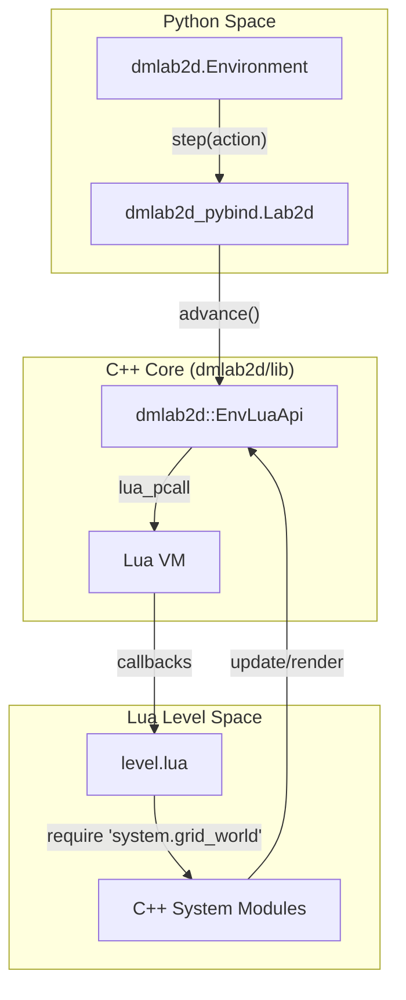
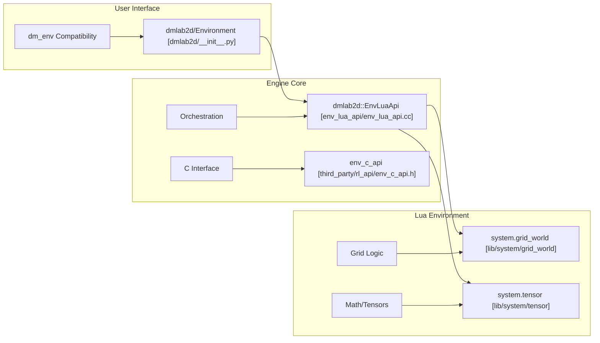

<!-- source: DeepWiki mcp.deepwiki.com · repo google-deepmind/lab2d · page 1 DeepMind Lab2D: Overview · fetched 2026-10-26 -->

# DeepMind Lab2D: Overview

Relevant source files

The following files were used as context for generating this wiki page:

- [AUTHORS](AUTHORS)
- [CONTRIBUTING.md](CONTRIBUTING.md)
- [LICENSE](LICENSE)
- [README.md](README.md)
- [WORKSPACE](WORKSPACE)
- [dmlab2d/__init__.py](dmlab2d/__init__.py)
- [install.sh](install.sh)

DeepMind Lab2D is a high-performance system designed for creating 2D "grid world" environments for machine learning research [README.md:11-14](). It combines a fast C++ engine with the flexibility of Lua scripting to define environment logic, layouts, and behaviors [README.md:3-3](). Agents interact with these worlds through standardized interfaces, primarily the Python `dm_env` API [README.md:15-17]().

## System Architecture

The codebase is organized into a three-layer architecture that balances performance, scriptability, and ease of use for RL researchers.

1.  **C++ Core Engine**: The foundational layer that manages the Lua Virtual Machine, provides high-performance systems (like grid physics and tensor math), and exposes a C API [README.md:11-17]().
2.  **Lua Scripting Layer**: This is where "Levels" are defined. Developers use Lua to specify maps, game rules, and observation/action spaces using built-in system libraries [README.md:13-14]().
3.  **Python API**: A wrapper that exposes the C++ engine to Python, making it compatible with the `dm_env` standard [dmlab2d/__init__.py:31-36]().

### Component Interaction Map

The following diagram illustrates how a Python agent's call flows through the system to the underlying Lua level logic.

**Flow of Execution: Python to Lua**

**Sources:** [dmlab2d/__init__.py:103-117](), [README.md:11-18]()

## Key Concepts

### Grid Worlds and Levels
Environments in Lab2D are referred to as "levels". A level consists of a text-based map (defining the initial layout) and Lua code (defining behavior) [README.md:13-14](). The engine uses a specialized `grid_world` system to handle piece movement, layering, and collisions.

### The Property Tree
Lab2D features a hierarchical property tree that allows for reading and writing environment state at runtime without modifying the core API. This is exposed via `read_property`, `write_property`, and `list_property` methods [dmlab2d/__init__.py:179-201]().

### Multi-Agent Support
The system natively supports multiple agents, allowing for complex multi-agent reinforcement learning (MARL) scenarios [README.md:18-18]().

## Major Subsystems

| Subsystem | Responsibility | Key Code Entities |
| :--- | :--- | :--- |
| **Python Bridge** | Exposes C++ to Python via `pybind11`. | `dmlab2d_pybind`, `dmlab2d.Environment` [dmlab2d/__init__.py:21-31]() |
| **EnvLuaApi** | Orchestrates the lifecycle between C++ and Lua. | `dmlab2d::EnvLuaApi` |
| **System Modules** | High-performance C++ logic for Lua (Grid, Tensor, Tile). | `system.grid_world`, `system.tensor`, `system.tile` |
| **RL API** | Standardized C interface for environment interaction. | `third_party/rl_api/env_c_api.h` [README.md:62-63]() |

### Code Entity Association

This diagram maps high-level system responsibilities to specific source file locations and classes.

**System Responsibility to Code Entity Mapping**

**Sources:** [dmlab2d/__init__.py:31-36](), [README.md:62-63](), [WORKSPACE:112-116]()

## Detailed Documentation

For more specific information, please refer to the following child pages:

*   **[Getting Started: Installation and Quick Start](#1.1)**: Instructions on how to build the project using Bazel and run your first random agent [README.md:24-48]().
*   **[Repository Layout and Key Concepts](#1.2)**: A deep dive into the directory structure and the core design philosophy of the engine.

**Sources:** [README.md:1-77](), [dmlab2d/__init__.py:1-201](), [install.sh:1-110]()

---

