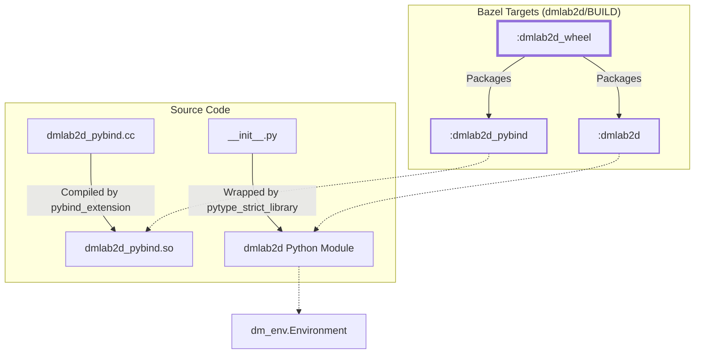
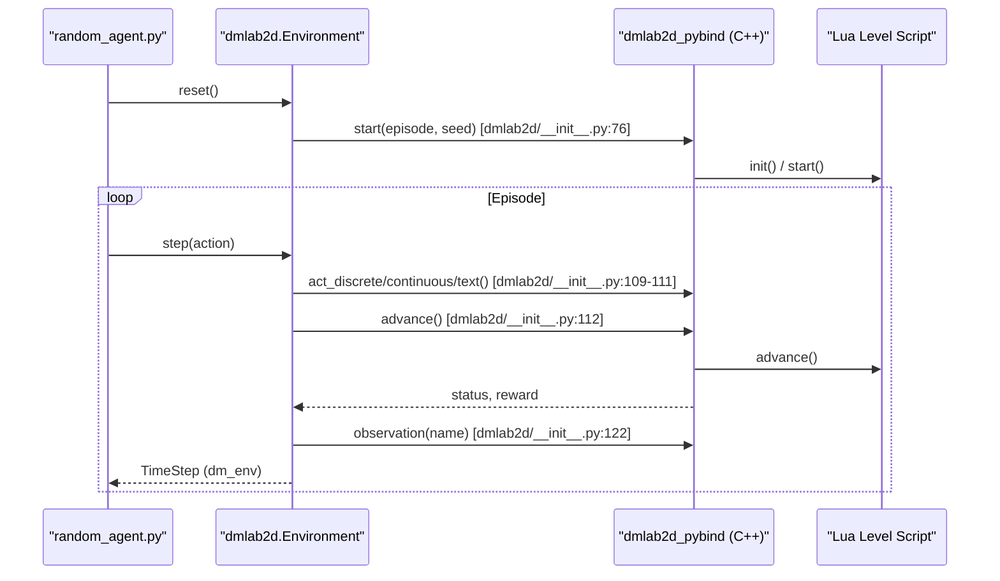

<!-- source: DeepWiki mcp.deepwiki.com · repo google-deepmind/lab2d · page 1.1 Getting Started: Installation and Quick Start · fetched 2026-10-26 -->

# Getting Started: Installation and Quick Start

<details>
<summary>Relevant source files</summary>

The following files were used as context for generating this wiki page:

- [.bazelrc](.bazelrc)
- [README.md](README.md)
- [dmlab2d/BUILD](dmlab2d/BUILD)
- [dmlab2d/__init__.py](dmlab2d/__init__.py)
- [dmlab2d/dmlab2d_pybind.lds](dmlab2d/dmlab2d_pybind.lds)
- [dmlab2d/dmlab2d_pybind.syms.lds](dmlab2d/dmlab2d_pybind.syms.lds)
- [dmlab2d/runfiles_helper.py](dmlab2d/runfiles_helper.py)
- [install.sh](install.sh)

</details>


DeepMind Lab2D is a high-performance 2D environment engine built with a C++ core and Lua scripting. This page provides technical instructions for setting up the development environment, building the system from source using Bazel, and running initial simulations.

## System Requirements and Prerequisites

DeepMind Lab2D requires a 64-bit Linux or macOS (Intel/Apple Silicon) system. The following software must be installed on the host machine:

*   **Python**: Version 3.8 or above [README.md:68-68]().
*   **Python Packages**: `numpy`, `pygame`, and `packaging` [README.md:68-68]().
*   **Compiler**: `Clang` (version 14.0+) or `GCC` [install.sh:41-43]().
*   **Build System**: `Bazel` (version 6.2+) [install.sh:44-45]().

Sources: [README.md:50-73](), [install.sh:29-46]()

---

## Installation Methods

### 1. PyPI Installation (Recommended for Users)
For standard use cases where environment customization is not required, pre-built wheels are available for Linux and macOS:
```shell
pip install dmlab2d
```
Sources: [README.md:26-33]()

### 2. Building from Source (Recommended for Developers)
To modify the C++ engine or add custom system libraries, the project must be built using Bazel. The `install.sh` script provides a template for this process.

#### Step-by-Step Build Flow
The build process utilizes Bazel to compile the C++ core and generate a Python wheel via `pybind11`.

1.  **Configure Bazel**: The project uses `.bazelrc` to manage platform-specific flags and Lua versions [ .bazelrc:1-24]().
2.  **Compile and Package**: Run the Bazel build command targeting the wheel.
    ```bash
    bazel build -c opt //dmlab2d:dmlab2d_wheel
    ```
3.  **Install Local Wheel**:
    ```bash
    pip install bazel-bin/dmlab2d/dmlab2d-1.0.0-py3-none-any.whl
    ```

### Build Configuration Matrix
The following table describes key Bazel configurations defined in `.bazelrc`:

| Config | Description | File Reference |
| :--- | :--- | :--- |
| `lua5_1` | Builds using Lua 5.1 [ .bazelrc:13-13](). | [.bazelrc:13-13]() |
| `lua5_2` | Builds using Lua 5.2 [ .bazelrc:14-14](). | [.bazelrc:14-14]() |
| `luajit` | Builds using LuaJIT for maximum performance [ .bazelrc:15-15](). | [.bazelrc:15-15]() |
| `libc++` | Forces the use of LLVM's `libc++` (standard on macOS) [ .bazelrc:8-11](). | [.bazelrc:8-11]() |
| `macos_arm64` | Specific settings for Apple Silicon [ .bazelrc:21-24](). | [.bazelrc:21-24]() |

Sources: [.bazelrc:1-24](), [install.sh:48-97]()

---

## Technical Architecture: Build to Runtime

The diagram below illustrates how Bazel entities map to the final Python package structure.

### Build Entity Mapping
"Natural Language Space" to "Code Entity Space"


Sources: [dmlab2d/BUILD:7-26](), [dmlab2d/BUILD:28-37](), [dmlab2d/BUILD:118-137]()

---

## Quick Start: Running your first Environment

### Smoke Test
After installation, verify the setup by running the internal test suite:
```bash
python dmlab2d/dmlab2d_test.py
```
Sources: [install.sh:99-102](), [dmlab2d/BUILD:39-51]()

### Launching the Random Agent
The `random_agent.py` is a provided utility to visualize environments and verify that the Lua levels are loading correctly. It uses `pygame` for rendering.

```bash
bazel run -c opt dmlab2d:random_agent -- --level_name=chase_eat
```

### Data Flow in `random_agent`
The following diagram shows the interaction between the Python agent and the C++ engine.


Sources: [dmlab2d/__init__.py:73-118](), [dmlab2d/BUILD:80-91]()

---

## Assets and Runfiles
DeepMind Lab2D needs to locate its Lua scripts and assets at runtime. The `runfiles_helper.py` manages this discovery.

*   **`find()`**: Returns the base folder containing assets by locating the `dmlab2d_pybind` binary location [dmlab2d/runfiles_helper.py:47-53]().
*   **`find_directory(sub_directory)`**: Heuristically searches for directories (like `game_scripts`) by checking `TEST_SRCDIR`, `RUNFILES_MANIFEST_FILE`, and `sys.path` [dmlab2d/runfiles_helper.py:56-114]().

Sources: [dmlab2d/runfiles_helper.py:1-115]()

---

