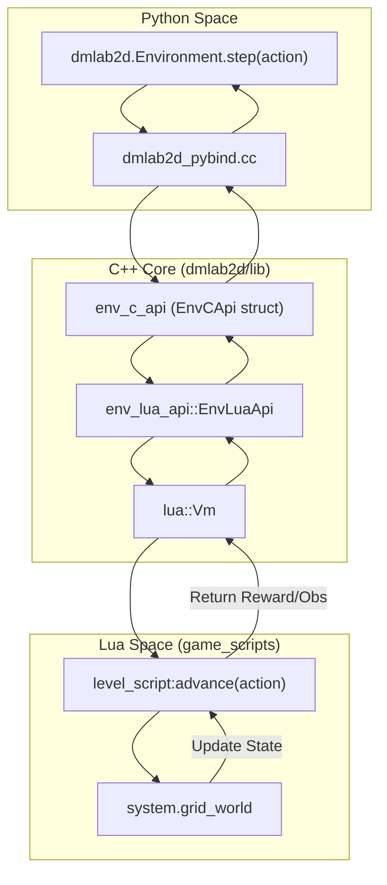
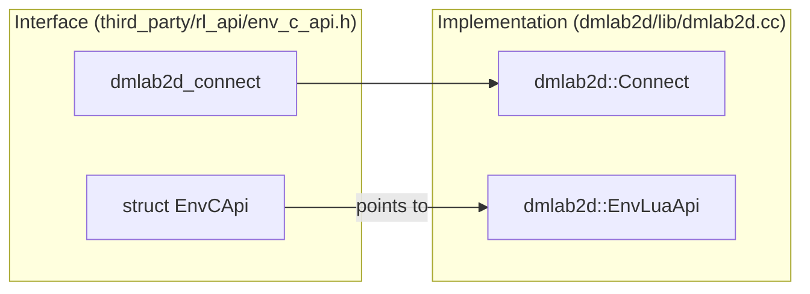

<!-- source: DeepWiki mcp.deepwiki.com · repo google-deepmind/lab2d · page 1.2 Repository Layout and Key Concepts · fetched 2026-10-26 -->

# Repository Layout and Key Concepts

Relevant source files

The following files were used as context for generating this wiki page:

- [BUILD](BUILD)
- [WORKSPACE](WORKSPACE)
- [bazel/BUILD](bazel/BUILD)
- [bazel/dm_env.BUILD](bazel/dm_env.BUILD)
- [bazel/tree.BUILD](bazel/tree.BUILD)
- [dmlab2d/lib/BUILD](dmlab2d/lib/BUILD)
- [third_party/rl_api/BUILD](third_party/rl_api/BUILD)
- [third_party/rl_api/env_c_api_example.syms.lds](third_party/rl_api/env_c_api_example.syms.lds)

DeepMind Lab2D is structured as a high-performance 2D simulation engine that bridges the gap between low-level C++ efficiency, flexible Lua game logic, and a standardized Python RL interface. This page provides a map of the repository and explains the architectural layers that allow these components to interact.

## Repository Directory Structure

The repository is organized into four primary top-level areas that separate the core engine, build infrastructure, external dependencies, and documentation.

| Directory | Description |
| :--- | :--- |
| `dmlab2d/` | The primary codebase. Contains the Python package (`dmlab2d/`), C++ core (`dmlab2d/lib/`), and Lua scripts (`dmlab2d/lib/game_scripts/`). |
| `bazel/` | Custom Bazel build rules and `BUILD` file templates for external dependencies like `eigen`, `lua`, and `dm_env`. |
| `third_party/` | Contains the `rl_api` which defines the C-standardized environment interface used to decouple the engine from its consumers. |
| `docs/` | Technical documentation and API specifications. |

### Key Subdirectories in `dmlab2d/lib`
*   `env_lua_api/`: The orchestrator that manages the lifecycle of the Lua VM and translates C calls to Lua callbacks [dmlab2d/lib/BUILD:30-30]().
*   `lua/`: C++ wrappers and type-safe stack helpers for interacting with the Lua C API [dmlab2d/lib/BUILD:31-31]().
*   `system/`: C++ implementations of performance-critical modules exposed to Lua (e.g., `grid_world`, `tensor`, `tile`) [dmlab2d/lib/BUILD:32-35]().
*   `game_scripts/`: The "Level Lab". Contains `common` Lua libraries and the `levels` directory where specific game logic resides [dmlab2d/lib/BUILD:56-68]().

**Sources:** [dmlab2d/lib/BUILD:16-40](), [WORKSPACE:1-151]()

---

## Three-Layer Architecture

DeepMind Lab2D employs a "sandwich" architecture to balance performance and flexibility.

### 1. The Python API (The Consumer)
The top layer is a Python wrapper that implements the `dm_env` interface. It uses `pybind11` to communicate with the underlying C++ engine. This layer is responsible for converting Pythonic data structures (like NumPy arrays or nested dictionaries) into formats the C++ core can process.
*   **Key Files:** `dmlab2d/__init__.py`, `dmlab2d/dmlab2d_pybind.cc`.
*   **Dependency:** Depends on `@dm_env_archive//:dm_env` [bazel/dm_env.BUILD:5-14]().

### 2. The C++ Core Engine (The Orchestrator)
The middle layer, defined in `dmlab2d/lib/`, manages the simulation's state. It acts as a host for the Lua virtual machine. It does not know the rules of the "game" being played; instead, it provides the tools (tensors, grid world physics, pathfinding) and dispatches events to the Lua layer.
*   **Key Class:** `dmlab2d::EnvLuaApi` [dmlab2d/lib/BUILD:30-30]().
*   **Entry Point:** `dmlab2d_connect` which follows the `env_c_api` contract [third_party/rl_api/env_c_api.h:1-22]().

### 3. The Lua Scripting Layer (The Game Logic)
The bottom layer contains the actual game definitions. Every "level" is a Lua script that defines observations, actions, and rewards. These scripts use the `system` modules (implemented in C++) to perform heavy lifting like rendering or grid updates.
*   **Key Files:** `dmlab2d/lib/game_scripts/levels/` [dmlab2d/lib/BUILD:83-91]().

### System Architecture Diagram

The following diagram illustrates the flow of a single `step()` call from Python down to the Lua game logic and back.

**Data Flow: Python to Lua**

**Sources:** [dmlab2d/lib/BUILD:16-40](), [third_party/rl_api/BUILD:18-22](), [bazel/dm_env.BUILD:5-14]()

---

## Key Concepts and Code Entities

### The `env_c_api` Interface
To ensure interoperability and minimize binary coupling, Lab2D uses a pure C interface for its core engine. The `EnvCApi` structure defines function pointers for environment lifecycle management (`step`, `reset`, `observation`, etc.). This allows the C++ engine to be compiled into a shared library (`.so`) that can be loaded by different frontends.

**Code Entity Mapping: C API to Implementation**

**Sources:** [third_party/rl_api/env_c_api.h:1-22](), [dmlab2d/lib/dmlab2d.cc:1-40](), [third_party/rl_api/BUILD:18-22]()

### Lua System Modules
While the game logic is in Lua, performance-critical operations are implemented in C++ and exposed as Lua modules. These are found in `dmlab2d/lib/system/`.

| Lua Module | C++ Implementation Path | Purpose |
| :--- | :--- | :--- |
| `system.grid_world` | `dmlab2d/lib/system/grid_world/` | Manages the 2D grid, collision, and piece updates [dmlab2d/lib/BUILD:34-34](). |
| `system.tensor` | `dmlab2d/lib/system/tensor/` | High-performance multi-dimensional arrays for observations. |
| `system.tile` | `dmlab2d/lib/system/tile/` | Sprite-based rendering of the grid into RGB tensors [dmlab2d/lib/BUILD:35-35](). |
| `system.file_system` | `dmlab2d/lib/system/file_system/` | Accessing assets via Bazel runfiles [dmlab2d/lib/BUILD:32-32](). |

### Build System and Dependencies
The project uses Bazel for dependency management and compilation. Key external dependencies are fetched and configured in the `WORKSPACE` file and `bazel/` directory.

*   **Lua Versions:** Lab2D supports multiple Lua runtimes (Lua 5.1, 5.2, and LuaJIT). These are managed via `http_archive` in `WORKSPACE` [WORKSPACE:81-110]().
*   **Math/Graphics:** Uses `Eigen` for linear algebra [WORKSPACE:49-57]() and `libpng` for image processing [WORKSPACE:59-68]().
*   **Testing:** C++ tests use `googletest` [WORKSPACE:6-10](), while Lua tests use a custom `dmlab2d_lua_test` macro defined in `dmlab2d/lib/testing/lua_testing.bzl` [dmlab2d/lib/BUILD:5-5]().

**Sources:** [WORKSPACE:1-151](), [dmlab2d/lib/BUILD:1-102](), [bazel/dm_env.BUILD:1-29]()

---

