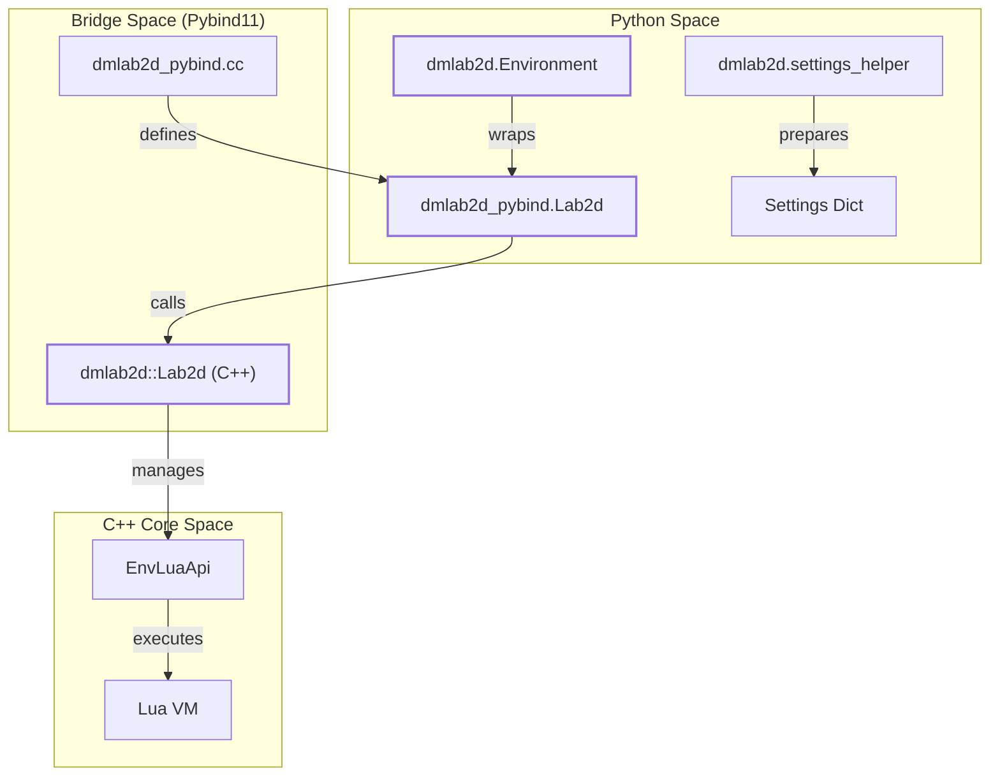
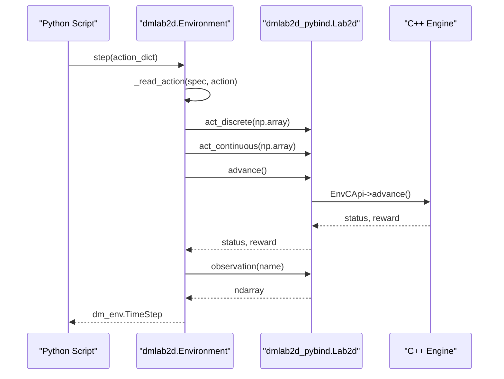

<!-- source: DeepWiki mcp.deepwiki.com · repo google-deepmind/lab2d · page 2 Python API · fetched 2026-10-26 -->

# Python API

Relevant source files

The following files were used as context for generating this wiki page:

- [README.md](README.md)
- [dmlab2d/BUILD](dmlab2d/BUILD)
- [dmlab2d/__init__.py](dmlab2d/__init__.py)
- [dmlab2d/dmlab2d_pybind.lds](dmlab2d/dmlab2d_pybind.lds)
- [dmlab2d/dmlab2d_pybind.syms.lds](dmlab2d/dmlab2d_pybind.syms.lds)
- [install.sh](install.sh)

The Python API for DeepMind Lab2D provides a high-level, idiomatic interface for interacting with 2D grid world environments. It is built upon a C++ core, exposed via `pybind11`, and adheres to the `dm_env` standard common in reinforcement learning research.

### System Architecture

The Python layer acts as a thin wrapper around the C++ engine. It manages the lifecycle of the environment, handles the conversion of data types (such as NumPy arrays to C++ tensors), and provides utility functions for configuration and asset management.

#### Entity Mapping
The following diagram illustrates how Python-level classes map to the underlying C++ and Pybind entities.

**Python-to-Code Entity Map**

**Sources:** [dmlab2d/__init__.py:21-31](), [dmlab2d/BUILD:7-26](), [README.md:11-18]()

---

### Core Components

#### dmlab2d.Environment: The dm_env Interface
The primary entry point for users is the `dmlab2d.Environment` class [dmlab2d/__init__.py:31-36](). This class inherits from `dm_env.Environment` and implements the standard `reset()`, `step()`, `observation_spec()`, and `action_spec()` methods. 

Beyond the standard RL loop, it provides access to the "Property Tree," a hierarchical API for inspecting and modifying environment state at runtime via `read_property`, `write_property`, and `list_property` [dmlab2d/__init__.py:179-203]().

For details, see [dmlab2d.Environment: The dm_env Interface](#2.1).

#### C++/Python Bridge: dmlab2d_pybind
The performance-critical logic resides in C++, which is exposed to Python through a module named `dmlab2d_pybind` [dmlab2d/BUILD:7-9](). This bridge handles the translation of discrete, continuous, and text-based actions from Python into the internal C++ representation. It also manages environment status enums like `RUNNING`, `TERMINATED`, and `INTERRUPTED` [dmlab2d/__init__.py:24-28]().

For details, see [C++/Python Bridge: dmlab2d_pybind](#2.2).

#### Python Utilities
DeepMind Lab2D includes helper modules to simplify environment setup:
*   **`settings_helper`**: Provides `flatten_args()` to convert nested Python dictionaries into the flat string-based settings required by the C++ engine [dmlab2d/BUILD:53-57]().
*   **`runfiles_helper`**: Assists in locating Lua scripts and assets within the Bazel runfiles tree [dmlab2d/BUILD:93-98]().

For details, see [Python Utilities: settings_helper and runfiles_helper](#2.3).

---

### Data Flow Overview

The flow of data during a single environment step involves multiple layers of the API.

**Step Execution Data Flow**

**Sources:** [dmlab2d/__init__.py:103-118](), [dmlab2d/BUILD:19-20]()

### Installation and Requirements
The Python API requires `Python 3.8+` along with `NumPy` [README.md:68-69](). While the core is distributed as pre-built wheels on PyPI, it can also be built from source using Bazel, which utilizes the `pybind_extension` macro to compile the C++ components [dmlab2d/BUILD:7-26](), [install.sh:84-93]().

**Sources:**
* [dmlab2d/__init__.py:1-203]()
* [dmlab2d/BUILD:1-165]()
* [README.md:1-77]()
* [install.sh:1-110]()

---

