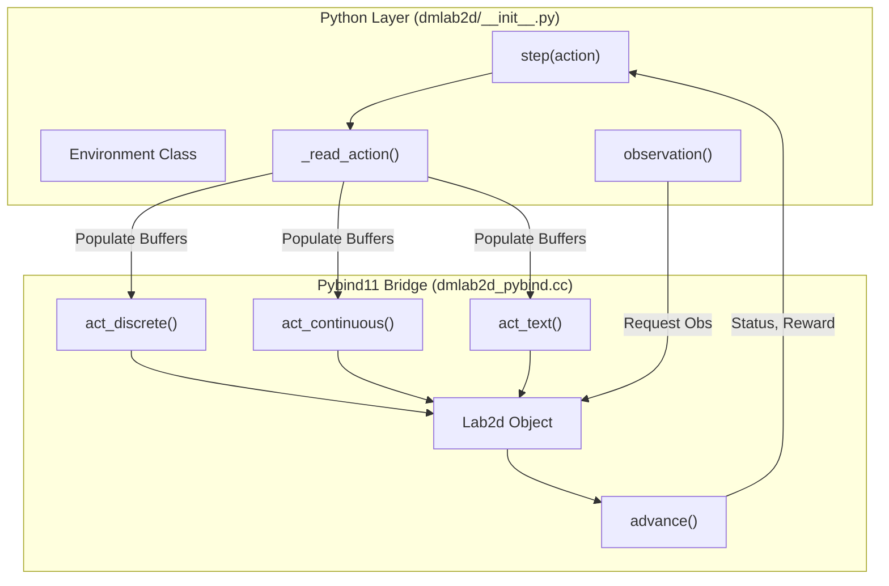
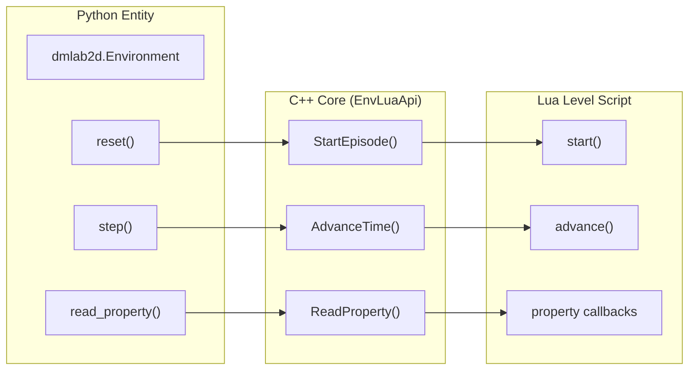

<!-- source: DeepWiki mcp.deepwiki.com · repo google-deepmind/lab2d · page 2.1 dmlab2d.Environment: The dm_env Interface · fetched 2026-10-26 -->

# dmlab2d.Environment: The dm_env Interface

Relevant source files

The following files were used as context for generating this wiki page:

- [README.md](README.md)
- [dmlab2d/__init__.py](dmlab2d/__init__.py)
- [install.sh](install.sh)

The `dmlab2d.Environment` class provides a Python-friendly wrapper around the core C++ engine, adhering to the [DeepMind `dm_env` interface](https://github.com/deepmind/dm_env). It handles the conversion between Python/NumPy data types and the underlying Lab2D engine, manages the episode lifecycle, and exposes the property tree for environment introspection and configuration.

### Class Definition and Initialization

The `Environment` class is defined in `dmlab2d/__init__.py` and inherits from `dm_env.Environment` [dmlab2d/__init__.py:31-32](). It acts as a bridge to the `dmlab2d_pybind.Lab2d` object, which contains the actual engine instance [dmlab2d/__init__.py:46]().

#### Constructor: `__init__(self, env, observation_names, seed=None)`
- **`env`**: An instance of `dmlab2d.Lab2d` (the pybind11-exposed C++ class) [dmlab2d/__init__.py:42]().
- **`observation_names`**: A list of strings specifying which observations from the Lua level should be included in the observation dictionary [dmlab2d/__init__.py:43]().
- **`seed`**: An optional integer to seed the internal NumPy RandomState used for generating episode seeds [dmlab2d/__init__.py:44-48]().

Upon initialization, the class queries the engine to build action and observation specifications [dmlab2d/__init__.py:53-59]().

### The dm_env Lifecycle

The environment follows the standard RL loop: `reset()` followed by repeated calls to `step()`.

#### `reset()`
Resets the environment for a new episode.
1. Increments the internal episode counter `_next_episode` [dmlab2d/__init__.py:77]().
2. Calls `self._env.start()` with a new seed derived from the internal RNG [dmlab2d/__init__.py:76]().
3. Returns a `dm_env.TimeStep` with `step_type=StepType.FIRST` [dmlab2d/__init__.py:78]().

#### `step(action)`
Advances the simulation by one time step.
1. If the previous step resulted in a terminal state, it automatically calls `reset()` [dmlab2d/__init__.py:105-106]().
2. Parses the `action` (which can be a nested dict/list) and updates internal buffers for discrete, continuous, and text actions [dmlab2d/__init__.py:108-111]().
3. Calls `self._env.advance()`, which returns the new `EnvironmentStatus` and the reward [dmlab2d/__init__.py:112]().
4. Returns a `dm_env.TimeStep` (either `TRANSITION` or `TERMINATION`) [dmlab2d/__init__.py:113-117]().

### Data Flow: Python to C++ Engine

The following diagram illustrates how Python-level calls move through the `Environment` wrapper into the pybind11 layer.

**Diagram: Python API Data Flow**

Sources: [dmlab2d/__init__.py:103-125](), [dmlab2d/__init__.py:80-102]()

### Specifications (Specs)

Lab2D supports three types of actions and flexible multidimensional observations.

| Spec Type | Internal DType | Python Container | Description |
| :--- | :--- | :--- | :--- |
| **Discrete Action** | `int32` | `dm_env.specs.BoundedArray` | Integer indices for actions (e.g., movement directions). |
| **Continuous Action** | `float64` | `dm_env.specs.BoundedArray` | Scalar values for fine-grained control. |
| **Text Action** | `object` (bytes) | `dm_env.specs.Array` | String-based commands or communication. |
| **Observation** | Variable | `dm_env.specs.Array` | Multi-dimensional arrays (Tensors) produced by the engine. |

Sources: [dmlab2d/__init__.py:131-164]()

### Property Tree API

The environment exposes a hierarchical property tree that allows reading and writing state variables defined in the Lua level or the C++ system modules.

*   **`list_property(key)`**: Returns a list of child properties and their attributes (Read/Write/Listable) under the given `key` [dmlab2d/__init__.py:179-193]().
*   **`read_property(key)`**: Returns the string representation of a property value [dmlab2d/__init__.py:207]().
*   **`write_property(key, value)`**: Writes a string value to a specific property [dmlab2d/__init__.py:195-205]().

### Events

Events are transient data packets generated during a step (e.g., "agent_fired_laser" or "item_picked_up"). Unlike observations, they are not necessarily produced every step.
- **`events()`**: Returns a sequence of `(name, observations)` tuples representing all events triggered since the last `step` or `reset` [dmlab2d/__init__.py:170-178]().

### Entity Mapping: Python to Engine

The following diagram maps the Python `Environment` methods to the corresponding C++ logic and Lua callbacks.

**Diagram: System Entity Mapping**

Sources: [dmlab2d/__init__.py:73-78](), [dmlab2d/__init__.py:103-117](), [dmlab2d/__init__.py:207]()

---

