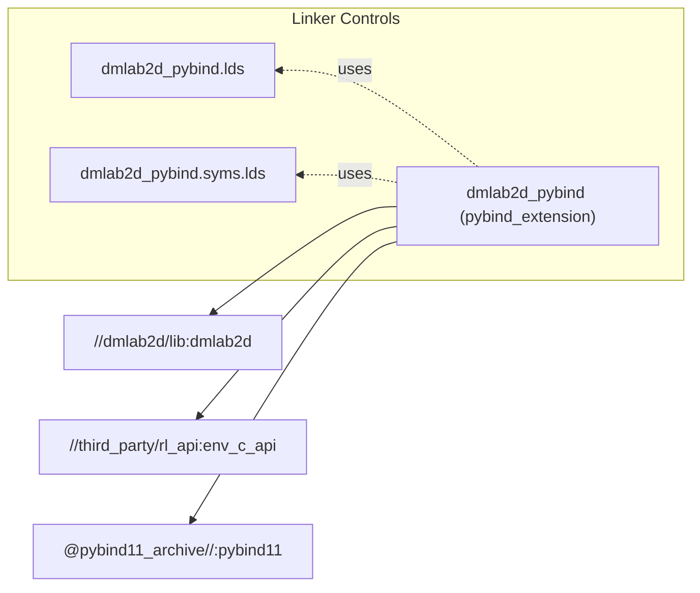

<!-- source: DeepWiki mcp.deepwiki.com · repo google-deepmind/lab2d · page 2.2 C++/Python Bridge: dmlab2d_pybind · fetched 2026-10-26 -->

# C++/Python Bridge: dmlab2d_pybind

<details>
<summary>Relevant source files</summary>

The following files were used as context for generating this wiki page:

- [bazel/pybind11.BUILD](bazel/pybind11.BUILD)
- [build_defs.bzl](build_defs.bzl)
- [dmlab2d/BUILD](dmlab2d/BUILD)
- [dmlab2d/dmlab2d_pybind.cc](dmlab2d/dmlab2d_pybind.cc)
- [dmlab2d/dmlab2d_pybind.lds](dmlab2d/dmlab2d_pybind.lds)
- [dmlab2d/dmlab2d_pybind.syms.lds](dmlab2d/dmlab2d_pybind.syms.lds)
- [dmlab2d/lib/system/generators/pushbox/python/BUILD](dmlab2d/lib/system/generators/pushbox/python/BUILD)
- [dmlab2d/lib/system/grid_world/lua/lua_grid.cc](dmlab2d/lib/system/grid_world/lua/lua_grid.cc)

</details>


The `dmlab2d_pybind` module serves as the critical glue layer between the DeepMind Lab2D C++ engine and the Python environment. It utilizes [pybind11](https://github.com/pybind/pybind11) to wrap the C++ `Lab2d` class and the underlying `EnvCApi`, exposing them as a Python-friendly extension module.

## Architecture Overview

The bridge is centered around the `PyEnvCApi` class, which manages the lifecycle of the C++ environment and translates between Python types (like NumPy arrays) and the C-based `EnvCApi` structures used by the engine [dmlab2d/dmlab2d_pybind.cc:105-126]().

### Data Flow: Python to C++

The following diagram illustrates how a call from Python (e.g., `step`) traverses the bridge into the C++ core.

**Diagram: Bridge Execution Flow**
```mermaid
graph TD
    subgraph "Python Space"
        PY_ENV["dmlab2d.Environment"] -- "calls" --> PYBIND_EXT["dmlab2d_pybind.so"]
    end

    subgraph "Bridge Layer (dmlab2d_pybind.cc)"
        PYBIND_EXT --> PY_ENV_C_API["PyEnvCApi::Step"]
        PY_ENV_C_API -- "converts NumPy to C" --> C_API_CALL["EnvCApi.step()"]
    end

    subgraph "C++ Core Space"
        C_API_CALL --> ENV_LUA_API["EnvLuaApi::Step"]
        ENV_LUA_API -- "invokes" --> LUA_VM["Lua VM (advance)"]
    end

    ["dmlab2d/__init__.py"] -. "wraps" .-> PY_ENV
    ["dmlab2d/dmlab2d_pybind.cc"] -. "defines" .-> PY_ENV_C_API
    ["dmlab2d/lib/env_lua_api/env_lua_api.cc"] -. "implements" .-> ENV_LUA_API
```
**Sources:** [dmlab2d/dmlab2d_pybind.cc:227-241](), [dmlab2d/__init__.py:1-37]().

---

## The `PyEnvCApi` Wrapper

`PyEnvCApi` is the primary C++ class exposed to Python. It encapsulates the `EnvCApi` struct and a context pointer, providing methods that match the expected Python RL environment patterns [dmlab2d/dmlab2d_pybind.cc:105-113]().

### Key Responsibilities
*   **Initialization**: The `Create` factory method accepts a connection function and a dictionary of settings, initializes the C++ environment, and handles error messages from the C API [dmlab2d/dmlab2d_pybind.cc:107-124]().
*   **Observation Conversion**: `FromArrayObservation` converts `EnvCApi_Observation` payloads (bytes, doubles, int32, int64) into `py::array_t` (NumPy arrays) [dmlab2d/dmlab2d_pybind.cc:41-68]().
*   **Action Handling**: Methods like `ActDiscrete` and `ActContinuous` validate action shapes and values before passing them to the engine [dmlab2d/dmlab2d_pybind.cc:205-225]().

### Enums and Status Tracking
The bridge exposes internal environment states and property attributes to Python to ensure consistent behavior between the two languages.

| Enum / Type | Description | Code Reference |
| :--- | :--- | :--- |
| `EnvironmentStatus` | Maps C API status (Running, Interrupted, Disc) to Python. | [dmlab2d/dmlab2d_pybind.cc:435-442]() |
| `PropertyAttributes` | Defines if a property is Read, Write, or Listable. | [dmlab2d/dmlab2d_pybind.cc:444-448]() |
| `State` | Internal tracker for `kPreStart` vs `kStep` transitions. | [dmlab2d/dmlab2d_pybind.cc:375-375]() |

**Sources:** [dmlab2d/dmlab2d_pybind.cc:41-103](), [dmlab2d/dmlab2d_pybind.cc:435-450]().

---

## Bazel Build and Symbol Visibility

The bridge is built using the `pybind_extension` macro defined in `build_defs.bzl`. This macro handles the complexities of linking against Python headers and ensuring the resulting shared object (`.so`) is correctly named for Python imports [build_defs.bzl:20-83]().

### Linker Scripts and Symbol Control
To prevent symbol collisions and keep the binary interface clean, DeepMind Lab2D uses linker scripts to restrict exported symbols to only the Python module entry point (`PyInit_dmlab2d_pybind`).

*   **Linux (`.lds`)**: Uses a version script to set `global` and `local` visibility [dmlab2d/dmlab2d_pybind.lds:1-7]().
*   **macOS (`.syms.lds`)**: Uses an exported symbols list [dmlab2d/dmlab2d_pybind.syms.lds:1-2]().

**Diagram: Build System Dependencies**

**Sources:** [dmlab2d/BUILD:7-26](), [build_defs.bzl:67-76](), [dmlab2d/dmlab2d_pybind.lds:1-7]().

---

## Property Tree API Bridge

The property tree allows Python to inspect and modify the internal state of the Lua simulation. The bridge maps these requests to the `EnvCApi` property functions.

### Implementation Detail
When Python calls `read_property`, the bridge:
1.  Translates the string key to a C-style string [dmlab2d/dmlab2d_pybind.cc:323-324]().
2.  Calls `env_->api.read_property`.
3.  Returns the result as a Python string or raises a `KeyError` if the property is missing or lacks the `kRead` attribute [dmlab2d/dmlab2d_pybind.cc:325-331]().

Similar logic applies to `write_property` and `list_property` [dmlab2d/dmlab2d_pybind.cc:333-358]().

**Sources:** [dmlab2d/dmlab2d_pybind.cc:323-358](), [dmlab2d/dmlab2d_pybind.cc:444-448]().

---

