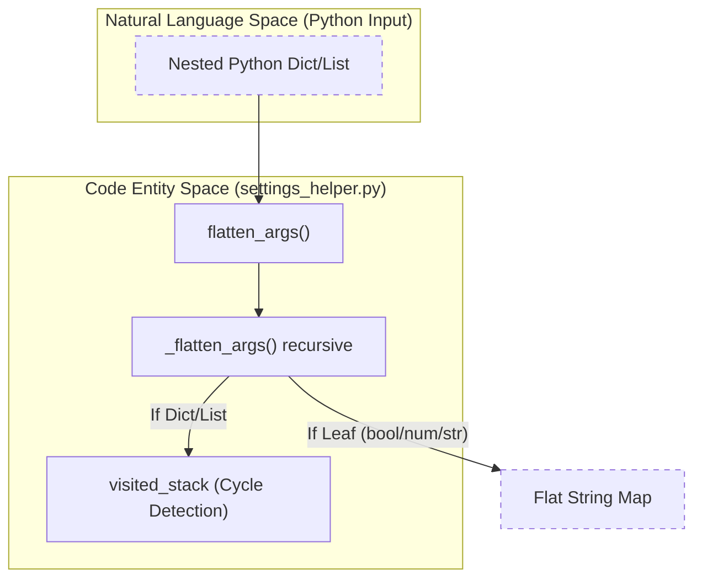
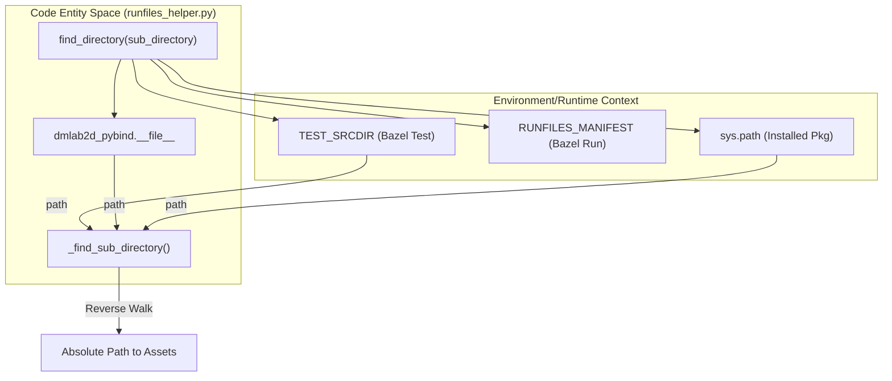

<!-- source: DeepWiki mcp.deepwiki.com · repo google-deepmind/lab2d · page 2.3 Python Utilities: settings_helper and runfiles_helper · fetched 2026-10-26 -->

# Python Utilities: settings_helper and runfiles_helper

Relevant source files

The following files were used as context for generating this wiki page:

- [dmlab2d/runfiles_helper.py](dmlab2d/runfiles_helper.py)
- [dmlab2d/settings_helper.py](dmlab2d/settings_helper.py)
- [dmlab2d/settings_helper_test.py](dmlab2d/settings_helper_test.py)
- [python_system.bzl](python_system.bzl)

This page documents the auxiliary Python utilities provided by DeepMind Lab2D to facilitate environment configuration and asset discovery. These utilities bridge the gap between flexible Pythonic data structures and the flat string-based configuration required by the C++ engine and Lua scripts, while also ensuring that game assets can be located across various execution environments (e.g., Bazel, installed wheels, or local development).

## settings_helper: Configuration Flattening

The `settings_helper.py` module provides a mechanism to convert complex, nested Python dictionaries and sequences into a flat mapping of dot-separated keys to string values. This is necessary because the underlying Lab2D C++ and Lua layers often expect a flat key-value store for environment settings [dmlab2d/settings_helper.py:16-19]().

### flatten_args() Implementation

The primary entry point is `flatten_args(args_in)`, which recursively traverses a hierarchy of dictionaries and lists [dmlab2d/settings_helper.py:49-61]().

**Key Transformation Rules:**
*   **Nesting:** Nested dictionaries are joined using a `.` (dot) separator (e.g., `{'a': {'b': 1}}` becomes `{'a.b': '1'}`) [dmlab2d/settings_helper.py:27-27]().
*   **Sequences:** Lists and tuples are converted to indexed keys starting from 1 (e.g., `['x', 'y']` becomes `{'1': 'x', '2': 'y'}`) [dmlab2d/settings_helper.py:41-42]().
*   **Type Conversion:** 
    *   `None` becomes `'none'` [dmlab2d/settings_helper.py:29-29]().
    *   `bool` becomes `'true'` or `'false'` [dmlab2d/settings_helper.py:32-33]().
    *   `numbers.Number` and `str` are converted to their string representation [dmlab2d/settings_helper.py:30-35]().
*   **Cycle Detection:** The implementation maintains a `visited_stack` to prevent infinite recursion in the case of self-referencing data structures [dmlab2d/settings_helper.py:37-42]().

### Data Flow: Dictionary Flattening

The following diagram illustrates how `_flatten_args` processes a nested structure into the flat format consumed by the environment.

**Configuration Transformation Flow**

**Sources:**
*   `dmlab2d/settings_helper.py:22-47` (Internal recursion logic)
*   `dmlab2d/settings_helper.py:49-61` (Public API)
*   `dmlab2d/settings_helper_test.py:22-34` (Example transformations)

---

## runfiles_helper: Asset Discovery

The `runfiles_helper.py` module is responsible for locating the DMLab2D assets (such as Lua level scripts and textures) at runtime. This is critical because the location of these files varies depending on whether the code is running via `bazel run`, `bazel test`, or as an installed Python package.

### Key Functions

| Function | Purpose | Implementation Detail |
| :--- | :--- | :--- |
| `find()` | Locates the root DMLab2D asset folder. | Returns the parent directory of the `dmlab2d_pybind` shared library [dmlab2d/runfiles_helper.py:47-53](). |
| `find_directory(sub_dir)` | Heuristically searches for a specific subdirectory. | Checks environment variables, the executable path, and `sys.path` [dmlab2d/runfiles_helper.py:56-114](). |
| `_find_sub_directory()` | Internal reverse-walk search. | Walks up the directory tree from a starting path to find a target folder [dmlab2d/runfiles_helper.py:26-44](). |

### Heuristic Search Order

When `find_directory` is called, it searches the following locations in order:
1.  **TEST_SRCDIR:** Environment variable set by Bazel during tests [dmlab2d/runfiles_helper.py:71-73]().
2.  **RUNFILES_MANIFEST_FILE:** Manifest created by `bazel run` [dmlab2d/runfiles_helper.py:76-79]().
3.  **Executable Path:** The directory containing `sys.argv[0]` [dmlab2d/runfiles_helper.py:82-84]().
4.  **Module Path:** The directory containing the `dmlab2d_pybind` binary [dmlab2d/runfiles_helper.py:87-90]().
5.  **Working Directory:** Current directory or paths relative to it [dmlab2d/runfiles_helper.py:93-100]().
6.  **System Path:** Every entry in `sys.path` [dmlab2d/runfiles_helper.py:103-109]().

### Asset Location Logic

This diagram shows how `runfiles_helper` resolves a request for a subdirectory by interacting with the environment and the Python runtime.

**Asset Resolution Path**

**Sources:**
*   `dmlab2d/runfiles_helper.py:47-53` (Root discovery)
*   `dmlab2d/runfiles_helper.py:56-114` (Heuristic search logic)
*   `dmlab2d/runfiles_helper.py:26-44` (Directory walking logic)

---

## Integration Example

These helpers are typically used together when initializing a `dmlab2d.Environment`.

1.  `runfiles_helper.find_directory('dmlab2d')` is used to locate the level scripts.
2.  A Python dictionary of hyperparameters is passed through `settings_helper.flatten_args()`.
3.  The resulting flat dictionary and asset paths are passed to the C++ extension via `dmlab2d_pybind`.

**Sources:**
*   `dmlab2d/settings_helper_test.py:22-34` (Usage of flatten_args in configuration)
*   `dmlab2d/runfiles_helper.py:23-23` (Import of pybind for path discovery)

---

