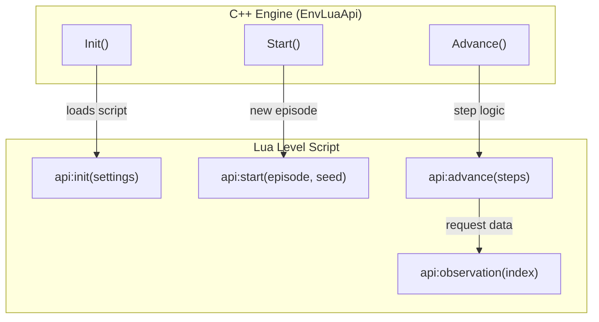
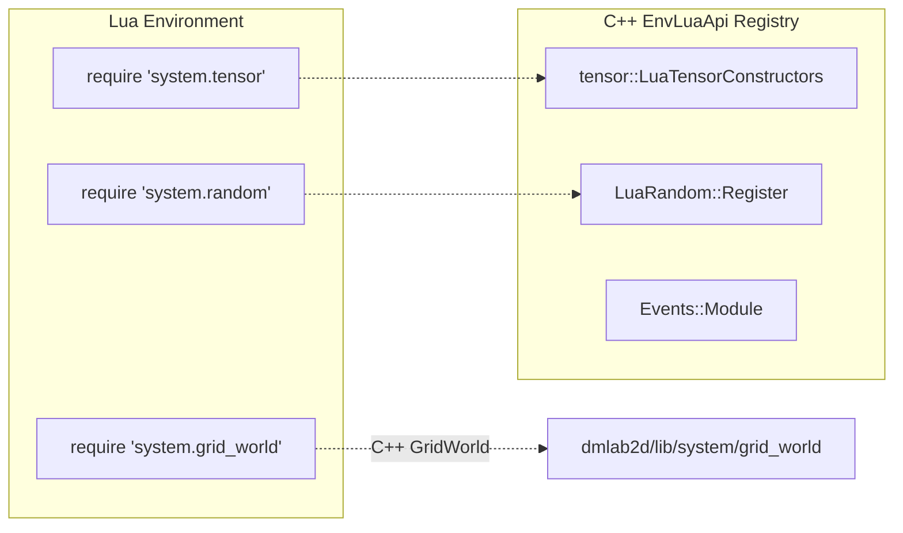

<!-- source: DeepWiki mcp.deepwiki.com · repo google-deepmind/lab2d · page 3 Lua Levels API · fetched 2026-10-26 -->

# Lua Levels API

Relevant source files

The following files were used as context for generating this wiki page:

- [dmlab2d/lib/env_lua_api/BUILD](dmlab2d/lib/env_lua_api/BUILD)
- [dmlab2d/lib/env_lua_api/env_lua_api.cc](dmlab2d/lib/env_lua_api/env_lua_api.cc)
- [dmlab2d/lib/env_lua_api/env_lua_api_test.cc](dmlab2d/lib/env_lua_api/env_lua_api_test.cc)
- [dmlab2d/lib/env_lua_api/episode.cc](dmlab2d/lib/env_lua_api/episode.cc)
- [dmlab2d/lib/lua/read_test.cc](dmlab2d/lib/lua/read_test.cc)
- [docs/system/grid_world.md](docs/system/grid_world.md)

The **Lua Levels API** is the primary interface for defining environment logic in DeepMind Lab2D. While the core engine is implemented in C++, the specific mechanics, reward structures, observation definitions, and episode lifecycles of a level are scripted in Lua. This architecture allows for rapid iteration of experimental designs without recompiling the C++ core.

## Overview of Level Logic

In DeepMind Lab2D, a "level" is a Lua script that returns a table containing specific callback functions. These functions are invoked by the C++ `EnvLuaApi` class during the environment's lifecycle.

### Key Responsibilities of the Lua Level:
*   **Defining Specs**: Specifying the shapes and types of observations and actions (discrete, continuous, and text).
*   **Lifecycle Management**: Handling initialization, episode starts, and per-step physics/logic updates.
*   **Property Tree**: Exposing internal state to the Python API via a hierarchical property system.
*   **System Integration**: Utilizing built-in C++ modules (like `system.grid_world` or `system.tensor`) to perform heavy computations or rendering.

### Level Execution Flow
The following diagram illustrates how the C++ `EnvLuaApi` orchestrates the Lua environment:

**C++ to Lua Orchestration**

Sources: [dmlab2d/lib/env_lua_api/env_lua_api.cc:164-210](), [dmlab2d/lib/env_lua_api/episode.cc:30-77](), [dmlab2d/lib/env_lua_api/env_lua_api_test.cc:56-179]()

---

## Sub-Topics

### [Level Lifecycle and Callback API](#3.1)
The environment follows a strict protocol of function calls. The `init` function processes user settings, while `observationSpec` and `actionSpec` define the interface for the RL agent. During the simulation, `start` resets the world for a new episode, and `advance` progresses the simulation state.
*   **Core Callbacks**: `init`, `start`, `advance`, `observation`.
*   **Spec Callbacks**: `observationSpec`, `discreteActionSpec`, `continuousActionSpec`, `textActionSpec`.
*   **Property Callbacks**: `readProperty`, `writeProperty`, `listProperty`.

For details, see [Level Lifecycle and Callback API](#3.1).

### [Common Lua Libraries (game_scripts/common)](#3.2)
DeepMind Lab2D provides a suite of Lua-native utility libraries located in `dmlab2d/lib/game_scripts/common/`. These libraries simplify common tasks like object-oriented programming, argument parsing, and table manipulation.
*   **`class.lua`**: A robust OOP system supporting inheritance and mixins.
*   **`tile_set.lua`**: Helpers for managing sprites and rendering.
*   **`properties.lua`**: Constants and helpers for the property tree API.

For details, see [Common Lua Libraries (game_scripts/common)](#3.2).

### [Built-in Levels](#3.3)
The repository includes several reference implementations that demonstrate how to use the API to create complex multi-agent interactions. These levels serve as both functional environments and templates for custom development.
*   **Examples**: `chase_eat`, `commons_harvest`, `running_with_scissors`, and `pushbox`.

For details, see [Built-in Levels](#3.3).

---

## System Module Integration

Level scripts frequently interact with C++ "System" modules for performance-critical tasks. These are exposed to Lua via `require 'system.<name>'`.

| Module | Purpose | Code Reference |
| :--- | :--- | :--- |
| `system.grid_world` | High-performance 2D grid physics and collision. | [docs/system/grid_world.md:1-10]() |
| `system.tensor` | Multi-dimensional array operations (Byte, Int32, Double). | [dmlab2d/lib/env_lua_api/env_lua_api.cc:181-182]() |
| `system.random` | Deterministic, seeded random number generation. | [dmlab2d/lib/env_lua_api/env_lua_api.cc:186-189]() |
| `system.events` | Logging discrete events for analysis. | [dmlab2d/lib/env_lua_api/env_lua_api.cc:184-185]() |

### Code Entity Mapping
The following diagram maps the Lua `require` calls to their underlying C++ implementations within the `EnvLuaApi`.

**Lua-to-C++ Module Mapping**

Sources: [dmlab2d/lib/env_lua_api/env_lua_api.cc:164-193](), [dmlab2d/lib/env_lua_api/BUILD:5-40]()

---

