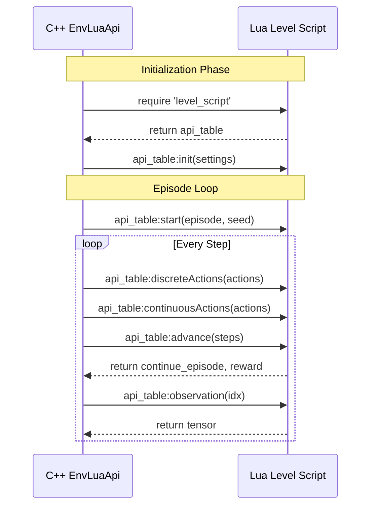
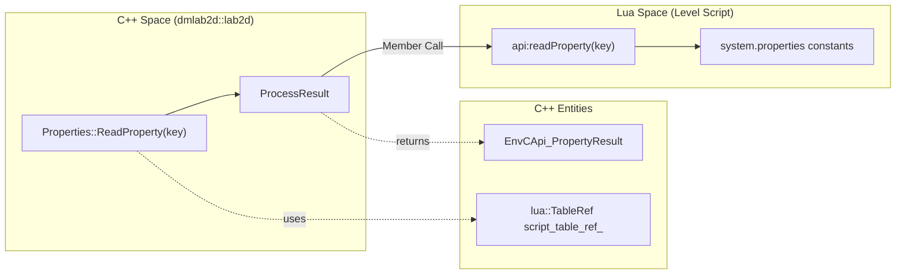

<!-- source: DeepWiki mcp.deepwiki.com · repo google-deepmind/lab2d · page 3.1 Level Lifecycle and Callback API · fetched 2026-10-26 -->

# Level Lifecycle and Callback API

Relevant source files

The following files were used as context for generating this wiki page:

- [dmlab2d/lib/env_lua_api/BUILD](dmlab2d/lib/env_lua_api/BUILD)
- [dmlab2d/lib/env_lua_api/actions.cc](dmlab2d/lib/env_lua_api/actions.cc)
- [dmlab2d/lib/env_lua_api/env_lua_api.cc](dmlab2d/lib/env_lua_api/env_lua_api.cc)
- [dmlab2d/lib/env_lua_api/env_lua_api_test.cc](dmlab2d/lib/env_lua_api/env_lua_api_test.cc)
- [dmlab2d/lib/env_lua_api/episode.cc](dmlab2d/lib/env_lua_api/episode.cc)
- [dmlab2d/lib/env_lua_api/events.cc](dmlab2d/lib/env_lua_api/events.cc)
- [dmlab2d/lib/env_lua_api/properties.cc](dmlab2d/lib/env_lua_api/properties.cc)
- [dmlab2d/lib/lua/call.cc](dmlab2d/lib/lua/call.cc)
- [dmlab2d/lib/lua/class.h](dmlab2d/lib/lua/class.h)
- [dmlab2d/lib/lua/read_test.cc](dmlab2d/lib/lua/read_test.cc)
- [dmlab2d/lib/lua/ref.cc](dmlab2d/lib/lua/ref.cc)

In DeepMind Lab2D, a "level" is defined by a Lua script that implements a specific set of callback functions. These callbacks are orchestrated by the C++ `EnvLuaApi` class to manage the environment's lifecycle, including initialization, action processing, and state transitions.

## Level Discovery and Resolution

When a level is loaded, the `EnvLuaApi` searches for the level script based on the `levelName` and `levelDirectory` settings. The discovery process follows a specific order to resolve the script file and its dependencies.

### Search Strategy
The `EnvLuaApi::PushLevelScriptAndName` function determines the path to the level script:
1.  **Literal Script**: If `levelName` starts with `=`, the remainder is treated as the script content itself [dmlab2d/lib/env_lua_api/env_lua_api.cc:82-84]().
2.  **File Path**: If `levelName` ends in `.lua`, it is treated as a direct file path [dmlab2d/lib/env_lua_api/env_lua_api.cc:124-136]().
3.  **Module Discovery**: If `levelName` is a simple string, the engine looks in the `levelDirectory`. It searches for either `<levelDirectory>/<levelName>.lua` or `<levelDirectory>/<levelName>/init.lua` [dmlab2d/lib/env_lua_api/env_lua_api.cc:141-153]().

The directory containing the level script is automatically added to the Lua `package.path` via `lua_vm_.AddPathToSearchers`, allowing the level to `require` local utility scripts [dmlab2d/lib/env_lua_api/env_lua_api.cc:154-155]().

**Sources:** [dmlab2d/lib/env_lua_api/env_lua_api.cc:81-162]()

## Level Lifecycle Callbacks

The interaction between the C++ engine and the Lua level script is defined by a table of callbacks returned by the script.

### Sequence Diagram: Environment Lifecycle
This diagram illustrates the flow from Python/C++ API calls into the Lua callback implementation.

Title: Environment Lifecycle Flow

**Sources:** [dmlab2d/lib/env_lua_api/env_lua_api.cc:164-210](), [dmlab2d/lib/env_lua_api/episode.cc:30-77](), [dmlab2d/lib/env_lua_api/actions.cc:161-194]()

### Callback Reference

| Callback | Description | Required |
| :--- | :--- | :--- |
| `init(kwargs)` | Called once after the script is loaded. Used to parse environment settings [dmlab2d/lib/env_lua_api/env_lua_api_test.cc:70-83](). | No |
| `observationSpec()` | Returns an array of tables defining the name, type, and shape of observations [dmlab2d/lib/env_lua_api/env_lua_api_test.cc:85-92](). | Yes |
| `discreteActionSpec()` | Returns an array of tables defining discrete action ranges [dmlab2d/lib/env_lua_api/env_lua_api_test.cc:99-102](). | No |
| `continuousActionSpec()` | Returns an array of tables defining continuous action ranges [dmlab2d/lib/env_lua_api/env_lua_api_test.cc:109-115](). | No |
| `textActionSpec()` | Returns an array of strings naming supported text actions [dmlab2d/lib/env_lua_api/actions.cc:93-112](). | No |
| `start(episode, seed)` | Called at the beginning of every episode to reset state and seed RNGs [dmlab2d/lib/env_lua_api/episode.cc:30-48](). | Yes |
| `advance(steps)` | Progresses the simulation. Returns a boolean (continue) and a number (reward) [dmlab2d/lib/env_lua_api/episode.cc:50-77](). | Yes |
| `observation(idx)` | Returns the observation tensor for the given index (1-based) [dmlab2d/lib/env_lua_api/env_lua_api_test.cc:94-97](). | Yes |

## Property API Callbacks

The Property API allows external inspection and modification of the level state via a hierarchical key-value system.

### Property Callback Logic
The `Properties` C++ class dispatches calls to the following Lua functions if they exist in the level's API table:

1.  **`readProperty(key)`**: Returns a string representation of the property or a status code from `system.properties` [dmlab2d/lib/env_lua_api/properties.cc:147-165]().
2.  **`writeProperty(key, value)`**: Receives a key and a string value. Returns a status code (e.g., `properties.SUCCESS`) [dmlab2d/lib/env_lua_api/properties.cc:133-144]().
3.  **`listProperty(key, callback)`**: Used to discover sub-properties. The level calls the provided `callback(name, mode)` where mode is a string like `'rw'` (read-write) [dmlab2d/lib/env_lua_api/properties.cc:167-182]().

### Data Flow: Property Access
This diagram maps the C++ Property API to the Lua implementation.

Title: Property API Data Flow

**Sources:** [dmlab2d/lib/env_lua_api/properties.cc:38-67](), [dmlab2d/lib/env_lua_api/properties.cc:133-182]()

## Implementation Details

### Action Handling
Actions are processed by the `Actions` class. It reads the specs during `BindApi` and dispatches actions to the level script via `DiscreteApply`, `ContinuousApply`, and `TextApply` [dmlab2d/lib/env_lua_api/actions.cc:143-195]().
*   **Discrete Actions**: Passed as an array of integers [dmlab2d/lib/env_lua_api/actions.cc:161-164]().
*   **Continuous Actions**: Passed as an array of doubles [dmlab2d/lib/env_lua_api/actions.cc:173-176]().
*   **Text Actions**: Passed as an array of strings [dmlab2d/lib/env_lua_api/actions.cc:185-194]().

### Episode Management
The `Episode` class tracks the `num_elapsed_frames_` and handles the garbage collection trigger at the start of an episode [dmlab2d/lib/env_lua_api/episode.cc:31-36](). It ensures that the `advance` callback receives the correct frame count and translates the Lua return values into `EnvCApi_EnvironmentStatus` [dmlab2d/lib/env_lua_api/episode.cc:50-77]().

**Sources:** [dmlab2d/lib/env_lua_api/episode.cc:1-80](), [dmlab2d/lib/env_lua_api/actions.cc:1-197]()

---

