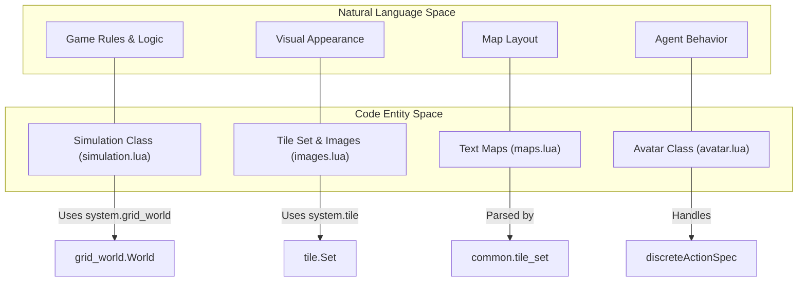
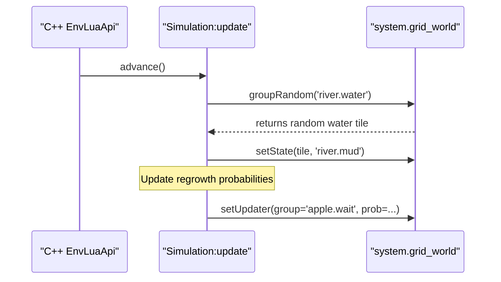

<!-- source: DeepWiki mcp.deepwiki.com · repo google-deepmind/lab2d · page 3.3 Built-in Levels · fetched 2026-10-26 -->

# Built-in Levels

Relevant source files

The following files were used as context for generating this wiki page:

- [dmlab2d/lib/game_scripts/levels/clean_up/images.lua](dmlab2d/lib/game_scripts/levels/clean_up/images.lua)
- [dmlab2d/lib/game_scripts/levels/clean_up/simulation.lua](dmlab2d/lib/game_scripts/levels/clean_up/simulation.lua)

DeepMind Lab2D bundles several example levels that demonstrate the core capabilities of the engine, including complex grid interactions, multi-agent coordination, and procedural generation. These levels serve as both functional environments for reinforcement learning and templates for developers to build custom simulations.

The built-in levels are primarily located in `dmlab2d/lib/game_scripts/levels/`. Each level typically follows a modular structure, separating visual assets, map definitions, and simulation logic.

## 1. Core Level Architecture

The bundled levels utilize a common pattern for defining environment dynamics. This pattern bridges the gap between the C++ engine's raw callbacks and the high-level game mechanics.

### From Natural Language to Code Entities

The following diagram maps high-level game concepts to the specific code structures used in the built-in levels.

**Mapping Game Concepts to Code Entities**

**Sources:** [dmlab2d/lib/game_scripts/levels/clean_up/simulation.lua:23-48](), [dmlab2d/lib/game_scripts/levels/clean_up/images.lua:184-195]()

---

## 2. Bundled Levels Overview

### 2.1 Chase Eat
`chase_eat` is a simple environment where an agent must navigate a grid to consume items. It demonstrates basic `onContact` triggers and reward accumulation.
*   **Mechanics:** The agent moves in a 2D grid. Contacting "food" pieces triggers a reward and removes the piece or moves it to a "wait" state for respawning.
*   **Implementation:** Uses `system.grid_world` to handle collisions and `onContact` callbacks.

### 2.2 Commons Harvest
`commons_harvest` is a multi-agent social dilemma environment. It simulates a shared resource (apples) that regrows faster if more apples are nearby, but can be permanently depleted if over-harvested.
*   **Mechanics:** Agents harvest apples for reward. If all apples in a patch are picked, they do not regrow.
*   **Key Logic:** The regrowth probability is a function of the local density of existing apples, managed via `grid:setUpdater` in the simulation's `update` loop.

### 2.3 Running with Scissors
This level implements a game-theoretic environment where agents collect resources representing "Rock", "Paper", or "Scissors".
*   **Mechanics:** Agents gather items to build a "hand". When agents interact (e.g., via a "tagging" beam), their collected resources determine the winner based on Roshambo rules.
*   **Implementation:** Leverages `system.grid_world`'s `onHit` callbacks to resolve interactions between agents' beams and their targets.

### 2.4 Pushbox (Sokoban)
`pushbox` is a classic puzzle environment where an agent must push boxes onto target locations.
*   **Procedural Generation:** This level uniquely utilizes `system.generators.pushbox` to create randomized, solvable Sokoban puzzles at the start of every episode.
*   **Mechanics:** Implements "push" physics by checking the state of the cell behind a box when an agent attempts to move into the box's current cell.

---

## 3. Deep Dive: Level Components (Example: Clean Up)

The "Clean Up" environment (often used as a template) illustrates how these components interact.

### Simulation Logic
The `Simulation` class defines the world configuration, including layers and update orders.

| Component | Function | Role |
| :--- | :--- | :--- |
| `worldConfig` | [simulation.lua:59-96]() | Defines `layers`, `renderOrder`, and `states` (e.g., `apple`, `mud`). |
| `stateCallbacks` | [simulation.lua:118-179]() | Defines logic for `onContact` (eating apples) and `onHit` (cleaning mud). |
| `update` | [simulation.lua:185-205]() | Manages global dynamics like mud accumulation and apple regrowth rates. |

**Simulation Flow**

**Sources:** [dmlab2d/lib/game_scripts/levels/clean_up/simulation.lua:185-205](), [dmlab2d/lib/game_scripts/levels/clean_up/simulation.lua:192-194]()

### Visuals and Palettes
Levels use `system.tile` to define sprites. The `images.lua` file often contains "shape" definitions where characters in a string represent colors in a palette, allowing for easy recoloring of avatars.

*   **Player Palette:** [images.lua:22-163]() defines color schemes (e.g., 'red', 'blue', 'gold') for different agents.
*   **Player Text:** [images.lua:165-182]() provides a ASCII-art style template for the agent's sprite.

### Map Definition
Maps are defined as 2D arrays of strings (text maps).
*   **Map Loading:** The simulation retrieves the layout from `maps.lua` [simulation.lua:98-100]().
*   **View Creation:** `world:createView` uses the text map layout to define the observation window [simulation.lua:103]().

---

## 4. Key Functions and Classes

### `Simulation:stateCallbacks(avatars)`
This function returns a table mapping state names to callback functions.
*   **`onContact`**: Triggered when a piece moves into a cell occupied by another piece [simulation.lua:126-137]().
*   **`onHit`**: Triggered when a "hit" (e.g., a beam or projectile) interacts with a piece [simulation.lua:152-168]().
*   **`onUpdate`**: Triggered by the grid world's update phase based on the defined `updateOrder` [simulation.lua:139-144]().

### `Simulation:addObservations(tileSet, world, observations)`
Configures the visual output of the level.
*   **`tile.Scene`**: A helper to render the grid into an RGB tensor [simulation.lua:105-114]().
*   **`world:createView`**: Defines which part of the grid is visible to the observation [simulation.lua:103]().

**Sources:**
*   `dmlab2d/lib/game_scripts/levels/clean_up/simulation.lua`
*   `dmlab2d/lib/game_scripts/levels/clean_up/images.lua`
*   `dmlab2d/lib/game_scripts/levels/clean_up/maps.lua`

---

