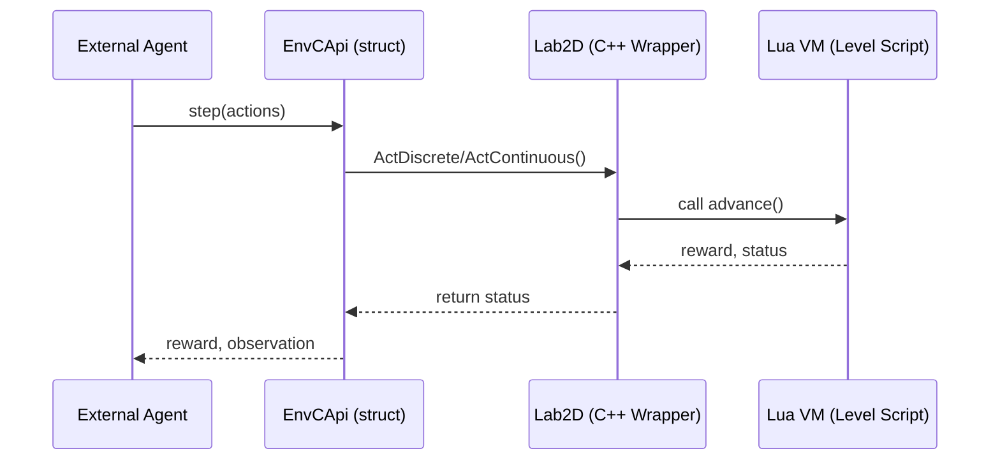

<!-- source: DeepWiki mcp.deepwiki.com · repo google-deepmind/lab2d · page 4 C++ Core Engine · fetched 2026-10-26 -->

# C++ Core Engine

<details>
<summary>Relevant source files</summary>

The following files were used as context for generating this wiki page:

- [BUILD](BUILD)
- [bazel/BUILD](bazel/BUILD)
- [dmlab2d/lib/BUILD](dmlab2d/lib/BUILD)
- [dmlab2d/lib/dmlab2d.cc](dmlab2d/lib/dmlab2d.cc)
- [dmlab2d/lib/system/file_system/lua/file_system.cc](dmlab2d/lib/system/file_system/lua/file_system.cc)
- [dmlab2d/lib/system/grid_world/grid_test.cc](dmlab2d/lib/system/grid_world/grid_test.cc)
- [third_party/rl_api/BUILD](third_party/rl_api/BUILD)
- [third_party/rl_api/env_c_api_example.syms.lds](third_party/rl_api/env_c_api_example.syms.lds)

</details>


The C++ Core Engine forms the middle layer of the DeepMind Lab2D architecture. It provides a bridge between the high-level Python API and the underlying Lua level scripts. The engine is responsible for managing the Lua virtual machine, orchestrating the environment lifecycle, and exposing a standardized C API (`EnvCApi`) that allows external agents to interact with the simulation.

### System Entry Point: dmlab2d_connect

The primary entry point for the entire engine is the `dmlab2d_connect` function. This function is exported as a C symbol, allowing it to be loaded dynamically by the Python bridge or other RL frameworks.

When `dmlab2d_connect` is called, it instantiates a `Lab2D` wrapper class. This wrapper encapsulates an `EnvLuaApi` instance and binds it to the `EnvCApi` structure using the `rl_api::Bind` helper. This binding maps the C function pointers (like `advance`, `step`, and `observation`) to the corresponding C++ methods in the engine.

#### Entry Point Architecture
The following diagram illustrates how the `dmlab2d_connect` call initializes the core components and binds them to the standardized interface.

**Diagram: Engine Initialization and Binding**
```mermaid
graph TD
    subgraph "External Caller"
        [Python_Bridge] --> |"dmlab2d_connect()"| CONNECT["dmlab2d_connect"]
    end

    subgraph "dmlab2d/lib/dmlab2d.cc"
        CONNECT --> |"instantiates"| L2D["class Lab2D"]
        L2D --> |"contains"| ELA["class EnvLuaApi"]
        L2D --> |"registers"| SYS_MODS["System Modules"]
    end

    subgraph "third_party/rl_api"
        BIND["rl_api::Bind()"]
        E_C_API["struct EnvCApi"]
    end

    CONNECT --> BIND
    BIND --> |"maps methods to"| E_C_API
    E_C_API -.-> |"calls"| L2D
```
Sources: [dmlab2d/lib/dmlab2d.cc:163-168](), [dmlab2d/lib/dmlab2d.cc:36-47]()

### Orchestration: EnvLuaApi

The `EnvLuaApi` class is the central coordinator of the engine. It manages the lifecycle of an environment episode, including initialization, starting new episodes with specific seeds, and advancing the simulation state.

Its primary responsibilities include:
*   **Setting Management**: Handling configuration strings passed from the caller.
*   **Lua Script Loading**: Loading the `init.lua` script for a chosen level.
*   **Data Flow**: Marshaling actions from C++ into the Lua VM and extracting observations and rewards back to C++.
*   **Subsystem Management**: Providing access to specialized managers for actions, observations, events, and properties.

For details, see [EnvLuaApi: C++ to Lua Bridge](#4.1).

Sources: [dmlab2d/lib/dmlab2d.cc:157-158](), [dmlab2d/lib/dmlab2d.cc:49-56]()

### Lua VM Wrapper

The engine interacts with Lua through a type-safe C++ abstraction layer. Instead of calling raw Lua C API functions directly, the engine uses a `Vm` wrapper that simplifies stack management and type conversion.

This layer provides:
*   **Type-Safe Push/Read**: Helpers to move data between C++ types (like `std::string` or `double`) and the Lua stack.
*   **Module Registration**: Mechanisms to expose C++ functionality to Lua via `AddCModuleToSearchers`.
*   **Object Binding**: A system for wrapping C++ classes so they can be manipulated as objects within Lua scripts.

For details, see [Lua VM Wrapper](#4.2).

Sources: [dmlab2d/lib/dmlab2d.cc:39-47](), [dmlab2d/lib/system/file_system/lua/file_system.cc:35-49]()

### RL Environment C Interface (env_c_api)

DeepMind Lab2D adheres to a standardized C interface for reinforcement learning environments. This interface, defined in `env_c_api.h`, ensures that the engine can be used interchangeably with other environments that implement the same contract.

The `EnvCApi` structure contains function pointers for:
*   **Action Specs**: Querying the number and bounds of discrete, continuous, and text actions.
*   **Observation Specs**: Defining the shapes and types of data returned by the environment.
*   **Simulation Control**: Methods for `Start`, `Advance`, and `Reset`.
*   **Property Tree**: A key-value API for inspecting and modifying internal environment state.

For details, see [env_c_api: The RL Environment C Interface](#4.3).

**Diagram: C API Interaction Flow**

Sources: [third_party/rl_api/env_c_api.h:1-22](), [dmlab2d/lib/dmlab2d.cc:118-138]()

### Summary of Engine Subsystems

| Subsystem | File Path | Role |
| :--- | :--- | :--- |
| **Connection Layer** | `dmlab2d/lib/dmlab2d.cc` | Implements `dmlab2d_connect` and the `Lab2D` class. |
| **EnvLuaApi** | `dmlab2d/lib/env_lua_api/` | Orchestrates level loading and episode lifecycle. |
| **Lua Wrapper** | `dmlab2d/lib/lua/` | Type-safe C++ abstraction for the Lua C API. |
| **C API Contract** | `third_party/rl_api/` | Defines the `EnvCApi` structure and binding utilities. |

Sources: [dmlab2d/lib/BUILD:16-40](), [third_party/rl_api/BUILD:18-43]()

---

