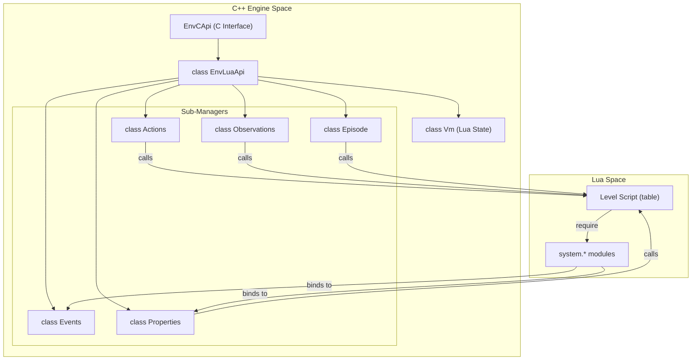
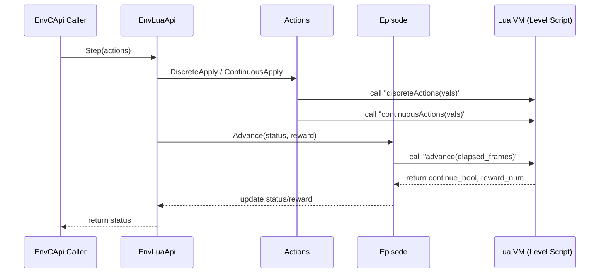

<!-- source: DeepWiki mcp.deepwiki.com · repo google-deepmind/lab2d · page 4.1 EnvLuaApi: C++ to Lua Bridge · fetched 2026-10-26 -->

# EnvLuaApi: C++ to Lua Bridge

Relevant source files

The following files were used as context for generating this wiki page:

- [dmlab2d/lib/env_lua_api/BUILD](dmlab2d/lib/env_lua_api/BUILD)
- [dmlab2d/lib/env_lua_api/actions.cc](dmlab2d/lib/env_lua_api/actions.cc)
- [dmlab2d/lib/env_lua_api/env_lua_api.cc](dmlab2d/lib/env_lua_api/env_lua_api.cc)
- [dmlab2d/lib/env_lua_api/env_lua_api_test.cc](dmlab2d/lib/env_lua_api/env_lua_api_test.cc)
- [dmlab2d/lib/env_lua_api/episode.cc](dmlab2d/lib/env_lua_api/episode.cc)
- [dmlab2d/lib/env_lua_api/events.cc](dmlab2d/lib/env_lua_api/events.cc)
- [dmlab2d/lib/env_lua_api/properties.cc](dmlab2d/lib/env_lua_api/properties.cc)
- [dmlab2d/lib/lua/call.cc](dmlab2d/lib/lua/call.cc)
- [dmlab2d/lib/lua/class.h](dmlab2d/lib/lua/class.h)
- [dmlab2d/lib/lua/read_test.cc](dmlab2d/lib/lua/read_test.cc)
- [dmlab2d/lib/lua/ref.cc](dmlab2d/lib/lua/ref.cc)

The `EnvLuaApi` class is the core orchestrator of DeepMind Lab2D, responsible for bridging the C++ engine with the Lua virtual machine. It implements the `EnvCApi` interface, allowing external callers (like Python or C++ tests) to drive an environment while the actual logic is executed within a Lua script.

## Overview and Purpose

`EnvLuaApi` manages the entire lifecycle of a Lua-based environment. Its primary responsibilities include:
*   **Lua VM Management**: Initializing and configuring the Lua state [dmlab2d/lib/env_lua_api/env_lua_api.cc:52-56]().
*   **Script Loading**: Locating and loading level scripts based on settings like `levelName` and `levelDirectory` [dmlab2d/lib/env_lua_api/env_lua_api.cc:110-162]().
*   **Callback Dispatch**: Translating C++ calls (like `Step`, `Reset`, `Observation`) into Lua function calls on the level script [dmlab2d/lib/env_lua_api/env_lua_api.cc:250-280]().
*   **System Module Registration**: Exposing C++ functionality (tensors, random number generators, events) to the Lua environment via `require 'system.<name>'` [dmlab2d/lib/env_lua_api/env_lua_api.cc:173-192]().

### System Architecture Diagram

This diagram shows how `EnvLuaApi` sits between the RL API and the Lua Level Script.

**EnvLuaApi Component Bridge**

Sources: [dmlab2d/lib/env_lua_api/env_lua_api.h:35-100](), [dmlab2d/lib/env_lua_api/env_lua_api.cc:164-210]()

## Episode Lifecycle Management

`EnvLuaApi` delegates the core RL loop to the `Episode` and `Actions` classes. The transition from a C++ call to a Lua callback follows a strict pattern.

### Reset and Start
When `Start` is called, the system:
1.  Resets the frame counter [dmlab2d/lib/env_lua_api/episode.cc:31]().
2.  Triggers Lua garbage collection twice to ensure a clean state [dmlab2d/lib/env_lua_api/episode.cc:33-36]().
3.  Calls the `start(episode, seed)` function in the Lua level script [dmlab2d/lib/env_lua_api/episode.cc:38-46]().

### Step and Advance
The `Advance` method handles the progression of time:
1.  Increments `num_elapsed_frames_` [dmlab2d/lib/env_lua_api/episode.cc:52]().
2.  Calls the `advance(steps)` function in Lua [dmlab2d/lib/env_lua_api/episode.cc:55-61]().
3.  Expects a boolean (continue/terminate) and a number (reward) as return values [dmlab2d/lib/env_lua_api/episode.cc:66-76]().

**Sequence: C++ Step to Lua Callback**

Sources: [dmlab2d/lib/env_lua_api/env_lua_api.cc:258-278](), [dmlab2d/lib/env_lua_api/actions.cc:161-183](), [dmlab2d/lib/env_lua_api/episode.cc:50-77]()

## Data Flow: Observations and Events

### Observations
Observations are managed by the `Observations` class. It queries the Lua script's `observationSpec()` during initialization [dmlab2d/lib/env_lua_api/env_lua_api.cc:215-220](). When a specific observation is requested by index, it calls the Lua `observation(idx)` function, which must return a `system.tensor` [dmlab2d/lib/env_lua_api/observations.cc:165-183]().

### Events
Events allow the Lua script to send asynchronous data packets back to the engine. 
*   **C++ Side**: `Events` class stores vectors of strings, doubles, and tensors [dmlab2d/lib/env_lua_api/events.h:60-75]().
*   **Lua Side**: The `system.events` module is bound to `LuaEventsModule` [dmlab2d/lib/env_lua_api/events.cc:31-37]().
*   **Mechanism**: Lua calls `events:add("name", ...obs)` which invokes `LuaEventsModule::Add` in C++, pushing data into the `Events` storage [dmlab2d/lib/env_lua_api/events.cc:61-90]().

## Property Tree API

The Property API allows for reading and writing environment configuration at runtime. It maps the C++ `EnvCApi` property functions to Lua callbacks.

| C++ Function | Lua Callback | Description |
| :--- | :--- | :--- |
| `ReadProperty` | `readProperty(key)` | Returns a string value or a result code [dmlab2d/lib/env_lua_api/properties.cc:147-165](). |
| `WriteProperty` | `writeProperty(key, value)` | Returns a result code (SUCCESS, NOT_FOUND, etc.) [dmlab2d/lib/env_lua_api/properties.cc:133-144](). |
| `ListProperty` | `listProperty(key, callback)` | Iterates over children of a key, calling a Lua-provided callback [dmlab2d/lib/env_lua_api/properties.cc:167-182](). |

The module constants (e.g., `properties.SUCCESS`) are defined in C++ and pushed to the Lua module table [dmlab2d/lib/env_lua_api/properties.cc:121-131]().

## Script Discovery and Search Paths

`EnvLuaApi` implements a sophisticated search logic to find level scripts and their dependencies.

1.  **Setting `levelName`**:
    *   If it starts with `=`, the remainder is treated as the script content itself [dmlab2d/lib/env_lua_api/env_lua_api.cc:82-84]().
    *   If it ends in `.lua`, it searches the absolute or relative path provided [dmlab2d/lib/env_lua_api/env_lua_api.cc:124-136]().
    *   Otherwise, it looks for `<levelName>.lua` or `<levelName>/init.lua` inside the `levelDirectory` [dmlab2d/lib/env_lua_api/env_lua_api.cc:141-153]().
2.  **Searcher Paths**: It automatically adds the level's directory and the standard `game_scripts` path to the Lua `package.path` [dmlab2d/lib/env_lua_api/env_lua_api.cc:154-155]().

Sources:
*   `EnvLuaApi` Core: [dmlab2d/lib/env_lua_api/env_lua_api.cc]()
*   Action Handling: [dmlab2d/lib/env_lua_api/actions.cc]()
*   Episode Logic: [dmlab2d/lib/env_lua_api/episode.cc]()
*   Event System: [dmlab2d/lib/env_lua_api/events.cc]()
*   Property API: [dmlab2d/lib/env_lua_api/properties.cc]()
*   Lua Class Binding: [dmlab2d/lib/lua/class.h]()

---

