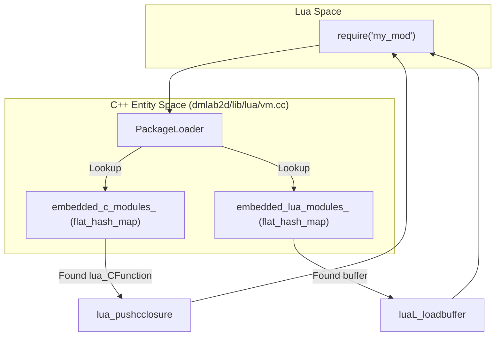
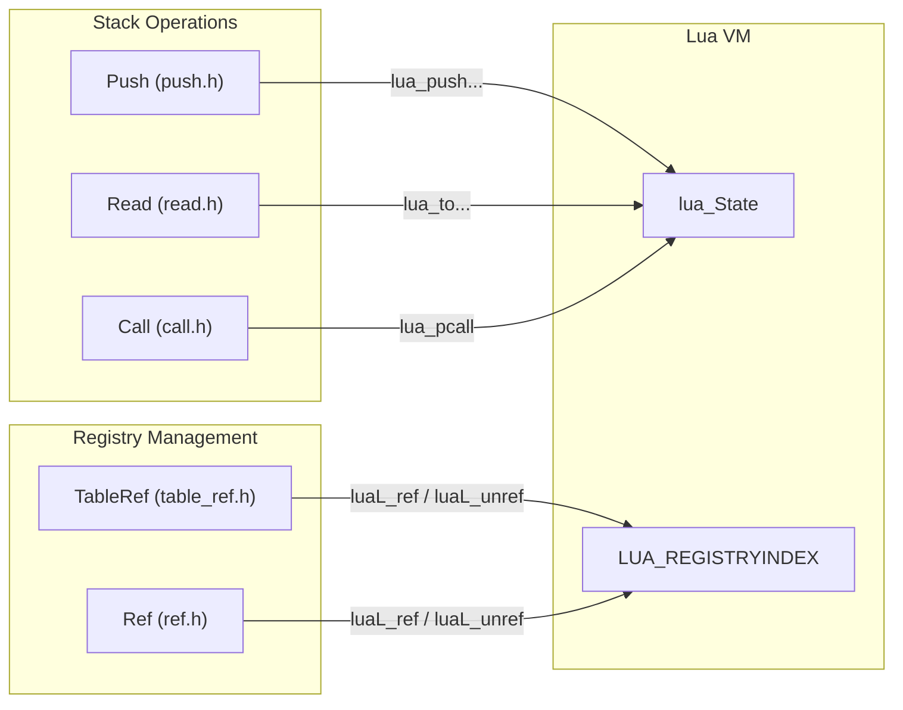

<!-- source: DeepWiki mcp.deepwiki.com · repo google-deepmind/lab2d · page 4.2 Lua VM Wrapper · fetched 2026-10-26 -->

# Lua VM Wrapper

Relevant source files

The following files were used as context for generating this wiki page:

- [dmlab2d/lib/env_lua_api/observations.cc](dmlab2d/lib/env_lua_api/observations.cc)
- [dmlab2d/lib/lua/BUILD](dmlab2d/lib/lua/BUILD)
- [dmlab2d/lib/lua/bind_test.cc](dmlab2d/lib/lua/bind_test.cc)
- [dmlab2d/lib/lua/call_test.cc](dmlab2d/lib/lua/call_test.cc)
- [dmlab2d/lib/lua/ref.h](dmlab2d/lib/lua/ref.h)
- [dmlab2d/lib/lua/table_ref.cc](dmlab2d/lib/lua/table_ref.cc)
- [dmlab2d/lib/lua/vm.cc](dmlab2d/lib/lua/vm.cc)
- [dmlab2d/lib/lua/vm_test.cc](dmlab2d/lib/lua/vm_test.cc)
- [dmlab2d/lib/lua/vm_test_util.h](dmlab2d/lib/lua/vm_test_util.h)

The Lua VM Wrapper provides a high-level C++ abstraction over the Lua C API. It simplifies interacting with the Lua virtual machine by providing type-safe stack operations, automatic reference management, and mechanisms for embedding C++ modules and Lua scripts directly into the environment's search path.

## The Vm Class

The `Vm` class is the primary entry point for managing a Lua state. It handles the lifecycle of the `lua_State` and configures the environment with custom searchers and error handling.

### Key Responsibilities
*   **Lifecycle Management**: Wraps a `lua_State` and ensures proper initialization. [dmlab2d/lib/lua/vm.h:40-45]().
*   **Custom Searchers**: Implements a `PackageLoader` that allows the Lua `require` function to find modules embedded in the C++ binary. [dmlab2d/lib/lua/vm.cc:36-88]().
*   **Traceback Enhancement**: Installs a custom Lua traceback function to provide readable stack traces with shortened file paths and color-coded error messages. [dmlab2d/lib/lua/vm.cc:115-155]().

### Module Registration
The `Vm` class allows registering C++ functions and Lua scripts as modules that can be loaded via `require` in Lua.

| Function | Description |
| :--- | :--- |
| `AddCModuleToSearchers` | Registers a `lua_CFunction` as a module. Supports up-values for creating closures. [dmlab2d/lib/lua/vm.cc:105-108]() |
| `AddLuaModuleToSearchers` | Registers a raw buffer containing Lua code as a module. [dmlab2d/lib/lua/vm.cc:110-113]() |
| `AddPathToSearchers` | Appends a filesystem path to the Lua `package.path`. [dmlab2d/lib/lua/vm.cc:92-103]() |

**Sources:** [dmlab2d/lib/lua/vm.h:40-100](), [dmlab2d/lib/lua/vm.cc:36-180]()

## Type-Safe Stack Helpers: Push and Read

To avoid the error-prone nature of the raw Lua stack API, the wrapper provides overloaded `Push` and `Read` functions.

### Push Operations
The `Push` function is overloaded for various C++ types (e.g., `int`, `double`, `std::string`, `absl::Span`, `TableRef`). It handles the logic of placing these values onto the Lua stack. [dmlab2d/lib/lua/push.h:30-100]().

### Read Operations
The `Read` function provides a type-safe way to extract values from the stack. It returns a `ReadResult` which indicates if the value was found, missing, or of a mismatched type. [dmlab2d/lib/lua/read.h:30-100]().

**Sources:** [dmlab2d/lib/lua/push.h:1-186](), [dmlab2d/lib/lua/read.h:1-224]()

## Reference Management: TableRef and Ref

The wrapper provides RAII classes to manage Lua objects stored in the Lua Registry (`LUA_REGISTRYINDEX`), preventing memory leaks and ensuring references are valid across C++ calls.

### TableRef
`TableRef` is specialized for interacting with Lua tables. It provides methods for looking up values, inserting new entries, and querying table size.
*   **Creation**: `TableRef::Create(L)` creates a new table and returns a reference. [dmlab2d/lib/lua/table_ref.cc:101-105]().
*   **Member Access**: `LookUp` and `Insert` facilitate C++ to Lua table manipulation. [dmlab2d/lib/lua/table_ref.h:50-80]().
*   **Lifecycle**: On destruction, it automatically calls `luaL_unref`. [dmlab2d/lib/lua/table_ref.cc:24-28]().

### Ref
`Ref` is a general-purpose wrapper for any Lua value (functions, tables, userdata). It is frequently used to store Lua callbacks in C++ classes. [dmlab2d/lib/lua/ref.h:39-61]().

**Sources:** [dmlab2d/lib/lua/table_ref.h:1-130](), [dmlab2d/lib/lua/table_ref.cc:1-130](), [dmlab2d/lib/lua/ref.h:1-130]()

## Call Utilities and Binding

### Call Function
The `Call` utility wraps `lua_pcall`. It handles error reporting by converting Lua errors into a C++ `NResultsOr` object, which contains either the number of results pushed to the stack or an error message. [dmlab2d/lib/lua/call.h:30-45]().

### Bind Mechanism
The `Bind` template allows wrapping C++ functions that return `NResultsOr` so they can be used directly as `lua_CFunction`. This bridges the gap between the wrapper's error handling and Lua's error mechanism. [dmlab2d/lib/lua/bind.h:30-50]().

**Sources:** [dmlab2d/lib/lua/call.h:1-143](), [dmlab2d/lib/lua/bind.h:1-117]()

## Data Flow and System Interaction

The following diagrams illustrate how the C++ components interact with the Lua VM.

### Module Loading Data Flow
This diagram shows how `require` in Lua is intercepted by the `PackageLoader` to find embedded C++ modules.

Title: Module Resolution Flow

**Sources:** [dmlab2d/lib/lua/vm.cc:36-88](), [dmlab2d/lib/lua/vm.h:92-108]()

### C++ to Lua Interaction Pattern
This diagram maps the C++ classes to their roles in managing the Lua stack and registry.

Title: Lua Wrapper Class Architecture

**Sources:** [dmlab2d/lib/lua/table_ref.h:24-40](), [dmlab2d/lib/lua/ref.h:42-47](), [dmlab2d/lib/lua/call.h:30-40]()

## Class Binding Mechanism

The `dmlab2d/lib/lua/class.h` header provides a mechanism for exposing C++ classes to Lua as userdata with metatables. This allows Lua scripts to instantiate C++ objects and call their methods.

*   **Registration**: Classes are registered with a name and a set of member functions. [dmlab2d/lib/lua/class.h:100-150]().
*   **Method Dispatch**: When a method is called in Lua, the wrapper retrieves the C++ instance from the userdata and dispatches the call to the corresponding C++ method. [dmlab2d/lib/lua/class.h:150-200]().

**Sources:** [dmlab2d/lib/lua/class.h:1-314]()

---

