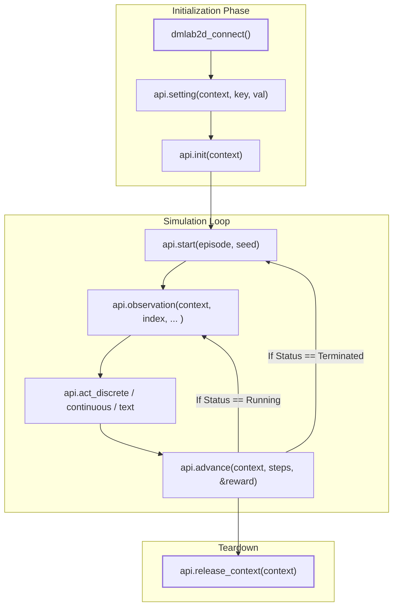
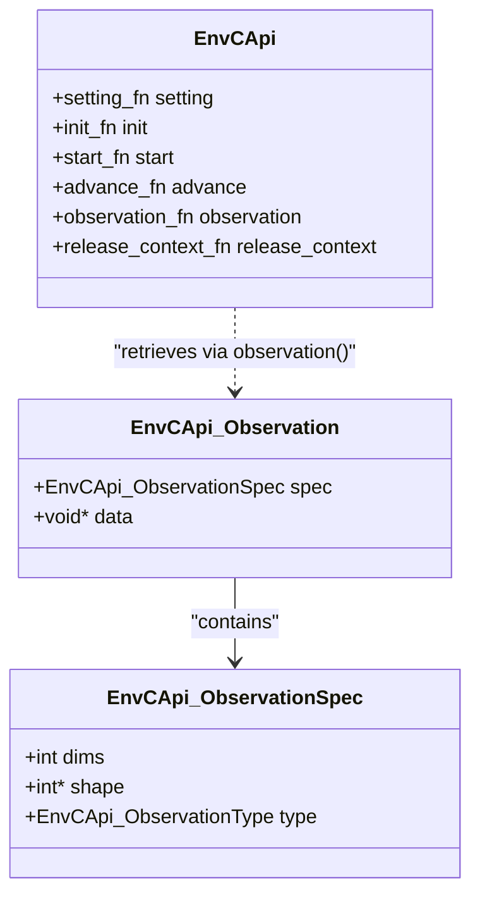

<!-- source: DeepWiki mcp.deepwiki.com · repo google-deepmind/lab2d · page 4.3 env_c_api: The RL Environment C Interface · fetched 2026-10-26 -->

# env_c_api: The RL Environment C Interface

<details>
<summary>Relevant source files</summary>

The following files were used as context for generating this wiki page:

- [BUILD](BUILD)
- [third_party/rl_api/BUILD](third_party/rl_api/BUILD)
- [third_party/rl_api/env_c_api_example.syms.lds](third_party/rl_api/env_c_api_example.syms.lds)
- [third_party/rl_api/env_c_api_test_suite.cc](third_party/rl_api/env_c_api_test_suite.cc)

</details>


The `env_c_api` defines a standardized, pure C interface for reinforcement learning environments. It serves as the primary interoperability layer between the DeepMind Lab2D engine (written in C++) and various frontends or wrappers, such as the Python API. By using a C-compatible structure of function pointers, it ensures binary compatibility across different compilers and languages without requiring complex C++ ABI matching.

## Overview of the C API Structure

The core of the interface is the `EnvCApi` struct, which contains function pointers for every aspect of the environment lifecycle: configuration, initialization, action handling, observation retrieval, and property management.

### Key Components

*   **`EnvCApi`**: A struct holding function pointers that define the environment's capabilities [third_party/rl_api/env_c_api.h:18-22]().
*   **`dmlab2d_connect`**: The standard entry point function used to initialize the `EnvCApi` struct and create an environment context [third_party/rl_api/env_c_api.h:45-46]().
*   **`env_c_api_bind`**: A helper library for binding C++ implementations to the C API structure [third_party/rl_api/BUILD:39-43]().
*   **`env_c_api_test_suite`**: A comprehensive GTest-based compliance suite to ensure an implementation correctly follows the API contract [third_party/rl_api/env_c_api_test_suite.h:17-18]().

### Data Flow and Lifecycle

The lifecycle of an environment via the C API follows a strict sequence: connection, setting configuration, initialization, and then the simulation loop (start, act, advance).

**Environment Lifecycle Diagram**


**Sources:** [third_party/rl_api/env_c_api_test_suite.cc:32-205]()

## Function Pointer Contract

The `EnvCApi` struct requires implementations to provide specific functions. The compliance test suite verifies that these pointers are not null and behave according to the spec.

### Metadata and Configuration
| Function | Purpose |
| :--- | :--- |
| `setting` | Sets environment parameters before `init` is called [third_party/rl_api/env_c_api_test_suite.cc:67-69](). |
| `init` | Finalizes configuration and prepares the internal state [third_party/rl_api/env_c_api_test_suite.cc:72-73](). |
| `environment_name` | Returns a string identifier for the environment [third_party/rl_api/env_c_api_test_suite.cc:45](). |

### Action and Observation Specs
The API distinguishes between three types of actions: Discrete, Continuous, and Text.
*   **Discrete Actions**: Handled via `action_discrete_count` and `action_discrete_bounds` [third_party/rl_api/env_c_api_test_suite.cc:75-81]().
*   **Continuous Actions**: Handled via `action_continuous_count` and `action_continuous_bounds` [third_party/rl_api/env_c_api_test_suite.cc:83-85]().
*   **Observations**: Described by `EnvCApi_ObservationSpec` which includes `dims`, `shape`, and `type` (e.g., `EnvCApi_ObservationString` or numeric types) [third_party/rl_api/env_c_api_test_suite.cc:89-115]().

### The Run Loop
The simulation progresses through `advance`, which returns an `EnvCApi_EnvironmentStatus` and the accumulated reward [third_party/rl_api/env_c_api_test_suite.cc:198-201]().

**API Entity Mapping**


**Sources:** [third_party/rl_api/env_c_api.h:18-22](), [third_party/rl_api/env_c_api_test_suite.cc:89-115]()

## Connection Entry Point

Every shared library implementing this API must expose a "connect" function. In Lab2D, this is typically named `dmlab2d_connect`.

```c
// Signature defined in env_c_api.h
int dmlab2d_connect(const EnvCApi** api, void** context);
```

When called, the implementation must:
1.  Populate the `EnvCApi` struct with valid function pointers [third_party/rl_api/env_c_api_test_suite.cc:32-33]().
2.  Allocate an internal state object and return it via the `context` pointer [third_party/rl_api/env_c_api_test_suite.cc:32]().

In the Lab2D build system, visibility of this entry point is controlled via linker scripts (e.g., `.lds` files) to ensure only the connect function is exported in the resulting `.so` or `.dylib` [third_party/rl_api/BUILD:49-55](), [third_party/rl_api/env_c_api_example.syms.lds:1]().

## Compliance Testing

The `env_c_api_test_suite` is a reusable library used to validate that any new environment implementation adheres to the `EnvCApi` protocol. It performs the following checks:

1.  **Presence Checks**: Ensures all mandatory function pointers (like `advance`, `start`, `observation_count`) are non-null [third_party/rl_api/env_c_api_test_suite.cc:36-62]().
2.  **Consistency Checks**: Verifies that if an environment reports a non-zero count for an action type, the corresponding `bounds` function is also provided [third_party/rl_api/env_c_api_test_suite.cc:79-85]().
3.  **Observation Validation**: Compares the shape and type of observations returned during `step` against the specs provided during initialization [third_party/rl_api/env_c_api_test_suite.cc:131-167]().
4.  **Property Integrity**: Tests that `read_property`, `write_property`, and `list_property` are accessible [third_party/rl_api/env_c_api_test_suite.cc:47-49]().

**Sources:** [third_party/rl_api/env_c_api_test_suite.cc:27-206](), [third_party/rl_api/BUILD:24-36]()

---

