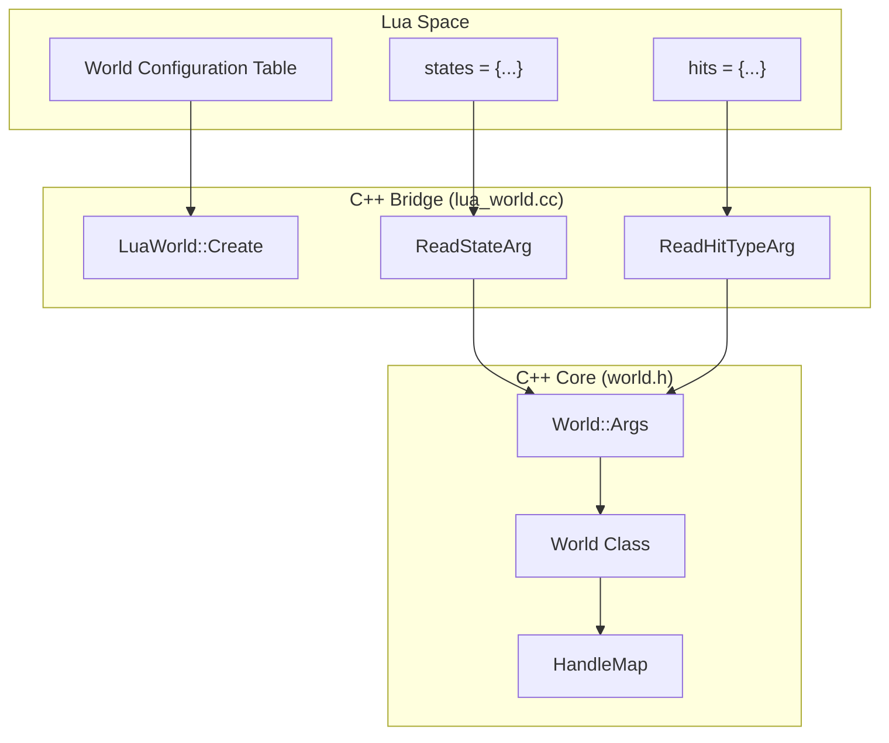
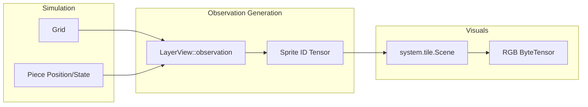

<!-- source: DeepWiki mcp.deepwiki.com · repo google-deepmind/lab2d · page 5.1 system.grid_world: Grid World Engine · fetched 2026-10-26 -->

# system.grid_world: Grid World Engine

Relevant source files

The following files were used as context for generating this wiki page:

- [dmlab2d/dmlab2d_pybind.cc](dmlab2d/dmlab2d_pybind.cc)
- [dmlab2d/lib/dmlab2d.cc](dmlab2d/lib/dmlab2d.cc)
- [dmlab2d/lib/system/file_system/lua/file_system.cc](dmlab2d/lib/system/file_system/lua/file_system.cc)
- [dmlab2d/lib/system/grid_world/BUILD](dmlab2d/lib/system/grid_world/BUILD)
- [dmlab2d/lib/system/grid_world/collections/handle.h](dmlab2d/lib/system/grid_world/collections/handle.h)
- [dmlab2d/lib/system/grid_world/collections/object_pool.h](dmlab2d/lib/system/grid_world/collections/object_pool.h)
- [dmlab2d/lib/system/grid_world/collections/shuffled_set.h](dmlab2d/lib/system/grid_world/collections/shuffled_set.h)
- [dmlab2d/lib/system/grid_world/collections/shuffled_set_test.cc](dmlab2d/lib/system/grid_world/collections/shuffled_set_test.cc)
- [dmlab2d/lib/system/grid_world/grid.cc](dmlab2d/lib/system/grid_world/grid.cc)
- [dmlab2d/lib/system/grid_world/grid_shape.h](dmlab2d/lib/system/grid_world/grid_shape.h)
- [dmlab2d/lib/system/grid_world/grid_test.cc](dmlab2d/lib/system/grid_world/grid_test.cc)
- [dmlab2d/lib/system/grid_world/lua/lua_grid.cc](dmlab2d/lib/system/grid_world/lua/lua_grid.cc)
- [dmlab2d/lib/system/grid_world/lua/lua_world.cc](dmlab2d/lib/system/grid_world/lua/lua_world.cc)
- [docs/system/grid_world.md](docs/system/grid_world.md)

The `system.grid_world` module is a high-performance C++ engine for 2D grid-based environments, exposed to Lua. It manages the simulation of "pieces" (objects) on a discrete grid, handling movement, collision, interactions (hits/beams), and complex lifecycle callbacks.

## World Configuration

The `World` object defines the static properties of the environment that persist across episodes. This includes the definition of states, layers, and the execution order for updates and rendering.

### Configuration Parameters
When creating a `grid_world.World`, the following fields are configured:

| Field | Description |
| :--- | :--- |
| `renderOrder` | An array of layer names defining the Z-order for rendering. [docs/system/grid_world.md:23-23]() |
| `updateOrder` | Defines named update phases (e.g., `update0`, `physics`) called during `grid:update()`. [docs/system/grid_world.md:27-27]() |
| `hits` | Definitions for beam-like interactions, including their layer and sprite. [docs/system/grid_world.md:31-40]() |
| `states` | Definitions for piece types, specifying their default layer, sprite, groups, and contact tags. [docs/system/grid_world.md:42-69]() |

### Code Entity Mapping: World Configuration
The following diagram shows how Lua configuration tables are mapped to C++ `World::Args` and internal handles.

**World Initialization Data Flow**

Sources: [dmlab2d/lib/system/grid_world/lua/lua_world.cc:119-190](), [dmlab2d/lib/system/grid_world/world.h:40-100]()

---

## Grid Creation and Manipulation

A `Grid` is an instantiation of a `World` with a specific size and topology. It tracks the positions and states of all `Piece` instances.

### Topology
The engine supports two primary topologies:
*   `BOUNDED`: Standard grid with hard edges. [docs/system/grid_world.md:113-115]()
*   `TORUS`: Coordinates wrap around (top-to-bottom, left-to-right). [docs/system/grid_world.md:116-117]()

### Piece Management
Pieces are the fundamental units of the grid. They are managed using an `ObjectPool` for efficiency. [dmlab2d/lib/system/grid_world/grid.h:35-40]()

*   **Creation**: `grid:createInstance(state, transform)` places a new piece. [dmlab2d/lib/system/grid_world/lua/lua_grid.cc:56-57]()
*   **Movement**: The engine provides methods to move pieces while checking for collisions based on layer occupancy. No two pieces can occupy the same location on the same layer. [docs/system/grid_world.md:44-46]()

Sources: [dmlab2d/lib/system/grid_world/grid.h:30-100](), [dmlab2d/lib/system/grid_world/collections/object_pool.h:29-52]()

---

## Lifecycle Callbacks

The `grid_world` engine uses a callback system to delegate logic to Lua. These are defined in the `stateCallbacks` table during grid creation. [docs/system/grid_world.md:121-154]()

| Callback | Trigger |
| :--- | :--- |
| `onAdd` | Called when a piece is added to the grid. [dmlab2d/lib/system/grid_world/lua/lua_grid.cc:139-139]() |
| `onRemove` | Called when a piece is removed. [dmlab2d/lib/system/grid_world/lua/lua_grid.cc:141-143]() |
| `onUpdate` | Called during `grid:update()` for each update phase defined in `updateOrder`. [dmlab2d/lib/system/grid_world/lua/lua_grid.cc:149-151]() |
| `onContact` | Triggered when a piece enters/leaves the same location as another piece (on different layers). [dmlab2d/lib/system/grid_world/lua/lua_grid.cc:153-159]() |
| `onHit` | Triggered when a piece is struck by a "hit" (beam). Returns whether the hit is absorbed. [dmlab2d/lib/system/grid_world/lua/lua_grid.cc:161-165]() |

### Callback Implementation
The `LuaStateCallback` class in C++ wraps Lua functions and handles the transition between the C++ engine and the Lua VM. [dmlab2d/lib/system/grid_world/lua/lua_grid.cc:69-108]()

Sources: [dmlab2d/lib/system/grid_world/lua/lua_grid.cc:69-166](), [docs/system/grid_world.md:121-154]()

---

## Grid Views and Rendering

`LayerView` objects allow for rendering egocentric or fixed observations of the grid.

*   **Windowing**: Views are defined by offsets (`left`, `right`, `forward`, `backward`) relative to a focal piece or coordinate. [docs/system/grid_world.md:167-170]()
*   **Orientation**: Observations can rotate with the focal piece's orientation. [docs/system/grid_world.md:175-176]()
*   **Data Flow**: `LayerView` produces a tensor of sprite IDs, which is typically consumed by `system.tile.Scene` to produce RGB images. [docs/system/grid_world.md:181-204]()

**Rendering Pipeline**

Sources: [docs/system/grid_world.md:157-204](), [dmlab2d/lib/system/grid_world/grid_view.h:35-60]()

---

## Collections and Utilities

The engine relies on several optimized C++ collection classes for performance:

### ObjectPool
Manages `Piece` instances. It recycles memory by keeping a list of `unused_handles_`, avoiding frequent allocations during high-turnover simulations.
[dmlab2d/lib/system/grid_world/collections/object_pool.h:29-74]()

### ShuffledSet
Used for managing groups of pieces where the iteration order must be randomized (e.g., to avoid turn-order bias). It supports `ShuffledElements` and `RandomElement`.
[dmlab2d/lib/system/grid_world/collections/shuffled_set.h:33-65]()

### Handle
A strongly-typed wrapper around an integer index. It prevents type errors (e.g., using a `Layer` handle where a `State` handle is expected) while maintaining the performance of a raw index.
[dmlab2d/lib/system/grid_world/collections/handle.h:30-57]()

Sources: [dmlab2d/lib/system/grid_world/collections/object_pool.h:29-102](), [dmlab2d/lib/system/grid_world/collections/shuffled_set.h:33-127](), [dmlab2d/lib/system/grid_world/collections/handle.h:30-74]()

---

