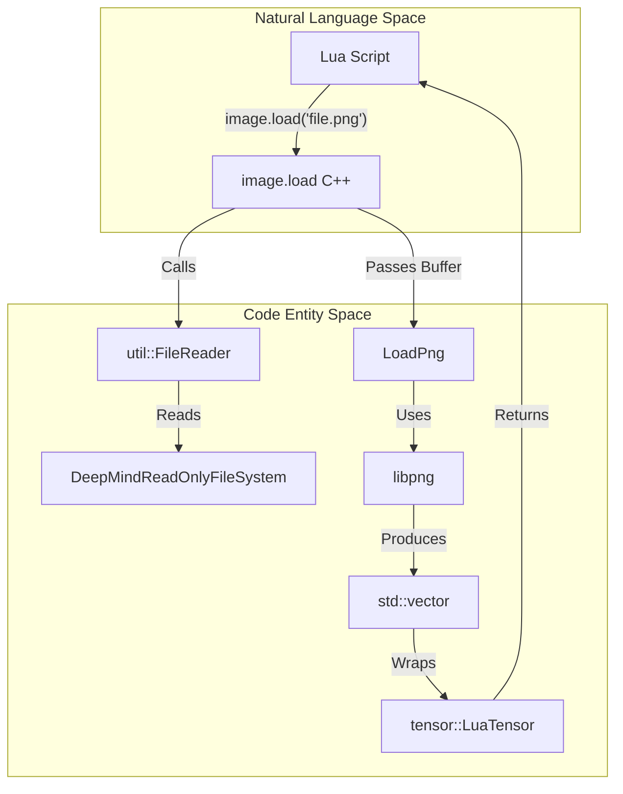
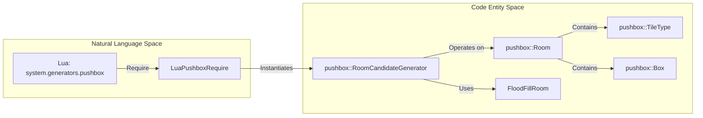

<!-- source: DeepWiki mcp.deepwiki.com · repo google-deepmind/lab2d · page 5.4 Other System Modules: image, random, file_system, generators · fetched 2026-10-26 -->

# Other System Modules: image, random, file_system, generators

Relevant source files

The following files were used as context for generating this wiki page:

- [dmlab2d/lib/dmlab2d.cc](dmlab2d/lib/dmlab2d.cc)
- [dmlab2d/lib/system/file_system/lua/file_system.cc](dmlab2d/lib/system/file_system/lua/file_system.cc)
- [dmlab2d/lib/system/generators/pushbox/BUILD](dmlab2d/lib/system/generators/pushbox/BUILD)
- [dmlab2d/lib/system/generators/pushbox/room.cc](dmlab2d/lib/system/generators/pushbox/room.cc)
- [dmlab2d/lib/system/generators/pushbox/room_candidate_generator.cc](dmlab2d/lib/system/generators/pushbox/room_candidate_generator.cc)
- [dmlab2d/lib/system/grid_world/grid_test.cc](dmlab2d/lib/system/grid_world/grid_test.cc)
- [dmlab2d/lib/system/image/BUILD](dmlab2d/lib/system/image/BUILD)
- [dmlab2d/lib/system/image/lua_image.cc](dmlab2d/lib/system/image/lua_image.cc)

This page documents the auxiliary C++-implemented Lua modules available in DeepMind Lab2D. These modules provide essential utilities for asset loading, procedural generation, and filesystem access that are not covered by the core grid-world or tensor libraries.

## 1. system.image
The `system.image` module provides utilities for loading image files (primarily PNG) into `system.tensor` objects and performing basic image manipulation like scaling.

### Key Functions
*   **`image.load(path)`**: Loads a PNG image from the filesystem. It returns a `ByteTensor` with shape `(height, width, channels)`. The number of channels depends on the PNG color type (e.g., 1 for Gray, 3 for RGB, 4 for RGBA) [[dmlab2d/lib/system/image/lua_image.cc:129-152](), [dmlab2d/lib/system/image/lua_image.cc:189-196]()].
*   **`image.scale(tensor, shape)`**: Scales an existing tensor to a new `(height, width)` using linear interpolation. It supports tensors with an arbitrary number of channels [[dmlab2d/lib/system/image/lua_image.cc:201-210](), [dmlab2d/lib/system/image/lua_image.cc:238-250]()].

### Implementation Details
The module uses `libpng` to decode image data [[dmlab2d/lib/system/image/lua_image.cc:44-44]()]. It validates the PNG signature and header bit depth (must be 8-bit) before parsing pixels into a raw byte vector which is then used to back a `LuaTensor` [[dmlab2d/lib/system/image/lua_image.cc:87-150]()].

**Image Loading Data Flow**

Sources: [[dmlab2d/lib/system/image/lua_image.cc:80-152](), [dmlab2d/lib/system/image/lua_image.cc:154-199]()]

---

## 2. system.random
The `system.random` module provides a seeded, deterministic pseudo-random number generator (PRNG) for use within Lua levels.

### Key Functions
*   **`uniformInt(min, max)`**: Returns a random integer in the range `[min, max]`.
*   **`uniformReal(min, max)`**: Returns a random double in the range `[min, max)`.
*   **`discreteDistribution(weights)`**: Takes a table of weights and returns an index sampled according to those weights.
*   **`shuffle(table)`**: Performs an in-place Fisher-Yates shuffle on a Lua table.

### Implementation
The module typically wraps a C++ standard library generator (like `std::mt19937_64`) to ensure that environment behavior is perfectly reproducible given a starting seed [[dmlab2d/lib/system/grid_world/grid_test.cc:198-198]()].

---

## 3. system.file_system
The `system.file_system` module provides controlled access to the environment's read-only assets. This is the primary way Lua scripts load external data files beyond what is handled by `require`.

### Class: `LuaFileSystem`
This class is registered in Lua as a module object [[dmlab2d/lib/system/file_system/lua/file_system.cc:35-49]()].

| Function | Description | Source |
| :--- | :--- | :--- |
| `runFiles()` | Returns the root path for runfiles. | [[dmlab2d/lib/system/file_system/lua/file_system.cc:52-55]()] |
| `loadFileToString(path)` | Reads a file from the read-only filesystem into a Lua string. | [[dmlab2d/lib/system/file_system/lua/file_system.cc:57-77]()] |

### Implementation
The module uses `util::FileReader` to interact with the `DeepMindReadOnlyFileSystem` provided during environment initialization [[dmlab2d/lib/system/file_system/lua/file_system.cc:62-63]()].

Sources: [[dmlab2d/lib/system/file_system/lua/file_system.cc:1-96]()]

---

## 4. system.generators.pushbox
This module provides a specialized procedural generator for Sokoban-style (Pushbox) puzzles. It is used to generate solvable layouts for the `pushbox` level.

### Procedural Generation Logic
The generator works by creating a "room" and then performing a reverse-search or flood-fill to ensure reachability and solvability.

1.  **Room Representation**: The `Room` class manages the topology (Walls, Floors, Targets) and the positions of the player and boxes [[dmlab2d/lib/system/generators/pushbox/room.cc:57-69]()].
2.  **Candidate Generation**: `RoomCandidateGenerator` uses a flood-fill algorithm to identify all accessible positions for the player and boxes [[dmlab2d/lib/system/generators/pushbox/room_candidate_generator.cc:118-139]()].
3.  **Scoring**: Rooms are scored based on "displacement" (how far boxes have moved from their origin) and "moved box changes" to ensure the generated level has sufficient complexity [[dmlab2d/lib/system/generators/pushbox/room.cc:156-169]()].

**Pushbox Generator Architecture**

### Tile Characters
The generator uses a standard character mapping for internal representation:
*   `*`: Wall [[dmlab2d/lib/system/generators/pushbox/room.cc:42-43]()]
*   ` `: Floor [[dmlab2d/lib/system/generators/pushbox/room.cc:45-46]()]
*   `X`: Target [[dmlab2d/lib/system/generators/pushbox/room.cc:48-49]()]
*   `P`: Player [[dmlab2d/lib/system/generators/pushbox/room.cc:35-35]()]
*   `B`: Box [[dmlab2d/lib/system/generators/pushbox/room.cc:37-37]()]

Sources: [[dmlab2d/lib/system/generators/pushbox/room.cc:1-212](), [dmlab2d/lib/system/generators/pushbox/room_candidate_generator.cc:1-161]()]

---

## 5. Module Registration
These modules are registered with the Lua VM during the C++ connection phase via `AddCModuleToSearchers` [[dmlab2d/lib/dmlab2d.cc:39-47]()].

| Lua Module Name | C++ Registration Function |
| :--- | :--- |
| `system.image` | `LuaImageModule` |
| `system.file_system` | `LuaFileSystemRequire` |
| `system.generators.pushbox` | `LuaPushboxRequire` |

Sources: [[dmlab2d/lib/dmlab2d.cc:35-47]()]

---

