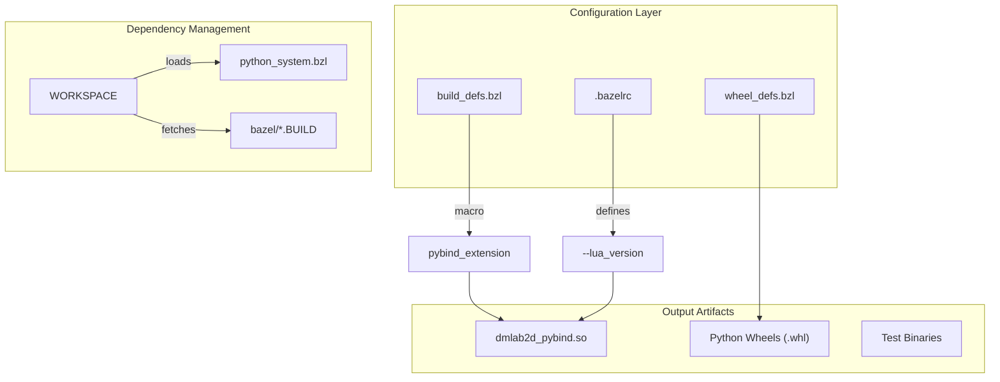
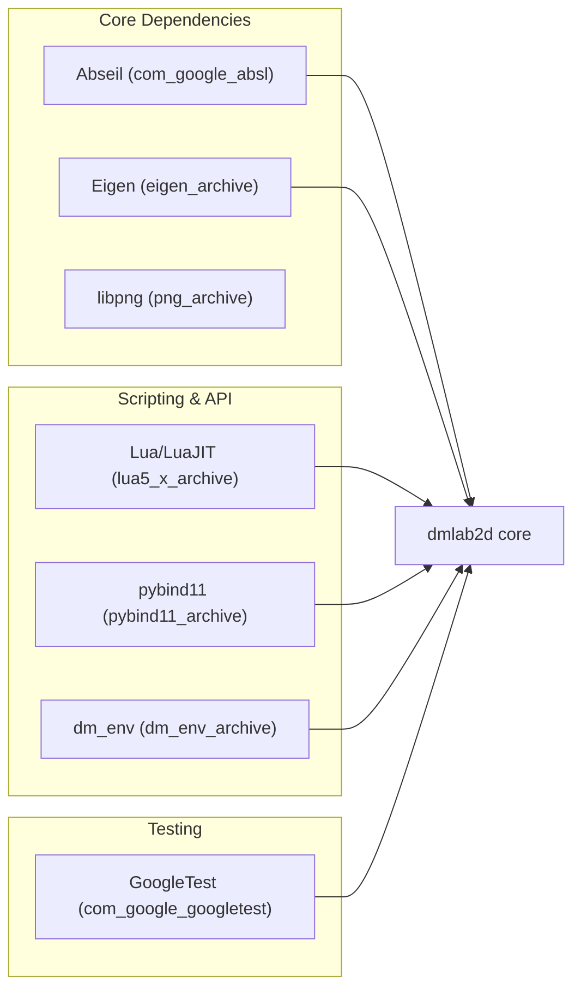

<!-- source: DeepWiki mcp.deepwiki.com · repo google-deepmind/lab2d · page 6 Build System and Infrastructure · fetched 2026-10-26 -->

# Build System and Infrastructure

Relevant source files

The following files were used as context for generating this wiki page:

- [.bazelrc](.bazelrc)
- [BUILD](BUILD)
- [WORKSPACE](WORKSPACE)
- [third_party/rl_api/BUILD](third_party/rl_api/BUILD)
- [third_party/rl_api/env_c_api_example.syms.lds](third_party/rl_api/env_c_api_example.syms.lds)

This section provides an overview of the DeepMind Lab2D build system, which is centered around **Bazel**. The infrastructure is designed to handle complex multi-language builds (C++, Lua, and Python), manage a variety of third-party dependencies, and provide a robust CI/CD pipeline for cross-platform testing and Python wheel distribution.

### High-Level Build Architecture

The Lab2D build system manages the compilation of the C++ core engine, the integration of different Lua versions, and the packaging of Python bindings. It uses a modular approach where external dependencies are fetched and built from source, ensuring consistency across different development environments.

#### Code-to-System Mapping
The following diagram illustrates how specific build files and configurations map to the functional components of the build system.

**Build Infrastructure Overview**

**Sources:**
- [`WORKSPACE:1-151`]()
- [`.bazelrc:1-24`]()
- [`BUILD:22-32`]()

---

### Bazel Build Configuration

Lab2D utilizes `.bazelrc` to manage platform-specific settings and feature flags. A key feature is the ability to swap the underlying Lua engine (Lua 5.1, Lua 5.2, or LuaJIT) using the `lua_version` flag alias [`.bazelrc:4-4`]().

Key configuration aspects include:
*   **Toolchain Selection:** Support for `libc++` on Linux and specialized configurations for macOS (including `macos_arm64`) [`.bazelrc:8-24`]().
*   **Build Macros:** The `pybind_extension` macro in `build_defs.bzl` standardizes the creation of Python-compatible shared libraries, handling linker scripts and symbol visibility [`.bazelrc:1-6`]().
*   **Python Integration:** A custom `python_system.bzl` repository rule detects the local Python environment to link against the correct headers and libraries [`python_system.bzl:1-32`]().

For details, see [Bazel Build Configuration](#6.1).

---

### External Dependencies

Lab2D follows a "fetch and build" philosophy for its dependencies to ensure reproducibility. The `WORKSPACE` file defines several `http_archive` rules that download third-party source code, which is then built using local `.BUILD` files located in the `bazel/` directory.

**Dependency Relationships**

Major dependencies include:
*   **Lua Engines:** Multi-stage bootstrap for LuaJIT and standard builds for Lua 5.1/5.2 [`WORKSPACE:82-109`]().
*   **Core Libraries:** Abseil-CPP, Eigen (for tensor operations), and libpng/zlib (for image processing) [`WORKSPACE:37-79`]().
*   **Python Ecosystem:** `pybind11` for the C++/Python bridge and `dm_env` for RL environment compatibility [`WORKSPACE:112-130`]().

For details, see [External Dependencies](#6.2).

---

### CI/CD: Precommit Checks and Wheel Release

The project uses GitHub Actions to automate quality assurance and distribution. The pipeline ensures that the codebase remains functional across multiple compilers and operating systems.

*   **Precommit Checks:** A matrix build strategy tests the code against GCC and LLVM on Linux, as well as Clang on macOS. It verifies compatibility with all three supported Lua versions [`.bazelrc:13-15`]().
*   **Release Automation:** The infrastructure includes logic for building **ManyLinux** compatible Python wheels. These wheels are built for various Python versions and uploaded to PyPI (or TestPyPI) automatically during the release process.
*   **C API Stability:** Compliance tests ensure that the `env_c_api` remains stable, using the `env_c_api_test_suite` to verify the entry points like `dmlab2d_connect` [`third_party/rl_api/BUILD:24-36`]().

For details, see [CI/CD: Precommit Checks and Wheel Release](#6.3).

**Sources:**
- [`WORKSPACE:6-46`]()
- [`third_party/rl_api/BUILD:18-80`]()
- [`third_party/rl_api/env_c_api_example.syms.lds:1-2`]()

---

