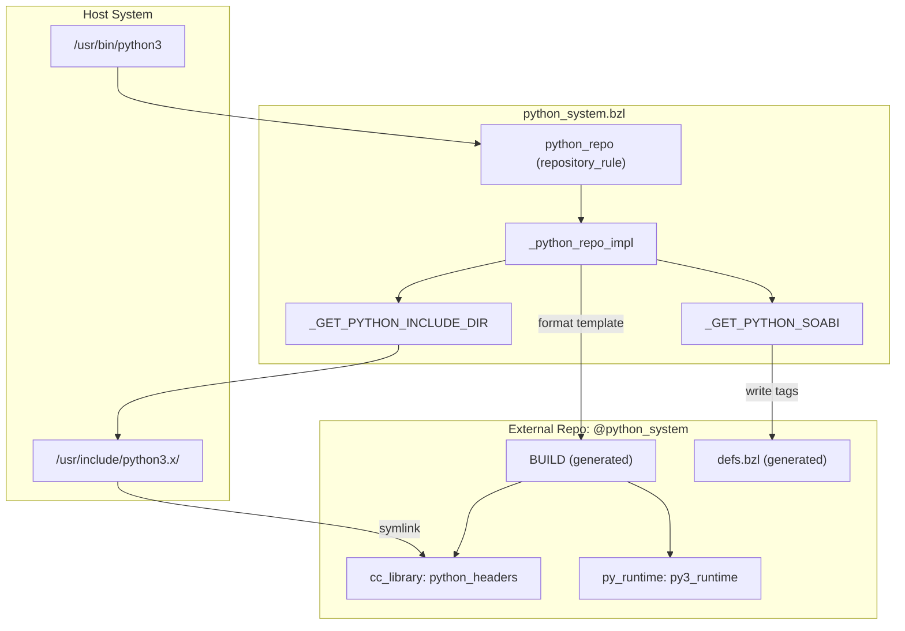
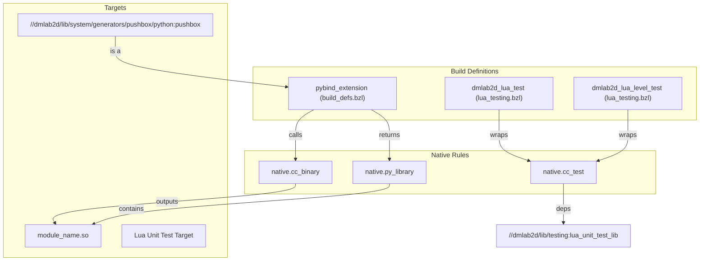

<!-- source: DeepWiki mcp.deepwiki.com · repo google-deepmind/lab2d · page 6.1 Bazel Build Configuration · fetched 2026-10-26 -->

# Bazel Build Configuration

Relevant source files

The following files were used as context for generating this wiki page:

- [.bazelrc](.bazelrc)
- [build_defs.bzl](build_defs.bzl)
- [dmlab2d/lib/system/generators/pushbox/python/BUILD](dmlab2d/lib/system/generators/pushbox/python/BUILD)
- [dmlab2d/lib/testing/lua_testing.bzl](dmlab2d/lib/testing/lua_testing.bzl)
- [python_system.bzl](python_system.bzl)

This page documents the Bazel infrastructure used to build, configure, and package DeepMind Lab2D. The build system manages a complex set of requirements, including multiple Lua engine versions, cross-platform support (Linux and macOS), and Python extension generation.

## Bazel Resource Configuration (.bazelrc)

The `.bazelrc` file defines the standard compilation flags and configuration sets (configs) used to toggle between different environment setups.

### Global Options
The project enforces C++17 as the minimum standard and suppresses specific warnings related to sign comparison and attributes to maintain compatibility across different toolchains [[.bazelrc:1-2]]().

### Configuration Sets
Users can apply these configurations using the `--config=<name>` flag:

| Config Name | Description | Implementation Details |
| :--- | :--- | :--- |
| `lua5_1` | Builds against Lua 5.1 | Sets `--lua_version=lua5_1` [[.bazelrc:13]]() |
| `lua5_2` | Builds against Lua 5.2 | Sets `--lua_version=lua5_2` [[.bazelrc:14]]() |
| `luajit` | Builds against LuaJIT | Sets `--lua_version=luajit` [[.bazelrc:15]]() |
| `libc++` | Uses LLVM's libc++ | Overrides `CXXFLAGS` and `LDFLAGS` to use `-stdlib=libc++` [[.bazelrc:8-11]]() |
| `macos` | Apple toolchain | Points to `@local_config_apple_cc` [[.bazelrc:17-19]]() |
| `macos_arm64` | Apple Silicon | Sets `cpu=darwin_arm64` and `macos_target_arch=arm64` [[.bazelrc:21-23]]() |

### Flag Aliases
To simplify command-line interaction, several long-form Bazel flags are aliased:
*   `lua_version`: Maps to `//dmlab2d/lib/lua:lua_version` [[.bazelrc:4]]().
*   `macos_target_arch`: Maps to `@luajit_archive//:target_arch` [[.bazelrc:5]]().

**Sources:**
*   [[.bazelrc:1-24]]()

---

## Python Infrastructure

DeepMind Lab2D uses a custom repository rule to integrate with the host system's Python installation, ensuring that C++ extensions are compiled against the correct headers and linked appropriately.

### python_system.bzl
The `python_repo` repository rule performs introspection on the local `python3` interpreter to generate a Bazel workspace [[python_system.bzl:85-89]]().

1.  **Header Discovery**: It runs a Python snippet using `distutils.sysconfig.get_python_inc` to locate the C headers [[python_system.bzl:55-59]]().
2.  **Symlinking**: The discovered include directory is symlinked into the external repository as `python3/` [[python_system.bzl:78]]().
3.  **ABI Tagging**: It executes a script using the `packaging` library to determine the interpreter, ABI, and platform tags (e.g., `cp310-cp310-manylinux_2_17_x86_64`) and writes them to `defs.bzl` [[python_system.bzl:61-67, 83]]().
4.  **Toolchain Export**: It generates a `cc_library` named `python_headers` which includes the symlinked headers and applies `-Wl,-undefined,dynamic_lookup` on macOS to allow for deferred symbol resolution in shared libraries [[python_system.bzl:25-35]]().

### pybind_extension Macro
Defined in `build_defs.bzl`, this macro simplifies the creation of pybind11 modules. It creates a `cc_binary` with `linkshared = 1` and wraps it in a `py_library` [[build_defs.bzl:20-83]]().

**Logic Flow of `pybind_extension`:**
1.  **Dependencies**: Automatically adds `@pybind11_archive//:pybind11` and `@python_system//:python_headers` [[build_defs.bzl:50-53]]().
2.  **Compilation**: Forces `-fexceptions` and disables header modules for compatibility [[build_defs.bzl:54-55]]().
3.  **Output**: Generates a `.so` file (or `.dylib` equivalent) and returns a `py_library` that includes this shared object in its `data` attribute [[build_defs.bzl:66-83]]().

### System to Code Mapping: Python Integration
The following diagram shows how the `python_repo` rule bridges the system environment to Bazel targets.

Title: Python Repository Rule Data Flow

**Sources:**
*   [[python_system.bzl:16-89]]()
*   [[build_defs.bzl:20-83]]()

---

## Testing Macros

Lab2D provides specialized macros for running Lua tests within the Bazel environment, ensuring that the necessary C++ libraries and Lua search paths are configured.

### dmlab2d_lua_test
This macro wraps a `cc_test` that executes a Lua script using the Lab2D test runner.
*   **Target**: `//dmlab2d/lib/testing:lua_unit_test_lib` [[dmlab2d/lib/testing/lua_testing.bzl:61]]().
*   **Data Discovery**: It automatically globs files in a directory named `<test_name>_data/` to make them available as runfiles [[dmlab2d/lib/testing/lua_testing.bzl:60]]().
*   **Arguments**: Passes the level script name and the package root to the C++ binary [[dmlab2d/lib/testing/lua_testing.bzl:59]]().

### dmlab2d_lua_level_test
A specialized version of the test macro used to validate environment specifications (observation/action specs) for specific levels. It depends on `//dmlab2d/lib/testing:lua_level_test_lib` [[dmlab2d/lib/testing/lua_testing.bzl:83]]().

**Sources:**
*   [[dmlab2d/lib/testing/lua_testing.bzl:42-85]]()

---

## Build System Entity Relationship

The following diagram illustrates the relationship between the build definitions and the resulting artifacts.

Title: Bazel Build Macro Relationships

**Sources:**
*   [[build_defs.bzl:67-83]]()
*   [[dmlab2d/lib/testing/lua_testing.bzl:57-64]]()
*   [[dmlab2d/lib/system/generators/pushbox/python/BUILD:8-17]]()

---

