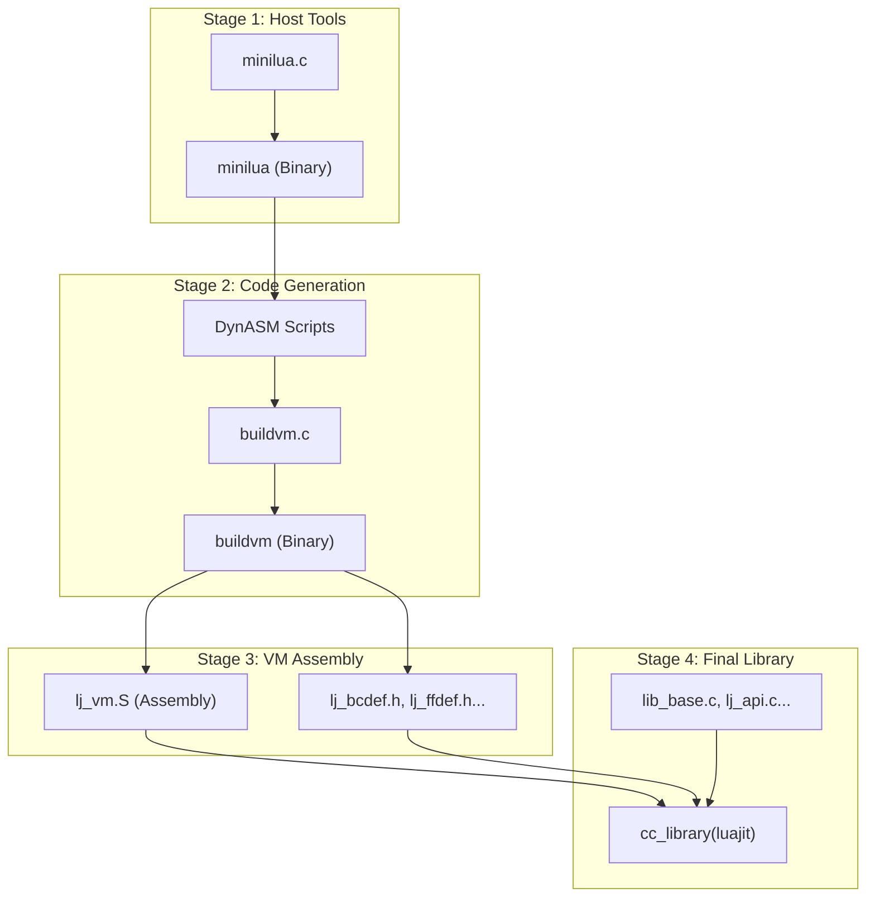
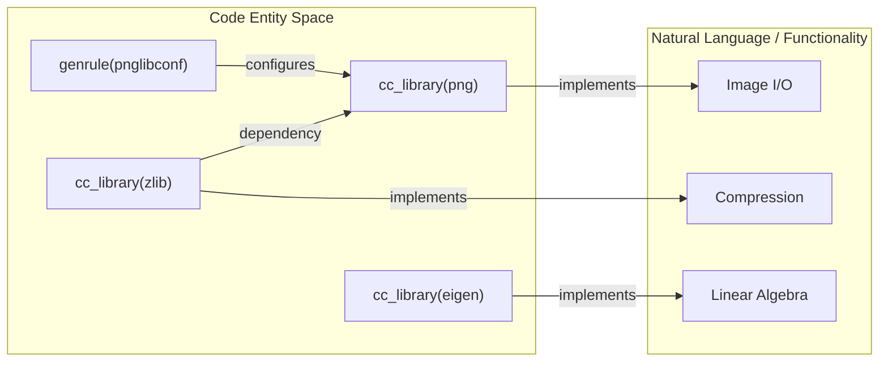

<!-- source: DeepWiki mcp.deepwiki.com · repo google-deepmind/lab2d · page 6.2 External Dependencies · fetched 2026-10-26 -->

# External Dependencies

Relevant source files

The following files were used as context for generating this wiki page:

- [WORKSPACE](WORKSPACE)
- [bazel/dm_env.BUILD](bazel/dm_env.BUILD)
- [bazel/eigen.BUILD](bazel/eigen.BUILD)
- [bazel/lua5_1.BUILD](bazel/lua5_1.BUILD)
- [bazel/lua5_2.BUILD](bazel/lua5_2.BUILD)
- [bazel/luajit.BUILD](bazel/luajit.BUILD)
- [bazel/png.BUILD](bazel/png.BUILD)
- [bazel/pybind11.BUILD](bazel/pybind11.BUILD)
- [bazel/tree.BUILD](bazel/tree.BUILD)
- [bazel/zlib.BUILD](bazel/zlib.BUILD)

DeepMind Lab2D manages its third-party software stack primarily through the Bazel `WORKSPACE` file and custom build definitions located in the `bazel/` directory. These dependencies provide the foundational runtime for Lua scripting, Python bindings, image processing, and linear algebra.

## Dependency Management Overview

All external archives are fetched via `http_archive` in the root `WORKSPACE` file [WORKSPACE:3-130](). Most of these dependencies use custom `BUILD` files (found in the `bazel/` directory) rather than their upstream build systems to ensure compatibility with Lab2D's specific compiler flags and platform requirements.

### Core Dependency Categories

| Category | Libraries |
| :--- | :--- |
| **Lua Runtimes** | LuaJIT, Lua 5.1, Lua 5.2 |
| **Python Bridge** | pybind11, dm_env, tree |
| **System Utilities** | Abseil (C++ & Python), GoogleTest, Benchmark |
| **Graphics & Math** | libpng, zlib, Eigen |

Sources: [WORKSPACE:6-130]()

---

## Lua Runtimes

Lab2D supports three distinct Lua environments, selectable at build time. The build system manages the complex bootstrapping required for LuaJIT.

### LuaJIT (Multi-stage Bootstrap)
The LuaJIT build process is the most complex dependency in the project. It involves a multi-stage compilation to generate the Just-In-Time (JIT) compiler and VM [bazel/luajit.BUILD:1-256]().

1.  **minilua**: A minimal Lua interpreter is compiled from `src/host/minilua.c` to run build-time scripts [bazel/luajit.BUILD:236-245]().
2.  **DynASM**: LuaJIT uses DynASM to generate assembly code for the VM. The build system selects specific flags based on the target architecture (e.g., `arm64` vs `x86_64`) [bazel/luajit.BUILD:247-256]().
3.  **buildvm**: The `buildvm` tool is generated and used to create various header files (`lj_bcdef.h`, `lj_ffdef.h`, etc.) and the core VM assembly file `lj_vm.S` [bazel/luajit.BUILD:210-215]().

### Standard Lua (5.1 & 5.2)
The standard Lua runtimes are built as simple `cc_library` targets. Both versions glob their respective source files but exclude the standalone interpreter (`lua.c`) and compiler (`luac.c`) to be embedded directly into the Lab2D engine [bazel/lua5_1.BUILD:4-26](), [bazel/lua5_2.BUILD:4-26]().

**Data Flow: LuaJIT Build Process**

Sources: [bazel/luajit.BUILD:210-256](), [bazel/lua5_1.BUILD:4-26](), [bazel/lua5_2.BUILD:4-26]()

---

## Python and Reinforcement Learning API

Lab2D integrates with the DeepMind RL ecosystem through several Python-centric dependencies.

### pybind11
Used to create the C++ to Python bridge. The build definition specifically excludes `eigen.h` from the standard glob to manage Eigen integration manually and sets `-fexceptions` to handle C++ exceptions during Python calls [bazel/pybind11.BUILD:4-24]().

### dm_env and tree
*   **dm_env**: Provides the standard Python interface for RL environments. It defines the `Environment` base class and `specs` for observations and actions [bazel/dm_env.BUILD:5-14]().
*   **tree**: A utility for working with nested data structures (nests of NumPy arrays). It includes a C++ extension `_tree.so` built with `pybind11` [bazel/tree.BUILD:6-20]().

### Python Compatibility Shims
The build system relies on standard Python utility libraries:
*   **Abseil Python**: For logging and testing (`absltest`) [WORKSPACE:42-46]().
*   **six/enum34/funcsigs**: Although not explicitly listed in the provided snippets, these are standard requirements for supporting older Python environments and are typically pulled as transitive dependencies of `dm_env`.

Sources: [bazel/pybind11.BUILD:4-24](), [bazel/dm_env.BUILD:5-28](), [bazel/tree.BUILD:1-37]()

---

## Graphics and Math

### libpng and zlib
Lab2D uses `libpng` for loading and saving level assets (sprites, observations). 
*   **zlib**: A prerequisite for `libpng`, providing compression routines [bazel/zlib.BUILD:5-37]().
*   **libpng**: Includes a `genrule` to prepare `pnglibconf.h` from prebuilt scripts [bazel/png.BUILD:6-11](). On ARM64 platforms (including Apple Silicon), it enables NEON intrinsics for optimized filtering and palette operations [bazel/png.BUILD:36-47]().

### Eigen
Eigen is used for high-performance linear algebra. The build configuration enforces `EIGEN_MPL2_ONLY` to ensure that only MPL2-licensed code is compiled, excluding restricted GPL/LGPL components [bazel/eigen.BUILD:58-68]().

**Entity Mapping: Graphics Stack**

Sources: [bazel/png.BUILD:13-57](), [bazel/zlib.BUILD:5-37](), [bazel/eigen.BUILD:58-68]()

---

## System Libraries and Testing

### Abseil (C++)
Abseil is the primary utility library for C++, providing string helpers, containers, and synchronization primitives. It is fetched directly from GitHub [WORKSPACE:36-40]().

### GoogleTest and Benchmark
*   **GoogleTest**: The framework used for all C++ unit tests [WORKSPACE:6-10]().
*   **Benchmark**: Used for performance regression testing of the engine's core loops [WORKSPACE:12-16]().

| Dependency | WORKSPACE Name | BUILD File |
| :--- | :--- | :--- |
| **Abseil** | `@com_google_absl` | Internal to Archive |
| **GoogleTest** | `@com_google_googletest` | Internal to Archive |
| **Eigen** | `@eigen_archive` | `bazel/eigen.BUILD` |
| **libpng** | `@png_archive` | `bazel/png.BUILD` |

Sources: [WORKSPACE:6-57]()

---

