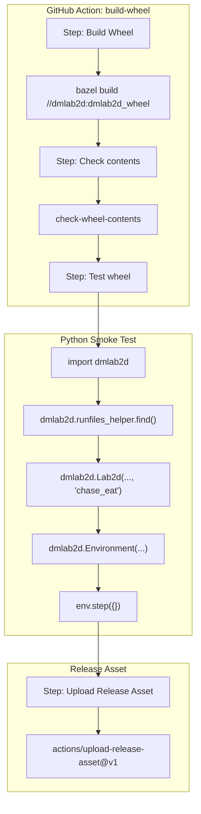
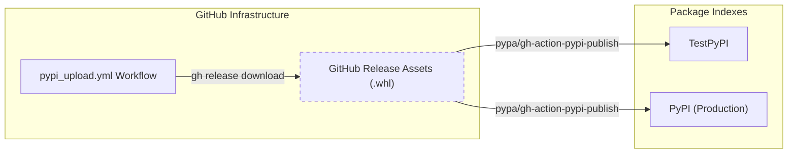

<!-- source: DeepWiki mcp.deepwiki.com · repo google-deepmind/lab2d · page 6.3 CI/CD: Precommit Checks and Wheel Release · fetched 2026-10-26 -->

# CI/CD: Precommit Checks and Wheel Release

Relevant source files

The following files were used as context for generating this wiki page:

- [.github/workflows/make_wheel.yml](.github/workflows/make_wheel.yml)
- [.github/workflows/precommit.yml](.github/workflows/precommit.yml)
- [.github/workflows/pypi_upload.yml](.github/workflows/pypi_upload.yml)

This page documents the automated pipelines for DeepMind Lab2D, including continuous integration (CI) for code quality and the release workflows for distributing Python wheels to PyPI.

## 1. Precommit Workflow (`precommit.yml`)

The `precommit` workflow ensures that changes to the codebase do not break the build or tests across a matrix of operating systems, compilers, and Lua versions. It is triggered on every push to `main` and `beta` branches, as well as on pull requests `[.github/workflows/precommit.yml:5-11]()`.

### 1.1 Matrix Build Strategy
The workflow uses a strategy matrix to cover diverse environments:
*   **Linux (Ubuntu 22.04):** Tests GCC 12 and Clang/LLVM. It supports both `libstdc++` and `libc++` configurations `[.github/workflows/precommit.yml:29-31]()`.
*   **MacOS (12 & 13):** Tests both x86_64 and ARM64 (Apple Silicon) architectures using LLVM/Clang and `libc++` `[.github/workflows/precommit.yml:32-35]()`.

### 1.2 Multi-Lua Configuration
For every environment in the matrix, the workflow executes builds and tests against three supported Lua runtimes:
1.  **Lua 5.1:** Triggered via `--config=lua5_1` `[.github/workflows/precommit.yml:56-60]()`.
2.  **Lua 5.2:** Triggered via `--config=lua5_2` `[.github/workflows/precommit.yml:64-68]()`.
3.  **LuaJIT:** Triggered via `--config=luajit` `[.github/workflows/precommit.yml:72-76]()`.
4.  **LuaJIT (Internal Unwind):** A specialized build testing LuaJIT without external unwinding tables using `--luajit_external_unwinder=False` `[.github/workflows/precommit.yml:80-84]()`.

### 1.3 Execution Flow
The workflow installs necessary Python dependencies (`numpy`, `packaging`) and then runs `bazel build //...` followed by `bazel test //...` for each Lua configuration `[.github/workflows/precommit.yml:44-84]()`. Note that tests are skipped on ARM64 runners as the current GitHub Action runners for ARM64 are used for building only `[.github/workflows/precommit.yml:58, 66, 74, 82]()`.

**Sources:**
*   `.github/workflows/precommit.yml`

---

## 2. Wheel Release Workflow (`make_wheel.yml`)

The `release_wheel` workflow automates the creation of a GitHub Release and the compilation of Python wheels for multiple platforms and Python versions. It is triggered by tags starting with `release*` `[.github/workflows/make_wheel.yml:7-9]()`.

### 2.1 Release Creation
The `create-release` job initializes a draft release on GitHub. It outputs an `upload-url` which subsequent jobs use to attach binary assets `[.github/workflows/make_wheel.yml:12-33]()`.

### 2.2 Multi-Platform Wheel Building
The `build-wheel` job runs a matrix across:
*   **Platforms:** ManyLinux 2.31, ManyLinux 2.35, and various MacOS versions (Intel and ARM) `[.github/workflows/make_wheel.yml:43-52]()`.
*   **Python Versions:** 3.8, 3.9, 3.10, and 3.11 `[.github/workflows/make_wheel.yml:54-57]()`.

### 2.3 Build and Verification
The wheels are built using Bazel with the `//dmlab2d:dmlab2d_wheel` target `[.github/workflows/make_wheel.yml:75]()`. The workflow includes a verification step that installs the newly built wheel and runs a smoke test using the `chase_eat` level to ensure the C++ engine and Python bridge are functional `[.github/workflows/make_wheel.yml:89-97]()`.

#### Workflow Entity Mapping
The following diagram maps the GitHub Action steps to the specific Bazel and Python entities they interact with.

**Title: Wheel Build and Verification Flow**

**Sources:**
*   `.github/workflows/make_wheel.yml`

---

## 3. PyPI Distribution Workflow (`pypi_upload.yml`)

The `pypi_upload` workflow handles the final stage of distribution: moving assets from a GitHub Release to PyPI and TestPyPI.

### 3.1 Distribution Logic
This workflow can be triggered manually via `workflow_dispatch` or automatically when a release is published `[.github/workflows/pypi_upload.yml:5-21]()`.

1.  **Download:** It uses the GitHub CLI (`gh release download`) to pull all wheel assets from the specified release into a `dist/` directory `[.github/workflows/pypi_upload.yml:39]()`.
2.  **TestPyPI:** If requested, it publishes to `https://test.pypi.org/legacy/` first for verification `[.github/workflows/pypi_upload.yml:41-46]()`.
3.  **PyPI:** Finally, it publishes the wheels to the production PyPI repository `[.github/workflows/pypi_upload.yml:48-53]()`.

### 3.2 Security and Permissions
The job `upload-wheels-to-pypi` uses OpenID Connect (OIDC) for authentication with PyPI, requiring `id-token: write` permissions `[.github/workflows/pypi_upload.yml:30-31]()`.

#### Data Flow: Release to Distribution
The following diagram illustrates the data flow from the GitHub Release storage to the PyPI package indexes.

**Title: Distribution Data Flow**

**Sources:**
*   `.github/workflows/pypi_upload.yml`

## 4. Summary of Workflows

| Workflow | Purpose | Trigger | Key Targets/Tools |
| :--- | :--- | :--- | :--- |
| `precommit` | CI / Code Quality | PR, Push to main | `bazel test //...` |
| `make_wheel` | Build Binaries | Release Tag | `//dmlab2d:dmlab2d_wheel` |
| `pypi_upload` | Distribution | Release Published | `gh-action-pypi-publish` |

**Sources:**
*   `.github/workflows/precommit.yml`
*   `.github/workflows/make_wheel.yml`
*   `.github/workflows/pypi_upload.yml`

---

