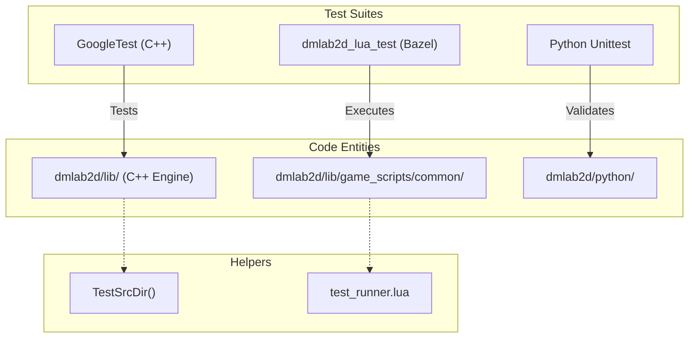
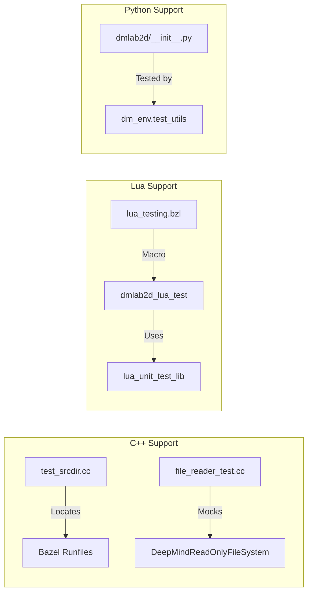

<!-- source: DeepWiki mcp.deepwiki.com · repo google-deepmind/lab2d · page 7 Testing Infrastructure · fetched 2026-10-26 -->

# Testing Infrastructure

Relevant source files

The following files were used as context for generating this wiki page:

- [dmlab2d/lib/testing/lua_testing.bzl](dmlab2d/lib/testing/lua_testing.bzl)
- [dmlab2d/lib/util/BUILD](dmlab2d/lib/util/BUILD)
- [dmlab2d/lib/util/file_reader_test.cc](dmlab2d/lib/util/file_reader_test.cc)
- [dmlab2d/lib/util/test_srcdir.cc](dmlab2d/lib/util/test_srcdir.cc)

DeepMind Lab2D employs a multi-layered testing strategy to ensure the integrity of its C++ core engine, Lua scripting environment, and Python API. The infrastructure is designed to validate both the low-level simulation logic and the high-level reinforcement learning (RL) environment contracts.

## Overview of Testing Layers

The testing approach is divided into three primary domains, each utilizing specialized tools and frameworks:

| Domain | Primary Framework | Key Components |
| :--- | :--- | :--- |
| **C++ Core** | [GoogleTest](https://github.com/google/googletest) | Unit tests for `grid_world`, `tensor`, and `lua` wrappers. |
| **Lua Scripts** | `dmlab2d_lua_test` (Bazel) | Unit tests for game logic and common libraries using a custom Lua test runner. |
| **Python API** | `dm_env.test_utils` | Validation of the `dm_env` interface compliance and pybind11 bindings. |
| **Integration** | `env_c_api_test_suite` | Compliance testing for the standardized C API. |

### Testing Architecture Flow

The following diagram illustrates how different testing entities interact with the codebase layers:

**Testing Entity Association**

**Sources:** [dmlab2d/lib/util/BUILD:15-88](), [dmlab2d/lib/testing/lua_testing.bzl:42-84]()

---

## C++ Testing Patterns

C++ tests are primarily located alongside the source code in `dmlab2d/lib/`. They utilize GoogleTest and GoogleMock for unit verification.

*   **Test Data Locating:** The `TestSrcDir()` utility in `dmlab2d/lib/util/test_srcdir.cc` is used to reliably locate assets and data files within the Bazel runfiles directory during test execution [dmlab2d/lib/util/test_srcdir.cc:27-33]().
*   **File System Mocking:** Many tests, such as `file_reader_test.cc`, demonstrate how to mock the `DeepMindReadOnlyFileSystem` to test file operations without relying on the actual disk [dmlab2d/lib/util/file_reader_test.cc:160-166]().
*   **API Compliance:** The `env_c_api_test_suite` provides a standardized way to ensure that any implementation of the RL C API (defined in `env_c_api.h`) behaves correctly.

For detailed patterns and examples, see **[C++ Testing Patterns (#7.1)]**.

**Sources:** [dmlab2d/lib/util/test_srcdir.cc:25-35](), [dmlab2d/lib/util/file_reader_test.cc:32-61]()

---

## Lua Testing Patterns

Lua tests are integrated into the Bazel build system via custom macros. This allows Lua scripts to be tested with the same rigor as C++ code.

*   **Bazel Integration:** The `dmlab2d_lua_test` macro in `lua_testing.bzl` wraps a `cc_test` that initializes a Lua VM, loads the Lab2D system libraries, and executes a Lua-based test runner [dmlab2d/lib/testing/lua_testing.bzl:42-64]().
*   **Test Runner:** Lua tests typically require `testing.test_runner` and return the result of `test_runner.run(tests)` [dmlab2d/lib/testing/lua_testing.bzl:25-39]().
*   **Level Validation:** The `dmlab2d_lua_level_test` macro is specifically designed to validate that a level script correctly implements the required Lab2D callbacks (e.g., `start`, `step`, `observation`) [dmlab2d/lib/testing/lua_testing.bzl:66-84]().

For details on mocking and helper modules, see **[Lua Testing Patterns (#7.2)]**.

**Sources:** [dmlab2d/lib/testing/lua_testing.bzl:1-40]()

---

## Python API Testing

The Python layer is tested to ensure it adheres to the `dm_env` standard. This involves:
1.  **Spec Validation:** Checking that `observation_spec()` and `action_spec()` return the correct types and shapes.
2.  **Lifecycle Testing:** Ensuring `reset()` and `step()` transitions match the expected RL trajectory.
3.  **Property Tree:** Verifying that C++ properties are correctly exposed and modifiable via the Python `read_property` and `write_property` methods.

**Code Entity Mapping: Test Infrastructure**

**Sources:** [dmlab2d/lib/util/BUILD:79-88](), [dmlab2d/lib/testing/lua_testing.bzl:57-61]()

---

