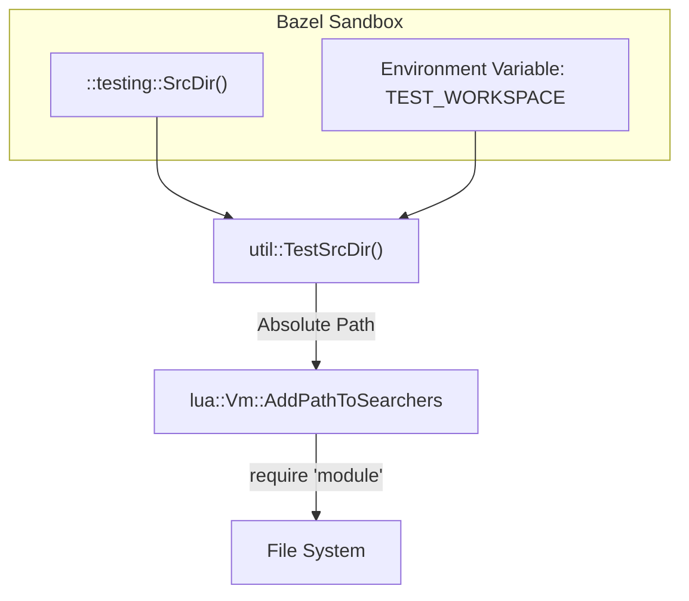
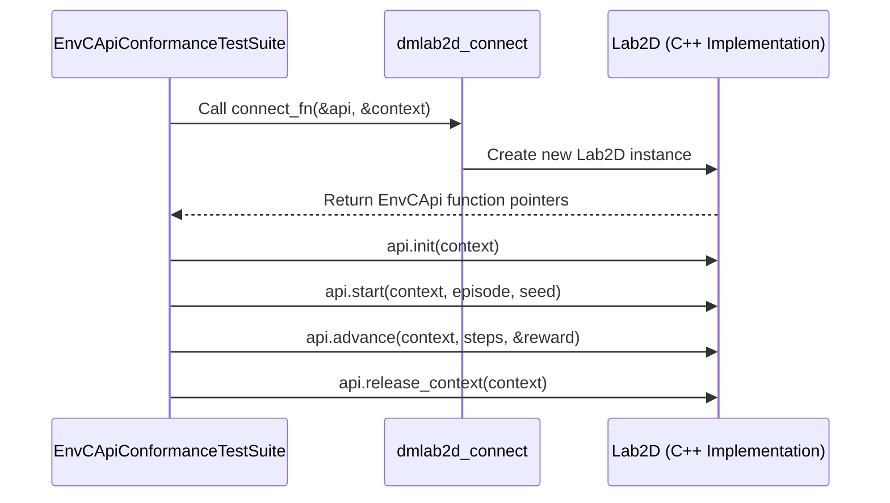

<!-- source: DeepWiki mcp.deepwiki.com · repo google-deepmind/lab2d · page 7.1 C++ Testing Patterns · fetched 2026-10-26 -->

# C++ Testing Patterns

Relevant source files

The following files were used as context for generating this wiki page:

- [dmlab2d/lib/dmlab2d.cc](dmlab2d/lib/dmlab2d.cc)
- [dmlab2d/lib/lua/vm_test.cc](dmlab2d/lib/lua/vm_test.cc)
- [dmlab2d/lib/lua/vm_test_util.h](dmlab2d/lib/lua/vm_test_util.h)
- [dmlab2d/lib/system/file_system/lua/file_system.cc](dmlab2d/lib/system/file_system/lua/file_system.cc)
- [dmlab2d/lib/system/grid_world/collections/shuffled_set_test.cc](dmlab2d/lib/system/grid_world/collections/shuffled_set_test.cc)
- [dmlab2d/lib/system/grid_world/grid_test.cc](dmlab2d/lib/system/grid_world/grid_test.cc)
- [dmlab2d/lib/util/BUILD](dmlab2d/lib/util/BUILD)
- [dmlab2d/lib/util/file_reader_test.cc](dmlab2d/lib/util/file_reader_test.cc)
- [dmlab2d/lib/util/test_srcdir.cc](dmlab2d/lib/util/test_srcdir.cc)
- [third_party/rl_api/env_c_api_test_suite.cc](third_party/rl_api/env_c_api_test_suite.cc)

This page documents the C++ testing infrastructure for DeepMind Lab2D. The testing suite is built on **GoogleTest** and **GoogleMock**, providing robust validation for the core engine, system modules, and C API compliance.

## Test Data and Environment

To ensure tests can locate assets (like Lua scripts or level data) regardless of the execution environment, Lab2D uses a specialized utility to resolve the source directory within the Bazel runfiles tree.

### TestSrcDir Utility
The `TestSrcDir` function provides a reliable way to find the root of the workspace during test execution. It combines the GoogleTest `SrcDir()` with the `TEST_WORKSPACE` environment variable.

*   **Implementation**: `deepmind::lab2d::util::TestSrcDir()` [dmlab2d/lib/util/test_srcdir.cc:27-33]().
*   **Usage**: Frequently used in `VmTest` to add paths to the Lua searchers [dmlab2d/lib/lua/vm_test.cc:135-140]().

**Diagram: Test Data Resolution**

Sources: [dmlab2d/lib/util/test_srcdir.cc:27-33](), [dmlab2d/lib/lua/vm_test.cc:135-140]()

---

## File Reader Patterns

Testing file operations involves the `util::FileReader` class and the `DeepMindReadOnlyFileSystem` interface. Tests typically verify both real filesystem interaction and mocked behavior.

### FileReaderTest Implementation
The `FileReaderTest` fixture creates a temporary directory and populates it with known content to verify read offsets and sizes [dmlab2d/lib/util/file_reader_test.cc:32-50]().

*   **Full Read**: Verifies that `FileReader::Read` captures the exact file content [dmlab2d/lib/util/file_reader_test.cc:52-61]().
*   **Partial Reads**: Tests reading specific byte ranges (first 10, middle 10, last 10) [dmlab2d/lib/util/file_reader_test.cc:63-97]().
*   **Error Handling**: Validates behavior when files are missing or reads exceed file boundaries [dmlab2d/lib/util/file_reader_test.cc:99-127]().

### Mocking the File System
To test `FileReader` without disk I/O, a `DeepMindReadOnlyFileSystem` struct is populated with "fake" C-style function pointers [dmlab2d/lib/util/file_reader_test.cc:128-166](). This pattern is also used within the `system.file_system` Lua module to bridge Lua calls to the C++ `FileReader` [dmlab2d/lib/system/file_system/lua/file_system.cc:62-77]().

Sources: [dmlab2d/lib/util/file_reader_test.cc:32-166](), [dmlab2d/lib/system/file_system/lua/file_system.cc:62-77]()

---

## C API Compliance Testing

The `env_c_api_test_suite` is a library used to ensure that any implementation of the DeepMind Lab2D C API (the `EnvCApi` struct) adheres to the required contract.

### Conformance Test Suite
The `EnvCApiConformanceTestSuite` is a parameterized test that takes a `connect_fn` and a set of environment settings [third_party/rl_api/env_c_api_test_suite.cc:27-31]().

**Key Validation Steps:**
1.  **Function Pointer Integrity**: Ensures all required members of the `EnvCApi` struct (e.g., `init`, `start`, `advance`) are non-null [third_party/rl_api/env_c_api_test_suite.cc:36-62]().
2.  **Lifecycle Flow**: Executes the sequence `setting` -> `init` -> `start` -> `advance` -> `release_context` [third_party/rl_api/env_c_api_test_suite.cc:66-206]().
3.  **Observation Consistency**: Compares the metadata returned by `observation_spec` with the actual data returned by `observation` during a step [third_party/rl_api/env_c_api_test_suite.cc:131-167]().

**Diagram: C API Test Flow**

Sources: [third_party/rl_api/env_c_api_test_suite.cc:27-206](), [dmlab2d/lib/dmlab2d.cc:163-168]()

---

## Grid World Unit Tests

Testing the `system.grid_world` module involves verifying the spatial logic and state transitions of the grid.

### ShuffledSet Tests
The `ShuffledSet` is a critical collection for randomized level generation. Tests verify:
*   **Insertion/Erasure**: Basic set operations [dmlab2d/lib/system/grid_world/collections/shuffled_set_test.cc:44-66]().
*   **Probability Sampling**: Using `ShuffledElementsWithProbability` and verifying the distribution of outcomes over multiple samples [dmlab2d/lib/system/grid_world/collections/shuffled_set_test.cc:126-171]().

### Grid and World Logic
`GridTest` uses a `MockStateCallback` to verify that the grid engine correctly triggers events like `OnAdd`, `OnRemove`, and `OnHit` [dmlab2d/lib/system/grid_world/grid_test.cc:90-110]().

*   **Text-to-Grid Helper**: A `PlaceGrid` helper function allows tests to define grid layouts using ASCII strings (e.g., `kGrid`), making tests highly readable [dmlab2d/lib/system/grid_world/grid_test.cc:59-75]().
*   **Instance Lifecycle**: Tests like `ReleaseInstanceWorks` ensure that when a piece is removed, callbacks are fired and the grid cell is cleared [dmlab2d/lib/system/grid_world/grid_test.cc:172-188]().

Sources: [dmlab2d/lib/system/grid_world/collections/shuffled_set_test.cc:44-171](), [dmlab2d/lib/system/grid_world/grid_test.cc:59-188]()

---

## Lua VM Integration Tests

Tests for the Lua C++ wrapper (`dmlab2d/lib/lua/`) ensure that the C++/Lua bridge is type-safe and handles modules correctly.

### VmTest Patterns
*   **Multiple VMs**: Verifies that multiple `Vm` instances can exist independently without stack corruption [dmlab2d/lib/lua/vm_test.cc:37-57]().
*   **C Module Injection**: Tests `AddCModuleToSearchers` by registering a C function and requiring it from within a Lua script [dmlab2d/lib/lua/vm_test.cc:71-84]().
*   **Upvalues/Closures**: Validates that C modules can be registered with upvalues (context data), which is how the `system.file_system` module receives its `FileSystem` pointer [dmlab2d/lib/lua/vm_test.cc:86-108](), [dmlab2d/lib/system/file_system/lua/file_system.cc:84-93]().

### TestWithVm Fixture
A common utility class `TestWithVm` is provided in `vm_test_util.h`. It automatically initializes a `Vm` and exposes a `lua_State* L` pointer for use in test bodies [dmlab2d/lib/lua/vm_test_util.h:38-50]().

Sources: [dmlab2d/lib/lua/vm_test.cc:37-108](), [dmlab2d/lib/lua/vm_test_util.h:38-50](), [dmlab2d/lib/system/file_system/lua/file_system.cc:84-93]()

---

