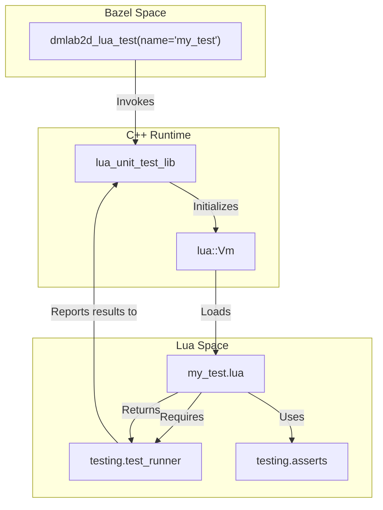
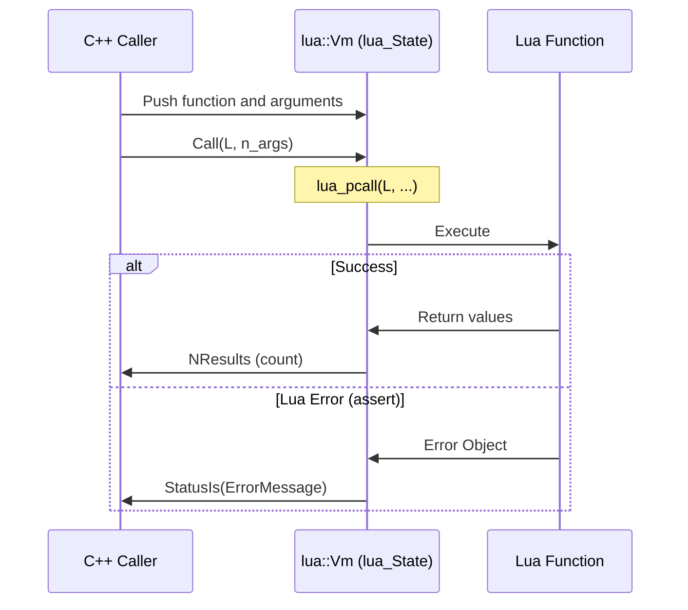

<!-- source: DeepWiki mcp.deepwiki.com · repo google-deepmind/lab2d · page 7.2 Lua Testing Patterns · fetched 2026-10-26 -->

# Lua Testing Patterns

Relevant source files

The following files were used as context for generating this wiki page:

- [dmlab2d/lib/lua/bind_test.cc](dmlab2d/lib/lua/bind_test.cc)
- [dmlab2d/lib/lua/call_test.cc](dmlab2d/lib/lua/call_test.cc)
- [dmlab2d/lib/testing/lua_testing.bzl](dmlab2d/lib/testing/lua_testing.bzl)

DeepMind Lab2D provides a robust infrastructure for testing Lua-based levels and common libraries. This includes a Bazel-based test runner, a Lua unit testing framework, and mocking utilities to isolate level logic from the C++ engine.

## Lua Test Infrastructure

The Lua testing framework is built around the `dmlab2d_lua_test` Bazel macro, which bridges Lua scripts with a C++ test runner. This allows Lua tests to access the same system modules (e.g., `system.grid_world`, `system.tensor`) available during normal environment execution.

### Bazel Macro: `dmlab2d_lua_test`
Defined in `dmlab2d/lib/testing/lua_testing.bzl`, this macro creates a `cc_test` target that links against `lua_unit_test_lib`.

*   **Automatic Data Discovery**: It automatically includes any files in a directory named `<test_name>_data/` as runfiles [dmlab2d/lib/testing/lua_testing.bzl:60-60]().
*   **Arguments**: It passes the level script name and the package root to the C++ runner [dmlab2d/lib/testing/lua_testing.bzl:59-59]().

### Lua Unit Test Lifecycle
A typical Lua test file follows a structured pattern:
1.  **Require** `testing.test_runner` and `testing.asserts`.
2.  **Define** a table of test functions (usually named `tests`).
3.  **Execute** the suite by returning `test_runner.run(tests)`.

**Test Structure Example**
[dmlab2d/lib/testing/lua_testing.bzl:24-39]()

| Entity | Role |
| :--- | :--- |
| `test_runner.run(tests)` | Iterates through the provided table and executes every function as a test case. |
| `test_runner.testDir(...)` | Resolves the absolute path to the test's data directory. |
| `testing.asserts` | Provides standard assertion helpers (e.g., `EQ`, `NE`, `TablesEQ`). |

### Code Entity Relationship: Lua Test Execution
The following diagram shows how a Bazel target invokes the C++ runner to execute Lua code.

"Lua Test Execution Flow"

Sources: [dmlab2d/lib/testing/lua_testing.bzl:42-64](), [dmlab2d/lib/testing/lua_testing.bzl:24-39]()

---

## Mocking and Level Testing

Testing environment logic often requires mocking the DeepMind Lab2D lifecycle or specific system modules.

### Level Specification Testing
The `dmlab2d_lua_level_test` macro is used specifically to verify that a level script complies with the required API (e.g., implements `start`, `advance`, `observation`) [dmlab2d/lib/testing/lua_testing.bzl:66-84](). It uses `lua_level_test_lib` to perform automated compliance checks against the Lua script.

### Mocking Utilities
For unit testing individual components of a level (like a specific game mechanic), developers use `mocking.lua`. This allows tests to:
*   Intercept calls to system modules.
*   Simulate environment callbacks.
*   Validate side effects without a full `grid_world` instantiation.

---

## C++ to Lua Bridge Testing

The C++ core includes extensive tests for the binding layer to ensure that Lua scripts can safely interact with C++ memory and functions.

### `lua::Bind` and `lua::Call`
Tests in `dmlab2d/lib/lua/bind_test.cc` and `dmlab2d/lib/lua/call_test.cc` validate the type-safety of the bridge.

*   **Error Handling**: `Bind` ensures that C++ functions returning `NResultsOr` correctly propagate error strings to the Lua VM as protected call errors [dmlab2d/lib/lua/bind_test.cc:31-41]().
*   **Stack Integrity**: `Call` tests verify that the Lua stack remains balanced even when Lua functions throw assertions [dmlab2d/lib/lua/call_test.cc:66-79]().

### Data Flow: C++ Protected Call
The following diagram illustrates how `lua::Call` manages the stack and error reporting when invoking Lua from C++.

"C++ to Lua Call Pattern"

Sources: [dmlab2d/lib/lua/call_test.cc:50-64](), [dmlab2d/lib/lua/call_test.cc:66-79](), [dmlab2d/lib/lua/bind_test.cc:45-52]()

---

## Common Test Helpers

Several common Lua libraries have dedicated test suites that serve as examples for writing Lua tests in the codebase.

| Test File | Component Tested | Key Pattern |
| :--- | :--- | :--- |
| `args_test.lua` | `common.args` | Validates command-line and settings parsing. |
| `image_helpers_test.lua` | `common.image_helpers` | Uses `system.image` to verify pixel-level transformations. |
| `tables_test.lua` | `common.tables` | Extensive use of `asserts.TablesEQ` for deep comparison. |

### Example: Using `testing.asserts`
The `testing.asserts` library provides specialized matchers that are more descriptive than standard Lua `assert`.

*   **`asserts.EQ(a, b)`**: Standard equality.
*   **`asserts.TablesEQ(t1, t2)`**: Deep table comparison, crucial for verifying complex state or observation specs.

Sources: [dmlab2d/lib/testing/lua_testing.bzl:24-27](), [dmlab2d/lib/lua/call_test.cc:21-28]()

---

