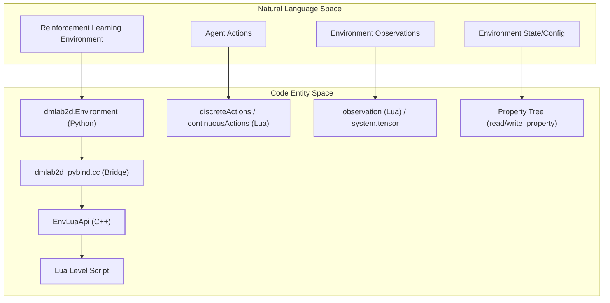
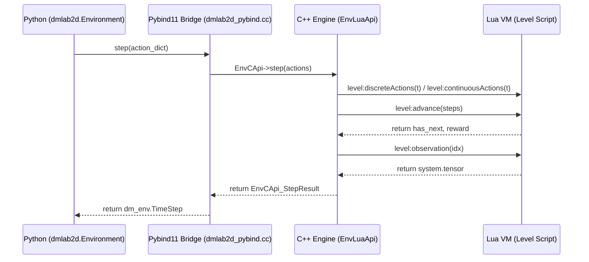

<!-- source: DeepWiki mcp.deepwiki.com · repo google-deepmind/lab2d · page 8 Glossary · fetched 2026-10-26 -->

# Glossary

Relevant source files

The following files were used as context for generating this wiki page:

- [.bazelrc](.bazelrc)
- [BUILD](BUILD)
- [README.md](README.md)
- [WORKSPACE](WORKSPACE)
- [bazel/luajit.BUILD](bazel/luajit.BUILD)
- [bazel/png.BUILD](bazel/png.BUILD)
- [dmlab2d/BUILD](dmlab2d/BUILD)
- [dmlab2d/__init__.py](dmlab2d/__init__.py)
- [dmlab2d/dmlab2d_pybind.lds](dmlab2d/dmlab2d_pybind.lds)
- [dmlab2d/dmlab2d_pybind.syms.lds](dmlab2d/dmlab2d_pybind.syms.lds)
- [dmlab2d/lib/env_lua_api/BUILD](dmlab2d/lib/env_lua_api/BUILD)
- [dmlab2d/lib/env_lua_api/env_lua_api_test.cc](dmlab2d/lib/env_lua_api/env_lua_api_test.cc)
- [dmlab2d/lib/env_lua_api/episode.cc](dmlab2d/lib/env_lua_api/episode.cc)
- [dmlab2d/lib/lua/read_test.cc](dmlab2d/lib/lua/read_test.cc)
- [dmlab2d/lib/system/grid_world/grid_shape.h](dmlab2d/lib/system/grid_world/grid_shape.h)
- [dmlab2d/lib/system/tensor/lua/tensor.h](dmlab2d/lib/system/tensor/lua/tensor.h)
- [dmlab2d/lib/system/tensor/lua/tensor_test.cc](dmlab2d/lib/system/tensor/lua/tensor_test.cc)
- [docs/system/grid_world.md](docs/system/grid_world.md)
- [docs/system/tensor.md](docs/system/tensor.md)
- [install.sh](install.sh)
- [third_party/rl_api/BUILD](third_party/rl_api/BUILD)
- [third_party/rl_api/env_c_api_example.syms.lds](third_party/rl_api/env_c_api_example.syms.lds)

This page provides definitions for codebase-specific terms, abbreviations, and domain concepts used throughout DeepMind Lab2D. It serves as a technical reference for onboarding engineers to understand the mapping between reinforcement learning (RL) terminology and the specific C++, Lua, and Python implementations in this repository.

## Core Architectural Terms

### EnvCApi
The **EnvCApi** is a standardized C interface for reinforcement learning environments. It defines a set of function pointers and data structures that allow a host (like a Python bridge or a training runner) to interact with an environment without knowing its internal implementation details.
*   **Implementation:** Defined as a C struct `EnvCApi` containing function pointers for `init`, `start`, `step`, etc. [third_party/rl_api/env_c_api.h:19-22]().
*   **Role:** It acts as the "narrow waist" of the system, separating the C++ engine logic from the language-specific bindings.

### EnvLuaApi
The **EnvLuaApi** is the primary C++ orchestrator in Lab2D. It implements the `EnvCApi` by embedding a Lua VM and dispatching calls to a Lua "level" script.
*   **Implementation:** `deepmind::lab2d::EnvLuaApi` [dmlab2d/lib/env_lua_api/env_lua_api.h:17-18]().
*   **Data Flow:** When `EnvLuaApi::Step` is called, it translates C-style action arrays into Lua tables, calls the `advance` function in the Lua level script, and then processes the returned reward and terminal state.

### Level Script
A Lua file that defines the specific logic, rules, and entities of a game or task. It must return a table containing specific callback functions (e.g., `init`, `start`, `advance`).
*   **Key Callbacks:** `observationSpec`, `discreteActionSpec`, `advance`. [dmlab2d/lib/env_lua_api/env_lua_api_test.cc:62-178]().

### System Modules
C++ libraries exposed to the Lua environment via the `require 'system.<name>'` syntax. These provide performance-critical functionality like grid physics, tensor manipulation, and sprite rendering.
*   **Examples:** `system.grid_world`, `system.tensor`, `system.random`. [dmlab2d/lib/env_lua_api/env_lua_api.cc:14-33]().

---

## Technical Concept Mapping

The following diagram bridges the gap between high-level RL concepts and the specific code entities used to implement them in Lab2D.

### Concept to Code Entity Mapping

**Sources:** [dmlab2d/__init__.py:1-37](), [dmlab2d/dmlab2d_pybind.cc:1-26](), [dmlab2d/lib/env_lua_api/env_lua_api.h:17-51]().

---

## Domain Terms

| Term | Definition | Code Pointer |
| :--- | :--- | :--- |
| **Action Spec** | Metadata describing the shape, type, and bounds of actions an agent can take. | `EnvCApi_ActionSpec` [third_party/rl_api/env_c_api.h:220-225]() |
| **Observation Spec**| Metadata describing the shape and numeric type of tensors returned as observations. | `EnvCApi_ObservationSpec` [third_party/rl_api/env_c_api.h:227-232]() |
| **Property Tree** | A hierarchical key-value store (read/write/list) used to inspect or modify environment state at runtime. | `dmlab2d/lib/env_lua_api/properties.h` [dmlab2d/lib/env_lua_api/properties.h:209-226]() |
| **Discrete Action** | An integer-based action (e.g., "Turn Left", "Move Forward"). | `discreteActionSpec` [dmlab2d/lib/env_lua_api/env_lua_api_test.cc:99-102]() |
| **Continuous Action**| A floating-point action (e.g., "Acceleration 0.5"). | `continuousActionSpec` [dmlab2d/lib/env_lua_api/env_lua_api_test.cc:109-115]() |
| **Runfiles** | Static assets (Lua scripts, images) required by the binary at runtime, managed by Bazel. | `dmlab2d/runfiles_helper.py` [dmlab2d/runfiles_helper.py:94-98]() |

---

## System Architecture Flow

The interaction between the Python API, the C++ Core, and the Lua VM is visualized below.

### Execution Flow: `env.step(action)`

**Sources:** [dmlab2d/__init__.py:1-37](), [dmlab2d/dmlab2d_pybind.cc:1-26](), [dmlab2d/lib/env_lua_api/env_lua_api.cc:7-40](), [dmlab2d/lib/env_lua_api/env_lua_api_test.cc:130-134]().

---

## Abbreviations

*   **ABI**: Application Binary Interface. Specifically refers to the stability of the C API so different compilers can link against the same `.so` or `.dylib`. [dmlab2d/BUILD:120-130]()
*   **JIT**: Just-In-Time compilation. Lab2D uses **LuaJIT** for high-performance execution of level scripts. [bazel/luajit.BUILD:1-50]()
*   **LDS**: Linker Description Script. Used to control symbol visibility (e.g., `PyInit_dmlab2d_pybind`) to prevent symbol collisions. [dmlab2d/dmlab2d_pybind.lds:1-8]()
*   **kwargs**: Keyword arguments. In Lab2D, these are often passed from Python to the Lua `init` function to configure environment parameters. [dmlab2d/lib/env_lua_api/env_lua_api_test.cc:70-83]()