# Page: DeepMind Lab2D: Overview

# DeepMind Lab2D: Overview

<details>
<summary>Relevant source files</summary>

The following files were used as context for generating this wiki page:

- [AUTHORS](AUTHORS)
- [CONTRIBUTING.md](CONTRIBUTING.md)
- [LICENSE](LICENSE)
- [README.md](README.md)
- [WORKSPACE](WORKSPACE)
- [dmlab2d/__init__.py](dmlab2d/__init__.py)
- [install.sh](install.sh)

</details>


DeepMind Lab2D is a high-performance system designed for creating 2D "grid world" environments for machine learning research [README.md:11-14](). It combines a fast C++ engine with the flexibility of Lua scripting to define environment logic, layouts, and behaviors [README.md:3-3](). Agents interact with these worlds through standardized interfaces, primarily the Python `dm_env` API [README.md:15-17]().

## System Architecture

The codebase is organized into a three-layer architecture that balances performance, scriptability, and ease of use for RL researchers.

1.  **C++ Core Engine**: The foundational layer that manages the Lua Virtual Machine, provides high-performance systems (like grid physics and tensor math), and exposes a C API [README.md:11-17]().
2.  **Lua Scripting Layer**: This is where "Levels" are defined. Developers use Lua to specify maps, game rules, and observation/action spaces using built-in system libraries [README.md:13-14]().
3.  **Python API**: A wrapper that exposes the C++ engine to Python, making it compatible with the `dm_env` standard [dmlab2d/__init__.py:31-36]().

### Component Interaction Map

The following diagram illustrates how a Python agent's call flows through the system to the underlying Lua level logic.

**Flow of Execution: Python to Lua**
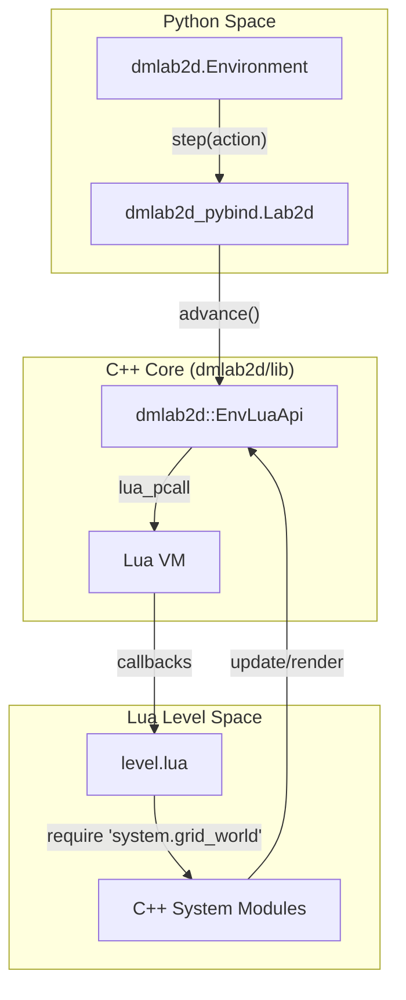
**Sources:** [dmlab2d/__init__.py:103-117](), [README.md:11-18]()

## Key Concepts

### Grid Worlds and Levels
Environments in Lab2D are referred to as "levels". A level consists of a text-based map (defining the initial layout) and Lua code (defining behavior) [README.md:13-14](). The engine uses a specialized `grid_world` system to handle piece movement, layering, and collisions.

### The Property Tree
Lab2D features a hierarchical property tree that allows for reading and writing environment state at runtime without modifying the core API. This is exposed via `read_property`, `write_property`, and `list_property` methods [dmlab2d/__init__.py:179-201]().

### Multi-Agent Support
The system natively supports multiple agents, allowing for complex multi-agent reinforcement learning (MARL) scenarios [README.md:18-18]().

## Major Subsystems

| Subsystem | Responsibility | Key Code Entities |
| :--- | :--- | :--- |
| **Python Bridge** | Exposes C++ to Python via `pybind11`. | `dmlab2d_pybind`, `dmlab2d.Environment` [dmlab2d/__init__.py:21-31]() |
| **EnvLuaApi** | Orchestrates the lifecycle between C++ and Lua. | `dmlab2d::EnvLuaApi` |
| **System Modules** | High-performance C++ logic for Lua (Grid, Tensor, Tile). | `system.grid_world`, `system.tensor`, `system.tile` |
| **RL API** | Standardized C interface for environment interaction. | `third_party/rl_api/env_c_api.h` [README.md:62-63]() |

### Code Entity Association

This diagram maps high-level system responsibilities to specific source file locations and classes.

**System Responsibility to Code Entity Mapping**
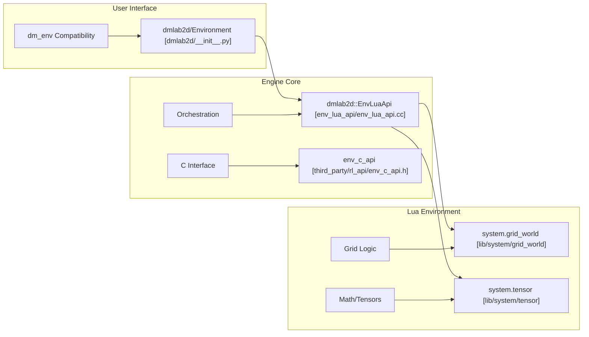
**Sources:** [dmlab2d/__init__.py:31-36](), [README.md:62-63](), [WORKSPACE:112-116]()

## Detailed Documentation

For more specific information, please refer to the following child pages:

*   **[Getting Started: Installation and Quick Start](#1.1)**: Instructions on how to build the project using Bazel and run your first random agent [README.md:24-48]().
*   **[Repository Layout and Key Concepts](#1.2)**: A deep dive into the directory structure and the core design philosophy of the engine.

**Sources:** [README.md:1-77](), [dmlab2d/__init__.py:1-201](), [install.sh:1-110]()

---

# Page: Getting Started: Installation and Quick Start

# Getting Started: Installation and Quick Start

<details>
<summary>Relevant source files</summary>

The following files were used as context for generating this wiki page:

- [.bazelrc](.bazelrc)
- [README.md](README.md)
- [dmlab2d/BUILD](dmlab2d/BUILD)
- [dmlab2d/__init__.py](dmlab2d/__init__.py)
- [dmlab2d/dmlab2d_pybind.lds](dmlab2d/dmlab2d_pybind.lds)
- [dmlab2d/dmlab2d_pybind.syms.lds](dmlab2d/dmlab2d_pybind.syms.lds)
- [dmlab2d/runfiles_helper.py](dmlab2d/runfiles_helper.py)
- [install.sh](install.sh)

</details>


DeepMind Lab2D is a high-performance 2D environment engine built with a C++ core and Lua scripting. This page provides technical instructions for setting up the development environment, building the system from source using Bazel, and running initial simulations.

## System Requirements and Prerequisites

DeepMind Lab2D requires a 64-bit Linux or macOS (Intel/Apple Silicon) system. The following software must be installed on the host machine:

*   **Python**: Version 3.8 or above [README.md:68-68]().
*   **Python Packages**: `numpy`, `pygame`, and `packaging` [README.md:68-68]().
*   **Compiler**: `Clang` (version 14.0+) or `GCC` [install.sh:41-43]().
*   **Build System**: `Bazel` (version 6.2+) [install.sh:44-45]().

Sources: [README.md:50-73](), [install.sh:29-46]()

---

## Installation Methods

### 1. PyPI Installation (Recommended for Users)
For standard use cases where environment customization is not required, pre-built wheels are available for Linux and macOS:
```shell
pip install dmlab2d
```
Sources: [README.md:26-33]()

### 2. Building from Source (Recommended for Developers)
To modify the C++ engine or add custom system libraries, the project must be built using Bazel. The `install.sh` script provides a template for this process.

#### Step-by-Step Build Flow
The build process utilizes Bazel to compile the C++ core and generate a Python wheel via `pybind11`.

1.  **Configure Bazel**: The project uses `.bazelrc` to manage platform-specific flags and Lua versions [ .bazelrc:1-24]().
2.  **Compile and Package**: Run the Bazel build command targeting the wheel.
    ```bash
    bazel build -c opt //dmlab2d:dmlab2d_wheel
    ```
3.  **Install Local Wheel**:
    ```bash
    pip install bazel-bin/dmlab2d/dmlab2d-1.0.0-py3-none-any.whl
    ```

### Build Configuration Matrix
The following table describes key Bazel configurations defined in `.bazelrc`:

| Config | Description | File Reference |
| :--- | :--- | :--- |
| `lua5_1` | Builds using Lua 5.1 [ .bazelrc:13-13](). | [.bazelrc:13-13]() |
| `lua5_2` | Builds using Lua 5.2 [ .bazelrc:14-14](). | [.bazelrc:14-14]() |
| `luajit` | Builds using LuaJIT for maximum performance [ .bazelrc:15-15](). | [.bazelrc:15-15]() |
| `libc++` | Forces the use of LLVM's `libc++` (standard on macOS) [ .bazelrc:8-11](). | [.bazelrc:8-11]() |
| `macos_arm64` | Specific settings for Apple Silicon [ .bazelrc:21-24](). | [.bazelrc:21-24]() |

Sources: [.bazelrc:1-24](), [install.sh:48-97]()

---

## Technical Architecture: Build to Runtime

The diagram below illustrates how Bazel entities map to the final Python package structure.

### Build Entity Mapping
"Natural Language Space" to "Code Entity Space"

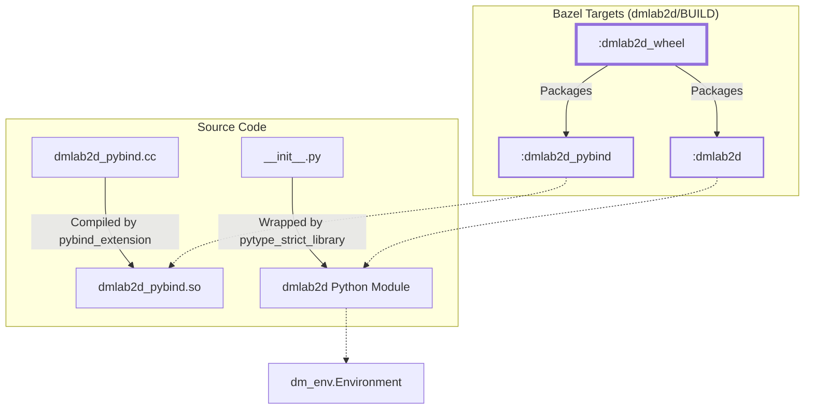
Sources: [dmlab2d/BUILD:7-26](), [dmlab2d/BUILD:28-37](), [dmlab2d/BUILD:118-137]()

---

## Quick Start: Running your first Environment

### Smoke Test
After installation, verify the setup by running the internal test suite:
```bash
python dmlab2d/dmlab2d_test.py
```
Sources: [install.sh:99-102](), [dmlab2d/BUILD:39-51]()

### Launching the Random Agent
The `random_agent.py` is a provided utility to visualize environments and verify that the Lua levels are loading correctly. It uses `pygame` for rendering.

```bash
bazel run -c opt dmlab2d:random_agent -- --level_name=chase_eat
```

### Data Flow in `random_agent`
The following diagram shows the interaction between the Python agent and the C++ engine.

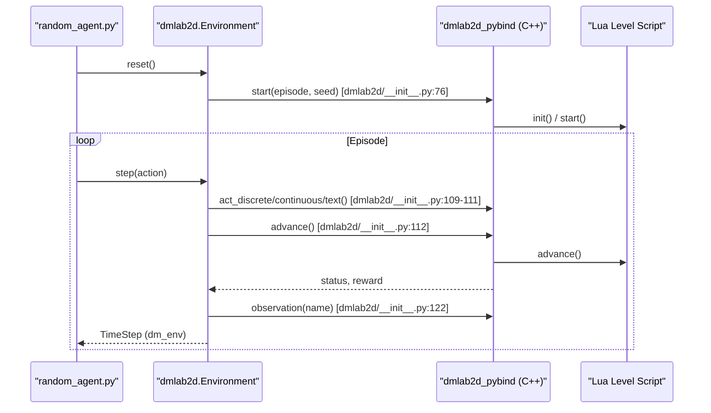
Sources: [dmlab2d/__init__.py:73-118](), [dmlab2d/BUILD:80-91]()

---

## Assets and Runfiles
DeepMind Lab2D needs to locate its Lua scripts and assets at runtime. The `runfiles_helper.py` manages this discovery.

*   **`find()`**: Returns the base folder containing assets by locating the `dmlab2d_pybind` binary location [dmlab2d/runfiles_helper.py:47-53]().
*   **`find_directory(sub_directory)`**: Heuristically searches for directories (like `game_scripts`) by checking `TEST_SRCDIR`, `RUNFILES_MANIFEST_FILE`, and `sys.path` [dmlab2d/runfiles_helper.py:56-114]().

Sources: [dmlab2d/runfiles_helper.py:1-115]()

---

# Page: Repository Layout and Key Concepts

# Repository Layout and Key Concepts

<details>
<summary>Relevant source files</summary>

The following files were used as context for generating this wiki page:

- [BUILD](BUILD)
- [WORKSPACE](WORKSPACE)
- [bazel/BUILD](bazel/BUILD)
- [bazel/dm_env.BUILD](bazel/dm_env.BUILD)
- [bazel/tree.BUILD](bazel/tree.BUILD)
- [dmlab2d/lib/BUILD](dmlab2d/lib/BUILD)
- [third_party/rl_api/BUILD](third_party/rl_api/BUILD)
- [third_party/rl_api/env_c_api_example.syms.lds](third_party/rl_api/env_c_api_example.syms.lds)

</details>


DeepMind Lab2D is structured as a high-performance 2D simulation engine that bridges the gap between low-level C++ efficiency, flexible Lua game logic, and a standardized Python RL interface. This page provides a map of the repository and explains the architectural layers that allow these components to interact.

## Repository Directory Structure

The repository is organized into four primary top-level areas that separate the core engine, build infrastructure, external dependencies, and documentation.

| Directory | Description |
| :--- | :--- |
| `dmlab2d/` | The primary codebase. Contains the Python package (`dmlab2d/`), C++ core (`dmlab2d/lib/`), and Lua scripts (`dmlab2d/lib/game_scripts/`). |
| `bazel/` | Custom Bazel build rules and `BUILD` file templates for external dependencies like `eigen`, `lua`, and `dm_env`. |
| `third_party/` | Contains the `rl_api` which defines the C-standardized environment interface used to decouple the engine from its consumers. |
| `docs/` | Technical documentation and API specifications. |

### Key Subdirectories in `dmlab2d/lib`
*   `env_lua_api/`: The orchestrator that manages the lifecycle of the Lua VM and translates C calls to Lua callbacks [dmlab2d/lib/BUILD:30-30]().
*   `lua/`: C++ wrappers and type-safe stack helpers for interacting with the Lua C API [dmlab2d/lib/BUILD:31-31]().
*   `system/`: C++ implementations of performance-critical modules exposed to Lua (e.g., `grid_world`, `tensor`, `tile`) [dmlab2d/lib/BUILD:32-35]().
*   `game_scripts/`: The "Level Lab". Contains `common` Lua libraries and the `levels` directory where specific game logic resides [dmlab2d/lib/BUILD:56-68]().

**Sources:** [dmlab2d/lib/BUILD:16-40](), [WORKSPACE:1-151]()

---

## Three-Layer Architecture

DeepMind Lab2D employs a "sandwich" architecture to balance performance and flexibility.

### 1. The Python API (The Consumer)
The top layer is a Python wrapper that implements the `dm_env` interface. It uses `pybind11` to communicate with the underlying C++ engine. This layer is responsible for converting Pythonic data structures (like NumPy arrays or nested dictionaries) into formats the C++ core can process.
*   **Key Files:** `dmlab2d/__init__.py`, `dmlab2d/dmlab2d_pybind.cc`.
*   **Dependency:** Depends on `@dm_env_archive//:dm_env` [bazel/dm_env.BUILD:5-14]().

### 2. The C++ Core Engine (The Orchestrator)
The middle layer, defined in `dmlab2d/lib/`, manages the simulation's state. It acts as a host for the Lua virtual machine. It does not know the rules of the "game" being played; instead, it provides the tools (tensors, grid world physics, pathfinding) and dispatches events to the Lua layer.
*   **Key Class:** `dmlab2d::EnvLuaApi` [dmlab2d/lib/BUILD:30-30]().
*   **Entry Point:** `dmlab2d_connect` which follows the `env_c_api` contract [third_party/rl_api/env_c_api.h:1-22]().

### 3. The Lua Scripting Layer (The Game Logic)
The bottom layer contains the actual game definitions. Every "level" is a Lua script that defines observations, actions, and rewards. These scripts use the `system` modules (implemented in C++) to perform heavy lifting like rendering or grid updates.
*   **Key Files:** `dmlab2d/lib/game_scripts/levels/` [dmlab2d/lib/BUILD:83-91]().

### System Architecture Diagram

The following diagram illustrates the flow of a single `step()` call from Python down to the Lua game logic and back.

**Data Flow: Python to Lua**
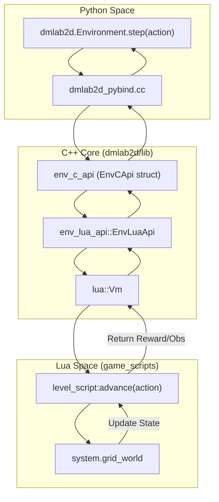
**Sources:** [dmlab2d/lib/BUILD:16-40](), [third_party/rl_api/BUILD:18-22](), [bazel/dm_env.BUILD:5-14]()

---

## Key Concepts and Code Entities

### The `env_c_api` Interface
To ensure interoperability and minimize binary coupling, Lab2D uses a pure C interface for its core engine. The `EnvCApi` structure defines function pointers for environment lifecycle management (`step`, `reset`, `observation`, etc.). This allows the C++ engine to be compiled into a shared library (`.so`) that can be loaded by different frontends.

**Code Entity Mapping: C API to Implementation**
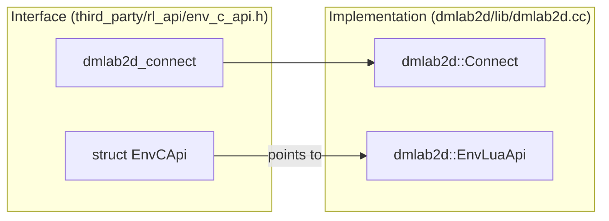
**Sources:** [third_party/rl_api/env_c_api.h:1-22](), [dmlab2d/lib/dmlab2d.cc:1-40](), [third_party/rl_api/BUILD:18-22]()

### Lua System Modules
While the game logic is in Lua, performance-critical operations are implemented in C++ and exposed as Lua modules. These are found in `dmlab2d/lib/system/`.

| Lua Module | C++ Implementation Path | Purpose |
| :--- | :--- | :--- |
| `system.grid_world` | `dmlab2d/lib/system/grid_world/` | Manages the 2D grid, collision, and piece updates [dmlab2d/lib/BUILD:34-34](). |
| `system.tensor` | `dmlab2d/lib/system/tensor/` | High-performance multi-dimensional arrays for observations. |
| `system.tile` | `dmlab2d/lib/system/tile/` | Sprite-based rendering of the grid into RGB tensors [dmlab2d/lib/BUILD:35-35](). |
| `system.file_system` | `dmlab2d/lib/system/file_system/` | Accessing assets via Bazel runfiles [dmlab2d/lib/BUILD:32-32](). |

### Build System and Dependencies
The project uses Bazel for dependency management and compilation. Key external dependencies are fetched and configured in the `WORKSPACE` file and `bazel/` directory.

*   **Lua Versions:** Lab2D supports multiple Lua runtimes (Lua 5.1, 5.2, and LuaJIT). These are managed via `http_archive` in `WORKSPACE` [WORKSPACE:81-110]().
*   **Math/Graphics:** Uses `Eigen` for linear algebra [WORKSPACE:49-57]() and `libpng` for image processing [WORKSPACE:59-68]().
*   **Testing:** C++ tests use `googletest` [WORKSPACE:6-10](), while Lua tests use a custom `dmlab2d_lua_test` macro defined in `dmlab2d/lib/testing/lua_testing.bzl` [dmlab2d/lib/BUILD:5-5]().

**Sources:** [WORKSPACE:1-151](), [dmlab2d/lib/BUILD:1-102](), [bazel/dm_env.BUILD:1-29]()

---

# Page: Python API

# Python API

<details>
<summary>Relevant source files</summary>

The following files were used as context for generating this wiki page:

- [README.md](README.md)
- [dmlab2d/BUILD](dmlab2d/BUILD)
- [dmlab2d/__init__.py](dmlab2d/__init__.py)
- [dmlab2d/dmlab2d_pybind.lds](dmlab2d/dmlab2d_pybind.lds)
- [dmlab2d/dmlab2d_pybind.syms.lds](dmlab2d/dmlab2d_pybind.syms.lds)
- [install.sh](install.sh)

</details>


The Python API for DeepMind Lab2D provides a high-level, idiomatic interface for interacting with 2D grid world environments. It is built upon a C++ core, exposed via `pybind11`, and adheres to the `dm_env` standard common in reinforcement learning research.

### System Architecture

The Python layer acts as a thin wrapper around the C++ engine. It manages the lifecycle of the environment, handles the conversion of data types (such as NumPy arrays to C++ tensors), and provides utility functions for configuration and asset management.

#### Entity Mapping
The following diagram illustrates how Python-level classes map to the underlying C++ and Pybind entities.

**Python-to-Code Entity Map**
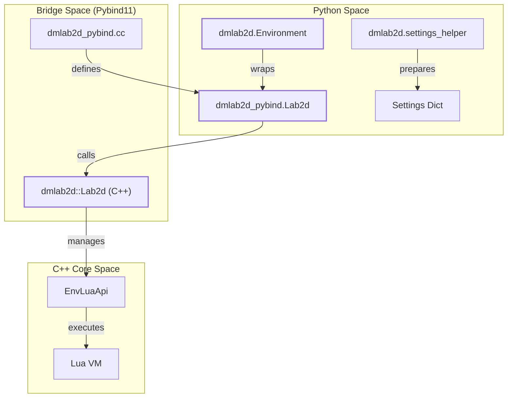
**Sources:** [dmlab2d/__init__.py:21-31](), [dmlab2d/BUILD:7-26](), [README.md:11-18]()

---

### Core Components

#### dmlab2d.Environment: The dm_env Interface
The primary entry point for users is the `dmlab2d.Environment` class [dmlab2d/__init__.py:31-36](). This class inherits from `dm_env.Environment` and implements the standard `reset()`, `step()`, `observation_spec()`, and `action_spec()` methods. 

Beyond the standard RL loop, it provides access to the "Property Tree," a hierarchical API for inspecting and modifying environment state at runtime via `read_property`, `write_property`, and `list_property` [dmlab2d/__init__.py:179-203]().

For details, see [dmlab2d.Environment: The dm_env Interface](#2.1).

#### C++/Python Bridge: dmlab2d_pybind
The performance-critical logic resides in C++, which is exposed to Python through a module named `dmlab2d_pybind` [dmlab2d/BUILD:7-9](). This bridge handles the translation of discrete, continuous, and text-based actions from Python into the internal C++ representation. It also manages environment status enums like `RUNNING`, `TERMINATED`, and `INTERRUPTED` [dmlab2d/__init__.py:24-28]().

For details, see [C++/Python Bridge: dmlab2d_pybind](#2.2).

#### Python Utilities
DeepMind Lab2D includes helper modules to simplify environment setup:
*   **`settings_helper`**: Provides `flatten_args()` to convert nested Python dictionaries into the flat string-based settings required by the C++ engine [dmlab2d/BUILD:53-57]().
*   **`runfiles_helper`**: Assists in locating Lua scripts and assets within the Bazel runfiles tree [dmlab2d/BUILD:93-98]().

For details, see [Python Utilities: settings_helper and runfiles_helper](#2.3).

---

### Data Flow Overview

The flow of data during a single environment step involves multiple layers of the API.

**Step Execution Data Flow**
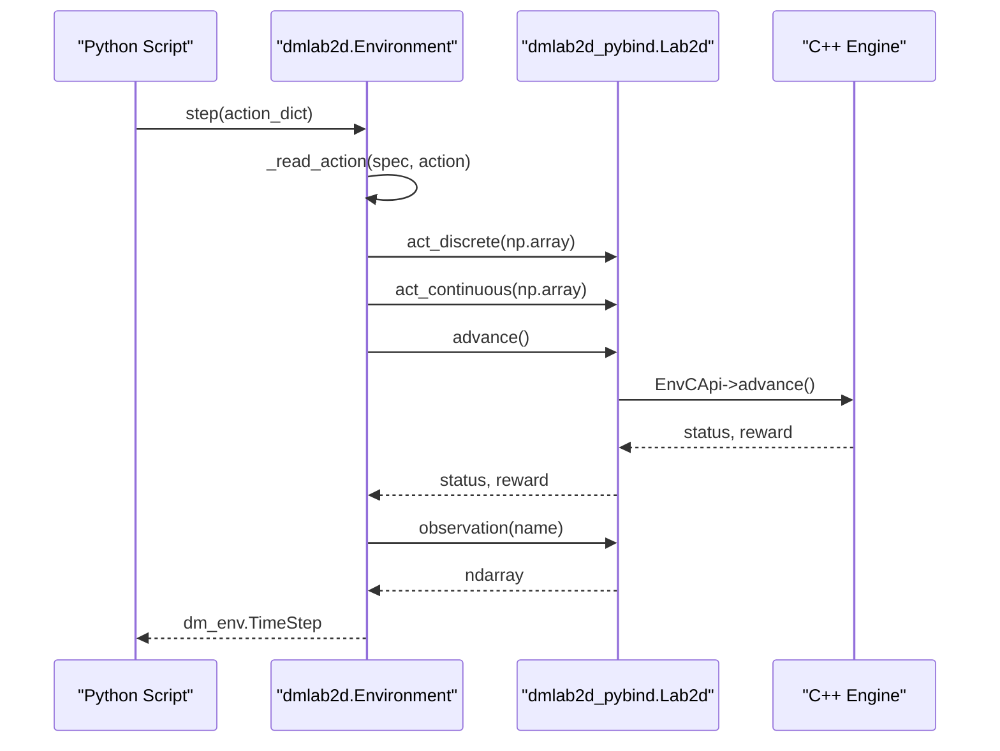
**Sources:** [dmlab2d/__init__.py:103-118](), [dmlab2d/BUILD:19-20]()

### Installation and Requirements
The Python API requires `Python 3.8+` along with `NumPy` [README.md:68-69](). While the core is distributed as pre-built wheels on PyPI, it can also be built from source using Bazel, which utilizes the `pybind_extension` macro to compile the C++ components [dmlab2d/BUILD:7-26](), [install.sh:84-93]().

**Sources:**
* [dmlab2d/__init__.py:1-203]()
* [dmlab2d/BUILD:1-165]()
* [README.md:1-77]()
* [install.sh:1-110]()

---

# Page: dmlab2d.Environment: The dm_env Interface

# dmlab2d.Environment: The dm_env Interface

<details>
<summary>Relevant source files</summary>

The following files were used as context for generating this wiki page:

- [README.md](README.md)
- [dmlab2d/__init__.py](dmlab2d/__init__.py)
- [install.sh](install.sh)

</details>


The `dmlab2d.Environment` class provides a Python-friendly wrapper around the core C++ engine, adhering to the [DeepMind `dm_env` interface](https://github.com/deepmind/dm_env). It handles the conversion between Python/NumPy data types and the underlying Lab2D engine, manages the episode lifecycle, and exposes the property tree for environment introspection and configuration.

### Class Definition and Initialization

The `Environment` class is defined in `dmlab2d/__init__.py` and inherits from `dm_env.Environment` [dmlab2d/__init__.py:31-32](). It acts as a bridge to the `dmlab2d_pybind.Lab2d` object, which contains the actual engine instance [dmlab2d/__init__.py:46]().

#### Constructor: `__init__(self, env, observation_names, seed=None)`
- **`env`**: An instance of `dmlab2d.Lab2d` (the pybind11-exposed C++ class) [dmlab2d/__init__.py:42]().
- **`observation_names`**: A list of strings specifying which observations from the Lua level should be included in the observation dictionary [dmlab2d/__init__.py:43]().
- **`seed`**: An optional integer to seed the internal NumPy RandomState used for generating episode seeds [dmlab2d/__init__.py:44-48]().

Upon initialization, the class queries the engine to build action and observation specifications [dmlab2d/__init__.py:53-59]().

### The dm_env Lifecycle

The environment follows the standard RL loop: `reset()` followed by repeated calls to `step()`.

#### `reset()`
Resets the environment for a new episode.
1. Increments the internal episode counter `_next_episode` [dmlab2d/__init__.py:77]().
2. Calls `self._env.start()` with a new seed derived from the internal RNG [dmlab2d/__init__.py:76]().
3. Returns a `dm_env.TimeStep` with `step_type=StepType.FIRST` [dmlab2d/__init__.py:78]().

#### `step(action)`
Advances the simulation by one time step.
1. If the previous step resulted in a terminal state, it automatically calls `reset()` [dmlab2d/__init__.py:105-106]().
2. Parses the `action` (which can be a nested dict/list) and updates internal buffers for discrete, continuous, and text actions [dmlab2d/__init__.py:108-111]().
3. Calls `self._env.advance()`, which returns the new `EnvironmentStatus` and the reward [dmlab2d/__init__.py:112]().
4. Returns a `dm_env.TimeStep` (either `TRANSITION` or `TERMINATION`) [dmlab2d/__init__.py:113-117]().

### Data Flow: Python to C++ Engine

The following diagram illustrates how Python-level calls move through the `Environment` wrapper into the pybind11 layer.

**Diagram: Python API Data Flow**
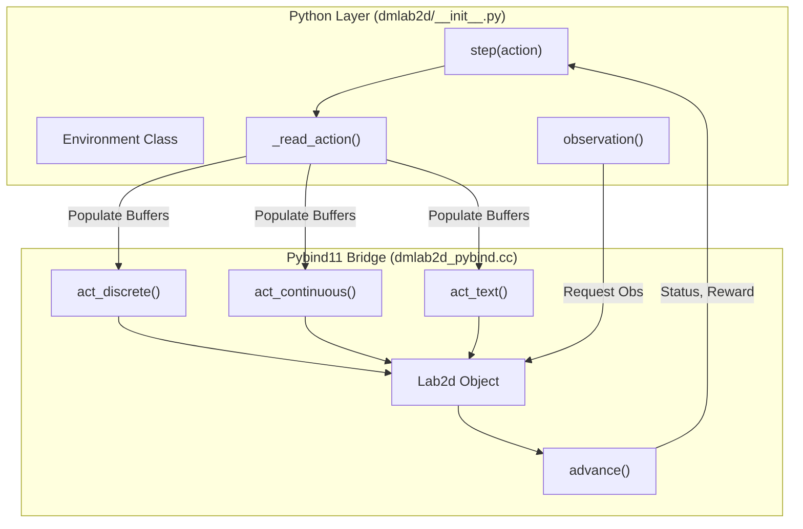
Sources: [dmlab2d/__init__.py:103-125](), [dmlab2d/__init__.py:80-102]()

### Specifications (Specs)

Lab2D supports three types of actions and flexible multidimensional observations.

| Spec Type | Internal DType | Python Container | Description |
| :--- | :--- | :--- | :--- |
| **Discrete Action** | `int32` | `dm_env.specs.BoundedArray` | Integer indices for actions (e.g., movement directions). |
| **Continuous Action** | `float64` | `dm_env.specs.BoundedArray` | Scalar values for fine-grained control. |
| **Text Action** | `object` (bytes) | `dm_env.specs.Array` | String-based commands or communication. |
| **Observation** | Variable | `dm_env.specs.Array` | Multi-dimensional arrays (Tensors) produced by the engine. |

Sources: [dmlab2d/__init__.py:131-164]()

### Property Tree API

The environment exposes a hierarchical property tree that allows reading and writing state variables defined in the Lua level or the C++ system modules.

*   **`list_property(key)`**: Returns a list of child properties and their attributes (Read/Write/Listable) under the given `key` [dmlab2d/__init__.py:179-193]().
*   **`read_property(key)`**: Returns the string representation of a property value [dmlab2d/__init__.py:207]().
*   **`write_property(key, value)`**: Writes a string value to a specific property [dmlab2d/__init__.py:195-205]().

### Events

Events are transient data packets generated during a step (e.g., "agent_fired_laser" or "item_picked_up"). Unlike observations, they are not necessarily produced every step.
- **`events()`**: Returns a sequence of `(name, observations)` tuples representing all events triggered since the last `step` or `reset` [dmlab2d/__init__.py:170-178]().

### Entity Mapping: Python to Engine

The following diagram maps the Python `Environment` methods to the corresponding C++ logic and Lua callbacks.

**Diagram: System Entity Mapping**
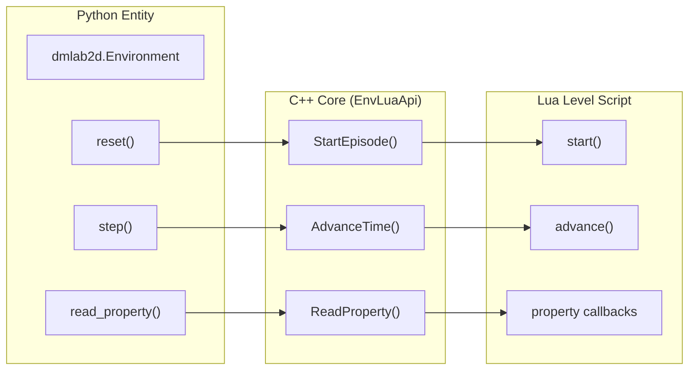
Sources: [dmlab2d/__init__.py:73-78](), [dmlab2d/__init__.py:103-117](), [dmlab2d/__init__.py:207]()

---

# Page: C++/Python Bridge: dmlab2d_pybind

# C++/Python Bridge: dmlab2d_pybind

<details>
<summary>Relevant source files</summary>

The following files were used as context for generating this wiki page:

- [bazel/pybind11.BUILD](bazel/pybind11.BUILD)
- [build_defs.bzl](build_defs.bzl)
- [dmlab2d/BUILD](dmlab2d/BUILD)
- [dmlab2d/dmlab2d_pybind.cc](dmlab2d/dmlab2d_pybind.cc)
- [dmlab2d/dmlab2d_pybind.lds](dmlab2d/dmlab2d_pybind.lds)
- [dmlab2d/dmlab2d_pybind.syms.lds](dmlab2d/dmlab2d_pybind.syms.lds)
- [dmlab2d/lib/system/generators/pushbox/python/BUILD](dmlab2d/lib/system/generators/pushbox/python/BUILD)
- [dmlab2d/lib/system/grid_world/lua/lua_grid.cc](dmlab2d/lib/system/grid_world/lua/lua_grid.cc)

</details>


The `dmlab2d_pybind` module serves as the critical glue layer between the DeepMind Lab2D C++ engine and the Python environment. It utilizes [pybind11](https://github.com/pybind/pybind11) to wrap the C++ `Lab2d` class and the underlying `EnvCApi`, exposing them as a Python-friendly extension module.

## Architecture Overview

The bridge is centered around the `PyEnvCApi` class, which manages the lifecycle of the C++ environment and translates between Python types (like NumPy arrays) and the C-based `EnvCApi` structures used by the engine [dmlab2d/dmlab2d_pybind.cc:105-126]().

### Data Flow: Python to C++

The following diagram illustrates how a call from Python (e.g., `step`) traverses the bridge into the C++ core.

**Diagram: Bridge Execution Flow**
```mermaid
graph TD
    subgraph "Python Space"
        PY_ENV["dmlab2d.Environment"] -- "calls" --> PYBIND_EXT["dmlab2d_pybind.so"]
    end

    subgraph "Bridge Layer (dmlab2d_pybind.cc)"
        PYBIND_EXT --> PY_ENV_C_API["PyEnvCApi::Step"]
        PY_ENV_C_API -- "converts NumPy to C" --> C_API_CALL["EnvCApi.step()"]
    end

    subgraph "C++ Core Space"
        C_API_CALL --> ENV_LUA_API["EnvLuaApi::Step"]
        ENV_LUA_API -- "invokes" --> LUA_VM["Lua VM (advance)"]
    end

    ["dmlab2d/__init__.py"] -. "wraps" .-> PY_ENV
    ["dmlab2d/dmlab2d_pybind.cc"] -. "defines" .-> PY_ENV_C_API
    ["dmlab2d/lib/env_lua_api/env_lua_api.cc"] -. "implements" .-> ENV_LUA_API
```
**Sources:** [dmlab2d/dmlab2d_pybind.cc:227-241](), [dmlab2d/__init__.py:1-37]().

---

## The `PyEnvCApi` Wrapper

`PyEnvCApi` is the primary C++ class exposed to Python. It encapsulates the `EnvCApi` struct and a context pointer, providing methods that match the expected Python RL environment patterns [dmlab2d/dmlab2d_pybind.cc:105-113]().

### Key Responsibilities
*   **Initialization**: The `Create` factory method accepts a connection function and a dictionary of settings, initializes the C++ environment, and handles error messages from the C API [dmlab2d/dmlab2d_pybind.cc:107-124]().
*   **Observation Conversion**: `FromArrayObservation` converts `EnvCApi_Observation` payloads (bytes, doubles, int32, int64) into `py::array_t` (NumPy arrays) [dmlab2d/dmlab2d_pybind.cc:41-68]().
*   **Action Handling**: Methods like `ActDiscrete` and `ActContinuous` validate action shapes and values before passing them to the engine [dmlab2d/dmlab2d_pybind.cc:205-225]().

### Enums and Status Tracking
The bridge exposes internal environment states and property attributes to Python to ensure consistent behavior between the two languages.

| Enum / Type | Description | Code Reference |
| :--- | :--- | :--- |
| `EnvironmentStatus` | Maps C API status (Running, Interrupted, Disc) to Python. | [dmlab2d/dmlab2d_pybind.cc:435-442]() |
| `PropertyAttributes` | Defines if a property is Read, Write, or Listable. | [dmlab2d/dmlab2d_pybind.cc:444-448]() |
| `State` | Internal tracker for `kPreStart` vs `kStep` transitions. | [dmlab2d/dmlab2d_pybind.cc:375-375]() |

**Sources:** [dmlab2d/dmlab2d_pybind.cc:41-103](), [dmlab2d/dmlab2d_pybind.cc:435-450]().

---

## Bazel Build and Symbol Visibility

The bridge is built using the `pybind_extension` macro defined in `build_defs.bzl`. This macro handles the complexities of linking against Python headers and ensuring the resulting shared object (`.so`) is correctly named for Python imports [build_defs.bzl:20-83]().

### Linker Scripts and Symbol Control
To prevent symbol collisions and keep the binary interface clean, DeepMind Lab2D uses linker scripts to restrict exported symbols to only the Python module entry point (`PyInit_dmlab2d_pybind`).

*   **Linux (`.lds`)**: Uses a version script to set `global` and `local` visibility [dmlab2d/dmlab2d_pybind.lds:1-7]().
*   **macOS (`.syms.lds`)**: Uses an exported symbols list [dmlab2d/dmlab2d_pybind.syms.lds:1-2]().

**Diagram: Build System Dependencies**
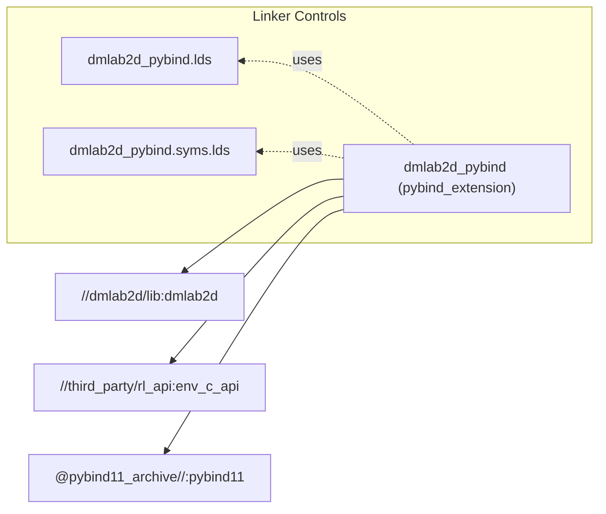
**Sources:** [dmlab2d/BUILD:7-26](), [build_defs.bzl:67-76](), [dmlab2d/dmlab2d_pybind.lds:1-7]().

---

## Property Tree API Bridge

The property tree allows Python to inspect and modify the internal state of the Lua simulation. The bridge maps these requests to the `EnvCApi` property functions.

### Implementation Detail
When Python calls `read_property`, the bridge:
1.  Translates the string key to a C-style string [dmlab2d/dmlab2d_pybind.cc:323-324]().
2.  Calls `env_->api.read_property`.
3.  Returns the result as a Python string or raises a `KeyError` if the property is missing or lacks the `kRead` attribute [dmlab2d/dmlab2d_pybind.cc:325-331]().

Similar logic applies to `write_property` and `list_property` [dmlab2d/dmlab2d_pybind.cc:333-358]().

**Sources:** [dmlab2d/dmlab2d_pybind.cc:323-358](), [dmlab2d/dmlab2d_pybind.cc:444-448]().

---

# Page: Python Utilities: settings_helper and runfiles_helper

# Python Utilities: settings_helper and runfiles_helper

<details>
<summary>Relevant source files</summary>

The following files were used as context for generating this wiki page:

- [dmlab2d/runfiles_helper.py](dmlab2d/runfiles_helper.py)
- [dmlab2d/settings_helper.py](dmlab2d/settings_helper.py)
- [dmlab2d/settings_helper_test.py](dmlab2d/settings_helper_test.py)
- [python_system.bzl](python_system.bzl)

</details>


This page documents the auxiliary Python utilities provided by DeepMind Lab2D to facilitate environment configuration and asset discovery. These utilities bridge the gap between flexible Pythonic data structures and the flat string-based configuration required by the C++ engine and Lua scripts, while also ensuring that game assets can be located across various execution environments (e.g., Bazel, installed wheels, or local development).

## settings_helper: Configuration Flattening

The `settings_helper.py` module provides a mechanism to convert complex, nested Python dictionaries and sequences into a flat mapping of dot-separated keys to string values. This is necessary because the underlying Lab2D C++ and Lua layers often expect a flat key-value store for environment settings [dmlab2d/settings_helper.py:16-19]().

### flatten_args() Implementation

The primary entry point is `flatten_args(args_in)`, which recursively traverses a hierarchy of dictionaries and lists [dmlab2d/settings_helper.py:49-61]().

**Key Transformation Rules:**
*   **Nesting:** Nested dictionaries are joined using a `.` (dot) separator (e.g., `{'a': {'b': 1}}` becomes `{'a.b': '1'}`) [dmlab2d/settings_helper.py:27-27]().
*   **Sequences:** Lists and tuples are converted to indexed keys starting from 1 (e.g., `['x', 'y']` becomes `{'1': 'x', '2': 'y'}`) [dmlab2d/settings_helper.py:41-42]().
*   **Type Conversion:** 
    *   `None` becomes `'none'` [dmlab2d/settings_helper.py:29-29]().
    *   `bool` becomes `'true'` or `'false'` [dmlab2d/settings_helper.py:32-33]().
    *   `numbers.Number` and `str` are converted to their string representation [dmlab2d/settings_helper.py:30-35]().
*   **Cycle Detection:** The implementation maintains a `visited_stack` to prevent infinite recursion in the case of self-referencing data structures [dmlab2d/settings_helper.py:37-42]().

### Data Flow: Dictionary Flattening

The following diagram illustrates how `_flatten_args` processes a nested structure into the flat format consumed by the environment.

**Configuration Transformation Flow**
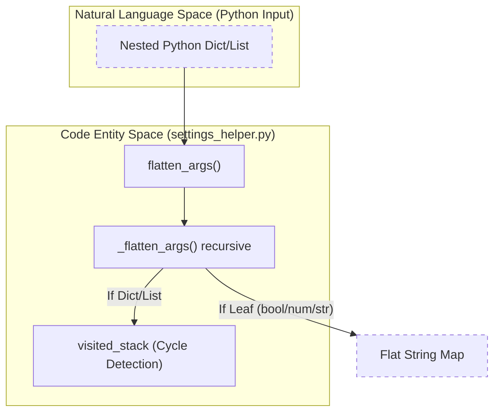

**Sources:**
*   `dmlab2d/settings_helper.py:22-47` (Internal recursion logic)
*   `dmlab2d/settings_helper.py:49-61` (Public API)
*   `dmlab2d/settings_helper_test.py:22-34` (Example transformations)

---

## runfiles_helper: Asset Discovery

The `runfiles_helper.py` module is responsible for locating the DMLab2D assets (such as Lua level scripts and textures) at runtime. This is critical because the location of these files varies depending on whether the code is running via `bazel run`, `bazel test`, or as an installed Python package.

### Key Functions

| Function | Purpose | Implementation Detail |
| :--- | :--- | :--- |
| `find()` | Locates the root DMLab2D asset folder. | Returns the parent directory of the `dmlab2d_pybind` shared library [dmlab2d/runfiles_helper.py:47-53](). |
| `find_directory(sub_dir)` | Heuristically searches for a specific subdirectory. | Checks environment variables, the executable path, and `sys.path` [dmlab2d/runfiles_helper.py:56-114](). |
| `_find_sub_directory()` | Internal reverse-walk search. | Walks up the directory tree from a starting path to find a target folder [dmlab2d/runfiles_helper.py:26-44](). |

### Heuristic Search Order

When `find_directory` is called, it searches the following locations in order:
1.  **TEST_SRCDIR:** Environment variable set by Bazel during tests [dmlab2d/runfiles_helper.py:71-73]().
2.  **RUNFILES_MANIFEST_FILE:** Manifest created by `bazel run` [dmlab2d/runfiles_helper.py:76-79]().
3.  **Executable Path:** The directory containing `sys.argv[0]` [dmlab2d/runfiles_helper.py:82-84]().
4.  **Module Path:** The directory containing the `dmlab2d_pybind` binary [dmlab2d/runfiles_helper.py:87-90]().
5.  **Working Directory:** Current directory or paths relative to it [dmlab2d/runfiles_helper.py:93-100]().
6.  **System Path:** Every entry in `sys.path` [dmlab2d/runfiles_helper.py:103-109]().

### Asset Location Logic

This diagram shows how `runfiles_helper` resolves a request for a subdirectory by interacting with the environment and the Python runtime.

**Asset Resolution Path**
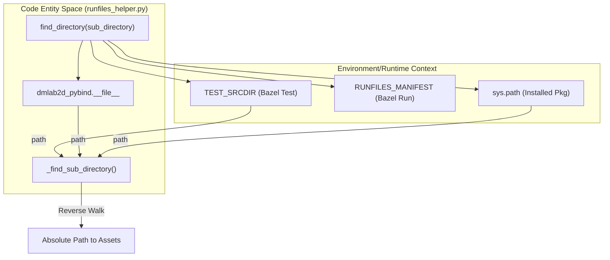

**Sources:**
*   `dmlab2d/runfiles_helper.py:47-53` (Root discovery)
*   `dmlab2d/runfiles_helper.py:56-114` (Heuristic search logic)
*   `dmlab2d/runfiles_helper.py:26-44` (Directory walking logic)

---

## Integration Example

These helpers are typically used together when initializing a `dmlab2d.Environment`.

1.  `runfiles_helper.find_directory('dmlab2d')` is used to locate the level scripts.
2.  A Python dictionary of hyperparameters is passed through `settings_helper.flatten_args()`.
3.  The resulting flat dictionary and asset paths are passed to the C++ extension via `dmlab2d_pybind`.

**Sources:**
*   `dmlab2d/settings_helper_test.py:22-34` (Usage of flatten_args in configuration)
*   `dmlab2d/runfiles_helper.py:23-23` (Import of pybind for path discovery)

---

# Page: Lua Levels API

# Lua Levels API

<details>
<summary>Relevant source files</summary>

The following files were used as context for generating this wiki page:

- [dmlab2d/lib/env_lua_api/BUILD](dmlab2d/lib/env_lua_api/BUILD)
- [dmlab2d/lib/env_lua_api/env_lua_api.cc](dmlab2d/lib/env_lua_api/env_lua_api.cc)
- [dmlab2d/lib/env_lua_api/env_lua_api_test.cc](dmlab2d/lib/env_lua_api/env_lua_api_test.cc)
- [dmlab2d/lib/env_lua_api/episode.cc](dmlab2d/lib/env_lua_api/episode.cc)
- [dmlab2d/lib/lua/read_test.cc](dmlab2d/lib/lua/read_test.cc)
- [docs/system/grid_world.md](docs/system/grid_world.md)

</details>


The **Lua Levels API** is the primary interface for defining environment logic in DeepMind Lab2D. While the core engine is implemented in C++, the specific mechanics, reward structures, observation definitions, and episode lifecycles of a level are scripted in Lua. This architecture allows for rapid iteration of experimental designs without recompiling the C++ core.

## Overview of Level Logic

In DeepMind Lab2D, a "level" is a Lua script that returns a table containing specific callback functions. These functions are invoked by the C++ `EnvLuaApi` class during the environment's lifecycle.

### Key Responsibilities of the Lua Level:
*   **Defining Specs**: Specifying the shapes and types of observations and actions (discrete, continuous, and text).
*   **Lifecycle Management**: Handling initialization, episode starts, and per-step physics/logic updates.
*   **Property Tree**: Exposing internal state to the Python API via a hierarchical property system.
*   **System Integration**: Utilizing built-in C++ modules (like `system.grid_world` or `system.tensor`) to perform heavy computations or rendering.

### Level Execution Flow
The following diagram illustrates how the C++ `EnvLuaApi` orchestrates the Lua environment:

**C++ to Lua Orchestration**
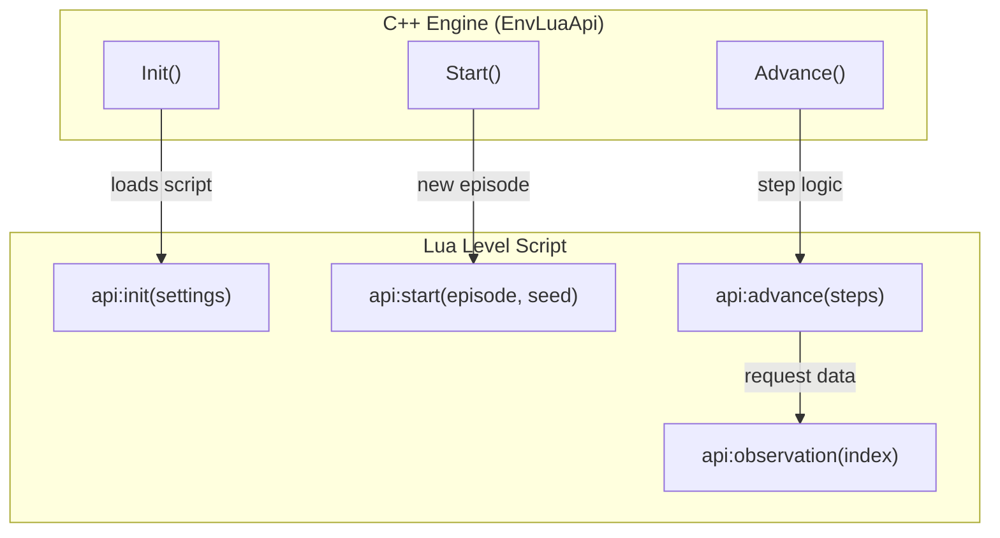
Sources: [dmlab2d/lib/env_lua_api/env_lua_api.cc:164-210](), [dmlab2d/lib/env_lua_api/episode.cc:30-77](), [dmlab2d/lib/env_lua_api/env_lua_api_test.cc:56-179]()

---

## Sub-Topics

### [Level Lifecycle and Callback API](#3.1)
The environment follows a strict protocol of function calls. The `init` function processes user settings, while `observationSpec` and `actionSpec` define the interface for the RL agent. During the simulation, `start` resets the world for a new episode, and `advance` progresses the simulation state.
*   **Core Callbacks**: `init`, `start`, `advance`, `observation`.
*   **Spec Callbacks**: `observationSpec`, `discreteActionSpec`, `continuousActionSpec`, `textActionSpec`.
*   **Property Callbacks**: `readProperty`, `writeProperty`, `listProperty`.

For details, see [Level Lifecycle and Callback API](#3.1).

### [Common Lua Libraries (game_scripts/common)](#3.2)
DeepMind Lab2D provides a suite of Lua-native utility libraries located in `dmlab2d/lib/game_scripts/common/`. These libraries simplify common tasks like object-oriented programming, argument parsing, and table manipulation.
*   **`class.lua`**: A robust OOP system supporting inheritance and mixins.
*   **`tile_set.lua`**: Helpers for managing sprites and rendering.
*   **`properties.lua`**: Constants and helpers for the property tree API.

For details, see [Common Lua Libraries (game_scripts/common)](#3.2).

### [Built-in Levels](#3.3)
The repository includes several reference implementations that demonstrate how to use the API to create complex multi-agent interactions. These levels serve as both functional environments and templates for custom development.
*   **Examples**: `chase_eat`, `commons_harvest`, `running_with_scissors`, and `pushbox`.

For details, see [Built-in Levels](#3.3).

---

## System Module Integration

Level scripts frequently interact with C++ "System" modules for performance-critical tasks. These are exposed to Lua via `require 'system.<name>'`.

| Module | Purpose | Code Reference |
| :--- | :--- | :--- |
| `system.grid_world` | High-performance 2D grid physics and collision. | [docs/system/grid_world.md:1-10]() |
| `system.tensor` | Multi-dimensional array operations (Byte, Int32, Double). | [dmlab2d/lib/env_lua_api/env_lua_api.cc:181-182]() |
| `system.random` | Deterministic, seeded random number generation. | [dmlab2d/lib/env_lua_api/env_lua_api.cc:186-189]() |
| `system.events` | Logging discrete events for analysis. | [dmlab2d/lib/env_lua_api/env_lua_api.cc:184-185]() |

### Code Entity Mapping
The following diagram maps the Lua `require` calls to their underlying C++ implementations within the `EnvLuaApi`.

**Lua-to-C++ Module Mapping**
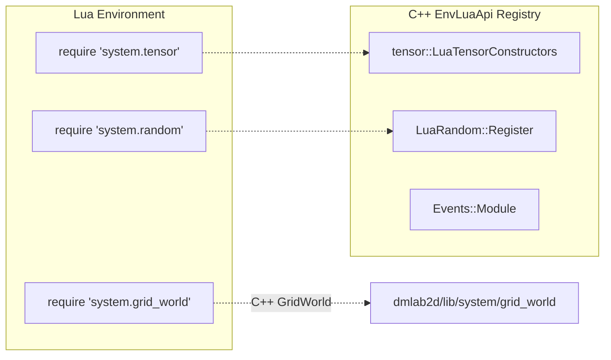
Sources: [dmlab2d/lib/env_lua_api/env_lua_api.cc:164-193](), [dmlab2d/lib/env_lua_api/BUILD:5-40]()

---

# Page: Level Lifecycle and Callback API

# Level Lifecycle and Callback API

<details>
<summary>Relevant source files</summary>

The following files were used as context for generating this wiki page:

- [dmlab2d/lib/env_lua_api/BUILD](dmlab2d/lib/env_lua_api/BUILD)
- [dmlab2d/lib/env_lua_api/actions.cc](dmlab2d/lib/env_lua_api/actions.cc)
- [dmlab2d/lib/env_lua_api/env_lua_api.cc](dmlab2d/lib/env_lua_api/env_lua_api.cc)
- [dmlab2d/lib/env_lua_api/env_lua_api_test.cc](dmlab2d/lib/env_lua_api/env_lua_api_test.cc)
- [dmlab2d/lib/env_lua_api/episode.cc](dmlab2d/lib/env_lua_api/episode.cc)
- [dmlab2d/lib/env_lua_api/events.cc](dmlab2d/lib/env_lua_api/events.cc)
- [dmlab2d/lib/env_lua_api/properties.cc](dmlab2d/lib/env_lua_api/properties.cc)
- [dmlab2d/lib/lua/call.cc](dmlab2d/lib/lua/call.cc)
- [dmlab2d/lib/lua/class.h](dmlab2d/lib/lua/class.h)
- [dmlab2d/lib/lua/read_test.cc](dmlab2d/lib/lua/read_test.cc)
- [dmlab2d/lib/lua/ref.cc](dmlab2d/lib/lua/ref.cc)

</details>


In DeepMind Lab2D, a "level" is defined by a Lua script that implements a specific set of callback functions. These callbacks are orchestrated by the C++ `EnvLuaApi` class to manage the environment's lifecycle, including initialization, action processing, and state transitions.

## Level Discovery and Resolution

When a level is loaded, the `EnvLuaApi` searches for the level script based on the `levelName` and `levelDirectory` settings. The discovery process follows a specific order to resolve the script file and its dependencies.

### Search Strategy
The `EnvLuaApi::PushLevelScriptAndName` function determines the path to the level script:
1.  **Literal Script**: If `levelName` starts with `=`, the remainder is treated as the script content itself [dmlab2d/lib/env_lua_api/env_lua_api.cc:82-84]().
2.  **File Path**: If `levelName` ends in `.lua`, it is treated as a direct file path [dmlab2d/lib/env_lua_api/env_lua_api.cc:124-136]().
3.  **Module Discovery**: If `levelName` is a simple string, the engine looks in the `levelDirectory`. It searches for either `<levelDirectory>/<levelName>.lua` or `<levelDirectory>/<levelName>/init.lua` [dmlab2d/lib/env_lua_api/env_lua_api.cc:141-153]().

The directory containing the level script is automatically added to the Lua `package.path` via `lua_vm_.AddPathToSearchers`, allowing the level to `require` local utility scripts [dmlab2d/lib/env_lua_api/env_lua_api.cc:154-155]().

**Sources:** [dmlab2d/lib/env_lua_api/env_lua_api.cc:81-162]()

## Level Lifecycle Callbacks

The interaction between the C++ engine and the Lua level script is defined by a table of callbacks returned by the script.

### Sequence Diagram: Environment Lifecycle
This diagram illustrates the flow from Python/C++ API calls into the Lua callback implementation.

Title: Environment Lifecycle Flow
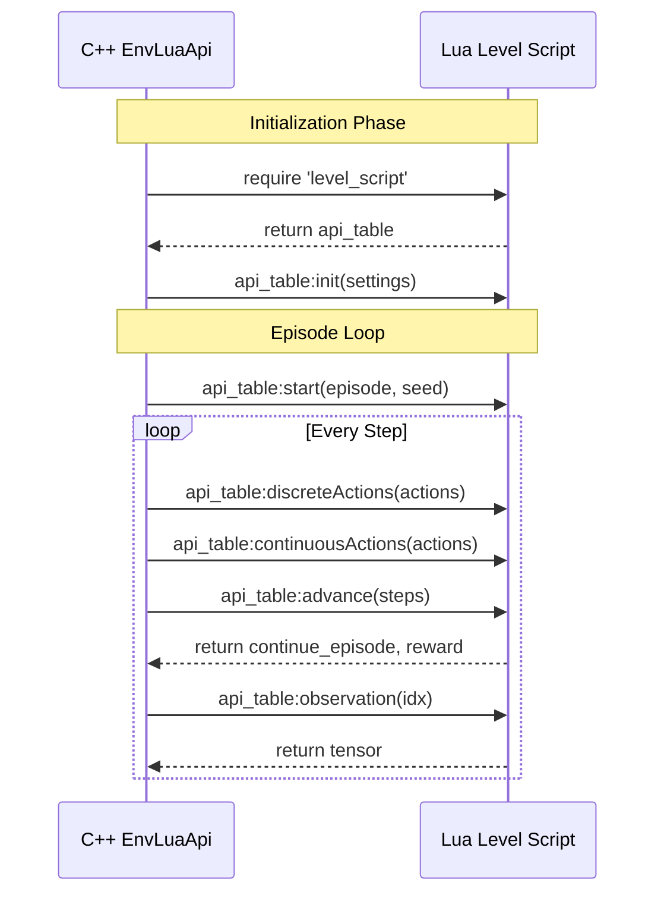
**Sources:** [dmlab2d/lib/env_lua_api/env_lua_api.cc:164-210](), [dmlab2d/lib/env_lua_api/episode.cc:30-77](), [dmlab2d/lib/env_lua_api/actions.cc:161-194]()

### Callback Reference

| Callback | Description | Required |
| :--- | :--- | :--- |
| `init(kwargs)` | Called once after the script is loaded. Used to parse environment settings [dmlab2d/lib/env_lua_api/env_lua_api_test.cc:70-83](). | No |
| `observationSpec()` | Returns an array of tables defining the name, type, and shape of observations [dmlab2d/lib/env_lua_api/env_lua_api_test.cc:85-92](). | Yes |
| `discreteActionSpec()` | Returns an array of tables defining discrete action ranges [dmlab2d/lib/env_lua_api/env_lua_api_test.cc:99-102](). | No |
| `continuousActionSpec()` | Returns an array of tables defining continuous action ranges [dmlab2d/lib/env_lua_api/env_lua_api_test.cc:109-115](). | No |
| `textActionSpec()` | Returns an array of strings naming supported text actions [dmlab2d/lib/env_lua_api/actions.cc:93-112](). | No |
| `start(episode, seed)` | Called at the beginning of every episode to reset state and seed RNGs [dmlab2d/lib/env_lua_api/episode.cc:30-48](). | Yes |
| `advance(steps)` | Progresses the simulation. Returns a boolean (continue) and a number (reward) [dmlab2d/lib/env_lua_api/episode.cc:50-77](). | Yes |
| `observation(idx)` | Returns the observation tensor for the given index (1-based) [dmlab2d/lib/env_lua_api/env_lua_api_test.cc:94-97](). | Yes |

## Property API Callbacks

The Property API allows external inspection and modification of the level state via a hierarchical key-value system.

### Property Callback Logic
The `Properties` C++ class dispatches calls to the following Lua functions if they exist in the level's API table:

1.  **`readProperty(key)`**: Returns a string representation of the property or a status code from `system.properties` [dmlab2d/lib/env_lua_api/properties.cc:147-165]().
2.  **`writeProperty(key, value)`**: Receives a key and a string value. Returns a status code (e.g., `properties.SUCCESS`) [dmlab2d/lib/env_lua_api/properties.cc:133-144]().
3.  **`listProperty(key, callback)`**: Used to discover sub-properties. The level calls the provided `callback(name, mode)` where mode is a string like `'rw'` (read-write) [dmlab2d/lib/env_lua_api/properties.cc:167-182]().

### Data Flow: Property Access
This diagram maps the C++ Property API to the Lua implementation.

Title: Property API Data Flow
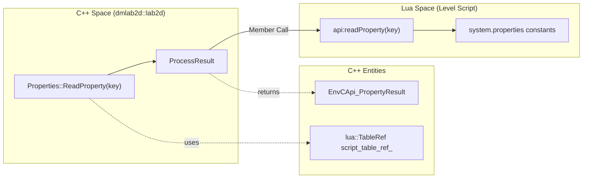
**Sources:** [dmlab2d/lib/env_lua_api/properties.cc:38-67](), [dmlab2d/lib/env_lua_api/properties.cc:133-182]()

## Implementation Details

### Action Handling
Actions are processed by the `Actions` class. It reads the specs during `BindApi` and dispatches actions to the level script via `DiscreteApply`, `ContinuousApply`, and `TextApply` [dmlab2d/lib/env_lua_api/actions.cc:143-195]().
*   **Discrete Actions**: Passed as an array of integers [dmlab2d/lib/env_lua_api/actions.cc:161-164]().
*   **Continuous Actions**: Passed as an array of doubles [dmlab2d/lib/env_lua_api/actions.cc:173-176]().
*   **Text Actions**: Passed as an array of strings [dmlab2d/lib/env_lua_api/actions.cc:185-194]().

### Episode Management
The `Episode` class tracks the `num_elapsed_frames_` and handles the garbage collection trigger at the start of an episode [dmlab2d/lib/env_lua_api/episode.cc:31-36](). It ensures that the `advance` callback receives the correct frame count and translates the Lua return values into `EnvCApi_EnvironmentStatus` [dmlab2d/lib/env_lua_api/episode.cc:50-77]().

**Sources:** [dmlab2d/lib/env_lua_api/episode.cc:1-80](), [dmlab2d/lib/env_lua_api/actions.cc:1-197]()

---

# Page: Common Lua Libraries (game_scripts/common)

# Common Lua Libraries (game_scripts/common)

<details>
<summary>Relevant source files</summary>

The following files were used as context for generating this wiki page:

- [dmlab2d/lib/game_scripts/common/image_helpers.lua](dmlab2d/lib/game_scripts/common/image_helpers.lua)
- [dmlab2d/lib/game_scripts/common/image_helpers_test.lua](dmlab2d/lib/game_scripts/common/image_helpers_test.lua)
- [dmlab2d/lib/game_scripts/common/log.lua](dmlab2d/lib/game_scripts/common/log.lua)
- [dmlab2d/lib/game_scripts/common/tile_set.lua](dmlab2d/lib/game_scripts/common/tile_set.lua)
- [dmlab2d/lib/game_scripts/levels/chase_eat/images.lua](dmlab2d/lib/game_scripts/levels/chase_eat/images.lua)
- [dmlab2d/lib/game_scripts/levels/commons_harvest/images.lua](dmlab2d/lib/game_scripts/levels/commons_harvest/images.lua)
- [dmlab2d/lib/game_scripts/levels/pushbox/images.lua](dmlab2d/lib/game_scripts/levels/pushbox/images.lua)
- [dmlab2d/lib/game_scripts/levels/running_with_scissors/images.lua](dmlab2d/lib/game_scripts/levels/running_with_scissors/images.lua)

</details>


The `dmlab2d/lib/game_scripts/common/` directory contains a suite of reusable Lua modules that provide foundational utilities for building levels. These libraries extend the core C++ system modules with higher-level abstractions for Object-Oriented Programming, sprite management, settings parsing, and logging.

## Core Utility Modules

### OOP System: `class.lua`
The `class.lua` module provides a single-inheritance class system with support for mixins. It is used extensively throughout the codebase to structure level logic into reusable components.
*   **Implementation**: Uses Lua metatables to implement inheritance and constructor chaining via `__init__`.
*   **Mixins**: Allows classes to incorporate functionality from multiple sources without deep inheritance hierarchies.

**Sources**: [dmlab2d/lib/game_scripts/common/class.lua]()

### Logging: `log.lua`
A configurable logging library that supports multiple verbosity levels and colorized output.

| Level | Numeric Value | Description |
| :--- | :--- | :--- |
| `NEVER` | -3 | Suppresses all output. |
| `ERROR` | -2 | Critical issues (Red). |
| `WARN` | -1 | Non-fatal warnings (Orange). |
| `INFO` | 0 | General information (Green). |
| `V(n)` | > 0 | Custom verbosity levels for tracing. |

The log level is controlled via the `logLevel` setting [dmlab2d/lib/game_scripts/common/log.lua:23-28](). Messages are automatically prefixed with the source file and line number [dmlab2d/lib/game_scripts/common/log.lua:89-90]().

**Sources**: [dmlab2d/lib/game_scripts/common/log.lua:16-144]()

---

## Graphics and Sprite Management

The libraries provide tools to bridge raw `system.tensor` data with the `system.tile` rendering engine.

### `image_helpers.lua`
Provides functional utilities for manipulating sprite data before it is loaded into a tile set.

*   **`textToSprite(text, palette)`**: Converts ASCII art strings into `ByteTensor` sprites using a provided color palette [dmlab2d/lib/game_scripts/common/image_helpers.lua:106-139]().
*   **`generateRotations(sprite)`**: Takes a single sprite and returns a tensor containing 4 rotated versions (0, 90, 180, 270 degrees) [dmlab2d/lib/game_scripts/common/image_helpers.lua:31-44]().
*   **`colorToSprite(shape, color)`**: Generates a solid-colored rectangular sprite [dmlab2d/lib/game_scripts/common/image_helpers.lua:54-56]().

### `tile_set.lua`
A high-level wrapper around the `system.tile` C++ module. It simplifies the process of registering sprites into a `world`.

*   **Implementation**: It manages a `tile.Set` object [dmlab2d/lib/game_scripts/common/tile_set.lua:34]() and ensures all added sprites match the required grid size, scaling them if necessary using `image.scale` [dmlab2d/lib/game_scripts/common/tile_set.lua:65-67]().
*   **Data Flow**: Level scripts define "Shapes" (text + palette), which `TileSet:addShape` converts into tensors via `image_helpers` before committing them to the underlying C++ tile renderer [dmlab2d/lib/game_scripts/common/tile_set.lua:95-114]().

**Sprite Processing Pipeline**
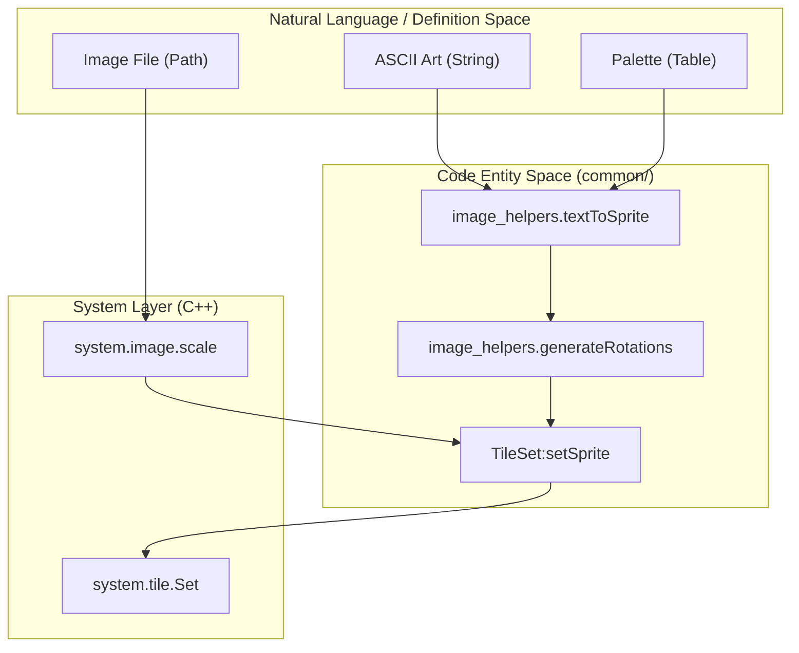
**Sources**: [dmlab2d/lib/game_scripts/common/tile_set.lua:21-121](), [dmlab2d/lib/game_scripts/common/image_helpers.lua:1-145]()

---

## Configuration and Data Structures

### `read_settings.lua`
Facilitates the parsing of settings passed from the Python environment or the command line. It provides type-safe reading and default value handling for level configuration.

### `args.lua`
A utility for validating and extracting arguments from Lua tables, often used for keyword-argument style function calls to ensure required parameters are present.

### `tables.lua` & `set.lua`
*   **`tables.lua`**: Provides deep copying, recursive comparison, and merging of Lua tables.
*   **`set.lua`**: Implements a basic Set data structure for efficient membership testing.

### `strings.lua` & `paths.lua`
*   **`strings.lua`**: Common string manipulation (split, join, trim).
*   **`paths.lua`**: Utilities for handling file paths and ensuring compatibility with the Lab2D runfiles system.

---

## Example: Sprite Definition Flow
The following diagram illustrates how a level script (like `chase_eat`) uses these libraries to define a player sprite.

**Entity Mapping: Level to System**
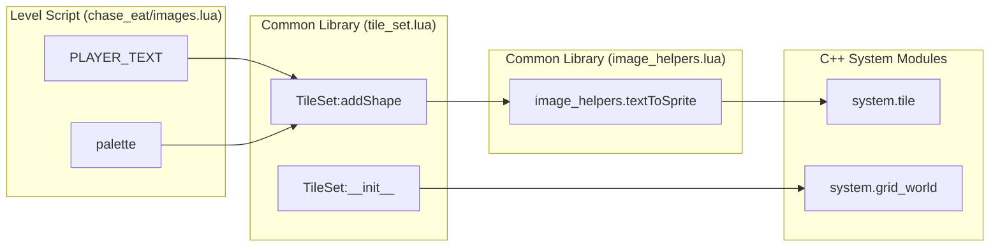

**Sources**: [dmlab2d/lib/game_scripts/levels/chase_eat/images.lua:16-122](), [dmlab2d/lib/game_scripts/common/tile_set.lua:95-114](), [dmlab2d/lib/game_scripts/common/image_helpers.lua:106-139]()

---

# Page: Built-in Levels

# Built-in Levels

<details>
<summary>Relevant source files</summary>

The following files were used as context for generating this wiki page:

- [dmlab2d/lib/game_scripts/levels/clean_up/images.lua](dmlab2d/lib/game_scripts/levels/clean_up/images.lua)
- [dmlab2d/lib/game_scripts/levels/clean_up/simulation.lua](dmlab2d/lib/game_scripts/levels/clean_up/simulation.lua)

</details>


DeepMind Lab2D bundles several example levels that demonstrate the core capabilities of the engine, including complex grid interactions, multi-agent coordination, and procedural generation. These levels serve as both functional environments for reinforcement learning and templates for developers to build custom simulations.

The built-in levels are primarily located in `dmlab2d/lib/game_scripts/levels/`. Each level typically follows a modular structure, separating visual assets, map definitions, and simulation logic.

## 1. Core Level Architecture

The bundled levels utilize a common pattern for defining environment dynamics. This pattern bridges the gap between the C++ engine's raw callbacks and the high-level game mechanics.

### From Natural Language to Code Entities

The following diagram maps high-level game concepts to the specific code structures used in the built-in levels.

**Mapping Game Concepts to Code Entities**
```mermaid
graph TD
    subgraph "Natural Language Space"
        A["Game Rules & Logic"]
        B["Visual Appearance"]
        C["Map Layout"]
        D["Agent Behavior"]
    end

    subgraph "Code Entity Space"
        A1["Simulation Class (simulation.lua)"]
        B1["Tile Set & Images (images.lua)"]
        C1["Text Maps (maps.lua)"]
        D1["Avatar Class (avatar.lua)"]
    end

    A --- A1
    B --- B1
    C --- C1
    D --- D1

    A1 -->|"Uses system.grid_world"| G["grid_world.World"]
    B1 -->|"Uses system.tile"| T["tile.Set"]
    C1 -->|"Parsed by"| M["common.tile_set"]
    D1 -->|"Handles"| ACT["discreteActionSpec"]
```
**Sources:** [dmlab2d/lib/game_scripts/levels/clean_up/simulation.lua:23-48](), [dmlab2d/lib/game_scripts/levels/clean_up/images.lua:184-195]()

---

## 2. Bundled Levels Overview

### 2.1 Chase Eat
`chase_eat` is a simple environment where an agent must navigate a grid to consume items. It demonstrates basic `onContact` triggers and reward accumulation.
*   **Mechanics:** The agent moves in a 2D grid. Contacting "food" pieces triggers a reward and removes the piece or moves it to a "wait" state for respawning.
*   **Implementation:** Uses `system.grid_world` to handle collisions and `onContact` callbacks.

### 2.2 Commons Harvest
`commons_harvest` is a multi-agent social dilemma environment. It simulates a shared resource (apples) that regrows faster if more apples are nearby, but can be permanently depleted if over-harvested.
*   **Mechanics:** Agents harvest apples for reward. If all apples in a patch are picked, they do not regrow.
*   **Key Logic:** The regrowth probability is a function of the local density of existing apples, managed via `grid:setUpdater` in the simulation's `update` loop.

### 2.3 Running with Scissors
This level implements a game-theoretic environment where agents collect resources representing "Rock", "Paper", or "Scissors".
*   **Mechanics:** Agents gather items to build a "hand". When agents interact (e.g., via a "tagging" beam), their collected resources determine the winner based on Roshambo rules.
*   **Implementation:** Leverages `system.grid_world`'s `onHit` callbacks to resolve interactions between agents' beams and their targets.

### 2.4 Pushbox (Sokoban)
`pushbox` is a classic puzzle environment where an agent must push boxes onto target locations.
*   **Procedural Generation:** This level uniquely utilizes `system.generators.pushbox` to create randomized, solvable Sokoban puzzles at the start of every episode.
*   **Mechanics:** Implements "push" physics by checking the state of the cell behind a box when an agent attempts to move into the box's current cell.

---

## 3. Deep Dive: Level Components (Example: Clean Up)

The "Clean Up" environment (often used as a template) illustrates how these components interact.

### Simulation Logic
The `Simulation` class defines the world configuration, including layers and update orders.

| Component | Function | Role |
| :--- | :--- | :--- |
| `worldConfig` | [simulation.lua:59-96]() | Defines `layers`, `renderOrder`, and `states` (e.g., `apple`, `mud`). |
| `stateCallbacks` | [simulation.lua:118-179]() | Defines logic for `onContact` (eating apples) and `onHit` (cleaning mud). |
| `update` | [simulation.lua:185-205]() | Manages global dynamics like mud accumulation and apple regrowth rates. |

**Simulation Flow**
```mermaid
sequenceDiagram
    participant Engine as "C++ EnvLuaApi"
    participant Sim as "Simulation:update"
    participant Grid as "system.grid_world"

    Engine->>Sim: advance()
    Sim->>Grid: groupRandom('river.water')
    Grid-->>Sim: returns random water tile
    Sim->>Grid: setState(tile, 'river.mud')
    Note over Sim: Update regrowth probabilities
    Sim->>Grid: setUpdater(group='apple.wait', prob=...)
```
**Sources:** [dmlab2d/lib/game_scripts/levels/clean_up/simulation.lua:185-205](), [dmlab2d/lib/game_scripts/levels/clean_up/simulation.lua:192-194]()

### Visuals and Palettes
Levels use `system.tile` to define sprites. The `images.lua` file often contains "shape" definitions where characters in a string represent colors in a palette, allowing for easy recoloring of avatars.

*   **Player Palette:** [images.lua:22-163]() defines color schemes (e.g., 'red', 'blue', 'gold') for different agents.
*   **Player Text:** [images.lua:165-182]() provides a ASCII-art style template for the agent's sprite.

### Map Definition
Maps are defined as 2D arrays of strings (text maps).
*   **Map Loading:** The simulation retrieves the layout from `maps.lua` [simulation.lua:98-100]().
*   **View Creation:** `world:createView` uses the text map layout to define the observation window [simulation.lua:103]().

---

## 4. Key Functions and Classes

### `Simulation:stateCallbacks(avatars)`
This function returns a table mapping state names to callback functions.
*   **`onContact`**: Triggered when a piece moves into a cell occupied by another piece [simulation.lua:126-137]().
*   **`onHit`**: Triggered when a "hit" (e.g., a beam or projectile) interacts with a piece [simulation.lua:152-168]().
*   **`onUpdate`**: Triggered by the grid world's update phase based on the defined `updateOrder` [simulation.lua:139-144]().

### `Simulation:addObservations(tileSet, world, observations)`
Configures the visual output of the level.
*   **`tile.Scene`**: A helper to render the grid into an RGB tensor [simulation.lua:105-114]().
*   **`world:createView`**: Defines which part of the grid is visible to the observation [simulation.lua:103]().

**Sources:**
*   `dmlab2d/lib/game_scripts/levels/clean_up/simulation.lua`
*   `dmlab2d/lib/game_scripts/levels/clean_up/images.lua`
*   `dmlab2d/lib/game_scripts/levels/clean_up/maps.lua`

---

# Page: C++ Core Engine

# C++ Core Engine

<details>
<summary>Relevant source files</summary>

The following files were used as context for generating this wiki page:

- [BUILD](BUILD)
- [bazel/BUILD](bazel/BUILD)
- [dmlab2d/lib/BUILD](dmlab2d/lib/BUILD)
- [dmlab2d/lib/dmlab2d.cc](dmlab2d/lib/dmlab2d.cc)
- [dmlab2d/lib/system/file_system/lua/file_system.cc](dmlab2d/lib/system/file_system/lua/file_system.cc)
- [dmlab2d/lib/system/grid_world/grid_test.cc](dmlab2d/lib/system/grid_world/grid_test.cc)
- [third_party/rl_api/BUILD](third_party/rl_api/BUILD)
- [third_party/rl_api/env_c_api_example.syms.lds](third_party/rl_api/env_c_api_example.syms.lds)

</details>


The C++ Core Engine forms the middle layer of the DeepMind Lab2D architecture. It provides a bridge between the high-level Python API and the underlying Lua level scripts. The engine is responsible for managing the Lua virtual machine, orchestrating the environment lifecycle, and exposing a standardized C API (`EnvCApi`) that allows external agents to interact with the simulation.

### System Entry Point: dmlab2d_connect

The primary entry point for the entire engine is the `dmlab2d_connect` function. This function is exported as a C symbol, allowing it to be loaded dynamically by the Python bridge or other RL frameworks.

When `dmlab2d_connect` is called, it instantiates a `Lab2D` wrapper class. This wrapper encapsulates an `EnvLuaApi` instance and binds it to the `EnvCApi` structure using the `rl_api::Bind` helper. This binding maps the C function pointers (like `advance`, `step`, and `observation`) to the corresponding C++ methods in the engine.

#### Entry Point Architecture
The following diagram illustrates how the `dmlab2d_connect` call initializes the core components and binds them to the standardized interface.

**Diagram: Engine Initialization and Binding**
```mermaid
graph TD
    subgraph "External Caller"
        [Python_Bridge] --> |"dmlab2d_connect()"| CONNECT["dmlab2d_connect"]
    end

    subgraph "dmlab2d/lib/dmlab2d.cc"
        CONNECT --> |"instantiates"| L2D["class Lab2D"]
        L2D --> |"contains"| ELA["class EnvLuaApi"]
        L2D --> |"registers"| SYS_MODS["System Modules"]
    end

    subgraph "third_party/rl_api"
        BIND["rl_api::Bind()"]
        E_C_API["struct EnvCApi"]
    end

    CONNECT --> BIND
    BIND --> |"maps methods to"| E_C_API
    E_C_API -.-> |"calls"| L2D
```
Sources: [dmlab2d/lib/dmlab2d.cc:163-168](), [dmlab2d/lib/dmlab2d.cc:36-47]()

### Orchestration: EnvLuaApi

The `EnvLuaApi` class is the central coordinator of the engine. It manages the lifecycle of an environment episode, including initialization, starting new episodes with specific seeds, and advancing the simulation state.

Its primary responsibilities include:
*   **Setting Management**: Handling configuration strings passed from the caller.
*   **Lua Script Loading**: Loading the `init.lua` script for a chosen level.
*   **Data Flow**: Marshaling actions from C++ into the Lua VM and extracting observations and rewards back to C++.
*   **Subsystem Management**: Providing access to specialized managers for actions, observations, events, and properties.

For details, see [EnvLuaApi: C++ to Lua Bridge](#4.1).

Sources: [dmlab2d/lib/dmlab2d.cc:157-158](), [dmlab2d/lib/dmlab2d.cc:49-56]()

### Lua VM Wrapper

The engine interacts with Lua through a type-safe C++ abstraction layer. Instead of calling raw Lua C API functions directly, the engine uses a `Vm` wrapper that simplifies stack management and type conversion.

This layer provides:
*   **Type-Safe Push/Read**: Helpers to move data between C++ types (like `std::string` or `double`) and the Lua stack.
*   **Module Registration**: Mechanisms to expose C++ functionality to Lua via `AddCModuleToSearchers`.
*   **Object Binding**: A system for wrapping C++ classes so they can be manipulated as objects within Lua scripts.

For details, see [Lua VM Wrapper](#4.2).

Sources: [dmlab2d/lib/dmlab2d.cc:39-47](), [dmlab2d/lib/system/file_system/lua/file_system.cc:35-49]()

### RL Environment C Interface (env_c_api)

DeepMind Lab2D adheres to a standardized C interface for reinforcement learning environments. This interface, defined in `env_c_api.h`, ensures that the engine can be used interchangeably with other environments that implement the same contract.

The `EnvCApi` structure contains function pointers for:
*   **Action Specs**: Querying the number and bounds of discrete, continuous, and text actions.
*   **Observation Specs**: Defining the shapes and types of data returned by the environment.
*   **Simulation Control**: Methods for `Start`, `Advance`, and `Reset`.
*   **Property Tree**: A key-value API for inspecting and modifying internal environment state.

For details, see [env_c_api: The RL Environment C Interface](#4.3).

**Diagram: C API Interaction Flow**
```mermaid
sequenceDiagram
    participant Agent as External Agent
    participant C_API as EnvCApi (struct)
    participant Engine as Lab2D (C++ Wrapper)
    participant Lua as Lua VM (Level Script)

    Agent->>C_API: step(actions)
    C_API->>Engine: ActDiscrete/ActContinuous()
    Engine->>Lua: call advance()
    Lua-->>Engine: reward, status
    Engine-->>C_API: return status
    C_API-->>Agent: reward, observation
```
Sources: [third_party/rl_api/env_c_api.h:1-22](), [dmlab2d/lib/dmlab2d.cc:118-138]()

### Summary of Engine Subsystems

| Subsystem | File Path | Role |
| :--- | :--- | :--- |
| **Connection Layer** | `dmlab2d/lib/dmlab2d.cc` | Implements `dmlab2d_connect` and the `Lab2D` class. |
| **EnvLuaApi** | `dmlab2d/lib/env_lua_api/` | Orchestrates level loading and episode lifecycle. |
| **Lua Wrapper** | `dmlab2d/lib/lua/` | Type-safe C++ abstraction for the Lua C API. |
| **C API Contract** | `third_party/rl_api/` | Defines the `EnvCApi` structure and binding utilities. |

Sources: [dmlab2d/lib/BUILD:16-40](), [third_party/rl_api/BUILD:18-43]()

---

# Page: EnvLuaApi: C++ to Lua Bridge

# EnvLuaApi: C++ to Lua Bridge

<details>
<summary>Relevant source files</summary>

The following files were used as context for generating this wiki page:

- [dmlab2d/lib/env_lua_api/BUILD](dmlab2d/lib/env_lua_api/BUILD)
- [dmlab2d/lib/env_lua_api/actions.cc](dmlab2d/lib/env_lua_api/actions.cc)
- [dmlab2d/lib/env_lua_api/env_lua_api.cc](dmlab2d/lib/env_lua_api/env_lua_api.cc)
- [dmlab2d/lib/env_lua_api/env_lua_api_test.cc](dmlab2d/lib/env_lua_api/env_lua_api_test.cc)
- [dmlab2d/lib/env_lua_api/episode.cc](dmlab2d/lib/env_lua_api/episode.cc)
- [dmlab2d/lib/env_lua_api/events.cc](dmlab2d/lib/env_lua_api/events.cc)
- [dmlab2d/lib/env_lua_api/properties.cc](dmlab2d/lib/env_lua_api/properties.cc)
- [dmlab2d/lib/lua/call.cc](dmlab2d/lib/lua/call.cc)
- [dmlab2d/lib/lua/class.h](dmlab2d/lib/lua/class.h)
- [dmlab2d/lib/lua/read_test.cc](dmlab2d/lib/lua/read_test.cc)
- [dmlab2d/lib/lua/ref.cc](dmlab2d/lib/lua/ref.cc)

</details>


The `EnvLuaApi` class is the core orchestrator of DeepMind Lab2D, responsible for bridging the C++ engine with the Lua virtual machine. It implements the `EnvCApi` interface, allowing external callers (like Python or C++ tests) to drive an environment while the actual logic is executed within a Lua script.

## Overview and Purpose

`EnvLuaApi` manages the entire lifecycle of a Lua-based environment. Its primary responsibilities include:
*   **Lua VM Management**: Initializing and configuring the Lua state [dmlab2d/lib/env_lua_api/env_lua_api.cc:52-56]().
*   **Script Loading**: Locating and loading level scripts based on settings like `levelName` and `levelDirectory` [dmlab2d/lib/env_lua_api/env_lua_api.cc:110-162]().
*   **Callback Dispatch**: Translating C++ calls (like `Step`, `Reset`, `Observation`) into Lua function calls on the level script [dmlab2d/lib/env_lua_api/env_lua_api.cc:250-280]().
*   **System Module Registration**: Exposing C++ functionality (tensors, random number generators, events) to the Lua environment via `require 'system.<name>'` [dmlab2d/lib/env_lua_api/env_lua_api.cc:173-192]().

### System Architecture Diagram

This diagram shows how `EnvLuaApi` sits between the RL API and the Lua Level Script.

**EnvLuaApi Component Bridge**
```mermaid
graph TD
    subgraph "C++ Engine Space"
        CApi["EnvCApi (C Interface)"]
        ELA["class EnvLuaApi"]
        VM["class Vm (Lua State)"]
        subgraph "Sub-Managers"
            ACT["class Actions"]
            OBS["class Observations"]
            EVT["class Events"]
            PRO["class Properties"]
            EPI["class Episode"]
        end
    end

    subgraph "Lua Space"
        LS["Level Script (table)"]
        SYS["system.* modules"]
    end

    CApi --> ELA
    ELA --> VM
    ELA --> ACT
    ELA --> OBS
    ELA --> EVT
    ELA --> PRO
    ELA --> EPI

    ACT -- "calls" --> LS
    OBS -- "calls" --> LS
    EPI -- "calls" --> LS
    PRO -- "calls" --> LS
    
    LS -- "require" --> SYS
    SYS -- "binds to" --> EVT
    SYS -- "binds to" --> PRO
```
Sources: [dmlab2d/lib/env_lua_api/env_lua_api.h:35-100](), [dmlab2d/lib/env_lua_api/env_lua_api.cc:164-210]()

## Episode Lifecycle Management

`EnvLuaApi` delegates the core RL loop to the `Episode` and `Actions` classes. The transition from a C++ call to a Lua callback follows a strict pattern.

### Reset and Start
When `Start` is called, the system:
1.  Resets the frame counter [dmlab2d/lib/env_lua_api/episode.cc:31]().
2.  Triggers Lua garbage collection twice to ensure a clean state [dmlab2d/lib/env_lua_api/episode.cc:33-36]().
3.  Calls the `start(episode, seed)` function in the Lua level script [dmlab2d/lib/env_lua_api/episode.cc:38-46]().

### Step and Advance
The `Advance` method handles the progression of time:
1.  Increments `num_elapsed_frames_` [dmlab2d/lib/env_lua_api/episode.cc:52]().
2.  Calls the `advance(steps)` function in Lua [dmlab2d/lib/env_lua_api/episode.cc:55-61]().
3.  Expects a boolean (continue/terminate) and a number (reward) as return values [dmlab2d/lib/env_lua_api/episode.cc:66-76]().

**Sequence: C++ Step to Lua Callback**
```mermaid
sequenceDiagram
    participant C as EnvCApi Caller
    participant ELA as EnvLuaApi
    participant ACT as Actions
    participant EPI as Episode
    participant L as Lua VM (Level Script)

    C->>ELA: Step(actions)
    ELA->>ACT: DiscreteApply / ContinuousApply
    ACT->>L: call "discreteActions(vals)"
    ACT->>L: call "continuousActions(vals)"
    ELA->>EPI: Advance(status, reward)
    EPI->>L: call "advance(elapsed_frames)"
    L-->>EPI: return continue_bool, reward_num
    EPI-->>ELA: update status/reward
    ELA-->>C: return status
```
Sources: [dmlab2d/lib/env_lua_api/env_lua_api.cc:258-278](), [dmlab2d/lib/env_lua_api/actions.cc:161-183](), [dmlab2d/lib/env_lua_api/episode.cc:50-77]()

## Data Flow: Observations and Events

### Observations
Observations are managed by the `Observations` class. It queries the Lua script's `observationSpec()` during initialization [dmlab2d/lib/env_lua_api/env_lua_api.cc:215-220](). When a specific observation is requested by index, it calls the Lua `observation(idx)` function, which must return a `system.tensor` [dmlab2d/lib/env_lua_api/observations.cc:165-183]().

### Events
Events allow the Lua script to send asynchronous data packets back to the engine. 
*   **C++ Side**: `Events` class stores vectors of strings, doubles, and tensors [dmlab2d/lib/env_lua_api/events.h:60-75]().
*   **Lua Side**: The `system.events` module is bound to `LuaEventsModule` [dmlab2d/lib/env_lua_api/events.cc:31-37]().
*   **Mechanism**: Lua calls `events:add("name", ...obs)` which invokes `LuaEventsModule::Add` in C++, pushing data into the `Events` storage [dmlab2d/lib/env_lua_api/events.cc:61-90]().

## Property Tree API

The Property API allows for reading and writing environment configuration at runtime. It maps the C++ `EnvCApi` property functions to Lua callbacks.

| C++ Function | Lua Callback | Description |
| :--- | :--- | :--- |
| `ReadProperty` | `readProperty(key)` | Returns a string value or a result code [dmlab2d/lib/env_lua_api/properties.cc:147-165](). |
| `WriteProperty` | `writeProperty(key, value)` | Returns a result code (SUCCESS, NOT_FOUND, etc.) [dmlab2d/lib/env_lua_api/properties.cc:133-144](). |
| `ListProperty` | `listProperty(key, callback)` | Iterates over children of a key, calling a Lua-provided callback [dmlab2d/lib/env_lua_api/properties.cc:167-182](). |

The module constants (e.g., `properties.SUCCESS`) are defined in C++ and pushed to the Lua module table [dmlab2d/lib/env_lua_api/properties.cc:121-131]().

## Script Discovery and Search Paths

`EnvLuaApi` implements a sophisticated search logic to find level scripts and their dependencies.

1.  **Setting `levelName`**:
    *   If it starts with `=`, the remainder is treated as the script content itself [dmlab2d/lib/env_lua_api/env_lua_api.cc:82-84]().
    *   If it ends in `.lua`, it searches the absolute or relative path provided [dmlab2d/lib/env_lua_api/env_lua_api.cc:124-136]().
    *   Otherwise, it looks for `<levelName>.lua` or `<levelName>/init.lua` inside the `levelDirectory` [dmlab2d/lib/env_lua_api/env_lua_api.cc:141-153]().
2.  **Searcher Paths**: It automatically adds the level's directory and the standard `game_scripts` path to the Lua `package.path` [dmlab2d/lib/env_lua_api/env_lua_api.cc:154-155]().

Sources:
*   `EnvLuaApi` Core: [dmlab2d/lib/env_lua_api/env_lua_api.cc]()
*   Action Handling: [dmlab2d/lib/env_lua_api/actions.cc]()
*   Episode Logic: [dmlab2d/lib/env_lua_api/episode.cc]()
*   Event System: [dmlab2d/lib/env_lua_api/events.cc]()
*   Property API: [dmlab2d/lib/env_lua_api/properties.cc]()
*   Lua Class Binding: [dmlab2d/lib/lua/class.h]()

---

# Page: Lua VM Wrapper

# Lua VM Wrapper

<details>
<summary>Relevant source files</summary>

The following files were used as context for generating this wiki page:

- [dmlab2d/lib/env_lua_api/observations.cc](dmlab2d/lib/env_lua_api/observations.cc)
- [dmlab2d/lib/lua/BUILD](dmlab2d/lib/lua/BUILD)
- [dmlab2d/lib/lua/bind_test.cc](dmlab2d/lib/lua/bind_test.cc)
- [dmlab2d/lib/lua/call_test.cc](dmlab2d/lib/lua/call_test.cc)
- [dmlab2d/lib/lua/ref.h](dmlab2d/lib/lua/ref.h)
- [dmlab2d/lib/lua/table_ref.cc](dmlab2d/lib/lua/table_ref.cc)
- [dmlab2d/lib/lua/vm.cc](dmlab2d/lib/lua/vm.cc)
- [dmlab2d/lib/lua/vm_test.cc](dmlab2d/lib/lua/vm_test.cc)
- [dmlab2d/lib/lua/vm_test_util.h](dmlab2d/lib/lua/vm_test_util.h)

</details>


The Lua VM Wrapper provides a high-level C++ abstraction over the Lua C API. It simplifies interacting with the Lua virtual machine by providing type-safe stack operations, automatic reference management, and mechanisms for embedding C++ modules and Lua scripts directly into the environment's search path.

## The Vm Class

The `Vm` class is the primary entry point for managing a Lua state. It handles the lifecycle of the `lua_State` and configures the environment with custom searchers and error handling.

### Key Responsibilities
*   **Lifecycle Management**: Wraps a `lua_State` and ensures proper initialization. [dmlab2d/lib/lua/vm.h:40-45]().
*   **Custom Searchers**: Implements a `PackageLoader` that allows the Lua `require` function to find modules embedded in the C++ binary. [dmlab2d/lib/lua/vm.cc:36-88]().
*   **Traceback Enhancement**: Installs a custom Lua traceback function to provide readable stack traces with shortened file paths and color-coded error messages. [dmlab2d/lib/lua/vm.cc:115-155]().

### Module Registration
The `Vm` class allows registering C++ functions and Lua scripts as modules that can be loaded via `require` in Lua.

| Function | Description |
| :--- | :--- |
| `AddCModuleToSearchers` | Registers a `lua_CFunction` as a module. Supports up-values for creating closures. [dmlab2d/lib/lua/vm.cc:105-108]() |
| `AddLuaModuleToSearchers` | Registers a raw buffer containing Lua code as a module. [dmlab2d/lib/lua/vm.cc:110-113]() |
| `AddPathToSearchers` | Appends a filesystem path to the Lua `package.path`. [dmlab2d/lib/lua/vm.cc:92-103]() |

**Sources:** [dmlab2d/lib/lua/vm.h:40-100](), [dmlab2d/lib/lua/vm.cc:36-180]()

## Type-Safe Stack Helpers: Push and Read

To avoid the error-prone nature of the raw Lua stack API, the wrapper provides overloaded `Push` and `Read` functions.

### Push Operations
The `Push` function is overloaded for various C++ types (e.g., `int`, `double`, `std::string`, `absl::Span`, `TableRef`). It handles the logic of placing these values onto the Lua stack. [dmlab2d/lib/lua/push.h:30-100]().

### Read Operations
The `Read` function provides a type-safe way to extract values from the stack. It returns a `ReadResult` which indicates if the value was found, missing, or of a mismatched type. [dmlab2d/lib/lua/read.h:30-100]().

**Sources:** [dmlab2d/lib/lua/push.h:1-186](), [dmlab2d/lib/lua/read.h:1-224]()

## Reference Management: TableRef and Ref

The wrapper provides RAII classes to manage Lua objects stored in the Lua Registry (`LUA_REGISTRYINDEX`), preventing memory leaks and ensuring references are valid across C++ calls.

### TableRef
`TableRef` is specialized for interacting with Lua tables. It provides methods for looking up values, inserting new entries, and querying table size.
*   **Creation**: `TableRef::Create(L)` creates a new table and returns a reference. [dmlab2d/lib/lua/table_ref.cc:101-105]().
*   **Member Access**: `LookUp` and `Insert` facilitate C++ to Lua table manipulation. [dmlab2d/lib/lua/table_ref.h:50-80]().
*   **Lifecycle**: On destruction, it automatically calls `luaL_unref`. [dmlab2d/lib/lua/table_ref.cc:24-28]().

### Ref
`Ref` is a general-purpose wrapper for any Lua value (functions, tables, userdata). It is frequently used to store Lua callbacks in C++ classes. [dmlab2d/lib/lua/ref.h:39-61]().

**Sources:** [dmlab2d/lib/lua/table_ref.h:1-130](), [dmlab2d/lib/lua/table_ref.cc:1-130](), [dmlab2d/lib/lua/ref.h:1-130]()

## Call Utilities and Binding

### Call Function
The `Call` utility wraps `lua_pcall`. It handles error reporting by converting Lua errors into a C++ `NResultsOr` object, which contains either the number of results pushed to the stack or an error message. [dmlab2d/lib/lua/call.h:30-45]().

### Bind Mechanism
The `Bind` template allows wrapping C++ functions that return `NResultsOr` so they can be used directly as `lua_CFunction`. This bridges the gap between the wrapper's error handling and Lua's error mechanism. [dmlab2d/lib/lua/bind.h:30-50]().

**Sources:** [dmlab2d/lib/lua/call.h:1-143](), [dmlab2d/lib/lua/bind.h:1-117]()

## Data Flow and System Interaction

The following diagrams illustrate how the C++ components interact with the Lua VM.

### Module Loading Data Flow
This diagram shows how `require` in Lua is intercepted by the `PackageLoader` to find embedded C++ modules.

Title: Module Resolution Flow
```mermaid
graph TD
    subgraph "Lua Space"
        L_REQ["require('my_mod')"]
    end

    subgraph "C++ Entity Space (dmlab2d/lib/lua/vm.cc)"
        VM_PL["PackageLoader"]
        C_MODS["embedded_c_modules_ (flat_hash_map)"]
        L_MODS["embedded_lua_modules_ (flat_hash_map)"]
    end

    L_REQ --> VM_PL
    VM_PL -- "Lookup" --> C_MODS
    VM_PL -- "Lookup" --> L_MODS
    
    C_MODS -- "Found lua_CFunction" --> L_RET["lua_pushcclosure"]
    L_MODS -- "Found buffer" --> L_LOAD["luaL_loadbuffer"]
    
    L_RET --> L_REQ
    L_LOAD --> L_REQ
```
**Sources:** [dmlab2d/lib/lua/vm.cc:36-88](), [dmlab2d/lib/lua/vm.h:92-108]()

### C++ to Lua Interaction Pattern
This diagram maps the C++ classes to their roles in managing the Lua stack and registry.

Title: Lua Wrapper Class Architecture
```mermaid
graph LR
    subgraph "Registry Management"
        TR["TableRef (table_ref.h)"]
        R["Ref (ref.h)"]
    end

    subgraph "Stack Operations"
        P["Push<T> (push.h)"]
        RD["Read<T> (read.h)"]
        C["Call (call.h)"]
    end

    subgraph "Lua VM"
        LS["lua_State"]
        REG["LUA_REGISTRYINDEX"]
    end

    TR -- "luaL_ref / luaL_unref" --> REG
    R -- "luaL_ref / luaL_unref" --> REG
    P -- "lua_push..." --> LS
    RD -- "lua_to..." --> LS
    C -- "lua_pcall" --> LS
```
**Sources:** [dmlab2d/lib/lua/table_ref.h:24-40](), [dmlab2d/lib/lua/ref.h:42-47](), [dmlab2d/lib/lua/call.h:30-40]()

## Class Binding Mechanism

The `dmlab2d/lib/lua/class.h` header provides a mechanism for exposing C++ classes to Lua as userdata with metatables. This allows Lua scripts to instantiate C++ objects and call their methods.

*   **Registration**: Classes are registered with a name and a set of member functions. [dmlab2d/lib/lua/class.h:100-150]().
*   **Method Dispatch**: When a method is called in Lua, the wrapper retrieves the C++ instance from the userdata and dispatches the call to the corresponding C++ method. [dmlab2d/lib/lua/class.h:150-200]().

**Sources:** [dmlab2d/lib/lua/class.h:1-314]()

---

# Page: env_c_api: The RL Environment C Interface

# env_c_api: The RL Environment C Interface

<details>
<summary>Relevant source files</summary>

The following files were used as context for generating this wiki page:

- [BUILD](BUILD)
- [third_party/rl_api/BUILD](third_party/rl_api/BUILD)
- [third_party/rl_api/env_c_api_example.syms.lds](third_party/rl_api/env_c_api_example.syms.lds)
- [third_party/rl_api/env_c_api_test_suite.cc](third_party/rl_api/env_c_api_test_suite.cc)

</details>


The `env_c_api` defines a standardized, pure C interface for reinforcement learning environments. It serves as the primary interoperability layer between the DeepMind Lab2D engine (written in C++) and various frontends or wrappers, such as the Python API. By using a C-compatible structure of function pointers, it ensures binary compatibility across different compilers and languages without requiring complex C++ ABI matching.

## Overview of the C API Structure

The core of the interface is the `EnvCApi` struct, which contains function pointers for every aspect of the environment lifecycle: configuration, initialization, action handling, observation retrieval, and property management.

### Key Components

*   **`EnvCApi`**: A struct holding function pointers that define the environment's capabilities [third_party/rl_api/env_c_api.h:18-22]().
*   **`dmlab2d_connect`**: The standard entry point function used to initialize the `EnvCApi` struct and create an environment context [third_party/rl_api/env_c_api.h:45-46]().
*   **`env_c_api_bind`**: A helper library for binding C++ implementations to the C API structure [third_party/rl_api/BUILD:39-43]().
*   **`env_c_api_test_suite`**: A comprehensive GTest-based compliance suite to ensure an implementation correctly follows the API contract [third_party/rl_api/env_c_api_test_suite.h:17-18]().

### Data Flow and Lifecycle

The lifecycle of an environment via the C API follows a strict sequence: connection, setting configuration, initialization, and then the simulation loop (start, act, advance).

**Environment Lifecycle Diagram**

```mermaid
graph TD
    subgraph "Initialization Phase"
        A["dmlab2d_connect()"] --> B["api.setting(context, key, val)"]
        B --> C["api.init(context)"]
    end

    subgraph "Simulation Loop"
        C --> D["api.start(episode, seed)"]
        D --> E["api.observation(context, index, ... )"]
        E --> F["api.act_discrete / continuous / text"]
        F --> G["api.advance(context, steps, &reward)"]
        G -- "If Status == Running" --> E
        G -- "If Status == Terminated" --> D
    end

    subgraph "Teardown"
        G --> H["api.release_context(context)"]
    end

    style A stroke-width:2px
    style H stroke-width:2px
```
**Sources:** [third_party/rl_api/env_c_api_test_suite.cc:32-205]()

## Function Pointer Contract

The `EnvCApi` struct requires implementations to provide specific functions. The compliance test suite verifies that these pointers are not null and behave according to the spec.

### Metadata and Configuration
| Function | Purpose |
| :--- | :--- |
| `setting` | Sets environment parameters before `init` is called [third_party/rl_api/env_c_api_test_suite.cc:67-69](). |
| `init` | Finalizes configuration and prepares the internal state [third_party/rl_api/env_c_api_test_suite.cc:72-73](). |
| `environment_name` | Returns a string identifier for the environment [third_party/rl_api/env_c_api_test_suite.cc:45](). |

### Action and Observation Specs
The API distinguishes between three types of actions: Discrete, Continuous, and Text.
*   **Discrete Actions**: Handled via `action_discrete_count` and `action_discrete_bounds` [third_party/rl_api/env_c_api_test_suite.cc:75-81]().
*   **Continuous Actions**: Handled via `action_continuous_count` and `action_continuous_bounds` [third_party/rl_api/env_c_api_test_suite.cc:83-85]().
*   **Observations**: Described by `EnvCApi_ObservationSpec` which includes `dims`, `shape`, and `type` (e.g., `EnvCApi_ObservationString` or numeric types) [third_party/rl_api/env_c_api_test_suite.cc:89-115]().

### The Run Loop
The simulation progresses through `advance`, which returns an `EnvCApi_EnvironmentStatus` and the accumulated reward [third_party/rl_api/env_c_api_test_suite.cc:198-201]().

**API Entity Mapping**

```mermaid
classDiagram
    class EnvCApi {
        +setting_fn setting
        +init_fn init
        +start_fn start
        +advance_fn advance
        +observation_fn observation
        +release_context_fn release_context
    }

    class EnvCApi_Observation {
        +EnvCApi_ObservationSpec spec
        +void* data
    }

    class EnvCApi_ObservationSpec {
        +int dims
        +int* shape
        +EnvCApi_ObservationType type
    }

    EnvCApi ..> EnvCApi_Observation : "retrieves via observation()"
    EnvCApi_Observation --> EnvCApi_ObservationSpec : "contains"
```
**Sources:** [third_party/rl_api/env_c_api.h:18-22](), [third_party/rl_api/env_c_api_test_suite.cc:89-115]()

## Connection Entry Point

Every shared library implementing this API must expose a "connect" function. In Lab2D, this is typically named `dmlab2d_connect`.

```c
// Signature defined in env_c_api.h
int dmlab2d_connect(const EnvCApi** api, void** context);
```

When called, the implementation must:
1.  Populate the `EnvCApi` struct with valid function pointers [third_party/rl_api/env_c_api_test_suite.cc:32-33]().
2.  Allocate an internal state object and return it via the `context` pointer [third_party/rl_api/env_c_api_test_suite.cc:32]().

In the Lab2D build system, visibility of this entry point is controlled via linker scripts (e.g., `.lds` files) to ensure only the connect function is exported in the resulting `.so` or `.dylib` [third_party/rl_api/BUILD:49-55](), [third_party/rl_api/env_c_api_example.syms.lds:1]().

## Compliance Testing

The `env_c_api_test_suite` is a reusable library used to validate that any new environment implementation adheres to the `EnvCApi` protocol. It performs the following checks:

1.  **Presence Checks**: Ensures all mandatory function pointers (like `advance`, `start`, `observation_count`) are non-null [third_party/rl_api/env_c_api_test_suite.cc:36-62]().
2.  **Consistency Checks**: Verifies that if an environment reports a non-zero count for an action type, the corresponding `bounds` function is also provided [third_party/rl_api/env_c_api_test_suite.cc:79-85]().
3.  **Observation Validation**: Compares the shape and type of observations returned during `step` against the specs provided during initialization [third_party/rl_api/env_c_api_test_suite.cc:131-167]().
4.  **Property Integrity**: Tests that `read_property`, `write_property`, and `list_property` are accessible [third_party/rl_api/env_c_api_test_suite.cc:47-49]().

**Sources:** [third_party/rl_api/env_c_api_test_suite.cc:27-206](), [third_party/rl_api/BUILD:24-36]()

---

# Page: System Libraries (Lua-accessible C++ Modules)

# System Libraries (Lua-accessible C++ Modules)

<details>
<summary>Relevant source files</summary>

The following files were used as context for generating this wiki page:

- [dmlab2d/lib/system/tensor/lua/tensor.h](dmlab2d/lib/system/tensor/lua/tensor.h)
- [dmlab2d/lib/system/tensor/lua/tensor_test.cc](dmlab2d/lib/system/tensor/lua/tensor_test.cc)
- [docs/system/grid_world.md](docs/system/grid_world.md)
- [docs/system/tensor.md](docs/system/tensor.md)

</details>


DeepMind Lab2D provides a suite of high-performance system modules implemented in C++ and exposed to the Lua environment. These modules provide the foundational building blocks for environment logic, including grid manipulation, numerical computation via tensors, sprite rendering, and procedural generation.

In Lua level scripts, these modules are typically accessed using the `require 'system.<name>'` syntax [docs/system/grid_world.md:4-4]().

### Core Subsystems

The system libraries are divided into several specialized modules, each handling a specific aspect of the simulation engine.

#### system.grid_world: Grid World Engine
The `grid_world` module is the primary engine for 2D simulations. It manages the spatial state of the environment, including piece placement, movement, and interaction logic. It uses a `World` configuration to define static properties (layers, states, update orders) and a `Grid` object for per-episode state [docs/system/grid_world.md:11-14]().

*   **World Configuration:** Defines `renderOrder`, `updateOrder`, and `states` [docs/system/grid_world.md:19-27]().
*   **Grid Lifecycle:** Supports creation via `layout` strings or explicit `size` [docs/system/grid_world.md:88-98]().
*   **Callbacks:** Supports Lua hooks for `onAdd`, `onRemove`, `onUpdate`, `onContact`, and `onHit` [docs/system/grid_world.md:122-154]().

For details, see [system.grid_world: Grid World Engine](#5.1).

#### system.tensor: Tensor Library
The `tensor` module provides a numerical library similar to PyTorch for manipulating data arrays. It supports multiple data types (e.g., `DoubleTensor`, `Int32Tensor`, `ByteTensor`) and allows for shared storage between views [docs/system/tensor.md:1-9]().

*   **Layout Operations:** Includes `reshape`, `transpose`, `narrow`, and `select` [dmlab2d/lib/system/tensor/lua/tensor.h:121-131]().
*   **Arithmetic:** Supports scalar operations (`add`, `mul`) and element-wise view operations (`cadd`, `cmul`) [dmlab2d/lib/system/tensor/lua/tensor.h:138-147]().
*   **Indexing:** Tensors use 1-based indexing in Lua [docs/system/tensor.md:4-5]().

For details, see [system.tensor: Tensor Library](#5.2).

#### system.tile: Sprite Rendering
The `tile` module handles the transformation of grid states into visual observations. It works in conjunction with `grid_world.LayerView` to render a scene into an RGB `ByteTensor` [docs/system/grid_world.md:181-204]().

*   **tile.Set:** Defines the collection of sprites and shapes used for rendering.
*   **tile.Scene:** Manages the rendering process, taking a view of the grid and outputting pixel data [docs/system/grid_world.md:191-203]().

For details, see [system.tile: Sprite Rendering](#5.3).

#### Other Utilities
Additional modules provide essential infrastructure:
*   **system.random:** A seeded, deterministic random number generator supporting uniform, discrete, and shuffled distributions [dmlab2d/lib/system/tensor/lua/tensor_test.cc:53-58]().
*   **system.image:** Utilities for loading and scaling PNG images.
*   **system.file_system:** Methods for reading files from the environment's runfiles [dmlab2d/lib/system/tensor/lua/tensor.h:58-61]().
*   **system.generators:** Specialized procedural generation tools, such as `pushbox` for Sokoban-style maps.

For details, see [Other System Modules: image, random, file_system, generators](#5.4).

### Architecture: Lua to C++ Mapping

The following diagram illustrates how the Lua-accessible module names map to their underlying C++ implementation classes and registration logic.

**System Module Registration Bridge**
```mermaid
graph TD
    subgraph "Lua Space"
        L_GW["require 'system.grid_world'"]
        L_TS["require 'system.tensor'"]
        L_TL["require 'system.tile'"]
        L_RD["require 'system.random'"]
    end

    subgraph "C++ Entity Space (dmlab2d/lib/system/)"
        C_GW["grid_world::LuaGridWorldRegister"]
        C_TS["tensor::LuaTensorRegister"]
        C_TL["tile::LuaTileRegister"]
        C_RD["LuaRandom::Register"]
        
        T_VIEW["TensorView&lt;T&gt;"]
        L_TENS["LuaTensor&lt;T&gt;"]
    end

    L_GW --> C_GW
    L_TS --> C_TS
    L_TL --> C_TL
    L_RD --> C_RD

    C_TS --> L_TENS
    L_TENS --> T_VIEW
```
Sources: [dmlab2d/lib/system/tensor/lua/tensor.h:55-103](), [dmlab2d/lib/system/tensor/lua/tensor_test.cc:53-61]()

### Interaction Flow

The system modules frequently interact to produce environment observations. The `grid_world` defines the state, which is viewed by a `LayerView`, and finally rendered by `tile` into a `tensor`.

**Observation Rendering Pipeline**
```mermaid
sequenceDiagram
    participant L as Lua Level Script
    participant GW as system.grid_world
    participant T as system.tile
    participant TN as system.tensor

    L->>GW: world:createView(kwargs)
    Note over GW: Returns LayerView
    L->>GW: layerView:observation{grid=grid}
    GW-->>L: Returns grid_tensor (ByteTensor)
    L->>T: tile_scene:render(grid_tensor)
    T->>TN: DoubleTensor/ByteTensor allocation
    TN-->>T: raw_storage
    T-->>L: rgb_observation (ByteTensor)
```
Sources: [docs/system/grid_world.md:183-203](), [dmlab2d/lib/system/tensor/lua/tensor.h:103-148]()

| Module | Primary C++ Header | Lua Entry Point | Key Responsibility |
| :--- | :--- | :--- | :--- |
| `grid_world` | `grid_world/lua/grid_world.h` | `World` | Spatial simulation and piece logic. |
| `tensor` | `tensor/lua/tensor.h` | `DoubleTensor`, etc. | Multi-dimensional numerical arrays. |
| `tile` | `tile/lua/tile.h` | `Scene`, `Set` | Pixel-based sprite rendering. |
| `random` | `random/lua/random.h` | `seed` | Deterministic PRNG. |

Sources: [dmlab2d/lib/system/tensor/lua/tensor.h:50-61](), [docs/system/grid_world.md:4-19](), [docs/system/tensor.md:47-55]()

---

# Page: system.grid_world: Grid World Engine

# system.grid_world: Grid World Engine

<details>
<summary>Relevant source files</summary>

The following files were used as context for generating this wiki page:

- [dmlab2d/dmlab2d_pybind.cc](dmlab2d/dmlab2d_pybind.cc)
- [dmlab2d/lib/dmlab2d.cc](dmlab2d/lib/dmlab2d.cc)
- [dmlab2d/lib/system/file_system/lua/file_system.cc](dmlab2d/lib/system/file_system/lua/file_system.cc)
- [dmlab2d/lib/system/grid_world/BUILD](dmlab2d/lib/system/grid_world/BUILD)
- [dmlab2d/lib/system/grid_world/collections/handle.h](dmlab2d/lib/system/grid_world/collections/handle.h)
- [dmlab2d/lib/system/grid_world/collections/object_pool.h](dmlab2d/lib/system/grid_world/collections/object_pool.h)
- [dmlab2d/lib/system/grid_world/collections/shuffled_set.h](dmlab2d/lib/system/grid_world/collections/shuffled_set.h)
- [dmlab2d/lib/system/grid_world/collections/shuffled_set_test.cc](dmlab2d/lib/system/grid_world/collections/shuffled_set_test.cc)
- [dmlab2d/lib/system/grid_world/grid.cc](dmlab2d/lib/system/grid_world/grid.cc)
- [dmlab2d/lib/system/grid_world/grid_shape.h](dmlab2d/lib/system/grid_world/grid_shape.h)
- [dmlab2d/lib/system/grid_world/grid_test.cc](dmlab2d/lib/system/grid_world/grid_test.cc)
- [dmlab2d/lib/system/grid_world/lua/lua_grid.cc](dmlab2d/lib/system/grid_world/lua/lua_grid.cc)
- [dmlab2d/lib/system/grid_world/lua/lua_world.cc](dmlab2d/lib/system/grid_world/lua/lua_world.cc)
- [docs/system/grid_world.md](docs/system/grid_world.md)

</details>


The `system.grid_world` module is a high-performance C++ engine for 2D grid-based environments, exposed to Lua. It manages the simulation of "pieces" (objects) on a discrete grid, handling movement, collision, interactions (hits/beams), and complex lifecycle callbacks.

## World Configuration

The `World` object defines the static properties of the environment that persist across episodes. This includes the definition of states, layers, and the execution order for updates and rendering.

### Configuration Parameters
When creating a `grid_world.World`, the following fields are configured:

| Field | Description |
| :--- | :--- |
| `renderOrder` | An array of layer names defining the Z-order for rendering. [docs/system/grid_world.md:23-23]() |
| `updateOrder` | Defines named update phases (e.g., `update0`, `physics`) called during `grid:update()`. [docs/system/grid_world.md:27-27]() |
| `hits` | Definitions for beam-like interactions, including their layer and sprite. [docs/system/grid_world.md:31-40]() |
| `states` | Definitions for piece types, specifying their default layer, sprite, groups, and contact tags. [docs/system/grid_world.md:42-69]() |

### Code Entity Mapping: World Configuration
The following diagram shows how Lua configuration tables are mapped to C++ `World::Args` and internal handles.

**World Initialization Data Flow**
```mermaid
graph TD
    subgraph "Lua Space"
        L_Table["World Configuration Table"]
        L_States["states = {...}"]
        L_Hits["hits = {...}"]
    end

    subgraph "C++ Bridge (lua_world.cc)"
        LW_Create["LuaWorld::Create"]
        LW_ReadState["ReadStateArg"]
        LW_ReadHit["ReadHitTypeArg"]
    end

    subgraph "C++ Core (world.h)"
        W_Args["World::Args"]
        W_Class["World Class"]
        W_Handles["HandleMap<State, Sprite, Layer>"]
    end

    L_Table --> LW_Create
    L_States --> LW_ReadState
    L_Hits --> LW_ReadHit
    LW_ReadState --> W_Args
    LW_ReadHit --> W_Args
    W_Args --> W_Class
    W_Class --> W_Handles
```
Sources: [dmlab2d/lib/system/grid_world/lua/lua_world.cc:119-190](), [dmlab2d/lib/system/grid_world/world.h:40-100]()

---

## Grid Creation and Manipulation

A `Grid` is an instantiation of a `World` with a specific size and topology. It tracks the positions and states of all `Piece` instances.

### Topology
The engine supports two primary topologies:
*   `BOUNDED`: Standard grid with hard edges. [docs/system/grid_world.md:113-115]()
*   `TORUS`: Coordinates wrap around (top-to-bottom, left-to-right). [docs/system/grid_world.md:116-117]()

### Piece Management
Pieces are the fundamental units of the grid. They are managed using an `ObjectPool` for efficiency. [dmlab2d/lib/system/grid_world/grid.h:35-40]()

*   **Creation**: `grid:createInstance(state, transform)` places a new piece. [dmlab2d/lib/system/grid_world/lua/lua_grid.cc:56-57]()
*   **Movement**: The engine provides methods to move pieces while checking for collisions based on layer occupancy. No two pieces can occupy the same location on the same layer. [docs/system/grid_world.md:44-46]()

Sources: [dmlab2d/lib/system/grid_world/grid.h:30-100](), [dmlab2d/lib/system/grid_world/collections/object_pool.h:29-52]()

---

## Lifecycle Callbacks

The `grid_world` engine uses a callback system to delegate logic to Lua. These are defined in the `stateCallbacks` table during grid creation. [docs/system/grid_world.md:121-154]()

| Callback | Trigger |
| :--- | :--- |
| `onAdd` | Called when a piece is added to the grid. [dmlab2d/lib/system/grid_world/lua/lua_grid.cc:139-139]() |
| `onRemove` | Called when a piece is removed. [dmlab2d/lib/system/grid_world/lua/lua_grid.cc:141-143]() |
| `onUpdate` | Called during `grid:update()` for each update phase defined in `updateOrder`. [dmlab2d/lib/system/grid_world/lua/lua_grid.cc:149-151]() |
| `onContact` | Triggered when a piece enters/leaves the same location as another piece (on different layers). [dmlab2d/lib/system/grid_world/lua/lua_grid.cc:153-159]() |
| `onHit` | Triggered when a piece is struck by a "hit" (beam). Returns whether the hit is absorbed. [dmlab2d/lib/system/grid_world/lua/lua_grid.cc:161-165]() |

### Callback Implementation
The `LuaStateCallback` class in C++ wraps Lua functions and handles the transition between the C++ engine and the Lua VM. [dmlab2d/lib/system/grid_world/lua/lua_grid.cc:69-108]()

Sources: [dmlab2d/lib/system/grid_world/lua/lua_grid.cc:69-166](), [docs/system/grid_world.md:121-154]()

---

## Grid Views and Rendering

`LayerView` objects allow for rendering egocentric or fixed observations of the grid.

*   **Windowing**: Views are defined by offsets (`left`, `right`, `forward`, `backward`) relative to a focal piece or coordinate. [docs/system/grid_world.md:167-170]()
*   **Orientation**: Observations can rotate with the focal piece's orientation. [docs/system/grid_world.md:175-176]()
*   **Data Flow**: `LayerView` produces a tensor of sprite IDs, which is typically consumed by `system.tile.Scene` to produce RGB images. [docs/system/grid_world.md:181-204]()

**Rendering Pipeline**
```mermaid
graph LR
    subgraph "Simulation"
        G["Grid"]
        P["Piece Position/State"]
    end

    subgraph "Observation Generation"
        LV["LayerView::observation"]
        T["Sprite ID Tensor"]
    end

    subgraph "Visuals"
        TS["system.tile.Scene"]
        RGB["RGB ByteTensor"]
    end

    G --> LV
    P --> LV
    LV --> T
    T --> TS
    TS --> RGB
```
Sources: [docs/system/grid_world.md:157-204](), [dmlab2d/lib/system/grid_world/grid_view.h:35-60]()

---

## Collections and Utilities

The engine relies on several optimized C++ collection classes for performance:

### ObjectPool
Manages `Piece` instances. It recycles memory by keeping a list of `unused_handles_`, avoiding frequent allocations during high-turnover simulations.
[dmlab2d/lib/system/grid_world/collections/object_pool.h:29-74]()

### ShuffledSet
Used for managing groups of pieces where the iteration order must be randomized (e.g., to avoid turn-order bias). It supports `ShuffledElements` and `RandomElement`.
[dmlab2d/lib/system/grid_world/collections/shuffled_set.h:33-65]()

### Handle
A strongly-typed wrapper around an integer index. It prevents type errors (e.g., using a `Layer` handle where a `State` handle is expected) while maintaining the performance of a raw index.
[dmlab2d/lib/system/grid_world/collections/handle.h:30-57]()

Sources: [dmlab2d/lib/system/grid_world/collections/object_pool.h:29-102](), [dmlab2d/lib/system/grid_world/collections/shuffled_set.h:33-127](), [dmlab2d/lib/system/grid_world/collections/handle.h:30-74]()

---

# Page: system.tensor: Tensor Library

# system.tensor: Tensor Library

<details>
<summary>Relevant source files</summary>

The following files were used as context for generating this wiki page:

- [dmlab2d/lib/system/tensor/lua/BUILD](dmlab2d/lib/system/tensor/lua/BUILD)
- [dmlab2d/lib/system/tensor/lua/tensor.cc](dmlab2d/lib/system/tensor/lua/tensor.cc)
- [dmlab2d/lib/system/tensor/lua/tensor.h](dmlab2d/lib/system/tensor/lua/tensor.h)
- [dmlab2d/lib/system/tensor/lua/tensor_benchmark.cc](dmlab2d/lib/system/tensor/lua/tensor_benchmark.cc)
- [dmlab2d/lib/system/tensor/lua/tensor_test.cc](dmlab2d/lib/system/tensor/lua/tensor_test.cc)
- [dmlab2d/lib/system/tensor/tensor_view.h](dmlab2d/lib/system/tensor/tensor_view.h)
- [dmlab2d/lib/system/tensor/tensor_view_test.cc](dmlab2d/lib/system/tensor/tensor_view_test.cc)
- [docs/system/tensor.md](docs/system/tensor.md)

</details>


The `system.tensor` library provides a high-performance numerical manipulation toolkit for DeepMind Lab2D. It is designed to be similar to tensors in PyTorch, supporting multi-dimensional arrays with shared storage, various data types, and efficient C++ backed operations.

## Overview and Implementation

The tensor library is implemented as a C++ core with Lua bindings. The core logic resides in `TensorView<T>`, a template class that provides a view into a block of memory.

### Key Components
*   **`Layout`**: Manages the mapping between multi-dimensional indices and flat memory offsets. It supports row-major (C-style) order by default [dmlab2d/lib/system/tensor/tensor_view.h:54-64]().
*   **`TensorView<T>`**: A non-owning view that combines a `Layout` with a pointer to data. It performs arithmetic, slicing, and transposition [dmlab2d/lib/system/tensor/tensor_view.h:234-245]().
*   **`LuaTensor<T>`**: The Lua-facing wrapper that manages storage ownership and exposes C++ methods to the Lua VM [dmlab2d/lib/system/tensor/lua/tensor.h:102-109]().

### Storage and Ownership
Tensors can either own their storage or share it with other tensors.
*   **`StorageVector<T>`**: Used when a tensor owns its memory (e.g., via `clone()` or initial creation) [dmlab2d/lib/system/tensor/lua/tensor.h:87-91]().
*   **Shared Storage**: Layout operations like `select`, `narrow`, and `transpose` create new tensor objects that point to the same underlying memory [docs/system/tensor.md:7-12]().

### Entity Mapping: Lua to C++
The following diagram illustrates how Lua-level tensor types and methods map to the underlying C++ implementation.

**Tensor Library Entity Mapping**
```mermaid
graph TD
    subgraph "Lua Space (system.tensor)"
        LT["tensor.DoubleTensor"]
        LV["val() / val(t)"]
        LO["transpose / narrow / select"]
        LA["add / mul / fill"]
    end

    subgraph "C++ Bridge (dmlab2d/lib/system/tensor/lua/)"
        CLT["LuaTensor<double>"]
        CLB["LuaTensorRegister"]
        CC["LuaTensor::Create"]
    end

    subgraph "C++ Core (dmlab2d/lib/system/tensor/)"
        TV["TensorView<T>"]
        LY["Layout"]
        SV["StorageVector<T>"]
    end

    LT --> CC
    LV --> CLT
    LO --> TV
    LA --> TV
    CLT --> TV
    TV --> LY
    TV --> SV
    CLB --> CLT
```
Sources: [dmlab2d/lib/system/tensor/lua/tensor.h:55-103](), [dmlab2d/lib/system/tensor/tensor_view.h:54-234](), [docs/system/tensor.md:45-55]()

## Tensor Types

There are seven supported tensor types, each corresponding to a specific C++ primitive [docs/system/tensor.md:47-55]().

| Lua Type | C++ Underlying Type | Conversion Method |
| :--- | :--- | :--- |
| `tensor.ByteTensor` | `std::uint8_t` | `:byte()` |
| `tensor.CharTensor` | `std::int8_t` | `:char()` |
| `tensor.Int16Tensor` | `std::int16_t` | `:int16()` |
| `tensor.Int32Tensor` | `std::int32_t` | `:int32()` |
| `tensor.Int64Tensor` | `std::int64_t` | `:int64()` |
| `tensor.FloatTensor` | `float` | `:float()` |
| `tensor.DoubleTensor` | `double` | `:double()` |

Sources: [dmlab2d/lib/system/tensor/lua/tensor.cc:37-44](), [docs/system/tensor.md:129-137]()

## Creation and Initialization

Tensors can be created in several ways via the `system.tensor` module:

1.  **Shape-based**: `tensor.DoubleTensor(dim1, dim2, ...)` creates a zero-initialized tensor of the specified rank and dimensions [docs/system/tensor.md:159-162]().
2.  **Table-based**: `tensor.DoubleTensor{{1, 2}, {3, 4}}` creates a tensor from nested Lua tables [docs/system/tensor.md:173-176]().
3.  **File-based**: `tensor.DoubleTensor{file = {name = 'data.bin', ...}}` reads raw bytes from the filesystem into a rank-1 tensor [docs/system/tensor.md:189-203]().
4.  **Range-based**: `tensor.DoubleTensor{range = {from, to, step}}` creates a rank-1 tensor with arithmetic progression [docs/system/tensor.md:238-243]().

Sources: [dmlab2d/lib/system/tensor/lua/tensor.h:508-620](), [docs/system/tensor.md:148-243]()

## Layout Operations

Layout operations manipulate the `Layout` object without copying the underlying data. This allows for efficient slicing and viewing of data.

*   **`transpose(dim1, dim2)`**: Swaps two dimensions [dmlab2d/lib/system/tensor/tensor_view.h:97-105]().
*   **`select(dim, index)`**: Reduces the rank of the tensor by 1 by fixing a dimension to a specific index [dmlab2d/lib/system/tensor/tensor_view.h:125-134]().
*   **`narrow(dim, index, size)`**: Narrows a dimension to a sub-range `[index, index + size - 1]` [dmlab2d/lib/system/tensor/tensor_view.h:140-149]().
*   **`reshape(new_shape)`**: Changes the shape of a contiguous tensor without altering its data [dmlab2d/lib/system/tensor/tensor_view.h:208-223]().

**Data Flow: Layout Transformation**
```mermaid
graph LR
    subgraph "Memory Storage"
        Data["[0, 1, 2, 3, 4, 5]"]
    end

    subgraph "Tensor A (2x3)"
        L1["Layout: {2, 3} Stride: {3, 1}"]
    end

    subgraph "Tensor B (Select dim 1, idx 1)"
        L2["Layout: {3} Stride: {1} Offset: 0"]
    end

    subgraph "Tensor C (Transpose)"
        L3["Layout: {3, 2} Stride: {1, 3}"]
    end

    Data --- L1
    L1 -- "select(1, 1)" --> L2
    L1 -- "transpose(0, 1)" --> L3
```
Sources: [dmlab2d/lib/system/tensor/tensor_view.h:54-150](), [dmlab2d/lib/system/tensor/tensor_view_test.cc:46-66]()

## Arithmetic and Mathematical Operations

The library provides vectorized operations implemented in C++.

### Scalar Operations
Operations that apply a scalar to every element in the tensor:
*   `add(val)`, `sub(val)`, `mul(val)`, `div(val)` [dmlab2d/lib/system/tensor/lua/tensor.h:138-141]().
*   `fill(val)`: Sets all elements to a specific value [dmlab2d/lib/system/tensor/lua/tensor.h:136]().

### Element-wise (Tensor-Tensor) Operations
Operations between two tensors of matching shapes:
*   `cadd(other)`, `csub(other)`, `cmul(other)`, `cdiv(other)` [dmlab2d/lib/system/tensor/lua/tensor.h:145-147]().

### Linear Algebra
*   **`dot(other)`**: Dot product of two tensors [dmlab2d/lib/system/tensor/lua/tensor.h:127]().
*   **`mmul(other)`**: Matrix multiplication (requires rank-2 tensors) [dmlab2d/lib/system/tensor/lua/tensor.h:148]().

### Reductions and Unary
*   `sum()`, `product()`, `maxElement()`, `minElement()` [dmlab2d/lib/system/tensor/lua/tensor.h:123-159]().
*   `floor()`, `ceil()`, `round()`, `clamp(min, max)` [dmlab2d/lib/system/tensor/lua/tensor.h:135-153]().

Sources: [dmlab2d/lib/system/tensor/lua/tensor.h:112-175](), [dmlab2d/lib/system/tensor/tensor_view.h:345-420]()

## Indexing and Slicing

Lua tensors support 1-based indexing via the `__call` metamethod.

*   **Accessing a value**: `t(i, j, k)` returns a scalar tensor representing the element at that position [docs/system/tensor.md:463-467]().
*   **Slicing**: Passing a table `{start, end}` as an argument performs a `narrow` operation. For example, `t({2, 4}, 1)` is equivalent to `t:narrow(1, 2, 3):select(2, 1)` [docs/system/tensor.md:483-490]().

### `val()` Function
The `val()` method is the primary way to move data between the tensor and Lua:
*   **Getter**: On a scalar tensor, it returns a Lua number. On a multi-dimensional tensor, it returns a nested Lua table [docs/system/tensor.md:65-89]().
*   **Setter**: `val(new_val)` updates the tensor elements using a Lua number or table [docs/system/tensor.md:91-122]().

Sources: [dmlab2d/lib/system/tensor/lua/tensor.h:354-415](), [docs/system/tensor.md:63-122]()

---

# Page: system.tile: Sprite Rendering

# system.tile: Sprite Rendering

<details>
<summary>Relevant source files</summary>

The following files were used as context for generating this wiki page:

- [dmlab2d/lib/game_scripts/common/tile_set.lua](dmlab2d/lib/game_scripts/common/tile_set.lua)
- [dmlab2d/lib/game_scripts/worlds/common/tile_set.lua](dmlab2d/lib/game_scripts/worlds/common/tile_set.lua)
- [dmlab2d/lib/system/tile/BUILD](dmlab2d/lib/system/tile/BUILD)
- [dmlab2d/lib/system/tile/pixel.h](dmlab2d/lib/system/tile/pixel.h)
- [dmlab2d/lib/system/tile/tile_renderer.cc](dmlab2d/lib/system/tile/tile_renderer.cc)

</details>


The `system.tile` module provides a high-performance 2D sprite rendering engine for DeepMind Lab2D. It allows developers to define a set of named sprites (the `tile.Set`) and render them onto a grid-based scene (`tile.Scene`). The engine supports alpha blending, various pixel formats, and efficient composition of multiple sprite layers into a final RGB observation.

## Core Concepts and Data Flow

The rendering pipeline transitions from abstract sprite names defined in Lua to raw pixel manipulation in C++.

1.  **`tile.Set`**: A collection of sprites. Each sprite is identified by a name and contains pixel data (RGB) and optional transparency data (Alpha) [dmlab2d/lib/system/tile/tile_set.h:26-30]().
2.  **`tile.Scene`**: Represents a 2D grid where each cell contains a list of sprite IDs to be rendered.
3.  **`TileRenderer`**: The C++ engine that processes the `tile.Scene` and `tile.Set` to produce a `ByteTensor` observation [dmlab2d/lib/system/tile/tile_renderer.h:25-28]().

### Sprite Rendering Pipeline

The following diagram illustrates how sprite definitions are processed into a rendered frame.

**Diagram: Sprite Rendering Pipeline**
```mermaid
graph TD
    subgraph "Lua Space"
        A["tile.Set:setSprite()"] -- "Sprite Name + ByteTensor" --> B["Internal Sprite Map"]
        C["tile.Scene:setCell()"] -- "Grid Coord + Sprite Names" --> D["Grid of Sprite IDs"]
    end

    subgraph "C++ Entity Space (dmlab2d/lib/system/tile/)"
        B --> E["TileSet Class"]
        D --> F["TileRenderer::Render()"]
        E --> F
        G["Pixel Struct"] --> E
        F -- "Alpha Blending" --> H["Output ByteTensor (RGB)"]
    end

    subgraph "Logic Flow"
        F --> I["Iterate Grid Cells"]
        I --> J["Fetch Sprite IDs for Cell"]
        J --> K["Blend Sprites (Back-to-Front)"]
        K --> L["Write to Destination Tensor"]
    end
```
Sources: [dmlab2d/lib/system/tile/tile_set.h:26-50](), [dmlab2d/lib/system/tile/tile_renderer.h:25-40](), [dmlab2d/lib/game_scripts/common/tile_set.lua:33-51]()

---

## Pixel Representation and Blending

At the lowest level, `system.tile` operates on `Pixel` structures.

### Pixel Structure
A `Pixel` is a 3-byte structure containing Red, Green, and Blue components [dmlab2d/lib/system/tile/pixel.h:39-43]().
*   **`PixelByte`**: An enum wrapping `unsigned char` (0-255) to avoid aliasing issues [dmlab2d/lib/system/tile/pixel.h:29-32]().
*   **`Interp`**: A constexpr function that performs linear interpolation between two pixels based on an alpha value [dmlab2d/lib/system/tile/pixel.h:66-81]().

### Blending Modes
The `TileRenderer` optimizes rendering by categorizing sprites into `SpriteMetaData` types [dmlab2d/lib/system/tile/tile_set.h:32-42]():

| MetaData Type | Description |
| :--- | :--- |
| `kInvisible` | Sprite is not rendered. |
| `kOpaque` | Fully opaque; overwrites previous layers. |
| `kOpaqueConstRgb` | Opaque sprite where every pixel is the same color. |
| `kSemiTransparent` | Uses per-pixel alpha for blending. |
| `kOneBitAlpha` | Alpha is either 0 (transparent) or 255 (opaque). |

Sources: [dmlab2d/lib/system/tile/pixel.h:17-85](), [dmlab2d/lib/system/tile/tile_set.h:32-42]()

---

## C++ Implementation: TileSet and TileRenderer

### TileSet
The `TileSet` class manages the lifecycle of sprite data. It stores:
*   **RGB Data**: A contiguous buffer of `Pixel` values [dmlab2d/lib/system/tile/tile_set.h:73]().
*   **Alpha Data**: A contiguous buffer of `PixelByte` values [dmlab2d/lib/system/tile/tile_set.h:74]().
*   **Metadata**: Information about transparency and color consistency used for rendering optimizations [dmlab2d/lib/system/tile/tile_set.h:72]().

### TileRenderer
The `TileRenderer` is responsible for the actual composition. When `Render` is called, it iterates through the grid provided by the scene. For each cell, it:
1.  Retrieves the list of sprite IDs.
2.  Filters out invisible sprites.
3.  Finds the topmost opaque sprite to skip rendering anything behind it [dmlab2d/lib/system/tile/tile_renderer.cc:156-164]().
4.  Performs back-to-front blending of the remaining sprites [dmlab2d/lib/system/tile/tile_renderer.cc:170-200]().

**Diagram: C++ Class Interaction**
```mermaid
classDiagram
    class TileSet {
        +int num_sprites()
        +SetSprite(int id, TensorView image)
        +GetSpriteMetaData(int id) SpriteMetaData
        -vector~Pixel~ rgb_data_
        -vector~PixelByte~ alpha_data_
    }
    class TileRenderer {
        +Render(Grid, TileSet, ByteTensor)
        -MakeSprite(sprite_indices)
        -pixels_ buffer
    }
    class Pixel {
        +PixelByte r
        +PixelByte g
        +PixelByte b
        +Interp(from, to, alpha)
    }
    TileRenderer ..> TileSet : uses
    TileSet "1" *-- "many" Pixel : contains
```
Sources: [dmlab2d/lib/system/tile/tile_set.h:26-77](), [dmlab2d/lib/system/tile/tile_renderer.h:25-50](), [dmlab2d/lib/system/tile/pixel.h:39-55]()

---

## Lua Interface: tile.Set and TileSet Wrapper

While the C++ layer handles the heavy lifting, Lua provides a high-level API for configuration.

### `tile.Set` (System Module)
Accessed via `require 'system.tile'`.
*   **`setSprite{name, image}`**: Associates a name with a `ByteTensor`. If the tensor has 4 channels, the 4th is treated as Alpha [dmlab2d/lib/game_scripts/common/tile_set.lua:68-71]().

### `common.tile_set` (Lua Wrapper)
The `common.tile_set` library provides a more ergonomic `TileSet` class [dmlab2d/lib/game_scripts/common/tile_set.lua:24](). It simplifies common tasks:
*   **`addColor(name, color)`**: Creates a solid color sprite [dmlab2d/lib/game_scripts/common/tile_set.lua:46-51]().
*   **`addSpritePath(name, path)`**: Loads a sprite from a PNG file using `system.image` [dmlab2d/lib/game_scripts/common/tile_set.lua:83-85]().
*   **`addShape(name, shape)`**: Renders a text-based ASCII art shape into a sprite using a palette [dmlab2d/lib/game_scripts/common/tile_set.lua:95-114]().
*   **Auto-scaling**: Automatically scales input images to match the `tile.Set` shape using nearest-neighbor interpolation [dmlab2d/lib/game_scripts/common/tile_set.lua:65-67]().

### Example Usage
```lua
local tile = require 'system.tile'
local TileSet = require 'common.tile_set'

-- Initialize with world sprite names and tile size (e.g., 8x8 pixels)
local ts = TileSet.TileSet(world, {width = 8, height = 8})

-- Add a simple colored sprite
ts:addColor('wall', {200, 200, 200})

-- Add a sprite from a file
ts:addSpritePath('player', 'assets/player.png')
```
Sources: [dmlab2d/lib/game_scripts/common/tile_set.lua:33-121](), [dmlab2d/lib/game_scripts/worlds/common/tile_set.lua:16-19]()

---

# Page: Other System Modules: image, random, file_system, generators

# Other System Modules: image, random, file_system, generators

<details>
<summary>Relevant source files</summary>

The following files were used as context for generating this wiki page:

- [dmlab2d/lib/dmlab2d.cc](dmlab2d/lib/dmlab2d.cc)
- [dmlab2d/lib/system/file_system/lua/file_system.cc](dmlab2d/lib/system/file_system/lua/file_system.cc)
- [dmlab2d/lib/system/generators/pushbox/BUILD](dmlab2d/lib/system/generators/pushbox/BUILD)
- [dmlab2d/lib/system/generators/pushbox/room.cc](dmlab2d/lib/system/generators/pushbox/room.cc)
- [dmlab2d/lib/system/generators/pushbox/room_candidate_generator.cc](dmlab2d/lib/system/generators/pushbox/room_candidate_generator.cc)
- [dmlab2d/lib/system/grid_world/grid_test.cc](dmlab2d/lib/system/grid_world/grid_test.cc)
- [dmlab2d/lib/system/image/BUILD](dmlab2d/lib/system/image/BUILD)
- [dmlab2d/lib/system/image/lua_image.cc](dmlab2d/lib/system/image/lua_image.cc)

</details>


This page documents the auxiliary C++-implemented Lua modules available in DeepMind Lab2D. These modules provide essential utilities for asset loading, procedural generation, and filesystem access that are not covered by the core grid-world or tensor libraries.

## 1. system.image
The `system.image` module provides utilities for loading image files (primarily PNG) into `system.tensor` objects and performing basic image manipulation like scaling.

### Key Functions
*   **`image.load(path)`**: Loads a PNG image from the filesystem. It returns a `ByteTensor` with shape `(height, width, channels)`. The number of channels depends on the PNG color type (e.g., 1 for Gray, 3 for RGB, 4 for RGBA) [[dmlab2d/lib/system/image/lua_image.cc:129-152](), [dmlab2d/lib/system/image/lua_image.cc:189-196]()].
*   **`image.scale(tensor, shape)`**: Scales an existing tensor to a new `(height, width)` using linear interpolation. It supports tensors with an arbitrary number of channels [[dmlab2d/lib/system/image/lua_image.cc:201-210](), [dmlab2d/lib/system/image/lua_image.cc:238-250]()].

### Implementation Details
The module uses `libpng` to decode image data [[dmlab2d/lib/system/image/lua_image.cc:44-44]()]. It validates the PNG signature and header bit depth (must be 8-bit) before parsing pixels into a raw byte vector which is then used to back a `LuaTensor` [[dmlab2d/lib/system/image/lua_image.cc:87-150]()].

**Image Loading Data Flow**
```mermaid
graph TD
    subgraph "Natural Language Space"
        A["Lua Script"] -- "image.load('file.png')" --> B["image.load C++"]
    end

    subgraph "Code Entity Space"
        B -- "Calls" --> C["util::FileReader"]
        C -- "Reads" --> D["DeepMindReadOnlyFileSystem"]
        B -- "Passes Buffer" --> E["LoadPng"]
        E -- "Uses" --> F["libpng"]
        F -- "Produces" --> G["std::vector<unsigned char>"]
        G -- "Wraps" --> H["tensor::LuaTensor<unsigned char>"]
        H -- "Returns" --> A
    end
```
Sources: [[dmlab2d/lib/system/image/lua_image.cc:80-152](), [dmlab2d/lib/system/image/lua_image.cc:154-199]()]

---

## 2. system.random
The `system.random` module provides a seeded, deterministic pseudo-random number generator (PRNG) for use within Lua levels.

### Key Functions
*   **`uniformInt(min, max)`**: Returns a random integer in the range `[min, max]`.
*   **`uniformReal(min, max)`**: Returns a random double in the range `[min, max)`.
*   **`discreteDistribution(weights)`**: Takes a table of weights and returns an index sampled according to those weights.
*   **`shuffle(table)`**: Performs an in-place Fisher-Yates shuffle on a Lua table.

### Implementation
The module typically wraps a C++ standard library generator (like `std::mt19937_64`) to ensure that environment behavior is perfectly reproducible given a starting seed [[dmlab2d/lib/system/grid_world/grid_test.cc:198-198]()].

---

## 3. system.file_system
The `system.file_system` module provides controlled access to the environment's read-only assets. This is the primary way Lua scripts load external data files beyond what is handled by `require`.

### Class: `LuaFileSystem`
This class is registered in Lua as a module object [[dmlab2d/lib/system/file_system/lua/file_system.cc:35-49]()].

| Function | Description | Source |
| :--- | :--- | :--- |
| `runFiles()` | Returns the root path for runfiles. | [[dmlab2d/lib/system/file_system/lua/file_system.cc:52-55]()] |
| `loadFileToString(path)` | Reads a file from the read-only filesystem into a Lua string. | [[dmlab2d/lib/system/file_system/lua/file_system.cc:57-77]()] |

### Implementation
The module uses `util::FileReader` to interact with the `DeepMindReadOnlyFileSystem` provided during environment initialization [[dmlab2d/lib/system/file_system/lua/file_system.cc:62-63]()].

Sources: [[dmlab2d/lib/system/file_system/lua/file_system.cc:1-96]()]

---

## 4. system.generators.pushbox
This module provides a specialized procedural generator for Sokoban-style (Pushbox) puzzles. It is used to generate solvable layouts for the `pushbox` level.

### Procedural Generation Logic
The generator works by creating a "room" and then performing a reverse-search or flood-fill to ensure reachability and solvability.

1.  **Room Representation**: The `Room` class manages the topology (Walls, Floors, Targets) and the positions of the player and boxes [[dmlab2d/lib/system/generators/pushbox/room.cc:57-69]()].
2.  **Candidate Generation**: `RoomCandidateGenerator` uses a flood-fill algorithm to identify all accessible positions for the player and boxes [[dmlab2d/lib/system/generators/pushbox/room_candidate_generator.cc:118-139]()].
3.  **Scoring**: Rooms are scored based on "displacement" (how far boxes have moved from their origin) and "moved box changes" to ensure the generated level has sufficient complexity [[dmlab2d/lib/system/generators/pushbox/room.cc:156-169]()].

**Pushbox Generator Architecture**
```mermaid
graph LR
    subgraph "Natural Language Space"
        L["Lua: system.generators.pushbox"] -- "Require" --> M["LuaPushboxRequire"]
    end

    subgraph "Code Entity Space"
        M -- "Instantiates" --> G["pushbox::RoomCandidateGenerator"]
        G -- "Operates on" --> R["pushbox::Room"]
        R -- "Contains" --> T["pushbox::TileType"]
        R -- "Contains" --> B["pushbox::Box"]
        G -- "Uses" --> FF["FloodFillRoom"]
    end
```

### Tile Characters
The generator uses a standard character mapping for internal representation:
*   `*`: Wall [[dmlab2d/lib/system/generators/pushbox/room.cc:42-43]()]
*   ` `: Floor [[dmlab2d/lib/system/generators/pushbox/room.cc:45-46]()]
*   `X`: Target [[dmlab2d/lib/system/generators/pushbox/room.cc:48-49]()]
*   `P`: Player [[dmlab2d/lib/system/generators/pushbox/room.cc:35-35]()]
*   `B`: Box [[dmlab2d/lib/system/generators/pushbox/room.cc:37-37]()]

Sources: [[dmlab2d/lib/system/generators/pushbox/room.cc:1-212](), [dmlab2d/lib/system/generators/pushbox/room_candidate_generator.cc:1-161]()]

---

## 5. Module Registration
These modules are registered with the Lua VM during the C++ connection phase via `AddCModuleToSearchers` [[dmlab2d/lib/dmlab2d.cc:39-47]()].

| Lua Module Name | C++ Registration Function |
| :--- | :--- |
| `system.image` | `LuaImageModule` |
| `system.file_system` | `LuaFileSystemRequire` |
| `system.generators.pushbox` | `LuaPushboxRequire` |

Sources: [[dmlab2d/lib/dmlab2d.cc:35-47]()]

---

# Page: Build System and Infrastructure

# Build System and Infrastructure

<details>
<summary>Relevant source files</summary>

The following files were used as context for generating this wiki page:

- [.bazelrc](.bazelrc)
- [BUILD](BUILD)
- [WORKSPACE](WORKSPACE)
- [third_party/rl_api/BUILD](third_party/rl_api/BUILD)
- [third_party/rl_api/env_c_api_example.syms.lds](third_party/rl_api/env_c_api_example.syms.lds)

</details>


This section provides an overview of the DeepMind Lab2D build system, which is centered around **Bazel**. The infrastructure is designed to handle complex multi-language builds (C++, Lua, and Python), manage a variety of third-party dependencies, and provide a robust CI/CD pipeline for cross-platform testing and Python wheel distribution.

### High-Level Build Architecture

The Lab2D build system manages the compilation of the C++ core engine, the integration of different Lua versions, and the packaging of Python bindings. It uses a modular approach where external dependencies are fetched and built from source, ensuring consistency across different development environments.

#### Code-to-System Mapping
The following diagram illustrates how specific build files and configurations map to the functional components of the build system.

**Build Infrastructure Overview**
```mermaid
graph TD
    subgraph "Configuration Layer"
        RC[".bazelrc"]
        BD["build_defs.bzl"]
        WD["wheel_defs.bzl"]
    end

    subgraph "Dependency Management"
        WS["WORKSPACE"]
        PS["python_system.bzl"]
        BZL_DIR["bazel/*.BUILD"]
    end

    subgraph "Output Artifacts"
        SO["dmlab2d_pybind.so"]
        WHL["Python Wheels (.whl)"]
        TESTS["Test Binaries"]
    end

    RC -->|defines| FLAGS["--lua_version"]
    WS -->|loads| PS
    WS -->|fetches| BZL_DIR
    BD -->|macro| PYEXT["pybind_extension"]
    PYEXT --> SO
    WD --> WHL
    FLAGS --> SO
```
**Sources:**
- [`WORKSPACE:1-151`]()
- [`.bazelrc:1-24`]()
- [`BUILD:22-32`]()

---

### Bazel Build Configuration

Lab2D utilizes `.bazelrc` to manage platform-specific settings and feature flags. A key feature is the ability to swap the underlying Lua engine (Lua 5.1, Lua 5.2, or LuaJIT) using the `lua_version` flag alias [`.bazelrc:4-4`]().

Key configuration aspects include:
*   **Toolchain Selection:** Support for `libc++` on Linux and specialized configurations for macOS (including `macos_arm64`) [`.bazelrc:8-24`]().
*   **Build Macros:** The `pybind_extension` macro in `build_defs.bzl` standardizes the creation of Python-compatible shared libraries, handling linker scripts and symbol visibility [`.bazelrc:1-6`]().
*   **Python Integration:** A custom `python_system.bzl` repository rule detects the local Python environment to link against the correct headers and libraries [`python_system.bzl:1-32`]().

For details, see [Bazel Build Configuration](#6.1).

---

### External Dependencies

Lab2D follows a "fetch and build" philosophy for its dependencies to ensure reproducibility. The `WORKSPACE` file defines several `http_archive` rules that download third-party source code, which is then built using local `.BUILD` files located in the `bazel/` directory.

**Dependency Relationships**
```mermaid
graph LR
    subgraph "Core Dependencies"
        ABSL["Abseil (com_google_absl)"]
        EIGEN["Eigen (eigen_archive)"]
        PNG["libpng (png_archive)"]
    end

    subgraph "Scripting & API"
        LUA["Lua/LuaJIT (lua5_x_archive)"]
        PYB["pybind11 (pybind11_archive)"]
        DM_ENV["dm_env (dm_env_archive)"]
    end

    subgraph "Testing"
        GTEST["GoogleTest (com_google_googletest)"]
    end

    ABSL --> DMLAB2D["dmlab2d core"]
    EIGEN --> DMLAB2D
    LUA --> DMLAB2D
    PYB --> DMLAB2D
    DM_ENV --> DMLAB2D
    GTEST --> DMLAB2D
```

Major dependencies include:
*   **Lua Engines:** Multi-stage bootstrap for LuaJIT and standard builds for Lua 5.1/5.2 [`WORKSPACE:82-109`]().
*   **Core Libraries:** Abseil-CPP, Eigen (for tensor operations), and libpng/zlib (for image processing) [`WORKSPACE:37-79`]().
*   **Python Ecosystem:** `pybind11` for the C++/Python bridge and `dm_env` for RL environment compatibility [`WORKSPACE:112-130`]().

For details, see [External Dependencies](#6.2).

---

### CI/CD: Precommit Checks and Wheel Release

The project uses GitHub Actions to automate quality assurance and distribution. The pipeline ensures that the codebase remains functional across multiple compilers and operating systems.

*   **Precommit Checks:** A matrix build strategy tests the code against GCC and LLVM on Linux, as well as Clang on macOS. It verifies compatibility with all three supported Lua versions [`.bazelrc:13-15`]().
*   **Release Automation:** The infrastructure includes logic for building **ManyLinux** compatible Python wheels. These wheels are built for various Python versions and uploaded to PyPI (or TestPyPI) automatically during the release process.
*   **C API Stability:** Compliance tests ensure that the `env_c_api` remains stable, using the `env_c_api_test_suite` to verify the entry points like `dmlab2d_connect` [`third_party/rl_api/BUILD:24-36`]().

For details, see [CI/CD: Precommit Checks and Wheel Release](#6.3).

**Sources:**
- [`WORKSPACE:6-46`]()
- [`third_party/rl_api/BUILD:18-80`]()
- [`third_party/rl_api/env_c_api_example.syms.lds:1-2`]()

---

# Page: Bazel Build Configuration

# Bazel Build Configuration

<details>
<summary>Relevant source files</summary>

The following files were used as context for generating this wiki page:

- [.bazelrc](.bazelrc)
- [build_defs.bzl](build_defs.bzl)
- [dmlab2d/lib/system/generators/pushbox/python/BUILD](dmlab2d/lib/system/generators/pushbox/python/BUILD)
- [dmlab2d/lib/testing/lua_testing.bzl](dmlab2d/lib/testing/lua_testing.bzl)
- [python_system.bzl](python_system.bzl)

</details>


This page documents the Bazel infrastructure used to build, configure, and package DeepMind Lab2D. The build system manages a complex set of requirements, including multiple Lua engine versions, cross-platform support (Linux and macOS), and Python extension generation.

## Bazel Resource Configuration (.bazelrc)

The `.bazelrc` file defines the standard compilation flags and configuration sets (configs) used to toggle between different environment setups.

### Global Options
The project enforces C++17 as the minimum standard and suppresses specific warnings related to sign comparison and attributes to maintain compatibility across different toolchains [[.bazelrc:1-2]]().

### Configuration Sets
Users can apply these configurations using the `--config=<name>` flag:

| Config Name | Description | Implementation Details |
| :--- | :--- | :--- |
| `lua5_1` | Builds against Lua 5.1 | Sets `--lua_version=lua5_1` [[.bazelrc:13]]() |
| `lua5_2` | Builds against Lua 5.2 | Sets `--lua_version=lua5_2` [[.bazelrc:14]]() |
| `luajit` | Builds against LuaJIT | Sets `--lua_version=luajit` [[.bazelrc:15]]() |
| `libc++` | Uses LLVM's libc++ | Overrides `CXXFLAGS` and `LDFLAGS` to use `-stdlib=libc++` [[.bazelrc:8-11]]() |
| `macos` | Apple toolchain | Points to `@local_config_apple_cc` [[.bazelrc:17-19]]() |
| `macos_arm64` | Apple Silicon | Sets `cpu=darwin_arm64` and `macos_target_arch=arm64` [[.bazelrc:21-23]]() |

### Flag Aliases
To simplify command-line interaction, several long-form Bazel flags are aliased:
*   `lua_version`: Maps to `//dmlab2d/lib/lua:lua_version` [[.bazelrc:4]]().
*   `macos_target_arch`: Maps to `@luajit_archive//:target_arch` [[.bazelrc:5]]().

**Sources:**
*   [[.bazelrc:1-24]]()

---

## Python Infrastructure

DeepMind Lab2D uses a custom repository rule to integrate with the host system's Python installation, ensuring that C++ extensions are compiled against the correct headers and linked appropriately.

### python_system.bzl
The `python_repo` repository rule performs introspection on the local `python3` interpreter to generate a Bazel workspace [[python_system.bzl:85-89]]().

1.  **Header Discovery**: It runs a Python snippet using `distutils.sysconfig.get_python_inc` to locate the C headers [[python_system.bzl:55-59]]().
2.  **Symlinking**: The discovered include directory is symlinked into the external repository as `python3/` [[python_system.bzl:78]]().
3.  **ABI Tagging**: It executes a script using the `packaging` library to determine the interpreter, ABI, and platform tags (e.g., `cp310-cp310-manylinux_2_17_x86_64`) and writes them to `defs.bzl` [[python_system.bzl:61-67, 83]]().
4.  **Toolchain Export**: It generates a `cc_library` named `python_headers` which includes the symlinked headers and applies `-Wl,-undefined,dynamic_lookup` on macOS to allow for deferred symbol resolution in shared libraries [[python_system.bzl:25-35]]().

### pybind_extension Macro
Defined in `build_defs.bzl`, this macro simplifies the creation of pybind11 modules. It creates a `cc_binary` with `linkshared = 1` and wraps it in a `py_library` [[build_defs.bzl:20-83]]().

**Logic Flow of `pybind_extension`:**
1.  **Dependencies**: Automatically adds `@pybind11_archive//:pybind11` and `@python_system//:python_headers` [[build_defs.bzl:50-53]]().
2.  **Compilation**: Forces `-fexceptions` and disables header modules for compatibility [[build_defs.bzl:54-55]]().
3.  **Output**: Generates a `.so` file (or `.dylib` equivalent) and returns a `py_library` that includes this shared object in its `data` attribute [[build_defs.bzl:66-83]]().

### System to Code Mapping: Python Integration
The following diagram shows how the `python_repo` rule bridges the system environment to Bazel targets.

Title: Python Repository Rule Data Flow
```mermaid
graph TD
    subgraph "Host System"
        SYS_PY["/usr/bin/python3"]
        SYS_HDRS["/usr/include/python3.x/"]
    end

    subgraph "python_system.bzl"
        REPO_RULE["python_repo (repository_rule)"]
        IMPL["_python_repo_impl"]
        GET_INC["_GET_PYTHON_INCLUDE_DIR"]
        GET_ABI["_GET_PYTHON_SOABI"]
    end

    subgraph "External Repo: @python_system"
        BUILD_FILE["BUILD (generated)"]
        DEFS_BZL["defs.bzl (generated)"]
        PY_HDRS_TARGET["cc_library: python_headers"]
        PY_RUNTIME["py_runtime: py3_runtime"]
    end

    SYS_PY --> REPO_RULE
    REPO_RULE --> IMPL
    IMPL --> GET_INC
    IMPL --> GET_ABI
    GET_INC --> SYS_HDRS
    SYS_HDRS -- "symlink" --> PY_HDRS_TARGET
    GET_ABI -- "write tags" --> DEFS_BZL
    IMPL -- "format template" --> BUILD_FILE
    BUILD_FILE --> PY_HDRS_TARGET
    BUILD_FILE --> PY_RUNTIME
```

**Sources:**
*   [[python_system.bzl:16-89]]()
*   [[build_defs.bzl:20-83]]()

---

## Testing Macros

Lab2D provides specialized macros for running Lua tests within the Bazel environment, ensuring that the necessary C++ libraries and Lua search paths are configured.

### dmlab2d_lua_test
This macro wraps a `cc_test` that executes a Lua script using the Lab2D test runner.
*   **Target**: `//dmlab2d/lib/testing:lua_unit_test_lib` [[dmlab2d/lib/testing/lua_testing.bzl:61]]().
*   **Data Discovery**: It automatically globs files in a directory named `<test_name>_data/` to make them available as runfiles [[dmlab2d/lib/testing/lua_testing.bzl:60]]().
*   **Arguments**: Passes the level script name and the package root to the C++ binary [[dmlab2d/lib/testing/lua_testing.bzl:59]]().

### dmlab2d_lua_level_test
A specialized version of the test macro used to validate environment specifications (observation/action specs) for specific levels. It depends on `//dmlab2d/lib/testing:lua_level_test_lib` [[dmlab2d/lib/testing/lua_testing.bzl:83]]().

**Sources:**
*   [[dmlab2d/lib/testing/lua_testing.bzl:42-85]]()

---

## Build System Entity Relationship

The following diagram illustrates the relationship between the build definitions and the resulting artifacts.

Title: Bazel Build Macro Relationships
```mermaid
graph TD
    subgraph "Build Definitions"
        PB_EXT["pybind_extension (build_defs.bzl)"]
        LUA_TEST["dmlab2d_lua_test (lua_testing.bzl)"]
        LUA_LVL_TEST["dmlab2d_lua_level_test (lua_testing.bzl)"]
    end

    subgraph "Native Rules"
        CC_BIN["native.cc_binary"]
        PY_LIB["native.py_library"]
        CC_TEST["native.cc_test"]
    end

    subgraph "Targets"
        PB_SO["module_name.so"]
        PUSHBOX_PY["//dmlab2d/lib/system/generators/pushbox/python:pushbox"]
        LUA_UNIT["Lua Unit Test Target"]
    end

    PB_EXT -- "calls" --> CC_BIN
    PB_EXT -- "returns" --> PY_LIB
    CC_BIN -- "outputs" --> PB_SO
    PY_LIB -- "contains" --> PB_SO

    LUA_TEST -- "wraps" --> CC_TEST
    LUA_LVL_TEST -- "wraps" --> CC_TEST
    
    CC_TEST -- "deps" --> LUA_LIB["//dmlab2d/lib/testing:lua_unit_test_lib"]

    PUSHBOX_PY -- "is a" --> PB_EXT
```

**Sources:**
*   [[build_defs.bzl:67-83]]()
*   [[dmlab2d/lib/testing/lua_testing.bzl:57-64]]()
*   [[dmlab2d/lib/system/generators/pushbox/python/BUILD:8-17]]()

---

# Page: External Dependencies

# External Dependencies

<details>
<summary>Relevant source files</summary>

The following files were used as context for generating this wiki page:

- [WORKSPACE](WORKSPACE)
- [bazel/dm_env.BUILD](bazel/dm_env.BUILD)
- [bazel/eigen.BUILD](bazel/eigen.BUILD)
- [bazel/lua5_1.BUILD](bazel/lua5_1.BUILD)
- [bazel/lua5_2.BUILD](bazel/lua5_2.BUILD)
- [bazel/luajit.BUILD](bazel/luajit.BUILD)
- [bazel/png.BUILD](bazel/png.BUILD)
- [bazel/pybind11.BUILD](bazel/pybind11.BUILD)
- [bazel/tree.BUILD](bazel/tree.BUILD)
- [bazel/zlib.BUILD](bazel/zlib.BUILD)

</details>


DeepMind Lab2D manages its third-party software stack primarily through the Bazel `WORKSPACE` file and custom build definitions located in the `bazel/` directory. These dependencies provide the foundational runtime for Lua scripting, Python bindings, image processing, and linear algebra.

## Dependency Management Overview

All external archives are fetched via `http_archive` in the root `WORKSPACE` file [WORKSPACE:3-130](). Most of these dependencies use custom `BUILD` files (found in the `bazel/` directory) rather than their upstream build systems to ensure compatibility with Lab2D's specific compiler flags and platform requirements.

### Core Dependency Categories

| Category | Libraries |
| :--- | :--- |
| **Lua Runtimes** | LuaJIT, Lua 5.1, Lua 5.2 |
| **Python Bridge** | pybind11, dm_env, tree |
| **System Utilities** | Abseil (C++ & Python), GoogleTest, Benchmark |
| **Graphics & Math** | libpng, zlib, Eigen |

Sources: [WORKSPACE:6-130]()

---

## Lua Runtimes

Lab2D supports three distinct Lua environments, selectable at build time. The build system manages the complex bootstrapping required for LuaJIT.

### LuaJIT (Multi-stage Bootstrap)
The LuaJIT build process is the most complex dependency in the project. It involves a multi-stage compilation to generate the Just-In-Time (JIT) compiler and VM [bazel/luajit.BUILD:1-256]().

1.  **minilua**: A minimal Lua interpreter is compiled from `src/host/minilua.c` to run build-time scripts [bazel/luajit.BUILD:236-245]().
2.  **DynASM**: LuaJIT uses DynASM to generate assembly code for the VM. The build system selects specific flags based on the target architecture (e.g., `arm64` vs `x86_64`) [bazel/luajit.BUILD:247-256]().
3.  **buildvm**: The `buildvm` tool is generated and used to create various header files (`lj_bcdef.h`, `lj_ffdef.h`, etc.) and the core VM assembly file `lj_vm.S` [bazel/luajit.BUILD:210-215]().

### Standard Lua (5.1 & 5.2)
The standard Lua runtimes are built as simple `cc_library` targets. Both versions glob their respective source files but exclude the standalone interpreter (`lua.c`) and compiler (`luac.c`) to be embedded directly into the Lab2D engine [bazel/lua5_1.BUILD:4-26](), [bazel/lua5_2.BUILD:4-26]().

**Data Flow: LuaJIT Build Process**

```mermaid
graph TD
    subgraph "Stage 1: Host Tools"
        minilua["minilua.c"] --> host_bin["minilua (Binary)"]
    end

    subgraph "Stage 2: Code Generation"
        host_bin --> dynasm["DynASM Scripts"]
        dynasm --> buildvm_c["buildvm.c"]
        buildvm_c --> buildvm_bin["buildvm (Binary)"]
    end

    subgraph "Stage 3: VM Assembly"
        buildvm_bin --> vm_s["lj_vm.S (Assembly)"]
        buildvm_bin --> headers["lj_bcdef.h, lj_ffdef.h..."]
    end

    subgraph "Stage 4: Final Library"
        vm_s --> luajit_lib["cc_library(luajit)"]
        headers --> luajit_lib
        src_files["lib_base.c, lj_api.c..."] --> luajit_lib
    end
```
Sources: [bazel/luajit.BUILD:210-256](), [bazel/lua5_1.BUILD:4-26](), [bazel/lua5_2.BUILD:4-26]()

---

## Python and Reinforcement Learning API

Lab2D integrates with the DeepMind RL ecosystem through several Python-centric dependencies.

### pybind11
Used to create the C++ to Python bridge. The build definition specifically excludes `eigen.h` from the standard glob to manage Eigen integration manually and sets `-fexceptions` to handle C++ exceptions during Python calls [bazel/pybind11.BUILD:4-24]().

### dm_env and tree
*   **dm_env**: Provides the standard Python interface for RL environments. It defines the `Environment` base class and `specs` for observations and actions [bazel/dm_env.BUILD:5-14]().
*   **tree**: A utility for working with nested data structures (nests of NumPy arrays). It includes a C++ extension `_tree.so` built with `pybind11` [bazel/tree.BUILD:6-20]().

### Python Compatibility Shims
The build system relies on standard Python utility libraries:
*   **Abseil Python**: For logging and testing (`absltest`) [WORKSPACE:42-46]().
*   **six/enum34/funcsigs**: Although not explicitly listed in the provided snippets, these are standard requirements for supporting older Python environments and are typically pulled as transitive dependencies of `dm_env`.

Sources: [bazel/pybind11.BUILD:4-24](), [bazel/dm_env.BUILD:5-28](), [bazel/tree.BUILD:1-37]()

---

## Graphics and Math

### libpng and zlib
Lab2D uses `libpng` for loading and saving level assets (sprites, observations). 
*   **zlib**: A prerequisite for `libpng`, providing compression routines [bazel/zlib.BUILD:5-37]().
*   **libpng**: Includes a `genrule` to prepare `pnglibconf.h` from prebuilt scripts [bazel/png.BUILD:6-11](). On ARM64 platforms (including Apple Silicon), it enables NEON intrinsics for optimized filtering and palette operations [bazel/png.BUILD:36-47]().

### Eigen
Eigen is used for high-performance linear algebra. The build configuration enforces `EIGEN_MPL2_ONLY` to ensure that only MPL2-licensed code is compiled, excluding restricted GPL/LGPL components [bazel/eigen.BUILD:58-68]().

**Entity Mapping: Graphics Stack**

```mermaid
graph LR
    subgraph "Code Entity Space"
        PNG_LIB["cc_library(png)"]
        ZLIB["cc_library(zlib)"]
        EIGEN["cc_library(eigen)"]
        PNG_CONF["genrule(pnglibconf)"]
    end

    subgraph "Natural Language / Functionality"
        IO["Image I/O"]
        COMP["Compression"]
        MATH["Linear Algebra"]
    end

    PNG_CONF -- "configures" --> PNG_LIB
    ZLIB -- "dependency" --> PNG_LIB
    PNG_LIB -- "implements" --> IO
    ZLIB -- "implements" --> COMP
    EIGEN -- "implements" --> MATH
```
Sources: [bazel/png.BUILD:13-57](), [bazel/zlib.BUILD:5-37](), [bazel/eigen.BUILD:58-68]()

---

## System Libraries and Testing

### Abseil (C++)
Abseil is the primary utility library for C++, providing string helpers, containers, and synchronization primitives. It is fetched directly from GitHub [WORKSPACE:36-40]().

### GoogleTest and Benchmark
*   **GoogleTest**: The framework used for all C++ unit tests [WORKSPACE:6-10]().
*   **Benchmark**: Used for performance regression testing of the engine's core loops [WORKSPACE:12-16]().

| Dependency | WORKSPACE Name | BUILD File |
| :--- | :--- | :--- |
| **Abseil** | `@com_google_absl` | Internal to Archive |
| **GoogleTest** | `@com_google_googletest` | Internal to Archive |
| **Eigen** | `@eigen_archive` | `bazel/eigen.BUILD` |
| **libpng** | `@png_archive` | `bazel/png.BUILD` |

Sources: [WORKSPACE:6-57]()

---

# Page: CI/CD: Precommit Checks and Wheel Release

# CI/CD: Precommit Checks and Wheel Release

<details>
<summary>Relevant source files</summary>

The following files were used as context for generating this wiki page:

- [.github/workflows/make_wheel.yml](.github/workflows/make_wheel.yml)
- [.github/workflows/precommit.yml](.github/workflows/precommit.yml)
- [.github/workflows/pypi_upload.yml](.github/workflows/pypi_upload.yml)

</details>


This page documents the automated pipelines for DeepMind Lab2D, including continuous integration (CI) for code quality and the release workflows for distributing Python wheels to PyPI.

## 1. Precommit Workflow (`precommit.yml`)

The `precommit` workflow ensures that changes to the codebase do not break the build or tests across a matrix of operating systems, compilers, and Lua versions. It is triggered on every push to `main` and `beta` branches, as well as on pull requests `[.github/workflows/precommit.yml:5-11]()`.

### 1.1 Matrix Build Strategy
The workflow uses a strategy matrix to cover diverse environments:
*   **Linux (Ubuntu 22.04):** Tests GCC 12 and Clang/LLVM. It supports both `libstdc++` and `libc++` configurations `[.github/workflows/precommit.yml:29-31]()`.
*   **MacOS (12 & 13):** Tests both x86_64 and ARM64 (Apple Silicon) architectures using LLVM/Clang and `libc++` `[.github/workflows/precommit.yml:32-35]()`.

### 1.2 Multi-Lua Configuration
For every environment in the matrix, the workflow executes builds and tests against three supported Lua runtimes:
1.  **Lua 5.1:** Triggered via `--config=lua5_1` `[.github/workflows/precommit.yml:56-60]()`.
2.  **Lua 5.2:** Triggered via `--config=lua5_2` `[.github/workflows/precommit.yml:64-68]()`.
3.  **LuaJIT:** Triggered via `--config=luajit` `[.github/workflows/precommit.yml:72-76]()`.
4.  **LuaJIT (Internal Unwind):** A specialized build testing LuaJIT without external unwinding tables using `--luajit_external_unwinder=False` `[.github/workflows/precommit.yml:80-84]()`.

### 1.3 Execution Flow
The workflow installs necessary Python dependencies (`numpy`, `packaging`) and then runs `bazel build //...` followed by `bazel test //...` for each Lua configuration `[.github/workflows/precommit.yml:44-84]()`. Note that tests are skipped on ARM64 runners as the current GitHub Action runners for ARM64 are used for building only `[.github/workflows/precommit.yml:58, 66, 74, 82]()`.

**Sources:**
*   `.github/workflows/precommit.yml`

---

## 2. Wheel Release Workflow (`make_wheel.yml`)

The `release_wheel` workflow automates the creation of a GitHub Release and the compilation of Python wheels for multiple platforms and Python versions. It is triggered by tags starting with `release*` `[.github/workflows/make_wheel.yml:7-9]()`.

### 2.1 Release Creation
The `create-release` job initializes a draft release on GitHub. It outputs an `upload-url` which subsequent jobs use to attach binary assets `[.github/workflows/make_wheel.yml:12-33]()`.

### 2.2 Multi-Platform Wheel Building
The `build-wheel` job runs a matrix across:
*   **Platforms:** ManyLinux 2.31, ManyLinux 2.35, and various MacOS versions (Intel and ARM) `[.github/workflows/make_wheel.yml:43-52]()`.
*   **Python Versions:** 3.8, 3.9, 3.10, and 3.11 `[.github/workflows/make_wheel.yml:54-57]()`.

### 2.3 Build and Verification
The wheels are built using Bazel with the `//dmlab2d:dmlab2d_wheel` target `[.github/workflows/make_wheel.yml:75]()`. The workflow includes a verification step that installs the newly built wheel and runs a smoke test using the `chase_eat` level to ensure the C++ engine and Python bridge are functional `[.github/workflows/make_wheel.yml:89-97]()`.

#### Workflow Entity Mapping
The following diagram maps the GitHub Action steps to the specific Bazel and Python entities they interact with.

**Title: Wheel Build and Verification Flow**
```mermaid
graph TD
    subgraph "GitHub Action: build-wheel"
        A["Step: Build Wheel"] --> B["bazel build //dmlab2d:dmlab2d_wheel"]
        B --> C["Step: Check contents"]
        C --> D["check-wheel-contents"]
        D --> E["Step: Test wheel"]
    end

    subgraph "Python Smoke Test"
        E --> F["import dmlab2d"]
        F --> G["dmlab2d.runfiles_helper.find()"]
        G --> H["dmlab2d.Lab2d(..., 'chase_eat')"]
        H --> I["dmlab2d.Environment(...)"]
        I --> J["env.step({})"]
    end

    subgraph "Release Asset"
        J --> K["Step: Upload Release Asset"]
        K --> L["actions/upload-release-asset@v1"]
    end
```
**Sources:**
*   `.github/workflows/make_wheel.yml`

---

## 3. PyPI Distribution Workflow (`pypi_upload.yml`)

The `pypi_upload` workflow handles the final stage of distribution: moving assets from a GitHub Release to PyPI and TestPyPI.

### 3.1 Distribution Logic
This workflow can be triggered manually via `workflow_dispatch` or automatically when a release is published `[.github/workflows/pypi_upload.yml:5-21]()`.

1.  **Download:** It uses the GitHub CLI (`gh release download`) to pull all wheel assets from the specified release into a `dist/` directory `[.github/workflows/pypi_upload.yml:39]()`.
2.  **TestPyPI:** If requested, it publishes to `https://test.pypi.org/legacy/` first for verification `[.github/workflows/pypi_upload.yml:41-46]()`.
3.  **PyPI:** Finally, it publishes the wheels to the production PyPI repository `[.github/workflows/pypi_upload.yml:48-53]()`.

### 3.2 Security and Permissions
The job `upload-wheels-to-pypi` uses OpenID Connect (OIDC) for authentication with PyPI, requiring `id-token: write` permissions `[.github/workflows/pypi_upload.yml:30-31]()`.

#### Data Flow: Release to Distribution
The following diagram illustrates the data flow from the GitHub Release storage to the PyPI package indexes.

**Title: Distribution Data Flow**
```mermaid
graph LR
    subgraph "GitHub Infrastructure"
        R["GitHub Release Assets (.whl)"]
        W["pypi_upload.yml Workflow"]
    end

    subgraph "Package Indexes"
        TP["TestPyPI"]
        P["PyPI (Production)"]
    end

    W -- "gh release download" --> R
    R -- "pypa/gh-action-pypi-publish" --> TP
    R -- "pypa/gh-action-pypi-publish" --> P

    style R stroke-dasharray: 5 5
```
**Sources:**
*   `.github/workflows/pypi_upload.yml`

## 4. Summary of Workflows

| Workflow | Purpose | Trigger | Key Targets/Tools |
| :--- | :--- | :--- | :--- |
| `precommit` | CI / Code Quality | PR, Push to main | `bazel test //...` |
| `make_wheel` | Build Binaries | Release Tag | `//dmlab2d:dmlab2d_wheel` |
| `pypi_upload` | Distribution | Release Published | `gh-action-pypi-publish` |

**Sources:**
*   `.github/workflows/precommit.yml`
*   `.github/workflows/make_wheel.yml`
*   `.github/workflows/pypi_upload.yml`

---

# Page: Testing Infrastructure

# Testing Infrastructure

<details>
<summary>Relevant source files</summary>

The following files were used as context for generating this wiki page:

- [dmlab2d/lib/testing/lua_testing.bzl](dmlab2d/lib/testing/lua_testing.bzl)
- [dmlab2d/lib/util/BUILD](dmlab2d/lib/util/BUILD)
- [dmlab2d/lib/util/file_reader_test.cc](dmlab2d/lib/util/file_reader_test.cc)
- [dmlab2d/lib/util/test_srcdir.cc](dmlab2d/lib/util/test_srcdir.cc)

</details>


DeepMind Lab2D employs a multi-layered testing strategy to ensure the integrity of its C++ core engine, Lua scripting environment, and Python API. The infrastructure is designed to validate both the low-level simulation logic and the high-level reinforcement learning (RL) environment contracts.

## Overview of Testing Layers

The testing approach is divided into three primary domains, each utilizing specialized tools and frameworks:

| Domain | Primary Framework | Key Components |
| :--- | :--- | :--- |
| **C++ Core** | [GoogleTest](https://github.com/google/googletest) | Unit tests for `grid_world`, `tensor`, and `lua` wrappers. |
| **Lua Scripts** | `dmlab2d_lua_test` (Bazel) | Unit tests for game logic and common libraries using a custom Lua test runner. |
| **Python API** | `dm_env.test_utils` | Validation of the `dm_env` interface compliance and pybind11 bindings. |
| **Integration** | `env_c_api_test_suite` | Compliance testing for the standardized C API. |

### Testing Architecture Flow

The following diagram illustrates how different testing entities interact with the codebase layers:

**Testing Entity Association**
```mermaid
graph TD
    subgraph "Test Suites"
        GTest["GoogleTest (C++)"]
        LuaMacro["dmlab2d_lua_test (Bazel)"]
        PyTest["Python Unittest"]
    end

    subgraph "Code Entities"
        C_Core["dmlab2d/lib/ (C++ Engine)"]
        Lua_Lib["dmlab2d/lib/game_scripts/common/"]
        Py_API["dmlab2d/python/"]
    end

    GTest -->|Tests| C_Core
    LuaMacro -->|Executes| Lua_Lib
    PyTest -->|Validates| Py_API
    
    subgraph "Helpers"
        TSD["TestSrcDir()"]
        TR["test_runner.lua"]
    end

    C_Core -.-> TSD
    Lua_Lib -.-> TR
```
**Sources:** [dmlab2d/lib/util/BUILD:15-88](), [dmlab2d/lib/testing/lua_testing.bzl:42-84]()

---

## C++ Testing Patterns

C++ tests are primarily located alongside the source code in `dmlab2d/lib/`. They utilize GoogleTest and GoogleMock for unit verification.

*   **Test Data Locating:** The `TestSrcDir()` utility in `dmlab2d/lib/util/test_srcdir.cc` is used to reliably locate assets and data files within the Bazel runfiles directory during test execution [dmlab2d/lib/util/test_srcdir.cc:27-33]().
*   **File System Mocking:** Many tests, such as `file_reader_test.cc`, demonstrate how to mock the `DeepMindReadOnlyFileSystem` to test file operations without relying on the actual disk [dmlab2d/lib/util/file_reader_test.cc:160-166]().
*   **API Compliance:** The `env_c_api_test_suite` provides a standardized way to ensure that any implementation of the RL C API (defined in `env_c_api.h`) behaves correctly.

For detailed patterns and examples, see **[C++ Testing Patterns (#7.1)]**.

**Sources:** [dmlab2d/lib/util/test_srcdir.cc:25-35](), [dmlab2d/lib/util/file_reader_test.cc:32-61]()

---

## Lua Testing Patterns

Lua tests are integrated into the Bazel build system via custom macros. This allows Lua scripts to be tested with the same rigor as C++ code.

*   **Bazel Integration:** The `dmlab2d_lua_test` macro in `lua_testing.bzl` wraps a `cc_test` that initializes a Lua VM, loads the Lab2D system libraries, and executes a Lua-based test runner [dmlab2d/lib/testing/lua_testing.bzl:42-64]().
*   **Test Runner:** Lua tests typically require `testing.test_runner` and return the result of `test_runner.run(tests)` [dmlab2d/lib/testing/lua_testing.bzl:25-39]().
*   **Level Validation:** The `dmlab2d_lua_level_test` macro is specifically designed to validate that a level script correctly implements the required Lab2D callbacks (e.g., `start`, `step`, `observation`) [dmlab2d/lib/testing/lua_testing.bzl:66-84]().

For details on mocking and helper modules, see **[Lua Testing Patterns (#7.2)]**.

**Sources:** [dmlab2d/lib/testing/lua_testing.bzl:1-40]()

---

## Python API Testing

The Python layer is tested to ensure it adheres to the `dm_env` standard. This involves:
1.  **Spec Validation:** Checking that `observation_spec()` and `action_spec()` return the correct types and shapes.
2.  **Lifecycle Testing:** Ensuring `reset()` and `step()` transitions match the expected RL trajectory.
3.  **Property Tree:** Verifying that C++ properties are correctly exposed and modifiable via the Python `read_property` and `write_property` methods.

**Code Entity Mapping: Test Infrastructure**
```mermaid
graph LR
    subgraph "C++ Support"
        A["test_srcdir.cc"] -->|Locates| B["Bazel Runfiles"]
        C["file_reader_test.cc"] -->|Mocks| D["DeepMindReadOnlyFileSystem"]
    end

    subgraph "Lua Support"
        E["lua_testing.bzl"] -->|Macro| F["dmlab2d_lua_test"]
        F -->|Uses| G["lua_unit_test_lib"]
    end

    subgraph "Python Support"
        H["dmlab2d/__init__.py"] -->|Tested by| I["dm_env.test_utils"]
    end
```
**Sources:** [dmlab2d/lib/util/BUILD:79-88](), [dmlab2d/lib/testing/lua_testing.bzl:57-61]()

---

# Page: C++ Testing Patterns

# C++ Testing Patterns

<details>
<summary>Relevant source files</summary>

The following files were used as context for generating this wiki page:

- [dmlab2d/lib/dmlab2d.cc](dmlab2d/lib/dmlab2d.cc)
- [dmlab2d/lib/lua/vm_test.cc](dmlab2d/lib/lua/vm_test.cc)
- [dmlab2d/lib/lua/vm_test_util.h](dmlab2d/lib/lua/vm_test_util.h)
- [dmlab2d/lib/system/file_system/lua/file_system.cc](dmlab2d/lib/system/file_system/lua/file_system.cc)
- [dmlab2d/lib/system/grid_world/collections/shuffled_set_test.cc](dmlab2d/lib/system/grid_world/collections/shuffled_set_test.cc)
- [dmlab2d/lib/system/grid_world/grid_test.cc](dmlab2d/lib/system/grid_world/grid_test.cc)
- [dmlab2d/lib/util/BUILD](dmlab2d/lib/util/BUILD)
- [dmlab2d/lib/util/file_reader_test.cc](dmlab2d/lib/util/file_reader_test.cc)
- [dmlab2d/lib/util/test_srcdir.cc](dmlab2d/lib/util/test_srcdir.cc)
- [third_party/rl_api/env_c_api_test_suite.cc](third_party/rl_api/env_c_api_test_suite.cc)

</details>


This page documents the C++ testing infrastructure for DeepMind Lab2D. The testing suite is built on **GoogleTest** and **GoogleMock**, providing robust validation for the core engine, system modules, and C API compliance.

## Test Data and Environment

To ensure tests can locate assets (like Lua scripts or level data) regardless of the execution environment, Lab2D uses a specialized utility to resolve the source directory within the Bazel runfiles tree.

### TestSrcDir Utility
The `TestSrcDir` function provides a reliable way to find the root of the workspace during test execution. It combines the GoogleTest `SrcDir()` with the `TEST_WORKSPACE` environment variable.

*   **Implementation**: `deepmind::lab2d::util::TestSrcDir()` [dmlab2d/lib/util/test_srcdir.cc:27-33]().
*   **Usage**: Frequently used in `VmTest` to add paths to the Lua searchers [dmlab2d/lib/lua/vm_test.cc:135-140]().

**Diagram: Test Data Resolution**
```mermaid
graph TD
    subgraph "Bazel Sandbox"
        ENV["Environment Variable: TEST_WORKSPACE"]
        G_SRC["::testing::SrcDir()"]
    end

    U_TSD["util::TestSrcDir()"]
    L_VM["lua::Vm::AddPathToSearchers"]

    G_SRC --> U_TSD
    ENV --> U_TSD
    U_TSD -- "Absolute Path" --> L_VM
    L_VM -- "require 'module'" --> FS["File System"]
```
Sources: [dmlab2d/lib/util/test_srcdir.cc:27-33](), [dmlab2d/lib/lua/vm_test.cc:135-140]()

---

## File Reader Patterns

Testing file operations involves the `util::FileReader` class and the `DeepMindReadOnlyFileSystem` interface. Tests typically verify both real filesystem interaction and mocked behavior.

### FileReaderTest Implementation
The `FileReaderTest` fixture creates a temporary directory and populates it with known content to verify read offsets and sizes [dmlab2d/lib/util/file_reader_test.cc:32-50]().

*   **Full Read**: Verifies that `FileReader::Read` captures the exact file content [dmlab2d/lib/util/file_reader_test.cc:52-61]().
*   **Partial Reads**: Tests reading specific byte ranges (first 10, middle 10, last 10) [dmlab2d/lib/util/file_reader_test.cc:63-97]().
*   **Error Handling**: Validates behavior when files are missing or reads exceed file boundaries [dmlab2d/lib/util/file_reader_test.cc:99-127]().

### Mocking the File System
To test `FileReader` without disk I/O, a `DeepMindReadOnlyFileSystem` struct is populated with "fake" C-style function pointers [dmlab2d/lib/util/file_reader_test.cc:128-166](). This pattern is also used within the `system.file_system` Lua module to bridge Lua calls to the C++ `FileReader` [dmlab2d/lib/system/file_system/lua/file_system.cc:62-77]().

Sources: [dmlab2d/lib/util/file_reader_test.cc:32-166](), [dmlab2d/lib/system/file_system/lua/file_system.cc:62-77]()

---

## C API Compliance Testing

The `env_c_api_test_suite` is a library used to ensure that any implementation of the DeepMind Lab2D C API (the `EnvCApi` struct) adheres to the required contract.

### Conformance Test Suite
The `EnvCApiConformanceTestSuite` is a parameterized test that takes a `connect_fn` and a set of environment settings [third_party/rl_api/env_c_api_test_suite.cc:27-31]().

**Key Validation Steps:**
1.  **Function Pointer Integrity**: Ensures all required members of the `EnvCApi` struct (e.g., `init`, `start`, `advance`) are non-null [third_party/rl_api/env_c_api_test_suite.cc:36-62]().
2.  **Lifecycle Flow**: Executes the sequence `setting` -> `init` -> `start` -> `advance` -> `release_context` [third_party/rl_api/env_c_api_test_suite.cc:66-206]().
3.  **Observation Consistency**: Compares the metadata returned by `observation_spec` with the actual data returned by `observation` during a step [third_party/rl_api/env_c_api_test_suite.cc:131-167]().

**Diagram: C API Test Flow**
```mermaid
sequenceDiagram
    participant T as EnvCApiConformanceTestSuite
    participant C as dmlab2d_connect
    participant L as Lab2D (C++ Implementation)
    
    T->>C: Call connect_fn(&api, &context)
    C->>L: Create new Lab2D instance
    L-->>T: Return EnvCApi function pointers
    T->>L: api.init(context)
    T->>L: api.start(context, episode, seed)
    T->>L: api.advance(context, steps, &reward)
    T->>L: api.release_context(context)
```
Sources: [third_party/rl_api/env_c_api_test_suite.cc:27-206](), [dmlab2d/lib/dmlab2d.cc:163-168]()

---

## Grid World Unit Tests

Testing the `system.grid_world` module involves verifying the spatial logic and state transitions of the grid.

### ShuffledSet Tests
The `ShuffledSet` is a critical collection for randomized level generation. Tests verify:
*   **Insertion/Erasure**: Basic set operations [dmlab2d/lib/system/grid_world/collections/shuffled_set_test.cc:44-66]().
*   **Probability Sampling**: Using `ShuffledElementsWithProbability` and verifying the distribution of outcomes over multiple samples [dmlab2d/lib/system/grid_world/collections/shuffled_set_test.cc:126-171]().

### Grid and World Logic
`GridTest` uses a `MockStateCallback` to verify that the grid engine correctly triggers events like `OnAdd`, `OnRemove`, and `OnHit` [dmlab2d/lib/system/grid_world/grid_test.cc:90-110]().

*   **Text-to-Grid Helper**: A `PlaceGrid` helper function allows tests to define grid layouts using ASCII strings (e.g., `kGrid`), making tests highly readable [dmlab2d/lib/system/grid_world/grid_test.cc:59-75]().
*   **Instance Lifecycle**: Tests like `ReleaseInstanceWorks` ensure that when a piece is removed, callbacks are fired and the grid cell is cleared [dmlab2d/lib/system/grid_world/grid_test.cc:172-188]().

Sources: [dmlab2d/lib/system/grid_world/collections/shuffled_set_test.cc:44-171](), [dmlab2d/lib/system/grid_world/grid_test.cc:59-188]()

---

## Lua VM Integration Tests

Tests for the Lua C++ wrapper (`dmlab2d/lib/lua/`) ensure that the C++/Lua bridge is type-safe and handles modules correctly.

### VmTest Patterns
*   **Multiple VMs**: Verifies that multiple `Vm` instances can exist independently without stack corruption [dmlab2d/lib/lua/vm_test.cc:37-57]().
*   **C Module Injection**: Tests `AddCModuleToSearchers` by registering a C function and requiring it from within a Lua script [dmlab2d/lib/lua/vm_test.cc:71-84]().
*   **Upvalues/Closures**: Validates that C modules can be registered with upvalues (context data), which is how the `system.file_system` module receives its `FileSystem` pointer [dmlab2d/lib/lua/vm_test.cc:86-108](), [dmlab2d/lib/system/file_system/lua/file_system.cc:84-93]().

### TestWithVm Fixture
A common utility class `TestWithVm` is provided in `vm_test_util.h`. It automatically initializes a `Vm` and exposes a `lua_State* L` pointer for use in test bodies [dmlab2d/lib/lua/vm_test_util.h:38-50]().

Sources: [dmlab2d/lib/lua/vm_test.cc:37-108](), [dmlab2d/lib/lua/vm_test_util.h:38-50](), [dmlab2d/lib/system/file_system/lua/file_system.cc:84-93]()

---

# Page: Lua Testing Patterns

# Lua Testing Patterns

<details>
<summary>Relevant source files</summary>

The following files were used as context for generating this wiki page:

- [dmlab2d/lib/lua/bind_test.cc](dmlab2d/lib/lua/bind_test.cc)
- [dmlab2d/lib/lua/call_test.cc](dmlab2d/lib/lua/call_test.cc)
- [dmlab2d/lib/testing/lua_testing.bzl](dmlab2d/lib/testing/lua_testing.bzl)

</details>


DeepMind Lab2D provides a robust infrastructure for testing Lua-based levels and common libraries. This includes a Bazel-based test runner, a Lua unit testing framework, and mocking utilities to isolate level logic from the C++ engine.

## Lua Test Infrastructure

The Lua testing framework is built around the `dmlab2d_lua_test` Bazel macro, which bridges Lua scripts with a C++ test runner. This allows Lua tests to access the same system modules (e.g., `system.grid_world`, `system.tensor`) available during normal environment execution.

### Bazel Macro: `dmlab2d_lua_test`
Defined in `dmlab2d/lib/testing/lua_testing.bzl`, this macro creates a `cc_test` target that links against `lua_unit_test_lib`.

*   **Automatic Data Discovery**: It automatically includes any files in a directory named `<test_name>_data/` as runfiles [dmlab2d/lib/testing/lua_testing.bzl:60-60]().
*   **Arguments**: It passes the level script name and the package root to the C++ runner [dmlab2d/lib/testing/lua_testing.bzl:59-59]().

### Lua Unit Test Lifecycle
A typical Lua test file follows a structured pattern:
1.  **Require** `testing.test_runner` and `testing.asserts`.
2.  **Define** a table of test functions (usually named `tests`).
3.  **Execute** the suite by returning `test_runner.run(tests)`.

**Test Structure Example**
[dmlab2d/lib/testing/lua_testing.bzl:24-39]()

| Entity | Role |
| :--- | :--- |
| `test_runner.run(tests)` | Iterates through the provided table and executes every function as a test case. |
| `test_runner.testDir(...)` | Resolves the absolute path to the test's data directory. |
| `testing.asserts` | Provides standard assertion helpers (e.g., `EQ`, `NE`, `TablesEQ`). |

### Code Entity Relationship: Lua Test Execution
The following diagram shows how a Bazel target invokes the C++ runner to execute Lua code.

"Lua Test Execution Flow"
```mermaid
graph TD
    subgraph "Bazel Space"
        B_Target["dmlab2d_lua_test(name='my_test')"]
    end

    subgraph "C++ Runtime"
        CPP_Runner["lua_unit_test_lib"]
        VM["lua::Vm"]
    end

    subgraph "Lua Space"
        L_Runner["testing.test_runner"]
        L_File["my_test.lua"]
        L_Asserts["testing.asserts"]
    end

    B_Target -- "Invokes" --> CPP_Runner
    CPP_Runner -- "Initializes" --> VM
    VM -- "Loads" --> L_File
    L_File -- "Requires" --> L_Runner
    L_File -- "Uses" --> L_Asserts
    L_File -- "Returns" --> L_Runner
    L_Runner -- "Reports results to" --> CPP_Runner
```
Sources: [dmlab2d/lib/testing/lua_testing.bzl:42-64](), [dmlab2d/lib/testing/lua_testing.bzl:24-39]()

---

## Mocking and Level Testing

Testing environment logic often requires mocking the DeepMind Lab2D lifecycle or specific system modules.

### Level Specification Testing
The `dmlab2d_lua_level_test` macro is used specifically to verify that a level script complies with the required API (e.g., implements `start`, `advance`, `observation`) [dmlab2d/lib/testing/lua_testing.bzl:66-84](). It uses `lua_level_test_lib` to perform automated compliance checks against the Lua script.

### Mocking Utilities
For unit testing individual components of a level (like a specific game mechanic), developers use `mocking.lua`. This allows tests to:
*   Intercept calls to system modules.
*   Simulate environment callbacks.
*   Validate side effects without a full `grid_world` instantiation.

---

## C++ to Lua Bridge Testing

The C++ core includes extensive tests for the binding layer to ensure that Lua scripts can safely interact with C++ memory and functions.

### `lua::Bind` and `lua::Call`
Tests in `dmlab2d/lib/lua/bind_test.cc` and `dmlab2d/lib/lua/call_test.cc` validate the type-safety of the bridge.

*   **Error Handling**: `Bind` ensures that C++ functions returning `NResultsOr` correctly propagate error strings to the Lua VM as protected call errors [dmlab2d/lib/lua/bind_test.cc:31-41]().
*   **Stack Integrity**: `Call` tests verify that the Lua stack remains balanced even when Lua functions throw assertions [dmlab2d/lib/lua/call_test.cc:66-79]().

### Data Flow: C++ Protected Call
The following diagram illustrates how `lua::Call` manages the stack and error reporting when invoking Lua from C++.

"C++ to Lua Call Pattern"
```mermaid
sequenceDiagram
    participant CPP as C++ Caller
    participant VM as lua::Vm (lua_State)
    participant LUA as Lua Function

    CPP->>VM: Push function and arguments
    CPP->>VM: Call(L, n_args)
    Note over VM: lua_pcall(L, ...)
    VM->>LUA: Execute
    alt Success
        LUA->>VM: Return values
        VM->>CPP: NResults (count)
    else Lua Error (assert)
        LUA->>VM: Error Object
        VM->>CPP: StatusIs(ErrorMessage)
    end
```
Sources: [dmlab2d/lib/lua/call_test.cc:50-64](), [dmlab2d/lib/lua/call_test.cc:66-79](), [dmlab2d/lib/lua/bind_test.cc:45-52]()

---

## Common Test Helpers

Several common Lua libraries have dedicated test suites that serve as examples for writing Lua tests in the codebase.

| Test File | Component Tested | Key Pattern |
| :--- | :--- | :--- |
| `args_test.lua` | `common.args` | Validates command-line and settings parsing. |
| `image_helpers_test.lua` | `common.image_helpers` | Uses `system.image` to verify pixel-level transformations. |
| `tables_test.lua` | `common.tables` | Extensive use of `asserts.TablesEQ` for deep comparison. |

### Example: Using `testing.asserts`
The `testing.asserts` library provides specialized matchers that are more descriptive than standard Lua `assert`.

*   **`asserts.EQ(a, b)`**: Standard equality.
*   **`asserts.TablesEQ(t1, t2)`**: Deep table comparison, crucial for verifying complex state or observation specs.

Sources: [dmlab2d/lib/testing/lua_testing.bzl:24-27](), [dmlab2d/lib/lua/call_test.cc:21-28]()

---

# Page: Glossary

# Glossary

<details>
<summary>Relevant source files</summary>

The following files were used as context for generating this wiki page:

- [.bazelrc](.bazelrc)
- [BUILD](BUILD)
- [README.md](README.md)
- [WORKSPACE](WORKSPACE)
- [bazel/luajit.BUILD](bazel/luajit.BUILD)
- [bazel/png.BUILD](bazel/png.BUILD)
- [dmlab2d/BUILD](dmlab2d/BUILD)
- [dmlab2d/__init__.py](dmlab2d/__init__.py)
- [dmlab2d/dmlab2d_pybind.lds](dmlab2d/dmlab2d_pybind.lds)
- [dmlab2d/dmlab2d_pybind.syms.lds](dmlab2d/dmlab2d_pybind.syms.lds)
- [dmlab2d/lib/env_lua_api/BUILD](dmlab2d/lib/env_lua_api/BUILD)
- [dmlab2d/lib/env_lua_api/env_lua_api_test.cc](dmlab2d/lib/env_lua_api/env_lua_api_test.cc)
- [dmlab2d/lib/env_lua_api/episode.cc](dmlab2d/lib/env_lua_api/episode.cc)
- [dmlab2d/lib/lua/read_test.cc](dmlab2d/lib/lua/read_test.cc)
- [dmlab2d/lib/system/grid_world/grid_shape.h](dmlab2d/lib/system/grid_world/grid_shape.h)
- [dmlab2d/lib/system/tensor/lua/tensor.h](dmlab2d/lib/system/tensor/lua/tensor.h)
- [dmlab2d/lib/system/tensor/lua/tensor_test.cc](dmlab2d/lib/system/tensor/lua/tensor_test.cc)
- [docs/system/grid_world.md](docs/system/grid_world.md)
- [docs/system/tensor.md](docs/system/tensor.md)
- [install.sh](install.sh)
- [third_party/rl_api/BUILD](third_party/rl_api/BUILD)
- [third_party/rl_api/env_c_api_example.syms.lds](third_party/rl_api/env_c_api_example.syms.lds)

</details>


This page provides definitions for codebase-specific terms, abbreviations, and domain concepts used throughout DeepMind Lab2D. It serves as a technical reference for onboarding engineers to understand the mapping between reinforcement learning (RL) terminology and the specific C++, Lua, and Python implementations in this repository.

## Core Architectural Terms

### EnvCApi
The **EnvCApi** is a standardized C interface for reinforcement learning environments. It defines a set of function pointers and data structures that allow a host (like a Python bridge or a training runner) to interact with an environment without knowing its internal implementation details.
*   **Implementation:** Defined as a C struct `EnvCApi` containing function pointers for `init`, `start`, `step`, etc. [third_party/rl_api/env_c_api.h:19-22]().
*   **Role:** It acts as the "narrow waist" of the system, separating the C++ engine logic from the language-specific bindings.

### EnvLuaApi
The **EnvLuaApi** is the primary C++ orchestrator in Lab2D. It implements the `EnvCApi` by embedding a Lua VM and dispatching calls to a Lua "level" script.
*   **Implementation:** `deepmind::lab2d::EnvLuaApi` [dmlab2d/lib/env_lua_api/env_lua_api.h:17-18]().
*   **Data Flow:** When `EnvLuaApi::Step` is called, it translates C-style action arrays into Lua tables, calls the `advance` function in the Lua level script, and then processes the returned reward and terminal state.

### Level Script
A Lua file that defines the specific logic, rules, and entities of a game or task. It must return a table containing specific callback functions (e.g., `init`, `start`, `advance`).
*   **Key Callbacks:** `observationSpec`, `discreteActionSpec`, `advance`. [dmlab2d/lib/env_lua_api/env_lua_api_test.cc:62-178]().

### System Modules
C++ libraries exposed to the Lua environment via the `require 'system.<name>'` syntax. These provide performance-critical functionality like grid physics, tensor manipulation, and sprite rendering.
*   **Examples:** `system.grid_world`, `system.tensor`, `system.random`. [dmlab2d/lib/env_lua_api/env_lua_api.cc:14-33]().

---

## Technical Concept Mapping

The following diagram bridges the gap between high-level RL concepts and the specific code entities used to implement them in Lab2D.

### Concept to Code Entity Mapping
```mermaid
graph TD
    subgraph "Natural Language Space"
        A["Reinforcement Learning Environment"]
        B["Agent Actions"]
        C["Environment Observations"]
        D["Environment State/Config"]
    end

    subgraph "Code Entity Space"
        A --> E["dmlab2d.Environment (Python)"]
        E --> F["dmlab2d_pybind.cc (Bridge)"]
        F --> G["EnvLuaApi (C++)"]
        G --> H["Lua Level Script"]

        B --> I["discreteActions / continuousActions (Lua)"]
        C --> J["observation (Lua) / system.tensor"]
        D --> K["Property Tree (read/write_property)"]
    end

    style E stroke-width:2px
    style G stroke-width:2px
    style H stroke-width:2px
```
**Sources:** [dmlab2d/__init__.py:1-37](), [dmlab2d/dmlab2d_pybind.cc:1-26](), [dmlab2d/lib/env_lua_api/env_lua_api.h:17-51]().

---

## Domain Terms

| Term | Definition | Code Pointer |
| :--- | :--- | :--- |
| **Action Spec** | Metadata describing the shape, type, and bounds of actions an agent can take. | `EnvCApi_ActionSpec` [third_party/rl_api/env_c_api.h:220-225]() |
| **Observation Spec**| Metadata describing the shape and numeric type of tensors returned as observations. | `EnvCApi_ObservationSpec` [third_party/rl_api/env_c_api.h:227-232]() |
| **Property Tree** | A hierarchical key-value store (read/write/list) used to inspect or modify environment state at runtime. | `dmlab2d/lib/env_lua_api/properties.h` [dmlab2d/lib/env_lua_api/properties.h:209-226]() |
| **Discrete Action** | An integer-based action (e.g., "Turn Left", "Move Forward"). | `discreteActionSpec` [dmlab2d/lib/env_lua_api/env_lua_api_test.cc:99-102]() |
| **Continuous Action**| A floating-point action (e.g., "Acceleration 0.5"). | `continuousActionSpec` [dmlab2d/lib/env_lua_api/env_lua_api_test.cc:109-115]() |
| **Runfiles** | Static assets (Lua scripts, images) required by the binary at runtime, managed by Bazel. | `dmlab2d/runfiles_helper.py` [dmlab2d/runfiles_helper.py:94-98]() |

---

## System Architecture Flow

The interaction between the Python API, the C++ Core, and the Lua VM is visualized below.

### Execution Flow: `env.step(action)`
```mermaid
sequenceDiagram
    participant P as Python (dmlab2d.Environment)
    participant B as Pybind11 Bridge (dmlab2d_pybind.cc)
    participant C as C++ Engine (EnvLuaApi)
    participant L as Lua VM (Level Script)

    P->>B: step(action_dict)
    B->>C: EnvCApi->step(actions)
    C->>L: level:discreteActions(t) / level:continuousActions(t)
    C->>L: level:advance(steps)
    L-->>C: return has_next, reward
    C->>L: level:observation(idx)
    L-->>C: return system.tensor
    C-->>B: return EnvCApi_StepResult
    B-->>P: return dm_env.TimeStep
```
**Sources:** [dmlab2d/__init__.py:1-37](), [dmlab2d/dmlab2d_pybind.cc:1-26](), [dmlab2d/lib/env_lua_api/env_lua_api.cc:7-40](), [dmlab2d/lib/env_lua_api/env_lua_api_test.cc:130-134]().

---

## Abbreviations

*   **ABI**: Application Binary Interface. Specifically refers to the stability of the C API so different compilers can link against the same `.so` or `.dylib`. [dmlab2d/BUILD:120-130]()
*   **JIT**: Just-In-Time compilation. Lab2D uses **LuaJIT** for high-performance execution of level scripts. [bazel/luajit.BUILD:1-50]()
*   **LDS**: Linker Description Script. Used to control symbol visibility (e.g., `PyInit_dmlab2d_pybind`) to prevent symbol collisions. [dmlab2d/dmlab2d_pybind.lds:1-8]()
*   **kwargs**: Keyword arguments. In Lab2D, these are often passed from Python to the Lua `init` function to configure environment parameters. [dmlab2d/lib/env_lua_api/env_lua_api_test.cc:70-83]()