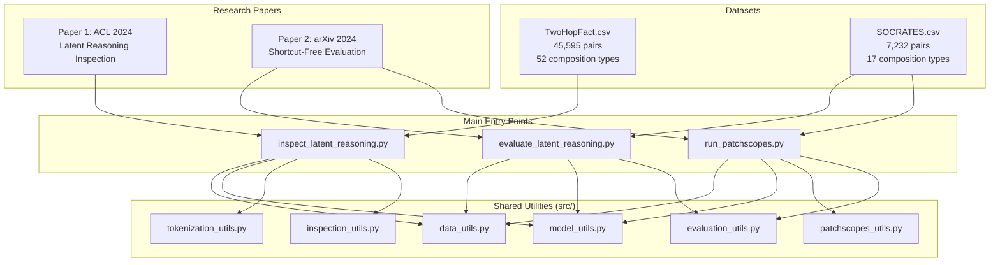
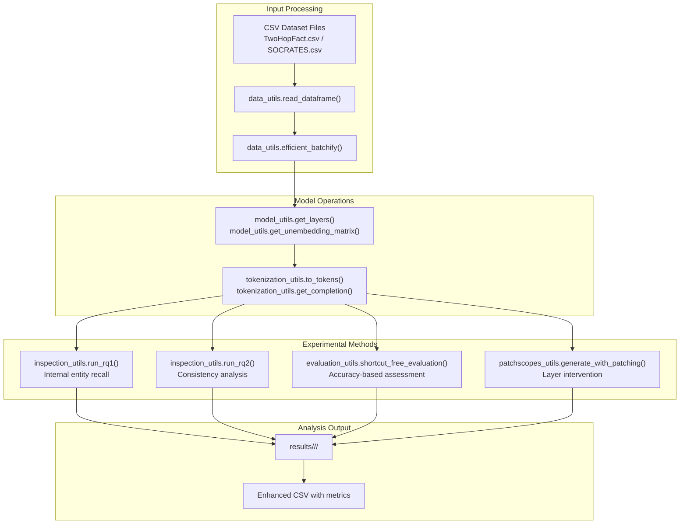
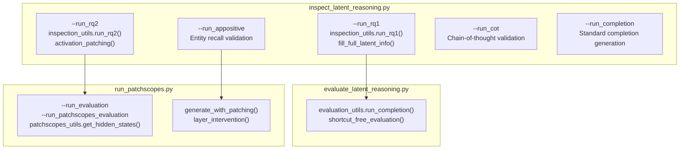
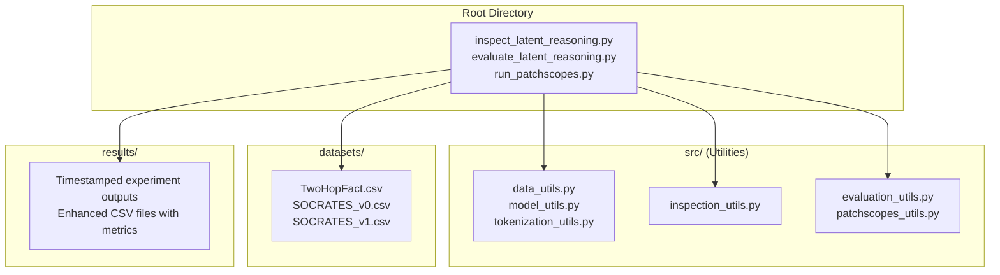

<!-- source: DeepWiki mcp.deepwiki.com · repo google-deepmind/latent-multi-hop-reasoning · page 1 Overview · fetched 2026-10-26 -->

# Overview

Relevant source files

The following files were used as context for generating this wiki page:

- [README.md](README.md)

This document provides a technical overview of the latent multi-hop reasoning research codebase, which investigates whether Large Language Models (LLMs) perform multi-hop reasoning internally. The codebase implements experimental methodologies from two research papers that probe LLM reasoning mechanisms through different approaches: latent reasoning inspection and shortcut-free evaluation.

For detailed setup instructions, see [Getting Started](#2). For specific experimental implementations, see [Main Entry Points](#3). For dataset specifications, see [Datasets](#5).

## Research Papers and Scope

This codebase implements two complementary research investigations:

| Paper | Venue | Primary Focus | Main Dataset |
|-------|--------|---------------|--------------|
| Do Large Language Models Latently Perform Multi-Hop Reasoning? | ACL 2024 | Internal reasoning pathway inspection | TwoHopFact |
| Do Large Language Models Perform Latent Multi-Hop Reasoning without Exploiting Shortcuts? | arXiv 2024 | Shortcut-free evaluation and layer analysis | SOCRATES |

### Research Questions Addressed

The codebase systematically investigates three core research questions through different experimental methodologies:

- **RQ1**: How often do LLMs perform the first hop of reasoning in two-hop prompts?
- **RQ2**: How often do LLMs perform the second hop, and what is the consistency between single-hop and multi-hop reasoning?
- **Shortcut Analysis**: Do LLMs exploit superficial patterns instead of performing genuine multi-hop reasoning?

## System Architecture

### High-Level Component Organization

Sources: [README.md:3-6](), [README.md:83-93]()

### Experimental Pipeline Mapping

Sources: [README.md:88-92](), [README.md:46-55](), [README.md:61-81]()

## Entry Points and Experimental Approaches

The codebase provides three main entry points, each implementing specific experimental methodologies:

### Entry Point Summary

| Script | Purpose | Primary Functions | Batch Size Parameters |
|--------|---------|-------------------|----------------------|
| `inspect_latent_reasoning.py` | Paper 1 experiments | RQ1, RQ2, validation studies | `--rq1_batch_size`, `--rq2_batch_size`, `--completion_batch_size` |
| `evaluate_latent_reasoning.py` | Paper 2 shortcut-free evaluation | Completion generation, accuracy metrics | `--batch_size`, `--tensor_parallel_size` |
| `run_patchscopes.py` | Paper 2 patchscopes analysis | Layer intervention, hidden state patching | `--batch_size`, `--source_layer_idxs`, `--target_layer_idxs` |

### Experimental Method Implementation

Sources: [README.md:46-55](), [README.md:61-68](), [README.md:72-81]()

## Key Dataset Specifications

The research utilizes two purpose-built datasets for different experimental approaches:

### Dataset Comparison

| Dataset | Size | Composition Types | Primary Use | File Location |
|---------|------|-------------------|-------------|---------------|
| TwoHopFact | 45,595 pairs | 52 types | Latent reasoning inspection | `datasets/TwoHopFact.csv` |
| SOCRATES v0 | 7,232 pairs | 17 types | Paper 2 experiments (with grammatical errors) | `datasets/SOCRATES_v0.csv` |
| SOCRATES v1 | 7,232 pairs | 17 types | Cleaned dataset (no grammatical errors) | `datasets/SOCRATES_v1.csv` |

Both datasets are also available via HuggingFace: `soheeyang/TwoHopFact` and `soheeyang/SOCRATES`.

Sources: [README.md:25-38]()

## Code Organization Structure

The codebase follows a modular architecture with shared utilities and experiment-specific implementations:

### Directory Structure

### Utility Module Responsibilities

| Module | Primary Functions | Used By |
|--------|-------------------|---------|
| `data_utils.py` | `read_dataframe()`, `efficient_batchify()`, `batchify()` | All entry points |
| `model_utils.py` | `get_unembedding_matrix()`, `get_layers()`, `is_instruction_tuned()` | All entry points |
| `tokenization_utils.py` | `to_tokens()`, `find_substrings()`, `get_completion()` | All entry points |
| `inspection_utils.py` | `run_rq1()`, `run_rq2()`, `activation_patching()` | `inspect_latent_reasoning.py` |
| `evaluation_utils.py` | `run_completion()`, `shortcut_free_evaluation()` | `evaluate_latent_reasoning.py`, `run_patchscopes.py` |
| `patchscopes_utils.py` | `get_hidden_states()`, `generate_with_patching()` | `run_patchscopes.py` |

Sources: [README.md:83-93]()

The codebase requires HuggingFace authentication via the `HF_TOKEN` environment variable for accessing certain models, and outputs all experimental results to the `results/` directory with timestamp-based organization.

Sources: [README.md:17-18](), [README.md:93]()

---

