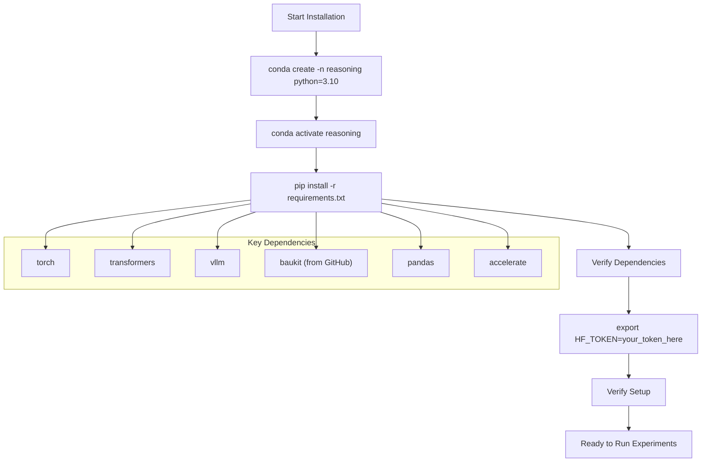
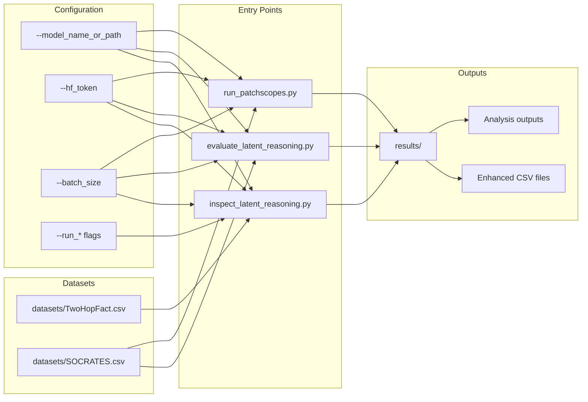
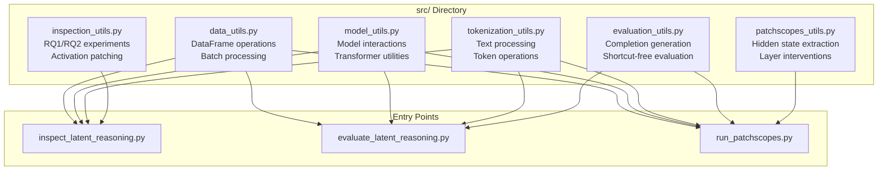

<!-- source: DeepWiki mcp.deepwiki.com · repo google-deepmind/latent-multi-hop-reasoning · page 2 Getting Started · fetched 2026-10-26 -->

# Getting Started

<details>
<summary>Relevant source files</summary>

The following files were used as context for generating this wiki page:

- [README.md](README.md)
- [requirements.txt](requirements.txt)

</details>


This document provides installation instructions, setup requirements, and basic usage patterns for the latent multi-hop reasoning research codebase. It covers the essential steps needed to run experiments from both research papers implemented in this repository.

For detailed information about the specific experimental approaches and their implementations, see [Main Entry Points](#3). For information about the datasets used in the experiments, see [Datasets](#5).

## Prerequisites

The codebase requires Python 3.10 and access to HuggingFace models through an authentication token. The system is designed to work with GPU acceleration for large language model inference and supports distributed processing through vLLM.

### System Requirements

| Component | Requirement |
|-----------|-------------|
| Python Version | 3.10 |
| Package Manager | conda (recommended) |
| GPU Support | CUDA-compatible GPU (recommended) |
| Memory | Sufficient RAM for model loading (varies by model size) |
| HuggingFace Account | Required for model access |

Sources: [README.md:10-18]()

## Installation Process

The installation follows a standard conda-based workflow with pip dependencies. The process involves environment creation, dependency installation, and authentication setup.

### Installation Flow



### Step-by-Step Installation

1. **Create conda environment:**
   ```bash
   conda create -n reasoning python=3.10
   conda activate reasoning
   ```

2. **Install dependencies:**
   ```bash
   pip install -r requirements.txt
   ```

3. **Set HuggingFace token:**
   ```bash
   export HF_TOKEN="your_token_here"
   ```

Sources: [README.md:8-19](), [requirements.txt:1-11]()

## Authentication Setup

The codebase requires a HuggingFace token for accessing certain models. This token must be set as an environment variable before running any experiments.

### HuggingFace Token Configuration

The `HF_TOKEN` environment variable is used throughout the codebase for model authentication. All three main entry points (`inspect_latent_reasoning.py`, `evaluate_latent_reasoning.py`, `run_patchscopes.py`) accept an `--hf_token` parameter that defaults to this environment variable.

```bash
# Option 1: Export as environment variable (recommended)
export HF_TOKEN="your_huggingface_token"

# Option 2: Pass directly to scripts
python inspect_latent_reasoning.py --hf_token "your_token" [other_args]
```

Sources: [README.md:17-18](), [README.md:53](), [README.md:67](), [README.md:79]()

## Basic Usage Workflow

The codebase provides three main entry points corresponding to different experimental approaches. Each operates on specific datasets and produces results in the `results/` directory.

### Experiment Execution Flow



### Basic Usage Examples

**Paper 1 Experiments (Latent Reasoning Inspection):**
```bash
python inspect_latent_reasoning.py \
    --model_name_or_path $MODEL_NAME_OR_PATH \
    --input_csv_path datasets/TwoHopFact.csv \
    --hf_token $HF_TOKEN \
    --run_rq1 --run_rq2 --run_completion
```

**Paper 2 Experiments (Shortcut-Free Evaluation):**
```bash
python evaluate_latent_reasoning.py \
    --model_name_or_path $MODEL_NAME_OR_PATH \
    --input_csv_path datasets/SOCRATES.csv \
    --hf_token $HF_TOKEN
```

**Paper 2 Experiments (Patchscopes Analysis):**
```bash
python run_patchscopes.py \
    --model_name_or_path $MODEL_NAME_OR_PATH \
    --input_csv_path datasets/SOCRATES.csv \
    --hf_token $HF_TOKEN \
    --run_evaluation --run_patchscopes_evaluation
```

Sources: [README.md:46-55](), [README.md:61-68](), [README.md:72-81]()

## Directory Structure

The codebase follows a modular structure with clear separation between datasets, source code, and experimental outputs.

### Project Organization

| Directory | Purpose | Key Files |
|-----------|---------|-----------|
| `datasets/` | Research datasets | `TwoHopFact.csv`, `SOCRATES.csv` |
| `src/` | Utility modules | `*_utils.py` files |
| `results/` | Experiment outputs | Timestamped result files |
| Root | Entry point scripts | `inspect_latent_reasoning.py`, etc. |

### Source Code Organization



Sources: [README.md:83-94]()

## Common Configuration Patterns

The entry points share common configuration patterns for model specification, batch processing, and output management.

### Batch Size Configuration

Different experiments require different batch sizes based on memory requirements and computational complexity:

| Experiment Type | Typical Batch Size | Parameter |
|-----------------|-------------------|-----------|
| RQ1 Analysis | 256 | `--rq1_batch_size` |
| RQ2 Analysis | 8 | `--rq2_batch_size` |
| Completion Generation | 64 | `--completion_batch_size` |
| Standard Evaluation | 256 | `--batch_size` |
| Patchscopes Analysis | 64 | `--batch_size` |

### Output Management

All experiments generate timestamped outputs in the `results/` directory. The output directory can be customized using the `--output_dir` parameter available in all entry points.

Sources: [README.md:50-52](), [README.md:66](), [README.md:76](), [README.md:93]()

## Next Steps

After completing the installation and setup:

1. **Choose your experiment approach** - See [Main Entry Points](#3) for detailed information about each experimental script
2. **Prepare your datasets** - See [Datasets](#5) for information about TwoHopFact and SOCRATES datasets  
3. **Review utility modules** - See [Utility Modules](#4) for understanding the shared functionality
4. **Run your first experiment** using one of the basic usage examples above

The codebase is designed to be modular and extensible, with clear separation between different experimental approaches while sharing common utility functions for data processing, model interactions, and evaluation.

Sources: [README.md:1-143]()

---

