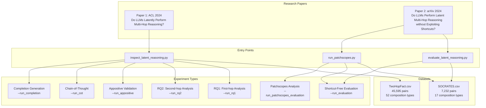
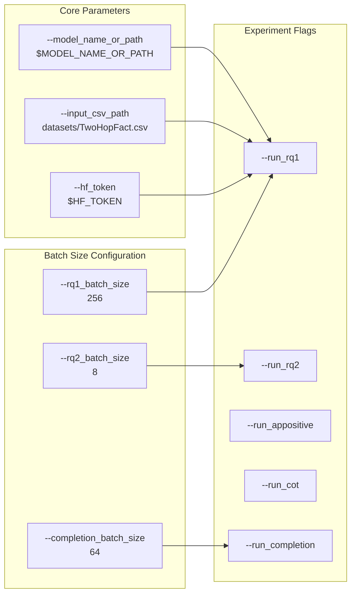
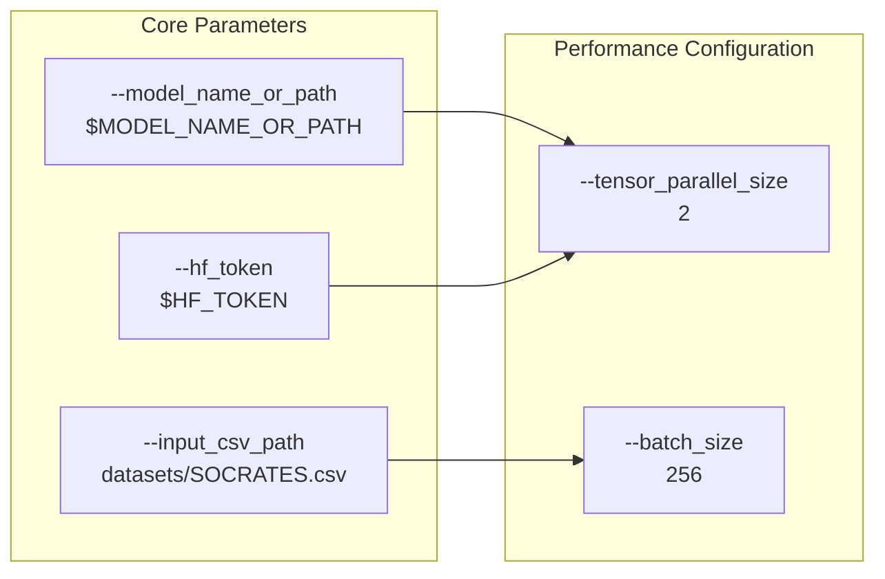
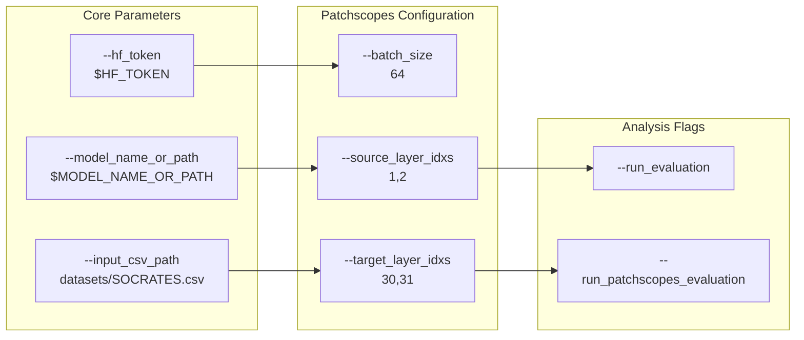
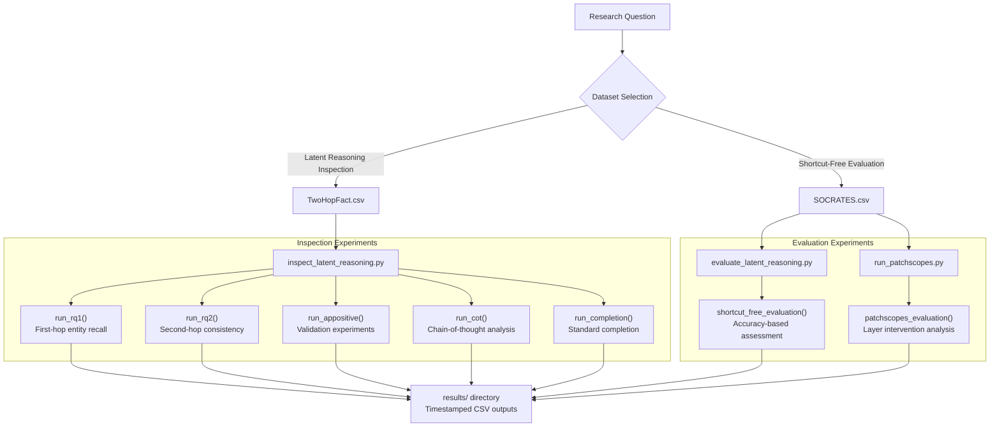

<!-- source: DeepWiki mcp.deepwiki.com · repo google-deepmind/latent-multi-hop-reasoning · page 3 Main Entry Points · fetched 2026-10-26 -->

# Main Entry Points

Relevant source files

The following files were used as context for generating this wiki page:

- [README.md](README.md)

This document provides an overview of the three primary scripts that serve as entry points for different experimental approaches in the latent multi-hop reasoning research codebase. These scripts implement the experiments described in two research papers and provide the main interfaces for running evaluations and analyses.

For detailed documentation of each entry point's functionality and implementation, see [Inspect Latent Reasoning](#3.1), [Evaluate Latent Reasoning](#3.2), and [Run Patchscopes](#3.3). For information about the shared utility modules used by these entry points, see [Utility Modules](#4).

## Overview

The codebase provides three main entry points that correspond to different research questions and experimental methodologies:

| Entry Point | Purpose | Associated Paper | Primary Dataset |
|-------------|---------|------------------|-----------------|
| `inspect_latent_reasoning.py` | Latent reasoning pathway inspection | Paper 1 (ACL 2024) | TwoHopFact |
| `evaluate_latent_reasoning.py` | Shortcut-free evaluation | Paper 2 (arXiv 2024) | SOCRATES |
| `run_patchscopes.py` | Patchscopes analysis | Paper 2 (arXiv 2024) | SOCRATES |

Each entry point implements specific experimental approaches and provides command-line interfaces for running different types of analyses on large language models' multi-hop reasoning capabilities.

## Entry Point Architecture

*Sources: [README.md:1-143]()*

## Command-Line Interfaces

Each entry point provides a comprehensive command-line interface with specific parameters for different experimental configurations:

### inspect_latent_reasoning.py Parameters

### evaluate_latent_reasoning.py Parameters

### run_patchscopes.py Parameters

*Sources: [README.md:42-81]()*

## Experimental Pipeline Flow

The entry points implement different experimental pipelines that address specific research questions:

*Sources: [README.md:40-81]()*

## Shared Infrastructure

All entry points utilize common infrastructure components from the `src/` directory:

| Utility Module | Functions Used | Purpose |
|----------------|----------------|---------|
| `data_utils.py` | `read_dataframe()`, `efficient_batchify()` | Dataset loading and batch processing |
| `model_utils.py` | `get_unembedding_matrix()`, `get_layers()` | Model loading and manipulation |
| `tokenization_utils.py` | `to_tokens()`, `get_completion()` | Text processing and tokenization |
| `evaluation_utils.py` | `run_completion()`, `shortcut_free_evaluation()` | Evaluation logic implementation |
| `inspection_utils.py` | `run_rq1()`, `run_rq2()`, `activation_patching()` | Latent reasoning inspection |
| `patchscopes_utils.py` | `get_hidden_states()`, `generate_with_patching()` | Patchscopes analysis |

The entry points serve as orchestrators that coordinate these utility modules to implement specific experimental workflows, handling command-line argument parsing, experiment execution, and result output management.

*Sources: [README.md:83-93]()*

---

