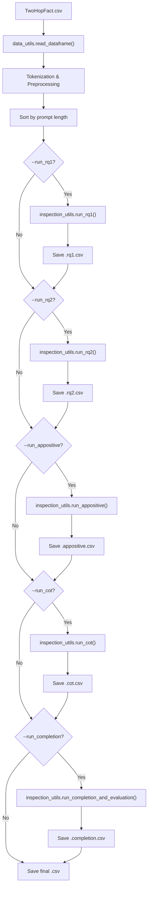
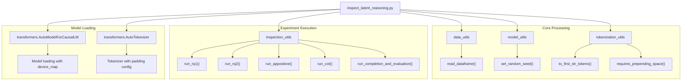
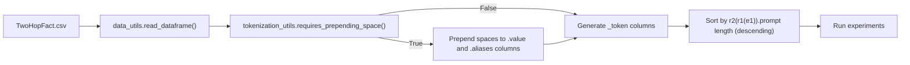

<!-- source: DeepWiki mcp.deepwiki.com · repo google-deepmind/latent-multi-hop-reasoning · page 3.1 Inspect Latent Reasoning · fetched 2026-10-26 -->

# Inspect Latent Reasoning

<details>
<summary>Relevant source files</summary>

The following files were used as context for generating this wiki page:

- [README.md](README.md)
- [inspect_latent_reasoning.py](inspect_latent_reasoning.py)

</details>


## Purpose and Scope

The `inspect_latent_reasoning.py` script serves as the main entry point for experiments described in the ACL 2024 paper "Do Large Language Models Latently Perform Multi-Hop Reasoning?". This script implements five distinct experimental approaches to analyze how language models perform multi-hop reasoning internally, focusing on probing the latent reasoning pathways within transformer models.

This page covers the inspection methodology and experimental pipeline. For shortcut-free evaluation approaches, see [Evaluate Latent Reasoning](#3.2). For patchscopes-based analysis, see [Run Patchscopes](#3.3).

## Experimental Overview

The script implements five core experiment types, each designed to probe different aspects of latent multi-hop reasoning:

| Experiment | Flag | Purpose | Primary Metric |
|------------|------|---------|----------------|
| RQ1 | `--run_rq1` | First-hop reasoning analysis | Internal entity recall |
| RQ2 | `--run_rq2` | Second-hop reasoning analysis | Consistency score |
| Appositive | `--run_appositive` | Validation of entity recall metric | Internal entity recall |
| Chain-of-Thought | `--run_cot` | Validation of consistency score | Consistency score |
| Completion | `--run_completion` | Standard evaluation | Accuracy |

**Experimental Pipeline Flow**



Sources: [inspect_latent_reasoning.py:209-319]()

## Script Architecture

The script follows a modular architecture, delegating specific functionality to utility modules while maintaining a clear experimental pipeline:

**Module Dependencies and Flow**



Sources: [inspect_latent_reasoning.py:22-25](), [inspect_latent_reasoning.py:150-164]()

## Data Processing Pipeline

The script implements a sophisticated data preprocessing pipeline that prepares the TwoHopFact dataset for analysis:

**Data Preprocessing Steps**



### Key Processing Operations

1. **Space Prepending**: For tokenizers requiring leading spaces, the script automatically prepends spaces to entity values and aliases [inspect_latent_reasoning.py:186-196]()

2. **Token Generation**: Creates `_token` columns for all `.value` columns using `tokenization_utils.to_first_str_tokens()` [inspect_latent_reasoning.py:199-204]()

3. **Length-Based Sorting**: Sorts data by prompt length in descending order to optimize batch processing [inspect_latent_reasoning.py:205-207]()

Sources: [inspect_latent_reasoning.py:183-207]()

## Experiment Types

### RQ1: First-Hop Analysis

**Purpose**: Analyzes how often language models perform the first hop of reasoning in two-hop prompts by measuring internal entity recall.

**Implementation**: `inspection_utils.run_rq1(model, tokenizer, df, batch_size, alt_batch_size, "e2.value", skip_positive)`

**Key Parameters**:
- `entity_col`: `"e2.value"` (intermediate entity)
- `skip_positive`: Set to `True` when RQ2 is also run to avoid redundant computation

### RQ2: Second-Hop Analysis  

**Purpose**: Measures second-hop reasoning consistency by comparing single-hop versus multi-hop reasoning distributions.

**Implementation**: `inspection_utils.run_rq2(df, model, tokenizer, batch_size, alt_batch_size, gather_device, fact_type="r2(r1(e1))", entity_col="e2.value", answer_col="e3.value")`

**Key Parameters**:
- `fact_type`: `"r2(r1(e1))"` (two-hop reasoning pattern)
- `entity_col`: `"e2.value"` (intermediate entity)
- `answer_col`: `"e3.value"` (final answer entity)

### Appositive Validation

**Purpose**: Validates the internal entity recall metric using appositive constructions as ground truth.

**Implementation**: `inspection_utils.run_appositive(df, model, tokenizer, batch_size, alt_batch_size, gather_device)`

### Chain-of-Thought Validation

**Purpose**: Validates consistency score calculations by comparing with explicit chain-of-thought reasoning.

**Implementation**: `inspection_utils.run_cot(df, model, tokenizer, batch_size)`

### Completion Generation

**Purpose**: Performs standard completion generation and evaluation for baseline comparison.

**Implementation**: `inspection_utils.run_completion_and_evaluation(df, model, tokenizer, batch_size)`

Sources: [inspect_latent_reasoning.py:209-319]()

## Configuration and Usage

### Command Line Arguments

The script accepts comprehensive configuration through command-line arguments:

| Argument | Type | Default | Purpose |
|----------|------|---------|---------|
| `--model_name_or_path` | str | "mistralai/Mistral-7B-v0.3" | HuggingFace model identifier |
| `--input_csv_path` | str | "datasets/TwoHopFact.csv" | Input dataset path |
| `--rq1_batch_size` | int | 512 | Batch size for RQ1 experiments |
| `--rq2_batch_size` | int | 32 | Batch size for RQ2 experiments |
| `--completion_batch_size` | int | 128 | Batch size for completion generation |
| `--gather_device` | str | "cuda:0" | Device for result gathering |
| `--half_precision` | flag | False | Use FP16 precision |
| `--output_dir` | str | "results/inspect_latent_reasoning" | Output directory |

### Experiment Selection Flags

| Flag | Purpose |
|------|---------|
| `--run_rq1` | Enable first-hop analysis |
| `--run_rq2` | Enable second-hop analysis |
| `--run_appositive` | Enable appositive validation |
| `--run_cot` | Enable chain-of-thought validation |
| `--run_completion` | Enable completion generation |

**Example Usage**:
```bash
python inspect_latent_reasoning.py \
    --model_name_or_path mistralai/Mistral-7B-v0.3 \
    --input_csv_path datasets/TwoHopFact.csv \
    --rq1_batch_size 256 \
    --rq2_batch_size 8 \
    --completion_batch_size 64 \
    --hf_token $HF_TOKEN \
    --run_rq1 --run_rq2 --run_appositive --run_cot --run_completion
```

Sources: [inspect_latent_reasoning.py:34-133](), [README.md:47-55]()

## Output Structure

The script generates timestamped output directories with structured file naming:

### Directory Structure
```
results/inspect_latent_reasoning/
└── YYMMDD_HHMMSS/
    ├── args.yaml
    ├── TwoHopFact.model-name.rq1.csv
    ├── TwoHopFact.model-name.rq2.csv
    ├── TwoHopFact.model-name.appositive.csv
    ├── TwoHopFact.model-name.cot.csv
    ├── TwoHopFact.model-name.completion.csv
    └── TwoHopFact.model-name.csv (final consolidated results)
```

### File Naming Convention
- **Model Name Sanitization**: `model_name_or_path` is converted to safe filename format by replacing `/` with `--` [inspect_latent_reasoning.py:167-170]()
- **Timestamping**: Directories use `YYMMDD_HHMMSS` format [inspect_latent_reasoning.py:173-174]()
- **Experiment Suffixes**: Each experiment type receives a specific suffix (`.rq1`, `.rq2`, `.appositive`, `.cot`, `.completion`)

### Error Handling
The script implements robust error handling with incomplete file markers. If an experiment fails, results are saved with `.incomplete` suffix [inspect_latent_reasoning.py:224-229]().

Sources: [inspect_latent_reasoning.py:167-177](), [inspect_latent_reasoning.py:220-327]()

---

