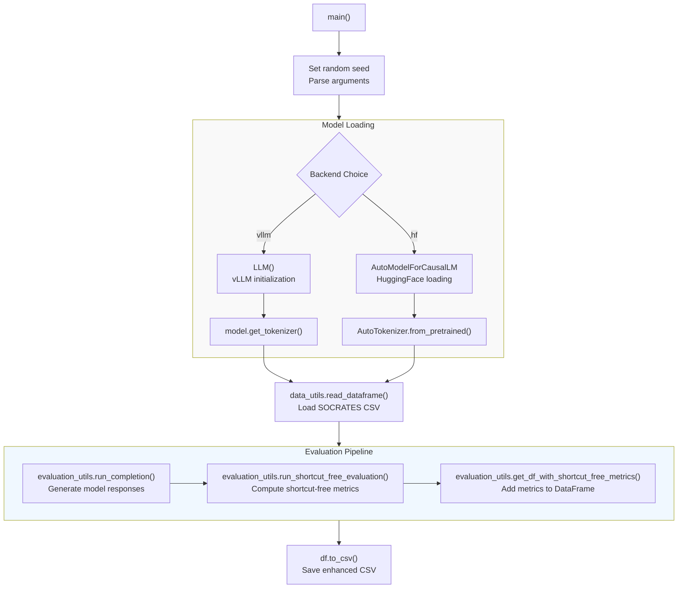
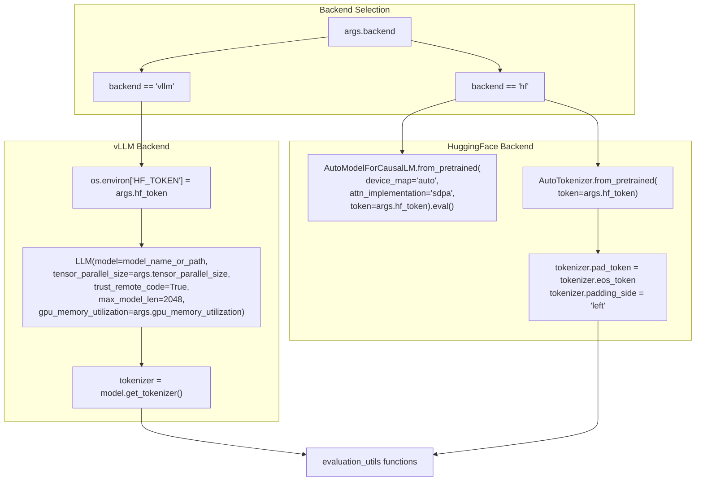
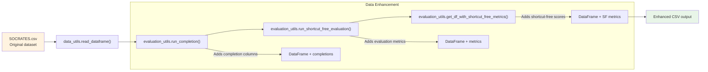
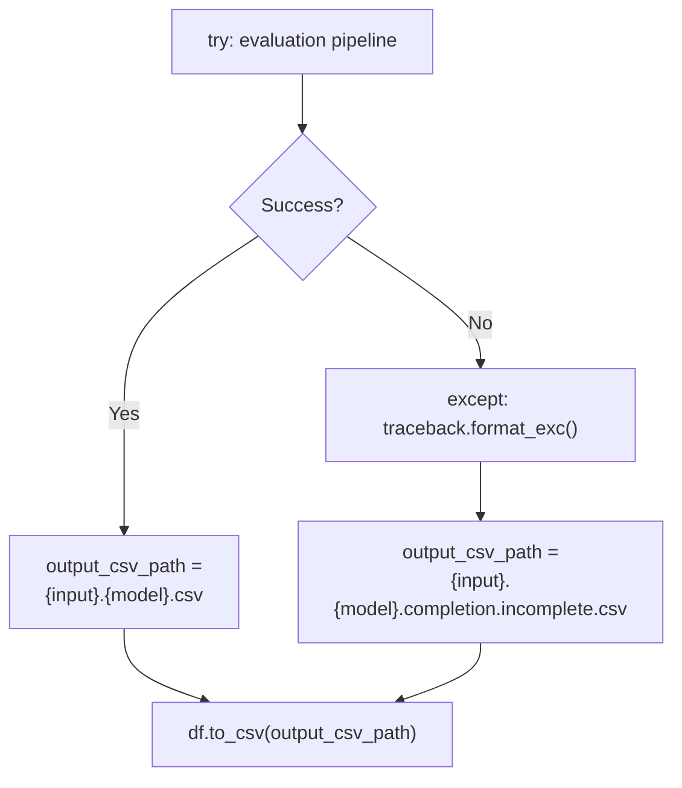

<!-- source: DeepWiki mcp.deepwiki.com · repo google-deepmind/latent-multi-hop-reasoning · page 3.2 Evaluate Latent Reasoning · fetched 2026-10-26 -->

# Evaluate Latent Reasoning

<details>
<summary>Relevant source files</summary>

The following files were used as context for generating this wiki page:

- [README.md](README.md)
- [evaluate_latent_reasoning.py](evaluate_latent_reasoning.py)

</details>


This document covers the `evaluate_latent_reasoning.py` script, which implements the shortcut-free evaluation experiments described in the paper "Do Large Language Models Perform Latent Multi-Hop Reasoning without Exploiting Shortcuts?". This script performs accuracy-based evaluation to assess whether language models genuinely perform multi-hop reasoning or exploit superficial patterns.

For information about the SOCRATES dataset used by this script, see [SOCRATES Dataset](#5.2). For details about the underlying evaluation utilities, see [Evaluation Utilities](#4.2).

## Script Overview

The `evaluate_latent_reasoning.py` script serves as the main entry point for Paper 2's shortcut-free evaluation experiments. It loads language models, processes the SOCRATES dataset, generates completions, and computes shortcut-free evaluation metrics to determine whether models perform genuine multi-hop reasoning.

**Key Components:**
- Model loading with vLLM or HuggingFace backends
- Completion generation for multi-hop reasoning prompts
- Shortcut-free evaluation metric computation
- Results output to timestamped CSV files

Sources: [evaluate_latent_reasoning.py:1-216](), [README.md:59-68]()

## Command-Line Interface

The script accepts multiple arguments to configure model selection, dataset input, inference backend, and output settings.

### Core Arguments

| Argument | Default | Description |
|----------|---------|-------------|
| `--model_name_or_path` | `mistralai/Mistral-7B-v0.3` | HuggingFace model identifier or path |
| `--input_csv_path` | `datasets/SOCRATES.csv` | Path to SOCRATES dataset CSV |
| `--hf_token` | `$HF_TOKEN` | HuggingFace authentication token |
| `--backend` | `vllm` | Inference backend (`vllm` or `hf`) |
| `--output_dir` | `results/evaluate_latent_reasoning` | Results output directory |

### Backend-Specific Arguments

| Argument | Backend | Default | Description |
|----------|---------|---------|-------------|
| `--tensor_parallel_size` | vLLM | `1` | Number of GPUs for parallel inference |
| `--gpu_memory_utilization` | vLLM | `0.85` | GPU memory utilization ratio |
| `--batch_size` | HuggingFace | `128` | Batch size for parallel processing |

Sources: [evaluate_latent_reasoning.py:30-122]()

## Execution Flow

### Main Execution Pipeline



Sources: [evaluate_latent_reasoning.py:125-216]()

### Model Loading Architecture



Sources: [evaluate_latent_reasoning.py:140-171]()

## Data Processing Pipeline

The script processes the SOCRATES dataset through a series of evaluation stages, each handled by specialized utility functions.

### Evaluation Stages



### Error Handling and Recovery

The script includes robust error handling for incomplete executions:



Sources: [evaluate_latent_reasoning.py:190-212]()

## Backend Configuration

The script supports two inference backends, each optimized for different use cases.

### vLLM Backend Configuration

**Optimized for:** High-throughput inference, multi-GPU deployments
**Key Parameters:**
- `tensor_parallel_size`: GPU parallelization
- `gpu_memory_utilization`: Memory management (default: 0.85)
- `max_model_len`: Sequence length limit (2048 tokens)
- `trust_remote_code`: Enable custom model code

### HuggingFace Backend Configuration

**Optimized for:** Flexibility, debugging, smaller-scale experiments
**Key Parameters:**
- `device_map`: Automatic device placement
- `attn_implementation`: Optimized attention ("sdpa")
- `batch_size`: Parallel processing batch size
- Tokenizer configuration with left padding

Sources: [evaluate_latent_reasoning.py:72-89](), [evaluate_latent_reasoning.py:140-171]()

## Output Structure

The script generates enhanced CSV files containing the original SOCRATES data plus computed metrics and model completions.

### Output File Naming

```
{experiment_dir}/{input_csv_name}.{safe_model_name}.csv
```

Where:
- `experiment_dir`: `results/evaluate_latent_reasoning` (default)
- `input_csv_name`: Base name of input CSV (e.g., "SOCRATES")
- `safe_model_name`: Model name with `/` replaced by `--`

### Enhanced DataFrame Columns

The output CSV includes original SOCRATES columns plus:
- Model completion columns (added by `run_completion`)
- Shortcut-free evaluation metrics (added by `run_shortcut_free_evaluation`)
- Aggregated shortcut-free scores (added by `get_df_with_shortcut_free_metrics`)

### Incomplete Execution Handling

If evaluation fails, the output filename includes `.completion.incomplete` to indicate partial results, allowing for recovery and reprocessing.

Sources: [evaluate_latent_reasoning.py:179-212]()

---

