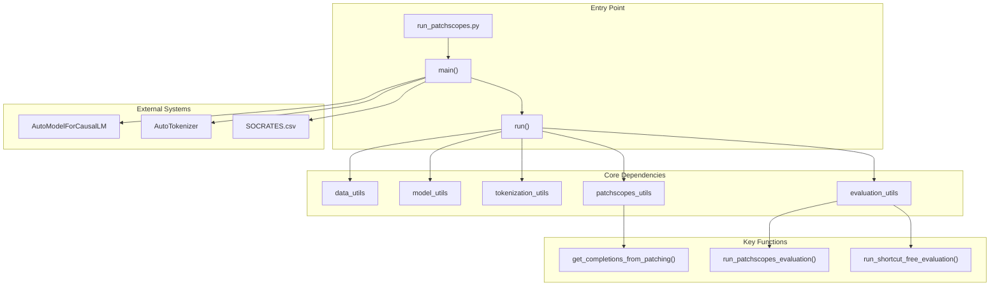
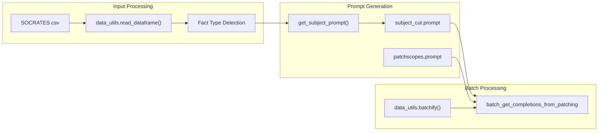
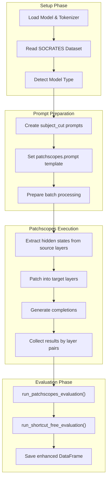

<!-- source: DeepWiki mcp.deepwiki.com · repo google-deepmind/latent-multi-hop-reasoning · page 3.3 Run Patchscopes · fetched 2026-10-26 -->

# Run Patchscopes

<details>
<summary>Relevant source files</summary>

The following files were used as context for generating this wiki page:

- [README.md](README.md)
- [run_patchscopes.py](run_patchscopes.py)

</details>


## Purpose and Scope

The `run_patchscopes.py` script implements Patchscopes analysis for investigating latent entity representations in multi-hop reasoning tasks. This system is part of the second research paper "Do Large Language Models Perform Latent Multi-Hop Reasoning without Exploiting Shortcuts?" and specifically focuses on layer-wise intervention studies to understand how different transformer layers contribute to multi-hop reasoning processes.

This document covers the Patchscopes analysis pipeline, its configuration, and evaluation mechanisms. For general evaluation without Patchscopes interventions, see [Evaluate Latent Reasoning](#3.2). For inspection-based approaches used in the first paper, see [Inspect Latent Reasoning](#3.1).

Sources: [README.md:70-81](), [run_patchscopes.py:15-38]()

## System Architecture

The Patchscopes system implements layer-wise hidden state interventions to probe multi-hop reasoning capabilities. The architecture centers around extracting hidden states from source layers and patching them into target layers during generation.



Sources: [run_patchscopes.py:19-23](), [run_patchscopes.py:131-220]()

## Key Components

### Model Loading and Configuration

The system loads transformer models using HuggingFace's `AutoModelForCausalLM` and `AutoTokenizer`. Model configuration includes device mapping, attention implementation, and tokenizer padding setup.

| Component | Function | Configuration |
|-----------|----------|---------------|
| `AutoModelForCausalLM` | Loads transformer model | `device_map="auto"`, `attn_implementation="sdpa"` |
| `AutoTokenizer` | Handles tokenization | `padding_side="left"`, `pad_token=eos_token` |
| Model Detection | Determines instruction tuning | Uses `model_utils.is_instruction_tuned()` |

The system automatically detects whether the model is instruction-tuned to select appropriate fact types: `"r2(r1(e1)).blank"` for instruction-tuned models and `"r2(r1(e1))"` for pretrained models.

Sources: [run_patchscopes.py:148-162](), [run_patchscopes.py:179-184]()

### Prompt Processing Pipeline



The system creates three types of prompts:
- **Original prompts**: Full multi-hop queries from dataset
- **Subject-cut prompts**: Truncated prompts ending at intermediate entity using `tokenization_utils.get_subject_prompt()`
- **Target prompts**: Fixed Patchscopes template with example entities

Sources: [run_patchscopes.py:186-193](), [run_patchscopes.py:262-267](), [run_patchscopes.py:269-286]()

## Configuration and Usage

### Command Line Arguments

The script accepts multiple configuration parameters for controlling the Patchscopes analysis:

| Argument | Default | Purpose |
|----------|---------|---------|
| `--model_name_or_path` | `"mistralai/Mistral-7B-v0.3"` | Model identifier or path |
| `--input_csv_path` | `"datasets/SOCRATES.csv"` | Input dataset path |
| `--batch_size` | `128` | Processing batch size |
| `--source_layer_idxs` | `""` | Comma-separated source layer indices |
| `--target_layer_idxs` | `""` | Comma-separated target layer indices |
| `--num_return_sequences` | `3` | Number of generations per patch |
| `--greedy` | `False` | Use greedy vs. sampling decoding |

### Layer Selection Strategy

If no layer indices are specified, the system defaults to using all available layers from the model configuration. Layer indices are parsed from comma-separated strings and converted to integer lists.

```bash
python run_patchscopes.py \
    --model_name_or_path $MODEL_NAME_OR_PATH \
    --source_layer_idxs 1,2 \
    --target_layer_idxs 30,31 \
    --run_evaluation --run_patchscopes_evaluation
```

Sources: [run_patchscopes.py:30-128](), [run_patchscopes.py:194-203](), [run_patchscopes.py:257-260]()

## Implementation Workflow

### Patchscopes Analysis Pipeline



### Core Processing Function

The `run()` function orchestrates the entire Patchscopes analysis workflow. It processes the DataFrame through several stages:

1. **Layer Configuration**: Sets up source and target layer indices, defaulting to all layers if not specified
2. **Template Setup**: Creates the fixed Patchscopes prompt template with example entities
3. **Batch Processing**: Uses `data_utils.batchify()` to create batched version of `patchscopes_utils.get_completions_from_patching()`
4. **Result Collection**: Organizes results by token position, generation index, and layer pair
5. **Evaluation**: Runs optional Patchscopes-specific and shortcut-free evaluations

Sources: [run_patchscopes.py:222-323](), [run_patchscopes.py:269-298]()

## Output and Evaluation

### Result Storage Format

The system stores Patchscopes results using a structured column naming convention:

```
{fact_type}.patched.{token_position}-{k}-{source_index}-{target_index}.completion
```

Where:
- `fact_type`: Either `"r2(r1(e1))"` or `"r2(r1(e1)).blank"`
- `token_position`: Position in sequence where patching occurs
- `k`: Generation sequence number (0 to `num_return_sequences-1`)
- `source_index`: Source layer index for hidden state extraction
- `target_index`: Target layer index for hidden state injection

### Evaluation Modes

The system supports two evaluation approaches controlled by command-line flags:

| Flag | Function | Purpose |
|------|----------|---------|
| `--run_patchscopes_evaluation` | `evaluation_utils.run_patchscopes_evaluation()` | Evaluates Patchscopes-generated completions |
| `--run_evaluation` | `evaluation_utils.run_shortcut_free_evaluation()` | Performs shortcut-free evaluation on results |

Both evaluation modes enhance the DataFrame with computed metrics and correctness assessments.

### Output File Management

Results are saved to timestamped directories under `results/run_patchscopes/` with filenames combining the input dataset name and model identifier:

```
{input_csv_name}.{safe_model_name_or_path}.csv
```

The system creates safe filenames by replacing path separators and handles model revisions in the naming scheme.

Sources: [run_patchscopes.py:288-298](), [run_patchscopes.py:299-322](), [run_patchscopes.py:172-175]()

---

