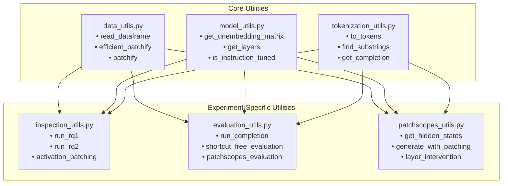
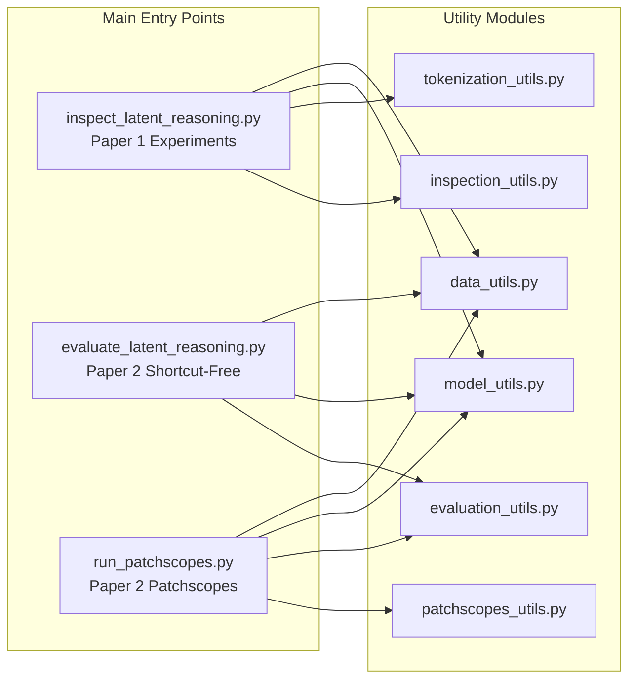
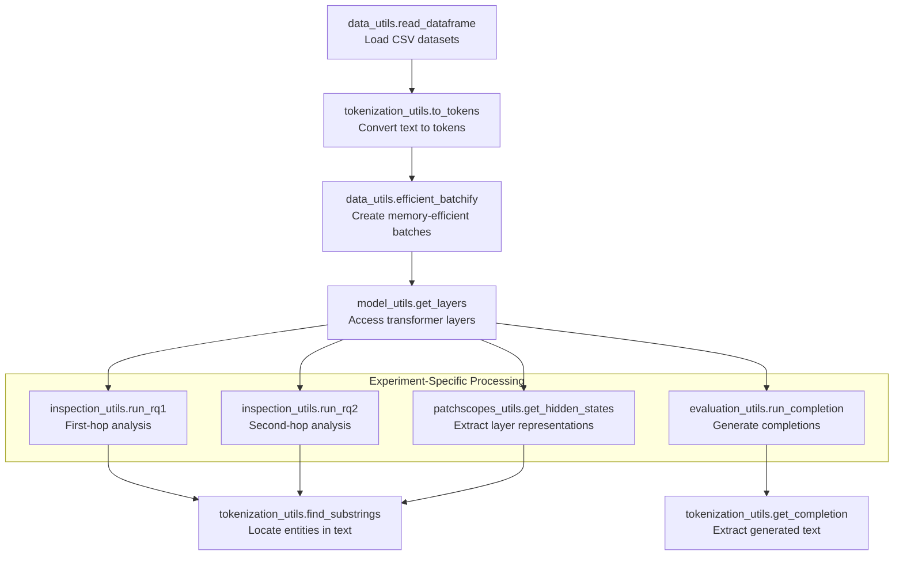

<!-- source: DeepWiki mcp.deepwiki.com · repo google-deepmind/latent-multi-hop-reasoning · page 4 Utility Modules · fetched 2026-10-26 -->

# Utility Modules

Relevant source files

The following files were used as context for generating this wiki page:

- [README.md](README.md)

The utility modules in the `src/` directory provide shared functionality that supports all experimental approaches in the latent multi-hop reasoning codebase. These modules handle common operations such as data processing, model interactions, tokenization, and specialized evaluation logic, allowing the main entry points to focus on their specific experimental objectives.

For detailed documentation of individual utility modules, see sections [4.1](#4.1) through [4.6](#4.6). For information about the main entry points that use these utilities, see [Main Entry Points](#3).

## Architecture Overview

The utility modules form a layered architecture where core utilities provide fundamental operations, while experiment-specific utilities implement specialized analysis functions:

*Sources: [README.md:88-92]()*

## Utility Module Usage by Main Entry Points

Each main entry point utilizes different combinations of utility modules based on its experimental requirements:

*Sources: [README.md:88-92]()*

## Module Classification and Dependencies

The utility modules can be categorized by their scope and dependencies:

| Module | Category | Purpose | Used By |
|--------|----------|---------|---------|
| `data_utils.py` | Core | DataFrame operations, batch processing | All entry points |
| `model_utils.py` | Core | Model loading, layer access, random seed control | All entry points |
| `tokenization_utils.py` | Core | Text-to-token conversion, substring finding | All entry points |
| `inspection_utils.py` | Paper 1 Specific | RQ1/RQ2 experiments, activation patching | `inspect_latent_reasoning.py` |
| `evaluation_utils.py` | Paper 2 Specific | Completion generation, shortcut-free evaluation | `evaluate_latent_reasoning.py`, `run_patchscopes.py` |
| `patchscopes_utils.py` | Paper 2 Specific | Hidden state extraction, layer interventions | `run_patchscopes.py` |

*Sources: [README.md:88-92]()*

## Functional Flow Between Utilities

The utilities work together in a typical experimental pipeline following this data flow:

*Sources: [README.md:88-92]()*

## Cross-Module Integration Patterns

The utility modules implement several integration patterns that enable seamless collaboration:

### Shared Configuration Pattern
Core utilities like `model_utils.set_random_seed()` and `model_utils.is_instruction_tuned()` provide configuration services used by all experiment-specific modules.

### Data Pipeline Pattern  
`data_utils` functions create standardized data structures that flow through `tokenization_utils` processing and into experiment-specific utilities.

### Model Abstraction Pattern
`model_utils.get_unembedding_matrix()` and `model_utils.get_layers()` provide consistent interfaces to transformer internals, enabling experiment utilities to work across different model architectures.

### Batch Processing Pattern
`data_utils.efficient_batchify()` creates memory-optimized batches that all experiment utilities can process uniformly, regardless of their specific analysis requirements.

*Sources: [README.md:88-92]()*

---

