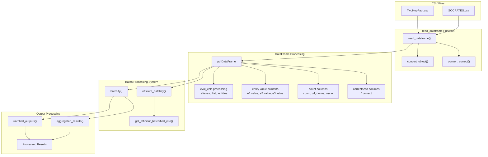
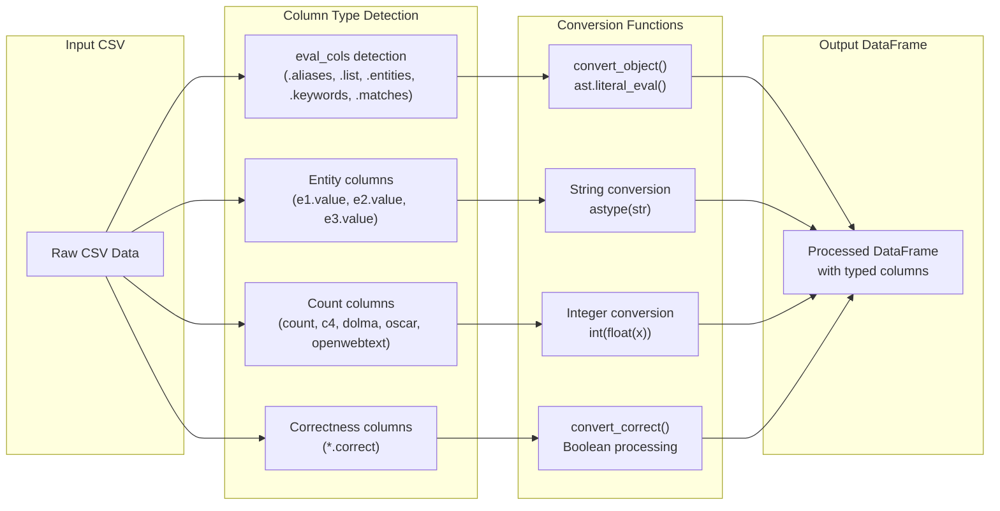
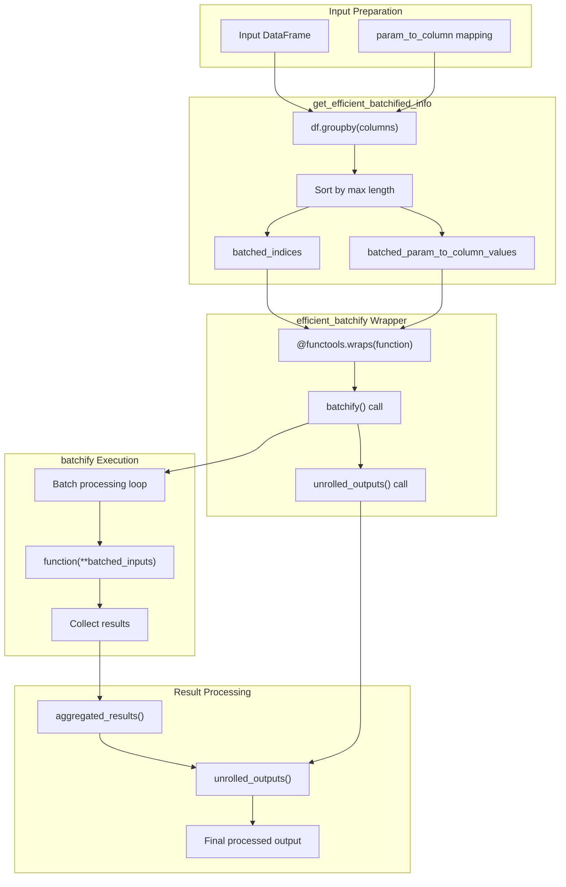
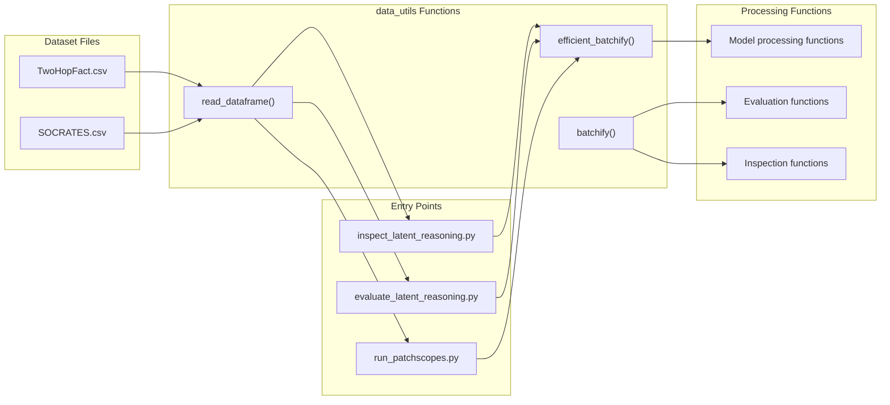

<!-- source: DeepWiki mcp.deepwiki.com · repo google-deepmind/latent-multi-hop-reasoning · page 4.1 Data Utilities · fetched 2026-10-26 -->

# Data Utilities

Relevant source files

The following files were used as context for generating this wiki page:

- [src/data_utils.py](src/data_utils.py)

## Purpose and Scope

The Data Utilities module provides core functionality for reading, processing, and efficiently batching datasets used in the latent multi-hop reasoning experiments. This module handles CSV file reading with specialized column processing, data type conversions, and memory-efficient batch processing operations that are shared across all experimental entry points.

For model-specific operations and transformations, see [Model Utilities](#4.4). For tokenization and text processing utilities, see [Tokenization Utilities](#4.6).

## Core Functions Overview

The `data_utils.py` module contains seven primary functions that form the foundation of data processing operations:

| Function | Purpose | Usage Context |
|----------|---------|---------------|
| `read_dataframe` | Read CSV with specialized column processing | Dataset loading in all experiments |
| `convert_object` | Convert string representations to Python objects | Column processing during CSV reading |
| `convert_correct` | Convert string representations to boolean values | Processing correctness metrics |
| `efficient_batchify` | Create memory-efficient batched functions | Large-scale data processing |
| `batchify` | General function batchification | Standard batch processing |
| `get_efficient_batchified_info` | Group data for efficient batching | Internal batching optimization |
| `unrolled_outputs` / `aggregated_results` | Handle batch result aggregation | Post-processing batch outputs |

**Data Flow Architecture**

Sources: [src/data_utils.py:55-109](), [src/data_utils.py:151-194](), [src/data_utils.py:230-301]()

## CSV Reading and Data Conversion

### read_dataframe Function

The `read_dataframe` function serves as the primary entry point for loading research datasets. It performs specialized processing for different column types found in the TwoHopFact and SOCRATES datasets.

**Column Processing Strategy**

The function uses pattern matching to identify column types:
- **eval_cols**: Columns ending with `.aliases`, `.list`, `.entities`, `.keywords`, `.matches` are processed with `convert_object`
- **Entity columns**: Columns like `e1.value`, `e2.value`, `e3.value` are converted to strings
- **Count columns**: Columns containing `count`, `c4`, `dolma`, `oscar`, `openwebtext` are converted to integers
- **Correctness columns**: Columns containing `correct` are processed with `convert_correct`

Sources: [src/data_utils.py:55-109](), [src/data_utils.py:31-39](), [src/data_utils.py:42-52]()

### Data Type Conversion Functions

The module provides two specialized conversion functions:

**convert_object Function**
- Handles string representations of Python objects (lists, dictionaries)
- Uses `ast.literal_eval` for safe evaluation
- Returns `np.nan` for null or empty values

**convert_correct Function**
- Converts string representations to boolean values
- Handles special cases for experimental correctness metrics
- Maintains type safety with explicit validation

Sources: [src/data_utils.py:31-39](), [src/data_utils.py:42-52]()

## Batch Processing System

The module implements a sophisticated batch processing system designed for memory-efficient processing of large datasets typical in language model experiments.

### Efficient Batching Architecture

Sources: [src/data_utils.py:112-148](), [src/data_utils.py:151-194](), [src/data_utils.py:230-301]()

### Batching Function Parameters

The batching functions accept several configuration parameters for optimization:

| Parameter | Purpose | Default | Usage |
|-----------|---------|---------|-------|
| `batch_size` | Number of items per batch | 4 | Memory management |
| `max_size` | Maximum total items to process | None | Debugging/testing |
| `tqdm_desc` | Progress bar description | '' | User feedback |
| `flush_step` | GPU memory flush interval | None | Memory optimization |
| `concat_dim` | Tensor concatenation dimension | None | Result aggregation |

### Result Aggregation Strategies

The module handles different result types through specialized aggregation:

**Tensor Results**: Uses `torch.cat()` with specified concatenation dimension
**List/Tuple Results**: Flattened using `itertools.chain.from_iterable()`
**Dictionary Results**: Recursively aggregated with `collections.defaultdict`

Sources: [src/data_utils.py:304-339](), [src/data_utils.py:197-227]()

## Integration with Entry Points

The data utilities are used across all experimental entry points:

The efficient batching system is particularly important for the large-scale processing required in:
- **RQ1/RQ2 experiments**: Processing thousands of entity recall operations
- **Shortcut-free evaluation**: Batch processing of model completions
- **Patchscopes analysis**: Memory-efficient hidden state extraction

Sources: [src/data_utils.py:1-340]()

---

